# Soal & pembahasan (tryout milikku)

Total 660 soal.

## TRY OUT SKD CASN 2027 - PART 27

### TWK

#### 12584 · no 1

Pancasila berkedudukan sebagai cita-cita dan tujuan bangsa Indonesia. Makna kedudukan tersebut tercermin dalam pernyataan berikut, kecuali …

- **A.** Menjadi arah ideal yang ingin diwujudkan dalam kehidupan berbangsa dan bernegara.
- **B.** Menjadi ukuran kemajuan bangsa yang mengutamakan pertumbuhan ekonomi dibanding pemerataan.
- **C.** Menjadi gambaran masyarakat adil dan makmur yang hendak dicapai bersama.
- **D.** Menjadi tolok ukur keberhasilan pembangunan nasional di berbagai bidang.
- **E.** Menjadi pedoman jangka panjang dalam perumusan kebijakan negara.

**Kunci:** B

**Pembahasan:** Pancasila sebagai cita-cita dan tujuan bangsa merupakan landasan ideal dalam mewujudkan kehidupan masyarakat yang adil, makmur, dan sejahtera. Kedudukan ini menunjukkan bahwa pembangunan nasional harus berorientasi pada pencapaian nilai-nilai Pancasila secara menyeluruh. Opsi B tidak tepat karena mengutamakan pertumbuhan ekonomi dibanding pemerataan bertentangan dengan nilai keadilan sosial yang terkandung dalam Pancasila. Kemajuan bangsa tidak hanya diukur melalui pertumbuhan ekonomi, tetapi juga melalui pemerataan kesejahteraan dan pemenuhan hak masyarakat. Opsi A sesuai karena Pancasila menjadi arah ideal dalam kehidupan berbangsa dan bernegara. Opsi C mencerminkan cita-cita bangsa untuk mewujudkan masyarakat yang adil dan makmur. Opsi D tepat karena nilai-nilai Pancasila menjadi acuan dalam menilai keberhasilan pembangunan nasional di berbagai bidang. Opsi E juga sesuai karena Pancasila memberikan arah jangka panjang bagi perumusan kebijakan negara. Dengan demikian, pernyataan yang tidak mencerminkan kedudukan Pancasila sebagai cita-cita dan tujuan bangsa adalah opsi B.  
  
Jawaban: B.

---

#### 12584 · no 2

Dalam kehidupan bermasyarakat, pengamalan butir Pancasila sila ke-2 “mengembangkan sikap tidak semena-mena terhadap orang lain” paling tepat tercermin melalui sikap …

- **A.** Menjaga hubungan sosial agar tetap harmonis dan terhindar dari konflik terbuka.
- **B.** Menyesuaikan perilaku dengan norma lingkungan demi terciptanya ketertiban bersama.
- **C.** Menunjukkan sikap sopan dan santun dalam setiap bentuk interaksi sosial.
- **D.** Memperlakukan setiap orang secara adil dengan memperhatikan hak dan kewajiban masing-masing.
- **E.** Menghindari perbedaan pendapat agar suasana masyarakat tetap aman dan kondusif.

**Kunci:** D

**Pembahasan:** Butir pengamalan Pancasila sila ke-2 menekankan penghormatan terhadap martabat manusia dengan cara tidak bersikap sewenang-wenang serta mempertimbangkan hak dan kewajiban setiap individu. Prinsip ini menuntut keadilan dalam memperlakukan orang lain, terutama saat terdapat perbedaan kepentingan. Opsi D paling tepat karena secara langsung menegaskan perlakuan adil yang disertai pertimbangan hak dan kewajiban, sehingga mencegah tindakan sewenang-wenang dan mencerminkan kemanusiaan yang beradab. Opsi A terlihat baik karena menekankan keharmonisan, tetapi fokusnya pada suasana rukun, bukan pada perlindungan hak ketika terjadi ketimpangan. Opsi B bersifat positif karena patuh norma, namun kepatuhan norma belum tentu menjamin tidak adanya sikap sewenang-wenang. Opsi C bernilai etis karena menekankan kesopanan, tetapi etika saja belum cukup saat berhadapan dengan persoalan keadilan. Opsi E tampak menjaga ketertiban, namun menghindari perbedaan pendapat justru dapat mengabaikan hak menyampaikan aspirasi. Dengan demikian, sikap yang paling sesuai dengan butir pengamalan sila ke-2 Pancasila adalah opsi D.  
  
Jawaban: D.

---

#### 12584 · no 3

Dalam sistem ketatanegaraan Indonesia, hubungan antara Pancasila dan UUD 1945 tercermin dalam kedudukan dan fungsinya sebagai dasar penyelenggaraan negara, yaitu …

- **A.** Pancasila berfungsi sebagai landasan filosofis kehidupan berbangsa, sedangkan UUD 1945 mengatur penyelenggaraan pemerintahan.
- **B.** Pancasila menjadi sumber nilai fundamental yang melandasi pembentukan dan isi norma dalam UUD 1945.
- **C.** Pancasila berfungsi sebagai pedoman etika sosial masyarakat, sedangkan UUD 1945 menjadi acuan hukum negara.
- **D.** Pancasila menjadi dasar kesepakatan politik nasional, sementara UUD 1945 merupakan hasil kompromi sejarah bangsa.
- **E.** Pancasila berfungsi sebagai identitas ideologis bangsa yang bersifat kultural, sedangkan UUD 1945 diposisikan sebagai dokumen hukum administratif negara.

**Kunci:** B

**Pembahasan:** Hubungan antara Pancasila dan UUD 1945 dalam sistem ketatanegaraan Indonesia bersifat normatif dan hierarkis, di mana Pancasila berkedudukan sebagai dasar negara dan sumber dari segala sumber hukum sehingga seluruh peraturan perundang-undangan termasuk UUD 1945 harus bersumber dan tidak boleh bertentangan dengan nilai-nilai Pancasila, sedangkan UUD 1945 merupakan perwujudan yuridis nilai-nilai Pancasila dalam penyelenggaraan negara. Opsi B paling tepat karena secara jelas dan utuh menunjukkan bahwa Pancasila menjadi sumber nilai fundamental yang melandasi pembentukan serta isi norma dalam UUD 1945. Opsi A tampak benar karena menyebut fungsi filosofis dan pengaturan pemerintahan, namun tidak menegaskan hubungan hierarki norma. Opsi C membatasi Pancasila hanya sebagai pedoman etika sosial masyarakat padahal Pancasila juga menjadi dasar konstitusional negara. Opsi D terlalu menekankan aspek politis dan historis sehingga mengaburkan kedudukan normatif Pancasila. Opsi E mereduksi Pancasila ke ranah kultural dan menurunkan kedudukan UUD 1945 menjadi administratif sehingga tidak sesuai dengan prinsip negara hukum. Oleh karena itu, jawaban yang paling tepat adalah opsi B.  
  
Jawaban: B.

---

#### 12584 · no 4

Perhatikan pernyataan berikut!  
  
1) Pembahasan rancangan undang-undang dilakukan oleh DPR dan Presiden untuk memperoleh persetujuan bersama.  
  
2) Aspirasi kelompok dengan dukungan terbanyak dijadikan acuan utama dalam penyusunan aturan.  
  
3) Peraturan daerah harus melindungi hak warga tanpa membedakan asal dan kedudukannya.  
  
4) Isi rancangan undang-undang dinilai berdasarkan prinsip kemanusiaan dan keadilan bagi masyarakat.  
  
5) Penyesuaian peraturan dilakukan untuk mendukung program prioritas pemerintahan yang sedang berjalan.  
  
6) Setiap ketentuan hukum harus selaras dengan prinsip fundamental yang mendasari kehidupan bernegara.  
  
Berdasarkan pernyataan diatas, yang menunjukkan Pancasila sebagai sumber dari segala sumber hukum adalah...

- **A.** 1, 2, dan 5
- **B.** 1, 3, dan 6
- **C.** 2, 4, dan 5
- **D.** 3, 4, dan 6
- **E.** 2, 3, dan 4

**Kunci:** D

**Pembahasan:** Pancasila sebagai sumber dari segala sumber hukum berarti setiap peraturan yang dibuat di Indonesia harus berlandaskan nilai-nilai Pancasila dan tidak boleh bertentangan dengannya, sebagaimana diatur dalam Pasal 2 UU Nomor 12 Tahun 2011. Pernyataan (3) tepat karena aturan yang melindungi hak seluruh warga tanpa membeda-bedakan mencerminkan nilai kemanusiaan dan keadilan. Pernyataan (4) menunjukkan bahwa penyusunan undang-undang harus memperhatikan nilai kemanusiaan dan keadilan agar tidak merugikan masyarakat. Pernyataan (6) menegaskan bahwa setiap aturan hukum harus sesuai dengan nilai dasar yang menjadi pedoman kehidupan bernegara. Sementara itu, pernyataan (1) hanya menjelaskan proses pembahasan undang-undang oleh DPR dan Presiden, bukan dasar nilai dalam pembentukan hukum. Pernyataan (2) kurang tepat karena aturan tidak boleh hanya mengikuti keinginan kelompok mayoritas tanpa memperhatikan hak kelompok lain. Pernyataan (5) berkaitan dengan perubahan aturan sesuai program pemerintah, tetapi belum menunjukkan bahwa aturan tersebut harus berlandaskan nilai dasar negara. Dengan demikian, pernyataan (3), (4), dan (6) paling tepat mencerminkan kedudukan Pancasila sebagai sumber dari segala sumber hukum.  
  
Jawaban: D

---

#### 12584 · no 5

Dalam kehidupan sehari-hari, putusan Mahkamah Konstitusi dapat dirasakan langsung oleh masyarakat. Contoh implementasi kewenangan Mahkamah Konstitusi yang paling tepat adalah …

- **A.** Pemerintah segera merevisi undang-undang setelah dinyatakan bertentangan dengan UUD 1945.
- **B.** Warga tetap menaati undang-undang meskipun menilai aturan tersebut kurang adil.
- **C.** Aparat penegak hukum menyesuaikan kebijakan teknis sesuai arahan kementerian.
- **D.** Masyarakat menyampaikan kritik terhadap undang-undang melalui media sosial.
- **E.** DPR membentuk undang-undang baru berdasarkan aspirasi kelompok tertentu.

**Kunci:** A

**Pembahasan:** Mahkamah Konstitusi memiliki kewenangan menguji undang-undang terhadap UUD 1945 dan setiap putusannya bersifat final serta mengikat sehingga wajib dilaksanakan oleh seluruh lembaga negara dan berdampak langsung pada kehidupan masyarakat. Implementasi kewenangan tersebut paling tepat ditunjukkan pada opsi A, yaitu ketika pemerintah menindaklanjuti putusan Mahkamah Konstitusi dengan merevisi undang-undang yang dinyatakan bertentangan dengan UUD 1945 agar tidak lagi melanggar hak konstitusional warga negara. Opsi B hanya mencerminkan sikap patuh warga terhadap hukum tanpa menunjukkan pelaksanaan putusan Mahkamah Konstitusi. Opsi C berkaitan dengan kebijakan teknis eksekutif yang tidak selalu bersumber dari putusan konstitusional. Opsi D merupakan bentuk partisipasi politik masyarakat, bukan implementasi kewenangan Mahkamah Konstitusi. Opsi E tampak relevan dengan fungsi legislasi, tetapi tidak secara spesifik menunjukkan tindak lanjut atas putusan Mahkamah Konstitusi. Oleh karena itu, jawaban yang paling tepat adalah opsi A.  
  
Jawaban: A.

---

#### 12584 · no 6

Pemerintah daerah menyelenggarakan festival budaya lokal dengan melibatkan generasi muda agar tradisi daerah tetap lestari di tengah arus budaya global. Berdasarkan Pasal 32 ayat (1) UUD NRI Tahun 1945, kebijakan tersebut paling tepat mencerminkan…

- **A.** Upaya negara membatasi pengaruh budaya asing terhadap kebudayaan nasional.
- **B.** Kewajiban negara menghormati dan memelihara bahasa daerah sebagai kekayaan budaya nasional.
- **C.** Hak masyarakat mengekspresikan kebudayaan daerah secara bebas tanpa campur tangan negara.
- **D.** Strategi pemerintah memperkuat persatuan bangsa melalui kegiatan kebudayaan.
- **E.** Tanggung jawab negara memajukan kebudayaan nasional dengan menjamin kebebasan masyarakat mengembangkan budayanya.

**Kunci:** E

**Pembahasan:** Pasal 32 ayat (1) UUD NRI Tahun 1945 menyatakan bahwa negara memajukan kebudayaan nasional Indonesia di tengah peradaban dunia dengan menjamin kebebasan masyarakat dalam memelihara dan mengembangkan nilai-nilai budayanya. Festival budaya lokal yang diselenggarakan pemerintah daerah dengan melibatkan generasi muda merupakan wujud peran aktif negara dalam memajukan kebudayaan sekaligus memberi ruang bagi masyarakat untuk melestarikan budayanya. Opsi E paling tepat karena memuat kedua unsur pasal tersebut, yaitu tanggung jawab negara memajukan kebudayaan nasional dan jaminan kebebasan masyarakat mengembangkan budayanya. Opsi A kurang tepat karena Pasal 32 ayat (1) justru menempatkan kebudayaan nasional di tengah peradaban dunia, bukan membatasi budaya asing. Opsi B tidak tepat karena menghormati dan memelihara bahasa daerah merupakan amanat Pasal 32 ayat (2), sedangkan kasus dalam soal berkaitan dengan kebudayaan, bukan bahasa. Opsi C keliru karena pasal tersebut menegaskan peran aktif negara dalam memajukan kebudayaan, bukan kebebasan tanpa campur tangan negara. Opsi D lebih menggambarkan dampak kebijakan berupa penguatan persatuan, bukan substansi amanat Pasal 32 ayat (1). Oleh karena itu, jawaban yang paling tepat adalah opsi E.  
  
Jawaban: E.

---

#### 12584 · no 7

Perhatikan pernyataan berikut!  
  
1) Masyarakat menerima hasil pemilu yang sah meskipun calon pilihannya kalah.  
  
2) Tokoh politik menyampaikan kritik secara konstitusional untuk memperkuat dukungan partainya.  
  
3) Partai politik mendahulukan kepentingan bangsa daripada kepentingan kelompoknya.  
  
4) Masyarakat mengikuti perkembangan politik nasional melalui berbagai media informasi.  
  
5) Penyelenggara pemilu menjalankan tugas secara jujur, adil, dan independen.  
  
6) Elite politik memanfaatkan isu identitas kelompok untuk menarik dukungan pemilih  
  
Perilaku yang paling mencerminkan nasionalisme di bidang politik ditunjukkan oleh pernyataan …

- **A.** 1, 2, dan 3
- **B.** 1, 2, dan 5
- **C.** 1, 3, dan 5
- **D.** 2, 4, dan 6
- **E.** 3, 5, dan 6

**Kunci:** C

**Pembahasan:** Nasionalisme di bidang politik merupakan sikap yang mengutamakan kepentingan bangsa, menjaga persatuan, dan menjunjung nilai demokrasi. Pernyataan (1) tepat karena menerima hasil pemilu yang sah menunjukkan sikap menghargai proses demokrasi meskipun pilihan politiknya kalah. Pernyataan (3) mencerminkan nasionalisme karena kepentingan bangsa ditempatkan di atas kepentingan kelompok atau golongan. Pernyataan (5) menunjukkan komitmen menjaga demokrasi melalui penyelenggaraan pemilu yang jujur, adil, dan independen. Sementara itu, pernyataan (2) lebih berorientasi pada kepentingan partai, meskipun kritik disampaikan melalui cara yang konstitusional. Pernyataan (4) menunjukkan kepedulian terhadap perkembangan politik, tetapi belum mencerminkan tindakan nyata dalam mengutamakan kepentingan bangsa. Pernyataan (6) kurang tepat karena penggunaan isu identitas untuk menarik dukungan politik berpotensi menimbulkan perpecahan masyarakat. Dengan demikian, pernyataan (1), (3), dan (5) paling tepat mencerminkan nasionalisme dalam kehidupan politik yang demokratis dan mengutamakan kepentingan bangsa.  
  
Jawaban: C.

---

#### 12584 · no 8

Kemajuan bangsa tidak hanya ditentukan oleh kemajuan teknologi dan sumber daya alam, tetapi juga oleh sikap nasionalisme warga negaranya. Sikap yang paling mencerminkan nasionalisme yang mendorong kemajuan bangsa adalah …

- **A.** Mengembangkan kemampuan diri agar mampu beradaptasi dengan persaingan global.
- **B.** Mematuhi aturan yang berlaku demi menjaga stabilitas dan ketertiban sosial.
- **C.** Mengarahkan keahlian dan potensi pribadi untuk berkontribusi bagi kepentingan bangsa.
- **D.** Mengikuti perubahan zaman agar tidak tertinggal dari negara lain.
- **E.** Menyesuaikan sikap dengan lingkungan sosial untuk menjaga keharmonisan masyarakat.

**Kunci:** C

**Pembahasan:** Nasionalisme yang berperan mendorong kemajuan bangsa bukan sekadar sikap simbolik atau kepatuhan pasif, melainkan kesadaran untuk berkontribusi nyata bagi kepentingan nasional dan pembangunan kolektif. Opsi C paling tepat karena menegaskan nasionalisme produktif, yaitu mengarahkan keahlian dan potensi pribadi untuk memberi manfaat langsung bagi bangsa dan negara sehingga berdampak pada peningkatan kualitas sumber daya manusia, daya saing nasional, dan keberlanjutan pembangunan. Opsi A dan D tampak progresif karena menekankan pengembangan diri dan adaptasi terhadap perubahan global, namun orientasinya masih dominan pada kepentingan individu tanpa kejelasan kontribusi bagi bangsa. Opsi B mencerminkan kepatuhan terhadap aturan yang penting bagi stabilitas, tetapi bersifat normatif dan belum menunjukkan peran aktif dalam memajukan bangsa. Opsi E menekankan keharmonisan sosial yang bernilai positif, namun cenderung pasif dan tidak secara langsung berkaitan dengan upaya mendorong kemajuan nasional. Oleh karena itu, sikap yang paling mencerminkan nasionalisme yang mendorong kemajuan bangsa adalah opsi C.  
  
Jawaban: C.

---

#### 12584 · no 9

Dalam kehidupan berbangsa, menjaga penggunaan bahasa Indonesia yang baik dan benar di ruang publik sering dikaitkan dengan sikap nasionalisme karena …

- **A.** Menunjukkan sikap menghargai budaya bangsa dalam interaksi sosial sehari-hari.
- **B.** Membantu menciptakan keteraturan komunikasi di tengah keberagaman masyarakat.
- **C.** Mempermudah komunikasi lintas daerah dalam berbagai aktivitas publik.
- **D.** Menguatkan jati diri bangsa yang menjadi fondasi persatuan nasional.
- **E.** Mendukung kelancaran adaptasi masyarakat terhadap dinamika sosial modern.

**Kunci:** D

**Pembahasan:** Nasionalisme dalam kehidupan berbangsa berkaitan erat dengan upaya menjaga identitas dan persatuan nasional di tengah keberagaman masyarakat. Penggunaan bahasa Indonesia yang baik dan benar di ruang publik memiliki peran strategis karena bahasa Indonesia bukan hanya alat komunikasi, tetapi juga simbol jati diri bangsa yang mempersatukan berbagai latar belakang suku dan budaya. Opsi D paling tepat karena secara langsung mengaitkan penggunaan bahasa Indonesia dengan penguatan jati diri bangsa yang menjadi fondasi persatuan nasional, sehingga relevan dengan makna nasionalisme. Opsi A mencerminkan sikap menghargai budaya bangsa, namun lebih menekankan aspek etika sosial individu. Opsi B dan C bersifat fungsional karena menyoroti keteraturan dan kemudahan komunikasi, tetapi belum menyentuh nilai nasionalisme secara substansial. Opsi E menekankan kemampuan adaptasi terhadap perubahan sosial yang bersifat umum dan tidak secara langsung mencerminkan sikap nasionalisme. Oleh karena itu, alasan yang paling tepat adalah opsi D.  
  
Jawaban: D.

---

#### 12584 · no 10

Peristiwa Sumpah Pemuda 1928 menegaskan komitmen pemuda untuk mengesampingkan kepentingan kedaerahan demi persatuan bangsa. Sikap berikut mencerminkan nilai nasionalisme yang relevan dengan semangat Sumpah Pemuda, kecuali …

- **A.** Mengembangkan sikap saling menghormati antarbudaya dalam kehidupan bermasyarakat.
- **B.** Menempatkan persatuan dan kepentingan bangsa di atas kepentingan kelompok atau golongan.
- **C.** Menumbuhkan rasa bangga terhadap pencapaian dan kemajuan bangsa di berbagai bidang.
- **D.** Menjaga stabilitas sosial dengan mengelola perbedaan pandangan secara bijak.
- **E.** Mengutamakan kesepakatan mayoritas sebagai dasar menjaga persatuan dalam kehidupan berbangsa.

**Kunci:** E

**Pembahasan:** Sumpah Pemuda 1928 merupakan tonggak lahirnya nasionalisme Indonesia yang menekankan persatuan bangsa dengan mengesampingkan kepentingan kedaerahan dan golongan demi terbentuknya identitas kebangsaan yang utuh. Sikap pada opsi A, B, C, dan D masih mencerminkan nilai-nilai tersebut karena menunjukkan penghormatan terhadap keberagaman, penempatan kepentingan bangsa di atas kepentingan kelompok, kebanggaan terhadap kemajuan nasional, serta kemampuan mengelola perbedaan pandangan secara bijak demi menjaga keharmonisan sosial. Keempat sikap ini berperan sebagai nilai pendukung yang memperkuat persatuan bangsa dalam kehidupan berbangsa saat ini. Sebaliknya, opsi E meskipun tampak positif dan demokratis dengan menekankan kesepakatan mayoritas, secara substansi tidak sepenuhnya sejalan dengan semangat Sumpah Pemuda, karena persatuan nasional tidak boleh dibangun atas dasar dominasi suara mayoritas yang berpotensi mengabaikan kelompok minoritas. Nasionalisme yang ditekankan dalam Sumpah Pemuda bersifat inklusif dan menyatukan seluruh elemen bangsa tanpa pembedaan. Oleh karena itu, sikap yang tidak mencerminkan nilai nasionalisme sesuai semangat Sumpah Pemuda adalah opsi E.  
  
Jawaban: E

---

#### 12584 · no 11

Di tengah tantangan global dan beragamnya kepentingan individu, urgensi utama patriotisme atau jiwa kepahlawanan bagi kemajuan bangsa adalah …

- **A.** Mengutamakan kepentingan bangsa dengan mengabdikan kemampuan diri bagi tujuan nasional.
- **B.** Meningkatkan daya saing melalui prestasi untuk mengharumkan nama bangsa di dunia.
- **C.** Mendorong kepatuhan terhadap aturan negara demi menjaga ketertiban dan stabilitas nasional.
- **D.** Memperkuat daya saing bangsa agar mampu menghadapi berbagai tantangan global.
- **E.** Menjaga keharmonisan sosial di tengah perbedaan kepentingan untuk mencegah konflik masyarakat.

**Kunci:** A

**Pembahasan:** Patriotisme merupakan sikap cinta tanah air yang diwujudkan melalui pengabdian, pengorbanan, dan kesediaan mengutamakan kepentingan bangsa di atas kepentingan pribadi. Di tengah tantangan global, semangat patriotisme diperlukan agar setiap warga negara berkontribusi bagi kemajuan bangsa. Opsi A paling tepat karena menekankan pengabdian kemampuan individu untuk mencapai tujuan nasional dengan mendahulukan kepentingan bangsa. Opsi B menunjukkan semangat berprestasi di tingkat internasional, tetapi lebih berfokus pada pencapaian dan daya saing. Opsi C menekankan kepatuhan terhadap aturan negara sebagai upaya menjaga stabilitas nasional, bukan secara langsung menunjukkan pengabdian. Opsi D berorientasi pada peningkatan daya saing bangsa dalam menghadapi tantangan global, tetapi belum menegaskan sikap rela berkorban. Sementara itu, opsi E menekankan keharmonisan sosial untuk mencegah konflik akibat perbedaan kepentingan. Dengan demikian, opsi A paling mencerminkan urgensi patriotisme karena menempatkan kepentingan bangsa sebagai prioritas dalam mewujudkan kemajuan nasional.  
  
Jawaban: A.

---

#### 12584 · no 12

Bela negara nonfisik dapat diwujudkan melalui perilaku sederhana dalam kehidupan sehari-hari. Sikap yang paling tepat mencerminkan upaya bela negara tersebut adalah …

- **A.** Menyesuaikan perilaku dengan norma lingkungan agar tercipta kehidupan sosial yang tertib.
- **B.** Menjalankan aturan lalu lintas dengan tertib sebagai bentuk disiplin pribadi.
- **C.** Terlibat aktif membantu kegiatan lingkungan yang mendukung kepentingan bersama.
- **D.** Mengikuti perkembangan zaman agar mampu beradaptasi dengan perubahan sosial.
- **E.** Menjaga hubungan baik dengan sesama warga untuk menciptakan suasana rukun.

**Kunci:** C

**Pembahasan:** Bela negara nonfisik merupakan wujud kontribusi warga negara dalam menjaga ketahanan bangsa melalui sikap dan tindakan yang memperkuat kebersamaan, kepedulian, serta daya tahan sosial di lingkungan sehari-hari. Opsi C paling tepat karena keterlibatan aktif membantu kegiatan lingkungan yang mendukung kepentingan bersama menunjukkan partisipasi nyata untuk menjaga solidaritas, gotong royong, dan ketertiban sosial, yang pada akhirnya memperkuat ketahanan masyarakat sebagai bagian dari ketahanan nasional. Opsi A bernilai positif karena menekankan kepatuhan pada norma lingkungan, namun lebih berorientasi pada penyesuaian diri dan ketertiban sosial, bukan kontribusi aktif untuk kepentingan bersama. Opsi B juga baik karena menunjukkan disiplin pribadi dan kepatuhan aturan, tetapi fokusnya masih pada perilaku individu dan dampaknya tidak selalu langsung pada penguatan daya tahan sosial kolektif. Opsi D tampak relevan karena menekankan adaptasi terhadap perubahan, tetapi adaptasi semata tidak otomatis menjadi bela negara jika tidak diarahkan pada kepentingan bersama. Opsi E positif karena menjaga kerukunan, namun cenderung pasif dan belum menunjukkan tindakan nyata yang memperkuat ketahanan sosial. Oleh karena itu, jawaban yang paling tepat adalah opsi C.  
  
Jawaban: C.

---

#### 12584 · no 13

Perhatikan pernyataan berikut ini!  
  
1) Warga menjaga kebersihan lingkungan demi kenyamanan dan estetika rumah.  
  
2) Masyarakat aktif menjaga kelestarian sumber air di wilayah tempat tinggal.  
  
3) Aparatur pemerintah menegakkan aturan lingkungan secara konsisten dan adil.  
  
4) Individu mengurangi penggunaan energi demi menghemat pengeluaran keluarga.  
  
5) Tokoh masyarakat mengajak warga menjaga lingkungan sebagai tanggung jawab bersama.  
  
6) Warga memanfaatkan sumber daya alam semaksimal mungkin untuk kepentingan ekonomi.  
  
Manfaat utama penerapan bela negara dalam bidang lingkungan hidup ditunjukkan oleh perilaku …

- **A.** 1, 2, dan 4
- **B.** 1, 3, dan 5
- **C.** 2, 4, dan 6
- **D.** 3, 4, dan 6
- **E.** 2, 3, dan 5

**Kunci:** E

**Pembahasan:** Bela negara dalam bidang lingkungan hidup bertujuan menjaga keberlanjutan sumber daya alam sebagai bagian dari ketahanan nasional dan kepentingan generasi mendatang. Pernyataan 2 mencerminkan upaya nyata menjaga kelestarian sumber air yang merupakan kebutuhan strategis bangsa dan berdampak langsung pada ketahanan lingkungan. Pernyataan 3 menunjukkan peran negara melalui aparatur pemerintah dalam menegakkan aturan lingkungan secara adil dan konsisten, yang menjadi fondasi perlindungan kepentingan nasional di bidang lingkungan hidup. Pernyataan 5 menegaskan pentingnya peran tokoh masyarakat dalam membangun kesadaran kolektif dan tanggung jawab bersama untuk menjaga lingkungan sebagai aset bangsa. Ketiga pernyataan ini secara langsung merepresentasikan manfaat utama penerapan bela negara di bidang lingkungan hidup. Sebaliknya, pernyataan 1 dan 4 bersifat positif tetapi lebih berorientasi pada kenyamanan dan penghematan pribadi, bukan kepentingan nasional, sedangkan pernyataan 6 justru berpotensi merusak keberlanjutan lingkungan jika tidak dibatasi prinsip pelestarian. Oleh karena itu, jawaban yang paling tepat adalah opsi E.  
  
Jawaban: E.

---

#### 12584 · no 14

Pada masa pandemi nasional, berbagai kebijakan pembatasan diterapkan untuk melindungi keselamatan bersama. Sikap bela negara yang paling relevan untuk diterapkan dari peristiwa tersebut dalam kehidupan berbangsa adalah …

- **A.** Kesediaan warga negara menyesuaikan kepentingan pribadi demi kepentingan bersama.
- **B.** Kepatuhan masyarakat terhadap kebijakan pemerintah dalam situasi darurat.
- **C.** Partisipasi warga dalam mengikuti imbauan pemerintah sesuai kemampuan masing-masing.
- **D.** Kepercayaan masyarakat kepada pemerintah sebagai pengambil kebijakan.
- **E.** Ketertiban sosial yang tercipta karena adanya pengawasan aparat negara.

**Kunci:** A

**Pembahasan:** Bela negara dalam konteks peristiwa nasional seperti pandemi menekankan kesadaran kolektif warga negara untuk menempatkan kepentingan bersama di atas kepentingan pribadi demi menjaga keselamatan dan ketahanan bangsa. Opsi A paling tepat karena menunjukkan kesediaan warga negara menyesuaikan kepentingan pribadi sebagai bentuk pengorbanan sadar demi kepentingan bersama, yang merupakan inti dari bela negara nonfisik. Opsi B dan C memang mencerminkan kepatuhan dan partisipasi warga, namun lebih bersifat teknis dan normatif tanpa menonjolkan aspek kesadaran berkorban. Opsi D bersifat psikologis karena menekankan kepercayaan, tetapi tidak menunjukkan tindakan nyata. Opsi E menggambarkan dampak dari kebijakan dan pengawasan aparat, bukan sikap bela negara yang lahir dari kesadaran warga. Oleh karena itu, sikap yang paling mencerminkan nilai bela negara dari peristiwa tersebut adalah opsi A.  
  
Jawaban: A.

---

#### 12584 · no 15

Dalam kehidupan ekonomi sehari-hari, pilihan konsumsi masyarakat dapat memengaruhi kemandirian dan daya saing bangsa. Sikap yang paling tepat mencerminkan cinta tanah air di bidang ekonomi adalah …

- **A.** Memilih produk yang diminati masyarakat luas agar perputaran ekonomi tetap terjaga.
- **B.** Menggunakan produk dalam negeri secara sadar sebagai dukungan terhadap ekonomi nasional.
- **C.** Memprioritaskan produk berkualitas dengan harga terjangkau demi efisiensi ekonomi keluarga.
- **D.** Menyesuaikan pola konsumsi dengan perkembangan pasar agar tetap kompetitif.
- **E.** Mengutamakan produk yang mudah diakses untuk menunjang kelancaran aktivitas ekonomi.

**Kunci:** B

**Pembahasan:** Cinta tanah air di bidang ekonomi tercermin dari kesadaran warga negara bahwa pilihan konsumsi bukan sekadar urusan pribadi, melainkan memiliki dampak terhadap kemandirian dan ketahanan ekonomi bangsa. Opsi B paling tepat karena menggunakan produk dalam negeri secara sadar menunjukkan keberpihakan nyata terhadap industri nasional, tenaga kerja lokal, dan keberlanjutan ekonomi nasional, sehingga mencerminkan orientasi kebangsaan yang jelas. Opsi A tampak mendukung ekonomi, namun lebih berorientasi pada selera pasar dan popularitas produk. Opsi C menekankan efisiensi keluarga yang penting, tetapi bersifat individual dan tidak secara langsung menunjukkan cinta tanah air. Opsi D menonjolkan adaptasi pasar yang rasional, namun netral secara kebangsaan. Opsi E berfokus pada kemudahan dan kelancaran aktivitas ekonomi tanpa mempertimbangkan dampaknya bagi ekonomi nasional. Oleh karena itu, sikap yang paling tepat mencerminkan cinta tanah air di bidang ekonomi adalah opsi B.  
  
Jawaban: B.

---

#### 12584 · no 16

Organisasi pergerakan nasional berperan penting dalam menumbuhkan kesadaran persatuan demi tercapainya kemerdekaan Indonesia. Sikap generasi muda yang paling tepat mencerminkan nilai tersebut dalam kehidupan saat ini adalah …

- **A.** Aktif berorganisasi untuk berkontribusi dalam berbagai kegiatan bersama secara konsisten.
- **B.** Menjadikan tujuan bersama organisasi sebagai landasan utama dalam setiap pengambilan keputusan.
- **C.** Menghargai perbedaan pendapat agar dinamika organisasi tetap berjalan secara sehat.
- **D.** Menjalankan kegiatan organisasi sesuai aturan yang disepakati secara tertib dan disiplin.
- **E.** Mengikuti organisasi yang mampu menyalurkan aspirasi anggota secara terbuka dan adil.

**Kunci:** B

**Pembahasan:** Organisasi pergerakan nasional hadir untuk menyatukan berbagai latar belakang kedaerahan dan kelompok masyarakat dalam satu tujuan besar yaitu kemerdekaan, sehingga nilai kuncinya adalah persatuan dan orientasi pada tujuan bersama. Opsi B paling tepat karena menjadikan tujuan bersama organisasi sebagai landasan utama pengambilan keputusan menunjukkan kemampuan menempatkan agenda kolektif di atas preferensi masing-masing pihak, mencegah organisasi terpecah oleh kepentingan sempit, dan menjaga arah perjuangan tetap konsisten seperti semangat organisasi nasional pada masa pergerakan. Opsi A positif karena menekankan kontribusi dan konsistensi, tetapi lebih menilai keaktifan individu dan belum memastikan keputusan selalu berpihak pada tujuan bersama. Opsi C juga baik karena menghargai perbedaan pendapat, namun fokusnya pada dinamika diskusi, bukan pada prioritas akhir yang harus dipegang organisasi. Opsi D penting untuk kedisiplinan dan efektivitas kerja, tetapi cenderung teknis dan tidak langsung menunjukkan nilai persatuan sebagai orientasi keputusan. Opsi E menekankan keterbukaan dan keadilan aspirasi, namun lebih pada tata kelola organisasi, bukan inti nilai persatuan yang menjadi ruh pergerakan nasional. Oleh karena itu, jawaban yang paling tepat adalah opsi B.  
  
Jawaban: B.

---

#### 12584 · no 17

BPUPKI dibentuk sebagai forum perumusan dasar dan arah negara Indonesia merdeka melalui musyawarah para wakil bangsa. Dalam konteks kehidupan berbangsa saat ini, makna utama peran BPUPKI tercermin pada pergeseran dari …

- **A.** Perjuangan fisik melawan penjajahan menuju perumusan sistem ketatanegaraan yang demokratis.
- **B.** Perlawanan rakyat secara spontan menuju perencanaan negara yang berbasis konstitusi.
- **C.** Kepemimpinan tokoh pergerakan menuju dominasi pemerintah dalam pengambilan keputusan.
- **D.** Perjuangan politik tertutup menuju partisipasi publik dalam kehidupan bernegara.
- **E.** Aspirasi kelompok tertentu menuju kesepakatan nasional yang mengikat seluruh bangsa.

**Kunci:** E

**Pembahasan:** BPUPKI berperan sebagai wadah musyawarah yang menyatukan berbagai pandangan, kepentingan, dan latar belakang golongan untuk merumuskan dasar negara dan arah penyelenggaraan Indonesia merdeka. Inti peran BPUPKI bukan pada bentuk perlawanan terhadap penjajah, melainkan pada proses menyatukan perbedaan menjadi kesepakatan bersama yang bersifat nasional. Oleh karena itu, opsi E paling tepat karena menggambarkan pergeseran dari aspirasi kelompok tertentu menuju kesepakatan nasional yang mengikat seluruh bangsa, yang merupakan esensi kerja BPUPKI dalam merumuskan Pancasila dan rancangan UUD. Opsi A dan B tampak relevan karena menyinggung peralihan bentuk perjuangan dan perencanaan negara, namun lebih menekankan aspek metode dan tahapan perjuangan, bukan makna musyawarah dan konsensus nasional. Opsi C tidak tepat karena BPUPKI justru menekankan kolektivitas dan perwakilan, bukan dominasi kekuasaan. Opsi D terlihat demokratis, tetapi partisipasi publik secara langsung bukan ciri utama BPUPKI yang bekerja melalui sistem perwakilan. Dengan demikian, makna utama peran BPUPKI paling tepat tercermin pada opsi E.  
  
Jawaban: E.

---

#### 12584 · no 18

Kongres Pemuda I dan II berperan penting dalam menumbuhkan kesadaran kebangsaan di kalangan pemuda Indonesia. Makna utama kedua kongres tersebut bagi kehidupan berbangsa saat ini tercermin pada sikap …

- **A.** Membangun kerja sama antarkelompok pemuda untuk memperkuat solidaritas sosial.
- **B.** Menjaga keberagaman latar belakang pemuda sebagai ciri khas kehidupan bangsa.
- **C.** Mengembangkan aktivitas kepemudaan sebagai sarana partisipasi sosial masyarakat.
- **D.** Menegaskan komitmen persatuan bangsa di atas kepentingan kedaerahan dan golongan.
- **E.** Menghargai perbedaan pandangan dalam organisasi pemuda secara demokratis.

**Kunci:** D

**Pembahasan:** Kongres Pemuda I dan II menjadi tonggak penting dalam sejarah perjuangan nasional karena berhasil menanamkan kesadaran bahwa perbedaan suku, daerah, bahasa, dan latar belakang harus disatukan dalam satu identitas kebangsaan Indonesia. Nilai utama yang diwariskan dari kedua kongres tersebut adalah komitmen persatuan nasional yang menempatkan kepentingan bangsa di atas kepentingan kedaerahan dan golongan. Opsi D paling tepat karena secara langsung mencerminkan semangat Sumpah Pemuda yang menegaskan satu tanah air, satu bangsa, dan satu bahasa sebagai fondasi persatuan Indonesia. Opsi A dan C bernilai positif karena menekankan kerja sama dan partisipasi pemuda, namun masih berorientasi pada aktivitas sosial dan peran organisasi, bukan pada inti komitmen persatuan nasional. Opsi B menekankan keberagaman sebagai ciri bangsa, tetapi belum menegaskan penyatuan perbedaan dalam satu ikatan kebangsaan. Opsi E mencerminkan sikap demokratis yang penting dalam organisasi, namun lebih bersifat etika internal dan tidak secara langsung merepresentasikan nilai utama Kongres Pemuda. Oleh karena itu, makna utama Kongres Pemuda I dan II paling tepat tercermin pada opsi D.  
  
Jawaban: D.

---

#### 12584 · no 19

Perjuangan Indische Partij dalam menentang diskriminasi dan memperjuangkan persamaan derajat memberi pengaruh penting bagi generasi muda Indonesia. Dampak paling utama dari nilai perjuangan tersebut dalam kehidupan berbangsa saat ini adalah …

- **A.** Tumbuhnya keberanian generasi muda menyuarakan keadilan dan kesetaraan secara bertanggung jawab.
- **B.** Meningkatnya sikap kritis generasi muda terhadap kebijakan pemerintah di berbagai bidang.
- **C.** Menguatnya kepedulian generasi muda terhadap kelompok yang mengalami ketidakadilan sosial.
- **D.** Bertambahnya partisipasi generasi muda dalam aktivitas sosial dan organisasi kemasyarakatan.
- **E.** Terbentuknya solidaritas generasi muda dalam menghadapi berbagai persoalan sosial bersama.

**Kunci:** A

**Pembahasan:** Perjuangan Indische Partij memberikan pengaruh penting bagi generasi muda karena menanamkan nilai penolakan terhadap diskriminasi serta pengakuan persamaan derajat bagi seluruh rakyat. Nilai utama yang diwariskan dari perjuangan tersebut adalah keberanian memperjuangkan keadilan dan kesetaraan sebagai dasar kehidupan berbangsa. Opsi A paling tepat karena secara langsung mencerminkan dampak utama nilai tersebut bagi generasi muda, yaitu tumbuhnya keberanian menyuarakan keadilan dan kesetaraan secara bertanggung jawab. Opsi B dan D bernilai positif karena menekankan sikap kritis dan partisipasi sosial, namun lebih menggambarkan praktik demokrasi modern dan aktivitas sosial, bukan inti nilai persamaan derajat. Opsi C menekankan kepedulian terhadap kelompok tertentu yang mengalami ketidakadilan, tetapi belum mencerminkan prinsip kesetaraan universal yang diperjuangkan Indische Partij. Opsi E mencerminkan solidaritas sosial yang baik, namun lebih bersifat konsekuensi lanjutan dan tidak langsung merepresentasikan nilai utama perjuangan Indische Partij. Oleh karena itu, dampak utama perjuangan Indische Partij bagi generasi muda paling tepat ditunjukkan oleh opsi A.  
  
Jawaban: A.

---

#### 12584 · no 20

Melemahnya semangat Bhinneka Tunggal Ika di kalangan generasi muda dapat menimbulkan dampak negatif bagi kehidupan berbangsa. Dampak yang paling berbahaya bagi persatuan nasional adalah …

- **A.** Munculnya sikap menutup diri dan menolak bergaul dengan kelompok yang berbeda latar belakang.
- **B.** Berkurangnya minat generasi muda untuk mengikuti kegiatan sosial di lingkungan sekitar.
- **C.** Semakin kuatnya sikap mementingkan diri sendiri dalam kehidupan sehari-hari.
- **D.** Menurunnya perhatian generasi muda terhadap isu kebangsaan karena lebih tertarik budaya luar.
- **E.** Meningkatnya sikap tidak peduli terhadap masalah sosial yang tidak menyangkut kepentingan pribadi.

**Kunci:** A

**Pembahasan:** Bhinneka Tunggal Ika merupakan prinsip dasar yang menjaga persatuan bangsa di tengah keberagaman suku, agama, dan budaya. Ketika semangat ini melemah di kalangan generasi muda, dampak yang paling berbahaya adalah munculnya sikap menutup diri dan menolak pergaulan dengan kelompok yang berbeda. Hal ini tercermin pada opsi A, karena penolakan terhadap perbedaan dapat memicu jarak sosial, prasangka, dan konflik yang secara langsung mengancam persatuan nasional. Opsi B dan C memang menunjukkan berkurangnya kepedulian sosial dan meningkatnya sikap individualis, tetapi dampaknya masih tidak langsung terhadap keutuhan bangsa. Opsi D berkaitan dengan ketertarikan pada budaya luar yang tidak selalu berdampak negatif selama tetap disertai sikap menghargai nilai kebangsaan. Opsi E menggambarkan sikap apatis yang melemahkan solidaritas sosial, namun tingkat ancamannya terhadap persatuan masih lebih rendah dibandingkan sikap menolak perbedaan. Oleh karena itu, jawaban yang paling tepat adalah A.  
  
Jawaban: A.

---

#### 12584 · no 21

Dalam pelaksanaan otonomi daerah, Wawasan Nusantara berperan sebagai pedoman dalam penyusunan kebijakan pemerintahan. Peran Wawasan Nusantara yang paling tepat dalam konteks tersebut adalah …

- **A.** Memberi kesempatan daerah menyusun kebijakan sesuai kebutuhan dan kondisi wilayahnya.
- **B.** Mendorong daerah mengembangkan potensi lokal demi peningkatan kesejahteraan masyarakat.
- **C.** Memperkuat hubungan kerja antara pemerintah pusat dan daerah dalam pembangunan.
- **D.** Menumbuhkan keterlibatan daerah dalam melaksanakan dan mendukung program nasional.
- **E.** Menjadi landasan agar kebijakan daerah tetap mengutamakan kepentingan nasional dan persatuan.

**Kunci:** E

**Pembahasan:** Wawasan Nusantara merupakan cara pandang yang menegaskan bahwa seluruh wilayah Indonesia adalah satu kesatuan politik, ekonomi, sosial, dan budaya dalam bingkai NKRI. Dalam konteks otonomi daerah, peran utamanya bukan sekadar mendorong pembangunan atau kerja sama antarlembaga, melainkan memastikan setiap kebijakan daerah tetap berorientasi pada kepentingan nasional dan tidak menimbulkan sikap kedaerahan yang berlebihan. Opsi E paling tepat karena secara jelas menempatkan kepentingan nasional dan persatuan sebagai dasar pengambilan kebijakan daerah, yang merupakan inti dari Wawasan Nusantara. Opsi A dan B berfokus pada kebutuhan serta potensi daerah, namun belum menegaskan kesatuan nasional sebagai prioritas utama. Opsi C dan D bersifat teknis dan operasional dalam pemerintahan, sehingga lebih merupakan dampak lanjutan, bukan peran mendasar Wawasan Nusantara sebagai cara pandang kebangsaan. Oleh karena itu, jawaban yang paling tepat adalah E.  
  
Jawaban: E.

---

#### 12584 · no 22

Di era globalisasi, generasi muda menghadapi tekanan nilai dan pengaruh lingkungan yang semakin beragam. Keteladanan perjuangan Cut Nyak Dien paling relevan untuk menjaga integritas generasi muda dalam kondisi tersebut adalah …

- **A.** Tetap menjalankan tanggung jawab meskipun arus perubahan berlangsung cepat.
- **B.** Menjaga komitmen pribadi agar tidak tertinggal dalam persaingan global.
- **C.** Berani bersikap dan bertindak benar meskipun mendapat tekanan dari pengaruh global.
- **D.** Mengembangkan kemampuan diri agar mampu beradaptasi dengan tuntutan zaman.
- **E.** Menyesuaikan diri dengan norma global selama tidak melanggar aturan hukum.

**Kunci:** C

**Pembahasan:** Globalisasi membawa arus nilai, budaya, dan pola pikir baru yang sering kali menimbulkan tekanan bagi generasi muda dalam menentukan sikap. Dalam situasi ini, integritas menjadi kunci agar generasi muda tidak kehilangan jati diri dan nilai kebenaran. Keteladanan Cut Nyak Dien menunjukkan keberanian moral untuk tetap bersikap dan bertindak benar meskipun menghadapi tekanan besar, yang sangat relevan di tengah pengaruh global yang beragam. Opsi C paling tepat karena secara langsung menekankan keberanian mempertahankan nilai kebenaran di tengah tekanan globalisasi, yang merupakan inti integritas. Opsi A dan B menekankan tanggung jawab dan komitmen pribadi, tetapi belum secara spesifik menyoroti keberanian moral. Opsi D berfokus pada adaptasi dan pengembangan diri, sedangkan opsi E menekankan penyesuaian terhadap norma global, yang keduanya penting namun tidak mencerminkan inti integritas sebagaimana diteladankan oleh Cut Nyak Dien. Oleh karena itu, jawaban yang paling tepat adalah C.  
  
Jawaban: C.

---

#### 12584 · no 23

Dr. Cipto Mangunkusumo adalah tokoh pergerakan nasional yang dikenal kritis, rasional, dan berani menyuarakan kebenaran terhadap ketidakadilan kolonial. Di era media sosial dan arus informasi yang cepat saat ini, sikap generasi muda yang paling mencerminkan integritas sesuai keteladanan beliau adalah…

- **A.** Menyampaikan pendapat secara terbuka dengan mempertimbangkan situasi sosial yang berkembang.
- **B.** Menjaga sikap kritis sambil tetap mengutamakan ketenangan dan stabilitas ruang publik.
- **C.** Menyesuaikan cara menyampaikan pendapat agar tidak menimbulkan perdebatan berkepanjangan.
- **D.** Menyuarakan pendapat berdasarkan fakta secara bertanggung jawab meskipun mendapat tekanan.
- **E.** Mengatur partisipasi dalam diskusi publik secara bijak demi menjaga keharmonisan bersama.

**Kunci:** D

**Pembahasan:** Integritas berarti kesesuaian antara nilai kebenaran yang diyakini dengan sikap dan tindakan nyata, terutama ketika seseorang menghadapi tekanan dari lingkungan. Keteladanan Dr. Cipto Mangunkusumo terlihat dari keberaniannya menyampaikan kritik terhadap ketidakadilan kolonial secara rasional dan bertanggung jawab meskipun harus menghadapi risiko pribadi. Dalam kondisi saat ini yang ditandai oleh derasnya arus informasi, polarisasi opini, dan tekanan sosial di ruang publik, generasi muda dituntut mampu menyampaikan pandangan secara kritis tanpa kehilangan etika dan tanggung jawab. Opsi D paling tepat karena mencerminkan keberanian menyuarakan pandangan berdasarkan fakta dan penalaran yang disertai tanggung jawab meskipun berada di bawah tekanan, yang merupakan inti nilai integritas. Opsi A dan B menunjukkan kehati-hatian dan upaya menjaga stabilitas sosial yang positif, tetapi cenderung menahan substansi kebenaran. Opsi C dan E berfokus pada pengelolaan perbedaan dan keharmonisan, namun berpotensi menghindari keberanian moral yang justru dibutuhkan dalam menjaga integritas. Oleh karena itu, jawaban yang paling tepat adalah D.  
  
Jawaban: D

---

#### 12584 · no 24

Seorang anggota tim pelaksana kegiatan menemukan bahwa salah satu rekan belum memenuhi kriteria kehadiran yang telah disepakati bersama. Sementara, kegiatan sudah mendekati tahap penilaian akhir dan hasil kerja tim dinilai cukup baik. Sikap yang paling mencerminkan integritas adalah…

- **A.** Memberikan kelonggaran kehadiran dengan mempertimbangkan kontribusi rekan selama kegiatan.
- **B.** Melaporkan kondisi kehadiran sesuai fakta meskipun berpotensi menimbulkan ketidaknyamanan.
- **C.** Menunda pembahasan masalah kehadiran hingga seluruh kegiatan selesai dievaluasi.
- **D.** Menjaga keharmonisan tim dengan membatasi pembahasan masalah kehadiran rekan.
- **E.** Menyesuaikan penilaian kehadiran agar tetap mencerminkan hasil kerja tim secara keseluruhan.

**Kunci:** B

**Pembahasan:** Integritas merupakan sikap jujur, bertanggung jawab, dan konsisten dalam menjalankan aturan meskipun menghadapi situasi yang sulit. Dalam kerja tim, integritas ditunjukkan dengan tetap bersikap objektif tanpa mengabaikan ketentuan yang telah disepakati bersama. Opsi B paling tepat karena melaporkan kondisi kehadiran sesuai fakta menunjukkan kejujuran serta keberanian menegakkan aturan meskipun berpotensi menimbulkan ketidaknyamanan. Opsi A kurang tepat karena memberikan kelonggaran berdasarkan kontribusi rekan dapat mengabaikan ketentuan kehadiran yang berlaku. Opsi C menunjukkan keinginan menyelesaikan kegiatan terlebih dahulu, tetapi menunda pembahasan masalah dapat menghambat penilaian yang objektif. Opsi D bertujuan menjaga keharmonisan tim, tetapi membatasi pembahasan masalah kehadiran dapat mengurangi keterbukaan dalam penilaian. Sementara itu, opsi E mempertimbangkan hasil kerja tim secara keseluruhan, tetapi penyesuaian penilaian kehadiran tanpa dasar aturan dapat mengurangi keadilan bagi anggota lain. Dengan demikian, sikap yang paling mencerminkan integritas adalah menyampaikan kondisi sebenarnya secara jujur sesuai ketentuan yang berlaku.  
  
Jawaban: B.

---

#### 12584 · no 25

(1) Jam tangan pintar atau smartwatch kini telah bertransformasi dari sekadar aksesori menjadi asisten pribadi yang serbaguna bagi masyarakat modern. (2) Perangkat ini dilengkapi dengan berbagai sensor canggih untuk memantau aktivitas fisik, seperti detak jantung dan jumlah langkah kaki pengguna secara real-time. (3) Selain fungsi kebugaran, smartwatch juga memudahkan komunikasi dengan menampilkan notifikasi pesan dan panggilan langsung di pergelangan tangan tanpa harus membuka ponsel. (4) Fitur kesehatan yang lebih mendalam, seperti analisis kualitas tidur dan pemantauan tingkat stres, kini juga menjadi standar utama pada berbagai model terbaru. (5) Desainnya yang variatif dan modern memungkinkan pengguna untuk mempersonalisasi tampilan sesuai dengan selera maupun kebutuhan gaya hidup sehari-hari.  
  
Gagasan utama paragraf di atas adalah...

- **A.** Penggunaan sensor canggih pada smartwatch untuk memantau detak jantung.
- **B.** Kemudahan komunikasi melalui notifikasi pesan di pergelangan tangan pengguna.
- **C.** Transformasi smartwatch sebagai asisten pribadi serbaguna bagi masyarakat modern.
- **D.** Pentingnya mempersonalisasi desain jam tangan pintar sesuai selera gaya hidup.
- **E.** Perkembangan fitur analisis kualitas tidur dan pemantauan tingkat stres pada gawai.

**Kunci:** C

**Pembahasan:** Paragraf di atas memiliki kalimat utama di awal paragraf (Kalimat 1). Kalimat tersebut menyatakan bahwa smartwatch bukan lagi sekadar jam tangan biasa, melainkan sudah menjadi asisten pribadi yang serbaguna. Kalimat (2) hingga (5) adalah kalimat penjelas yang memberikan rincian tentang apa saja fungsi serbaguna tersebut (kebugaran, komunikasi, kesehatan mendalam, dan desain).  
  
Jawaban: C

---

#### 12584 · no 26

(1) Bencana tanah longsor sering melanda wilayah pegunungan di Indonesia, terutama saat memasuki puncak musim penghujan dengan intensitas tinggi. (2) Faktor pemicu utamanya adalah kondisi tanah yang labil serta kemiringan lereng yang sangat curam di kawasan tersebut. (3) Aktivitas manusia, seperti penebangan hutan secara liar dan pengalihan fungsi lahan di area resapan air, turut memperbesar risiko terjadinya longsor. (4) Dampak yang ditimbulkan bencana ini sangat masif, mulai dari kerusakan infrastruktur jalan hingga hilangnya pemukiman warga. (5) Upaya mitigasi seperti penanaman pohon berakar kuat dan pembuatan terasering harus terus digalakkan untuk mengurangi potensi kerugian. (6) Selain itu, edukasi mengenai tanda-tanda awal longsor sangat penting diberikan kepada masyarakat yang tinggal di zona merah.  
  
Kalimat utama pada paragraf tersebut adalah nomor...

- **A.** (1)
- **B.** (2)
- **C.** (3)
- **D.** (4)
- **E.** (5)

**Kunci:** A

**Pembahasan:** Kalimat (1) merupakan pernyataan umum yang memperkenalkan topik "bencana tanah longsor di wilayah pegunungan Indonesia" sebagai inti pembicaraan. Semua informasi pada kalimat (2) hingga (6) berfungsi untuk menguraikan atau menjelaskan pernyataan umum yang ada di kalimat (1). Oleh karena itu, kalimat nomor (1) adalah kalimat utamanya.  
  
Jawaban: A

---

#### 12584 · no 27

(1) Tren belanja baju secara daring telah mengalami pergeseran signifikan seiring dengan masifnya perkembangan platform lokapasar atau e-commerce. (2) Konsumen kini lebih memilih berbelanja melalui aplikasi karena dianggap lebih praktis dan efisien dari segi waktu. (3) Kehadiran berbagai promo menarik, flash sale, hingga voucer gratis ongkos kirim menjadi daya tarik utama yang memicu frekuensi belanja masyarakat. (4) Tidak hanya itu, fitur live shopping di media sosial memungkinkan pembeli berinteraksi langsung dengan penjual untuk memastikan kualitas barang sebelum membeli. (5) Namun, kemudahan ini juga memicu kekhawatiran akan pola hidup impulsif dan konsumtif yang berlebihan di kalangan masyarakat. (6) Oleh sebab itu, evolusi belanja digital ini memberikan kemudahan luar biasa sekaligus menuntut kebijakan konsumen dalam mengelola keinginan dan pengeluaran.  
  
Kesimpulan paragraf di atas adalah...

- **A.** Fitur live shopping dan promo gratis ongkos kirim merupakan faktor utama yang mengubah cara masyarakat dalam membeli pakaian.
- **B.** Masyarakat modern lebih menyukai belanja baju melalui aplikasi e-commerce karena lebih praktis dibandingkan belanja secara konvensional.
- **C.** Pergeseran tren belanja baju ke arah digital menawarkan kemudahan yang besar, tetapi perlu dibarengi dengan sikap bijak dalam berbelanja.
- **D.** Pola hidup impulsif dan konsumtif di kalangan generasi muda merupakan dampak negatif dari perkembangan teknologi belanja daring.
- **E.** Perkembangan platform lokapasar telah berhasil meningkatkan frekuensi belanja baju masyarakat melalui berbagai fitur interaktif.

**Kunci:** C

**Pembahasan:** Kesimpulan harus merangkum seluruh ide dalam paragraf, mulai dari adanya fenomena tren belanja digital (kalimat 1-4), adanya dampak/risiko yang muncul (kalimat 5), hingga pesan akhir yang disampaikan (kalimat 6). Opsi C adalah yang paling lengkap karena mencakup aspek kemudahan (positif) dan aspek kebijakan/sikap bijak (antisipasi dampak negatif).  
  
Jawaban: C

---

#### 12584 · no 28

(1) Internet of Things (IoT) merupakan sebuah konsep di mana berbagai objek fisik terhubung ke jaringan internet untuk saling bertukar data secara otomatis. (2) Teknologi ini memungkinkan integrasi antara dunia nyata dan sistem komputer guna meningkatkan efisiensi di berbagai sektor kehidupan. (3) Demi untuk meningkatkan produktivitas, para pengusaha-pengusaha banyak mulai menerapkan sistem IoT pada lini produksi mereka. (4) Penggunaan sensor pintar pada peralatan industri menjadi salah satu bukti nyata kemajuan teknologi di era digital. (5) Meskipun demikian, tantangan mengenai privasi data tetap menjadi perhatian utama bagi para pengembang sistem tersebut.  
  
Kalimat tidak efektif pada paragraf tersebut ditunjukkan oleh nomor...

- **A.** (1)
- **B.** (2)
- **C.** (3)
- **D.** (4)
- **E.** (5)

**Kunci:** C

**Pembahasan:** Kalimat nomor (3) memiliki dua kesalahan sekaligus yang membuatnya tidak efektif menurut kaidah bahasa Indonesia yaitu terdapat pemborosan kata pada penggunaan kata "Demi untuk". Seharusnya cukup pilih salah satu saja. Kemudian, penggunaan "para pengusaha-pengusaha" juga merupakan pemborosan kata. Kata para sudah bermakna banyak, sehingga kata benda di belakangnya tidak perlu diulang. Seharusnya cukup "para pengusaha" atau "pengusaha-pengusaha".  
  
Jawaban: C

---

#### 12584 · no 29

(1) Pembangunan hunian berbasis tahan gempa merupakan solusi cerdas untuk meminimalkan risiko jatuhnya korban jiwa di wilayah rawan tektonik. (2) Material yang digunakan biasanya memiliki bobot ringan namun mempunyai tingkat elastisitas yang tinggi terhadap guncangan. (3) Fondasi bangunan pun didesain secara khusus agar mampu meredam getaran yang merambat dari dalam tanah. (4) Segala aspek teknis mulai dari sambungan antarbalok hingga rangka atap harus diperhitungkan secara seksama oleh para ahli konstruksi. (5) Hal ini bertujuan agar struktur bangunan tetap kokoh dan tidak mudah roboh saat terjadi pergeseran lempeng bumi. (6) Dengan menerapkan teknologi ini, masyarakat dapat merasa lebih aman meskipun tinggal di daerah yang memiliki aktivitas seismik aktif.  
  
Manakah kata tidak baku yang terdapat pada paragraf tersebut …

- **A.** Risiko
- **B.** Fondasi
- **C.** Antarbalok
- **D.** Seksama
- **E.** Roboh

**Kunci:** D

**Pembahasan:** Kata seksama adalah kata yang tidak baku. Bentuk yang baku menurut KBBI adalah saksama (artinya: teliti, cermat).  
  
Jawaban: D

---

#### 12584 · no 30

Manakah kalimat di bawah ini yang SALAH dalam penggunaan tanda bacanya...

- **A.** Narasumber utama dalam seminar hukum tersebut adalah Prof. Dr. Andi Hakim, M.H.
- **B.** Rencana pemindahan ibu kota terus dimatangkan, sedangkan proses pembangunan infrastruktur dasarnya sudah mulai berjalan.
- **C.** Walaupun sudah diperingatkan berkali-kali, masih banyak pengendara yang nekat menerobos jalur khusus busway.
- **D.** Peserta pendaftaran CPNS wajib mengunggah berkas administrasi berupa: pasfoto, fotokopi KTP, dan ijazah terakhir.
- **E.** "Saya yakin," kata ketua panitia, "bahwa acara besok akan berjalan dengan lancar."

**Kunci:** D

**Pembahasan:** Tanda titik dua (:) pada kalimat di opsi D tidak boleh digunakan. Aturan EYD pada penggunaan tanda titik dua hanya digunakan pada akhir suatu pernyataan lengkap yang diikuti pemerincian. Jika pemerincian tersebut merupakan pelengkap yang mengakhiri pernyataan (diawali kata kerja seperti adalah, ialah, yaitu, merupakan, meliputi, berupa), maka tanda titik dua tidak dipakai. Sehingga perbaikan yang tepat adalah "Peserta pendaftaran CPNS wajib mengunggah berkas administrasi berupa pasfoto, fotokopi KTP, dan ijazah terakhir." Sementara itu, opsi A sudah tepat karena tanda koma dipakai di antara nama orang dan singkatan gelar akademik. Opsi B tepat karena tanda koma dipakai sebelum kata penghubung sedangkan dalam kalimat majemuk setara. Opsi C tepat karena tanda koma dipakai di antara anak kalimat yang mendahului induk kalimat. Opsi E tepat karena tanda koma memisahkan petikan langsung dari bagian lain kalimat.  
  
Jawaban: D

---

### TIU

#### 12584 · no 1

Tidak ada pegawai divisi keuangan yang tergabung dalam tim pemasaran.  
  
Beberapa anggota tim pemasaran mengikuti pelatihan kepemimpinan.  
  
Kesimpulan yang paling tepat adalah…

- **A.** Semua pegawai divisi keuangan tidak pernah mengikuti pelatihan kepemimpinan.
- **B.** Semua peserta pelatihan kepemimpinan berasal dari tim pemasaran.
- **C.** Beberapa peserta pelatihan kepemimpinan bukan pegawai divisi keuangan.
- **D.** Tidak ada peserta pelatihan kepemimpinan yang bekerja di perusahaan tersebut.
- **E.** Pegawai divisi keuangan hanya bekerja di bagian administrasi.

**Kunci:** C

**Pembahasan:** Premis pertama menyatakan bahwa pegawai divisi keuangan tidak termasuk tim pemasaran. Premis kedua menyatakan bahwa sebagian anggota tim pemasaran mengikuti pelatihan kepemimpinan. Karena anggota tim pemasaran bukan pegawai divisi keuangan, maka sebagian peserta pelatihan kepemimpinan tersebut bukan pegawai divisi keuangan. Jadi kesimpulan yang tepat adalah bahwa beberapa peserta pelatihan kepemimpinan bukan pegawai divisi keuangan.  
  
Jawaban: C

---

#### 12584 · no 2

Semua karyawan yang terlambat masuk kerja mendapatkan teguran dari manajer.  
  
Tidak semua karyawan yang mendapatkan teguran dari manajer dipotong insentifnya.  
  
Kesimpulan dari kedua premis di atas adalah…

- **A.** Semua karyawan yang terlambat masuk kerja dipotong insentifnya.
- **B.** Sebagian karyawan yang terlambat masuk kerja dipotong insentifnya.
- **C.** Tidak ada karyawan yang terlambat masuk kerja dipotong insentifnya.
- **D.** Sebagian karyawan yang terlambat masuk kerja tidak dipotong insentifnya.
- **E.** Semua karyawan yang tidak terlambat masuk kerja tidak dipotong insentifnya.

**Kunci:** D

**Pembahasan:** Premis 1: Semua karyawan yang terlambat masuk kerja mendapatkan teguran dari manajer.  
  
p: Semua karyawan yang terlambat masuk kerja  
  
q: mendapatkan teguran dari manajer.  
  
Premis 2: Tidak semua karyawan yang mendapatkan teguran dari manajer dipotong insentifnya.  
  
Artinya, Sebagian karyawan yang mendapatkan teguran dari manajer tidak dipotong intensifnya).  
  
q: Sebagian karyawan yang mendapatkan teguran dari manajer  
  
r: tidak dipotong intensifnya.  
  
Maka, dapat kita selesaikan menggunakan rumus silogisme:  
  
P1: Semua p → q  
  
P2: Sebagian q → r  
  
Kesimpulan: Sebagian p → r  
  
Maka, jawaban yang tepat adalah yang D. Sebagian karyawan yang terlambat masuk kerja tidak dipotong intensifnya  
  
Jawaban: D

---

#### 12584 · no 3

Semua peserta yang mendaftar kelas “Intensive UTBK” mendapatkan modul.  
  
Tidak ada penerima modul yang boleh mengakses kelas tanpa akun resmi.  
  
Kesimpulan dari kedua premis di atas adalah…

- **A.** Semua peserta yang mendaftar kelas “Intensive UTBK” tidak mungkin mengakses kelas tanpa akun resmi.
- **B.** Sebagian peserta yang tidak mendaftar kelas “Intensive UTBK” juga mendapatkan modul.
- **C.** Tidak ada peserta kelas “Intensive UTBK” yang dapat mengakses kelas.
- **D.** Beberapa peserta tanpa akun resmi tetap bisa mengakses kelas.
- **E.** Semua peserta yang memiliki akun resmi pasti mendaftar kelas “Intensive UTBK”.

**Kunci:** A

**Pembahasan:** Premis 1: Semua peserta yang mendaftar kelas “Intensive UTBK” mendapatkan modul.  
  
p = peserta yang mendaftar “Intensive UTBK”  
  
q = mendapatkan modul  
  
Maka: Semua p → q  
  
Premis 2: Tidak ada penerima modul yang boleh mengakses kelas tanpa akun resmi.  
  
Artinya, semua penerima modul hanya dapat mengakses kelas dengan akun resmi.  
  
q = mendapatkan modul  
  
r = mengakses kelas dengan akun resmi  
  
Maka: Semua q → r  
  
Rumus silogisme:  
  
P1: Semua p → q  
  
P2: Semua q → r  
  
Kesimpulan: Semua p → r  
  
Jadi, semua peserta yang mendaftar kelas “Intensive UTBK” tidak mungkin mengakses kelas tanpa akun resmi.  
  
Jawaban: A

---

#### 12584 · no 4

KOMPAS: ARAH =...

- **A.** Kamera: Film
- **B.** Jam: Menit
- **C.** Termometer: Suhu
- **D.** Arloji: Detik
- **E.** Penggaris: Garis

**Kunci:** C

**Pembahasan:** Hubungan analoginya adalah alat dan yang diukur. Kompas adalah alat yang digunakan untuk menunjukkan atau menentukan arah. Hal yang sama yaitu termometer adalah alat yang digunakan untuk mengukur atau menunjukkan suhu.  
  
Jawaban: C

---

#### 12584 · no 5

BETON: SEMEN =...

- **A.** Lem: Kayu
- **B.** Kain: Kapas
- **C.** Meja: Kursi
- **D.** Pintal: Benang
- **E.** Batu: Bata

**Kunci:** B

**Pembahasan:** Hubungan analoginya adalah produk akhir dan bahan baku utama. Beton dibuat dengan bahan baku utama Semen. Hal yang sama yaitu kain dibuat dengan bahan baku utama kapas.  
  
Jawaban: B

---

#### 12584 · no 6

Sepeda memerlukan rantai dan pedal agar dapat dikayuh dengan baik.  
  
Hubungan ini sama dengan...

- **A.** Guru menggunakan buku dan papan tulis saat mengajar di depan kelas.
- **B.** Lampu membutuhkan listrik dan bohlam agar dapat memancarkan cahaya
- **C.** Hutan memiliki banyak pohon dan semak sebagai paru-paru dunia.
- **D.** Kita harus rajin makan dan minum saat berbuka puasa.
- **E.** Kamera digunakan oleh fotografer untuk memotret dan merekam video.

**Kunci:** B

**Pembahasan:** Hubungan antara objek dengan komponen yang wajib ada supaya objek tersebut bisa berfungsi. Sepeda membutuhkan rantai dan pedal agar dapat berfungsi. Hal yang sama yaitu lampu membutuhkan listrik dan bohlam agar dapat memancarkan cahaya  
  
Jawaban: B

---

#### 12584 · no 7

Pembangunan bendungan berfungsi untuk menyediakan cadangan air dan mencegah terjadinya banjir.  
  
Hubungan ini sama dengan...

- **A.** Menabung di bank merupakan cara yang masih dilakukan oleh banyak generasi muda.
- **B.** Olahraga dengan intensitas tinggi tidak disarankan untuk dilakukan setiap hari.
- **C.** Cara untuk mendapatkan nilai yang memuaskan adalah belajar dengan giat.
- **D.** Pemasangan alarm bertujuan untuk memberikan peringatan dan mencegah pencurian.
- **E.** Penggunaan kosmetik setiap hari berbahaya apabila tidak disertai dengan cara membersihkannya dengan benar.

**Kunci:** D

**Pembahasan:** Pola hubungannya adalah tindakan dan fungsi/ manfaat. Bendungan menyediakan air (manfaat) dan mencegah banjir (manfaat). Hal yang sama yaitu alarm memberikan peringatan (manfaat) dan mencegah pencurian (manfaat).  
  
Jawaban: D

---

#### 12584 · no 8

\(5+\left(2\frac{1}{4}-\frac{3}{8}\right)\times16\)  =...

- **A.** 30
- **B.** 33
- **C.** 35
- **D.** 39
- **E.** 41

**Kunci:** C

**Pembahasan:** \(5+\left(2\frac{1}{4}-\frac{3}{8}\right)\times16=5+\left(\frac{9}{4}-\frac{3}{8}\right)\times16\)  
  
                     \(=5+\left(\frac{18}{8}-\frac{3}{8}\right)\times16\)  
  
                    = 5 + 15 8   ×  16  
  
                    = 5 + 15 ×  2  
  
                    = 5 + 30  
  
                    = 35  
  
Jawaban: C

---

#### 12584 · no 9

(1,25 + 2 1 5) ×  6 − (3 4 ×  8,4) =...

- **A.** 14,4
- **B.** 15,5
- **C.** 20,4
- **D.** 25,6
- **E.** 30,3

**Kunci:** A

**Pembahasan:** (1,25 + 2 1 5) ×  6 − (3 4 ×  8,4) = (1,25 + 2,2) ×  6−(3 ×  2,1)  
  
= 3,45 ×  6 − 6,3  
  
= 20,7 − 6,3  
  
= 14,4  
  
Jawaban: A

---

#### 12584 · no 10

1 3 4, 8   −   1 1 2  + 2 1 4   ×   0, 8  =...

- **A.** 1,9
- **B.** 2,1
- **C.** 2,5
- **D.** 2,9
- **E.** 3,1

**Kunci:** D

**Pembahasan:** 1 3 4, 8   −   1 1 2  + 2 1 4   ×   0, 8  =  1 3 (4,8 − 1,5) + 9 4   ×   0, 8  
  
                        = 1 3 (3,3) + 9 4   ×   8 10  
  
                        = 1,1 + 18 10  
  
                        = 11 10   +   18 10  
  
                        = 29 10  
  
                        = 2,9  
  
Jawaban: D

---

#### 12584 · no 11

Diketahui nilai x = −1 dan y = 3  
  
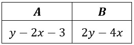  
  
Manakah hubungan yang benar antara kuantitas A dan B berikut berdasarkan informasi yang diberikan …

- **A.** 2A < B
- **B.** A = B
- **C.** Hubungan A dan B tidak dapat ditentukan
- **D.** A > B
- **E.** 3A > 2B

**Kunci:** A

**Pembahasan:** A = y − 2x − 3 = 3 − 2(−1) − 3 = 2  
  
B = 2y − 4x = 2(3) − 4(−1) = 6 + 4 = 10  
  
Mari kita substitusi pada masing-masing opsi  
  
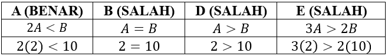  
  
Jawaban: A

---

#### 12584 · no 12

Diketahui nilai P = −4,  
  
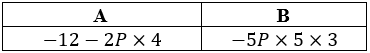  
  
Manakah hubungan yang benar antara kuantitas A dan B berikut berdasarkan informasi yang diberikan...

- **A.** A > B
- **B.** 2A > B
- **C.** Hubungan A dan B tidak dapat ditentukan
- **D.** 3A = 2B
- **E.** 3A < 2B

**Kunci:** E

**Pembahasan:** Diketahui nilai P = −4,  
  
Lalu disubstitusikan ke persamaan berikut  
  
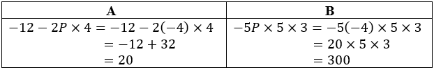  
  
Mari kita substitusi pada masing-masing opsi  
  
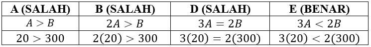  
  
Jawaban: E

---

#### 12584 · no 13

Diketahui  
  
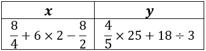  
  
Manakah hubungan yang benar antara kuantitas x dan y berikut berdasarkan informasi yang diberikan....

- **A.** 3x < 2y
- **B.** 4x < y
- **C.** Hubungan x dan y tidak dapat ditentukan
- **D.** 3x > 2y
- **E.** 2x > 3y

**Kunci:** A

**Pembahasan:** x  → 8 4  + 6 ×  2 − 8 2 = 8 4 + 12 − 16 4 = 12 −  8 4 = 12 − 2 = 10  
  
y  → 4 5 ×  25 + 18 ÷ 3 = 20 + 6 = 26  
  
Sehingga perbandingan  
  
X: Y = 10 : 26 = 5: 13  
  
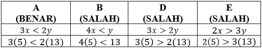  
  
Jawaban: A

---

#### 12584 · no 14

Sebuah tempat parkir menetapkan tarif sebesar Rp6.000,00 untuk 2 jam pertama dan Rp2.500,00 untuk setiap 1 jam berikutnya. Jika kendaraan Andi parkir selama 7 jam, maka total biaya parkir yang harus dibayarkan adalah …

- **A.** Rp16.000,00
- **B.** Rp17.500,00
- **C.** Rp18.500,00
- **D.** Rp19.000,00
- **E.** Rp20.500,00

**Kunci:** C

**Pembahasan:** Diketahui biaya parkir 2 jam pertama Rp6.000,00.  
  
Total waktu kendaraan Andi parkir = 7 jam  
  
Sisa Waktu parkir = 7 - 2 = 5 jam  
  
Biaya Parkir 5 jam berikutnya = 5 ×  2.500 = 12.500  
  
Total biaya parkir selama 7 jam = 6000 + 12.500 = 18.500  
  
Jawaban: C

---

#### 12584 · no 15

Sekelompok gajah menghabiskan satu gudang stok pakan. Dengan 4 ekor gajah, stok pakan tersebut habis dalam waktu 30 hari.  
  
| A | B |  
|---|---|  
| Waktu yang diperlukan jika jumlah gajah bertambah menjadi 6 ekor untuk menghabiskan stok pakan yang sama (hari) | 22 |  
  
Tentukanlah hubungan antara A dan B yang benar…

- **A.** 2A = B
- **B.** 2A < B
- **C.** 3A > 2B
- **D.** 4A < 3B
- **E.** 2A > 3B

**Kunci:** C

**Pembahasan:** Diketahui 4 ekor gajah mampu menghabiskan satu gudang stok pakan dalam 30 hari  
  
A → Waktu yang diperlukan jika jumlah gajah bertambah menjadi 6 ekor untuk menghabiskan stok pakan yang sama (hari)  
  
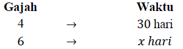  
  
Menggunakan perbandingan tak senilai:  
  
Trik: Alfaiz aab =  a t a s   ×   a t a s b a w a h  
  
x = 4   ×   30 6  
  
= 4 ×  5  
  
= 20  
  
B → 22  
  
Perbandingan A: B = 20: 22  
  
                           = 10: 11  
  
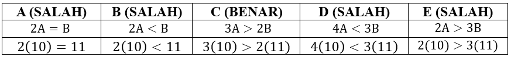  
  
Jawaban: C

---

#### 12584 · no 16

Sebuah mesin dapat menyelesaikan 24 unit produk dalam waktu 3 jam secara efektif. Mesin tersebut kemudian bekerja selama 7,5 jam, namun 30 menit pertama digunakan untuk pemanasan sehingga belum menghasilkan produk. Jika kecepatan kerja mesin tetap, berapa jumlah unit produk yang dapat diselesaikan mesin tersebut?

- **A.** 48 unit
- **B.** 54 unit
- **C.** 56 unit
- **D.** 60 unit
- **E.** 62 unit

**Kunci:** C

**Pembahasan:** Diketahui  
  
- Sebuah mesin dapat menyelesaikan 24 unit produk dalam waktu 3 jam secara efektif.  
  
- Mesin tersebut kemudian bekerja selama 7,5 jam, namun 30 menit pertama digunakan untuk pemanasan sehingga belum menghasilkan produk → sehingga waktu kerja efektif adalah 7 jam  
  
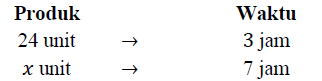  
  
Perbandingan senilai  
  
24 x  = 3 7  
  
8 x  = 1 7  
  
x = 56 unit  
  
Jawaban: C

---

#### 12584 · no 17

Sebuah proyek perbaikan jalan direncanakan selesai dalam 90 hari oleh 40 pekerja. Pada hari kerja ke 19, 8 pekerja harus dipindahkan ke proyek lain. Dengan produktivitas pekerja tetap sama, berapa tambahan hari yang diperlukan agar proyek tersebut dapat diselesaikan?

- **A.** 12 hari
- **B.** 15 hari
- **C.** 18 hari
- **D.** 20 hari
- **E.** 24 hari

**Kunci:** C

**Pembahasan:** Untuk menyelesaikan soal tersebut dapat kita gunakan Al Faiz Batako, misalkan h adalah tambahan hari yang dibutuhkan untuk menyelesaikan bangunan tersebut.  
  
T ×  W = H  
  
40 ×  90 = 3600 } Rencana  
  
40 ×  18 = 720   } 18 hari kerja oleh 40 pekerja  
  
32 ×  72 = 2304 } sisa hari dari 90 hari (90 − 18 = 72 hari) oleh 32 pekerja (8 pekerja dipindahkan)  
  
32  × h = 576  
  
h = 18  
  
Sehingga tambahan hari yang diperlukan adalah 18 hari.  
  
Jawaban: C

---

#### 12584 · no 18

Andi merencanakan perjalanan sejauh 350 km yang harus selesai dalam waktu 5 jam. Di tengah perjalanan, Andi ingin mampir di rumah sahabatnya selama 90 menit. Agar tetap tiba tepat waktu, berapa kecepatan rata-rata kendaraan Andi saat berjalan?

- **A.** 80 km/jam
- **B.** 85 km/jam
- **C.** 90 km/jam
- **D.** 100 km/jam
- **E.** 105 km/jam

**Kunci:** D

**Pembahasan:** Diketahui:  
  
Kecepatan Andi = 350 5  = 70 km/jam  
  
Istirahat 90 menit  
  
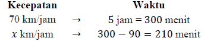  
  
Menggunakan perbandingan tak senilai:  
  
Trik: Alfaiz aab = a t a s   ×   a t a s b a w a h  
  
x = 70   ×   300 210  = 1   ×   300 3  = 100 km/jam  
  
Jawaban: D

---

#### 12584 · no 19

Sebanyak 6 pekerja dapat membangun 3 rumah dalam waktu 15 hari. Berapa banyak rumah yang dapat dibangun oleh 9 pekerja dalam waktu 20 hari, dengan tingkat produktivitas yang sama?

- **A.** 5 rumah
- **B.** 6 rumah
- **C.** 7 rumah
- **D.** 8 rumah
- **E.** 9 rumah

**Kunci:** B

**Pembahasan:** Diketahui  
  
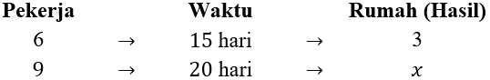  
  
T  × W = H  
  
6 9 ×   15 20 = 3 x  
  
2 3 ×   5 20  = 1 x  
  
2 3 ×   1 4  = 1 x  
  
1 3 ×   1 2  = 1 x  
  
x = 3 ×  2  
  
   = 6  
  
Jawaban: B

---

#### 12584 · no 20

16, 12, 60, 55, 275, …

- **A.** 271
- **B.** 270
- **C.** 269
- **D.** 268
- **E.** 267

**Kunci:** C

**Pembahasan:** 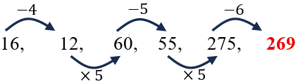  
  
Jawaban: C

---

#### 12584 · no 21

2, 5, 10, 17, 26, 37,...

- **A.** 48
- **B.** 49
- **C.** 50
- **D.** 51
- **E.** 52

**Kunci:** C

**Pembahasan:** 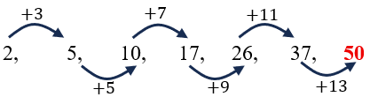  
  
Jawaban: C

---

#### 12584 · no 22

120,24,6,…,1,1

- **A.** 1
- **B.** 2
- **C.** 3
- **D.** 4
- **E.** 5

**Kunci:** B

**Pembahasan:** 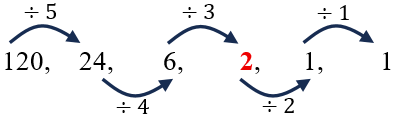  
  
Jawaban: B

---

#### 12584 · no 23

Perhatikan tabel hasil ujian berikut:  
  
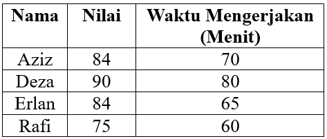  
  
Tentukan urutan peserta berdasarkan nilai tertinggi ke terendah. Jika terdapat nilai yang sama, maka urutkan berdasarkan waktu mengerjakan yang lebih cepat lebih dahulu.

- **A.** Deza – Aziz – Erlan – Rafi
- **B.** Deza – Erlan – Aziz – Rafi
- **C.** Erlan – Deza – Aziz – Rafi
- **D.** Deza – Erlan – Rafi – Aziz
- **E.** Erlan – Aziz – Deza – Rafi

**Kunci:** B

**Pembahasan:** Nilai tertinggi: 90 → Deza.  
  
Nilai berikutnya: 84 →  Aziz dan Erlan.  
  
Karena sama, pilih yang waktu lebih cepat: Erlan (65 menit) dan Aziz (70 menit)  
  
Nilai terakhir: 75 → Rafi  
  
Maka urutannya adalah: Deza – Erlan – Aziz – Rafi  
  
Jawaban: B

---

#### 12584 · no 24

Affan, Miko, Raza, Haikal, Fella, Syifa, Lova, dan Salma sedang berdiskusi dalam sebuah rapat dan duduk mengelilingi meja bundar.  
  
(1) Affan duduk tepat di sebelah kiri Miko.  
  
(2) Fella duduk berhadapan dengan Affan.  
  
(3) Raza duduk di antara Haikal dan Syifa.  
  
(4) Lova duduk dua kursi dari Miko (ada satu orang di antara mereka).  
  
Siapakah yang duduk berhadapan dengan Raza?

- **A.** Affan
- **B.** Salma
- **C.** Fella
- **D.** Lova
- **E.** Miko

**Kunci:** B

**Pembahasan:** Informasi yang diberikan  
  
(1) Affan duduk tepat di sebelah kiri Miko.  
  
(2) Fella duduk berhadapan dengan Affan.  
  
(3) Raza duduk di antara Haikal dan Syifa.  
  
(4) Lova duduk dua kursi dari Miko (ada satu orang di antara mereka).  
  
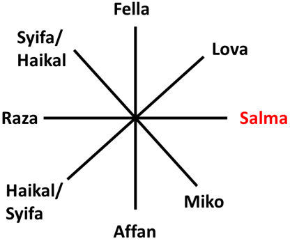  
  
Sehingga yang berhadapan dengan Raza adalah Salma.  
  
Jawaban: B

---

#### 12584 · no 25

Dalam sebuah keluarga, ayah, ibu, serta dua anaknya Philo dan Nico masing-masing menyukai olahraga. Ayah menyukai semua olahraga yang menggunakan bola. Ibu menyukai renang dan olahraga atletik. Philo menyukai olahraga renang, futsal dan badminton. Sedangkan Nico menyukai badminton dan basket. Berdasarkan informasi tersebut, siapa saja yang menyukai olahraga futsal?

- **A.** Ayah dan Philo
- **B.** Nico dan Philo
- **C.** Ayah dan Nico
- **D.** Ibu dan Philo
- **E.** Ibu dan Nico

**Kunci:** A

**Pembahasan:** Informasi yang diberikan:  
  
(1) Ayah menyukai semua olahraga yang menggunakan bola.  
  
(2) Ibu menyukai renang dan olahraga atletik.  
  
(3) Philo menyukai olahraga renang, futsal dan badminton.  
  
(4) Nico menyukai badminton dan basket.  
  
Dari pernyataan, jelas bahwa yang menyukai olahraga futsal adalah Ayah dan Philo  
  
Jawaban: A

---

#### 12584 · no 26

Seorang pegawai bernama Raka ingin pergi dari Kota P menuju Kota Z. Dari Kota P, Raka dapat menuju Kota Q atau Kota R. Jika Raka memilih menuju Kota Q, ia dapat melanjutkan ke Kota S atau Kota T. Dari Kota S, Raka dapat menuju Kota W, sedangkan dari Kota T, Raka dapat menuju Kota U. Kota W terhubung ke Kota V, dan Kota V terhubung langsung ke Kota Z. Sementara itu, Kota U terhubung langsung ke Kota Z. Jika Raka memilih menuju Kota R, ia dapat melanjutkan ke Kota X atau Kota Y. Kota X terhubung ke Kota V, sedangkan Kota Y terhubung langsung ke Kota Z.  
  
Jika Raka harus singgah terlebih dahulu di Kota V sebelum menuju Kota Z dan memilih rute dengan jumlah kota paling sedikit, rute manakah yang dapat ia tempuh?

- **A.** P-R-Y-Z
- **B.** P-R-X-V-Z
- **C.** P-Q-S-W-V-Z
- **D.** P-Q-T-U-Z
- **E.** R-X-V-Z

**Kunci:** B

**Pembahasan:** 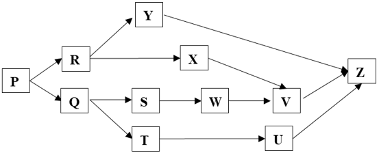  
  
Diperoleh rute:  
  
(1) P-R-Y-Z  
  
(2) P-R-X-V-Z  
  
(3) P-Q-S-W-V-Z  
  
(4) P-Q-T-U-Z  
  
Rute yang dipilih Raka adalah melewati Kota V dan rute dengan jumlah kota paling sedikit yaitu P-R-X-V-Z  
  
Jawaban: B

---

#### 12584 · no 27

Perhatikan gambar berikut!  
  
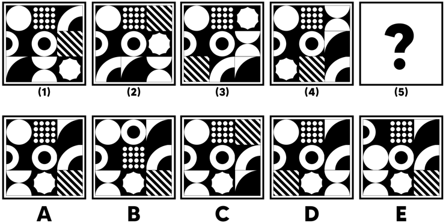

- **A.** A
- **B.** B
- **C.** C
- **D.** D
- **E.** E

**Kunci:** A

**Pembahasan:** 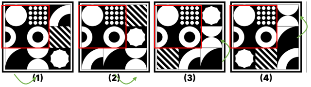  
  
Berdasarkan gambar yang diketahui terdapat beberapa pola  
  
- Dari garmbar (1) sampai gambar (4) objek yang berada pada kotak merah bersifat tetap dan tidak berubah  
  
- Dari gambar (1) sampai gambar (4) objek yang berada dibagian bawah dan kanan saling bergeser berlawanan arah jarum jam.  
  
Sehingga mengikuti pola tersebut gambar yang tepat mengisi gambar (5) adalah  
  
  
  
Jawaban: A

---

#### 12584 · no 28

Perhatikan gambar berikut!  
  
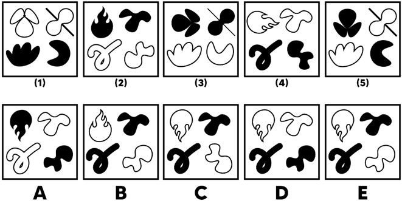

- **A.** A
- **B.** B
- **C.** C
- **D.** D
- **E.** E

**Kunci:** E

**Pembahasan:** 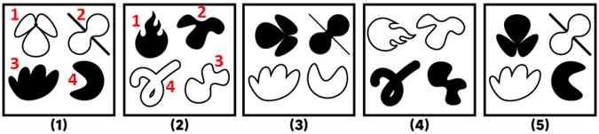  
  
Berdasarkan gambar yang diketahui terdapat pola gambar (1), (3) dan (5) kemudian gambar (2), (4). Yang setiap jenis objek 1,2,3,4 memiliki pola gerakan masing-masing  
  
- objek 1, dari gambar (1) (3) (5) memiliki pola berputar berlawanan arah jarum jam 90°. Kemudian memiliki pola berubahan warna yaitu ubah – tetap  
  
- objek 2, dari gambar (1), (3), (5) memiliki pola perubahan warna  
  
- objek 3, dari gambar (1), (3), (5) memiliki pola ubah warna yaitu ubah – tetap – ubah  
  
- objek 4, dari gambar (1), (3), (5) memiliki pola berputar searah jarum jam 90° dan memiliki pola perubahan warna setiap langkahnya.  
  
Dengan menggunakan pola yang sama pola gambar (2) (4) (6), maka gambar (6) yang tepat adalah  
  
  
  
Jawaban: E

---

#### 12584 · no 29

Perhatikan gambar berikut!  
  
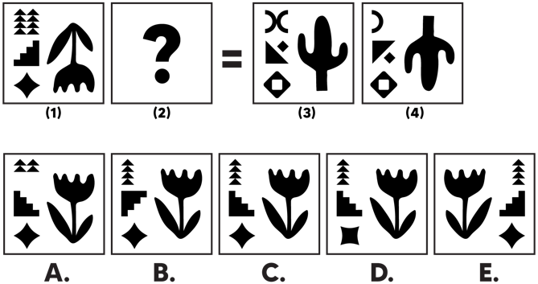

- **A.** A
- **B.** B
- **C.** C
- **D.** D
- **E.** E

**Kunci:** C

**Pembahasan:** 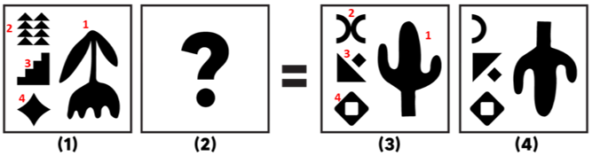  
  
Pola objek gambar (3) ke (4) = gambar (1) ke (2).  
  
Untuk pola gambar (3) ke (4) yaitu  
  
- Objek 1 dicerminkan secara horizontal  
  
- Objek 2 sebagian objeknya berkurang ½ bagian kanan  
  
- Objek 3 berputar 90° searah jarum jam  
  
- Objek 4 tetap  
  
Sehingga menggunakan pola yang sama untuk gambar (1) ke (2). Gambar yang tepat mengisi gambar (2) adalah  
  
  
  
Jawaban: C

---

#### 12584 · no 30

Perhatikan gambar berikut!  
  
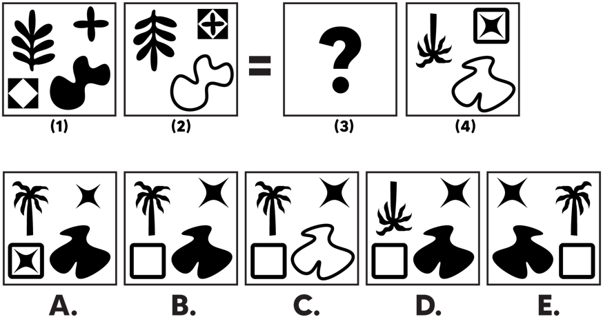

- **A.** A
- **B.** B
- **C.** C
- **D.** D
- **E.** E

**Kunci:** B

**Pembahasan:** 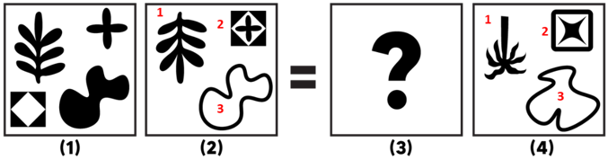  
  
Pola objek gambar (2) ke (1) = gambar (4) ke (3).  
  
Untuk pola gambar (2) ke (1) yaitu  
  
- Objek 1 dicerminkan secara horizontal  
  
- Objek 2 bagian luar objek berpindah ke sisi kiri bawah dan bagian dalam objek ukurannya membesar  
  
- Objek 3 berubah warna  
  
Sehingga menggunakan pola yang sama untuk gambar (4) ke (3). Gambar yang tepat mengisi gambar (3) adalah  
  
  
  
Jawaban: B

---

#### 12584 · no 31

Perhatikan gambar berikut!  
  
KETAKSAMAAN  
  
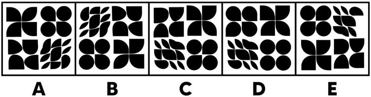

- **A.** A
- **B.** B
- **C.** C
- **D.** D
- **E.** E

**Kunci:** D

**Pembahasan:**   
  
Jika diperhatikan terdapat bentuk objek yang berbeda dari yang lain pada opsi D, maka opsi yang tepat adalah D.  
  
Jawaban: D

---

#### 12584 · no 32

Perhatikan gambar berikut  
  
KETAKSAMAAN  
  
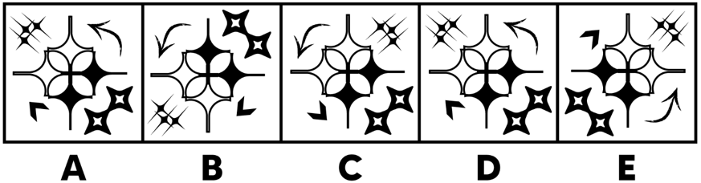

- **A.** A
- **B.** B
- **C.** C
- **D.** D
- **E.** E

**Kunci:** C

**Pembahasan:** Objek pada opsi A jika dirotasi akan menghasilkan bentuk dan arah yang sama seperti di opsi B, D, dan E. Kecuali pada opsi C arah yang berbeda. Maka jawaban yang tepat adalah C.  
  
Jawaban: C

---

#### 12584 · no 33

Perhatikan gambar berikut!  
  
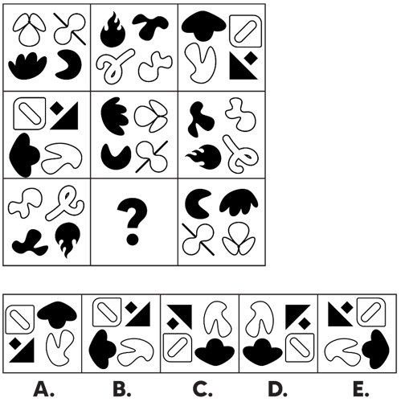

- **A.** A
- **B.** B
- **C.** C
- **D.** D
- **E.** E

**Kunci:** C

**Pembahasan:** 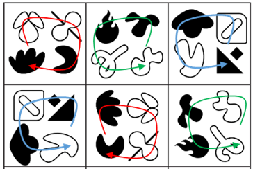  
  
Jika diperhatikan pola objek pada figural 9 kotak ini adalah pengelompokan objek. Gambar yang ditandai dengan warna yang sama memiliki bentuk objek yang sama, hanya saja kelompok objek tersebut dirotasi. Kelompok yang ditandai warna merah semua objeknya dirotasi secara bersama 90° searah jarum jam, kemudian kelompok yang ditandai warna hijau dan biru semua objeknya dirotasi secara bersama 90° berlawanan arah jarum jam. Sehingga gambar yang tepat untuk mengisi gambar di baris ketiga kolom kedua adalah  
  
  
  
Jawaban: C

---

#### 12584 · no 34

Perhatikan gambar berikut!  
  
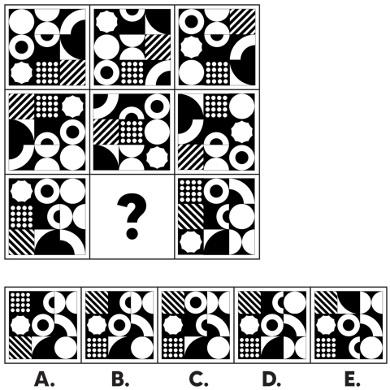

- **A.** A
- **B.** B
- **C.** C
- **D.** D
- **E.** E

**Kunci:** B

**Pembahasan:** 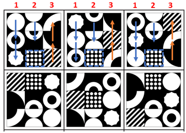  
  
Dari gambar tersebut memiliki pola setiap barisnya.  
  
Baris pertama  
  
- Setiap objek dikolom 1 bergeser selangkah ke bawah  
  
- Dua objek kolom 2 bergeser selangkah ke bawah (bertukar tempat) setiap langkahnya  
  
- Setiap objek di kolom 3 bergeser selangkah ke atas  
  
Mengikuti pola yang sama pada baris ketiga  
  
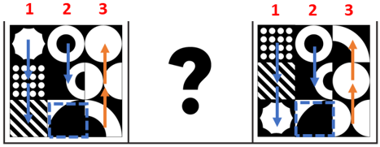  
  
Maka gambar yang tepat untuk mengisi gambar pada baris ketiga kolom kedua adalah  
  
  
  
Jawaban: B

---

#### 12584 · no 35

Perhatikan gambar berikut!  
  
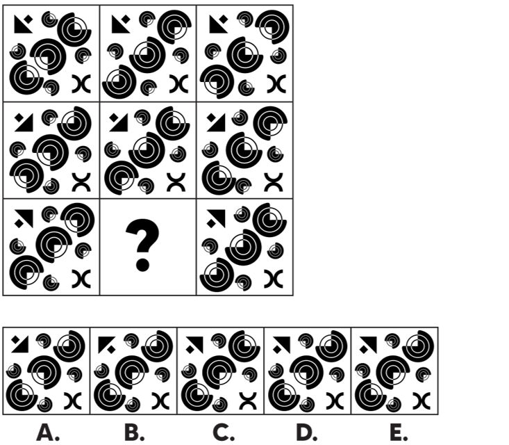

- **A.** A
- **B.** B
- **C.** C
- **D.** D
- **E.** E

**Kunci:** D

**Pembahasan:** 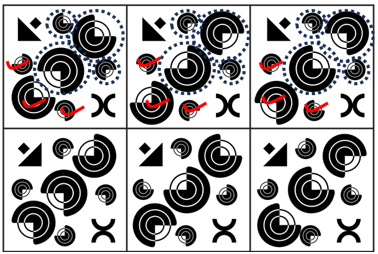  
  
Dari gambar tersebut memiliki pola setiap barisnya.  
  
Baris pertama  
  
- Objek yang ditandai garis lingkaran putus-putus berputar 90° searah jarum jam  
  
- Objek yang ditandai dengan ceklis merah berputar 90° berlawanan arah jarum jam.  
  
Sehingga gambar yang tepat untuk mengisi di baris ketiga kolom kedua adalah  
  
  
  
Jawaban: D

---

### TKP

#### 12584 · no 1

Anda bertugas sebagai petugas layanan pengaduan di Dinas Perhubungan. Sejumlah warga melapor melalui media sosial bahwa lampu lalu lintas di persimpangan utama sering mati pada jam sibuk, menyebabkan kemacetan dan hampir terjadi kecelakaan. Laporan serupa sudah masuk beberapa kali, namun perbaikan belum terlihat. Apa tindakan Anda … (Pelayanan Publik)

- **A.** Menenangkan warga dengan menjelaskan bahwa laporan akan diteruskan ke bidang teknis dan meminta mereka bersabar menunggu proses perbaikan.
- **B.** Segera mengoordinasikan laporan tersebut ke tim teknis, memantau progres perbaikan, dan memberikan pembaruan informasi kepada warga.
- **C.** Mencatat laporan warga sebagai arsip pengaduan dan menunggu instruksi dari atasan sebelum bertindak lebih lanjut.
- **D.** Menyarankan warga melapor langsung ke kantor pusat Dinas Perhubungan agar keluhan lebih cepat ditangani.
- **E.** Menyampaikan permohonan maaf atas ketidaknyamanan dan menjelaskan bahwa perbaikan membutuhkan waktu karena keterbatasan teknis.

**Kunci:** B

**Pembahasan:** SKOR JAWABAN:  
  
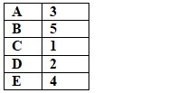  
  
Situasi ini menguji kemampuan Anda dalam menangani pengaduan masyarakat secara responsif, solutif, dan akuntabel. Sebagai petugas layanan pengaduan, Anda tidak cukup hanya menerima keluhan, tetapi juga perlu memastikan laporan ditindaklanjuti karena masalah lampu lalu lintas yang mati menyangkut kelancaran lalu lintas dan keselamatan pengguna jalan. Dalam pelayanan publik, kecepatan koordinasi dan kejelasan informasi sangat penting untuk menjaga kepercayaan masyarakat. Pilihan B paling tepat karena Anda segera mengoordinasikan laporan kepada tim teknis, memantau progres perbaikan, dan memberikan pembaruan informasi kepada warga. Langkah ini menunjukkan sikap proaktif, tanggung jawab, serta orientasi pada penyelesaian masalah, sehingga layak mendapat skor 5. Pilihan E mendapat skor 4 karena sudah menunjukkan empati melalui permohonan maaf dan memberikan penjelasan kepada warga. Namun, langkah ini belum menunjukkan tindakan nyata untuk memastikan masalah segera ditangani.Pilihan A bernilai 3 karena berusaha menenangkan warga dan meneruskan laporan, tetapi masih bersifat pasif karena hanya meminta warga menunggu tanpa memastikan tindak lanjut.Pilihan D mendapat skor 2 karena justru mengalihkan tanggung jawab kepada warga untuk melapor ke pihak lain, padahal laporan sudah diterima oleh unit Anda. Sementara itu, pilihan C menjadi yang terendah karena hanya mencatat laporan dan menunggu instruksi, sehingga kurang responsif terhadap masalah yang berulang dan berdampak pada keselamatan publik.

---

#### 12584 · no 2

Anda bertugas sebagai petugas layanan akademik di sebuah perguruan tinggi negeri. Seorang mahasiswa datang dengan wajah cemas karena nilai salah satu mata kuliahnya belum muncul di sistem, padahal batas waktu pendaftaran beasiswa akan segera berakhir. Ia merasa khawatir tidak bisa melanjutkan proses pendaftaran jika nilai tersebut belum terinput. Setelah dicek, nilai memang belum divalidasi oleh dosen pengampu. Apa langkah terbaik yang Anda lakukan…  
  
(Pelayanan Publik)

- **A.** Menjelaskan bahwa proses input nilai sepenuhnya menjadi kewenangan dosen dan mahasiswa perlu menunggu.
- **B.** Meminta mahasiswa tersebut menghubungi dosen pengampu secara mandiri untuk mempercepat proses validasi nilai.
- **C.** Mengecek kelengkapan data nilai, menjelaskan posisi prosesnya, serta membantu mengoordinasikan tindak lanjut ke dosen atau bagian terkait.
- **D.** Menyarankan mahasiswa menunda pendaftaran beasiswa hingga nilai resmi muncul di sistem.
- **E.** Mengarahkan mahasiswa menyampaikan keluhan melalui layanan pengaduan akademik kampus.

**Kunci:** C

**Pembahasan:** SKOR JAWABAN:  
  
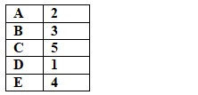  
  
Pilihan terbaik adalah C karena petugas secara aktif mengecek kelengkapan data, memberikan penjelasan yang jelas mengenai posisi proses nilai, serta membantu mengoordinasikan tindak lanjut dengan dosen atau unit terkait. Tindakan ini menunjukkan sikap berorientasi pelayanan, komunikatif, dan bertanggung jawab dalam membantu mahasiswa mendapatkan kepastian layanan sehingga mendapat skor 5. Pilihan E juga cukup baik karena tetap memberikan saluran resmi bagi mahasiswa untuk menyampaikan keluhan sehingga masalah dapat tercatat secara formal. Namun, langkah ini kurang responsif karena tidak memberikan bantuan langsung terhadap kebutuhan mendesak mahasiswa sehingga mendapat skor 4. Pilihan B cukup tepat karena mendorong mahasiswa untuk berinisiatif menghubungi dosen pengampu. Akan tetapi, langkah ini cenderung melepaskan peran petugas layanan akademik sebagai fasilitator sehingga bantuan yang diberikan belum optimal dan mendapat skor 3. Pilihan A kurang tepat karena hanya menjelaskan batas kewenangan tanpa memberikan solusi atau upaya pendampingan, sehingga mahasiswa tetap berada dalam ketidakpastian dan mendapat skor 2. Pilihan D paling tidak tepat karena menyarankan penundaan pendaftaran beasiswa tanpa menawarkan alternatif solusi, yang berpotensi merugikan mahasiswa dan tidak mencerminkan orientasi pelayanan publik sehingga mendapat skor 1.

---

#### 12584 · no 3

Anda bertugas sebagai petugas pengelola data di instansi pemerintah daerah. Suatu hari, seorang rekan kerja meminta Anda memberikan data pribadi warga (NIK dan alamat) dengan alasan untuk keperluan laporan cepat. Namun, permintaan tersebut belum disertai surat tugas atau persetujuan atasan. Apa langkah terbaik yang Anda lakukan… (Pelayanan Publik)

- **A.** Memberikan data tersebut karena masih satu instansi dan tujuannya untuk pekerjaan.
- **B.** Menolak permintaan tersebut secara tegas tanpa memberikan penjelasan.
- **C.** Menyarankan rekan kerja mengajukan permintaan resmi sesuai prosedur sebelum data diberikan.
- **D.** Memberikan sebagian data yang dianggap tidak terlalu sensitif agar pekerjaan tetap berjalan.
- **E.** Menunda pemberian data sambil menunggu instruksi lebih lanjut dari atasan.

**Kunci:** C

**Pembahasan:** SKOR JAWABAN:  
  
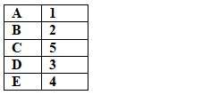  
  
Pilihan terbaik adalah C karena menjaga keamanan data pribadi warga sekaligus tetap mendukung kelancaran pekerjaan dengan mematuhi prosedur resmi. Sikap ini mencerminkan nilai Akuntabel dan Profesional, sehingga mendapat skor 5. Pilihan E cukup baik karena berhati-hati dan tidak langsung memberikan data, namun kurang proaktif dalam memberikan solusi prosedural sehingga mendapat skor 4. Pilihan D kurang tepat karena tetap berisiko melanggar prinsip perlindungan data meskipun hanya sebagian sehingga mendapat skor 3. Pilihan B kurang baik karena menolak tanpa komunikasi yang baik sehingga berpotensi menimbulkan konflik kerja dan mendapat skor 2. Pilihan A paling tidak tepat karena mengabaikan etika dan keamanan data sehingga mendapat skor 1.

---

#### 12584 · no 4

Anda bertugas sebagai admin layanan aplikasi internal. Seorang pegawai mengeluh karena akunnya tidak bisa digunakan untuk mengakses sistem, padahal tenggat pelaporan sangat dekat. Setelah dicek, kesalahan terjadi karena kelalaian pegawai tersebut sendiri saat memperbarui data. Apa langkah terbaik yang Anda lakukan… (Pelayanan Publik)

- **A.** Menolak membantu karena kesalahan bukan berasal dari sistem.
- **B.** Membantu memperbaiki akun sambil menjelaskan prosedur yang benar agar tidak terulang.
- **C.** Meminta pegawai tersebut mengajukan tiket layanan baru dan menunggu antrean.
- **D.** Melaporkan pegawai tersebut ke atasan karena kelalaiannya mengganggu sistem.
- **E.** Membiarkan akun diperbaiki nanti setelah tenggat pelaporan selesai.

**Kunci:** B

**Pembahasan:** SKOR JAWABAN:  
  
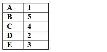  
  
Pilihan terbaik adalah B karena tetap memberikan bantuan meskipun kesalahan berasal dari pengguna, sekaligus melakukan edukasi agar tidak terulang. Hal ini mencerminkan nilai Berorientasi Pelayanan dan Kompeten, sehingga mendapat skor 5. Pilihan C cukup baik karena sesuai prosedur, tetapi kurang responsif terhadap kondisi mendesak sehingga mendapat skor 4. Pilihan E kurang tepat karena menunda penyelesaian dan berpotensi menghambat kinerja pegawai sehingga mendapat skor 3. Pilihan D tidak tepat karena bersifat menghukum dan tidak solutif sehingga mendapat skor 2. Pilihan A paling tidak tepat karena tidak menunjukkan sikap pelayanan sama sekali sehingga mendapat skor 1.

---

#### 12584 · no 5

Anda adalah ASN yang mengelola akun media sosial unit kerja. Anda menemukan komentar masyarakat yang provokatif dan menyudutkan instansi dengan informasi yang belum tentu benar. Komentar tersebut mulai memicu perdebatan antarwarganet. Apa langkah terbaik yang Anda lakukan? (Pelayanan Publik)

- **A.** Menghapus komentar tersebut agar tidak memperkeruh suasana.
- **B.** Membalas komentar dengan nada tegas untuk meluruskan kesalahan informasi.
- **C.** Memberikan klarifikasi resmi secara netral dan berbasis data tanpa memperkeruh perdebatan.
- **D.** Membiarkan komentar tersebut sebagai bentuk kebebasan berekspresi.
- **E.** Menonaktifkan kolom komentar sementara waktu.

**Kunci:** C

**Pembahasan:** SKOR JAWABAN:  
  
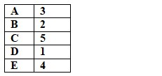  
  
Pilihan C paling tepat karena menunjukkan inisiatif aktif dengan memverifikasi dokumen sekaligus berkoordinasi ke pihak berwenang agar masalah tidak berlarut. Ini mencerminkan pelayanan yang bertanggung jawab dan berorientasi solusi. D mendapat skor 4 karena realistis, tetapi tetap membuat warga menunggu tanpa kepastian tindakan. A berada di skor 3 karena memberi penjelasan, namun cenderung pasif. B hanya skor 2 karena prosedural dan tidak membantu secara langsung. E paling rendah karena melepaskan tanggung jawab dan berpotensi merusak kepercayaan publik.

---

#### 12584 · no 6

Anda bertugas sebagai resepsionis di kantor pusat perusahaan. Seorang tamu datang tanpa janji temu dan meminta bertemu pimpinan dengan alasan mendesak. Jadwal pimpinan hari itu penuh. Apa langkah terbaik yang Anda lakukan? (Pelayanan Publik)

- **A.** Menyampaikan bahwa pimpinan tidak dapat ditemui tanpa janji temu dan meminta tamu datang kembali di lain waktu.
- **B.** Mengizinkan tamu menunggu di area resepsionis sambil berharap ada jadwal pimpinan yang kosong.
- **C.** Menyampaikan kondisi jadwal pimpinan dengan sopan, menggali keperluan tamu secara singkat, lalu menghubungi unit terkait untuk menindaklanjuti sesuai prosedur.
- **D.** Menjelaskan bahwa jadwal pimpinan penuh, menawarkan untuk menyampaikan pesan atau mengatur jadwal pertemuan di waktu lain.
- **E.** Meminta tamu menunggu sementara Anda mencoba menghubungi pimpinan meskipun jadwalnya sudah penuh.

**Kunci:** C

**Pembahasan:** SKOR JAWABAN:  
  
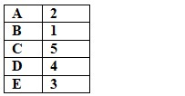  
  
Pilihan terbaik adalah C karena resepsionis bersikap sopan, menjelaskan kondisi jadwal pimpinan secara transparan, serta secara aktif menggali keperluan tamu dan menindaklanjutinya melalui unit atau pihak yang berwenang. Tindakan ini menunjukkan kemampuan komunikasi yang baik, orientasi pelayanan, serta kepatuhan terhadap prosedur tanpa mengabaikan kebutuhan tamu, sehingga mendapat skor 5. Pilihan D juga merupakan tindakan yang cukup tepat karena resepsionis menyampaikan kondisi jadwal pimpinan dengan baik dan menawarkan alternatif berupa penyampaian pesan atau pengaturan jadwal ulang. Namun, langkah ini belum menunjukkan upaya untuk memahami tingkat urgensi kebutuhan tamu dan belum memastikan adanya tindak lanjut langsung, sehingga mendapat skor 4. Pilihan E cukup baik karena menunjukkan inisiatif untuk membantu tamu. Namun, tindakan ini berpotensi mengganggu pimpinan yang memiliki jadwal penuh dan kurang memperhatikan prosedur kerja yang berlaku, sehingga mendapat skor 3. Pilihan A kurang tepat karena resepsionis bersikap terlalu kaku dengan langsung menolak permintaan tamu tanpa menawarkan solusi lain. Hal ini dapat menimbulkan kesan kurang ramah dan tidak berorientasi pada pelayanan, sehingga mendapat skor 2. Pilihan B paling tidak tepat karena hanya membiarkan tamu menunggu tanpa kepastian dan tanpa melakukan langkah lanjutan. Tindakan ini tidak mencerminkan profesionalisme dan berpotensi menimbulkan ketidakpuasan tamu, sehingga mendapat skor 1.

---

#### 12584 · no 7

Anda bertugas sebagai resepsionis hotel. Seorang tamu komplain karena kamar yang diterimanya tidak sesuai dengan tipe yang dipesan, sementara hotel sedang penuh. Apa langkah terbaik yang Anda lakukan? (Pelayanan Publik)

- **A.** Menjelaskan bahwa seluruh kamar sesuai tipe pesanan sedang penuh dan meminta tamu memahami kondisi okupansi hotel saat ini.
- **B.** Menyampaikan permohonan maaf, menjelaskan kondisi kamar yang tersedia, lalu menawarkan pemindahan kamar jika ada pembatalan dari tamu lain.
- **C.** Meminta maaf, memverifikasi ulang data pemesanan, serta menawarkan kompensasi yang setara sambil memastikan kebutuhan utama tamu tetap terpenuhi.
- **D.** Menjelaskan kesalahan secara terbuka, meminta persetujuan tamu untuk tetap menempati kamar yang ada, dan memberikan fasilitas tambahan sebagai bentuk tanggung jawab.
- **E.** Meminta maaf, melakukan pengecekan detail pemesanan, berkoordinasi dengan bagian terkait, serta memberikan solusi terbaik yang disepakati bersama tamu tanpa mengganggu kenyamanan tamu lain.

**Kunci:** E

**Pembahasan:** SKOR JAWABAN:  
  
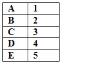  
  
Pilihan terbaik adalah E karena resepsionis menunjukkan sikap paling komprehensif dalam pelayanan. Petugas tidak hanya meminta maaf dan memverifikasi pemesanan, tetapi juga aktif berkoordinasi dengan bagian terkait serta mengajak tamu menyepakati solusi terbaik tanpa mengganggu kenyamanan tamu lain. Pendekatan ini mencerminkan orientasi pelayanan, profesionalisme, dan kemampuan mengelola situasi sensitif secara seimbang, sehingga mendapat skor 5. Pilihan D sangat baik karena resepsionis bersikap terbuka terhadap kesalahan, meminta persetujuan tamu, serta memberikan fasilitas tambahan sebagai bentuk tanggung jawab. Namun, solusi yang ditawarkan masih bersifat reaktif dan terbatas pada kompensasi, belum menekankan koordinasi lintas bagian atau kesepakatan menyeluruh, sehingga mendapat skor 4. Pilihan C cukup baik karena petugas memverifikasi data pemesanan dan menawarkan kompensasi yang setara. Langkah ini menunjukkan sikap profesional dan akuntabel, tetapi pendekatan yang diambil masih fokus pada aspek administratif dan belum sepenuhnya berorientasi pada pengalaman tamu secara holistik, sehingga mendapat skor 3. Pilihan B kurang tepat karena meskipun menunjukkan empati dan memberikan harapan solusi, langkah ini bergantung pada kondisi yang belum pasti (menunggu pembatalan) sehingga tidak memberikan kepastian bagi tamu, sehingga mendapat skor 2. Pilihan A paling tidak tepat karena hanya menyampaikan keterbatasan hotel tanpa menunjukkan tanggung jawab atau upaya solusi. Sikap ini berpotensi memperburuk ketidakpuasan tamu dan tidak mencerminkan nilai pelayanan prima, sehingga mendapat skor 1.

---

#### 12584 · no 8

Anda bertugas sebagai petugas front office di sebuah balai pelatihan kerja milik pemerintah. Seorang peserta pelatihan datang meminta Anda mengubah tanggal kehadiran di sistem karena ia tidak hadir pada hari tertentu dan khawatir akan dinyatakan gugur. Ia beralasan sedang mengalami masalah keluarga dan berharap Anda bisa membantu karena data tersebut hanya diketahui internal. Apa tindakan terbaik yang Anda lakukan.. (Pelayanan Publik)

- **A.** Menyetujui perubahan data kehadiran karena alasan peserta cukup manusiawi dan tidak merugikan pihak lain.
- **B.** Menolak permintaan tersebut secara tegas tanpa memberikan penjelasan lebih lanjut.
- **C.** Mengarahkan peserta ke petugas lain agar keputusan tidak berada di tangan Anda.
- **D.** Meminta peserta membuat surat pernyataan pribadi agar perubahan data bisa dipertimbangkan.
- **E.** Menjelaskan dengan sopan bahwa data kehadiran tidak dapat diubah secara sepihak, serta menyampaikan mekanisme resmi pengajuan dispensasi sesuai ketentuan.

**Kunci:** E

**Pembahasan:** SKOR JAWABAN:  
  
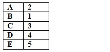  
  
Pilihan E merupakan jawaban paling tepat karena mampu menjaga keseimbangan antara keterbukaan pelayanan dan perlindungan data. Dengan menjelaskan secara sopan batasan informasi yang bersifat tertutup sekaligus menawarkan alternatif informasi yang boleh diakses, petugas tetap menunjukkan sikap profesional, komunikatif, dan berorientasi pada pelayanan tanpa melanggar aturan. Pendekatan ini juga membantu meredakan tekanan dari warga karena disertai penjelasan rasional dan solusi yang masih dapat diberikan. Pilihan D mendapat skor 4 karena menunjukkan upaya prosedural agar permintaan dapat diproses secara resmi dan akuntabel. Namun, tidak semua data dapat dibuka meskipun melalui surat permohonan, sehingga langkah ini berpotensi menimbulkan harapan keliru jika tidak disertai penjelasan batasan informasi. Pilihan C berada pada skor 3 karena mengalihkan warga ke petugas lain memang dapat meredam konflik, tetapi tidak menyelesaikan substansi persoalan dan berisiko dianggap menghindari tanggung jawab. Pilihan A memperoleh skor 2 karena meskipun bertujuan meredakan kekecewaan, tetap berisiko melanggar prinsip kerahasiaan dengan memberikan informasi yang seharusnya dibatasi, sehingga tidak mencerminkan kehati-hatian aparatur. Pilihan B menjadi yang paling rendah karena penolakan tanpa penjelasan berpotensi memicu konflik, menurunkan kepercayaan publik, dan tidak mencerminkan pelayanan yang komunikatif maupun berorientasi pada masyarakat.

---

#### 12584 · no 9

Anda bertugas di loket pelayanan fasilitas umum. Seorang warga datang untuk menanyakan penggunaan gedung serbaguna milik pemerintah daerah yang sebelumnya diinformasikan dapat dipakai oleh masyarakat. Namun saat hari pelaksanaan semakin dekat, jadwal penggunaan gedung tersebut berubah karena adanya kegiatan resmi mendadak dari instansi. Warga merasa kecewa karena sudah menyebarkan undangan dan meminta kejelasan serta solusi agar kegiatannya tetap bisa berjalan. Sikap Anda adalah … (Pelayanan Publik)

- **A.** Menjelaskan bahwa kegiatan resmi pemerintah menjadi prioritas dan meminta warga memahami perubahan tersebut.
- **B.** Menyampaikan perubahan jadwal secara terbuka serta meminta warga menunggu informasi lanjutan dari pihak pengelola.
- **C.** Menjelaskan alasan perubahan jadwal, menyampaikan permohonan maaf, dan membantu mengusulkan penjadwalan ulang sesuai prosedur.
- **D.** Menjelaskan perubahan jadwal secara rinci, menyampaikan dasar kebijakan, serta secara aktif membantu mencarikan alternatif fasilitas atau solusi lain yang memungkinkan.
- **E.** Menyarankan warga menyampaikan keberatan melalui mekanisme pengaduan resmi agar mendapatkan kepastian.

**Kunci:** D

**Pembahasan:** SKOR JAWABAN:  
  
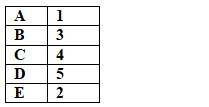  
  
Pilihan D merupakan jawaban paling tepat karena mencerminkan prinsip pelayanan publik yang responsif, transparan, dan proaktif, di mana petugas tidak hanya menjelaskan perubahan jadwal secara rinci serta menyampaikan dasar kebijakan yang melatarbelakanginya, tetapi juga secara aktif membantu mencarikan alternatif fasilitas atau solusi lain yang memungkinkan sehingga warga tetap memperoleh jalan keluar atas permasalahannya, sehingga layak mendapat skor 5. Pilihan C berada satu tingkat di bawahnya karena petugas telah menjelaskan alasan perubahan jadwal, menyampaikan permohonan maaf, dan membantu mengusulkan penjadwalan ulang sesuai prosedur, namun solusi yang diberikan masih terbatas dan belum menunjukkan inisiatif untuk mencari alternatif lain yang lebih fleksibel bagi warga, sehingga layak mendapat skor 4. Pilihan B menunjukkan adanya transparansi awal dengan menyampaikan perubahan jadwal, tetapi sikap meminta warga menunggu informasi lanjutan tanpa kepastian waktu maupun bentuk solusi mencerminkan pelayanan yang pasif dan kurang berorientasi pada kebutuhan warga, sehingga layak mendapat skor 3. Pilihan E mengarahkan warga pada mekanisme pengaduan resmi yang memang sah, namun langkah ini kurang tepat apabila permasalahan masih dapat ditangani langsung di loket pelayanan karena berpotensi memperpanjang proses dan menambah ketidakpuasan, sehingga layak mendapat skor 2. Sementara itu, pilihan A menjadi yang paling tidak tepat karena hanya menekankan prioritas kegiatan pemerintah tanpa disertai empati, penjelasan mendalam, maupun upaya solusi, sehingga berpotensi menurunkan kepercayaan masyarakat terhadap pelayanan publik, sehingga layak mendapat skor 1.

---

#### 12584 · no 10

Anda tergabung dalam tim kerja lintas instansi yang melibatkan pemerintah daerah, pihak swasta, dan komunitas masyarakat. Dalam pelaksanaannya, salah satu mitra eksternal aktif bergerak di lapangan namun sering mengambil keputusan sendiri tanpa menginformasikan tim lain. Di sisi lain, menghentikan peran mitra tersebut berpotensi menghambat capaian program. Sikap Anda adalah (Jejaring Kerja)

- **A.** Mengingatkan mitra tersebut agar selalu melapor sebelum mengambil keputusan dan membatasi ruang geraknya.
- **B.** Membiarkan mitra tetap bergerak mandiri selama target program masih tercapai.
- **C.** Mengajak mitra dan tim terkait menyepakati ulang pola koordinasi serta batas kewenangan secara jelas.
- **D.** Memfasilitasi diskusi bersama seluruh jejaring untuk menyelaraskan tujuan, alur komunikasi, dan mekanisme pengambilan keputusan ke depan.
- **E.** Melaporkan perilaku mitra kepada pimpinan agar ditentukan langkah tegas.

**Kunci:** D

**Pembahasan:** SKOR JAWABAN:  
  
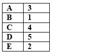  
  
Pilihan D merupakan jawaban paling tepat karena mencerminkan kemampuan membangun dan menjaga jejaring kerja secara kolaboratif dan berkelanjutan. Dengan memfasilitasi diskusi bersama seluruh jejaring untuk menyelaraskan tujuan, alur komunikasi, serta mekanisme pengambilan keputusan, petugas tidak hanya menyelesaikan masalah koordinasi yang muncul, tetapi juga memperkuat kerja sama lintas instansi ke depan tanpa mematikan kontribusi salah satu pihak, sehingga layak mendapat skor 5. Pilihan C berada pada tingkat berikutnya karena mengajak mitra dan tim terkait menyepakati ulang pola koordinasi serta batas kewenangan secara jelas sudah menunjukkan upaya menjaga keteraturan kerja sama, namun pendekatannya masih terbatas pada klarifikasi struktural dan belum sepenuhnya memperkuat dinamika jejaring secara menyeluruh, sehingga layak mendapat skor 4. Pilihan A menunjukkan niat menjaga koordinasi dengan mengingatkan mitra agar melapor sebelum mengambil keputusan, tetapi pembatasan ruang gerak berpotensi menurunkan fleksibilitas dan kepercayaan dalam jejaring kerja, sehingga layak mendapat skor 3. Pilihan E mengedepankan jalur struktural dengan melaporkan mitra kepada pimpinan, namun langkah ini cenderung represif dan berpotensi merusak hubungan kerja sama apabila masih dapat diselesaikan melalui komunikasi dan fasilitasi langsung, sehingga layak mendapat skor 2. Sementara itu, pilihan B menjadi yang paling tidak tepat karena membiarkan mitra bergerak tanpa koordinasi hanya demi capaian target jangka pendek dapat menimbulkan konflik dan ketidaksinergian di kemudian hari, sehingga layak mendapat skor 1.

---

#### 12584 · no 11

Anda ditunjuk sebagai koordinator kerja sama lintas lembaga dalam kegiatan pendataan calon peserta pelatihan kerja. Salah satu lembaga mitra belum menyelesaikan rekap hasil verifikasi lapangan tepat waktu karena adanya pergantian personel di internal mereka. Padahal, data tersebut segera dibutuhkan sebagai dasar penetapan peserta oleh tim pusat. Sikap Anda adalah (Jejaring Kerja)

- **A.** Memberi kelonggaran waktu penuh kepada mitra dan menyesuaikan ulang seluruh tahapan kegiatan.
- **B.** Menyampaikan secara tegas bahwa keterlambatan tersebut akan menjadi catatan kinerja tanpa membahas solusi lebih lanjut.
- **C.** Mengajak mitra berdiskusi untuk mencari cara agar sebagian hasil verifikasi bisa dikirim lebih dulu sesuai kebutuhan mendesak.
- **D.** Mengambil alih proses rekap data agar target pengiriman ke tim pusat tetap terpenuhi.
- **E.** Menyampaikan kondisi keterlambatan kepada pimpinan sambil tetap berkoordinasi dengan mitra agar pekerjaan segera diselesaikan.

**Kunci:** C

**Pembahasan:** SKOR JAWABAN:  
  
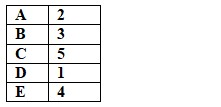  
  
Pilihan C merupakan jawaban paling tepat karena menunjukkan kemampuan membangun jejaring kerja secara kolaboratif dan solutif. Dengan mengajak mitra berdiskusi untuk mencari cara agar sebagian hasil verifikasi dapat dikirim lebih dulu, kebutuhan mendesak tim pusat tetap terpenuhi tanpa mengabaikan keterbatasan yang dihadapi mitra. Sikap ini mencerminkan fleksibilitas, komunikasi yang baik, serta fokus pada keberlanjutan kerja sama, sehingga layak mendapat skor 5. Pilihan E berada satu tingkat di bawahnya karena menyampaikan kondisi keterlambatan kepada pimpinan memang diperlukan sebagai bentuk transparansi, namun langkah tersebut masih bersifat pelaporan dan belum menjadi solusi utama atas hambatan teknis yang terjadi, sehingga layak mendapat skor 4. Pilihan B menunjukkan ketegasan dengan menjadikan keterlambatan sebagai catatan kinerja, tetapi tanpa disertai upaya mencari jalan keluar bersama, pendekatan ini berpotensi merusak hubungan kerja dan tidak membantu percepatan penyelesaian tugas, sehingga layak mendapat skor 3. Pilihan A memberikan kelonggaran penuh dengan menyesuaikan seluruh tahapan kegiatan, namun sikap ini mengabaikan urgensi kebutuhan data dan berisiko mengganggu jadwal pihak lain, sehingga layak mendapat skor 2. Sementara itu, pilihan D menjadi yang paling tidak tepat karena mengambil alih pekerjaan mitra dapat menimbulkan ketergantungan, melemahkan peran jejaring kerja, serta berpotensi menimbulkan konflik kewenangan di kemudian hari, sehingga layak mendapat skor 1.

---

#### 12584 · no 12

Anda menjadi anggota tim koordinasi lintas instansi dalam sebuah program bersama. Dalam pelaksanaannya, setiap instansi sudah menjalankan tugasnya masing-masing, tetapi cara kerja dan standar pelaporan yang digunakan berbeda-beda sehingga hasil kerja sulit digabungkan dan berpotensi menimbulkan kesalahpahaman. Beberapa pihak mulai saling menyalahkan karena merasa sudah bekerja sesuai versi mereka masing-masing. Sikap Anda adalah (Jejaring Kerja)

- **A.** Memahami bahwa perbedaan cara kerja antarinstansi adalah hal yang sulit dihindari dalam kerja bersama.
- **B.** Menyesuaikan hasil kerja Anda dengan standar instansi lain agar tidak terjadi perdebatan.
- **C.** Menyampaikan masukan kepada pimpinan tim agar dibuat kesepakatan standar kerja bersama.
- **D.** Mengusulkan secara terbuka dalam forum tim agar disepakati format dan alur kerja bersama untuk memudahkan koordinasi.
- **E.** Tetap menjalankan tugas sesuai standar instansi Anda tanpa ikut terlibat dalam perbedaan tersebut.

**Kunci:** D

**Pembahasan:** SKOR JAWABAN:  
  
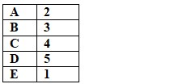  
  
Pilihan D merupakan jawaban paling tepat karena menunjukkan inisiatif dalam membangun jejaring kerja secara kolaboratif tanpa melampaui kewenangan sebagai anggota tim. Dengan mengusulkan secara terbuka dalam forum tim agar disepakati format dan alur kerja bersama, masalah perbedaan standar dapat dibahas dan diselesaikan secara kolektif sehingga meminimalkan kesalahpahaman serta saling menyalahkan antarinstansi, sehingga layak mendapat skor 5. Pilihan C berada satu tingkat di bawahnya karena menyampaikan masukan kepada pimpinan tim agar dibuat kesepakatan bersama tetap mencerminkan kepedulian terhadap kelancaran kerja sama, namun pendekatan ini lebih bersifat tidak langsung dan kurang menunjukkan peran aktif dalam membangun koordinasi di tingkat tim, sehingga layak mendapat skor 4. Pilihan B menunjukkan sikap kompromi dengan menyesuaikan hasil kerja sendiri agar selaras dengan pihak lain, tetapi tindakan ini bersifat individual dan tidak menyelesaikan akar permasalahan perbedaan standar kerja yang dialami bersama, sehingga layak mendapat skor 3. Pilihan A mencerminkan sikap pasif karena hanya menerima perbedaan cara kerja tanpa upaya perbaikan atau penyelarasan, sehingga berpotensi membuat masalah terus berulang, sehingga layak mendapat skor 2. Sementara itu, pilihan E merupakan sikap paling tidak tepat karena memilih untuk tidak terlibat dan tetap bekerja sesuai standar sendiri justru dapat memperbesar kesenjangan koordinasi dan melemahkan jejaring kerja lintas instansi, sehingga layak mendapat skor 1.

---

#### 12584 · no 13

Anda tergabung dalam tim lintas unit yang sedang menyusun laporan bersama. Salah satu unit meminta agar temuan yang kurang menguntungkan bagi mereka tidak dicantumkan demi menjaga citra. Jika ditolak, mereka mengisyaratkan akan mengurangi dukungan kerja sama ke depan. Apa sikap terbaik Anda? (Jejaring Kerja)

- **A.** Menyetujui usulan tersebut demi menjaga hubungan kerja sama antarunit.
- **B.** Menolak usulan tersebut karena rekomendasi harus disusun berdasarkan hasil evaluasi yang ada.
- **C.** Mengajak unit terkait membahas cara merumuskan rekomendasi yang tetap berlandaskan temuan lapangan namun disampaikan secara konstruktif.
- **D.** Menyampaikan kondisi tersebut kepada pimpinan tim agar diputuskan secara struktural.
- **E.** Mengurangi porsi rekomendasi tersebut agar tidak menimbulkan keberatan dari pihak lain.

**Kunci:** C

**Pembahasan:** SKOR JAWABAN:  
  
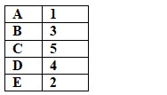  
  
Pilihan C merupakan jawaban paling tepat karena menunjukkan kemampuan menjaga jejaring kerja sekaligus mempertahankan integritas substansi pekerjaan. Dengan mengajak unit terkait membahas cara merumuskan rekomendasi yang tetap berlandaskan temuan lapangan namun disampaikan secara konstruktif, kebutuhan akan objektivitas tetap terpenuhi tanpa mengorbankan hubungan kerja sama. Sikap ini mencerminkan komunikasi yang dewasa, kolaboratif, dan berorientasi pada solusi bersama, sehingga layak mendapat skor 5. Pilihan D berada satu tingkat di bawahnya karena menyampaikan persoalan kepada pimpinan merupakan langkah yang sah dan aman secara struktural, namun pendekatan ini cenderung mengalihkan penyelesaian masalah ke pihak lain dan kurang menunjukkan upaya membangun kesepahaman langsung dalam jejaring kerja, sehingga layak mendapat skor 4. Pilihan B menunjukkan sikap menjunjung objektivitas dengan menolak usulan tersebut, tetapi penolakan tanpa upaya dialog berpotensi memicu ketegangan dan tidak membantu menjaga keberlanjutan kerja sama lintas unit, sehingga layak mendapat skor 3. Pilihan E berupaya meredam potensi konflik dengan mengurangi porsi rekomendasi, namun langkah ini tetap mengaburkan substansi evaluasi dan tidak menyelesaikan tekanan yang muncul secara prinsip, sehingga layak mendapat skor 2. Sementara itu, pilihan A menjadi yang paling tidak tepat karena mengorbankan integritas hasil kerja demi menjaga hubungan semu, yang dalam jangka panjang justru merusak kepercayaan dan profesionalitas dalam jejaring kerja, sehingga layak mendapat skor 1.

---

#### 12584 · no 14

Dalam kerja sama lintas instansi, mitra Anda melaksanakan kegiatan tanpa mengikuti alur koordinasi yang telah disepakati. Akibatnya, jadwal berbenturan dan muncul keluhan dari peserta. Setelah dikonfirmasi, mitra tersebut mengakui kesalahan dan khawatir hubungan kerja sama ke depan terganggu. Sikap Anda adalah (Jejaring Kerja)

- **A.** Menjadikan kejadian tersebut sebagai catatan evaluasi tanpa membahas tindak lanjut.
- **B.** Menganggap masalah selesai karena mitra telah mengakui kesalahan.
- **C.** Mengajak mitra mengevaluasi kejadian dan menyepakati langkah perbaikan agar tidak terulang.
- **D.** Mengurangi peran mitra pada kegiatan berikutnya untuk mencegah masalah serupa.
- **E.** Melaporkan kejadian tersebut kepada pimpinan tanpa melibatkan mitra dalam pembahasan solusi.

**Kunci:** C

**Pembahasan:** SKOR JAWABAN:  
  
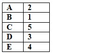  
  
Sikap paling tepat adalah opsi C karena menunjukkan upaya menjaga jejaring kerja melalui evaluasi bersama dan penyusunan langkah perbaikan yang disepakati, sehingga masalah diselesaikan tanpa menyalahkan dan kolaborasi tetap berjalan sehat, sehingga layak mendapat skor 5. Opsi E menekankan akuntabilitas melalui pelaporan kepada pimpinan, namun tidak melibatkan mitra dalam penyelesaian masalah sehingga berpotensi memperlebar jarak koordinasi, sehingga layak mendapat skor 4. Opsi D bertujuan mencegah kesalahan berulang dengan mengurangi peran mitra, tetapi langkah ini dapat menurunkan kepercayaan dan tidak menyentuh akar masalah, sehingga layak mendapat skor 3. Opsi A hanya menjadikan kejadian sebagai catatan evaluasi tanpa tindak lanjut perbaikan yang konkret, sehingga risiko kesalahan terulang tetap ada, sehingga layak mendapat skor 2. Sementara itu, opsi B mengabaikan dampak kesalahan meskipun sudah diakui dan tidak mencerminkan tanggung jawab dalam menjaga kualitas koordinasi jejaring kerja, sehingga layak mendapat skor 1.

---

#### 12584 · no 15

Anda berperan sebagai penghubung dalam kerja sama antara dinas kesehatan dan sebuah organisasi nonpemerintah pada program penyuluhan gizi di sekolah. Saat pelaksanaan, pihak NGO menilai jadwal kegiatan sering berubah sepihak, sementara dinas merasa perubahan dilakukan karena menyesuaikan agenda sekolah. Ketegangan mulai mengganggu kelancaran program. Sikap Anda adalah (Jejaring Kerja)

- **A.** Mengajak kedua pihak duduk bersama untuk mengevaluasi pola koordinasi dan menyepakati mekanisme penjadwalan yang lebih jelas.
- **B.** Meminta NGO menyesuaikan diri karena dinas memiliki kewenangan lebih besar dalam program pemerintah.
- **C.** Menyarankan program tetap berjalan sambil masalah koordinasi dibahas di akhir kegiatan.
- **D.** Menghentikan sementara kegiatan sampai masing-masing pihak memperbaiki koordinasi internal.
- **E.** Menyampaikan permasalahan tersebut kepada pimpinan tanpa melibatkan kedua pihak dalam pembahasan awal.

**Kunci:** A

**Pembahasan:** SKOR JAWABAN:  
  
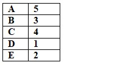  
  
Sikap paling tepat adalah opsi A karena mengedepankan peran koordinatif dalam jejaring kerja dengan mempertemukan kedua pihak untuk mengevaluasi pola komunikasi dan menyepakati mekanisme penjadwalan yang jelas, sehingga akar masalah dapat diselesaikan tanpa memperbesar konflik dan program tetap berjalan efektif, sehingga layak mendapat skor 5. Opsi C menunjukkan upaya menjaga kelangsungan program dengan menunda pembahasan konflik, namun tidak segera menyentuh sumber permasalahan sehingga berisiko menimbulkan gangguan berulang, sehingga layak mendapat skor 4. Opsi B cenderung berpihak pada salah satu pihak dengan alasan kewenangan, yang dapat merusak keseimbangan kemitraan dan menurunkan kepercayaan dalam jejaring kerja, sehingga layak mendapat skor 3. Opsi E menempuh jalur struktural dengan melapor ke pimpinan, tetapi mengabaikan fungsi mediasi awal yang seharusnya dilakukan pada level koordinasi, sehingga layak mendapat skor 2. Sementara itu, opsi D menghentikan kegiatan tanpa upaya penyelesaian bersama sehingga berpotensi merugikan tujuan program dan melemahkan kerja sama antar pihak, sehingga layak mendapat skor 1.

---

#### 12584 · no 16

Anda menjadi penghubung antara pemerintah daerah dan sebuah organisasi relawan lingkungan dalam program pengelolaan sampah terpadu. Dalam pelaksanaannya, relawan merasa kurang dilibatkan dalam pengambilan keputusan teknis, sementara pemerintah menilai relawan sering bergerak di luar kesepakatan awal. Ketegangan mulai muncul dan koordinasi melemah. Apa langkah terbaik yang Anda lakukan? (Jejaring Kerja)

- **A.** Meminta relawan mengikuti seluruh keputusan pemerintah agar program tetap terkendali.
- **B.** Menginisiasi forum evaluasi bersama untuk menyepakati ulang peran, batas kewenangan, dan mekanisme koordinasi.
- **C.** Membiarkan masing-masing pihak menjalankan perannya agar konflik mereda dengan sendirinya.
- **D.** Menyampaikan keluhan kedua pihak kepada pimpinan tanpa mempertemukan mereka.
- **E.** Mengurangi ruang keterlibatan relawan agar koordinasi lebih sederhana.

**Kunci:** B

**Pembahasan:** SKOR JAWABAN:  
  
  
  
Pilihan B paling tepat karena Anda menginisiasi forum evaluasi bersama untuk menyepakati ulang peran, batas kewenangan, dan mekanisme koordinasi. Langkah ini menunjukkan pendekatan kolaboratif, terbuka, dan berorientasi solusi jangka panjang. Dengan mempertemukan kedua pihak, potensi miskomunikasi dapat diselesaikan secara langsung dan hubungan kerja sama dapat diperkuat kembali, sehingga layak mendapat skor 5. Pilihan E mendapat skor 4 karena berupaya menyederhanakan koordinasi, namun dengan mengurangi keterlibatan relawan justru berisiko menurunkan partisipasi dan semangat kolaborasi. Pilihan D bernilai 3 karena menyampaikan keluhan kepada pimpinan dapat membantu, tetapi tidak menyelesaikan akar masalah karena kedua pihak tidak dipertemukan secara langsung. Pilihan A mendapat skor 2 karena cenderung sepihak dan tidak menghargai peran relawan, sehingga berpotensi memperbesar konflik. Sementara itu, pilihan C menjadi yang terendah karena membiarkan masing-masing pihak berjalan sendiri justru akan memperparah miskomunikasi dan melemahkan kerja sama dalam jangka panjang.

---

#### 12584 · no 17

Anda berperan sebagai penghubung dalam jejaring kerja program literasi digital bagi masyarakat. Pada tahap pelaksanaan, narasumber teknis yang biasanya mendampingi sesi praktik tiba-tiba tidak dapat mengikuti beberapa jadwal karena penugasan lain. Sementara itu, peserta sudah terdaftar dan pelatihan harus tetap berjalan sesuai rencana. Apa langkah paling tepat yang Anda ambil? (Jejaring Kerja)

- **A.** Mengatur pembagian tugas pendampingan kepada anggota tim lain yang memiliki kemampuan teknis sejenis agar kegiatan tetap berjalan.
- **B.** Menunda seluruh rangkaian pelatihan sampai narasumber utama dapat kembali mendampingi.
- **C.** Meminta narasumber utama menyiapkan panduan materi tertulis sebagai pegangan sementara bagi peserta.
- **D.** Mengalihkan sesi praktik menjadi pemaparan umum tanpa pendampingan teknis.
- **E.** Menyerahkan sepenuhnya pelaksanaan sesi kepada panitia lapangan tanpa pengawasan pendamping.

**Kunci:** A

**Pembahasan:** SKOR JAWABAN:  
  
  
  
Sikap paling tepat adalah opsi A karena menunjukkan kemampuan mengelola jejaring kerja secara adaptif dengan memanfaatkan sumber daya yang ada, yaitu membagi peran pendampingan kepada anggota tim lain yang memiliki kompetensi serupa sehingga kegiatan tetap berjalan tanpa mengorbankan kualitas pelaksanaan, sehingga layak mendapat skor 5. Opsi C merupakan alternatif yang cukup baik karena tetap melibatkan narasumber utama melalui penyediaan panduan tertulis, namun efektivitas pendampingan praktik tetap lebih rendah dibandingkan kehadiran fasilitator pengganti secara langsung, sehingga layak mendapat skor 4. Opsi D berupaya menjaga keberlangsungan kegiatan dengan mengubah bentuk sesi, tetapi mengurangi substansi pendampingan teknis yang menjadi tujuan utama program, sehingga layak mendapat skor 3. Opsi E menyerahkan pelaksanaan sepenuhnya kepada panitia lapangan tanpa dukungan pendamping yang memadai, sehingga berisiko menurunkan kualitas kegiatan dan melemahkan fungsi jejaring kerja, sehingga layak mendapat skor 2. Sementara itu, opsi B menunda seluruh kegiatan sampai narasumber utama kembali aktif tanpa mencari solusi alternatif, sehingga berpotensi mengecewakan peserta dan menghambat capaian program, sehingga layak mendapat skor 1.

---

#### 12584 · no 18

Anda menjadi koordinator kegiatan komunitas pemuda yang anggotanya berasal dari berbagai daerah dan kebiasaan sosial. Dalam beberapa pertemuan, sebagian anggota sering bercanda menggunakan gaya humor internal kelompoknya sendiri, yang tanpa disadari membuat anggota lain jarang terlibat dan memilih diam. Belum ada konflik terbuka, tetapi suasana kebersamaan mulai berkurang. Apa langkah paling tepat yang Anda ambil? (Sosial Budaya)

- **A.** Membiarkan gaya interaksi tersebut berjalan alami karena setiap kelompok memiliki cara bergaul masing-masing.
- **B.** Menyarankan anggota yang kurang nyaman untuk lebih aktif menyesuaikan diri agar tidak tertinggal.
- **C.** Mengajak anggota berdiskusi bersama untuk membangun pola interaksi yang saling menghargai dan inklusif.
- **D.** Mengurangi sesi diskusi bebas agar potensi ketidaknyamanan tidak muncul.
- **E.** Menetapkan aturan tegas mengenai cara bercanda dan berkomunikasi dalam setiap kegiatan.

**Kunci:** C

**Pembahasan:** SKOR JAWABAN:  
  
  
  
Sikap paling tepat adalah opsi C karena menunjukkan kepekaan sosial budaya dengan mengajak seluruh anggota berdiskusi untuk membangun pola interaksi yang lebih inklusif dan saling menghargai tanpa meniadakan ekspresi sosial masing-masing, sehingga kebersamaan dapat dipulihkan dan potensi jarak sosial dapat dicegah sejak awal, sehingga layak mendapat skor 5. Opsi E bertujuan menciptakan keteraturan melalui aturan tegas, namun berpotensi membatasi ekspresi sosial secara kaku dan kurang mendorong kesadaran bersama, sehingga layak mendapat skor 4. Opsi D berusaha menghindari sumber masalah dengan mengurangi ruang interaksi, tetapi langkah ini tidak menyelesaikan akar persoalan dan justru mengurangi kualitas kebersamaan, sehingga layak mendapat skor 3. Opsi A membiarkan kondisi berlangsung tanpa intervensi sehingga risiko eksklusivitas dan jarak sosial semakin besar, sehingga layak mendapat skor 2. Sementara itu, opsi B membebankan penyesuaian sepenuhnya kepada pihak yang merasa tidak nyaman dan tidak mencerminkan sikap inklusif dalam lingkungan multikultural, sehingga layak mendapat skor 1.

---

#### 12584 · no 19

Anda bertugas sebagai fasilitator dalam kegiatan musyawarah warga yang diikuti oleh peserta dari berbagai latar kebiasaan sosial. Selama pertemuan, sebagian warga terbiasa menyampaikan pendapat secara lugas dan langsung, sementara yang lain merasa cara tersebut terlalu keras dan kurang menghargai perasaan. Perbedaan ini mulai menghambat partisipasi beberapa peserta. Apa langkah paling tepat yang Anda lakukan? (Sosial Budaya)

- **A.** Meminta peserta menyampaikan pendapat dengan cara yang lebih halus agar tidak menyinggung pihak lain.
- **B.** Mengajak peserta menyepakati aturan penyampaian pendapat yang saling menghormati tanpa menghilangkan ciri komunikasi masing-masing.
- **C.** Memisahkan sesi musyawarah berdasarkan kelompok yang memiliki gaya komunikasi serupa.
- **D.** Mengarahkan pertemuan agar berjalan singkat dan langsung pada keputusan untuk menghindari perdebatan.
- **E.** Memberi ruang diskusi tidak resmi di luar forum utama agar peserta dapat menyampaikan pendapat dengan bebas.

**Kunci:** B

**Pembahasan:** SKOR JAWABAN:  
  
  
  
Sikap paling tepat adalah opsi B karena menunjukkan kemampuan mengelola perbedaan sosial budaya dengan melibatkan seluruh peserta untuk menyepakati aturan penyampaian pendapat yang saling menghormati tanpa meniadakan ciri komunikasi masing-masing, sehingga partisipasi dapat kembali merata dan suasana musyawarah tetap inklusif, sehingga layak mendapat skor 5. Opsi E memberi ruang alternatif bagi peserta untuk menyalurkan pendapat secara lebih bebas, namun tidak langsung menyelesaikan hambatan partisipasi yang terjadi di forum utama, sehingga layak mendapat skor 4. Opsi D berupaya meredam perbedaan dengan membatasi diskusi, tetapi berisiko mengurangi kualitas musyawarah dan kesempatan menyampaikan pandangan secara utuh, sehingga layak mendapat skor 3. Opsi A cenderung memihak salah satu gaya komunikasi dan berpotensi menekan ekspresi sebagian peserta, sehingga kurang mencerminkan sikap saling menghargai, sehingga layak mendapat skor 2. Sementara itu, opsi C memisahkan peserta berdasarkan gaya komunikasi sehingga berpotensi memperlebar jarak sosial dan bertentangan dengan semangat kebersamaan dalam lingkungan multikultural, sehingga layak mendapat skor 1.

---

#### 12584 · no 20

Anda menjadi pendamping kegiatan PKK di sebuah kelurahan. Dalam pelaksanaan program bulanan, muncul keluhan bahwa sebagian ibu PKK merasa ide dan usulan mereka jarang ditindaklanjuti karena keputusan lebih sering diambil oleh pengurus lama. Akibatnya, beberapa anggota mulai enggan hadir dalam kegiatan. Apa langkah paling tepat yang Anda lakukan? (Sosial Budaya)

- **A.** Membiarkan mekanisme yang ada berjalan karena pengurus lama dianggap lebih berpengalaman.
- **B.** Mengingatkan anggota PKK agar tetap menghormati keputusan pengurus inti.
- **C.** Mengajak pengurus dan anggota PKK menyepakati mekanisme penyaluran dan pembahasan usulan secara terbuka.
- **D.** Mengganti pengurus lama dengan anggota baru agar suasana lebih segar.
- **E.** Menyarankan anggota yang kurang puas menyampaikan keluhan secara pribadi kepada ketua PKK.

**Kunci:** C

**Pembahasan:** SKOR JAWABAN:  
  
  
  
Sikap paling tepat adalah opsi C karena menunjukkan kepekaan sosial budaya dengan membuka ruang dialog antara pengurus dan anggota PKK untuk menyepakati mekanisme penyaluran serta pembahasan usulan secara terbuka, sehingga setiap anggota merasa dihargai dan partisipasi dapat meningkat kembali, sehingga layak mendapat skor 5. Opsi E memberikan saluran penyampaian keluhan secara pribadi yang dapat meredam ketegangan sementara, namun tidak menyelesaikan persoalan secara kolektif dan berpotensi mengulang masalah yang sama, sehingga layak mendapat skor 4. Opsi D menawarkan perubahan struktural dengan mengganti pengurus lama, tetapi langkah ini berisiko menimbulkan konflik baru dan tidak menyentuh akar masalah komunikasi, sehingga layak mendapat skor 3. Opsi A mempertahankan pola lama tanpa evaluasi sehingga mengabaikan aspirasi anggota dan dapat memperkuat rasa ketidakadilan, sehingga layak mendapat skor 2. Sementara itu, opsi B hanya menekankan kepatuhan terhadap pengurus inti tanpa membuka ruang perbaikan, sehingga tidak mencerminkan upaya membangun kebersamaan dalam kegiatan PKK, sehingga layak mendapat skor 1.

---

#### 12584 · no 21

Anda bekerja di sebuah kantor pemerintah dengan pegawai dari latar belakang yang beragam. Dalam praktik sehari-hari, bantuan pekerjaan dan informasi lebih sering berputar di kelompok tertentu saja, sehingga sebagian pegawai merasa tersisih dan kurang dilibatkan. Situasi ini mulai mengganggu kerja tim. Apa sikap paling tepat yang Anda ambil? (Sosial Budaya)

- **A.** Menginisiasi forum kerja lintas tim untuk membahas pola kolaborasi tanpa menyinggung kelompok tertentu secara langsung.
- **B.** Mengajak pimpinan mengevaluasi budaya kerja yang berkembang dan menyusun mekanisme kolaborasi yang lebih inklusif.
- **C.** Menyampaikan kepada rekan kerja bahwa pola bantuan yang eksklusif dapat berdampak pada kinerja tim secara keseluruhan.
- **D.** Mengusulkan sistem rotasi tugas dan kerja kelompok agar interaksi antarpegawai lebih merata.
- **E.** Tetap bekerja seperti biasa sambil berharap dinamika tim membaik dengan sendirinya.

**Kunci:** A

**Pembahasan:** SKOR JAWABAN:  
  
  
  
Pilihan A paling tepat karena menginisiasi forum kerja lintas tim membantu membuka ruang komunikasi yang netral tanpa menyasar kelompok tertentu secara langsung, sehingga semua pegawai dapat menyampaikan pandangan dan bersama-sama membangun pola kolaborasi yang lebih inklusif tanpa memicu konflik personal, langkah ini juga menunjukkan inisiatif profesional dalam menjaga keharmonisan kerja tim dan memperbaiki sistem secara konstruktif sehingga layak mendapat skor 5, pilihan B tetap baik karena melibatkan pimpinan untuk evaluasi budaya kerja namun cenderung melewati upaya penyelesaian langsung di tingkat rekan kerja sehingga layak mendapat skor 4, pilihan D cukup membantu meningkatkan interaksi tetapi lebih berfokus pada teknis pembagian tugas daripada akar masalah komunikasi sehingga layak mendapat skor 3, pilihan C hanya berupa penyampaian pendapat yang berpotensi menimbulkan kesalahpahaman tanpa solusi sistematis sehingga layak mendapat skor 2, sedangkan pilihan E bersifat pasif dan tidak berkontribusi pada perbaikan situasi sehingga layak mendapat skor 1.

---

#### 12584 · no 22

Anda menjabat sebagai pimpinan unit kerja di instansi pemerintah yang pegawainya memiliki latar keyakinan dan budaya beragam. Menjelang peringatan hari besar nasional, muncul usulan agar kantor mengadakan kegiatan yang bernuansa keagamaan tertentu karena dianggap paling mencerminkan nilai moral, sementara pegawai lain mengusulkan kegiatan kebangsaan yang bersifat netral agar semua dapat terlibat. Perbedaan pandangan ini mulai memicu perdebatan internal. Apa sikap paling tepat yang Anda lakukan? (Sosial Budaya)

- **A.** Mengarahkan unit kerja untuk memilih satu bentuk kegiatan yang dinilai paling aman agar tidak memperpanjang perdebatan.
- **B.** Mengajak perwakilan pegawai berdiskusi untuk merumuskan bentuk kegiatan yang menonjolkan nilai kebangsaan tanpa mengabaikan sensitivitas keberagaman.
- **C.** Menetapkan dua kegiatan berbeda dalam waktu yang sama agar seluruh usulan dapat terakomodasi.
- **D.** Meminta pendapat pimpinan tertinggi lalu melaksanakan keputusan tersebut tanpa diskusi lanjutan.
- **E.** Menunda peringatan hingga seluruh pihak sepakat agar tidak menimbulkan ketegangan.

**Kunci:** B

**Pembahasan:** SKOR JAWABAN:  
  
  
  
Sikap paling tepat adalah opsi B karena mengedepankan pengelolaan perbedaan sosial budaya secara inklusif dengan melibatkan perwakilan pegawai untuk merumuskan bentuk kegiatan yang menonjolkan nilai kebangsaan sekaligus sensitif terhadap keberagaman keyakinan, sehingga semua pihak merasa dihargai dan kebersamaan tetap terjaga, sehingga layak mendapat skor 5. Opsi C berupaya mengakomodasi seluruh usulan dengan menetapkan dua kegiatan sekaligus, namun tanpa perumusan bersama langkah ini berpotensi menimbulkan fragmentasi partisipasi dan tidak menyelesaikan perbedaan pandangan, sehingga layak mendapat skor 4. Opsi A memilih jalan praktis dengan menetapkan satu kegiatan demi efisiensi, tetapi mengabaikan aspirasi sebagian pegawai dan dapat menimbulkan rasa tidak dilibatkan, sehingga layak mendapat skor 3. Opsi D menyerahkan keputusan sepenuhnya kepada pimpinan tertinggi tanpa dialog, sehingga partisipasi dan rasa memiliki pegawai terhadap kegiatan menjadi rendah, sehingga layak mendapat skor 2. Sementara itu, opsi E menunda kegiatan tanpa solusi yang jelas, sehingga berpotensi menghilangkan momentum kebersamaan dan tidak menyelesaikan perbedaan yang ada, sehingga layak mendapat skor 1.

---

#### 12584 · no 23

Anda adalah ASN di unit pelayanan publik. Di kantor, ada kebiasaan mendahulukan warga yang sudah dikenal. Praktik ini jarang dipermasalahkan, tetapi berpotensi merusak keadilan layanan. Sikap paling tepat adalah … (Sosial Budaya)

- **A.** Menyesuaikan diri dengan kebiasaan yang ada agar tidak menimbulkan gesekan internal.
- **B.** Menjaga pelayanan pribadi tetap adil tanpa ikut campur praktik rekan kerja.
- **C.** Mengajak tim mendiskusikan standar layanan yang sama bagi semua warga secara bertahap.
- **D.** Melaporkan kebiasaan tersebut kepada atasan agar segera dihentikan.
- **E.** Mengingatkan rekan kerja di hadapan warga agar menjadi pembelajaran bersama.

**Kunci:** C

**Pembahasan:** SKOR JAWABAN:  
  
  
  
Pilihan C merupakan jawaban paling tepat karena menunjukkan kemampuan mengelola perbedaan secara sistematis dan berorientasi pada perbaikan bersama, dengan mengajak tim berdiskusi untuk menyusun standar layanan yang lebih adil dan inklusif tanpa menyalahkan pihak tertentu, sehingga layak mendapatkan skor 5. Pilihan D mencerminkan ketegasan pimpinan, namun cenderung top-down dan berpotensi menimbulkan resistensi karena perubahan dilakukan tanpa proses dialog, sehingga hanya layak mendapatkan skor 4. Pilihan A menunjukkan upaya menjaga keharmonisan, tetapi mengorbankan prinsip keadilan dan profesionalisme dalam pelayanan, sehingga kurang tepat dan layak mendapatkan skor 3. Pilihan B bersifat pasif dan individual karena hanya menyesuaikan diri tanpa berkontribusi menyelesaikan masalah di tingkat tim, sehingga layak mendapatkan skor 2. Sementara itu, pilihan E tidak mencerminkan etika kerja dan kepemimpinan ASN karena berisiko mempermalukan rekan kerja serta memperkeruh suasana kerja, sehingga menjadi pilihan paling tidak tepat dan hanya layak mendapatkan skor 1.

---

#### 12584 · no 24

Anda bekerja sebagai ASN baru di sebuah instansi. Ada kebiasaan tidak tertulis bahwa pegawai junior ikut patungan rutin untuk kebutuhan pribadi atasan. Kebiasaan ini tidak pernah diwajibkan, tetapi penolakan berpotensi berdampak pada relasi kerja. Sikap paling tepat adalah… (Sosial Budaya)

- **A.** Menolak secara langsung dengan alasan prinsip, tanpa mempertimbangkan dampak relasi kerja.
- **B.** Mengikuti kebiasaan tersebut sambil menunda sikap sampai posisi Anda lebih aman.
- **C.** Menyampaikan keberatan secara personal dengan pendekatan profesional dan mencari titik temu yang tidak melanggar norma.
- **D.** Mengumpulkan dukungan rekan junior agar kebiasaan tersebut dihentikan bersama-sama.
- **E.** Mendokumentasikan praktik tersebut dan menyiapkan langkah formal jika tekanan berlanjut.

**Kunci:** C

**Pembahasan:** SKOR JAWABAN:  
  
  
  
Pilihan C merupakan jawaban paling tepat karena menunjukkan kemampuan menjaga nilai etika, norma organisasi, dan relasi kerja secara seimbang dengan menyampaikan keberatan secara personal dan profesional, sehingga masalah dapat disikapi tanpa konfrontasi terbuka maupun pelanggaran prinsip ASN, sehingga layak mendapatkan skor 5. Pilihan D mencerminkan keberanian dan upaya kolektif, namun berisiko memicu resistensi dan dinamika kelompok yang kurang sehat jika tidak melalui pendekatan struktural, sehingga layak mendapatkan skor 4. Pilihan E menunjukkan kewaspadaan dan kesiapan menghadapi tekanan lanjutan, tetapi cenderung reaktif dan belum mengedepankan penyelesaian sosial di tahap awal, sehingga layak mendapatkan skor 3. Pilihan A menekankan prinsip pribadi, namun mengabaikan konteks sosial dan potensi dampak relasi kerja sebagai ASN baru, sehingga layak mendapatkan skor 2. Sementara itu, pilihan B paling tidak tepat karena mencerminkan kompromi terhadap praktik yang menyimpang demi kenyamanan pribadi, yang berpotensi melanggengkan budaya tidak sehat, sehingga hanya layak mendapatkan skor 1.

---

#### 12584 · no 25

Dalam tim Anda, pegawai yang aktif di kegiatan informal kantor cenderung dianggap lebih loyal, sehingga lebih sering mendapat kesempatan pengembangan. Pegawai yang fokus bekerja mulai merasa dirugikan. Apa langkah paling tepat? (Sosial Budaya)

- **A.** Mendorong penyesuaian kriteria penilaian melalui jalur resmi dengan menekankan dampak jangka panjang terhadap profesionalisme.
- **B.** Menyarankan rekan kerja meningkatkan keterlibatan sosial agar tidak tertinggal peluang.
- **C.** Menerima kondisi tersebut sebagai bagian dari budaya organisasi yang sulit diubah.
- **D.** Menjaga jarak dari sistem penilaian dan fokus pada kinerja pribadi saja.
- **E.** Mengkritik kecenderungan tersebut secara terbuka agar pimpinan merasa tertekan.

**Kunci:** A

**Pembahasan:** SKOR JAWABAN:  
  
  
  
Pilihan A merupakan jawaban paling tepat karena menunjukkan pola pikir strategis dan berorientasi pada perbaikan sistem dengan mendorong penyesuaian kriteria penilaian melalui jalur resmi, sehingga profesionalisme dan keadilan organisasi dapat terjaga dalam jangka panjang, sehingga layak mendapatkan skor 5. Pilihan E menunjukkan keberanian menyuarakan kritik, namun dilakukan secara terbuka dan konfrontatif sehingga berpotensi menimbulkan konflik serta resistensi pimpinan, sehingga layak mendapatkan skor 4. Pilihan B bersifat adaptif terhadap budaya yang ada, tetapi cenderung menyarankan penyesuaian individu tanpa menyentuh akar ketidakadilan sistem, sehingga layak mendapatkan skor 3. Pilihan D bersikap pasif karena hanya berfokus pada kinerja pribadi tanpa kontribusi pada perbaikan lingkungan kerja, sehingga layak mendapatkan skor 2. Adapun pilihan C paling tidak tepat karena menerima kondisi yang tidak adil tanpa upaya perbaikan, yang bertentangan dengan nilai profesionalisme dan meritokrasi ASN, sehingga hanya layak mendapatkan skor 1.

---

#### 12584 · no 26

Di unit kerja Anda, ada kebiasaan berbagi akun aplikasi kerja agar tugas cepat selesai saat salah satu pegawai berhalangan. Suatu hari Anda diminta menggunakan akun milik rekan untuk mengunggah laporan karena tenggat sudah dekat. Apa sikap paling tepat yang Anda ambil? (Teknologi Informasi dan Komunikasi)

- **A.** Menggunakan akun tersebut karena sudah menjadi kebiasaan di tim.
- **B.** Menggunakan akun rekan hanya untuk tugas itu lalu keluar kembali.
- **C.** Menolak secara halus dan mengusulkan penggunaan akun resmi sesuai prosedur.
- **D.** Menggunakan akun rekan sambil mencatat aktivitas sebagai bentuk tanggung jawab.
- **E.** Menunda pengunggahan tanpa memberi penjelasan agar tidak terlibat risiko.

**Kunci:** C

**Pembahasan:** SKOR JAWABAN:  
  
  
  
Pilihan C merupakan jawaban paling tepat karena menunjukkan pemahaman terhadap etika dan keamanan penggunaan sistem teknologi informasi dengan tetap menjaga kepatuhan pada prosedur resmi, sekaligus disampaikan secara halus agar tidak merusak hubungan kerja, sehingga layak mendapatkan skor 5. Pilihan D berada satu tingkat di bawah karena meskipun ada upaya bertanggung jawab dengan mencatat aktivitas, penggunaan akun milik orang lain tetap melanggar prinsip keamanan dan akuntabilitas sistem, sehingga hanya layak mendapatkan skor 4. Pilihan B menunjukkan kesadaran risiko yang lebih baik dibanding mengikuti kebiasaan sepenuhnya, namun tetap membenarkan penggunaan akun bersama meski hanya sementara, sehingga belum sepenuhnya tepat dan layak mendapatkan skor 3. Pilihan A mencerminkan sikap permisif terhadap praktik yang salah dengan alasan kebiasaan dan efisiensi, yang berpotensi menimbulkan masalah keamanan dan akuntabilitas di kemudian hari, sehingga layak mendapatkan skor 2. Sementara itu, pilihan E menjadi yang paling tidak tepat karena bersikap pasif, tidak profesional, dan berpotensi menghambat pekerjaan tim tanpa komunikasi yang jelas, sehingga layak mendapatkan skor 1.

---

#### 12584 · no 27

Di unit kerja Anda, grup percakapan internal sering digunakan untuk koordinasi. Namun, belakangan beberapa pegawai mulai membagikan meme dan candaan yang berpotensi menyinggung serta mencampuradukkan urusan pribadi dengan informasi kerja. Kondisi ini mulai mengganggu fokus dan profesionalisme komunikasi. Sikap paling tepat adalah (Teknologi Informasi dan Komunikasi)

- **A.** Membiarkan kebiasaan tersebut karena grup percakapan bersifat informal.
- **B.** Keluar dari grup dan hanya berkomunikasi melalui jalur resmi lainnya.
- **C.** Mengusulkan kesepakatan penggunaan grup agar tetap fokus pada keperluan kerja.
- **D.** Menegur pengirim pesan secara langsung di dalam grup agar menjadi efek jera.
- **E.** Menyimpan bukti percakapan untuk berjaga-jaga jika terjadi masalah di kemudian hari.

**Kunci:** C

**Pembahasan:** SKOR JAWABAN:  
  
  
  
Pilihan C merupakan jawaban paling tepat karena menunjukkan kemampuan menjaga profesionalisme komunikasi digital dengan cara yang konstruktif, yaitu mengusulkan kesepakatan bersama agar penggunaan grup tetap fokus pada kepentingan kerja tanpa menyalahkan pihak tertentu, sehingga layak mendapatkan skor 5. Pilihan D berada di bawahnya karena meskipun bertujuan menghentikan perilaku yang tidak tepat, menegur secara langsung di dalam grup berpotensi menimbulkan rasa tidak nyaman dan konflik terbuka, sehingga hanya layak mendapatkan skor 4. Pilihan E menunjukkan sikap berjaga-jaga, tetapi bersifat pasif dan tidak menyelesaikan akar masalah komunikasi yang mengganggu, sehingga layak mendapatkan skor 3. Pilihan B mencerminkan upaya menghindari masalah dengan menarik diri dari grup, namun langkah ini dapat menghambat koordinasi kerja dan tidak mencerminkan tanggung jawab sebagai bagian dari tim, sehingga layak mendapatkan skor 2. Sementara itu, pilihan A menjadi yang paling tidak tepat karena membiarkan komunikasi tidak profesional terus berlangsung dan berpotensi merusak etika serta efektivitas kerja, sehingga layak mendapatkan skor 1.

---

#### 12584 · no 28

Di kantor Anda mulai digunakan aplikasi berbasis kecerdasan buatan untuk membantu menyusun draf laporan. Beberapa rekan langsung menyalin hasil aplikasi tersebut tanpa meninjau ulang isinya. Anda diminta ikut menggunakan cara yang sama agar pekerjaan cepat selesai. Sikap paling tepat adalah (Teknologi Informasi dan Komunikasi)

- **A.** Menggunakan hasil aplikasi sepenuhnya karena tujuannya membantu efisiensi kerja.
- **B.** Menggunakan aplikasi sebagai referensi awal lalu menyesuaikan isi sesuai konteks dan tanggung jawab pekerjaan.
- **C.** Menolak penggunaan aplikasi apa pun karena berisiko menurunkan kualitas kerja.
- **D.** Menggunakan aplikasi hanya untuk bagian yang bersifat umum tanpa koreksi lanjutan.
- **E.** Mengikuti cara rekan kerja agar tidak dianggap menghambat proses tim.

**Kunci:** B

**Pembahasan:** SKOR JAWABAN:  
  
  
  
Pilihan B merupakan jawaban paling tepat karena menunjukkan pemanfaatan teknologi secara bijak dengan tetap menempatkan tanggung jawab profesional pada ASN, yaitu menggunakan aplikasi kecerdasan buatan sebagai alat bantu awal sambil tetap meninjau, menyesuaikan, dan memastikan isi laporan sesuai konteks serta akurat, sehingga layak mendapatkan skor 5. Pilihan D berada sedikit di bawah karena sudah ada upaya membatasi penggunaan aplikasi hanya pada bagian umum, namun masih kurang optimal karena tidak menekankan kewajiban pengecekan dan penyesuaian secara menyeluruh, sehingga layak mendapatkan skor 4. Pilihan C mencerminkan kehati-hatian terhadap risiko teknologi, tetapi bersifat terlalu kaku dan menutup peluang peningkatan efisiensi kerja yang sebenarnya dapat dikelola dengan baik, sehingga layak mendapatkan skor 3. Pilihan A menunjukkan pemahaman yang kurang tepat karena menyerahkan sepenuhnya hasil kerja pada aplikasi tanpa kontrol manusia, yang berisiko menurunkan kualitas dan akuntabilitas pekerjaan, sehingga layak mendapatkan skor 2. Sementara itu, pilihan E menjadi yang paling tidak tepat karena lebih mengutamakan tekanan sosial daripada prinsip profesionalisme dan tanggung jawab kerja, sehingga layak mendapatkan skor 1.

---

#### 12584 · no 29

Di unit kerja Anda, terdapat kebiasaan menggunakan template presentasi lama yang desainnya kurang ramah akses (tulisan kecil, kontras rendah), padahal audiens rapat sering berasal dari berbagai usia dan latar belakang. Anda diminta menyiapkan materi presentasi berikutnya. Apa langkah paling tepat? (Teknologi Informasi dan Komunikasi)

- **A.** Menggunakan template lama agar konsisten dengan kebiasaan unit.
- **B.** Mengubah desain presentasi agar lebih ramah akses sambil tetap menjaga substansi materi.
- **C.** Mengikuti template lama lalu menjelaskan isi secara lisan lebih detail.
- **D.** Mengusulkan perubahan desain setelah rapat selesai agar tidak mengganggu jadwal.
- **E.** Menyerahkan desain sepenuhnya kepada rekan yang biasa membuat presentasi.

**Kunci:** B

**Pembahasan:** SKOR JAWABAN:  
  
  
  
Jawaban B paling tepat karena menunjukkan pemanfaatan teknologi informasi yang peka terhadap kebutuhan pengguna dengan latar belakang yang beragam, di mana perbaikan desain presentasi seperti ukuran teks dan kontras warna membantu audiens memahami materi tanpa mengubah isi utama, sehingga layak mendapatkan skor 5. Pilihan D masih cukup baik karena ada kesadaran untuk melakukan perbaikan, namun menundanya membuat masalah aksesibilitas tetap terjadi pada rapat yang sedang berlangsung, sehingga layak mendapatkan skor 4. Pilihan C berada di tingkat berikutnya karena meskipun berusaha mengompensasi desain yang kurang ramah akses melalui penjelasan lisan, cara ini kurang efektif dan tidak menyelesaikan akar masalah, sehingga layak mendapatkan skor 3. Pilihan E menunjukkan sikap pasif karena menyerahkan sepenuhnya kepada rekan tanpa memastikan kualitas dan keterbacaan materi presentasi, sehingga layak mendapatkan skor 2. Sementara itu, pilihan A merupakan opsi paling tidak tepat karena mempertahankan kebiasaan lama tanpa mempertimbangkan efektivitas penyampaian informasi kepada audiens, sehingga layak mendapatkan skor 1.

---

#### 12584 · no 30

Di unit kerja Anda, pegawai terbiasa menyimpan file kerja di perangkat pribadi masing-masing dengan penamaan yang berbeda-beda. Saat salah satu pegawai cuti mendadak, pekerjaan tertunda karena file sulit ditemukan dan tidak sinkron. Anda diminta memberi masukan perbaikan. Apa langkah paling tepat? (Teknologi Informasi dan Komunikasi)

- **A.** Mengingatkan pegawai agar lebih rapi menyimpan file di perangkat masing-masing.
- **B.** Menyusun kesepakatan penamaan file dan lokasi penyimpanan bersama yang mudah diakses.
- **C.** Menyarankan pegawai mencadangkan file secara mandiri agar tidak hilang.
- **D.** Menunggu pimpinan menetapkan aturan resmi terkait pengelolaan file.
- **E.** Meminta pegawai yang cuti tetap dihubungi jika file dibutuhkan.

**Kunci:** B

**Pembahasan:** SKOR JAWABAN:  
  
  
  
Pilihan B merupakan jawaban paling tepat karena menunjukkan pemahaman TIK yang berorientasi pada efektivitas kerja tim dan keberlanjutan sistem, dengan menyusun kesepakatan penamaan file serta lokasi penyimpanan bersama sehingga informasi mudah diakses, risiko ketergantungan pada individu berkurang, dan kolaborasi tetap berjalan meski ada pegawai berhalangan, sehingga layak mendapatkan skor 5. Pilihan D mencerminkan kepatuhan terhadap struktur organisasi, namun terlalu pasif karena menunggu kebijakan formal tanpa inisiatif perbaikan di level unit kerja, sehingga hanya layak mendapatkan skor 4. Pilihan C menunjukkan kesadaran akan pentingnya pencadangan data, tetapi masih bersifat individual dan tidak menyelesaikan masalah keterpaduan akses file tim, sehingga layak mendapatkan skor 3. Pilihan A menekankan kerapian pribadi tanpa solusi sistemik, sehingga dampaknya terbatas dan hanya layak mendapatkan skor 2. Sementara itu, pilihan E sangat tidak tepat karena mencampuradukkan urusan pribadi dan pekerjaan serta berpotensi melanggar etika dan efisiensi kerja, sehingga layak mendapatkan skor 1.

---

#### 12584 · no 31

Sekolah Anda mulai menggunakan sistem ujian berbasis komputer. Saat simulasi, beberapa siswa terlihat saling memotret layar soal menggunakan ponsel yang disembunyikan, sementara pengawas belum menyadari hal tersebut. Jika Anda menjadi panitia pelaksana, langkah paling tepat adalah … (Teknologi Informasi dan Komunikasi)

- **A.** Menghentikan simulasi dan langsung menyita seluruh ponsel siswa tanpa penjelasan lebih lanjut.
- **B.** Membiarkan simulasi berjalan karena belum terbukti terjadi pelanggaran serius.
- **C.** Mengevaluasi sistem pengawasan dan pengaturan teknis ujian agar celah penyalahgunaan teknologi dapat diminimalkan.
- **D.** Memberikan sanksi kepada seluruh siswa peserta simulasi agar menimbulkan efek jera.
- **E.** Menghapus hasil simulasi dan mengulang ujian dengan soal yang sama di hari lain.

**Kunci:** C

**Pembahasan:** SKOR JAWABAN:  
  
  
  
Pilihan C paling tepat karena fokus pada perbaikan sistem pengawasan dan pengaturan teknis ujian membantu mencegah penyalahgunaan teknologi secara menyeluruh, bukan hanya menangani kejadian saat itu saja, sehingga simulasi benar-benar berfungsi sebagai bahan evaluasi untuk meningkatkan keamanan pelaksanaan ujian berbasis komputer di masa depan, langkah ini bersifat preventif, objektif, dan profesional sehingga layak mendapat skor 5, pilihan E masih cukup baik karena menjaga integritas ujian dengan mengulang simulasi namun belum menyentuh akar masalah pada sistem pengawasan sehingga layak mendapat skor 4, pilihan A menunjukkan ketegasan tetapi terlalu reaktif dan kurang edukatif sehingga layak mendapat skor 3, pilihan D bersifat tidak adil karena memberi sanksi menyeluruh tanpa pembuktian individual sehingga layak mendapat skor 2, sedangkan pilihan B membiarkan potensi pelanggaran terus terjadi tanpa upaya perbaikan sehingga layak mendapat skor 1.

---

#### 12584 · no 32

Di instansi Anda diterapkan sistem arsip digital yang mencatat jejak aktivitas pengguna, seperti waktu membuka, mengedit, dan mengunduh dokumen. Beberapa pegawai merasa tidak nyaman karena aktivitas kerjanya menjadi sangat terpantau, meskipun sistem tersebut bertujuan meningkatkan akuntabilitas. Sikap paling tepat adalah (Teknologi Informasi dan Komunikasi)

- **A.** Menolak menggunakan sistem arsip digital karena berpotensi melanggar privasi pegawai.
- **B.** Menggunakan sistem secara minimal agar aktivitas tidak terlalu terekam.
- **C.** Menggunakan sistem sesuai ketentuan sambil mendorong kejelasan batas pemanfaatan data aktivitas.
- **D.** Mengabaikan rasa tidak nyaman karena pengawasan merupakan konsekuensi teknologi modern.
- **E.** Menyampaikan keberatan secara terbuka kepada publik agar instansi mengevaluasi kebijakannya.

**Kunci:** C

**Pembahasan:** SKOR JAWABAN:  
  
  
  
Pilihan C merupakan jawaban paling tepat karena menunjukkan sikap profesional dalam pemanfaatan teknologi informasi dengan tetap mematuhi sistem arsip digital sebagai alat akuntabilitas, sekaligus bersikap kritis dan konstruktif dengan mendorong kejelasan batas penggunaan data aktivitas agar tidak melanggar privasi pegawai, sehingga layak mendapatkan skor 5. Pilihan E mencerminkan kepedulian terhadap isu transparansi, namun cara menyampaikan keberatan ke ranah publik tanpa melalui mekanisme internal berpotensi menimbulkan citra negatif institusi dan konflik kebijakan, sehingga hanya layak mendapatkan skor 4. Pilihan D menunjukkan penerimaan terhadap teknologi, tetapi bersifat pasif dan mengabaikan aspek etika serta kenyamanan kerja pegawai, sehingga kurang optimal dan layak mendapatkan skor 3. Pilihan A terlihat tegas dalam membela privasi, namun tidak realistis karena menolak sistem resmi tanpa menawarkan solusi alternatif yang seimbang antara pengawasan dan akuntabilitas, sehingga layak mendapatkan skor 2. Sementara itu, pilihan B mencerminkan sikap menghindari tanggung jawab dengan memanipulasi penggunaan sistem, yang bertentangan dengan prinsip integritas ASN dan tata kelola TIK yang baik, sehingga menjadi pilihan paling tidak tepat dan hanya layak mendapatkan skor 1.

---

#### 12584 · no 33

Anda ditugaskan membantu sebuah unit kerja yang baru beralih menggunakan sistem tiket digital untuk pengaduan internal. Dalam praktiknya, banyak pegawai memilih menyampaikan keluhan lewat chat pribadi karena merasa sistem terlalu rumit dan takut laporannya tercatat permanen. Akibatnya, data pengaduan tidak terdokumentasi dengan baik. Apa langkah paling tepat yang Anda lakukan? (Teknologi Informasi dan Komunikasi)

- **A.** Menegaskan bahwa seluruh pengaduan wajib masuk sistem tanpa pengecualian.
- **B.** Menyederhanakan alur penggunaan sistem dan menjelaskan manfaatnya bagi perlindungan pelapor.
- **C.** Membiarkan dua jalur berjalan bersamaan agar pegawai tidak merasa tertekan.
- **D.** Mengambil alih penginputan laporan agar pegawai tidak perlu menggunakan sistem langsung.
- **E.** Mengusulkan evaluasi sistem setelah semua pegawai terbiasa dengan penggunaan digital.

**Kunci:** B

**Pembahasan:** SKOR JAWABAN:  
  
  
  
Pilihan B merupakan jawaban paling tepat karena menunjukkan pemahaman TIK yang berorientasi pada perubahan perilaku pengguna dengan cara memperbaiki pengalaman penggunaan sistem sekaligus memberikan edukasi mengenai manfaat dokumentasi digital dan perlindungan data pelapor, sehingga mendorong adopsi sistem secara berkelanjutan dan layak mendapatkan skor 5. Pilihan E mencerminkan sikap reflektif terhadap efektivitas sistem, namun bersifat reaktif karena evaluasi baru dilakukan setelah masalah berlangsung cukup lama, sehingga hanya layak mendapatkan skor 4. Pilihan D menunjukkan upaya membantu secara praktis, tetapi tidak menyelesaikan akar masalah karena ketergantungan pegawai tetap tinggi dan pemanfaatan sistem tidak meningkat, sehingga layak mendapatkan skor 3. Pilihan A menekankan kepatuhan aturan, namun mengabaikan aspek psikologis pengguna dan berpotensi menimbulkan resistensi terhadap sistem digital, sehingga hanya layak mendapatkan skor 2. Sementara itu, pilihan C justru melemahkan tujuan transformasi digital karena membiarkan praktik informal terus berlangsung dan data tidak terdokumentasi dengan baik, sehingga menjadi pilihan paling tidak tepat dan hanya layak mendapatkan skor 1.

---

#### 12584 · no 34

Anda bertugas mengelola akun resmi instansi untuk kegiatan internal. Suatu pagi, Anda mendapati ada unggahan di akun tersebut yang menampilkan tangkapan layar sistem internal, termasuk nama pengguna dan sebagian informasi teknis. Unggahan itu sudah dilihat banyak orang, tetapi belum ada klarifikasi dari siapa pun. Apa langkah paling tepat yang segera Anda lakukan? (Teknologi Informasi dan Komunikasi)

- **A.** Menghapus unggahan tersebut secepatnya tanpa penjelasan agar tidak menarik perhatian lebih luas.
- **B.** Menyimpan bukti unggahan, mengamankan akun, lalu melaporkan kejadian kepada atasan dan tim terkait.
- **C.** Membiarkan unggahan tetap ada sambil menunggu arahan resmi dari pimpinan.
- **D.** Memberikan klarifikasi di kolom komentar bahwa unggahan tersebut tidak bermasalah.
- **E.** Mengganti kata sandi akun setelah unggahan dihapus dan menganggap masalah selesai.

**Kunci:** B

**Pembahasan:** SKOR JAWABAN:  
  
  
  
Pilihan B paling tepat karena langkah menyimpan bukti, mengamankan akun, dan segera melaporkan kejadian menunjukkan penanganan insiden yang sistematis dan profesional, sehingga masalah keamanan dapat ditelusuri sekaligus dicegah agar tidak berulang, tindakan ini juga menjaga akuntabilitas dan koordinasi dengan pihak terkait sehingga layak mendapat skor 5, pilihan E cukup baik karena ada upaya pengamanan akun tetapi terlalu menyederhanakan masalah dan mengabaikan proses pelaporan resmi sehingga layak mendapat skor 4, pilihan A membantu membatasi penyebaran informasi sensitif namun kurang lengkap karena tidak disertai pengamanan dan pelaporan sehingga layak mendapat skor 3, pilihan D berisiko menyesatkan publik dan tidak menyentuh aspek keamanan sehingga layak mendapat skor 2, sedangkan pilihan C membiarkan potensi risiko keamanan terus berlangsung tanpa tindakan cepat sehingga layak mendapat skor 1.

---

#### 12584 · no 35

Di unit kerja Anda, beberapa pegawai lebih sering berbagi informasi penting secara informal melalui percakapan pribadi, bukan lewat kanal resmi tim. Akibatnya, Anda dan beberapa rekan lain kerap tertinggal informasi yang berdampak pada pelaksanaan tugas. Sebagai bagian dari tim, sikap profesional yang paling tepat adalah… (Profesionalisme)

- **A.** Mencari tahu informasi secara mandiri agar pekerjaan tetap berjalan tanpa perlu bergantung pada rekan lain.
- **B.** Meminta agar setiap informasi penting selalu disampaikan melalui media kerja resmi dengan pendekatan kolaboratif.
- **C.** Menyesuaikan diri dengan kebiasaan tersebut agar tidak tertinggal arus informasi.
- **D.** Menyampaikan keluhan secara pribadi kepada rekan yang sering berbagi informasi terbatas.
- **E.** Melaporkan pola komunikasi tersebut kepada pimpinan sebagai bentuk ketidakterbukaan tim.

**Kunci:** B

**Pembahasan:** SKOR JAWABAN:  
  
  
  
Pilihan B merupakan jawaban paling tepat karena menunjukkan sikap profesional yang berorientasi pada perbaikan sistem kerja dengan mendorong penggunaan kanal komunikasi resmi secara kolaboratif, sehingga seluruh anggota tim memperoleh informasi yang sama dan pekerjaan dapat berjalan lebih efektif, sehingga layak mendapatkan skor 5. Pilihan E mencerminkan kepedulian terhadap kinerja tim, namun bersifat eskalatif dan berpotensi menimbulkan ketegangan karena melibatkan pimpinan tanpa upaya perbaikan komunikasi terlebih dahulu di tingkat tim, sehingga layak mendapatkan skor 4. Pilihan D menunjukkan upaya menyampaikan keberatan, tetapi dilakukan secara personal dan terbatas sehingga dampaknya tidak menyentuh akar masalah komunikasi tim secara menyeluruh, sehingga layak mendapatkan skor 3. Pilihan A bersifat individualistis karena hanya berfokus pada penyelamatan tugas pribadi tanpa berkontribusi memperbaiki pola kerja bersama, sehingga layak mendapatkan skor 2. Sementara itu, pilihan C mencerminkan sikap tidak profesional karena menormalisasi praktik komunikasi yang tidak inklusif dan berpotensi merugikan kinerja tim dalam jangka panjang, sehingga hanya layak mendapatkan skor 1.

---

#### 12584 · no 36

Anda bertugas melakukan final review laporan evaluasi kinerja program sebelum diserahkan ke pimpinan. Secara umum laporan sudah sesuai, namun Anda menemukan satu indikator penilaian yang disajikan dengan pilihan kata ambigu sehingga bisa menimbulkan penafsiran terlalu positif dibanding kondisi sebenarnya. Tenggat pengumpulan laporan tinggal beberapa jam lagi. Sikap Anda… ((Profesionalisme)

- **A.** Membiarkan redaksi tetap seperti semula karena tidak ada data yang dimanipulasi secara langsung.
- **B.** Mengoreksi redaksi indikator tersebut dan menyampaikan alasannya kepada tim penyusun sebelum laporan dikirim.
- **C.** Menyederhanakan bahasa laporan agar lebih singkat tanpa mengubah substansi indikator.
- **D.** Menyerahkan laporan apa adanya dan menyampaikan catatan tersebut secara lisan jika diminta pimpinan.
- **E.** Menghapus indikator tersebut agar tidak menimbulkan salah tafsir di kemudian hari.

**Kunci:** B

**Pembahasan:** SKOR JAWABAN:  
  
  
  
Pilihan B merupakan jawaban paling tepat karena mencerminkan profesionalisme melalui upaya menjaga akurasi, kejujuran, dan tanggung jawab substansi laporan dengan memperbaiki redaksi yang berpotensi menyesatkan serta mengomunikasikan alasannya secara terbuka kepada tim sebelum laporan diserahkan, sehingga layak mendapatkan skor 5. Pilihan D menunjukkan kesadaran terhadap potensi masalah, namun bersifat pasif karena membiarkan laporan tetap dikirim tanpa perbaikan dan hanya mengandalkan klarifikasi lisan jika diminta, sehingga layak mendapatkan skor 4. Pilihan C berupaya mengurangi risiko melalui penyederhanaan bahasa, tetapi tidak secara langsung menyelesaikan persoalan utama terkait ambiguitas makna indikator, sehingga layak mendapatkan skor 3. Pilihan A kurang mencerminkan integritas profesional karena mengabaikan potensi bias penafsiran demi mengejar tenggat waktu, sehingga hanya layak mendapatkan skor 2. Sementara itu, pilihan E merupakan tindakan tidak tepat karena menghilangkan indikator penting tanpa dasar prosedural dan berpotensi merusak kelengkapan laporan, sehingga layak mendapatkan skor 1.

---

#### 12584 · no 37

Anda menjadi anggota tim kecil yang sedang menyusun jadwal kerja proyek lintas bagian. Di tengah proses, salah satu rekan meminta penyesuaian jadwal karena alasan pribadi, tetapi perubahan tersebut berpotensi membebani anggota tim lain dan mempersempit waktu penyelesaian. Tidak ada aturan tertulis yang dilanggar, namun keputusan Anda akan memengaruhi dinamika kerja tim. Sikap paling profesional yang sebaiknya Anda ambil adalah … (Profesionalisme)

- **A.** Menyetujui penyesuaian jadwal demi menjaga hubungan baik dengan rekan tersebut.
- **B.** Menolak permintaan tersebut karena berisiko mengganggu target tim secara keseluruhan.
- **C.** Mengajak tim membahas opsi penyesuaian yang tetap adil tanpa memberatkan pihak lain.
- **D.** Menyerahkan keputusan sepenuhnya kepada pimpinan agar tidak terlibat konflik.
- **E.** Menunda keputusan sambil melihat perkembangan situasi kerja ke depan.

**Kunci:** C

**Pembahasan:** SKOR JAWABAN:  
  
  
  
Pilihan C paling tepat karena mengajak seluruh tim berdiskusi menunjukkan sikap profesional yang menyeimbangkan empati terhadap kebutuhan individu dan tanggung jawab terhadap kepentingan bersama, sehingga keputusan yang diambil tetap adil dan transparan tanpa membebani pihak lain sehingga layak mendapat skor 5, pilihan D cukup baik karena melibatkan pimpinan dapat membantu meredakan konflik tetapi menunjukkan kurangnya inisiatif dalam menyelesaikan masalah di tingkat tim sehingga layak mendapat skor 4, pilihan B berfokus pada kepentingan target kerja namun cenderung kaku dan kurang mempertimbangkan aspek kemanusiaan sehingga layak mendapat skor 3, pilihan A lebih mengutamakan hubungan pribadi daripada keadilan bagi tim sehingga layak mendapat skor 2, sedangkan pilihan E menunjukkan sikap pasif yang berpotensi memperbesar masalah sehingga layak mendapat skor 1.

---

#### 12584 · no 38

Anda mendapat tugas menyusun laporan kinerja bulanan tim. Saat mengolah data, Anda melihat ada satu target utama yang tidak tercapai karena kesalahan koordinasi di awal pekerjaan. Biasanya, hal seperti ini tidak terlalu dibahas dan laporan dibuat agar terlihat aman. Secara aturan, laporan tetap bisa disusun tanpa masalah. Sikap paling profesional yang sebaiknya Anda lakukan adalah (Profesionalisme)

- **A.** Menyusun laporan dengan bahasa yang dibuat lebih positif agar tidak menurunkan penilaian tim.
- **B.** Menyajikan hasil apa adanya disertai penjelasan penyebab dan rencana perbaikan ke depan.
- **C.** Tidak memasukkan indikator tersebut agar laporan tetap terlihat rapi.
- **D.** Menuliskan capaian seolah sudah membaik meskipun perbaikannya belum sepenuhnya berjalan.
- **E.** Menunggu instruksi pimpinan sebelum menentukan isi laporan.

**Kunci:** B

**Pembahasan:** SKOR JAWABAN:  
  
  
  
Pilihan B merupakan jawaban paling tepat karena menunjukkan sikap profesional yang jujur, bertanggung jawab, dan berorientasi pada perbaikan, dengan menyajikan hasil kinerja apa adanya sekaligus menjelaskan penyebab kegagalan serta rencana tindak lanjut sehingga laporan tetap akuntabel dan dapat menjadi dasar evaluasi yang konstruktif, sehingga layak mendapatkan skor 5. Pilihan E mencerminkan kehati-hatian dan kepatuhan pada hierarki, namun kurang menunjukkan inisiatif profesional karena tanggung jawab penyusunan laporan seharusnya tetap dijalankan secara mandiri sesuai tugas yang diberikan, sehingga layak mendapatkan skor 4. Pilihan D menunjukkan upaya menjaga citra tim, tetapi tidak mencerminkan integritas karena menampilkan kondisi yang belum sesuai fakta, sehingga hanya layak mendapatkan skor 3. Pilihan A berusaha mengamankan penilaian tim dengan cara mengaburkan kondisi sebenarnya, namun mengorbankan transparansi dan fungsi laporan sebagai alat evaluasi, sehingga kurang tepat dan layak mendapatkan skor 2. Sementara itu, pilihan C merupakan sikap paling tidak profesional karena sengaja menghilangkan indikator penting dan menyesatkan pembaca laporan, sehingga hanya layak mendapatkan skor 1.

---

#### 12584 · no 39

Anda ditugaskan sebagai anggota tim yang menilai hasil kerja sebuah proyek internal. Dalam rapat evaluasi, atasan meminta Anda menyampaikan pendapat. Anda mengetahui bahwa salah satu rekan satu tim melakukan kesalahan kecil yang tidak fatal, tetapi jika disebutkan bisa memengaruhi penilaian terhadapnya. Di sisi lain, evaluasi ini akan menjadi dasar perbaikan kerja ke depan. Sikap paling profesional yang Anda lakukan adalah … (Profesionalisme)

- **A.** Tidak menyampaikan temuan tersebut agar tidak merusak hubungan kerja.
- **B.** Menyampaikan evaluasi secara jujur dengan fokus pada perbaikan, bukan menyalahkan individu.
- **C.** Menunggu rekan lain menyampaikan terlebih dahulu lalu menyesuaikan pendapat Anda.
- **D.** Menyampaikan kesalahan tersebut secara rinci agar atasan mengetahui semuanya.
- **E.** Membahas kesalahan tersebut di luar rapat agar tidak muncul dalam forum resmi.

**Kunci:** B

**Pembahasan:** SKOR JAWABAN:  
  
  
  
Pilihan B merupakan jawaban paling tepat karena menunjukkan sikap profesional dengan menyampaikan evaluasi secara jujur namun tetap berorientasi pada perbaikan kinerja tim, bukan pada menyalahkan individu, sehingga masukan yang diberikan tetap objektif, konstruktif, dan bermanfaat untuk peningkatan kualitas kerja ke depan, sehingga layak mendapatkan skor 5. Pilihan D mencerminkan keterbukaan, tetapi penyampaian kesalahan secara rinci berpotensi menimbulkan rasa tidak nyaman dan menurunkan semangat kerja jika tidak disertai pendekatan yang proporsional, sehingga hanya layak mendapatkan skor 4. Pilihan C menunjukkan sikap berhati-hati, namun cenderung pasif karena tidak mencerminkan tanggung jawab profesional dalam menyampaikan penilaian secara mandiri, sehingga layak mendapatkan skor 3. Pilihan A berupaya menjaga hubungan kerja, tetapi mengorbankan prinsip objektivitas dan kesempatan perbaikan kinerja, sehingga kurang tepat dan layak mendapatkan skor 2. Sementara itu, pilihan E tidak mencerminkan etika profesional karena menghindari forum resmi dan berpotensi menimbulkan kesalahpahaman atau gosip, sehingga menjadi pilihan paling tidak tepat dan hanya layak mendapatkan skor 1.

---

#### 12584 · no 40

Anda bekerja dalam satu tim pelayanan. Saat jam kerja masih berlangsung, ada rekan yang sering meninggalkan meja untuk urusan pribadi sehingga tugas pelayanan sering dialihkan ke Anda tanpa konfirmasi. Jika dibiarkan, kondisi ini berpotensi menimbulkan ketidakadilan kerja. Sikap paling profesional yang sebaiknya Anda lakukan adalah … (Profesionalisme)

- **A.** Menerima tambahan tugas tersebut agar pelayanan tetap berjalan lancar.
- **B.** Menyampaikan keberatan secara santai kepada rekan tersebut dan menyepakati pembagian tugas yang lebih jelas.
- **C.** Mengurangi kualitas pekerjaan sebagai bentuk protes tidak langsung.
- **D.** Menghindari rekan tersebut dan hanya fokus pada tugas sendiri.
- **E.** Melaporkan perilaku tersebut ke atasan tanpa mencoba menyelesaikannya terlebih dahulu.

**Kunci:** B

**Pembahasan:** SKOR JAWABAN:  
  
  
  
Pilihan B merupakan jawaban paling tepat karena menunjukkan sikap profesional dengan mengedepankan komunikasi langsung, terbuka, dan berorientasi pada solusi melalui kesepakatan pembagian tugas yang adil tanpa memperkeruh suasana kerja, sehingga layak mendapatkan skor 5. Pilihan E mencerminkan ketegasan, namun terlalu cepat membawa masalah ke atasan tanpa upaya penyelesaian di tingkat rekan kerja, sehingga berpotensi menimbulkan ketegangan dan hanya layak mendapatkan skor 4. Pilihan A menunjukkan sikap kooperatif, tetapi jika dilakukan terus-menerus justru memperkuat kebiasaan tidak adil dan mengorbankan profesionalisme, sehingga layak mendapatkan skor 3. Pilihan D bersifat pasif dan tidak menyentuh akar masalah karena hanya menghindari rekan kerja tanpa memperbaiki pola kerja tim, sehingga layak mendapatkan skor 2. Sementara itu, pilihan C tidak mencerminkan etika kerja karena menurunkan kualitas pelayanan dan berpotensi merugikan organisasi serta pengguna layanan, sehingga menjadi pilihan paling tidak tepat dan hanya layak mendapatkan skor 1.

---

#### 12584 · no 41

Anda menjadi ASN yang bertugas mengelola akun media sosial instansi. Suatu hari, Anda menemukan kolom komentar berisi ajakan mengikuti kanal tertentu yang sering membingkai isu nasional dengan narasi kebencian dan memecah belah, meskipun tidak secara terang-terangan menyebut ideologi ekstrem. Beberapa pegawai menganggap hal tersebut tidak perlu ditanggapi karena bukan unggahan resmi instansi. Sikap paling tepat yang Anda lakukan adalah… (Anti Radikalisme)

- **A.** Membiarkan komentar tersebut karena tidak berkaitan langsung dengan tugas instansi.
- **B.** Menghapus komentar tanpa tindak lanjut agar kolom tetap bersih
- **C.** Menyampaikan temuan tersebut kepada tim pengelola dan menyusun langkah penanganan yang sesuai kebijakan komunikasi publik.
- **D.** Menanggapi komentar tersebut secara pribadi untuk meluruskan pandangan yang disampaikan.
- **E.** Menutup kolom komentar sementara agar tidak muncul perdebatan.

**Kunci:** C

**Pembahasan:** SKOR JAWABAN:  
  
  
  
Pilihan C merupakan jawaban paling tepat karena menunjukkan sikap waspada terhadap potensi penyebaran paham yang mengarah pada radikalisme dengan tetap mengedepankan prosedur dan etika kerja ASN, yaitu menyampaikan temuan kepada tim pengelola serta menyusun langkah penanganan yang sesuai kebijakan komunikasi publik sehingga respons yang diambil tidak bersifat reaktif, personal, atau gegabah, sehingga layak mendapatkan skor 5. Pilihan D menunjukkan kepedulian dan keberanian meluruskan narasi, namun dilakukan secara personal dan berisiko memicu perdebatan terbuka yang justru memperluas jangkauan pesan bermuatan kebencian, sehingga hanya layak mendapatkan skor 4. Pilihan B terlihat cepat dan praktis, tetapi bersifat reaktif karena hanya menghapus tanpa upaya pencegahan lanjutan atau pembelajaran bagi tim, sehingga layak mendapatkan skor 3. Pilihan E bertujuan menjaga kondusivitas, namun menutup kolom komentar justru mengorbankan ruang komunikasi publik yang sehat dan tidak menyentuh akar masalah, sehingga layak mendapatkan skor 2. Sementara itu, pilihan A paling tidak tepat karena sikap membiarkan menunjukkan kurangnya kepekaan terhadap potensi penyebaran paham radikal di ruang publik instansi, sehingga hanya layak mendapatkan skor 1.

---

#### 12584 · no 42

Anda menjadi anggota tim pengelola kegiatan kepemudaan di instansi. Dalam salah satu sesi diskusi, seorang peserta mulai menyampaikan pandangan yang membenarkan penggunaan kekerasan atas nama perjuangan tertentu dan mendapat respons setuju dari beberapa peserta lain. Situasi masih terkendali, tetapi berpotensi memengaruhi peserta lain. Sikap paling tepat yang Anda lakukan adalah… (Anti-radikalisme)

- **A.** Membiarkan diskusi berjalan agar semua pendapat tersalurkan secara terbuka.
- **B.** Menghentikan diskusi secara sepihak dan membubarkan sesi tersebut.
- **C.** Meluruskan pandangan tersebut dengan pendekatan dialogis dan menegaskan nilai kebangsaan serta hukum yang berlaku.
- **D.** Menegur peserta tersebut setelah kegiatan selesai agar tidak menimbulkan konflik saat forum berlangsung.
- **E.** Melaporkan peserta tersebut kepada pimpinan tanpa melakukan intervensi dalam forum

**Kunci:** C

**Pembahasan:** SKOR JAWABAN:  
  
  
  
Pilihan C merupakan jawaban paling tepat karena menunjukkan kemampuan mencegah penyebaran paham radikal secara dini melalui pendekatan dialogis, edukatif, dan kontekstual dengan tetap menjaga suasana forum tetap kondusif serta menegaskan nilai kebangsaan dan hukum tanpa bersikap represif, sehingga layak mendapatkan skor 5. Pilihan E menunjukkan kewaspadaan terhadap potensi radikalisme, namun bersifat reaktif dan melewatkan kesempatan klarifikasi serta edukasi langsung di forum, sehingga layak mendapatkan skor 4. Pilihan D mencerminkan kehati-hatian, tetapi kurang efektif karena membiarkan pandangan bermasalah berkembang tanpa penyeimbang saat forum berlangsung, sehingga layak mendapatkan skor 3. Pilihan B memang menghentikan potensi risiko, tetapi dilakukan secara sepihak dan berisiko menimbulkan resistensi serta rasa tidak adil, sehingga hanya layak mendapatkan skor 2. Sementara itu, pilihan A paling tidak tepat karena sikap membiarkan dapat memperkuat normalisasi kekerasan dan paham radikal di ruang diskusi, sehingga hanya layak mendapatkan skor 1.

---

#### 12584 · no 43

Anda bertugas mengelola konten internal organisasi. Dalam proses kurasi materi, Anda menemukan bahan bacaan yang secara halus menyudutkan kelompok tertentu dan menanamkan sikap eksklusif, meskipun tidak mengandung ajakan kekerasan secara langsung. Materi tersebut rencananya akan dibagikan ke seluruh anggota. Apa langkah paling tepat?… (Anti-radikalisme)

- **A.** Tetap membagikan materi karena tidak melanggar aturan secara eksplisit.
- **B.** Menghapus materi tersebut tanpa penjelasan agar tidak menimbulkan polemik.
- **C.** Mengganti materi dengan konten yang lebih inklusif dan memperkuat nilai kebhinekaan.
- **D.** Membagikan materi tersebut dengan catatan agar pembaca bersikap kritis.
- **E.** Menunggu arahan pimpinan tanpa melakukan penilaian awal.

**Kunci:** C

**Pembahasan:** SKOR JAWABAN:  
  
  
  
Pilihan C merupakan jawaban paling tepat karena menunjukkan sikap proaktif dalam mencegah penyebaran narasi eksklusif yang berpotensi mengarah pada radikalisme dengan menggantinya menggunakan konten yang lebih inklusif dan sejalan dengan nilai kebangsaan, sehingga layak mendapatkan skor 5. Pilihan D menunjukkan kesadaran akan potensi masalah, namun tetap berisiko karena materi bermuatan bias tetap tersebar dan dapat disalahpahami oleh pembaca, sehingga layak mendapatkan skor 4. Pilihan B bersifat cepat dan aman secara praktis, tetapi kurang edukatif karena tidak disertai upaya membangun pemahaman yang lebih sehat, sehingga layak mendapatkan skor 3. Pilihan E menunjukkan kehati-hatian, namun terlalu pasif dan berpotensi membiarkan konten bermasalah lolos tanpa penyaringan awal, sehingga layak mendapatkan skor 2. Sementara itu, pilihan A paling tidak tepat karena mengabaikan dampak jangka panjang dari narasi eksklusif terhadap sikap dan pola pikir anggota, sehingga hanya layak mendapatkan skor 1.

---

#### 12584 · no 44

Anda menjadi panitia kegiatan orientasi pegawai baru. Dalam salah satu sesi informal, beredar ajakan bergabung ke komunitas tertentu yang mengklaim paling benar dan meminta anggotanya membatasi interaksi dengan pihak di luar kelompok. Ajakan tersebut mulai menarik perhatian beberapa peserta. Sikap paling tepat yang Anda lakukan adalah… (Anti-radikalisme)

- **A.** Membiarkan ajakan tersebut karena belum ada pelanggaran yang terlihat jelas.
- **B.** Mengingatkan peserta agar berhati-hati tanpa menyinggung isi ajakan tersebut.
- **C.** Menyisipkan penguatan nilai kebangsaan dan keterbukaan dalam sesi lanjutan kegiatan.
- **D.** Melarang seluruh bentuk komunitas di luar kegiatan resmi kantor.
- **E.** Mengumpulkan nama peserta yang tertarik untuk dilaporkan ke atasan.

**Kunci:** C

**Pembahasan:** SKOR JAWABAN:  
  
  
  
Pilihan C merupakan jawaban paling tepat karena menunjukkan upaya pencegahan radikalisme secara halus dan preventif melalui penguatan nilai kebangsaan, keterbukaan, dan kebersamaan tanpa menimbulkan stigma atau resistensi di kalangan peserta, sehingga layak mendapatkan skor 5. Pilihan E menunjukkan kewaspadaan, namun cenderung represif dan berpotensi menimbulkan ketakutan serta salah sasaran karena belum ada pelanggaran nyata, sehingga layak mendapatkan skor 4. Pilihan B mencerminkan kehati-hatian, tetapi kurang menyentuh akar masalah karena tidak memberikan penyeimbang nilai yang jelas terhadap ajakan eksklusif, sehingga layak mendapatkan skor 3. Pilihan D terlalu berlebihan dan tidak proporsional karena membatasi ruang sosial secara ekstrem yang justru bisa memicu penolakan, sehingga hanya layak mendapatkan skor 2. Sementara itu, pilihan A paling tidak tepat karena sikap membiarkan dapat membuat paham eksklusif berkembang tanpa kontrol, sehingga hanya layak mendapatkan skor 1.

---

#### 12584 · no 45

Dalam diskusi daring internal, Anda melihat unggahan rekan kerja yang membagikan konten provokatif berisi narasi ketidakpercayaan terhadap negara dan ajakan menarik diri dari sistem yang ada. Unggahan tersebut mendapat beberapa tanda suka, namun belum ditanggapi secara terbuka. Apa langkah paling tepat……

- **A.** Mengabaikan unggahan tersebut agar tidak memperbesar isu.
- **B.** Menegur rekan tersebut secara terbuka di kolom komentar.
- **C.** Menyampaikan klarifikasi dan sudut pandang alternatif secara santun berbasis fakta.
- **D.** Melaporkan unggahan tersebut tanpa melakukan interaksi apa pun.
- **E.** Meminta admin menghapus unggahan tanpa penjelasan.

**Kunci:** C

**Pembahasan:** SKOR JAWABAN:  
  
  
  
Pilihan C merupakan jawaban paling tepat karena menunjukkan sikap dewasa dan profesional dalam menangkal narasi radikal dengan cara dialogis, berbasis fakta, dan tetap menjaga etika komunikasi tanpa mempermalukan pihak lain, sehingga layak mendapatkan skor 5. Pilihan D menunjukkan kesadaran terhadap risiko penyebaran paham bermasalah, namun bersifat reaktif dan melewatkan kesempatan edukasi langsung yang konstruktif, sehingga layak mendapatkan skor 4. Pilihan E cukup aman secara teknis, tetapi kurang mendidik karena hanya menghilangkan konten tanpa memperbaiki pemahaman, sehingga layak mendapatkan skor 3. Pilihan B tidak tepat karena berpotensi memicu konflik terbuka dan memperkeruh suasana diskusi, sehingga hanya layak mendapatkan skor 2. Sementara itu, pilihan A paling tidak tepat karena sikap diam dapat memperkuat persepsi bahwa narasi provokatif tersebut dapat diterima, sehingga hanya layak mendapatkan skor 1.

---

## TRY OUT SKD CASN 2027 - PART 28

### TWK

#### 12585 · no 1

Pasal 28B ayat (2) UUD 1945 menjamin hak anak untuk tumbuh dan berkembang serta memperoleh perlindungan dari kekerasan dan diskriminasi. Penerapan ketentuan tersebut yang paling tepat dalam kehidupan sehari-hari adalah …

- **A.** Orang tua membiasakan pola asuh yang menghargai pilihan anak tanpa tekanan berlebihan.
- **B.** Anak mengikuti kegiatan pendidikan yang mendukung pengembangan minat dan bakatnya.
- **C.** Sekolah membangun sistem pembelajaran yang menjamin keamanan dan perlindungan seluruh peserta didik.
- **D.** Masyarakat membangun lingkungan sosial yang adil dan aman bagi seluruh anggota masyarakat.
- **E.** Pemerintah mendorong peningkatan kualitas pendidikan untuk mendukung masa depan anak.

**Kunci:** C

**Pembahasan:** Pasal 28B ayat (2) UUD 1945 secara tegas menekankan hak anak untuk tumbuh dan berkembang serta memperoleh perlindungan dari kekerasan dan diskriminasi. Oleh karena itu, implementasi yang paling tepat harus bersifat langsung, konkret, dan secara spesifik melindungi anak dari ancaman tersebut dalam kehidupan sehari-hari. Opsi C paling tepat karena menunjukkan peran sekolah sebagai lingkungan utama anak dalam menyediakan sistem pembelajaran yang aman dan melindungi peserta didik dari kekerasan maupun perlakuan diskriminatif, sehingga hak anak terlindungi secara nyata. Opsi A mencerminkan pola asuh yang baik, namun fokus pada kebebasan dan kenyamanan psikologis anak tanpa penekanan langsung pada aspek perlindungan dari kekerasan dan diskriminasi. Opsi B berkaitan dengan pengembangan minat dan bakat yang mendukung tumbuh kembang anak, tetapi tidak menekankan perlindungan. Opsi D menggambarkan nilai keadilan dan keamanan sosial secara umum, namun terlalu luas dan tidak spesifik pada perlindungan anak. Opsi E bersifat kebijakan makro dan tidak menunjukkan penerapan langsung dalam kehidupan sehari-hari anak. Dengan demikian, jawaban yang paling tepat adalah C.  
  
Jawaban: C.

---

#### 12585 · no 2

Berdasarkan pasal 14 ayat 2 UUD 1945 Presiden memiliki kewenangan memberikan amnesti dan abolisi dengan tujuan yang berbeda. Penerapan yang paling tepat untuk membedakan kedua kewenangan tersebut adalah …

- **A.** Amnesti menghapus akibat hukum pidana seseorang, sedangkan abolisi menghentikan proses penuntutan pidana.
- **B.** Amnesti dan abolisi sama-sama diberikan setelah adanya putusan pengadilan berkekuatan hukum tetap.
- **C.** Amnesti diberikan pada tahap pemeriksaan perkara, sedangkan abolisi diberikan setelah putusan dijatuhkan.
- **D.** Amnesti menghapus kesalahan pelaku, sedangkan abolisi memulihkan hak dan kedudukan hukum.
- **E.** Amnesti dan abolisi diberikan melalui putusan pengadilan atas permohonan terpidana.

**Kunci:** A

**Pembahasan:** Dalam sistem hukum Indonesia, amnesti dan abolisi merupakan hak prerogatif Presiden yang diberikan dalam konteks kepentingan negara dan kemanusiaan, serta memiliki tujuan dan akibat hukum yang berbeda. Amnesti diberikan untuk menghapus akibat hukum pidana yang telah dijatuhkan kepada seseorang, sehingga status hukum terpidana tidak lagi dibebani akibat pidana tersebut. Sementara itu, abolisi diberikan untuk menghentikan proses penuntutan pidana sebelum perkara diputus oleh pengadilan, sehingga proses hukum tidak dilanjutkan ke tahap putusan. Oleh karena itu, opsi A paling tepat karena secara jelas membedakan fungsi utama amnesti dan abolisi sesuai ketentuan hukum yang berlaku. Opsi B dan C keliru karena menempatkan abolisi pada tahap setelah putusan, padahal abolisi justru diberikan sebelum putusan dijatuhkan. Opsi D salah memahami akibat hukum dari kedua kewenangan tersebut, sedangkan opsi E tidak tepat karena amnesti dan abolisi merupakan kewenangan Presiden, bukan hasil putusan pengadilan. Dengan demikian, jawaban yang paling tepat adalah A.  
  
Jawaban: A.

---

#### 12585 · no 3

Perhatikan pernyataan berikut ini!  
  
1) Menjaga keutuhan wilayah NKRI dengan mengamankan perbatasan darat dan laut.  
  
2) Memandang wilayah darat, laut, dan udara sebagai satu kesatuan wilayah negara  
  
3) Mengembangkan kebijakan daerah kepulauan sesuai potensi dan karakteristik lokal.  
  
4) Mengelola sumber daya laut sebagai kekayaan nasional untuk kepentingan seluruh rakyat  
  
5) Melestarikan budaya maritim sebagai bagian dari identitas bangsa Indonesia.  
  
6) Meningkatkan kesejahteraan masyarakat pesisir melalui program pembangunan daerah  
  
Manakah yang merupakan bentuk implementasi Pasal 25A UUD 1945 tentang NKRI sebagai negara kepulauan (negara Nusantara)?

- **A.** 1, 3, dan 6
- **B.** 2, 3, dan 5
- **C.** 1, 2, dan 4
- **D.** 3, 4, dan 6
- **E.** 2, 5, dan 6

**Kunci:** C

**Pembahasan:** Pasal 25A UUD 1945 menegaskan bahwa Indonesia adalah negara kepulauan yang berciri Nusantara, sehingga seluruh wilayah darat, laut, dan udara dipandang sebagai satu kesatuan yang utuh, termasuk kekayaan alam di dalamnya, serta dikelola untuk kepentingan nasional. Implementasi pasal ini harus mencerminkan cara pandang kesatuan wilayah dan orientasi kepentingan nasional, bukan semata-mata pembangunan atau kebijakan daerah. Pernyataan (1) mencerminkan upaya menjaga keutuhan dan kedaulatan wilayah NKRI sebagai negara kepulauan. Pernyataan (2) secara langsung menegaskan inti Pasal 25A, yaitu memandang wilayah darat, laut, dan udara sebagai satu kesatuan wilayah negara. Pernyataan (4) menunjukkan pengelolaan sumber daya laut sebagai kekayaan nasional yang dimanfaatkan untuk kepentingan seluruh rakyat Indonesia. Sebaliknya, pernyataan (3), (5), dan (6) bernilai positif, namun lebih menekankan aspek pembangunan daerah, pelestarian budaya, dan kesejahteraan lokal, sehingga tidak secara langsung mencerminkan esensi Pasal 25A tentang kesatuan wilayah Nusantara. Oleh karena itu, kombinasi pernyataan yang paling tepat adalah 1, 2, dan 4.  
  
Jawaban: C.

---

#### 12585 · no 4

Pancasila berkedudukan sebagai paradigma pembangunan nasional yang menjadi kerangka acuan dalam merancang dan melaksanakan pembangunan di berbagai bidang. Sikap yang paling tepat mencerminkan kedudukan tersebut adalah …

- **A.** Menyusun kebijakan pembangunan yang mendorong pertumbuhan ekonomi agar daya saing nasional meningkat.
- **B.** Menjalankan program pembangunan secara berkelanjutan dengan menyesuaikan kebutuhan masyarakat.
- **C.** Menempatkan keberhasilan pembangunan fisik sebagai ukuran utama kemajuan bangsa.
- **D.** Mengarahkan pembangunan agar berlandaskan nilai keadilan sosial dan kesejahteraan seluruh rakyat.
- **E.** Mendorong partisipasi masyarakat dalam pembangunan sesuai peran dan kapasitas masing-masing.

**Kunci:** D

**Pembahasan:** Pancasila sebagai paradigma pembangunan berarti bahwa seluruh arah dan kebijakan pembangunan nasional harus berlandaskan nilai-nilai Pancasila sebagai kerangka dasar, bukan semata-mata pada pertimbangan teknis, ekonomi, atau kepentingan sektoral. Dalam konteks ini, pembangunan tidak hanya diukur dari pertumbuhan atau keberhasilan fisik, tetapi dari sejauh mana pembangunan tersebut mampu mewujudkan keadilan sosial dan kesejahteraan bagi seluruh rakyat. Opsi D paling tepat karena secara langsung menempatkan nilai keadilan sosial dan kesejahteraan rakyat sebagai orientasi utama pembangunan, sesuai dengan fungsi Pancasila sebagai paradigma pembangunan nasional. Opsi A menekankan pertumbuhan dan daya saing yang penting, tetapi lebih bersifat tujuan ekonomi. Opsi B menyoroti keberlanjutan dan kebutuhan masyarakat, namun masih berada pada tataran pendekatan kebijakan. Opsi C terlalu sempit karena menjadikan pembangunan fisik sebagai ukuran utama kemajuan bangsa. Opsi E menekankan partisipasi masyarakat yang merupakan mekanisme pelaksanaan, bukan kerangka nilai pembangunan. Dengan demikian, jawaban yang paling tepat adalah D.  
  
Jawaban: D.

---

#### 12585 · no 5

Butir sila ke-5 Pancasila yang berbunyi “Suka memberi pertolongan kepada orang lain agar dapat berdiri sendiri” paling tepat tercermin dalam sikap berikut …

- **A.** Memberikan bantuan sosial kepada masyarakat kurang mampu untuk meringankan beban hidup sehari-hari.
- **B.** Menyalurkan bantuan dana kepada kelompok rentan agar kebutuhan dasarnya dapat terpenuhi.
- **C.** Menggalang donasi bersama sebagai bentuk tanggung jawab sosial terhadap sesama yang membutuhkan.
- **D.** Membantu masyarakat yang membutuhkan melalui program bantuan kemanusiaan secara berkala.
- **E.** Memberikan bantuan disertai pelatihan keterampilan dan pendampingan agar penerima mampu mandiri.

**Kunci:** E

**Pembahasan:** Butir sila ke-5 Pancasila menegaskan bahwa pertolongan kepada sesama harus berorientasi pada kemandirian, sehingga bantuan tidak berhenti pada pemenuhan kebutuhan sesaat, melainkan memberdayakan penerima agar mampu berdiri sendiri. Opsi E paling tepat karena menggabungkan bantuan dengan pelatihan keterampilan dan pendampingan, yang secara langsung membangun kapasitas dan kemandirian penerima sesuai tujuan keadilan sosial. Opsi A dan B bernilai positif karena membantu meringankan beban dan memenuhi kebutuhan dasar, namun sifatnya masih konsumtif dan berdampak jangka pendek. Opsi C juga baik karena menekankan tanggung jawab sosial, tetapi fokusnya pada penggalangan bantuan tanpa jaminan adanya proses pemberdayaan menuju kemandirian. Opsi D menunjukkan kepedulian yang berkelanjutan, namun jika tidak disertai pemberdayaan, berisiko menumbuhkan ketergantungan. Oleh karena itu, pilihan yang paling tepat adalah E.  
  
Jawaban: E.

---

#### 12585 · no 6

Perhatikan pernyataan berikut ini!  
  
1) Memperlakukan setiap orang secara setara tanpa membedakan latar belakang apa pun.  
  
2) Menumbuhkan sikap empati dalam berinteraksi dengan sesama di lingkungan masyarakat.  
  
3) Mengedepankan kepentingan bersama demi menjaga stabilitas sosial.  
  
4) Menghargai martabat dan hak setiap manusia secara adil dan beradab.  
  
5) Menyesuaikan kebijakan sosial agar sejalan dengan nilai dan norma masyarakat setempat.  
  
6) Menolak segala bentuk perlakuan tidak adil terhadap individu atau kelompok tertentu.  
  
Manakah yang paling mencerminkan manfaat penerapan sila ke-2 Pancasila dalam mencegah sikap diskriminatif?

- **A.** 1, 2, dan 3
- **B.** 2, 3, dan 5
- **C.** 1, 4, dan 6
- **D.** 1, 4, dan 5
- **E.** 3, 5, dan 6

**Kunci:** C

**Pembahasan:** Sila ke-2 Pancasila menegaskan pengakuan terhadap martabat manusia yang setara serta perlakuan yang adil dan beradab tanpa diskriminasi. Manfaat penerapan sila ini dalam kehidupan sosial adalah mencegah perlakuan tidak adil terhadap individu atau kelompok tertentu. Pernyataan (1) menunjukkan perlakuan setara, (4) menegaskan penghargaan terhadap martabat dan hak asasi manusia, dan (6) secara langsung menolak segala bentuk ketidakadilan, sehingga paling relevan dalam mencegah sikap diskriminatif. Pernyataan (2) dan (3) bernilai positif karena mendukung harmoni sosial, namun tidak secara langsung menargetkan pencegahan diskriminasi. Pernyataan (5) terlihat baik, tetapi penyesuaian kebijakan terhadap norma tertentu justru berpotensi membuka ruang diskriminasi jika tidak dikontrol oleh prinsip keadilan. Oleh karena itu, kombinasi yang paling tepat adalah 1, 4, dan 6.  
  
Jawaban: C.

---

#### 12585 · no 7

Peringatan 1 Juni sebagai Hari Lahir Pancasila tidak hanya bersifat seremonial, tetapi memiliki makna penting bagi kehidupan berbangsa di tengah keberagaman. Sikap yang paling tepat dalam memaknai peringatan tersebut adalah …

- **A.** Mengikuti upacara peringatan sebagai bentuk penghormatan terhadap Pancasila dan sejarah bangsa.
- **B.** Menjadikan nilai-nilai Pancasila sebagai pedoman bersikap dalam menyikapi perbedaan di masyarakat.
- **C.** Menghafalkan rumusan Pancasila agar tidak melupakan jati diri bangsa.
- **D.** Menjaga ketertiban sosial demi menciptakan suasana kehidupan yang aman dan harmonis.
- **E.** Menghargai simbol-simbol negara sebagai wujud rasa cinta tanah air terhadap bangsa Indonesia.

**Kunci:** B

**Pembahasan:** Peringatan 1 Juni sebagai Hari Lahir Pancasila memiliki makna penting sebagai momentum untuk meneguhkan kembali Pancasila sebagai pedoman hidup dalam kehidupan berbangsa, terutama di tengah keberagaman masyarakat Indonesia saat ini. Makna tersebut tidak cukup diwujudkan melalui kegiatan simbolik atau seremonial semata, melainkan melalui pengamalan nilai Pancasila dalam sikap dan perilaku sehari-hari. Opsi B paling tepat karena menekankan penerapan nilai-nilai Pancasila sebagai pedoman bersikap dalam menyikapi perbedaan di masyarakat, yang merupakan tantangan nyata kehidupan berbangsa dewasa ini. Opsi A bernilai positif karena menunjukkan penghormatan terhadap sejarah bangsa, namun cenderung bersifat seremonial. Opsi C juga baik karena berkaitan dengan pemahaman Pancasila, tetapi masih terbatas pada aspek kognitif tanpa menjamin pengamalan nilai. Opsi D mencerminkan sikap menjaga ketertiban dan harmoni sosial, namun lebih berfungsi sebagai dampak lanjutan, bukan inti pemaknaan Hari Lahir Pancasila. Opsi E menunjukkan rasa cinta tanah air melalui penghargaan simbol negara, tetapi masih bersifat simbolik dan tidak langsung mencerminkan pengamalan nilai Pancasila. Oleh karena itu, pilihan yang paling tepat adalah B.  
  
Jawaban: B.

---

#### 12585 · no 8

Peristiwa Rengasdengklok mencerminkan dinamika pemikiran para tokoh bangsa menjelang Proklamasi Kemerdekaan. Makna paling tepat dari peristiwa tersebut bagi proses kemerdekaan Indonesia adalah …

- **A.** Munculnya perbedaan cara pandang yang mendorong percepatan pengambilan keputusan penting bangsa.
- **B.** Terjadinya perdebatan antar generasi yang memperkaya strategi perjuangan menuju kemerdekaan.
- **C.** Dorongan kuat golongan muda agar proklamasi segera dilakukan karena situasi politik global.
- **D.** Dinamika perbedaan strategi perjuangan yang tetap diarahkan pada tujuan kemerdekaan nasional.
- **E.** Proses pendewasaan sikap politik para tokoh bangsa dalam menghadapi situasi yang mendesak

**Kunci:** D

**Pembahasan:** Peristiwa Rengasdengklok mencerminkan perbedaan pandangan dan strategi perjuangan antara golongan muda dan golongan tua dalam menyikapi momentum kemerdekaan Indonesia yang sangat mendesak. Golongan muda mendorong percepatan proklamasi, sementara golongan tua mempertimbangkan aspek politis dan strategis, namun seluruh dinamika tersebut tetap berlandaskan pada tujuan yang sama, yaitu mewujudkan kemerdekaan nasional. Makna utama peristiwa ini terletak pada dinamika perbedaan strategi yang tidak memecah perjuangan, melainkan justru menjadi bagian dari proses pengambilan keputusan bangsa menuju kemerdekaan. Opsi D paling tepat karena secara utuh menangkap esensi tersebut, yakni adanya perbedaan strategi perjuangan yang tetap diarahkan pada tujuan kemerdekaan nasional. Opsi A benar karena menunjukkan adanya perbedaan cara pandang, tetapi terlalu menekankan aspek percepatan keputusan tanpa menggambarkan kesatuan tujuan perjuangan. Opsi B relevan karena memang terjadi perdebatan antar generasi, namun fokusnya lebih pada dinamika internal dan belum menyentuh makna strategis nasional. Opsi C bersifat deskriptif terhadap dorongan golongan muda, sehingga lebih menggambarkan peristiwa, bukan makna utamanya. Opsi E bersifat reflektif dan interpretatif sehingga kurang tepat untuk menggambarkan makna historis yang paling substansial dari Peristiwa Rengasdengklok.  
  
Jawaban: D.

---

#### 12585 · no 9

Filosofi pendidikan Taman Siswa menekankan pendidikan yang memerdekakan serta membentuk karakter kebangsaan. Dalam konteks perbaikan pendidikan Indonesia saat ini, aspek yang paling mendesak untuk dibenahi agar sejalan dengan semangat tersebut adalah …

- **A.** Penguatan pendidikan karakter dan kemandirian peserta didik dalam proses pembelajaran.
- **B.** Peningkatan standar akademik agar lulusan mampu bersaing di tingkat global.
- **C.** Penyesuaian kurikulum nasional dengan kebutuhan industri dan dunia kerja.
- **D.** Pemerataan sarana dan prasarana pendidikan untuk mengurangi kesenjangan antardaerah.
- **E.** Optimalisasi pemanfaatan teknologi pembelajaran untuk meningkatkan efisiensi pendidikan.

**Kunci:** A

**Pembahasan:** Filosofi pendidikan Taman Siswa menempatkan pendidikan sebagai sarana pembebasan manusia yang bertujuan membentuk pribadi yang berkarakter, mandiri, dan berjiwa kebangsaan, bukan sekadar mengejar capaian akademik atau kebutuhan pragmatis. Oleh karena itu, perbaikan pendidikan yang paling mendesak adalah pembenahan orientasi pendidikan agar benar-benar memerdekakan peserta didik dalam berpikir, bersikap, dan bertindak. Opsi A paling tepat karena secara langsung menekankan penguatan pendidikan karakter dan kemandirian peserta didik dalam proses pembelajaran, yang merupakan inti semangat Taman Siswa. Opsi B bernilai positif karena mendorong daya saing global, namun fokusnya lebih pada hasil akademik. Opsi C relevan dengan kebutuhan dunia kerja, tetapi berisiko mereduksi pendidikan menjadi alat ekonomi semata. Opsi D penting untuk keadilan akses pendidikan, namun lebih menyentuh aspek struktural, bukan esensi pendidikan yang memerdekakan. Opsi E mendukung efektivitas pembelajaran, tetapi bersifat instrumen pendukung dan tidak langsung mencerminkan tujuan utama pendidikan menurut filosofi Taman Siswa. Oleh karena itu, pilihan yang paling tepat adalah A.  
  
Jawaban: A.

---

#### 12585 · no 10

Semboyan Bhinneka Tunggal Ika membawa perubahan cara pandang bangsa Indonesia terhadap keberagaman. Perbedaan paling mendasar antara kondisi sebelum dan sesudah pemaknaan semboyan tersebut adalah …

- **A.** Perbedaan yang sebelumnya dikelola secara terbatas kini diakui sebagai bagian dari kehidupan berbangsa.
- **B.** Perbedaan yang sebelumnya dihindari kini diberi ruang agar setiap kelompok dapat mengekspresikan diri.
- **C.** Keberagaman yang semula dianggap sensitif kini disesuaikan dengan kepentingan sosial yang lebih luas.
- **D.** Perbedaan yang dahulu dipandang sebagai masalah kini diatur agar tidak mengganggu ketertiban umum.
- **E.** Keberagaman yang dahulu berpotensi memicu gesekan kini diarahkan untuk memperkuat persatuan bangsa.

**Kunci:** E

**Pembahasan:** Makna utama semboyan Bhinneka Tunggal Ika terletak pada perubahan cara pandang bangsa Indonesia terhadap keberagaman, yaitu dari sesuatu yang berpotensi memecah menjadi kekuatan yang justru memperkokoh persatuan. Semboyan ini tidak meniadakan perbedaan, tetapi menempatkan perbedaan sebagai bagian yang harus dikelola dan diarahkan untuk tujuan bersama sebagai satu bangsa. Opsi E paling tepat karena secara jelas menggambarkan pergeseran cara pandang tersebut, yakni keberagaman yang semula berpotensi menimbulkan gesekan kini dimaknai dan diarahkan untuk memperkuat persatuan bangsa. Opsi A bernilai positif karena menekankan pengakuan terhadap perbedaan, namun belum menegaskan arah persatuan. Opsi B terlihat mendukung kebebasan berekspresi, tetapi tidak mencerminkan upaya penyatuan dalam keberagaman. Opsi C dan D tampak menjaga stabilitas sosial, namun lebih menekankan pengaturan dan penyesuaian perbedaan, bukan pemaknaan perbedaan sebagai kekuatan pemersatu. Oleh karena itu, pilihan yang paling tepat adalah E.  
  
Jawaban: E.

---

#### 12585 · no 11

Konflik horizontal kerap muncul akibat perbedaan kepentingan dan persepsi antarkelompok dalam masyarakat. Upaya paling tepat untuk mencegah konflik horizontal agar tidak berkembang menjadi perpecahan sosial adalah …

- **A.** Menetapkan aturan umum yang berlaku sama bagi seluruh kelompok demi menjaga ketertiban.
- **B.** Mengarahkan kelompok yang berpotensi konflik agar menyesuaikan diri dengan norma yang berlaku.
- **C.** Mengarahkan ruang publik pada isu-isu konstruktif untuk meredam potensi gesekan sosial.
- **D.** Menjaga stabilitas lingkungan dengan mengendalikan perbedaan agar tidak memicu ketegangan.
- **E.** Membangun komunikasi dan kerja sama antarkelompok berdasarkan kesetaraan dan saling menghormati.

**Kunci:** E

**Pembahasan:** Konflik horizontal tidak muncul karena perbedaan semata, melainkan karena perbedaan tersebut tidak dikelola secara adil, terbuka, dan inklusif. Pencegahan yang paling efektif harus menyentuh akar persoalan melalui komunikasi dan pembangunan kepercayaan antarkelompok. Opsi E paling tepat karena menekankan komunikasi dan kerja sama yang berlandaskan kesetaraan dan saling menghormati, sehingga setiap kelompok merasa diakui dan potensi konflik dapat diredam secara berkelanjutan. Opsi A tampak adil secara formal, tetapi belum tentu menyelesaikan konflik jika perbedaan kepentingan tidak dibahas. Opsi B menjaga keteraturan, namun penyesuaian sepihak berisiko memicu rasa ketidakadilan. Opsi C terdengar positif dan menenangkan, tetapi hanya mengalihkan fokus tanpa menyelesaikan akar konflik. Opsi D menjaga stabilitas jangka pendek, namun pengendalian perbedaan tanpa dialog berpotensi menimbulkan konflik laten. Oleh karena itu, jawaban yang paling tepat adalah E.  
  
Jawaban: E.

---

#### 12585 · no 12

Ancaman spionase dapat membahayakan kedaulatan negara karena menyasar informasi strategis. Sikap yang paling tepat untuk mencegah ancaman tersebut adalah …

- **A.** Menerapkan prinsip kehati-hatian dalam berbagi informasi agar tidak menimbulkan kecurigaan pihak lain.
- **B.** Menjaga etika profesional dalam bekerja supaya data negara tetap digunakan secara bertanggung jawab.
- **C.** Membatasi akses informasi strategis secara ketat sesuai kewenangan dan prosedur yang berlaku.
- **D.** Mengedepankan keterbukaan informasi sebagai bentuk transparansi dan akuntabilitas publik.
- **E.** Memperkuat koordinasi antarindividu dan instansi agar stabilitas nasional tetap terjaga.

**Kunci:** C

**Pembahasan:** Ancaman spionase menuntut negara dan aparatur untuk mengutamakan perlindungan informasi strategis, bukan sekadar sikap umum seperti profesionalisme atau koordinasi. Opsi C paling tepat karena secara langsung menekankan pembatasan akses informasi sensitif berdasarkan kewenangan dan prosedur resmi, yang merupakan inti pencegahan spionase dalam sistem keamanan negara. Opsi E tampak strategis dan nasionalis, tetapi terlalu umum dan tidak spesifik menyasar perlindungan informasi. Opsi B mencerminkan etika kerja yang baik, namun profesionalisme saja tidak cukup tanpa sistem pembatasan akses yang jelas. Opsi A terlihat hati-hati, tetapi lebih berfokus pada persepsi pihak lain, bukan pada pengamanan informasi itu sendiri. Opsi D menjunjung transparansi, namun dalam konteks ancaman spionase, keterbukaan informasi justru harus dibatasi demi kepentingan kedaulatan negara.  
  
Jawaban: C.

---

#### 12585 · no 13

Peristiwa Sumpah Pemuda 1928 menandai perubahan penting dalam arah perjuangan nasional Indonesia. Perubahan saat ini yang paling mendasar yang ditunjukkan oleh peristiwa tersebut adalah …

- **A.** Perjuangan yang semula bersifat kedaerahan mulai diarahkan pada cita-cita nasional bersama.
- **B.** Organisasi pemuda semakin aktif menyusun strategi perlawanan terhadap penjajahan.
- **C.** Pemuda Indonesia mulai menyatukan kekuatan untuk memperkuat gerakan politik nasional.
- **D.** Kesadaran pemuda terhadap pentingnya pendidikan dan pergerakan sosial semakin meningkat.
- **E.** Perlawanan terhadap penjajahan dilakukan secara lebih terbuka dan terkoordinasi.

**Kunci:** A

**Pembahasan:** Peristiwa Sumpah Pemuda 1928 merupakan tonggak penting yang menunjukkan perubahan mendasar dalam orientasi perjuangan bangsa Indonesia. Sebelum Sumpah Pemuda, perjuangan masih banyak dipengaruhi semangat kedaerahan, di mana organisasi dan gerakan lebih berfokus pada kepentingan suku atau wilayah masing-masing. Melalui Sumpah Pemuda, para pemuda secara sadar menegaskan satu tanah air, satu bangsa, dan satu bahasa, sehingga arah perjuangan bergeser menuju cita-cita nasional bersama sebagai bangsa Indonesia. Opsi A paling tepat karena secara langsung menggambarkan perubahan fundamental tersebut, yaitu peralihan dari perjuangan yang terfragmentasi secara kedaerahan menuju perjuangan yang berlandaskan identitas dan tujuan nasional. Opsi B dan C tampak relevan karena berkaitan dengan aktivitas organisasi dan penguatan gerakan politik, namun lebih merupakan dampak lanjutan dari perubahan orientasi tersebut, bukan perubahan mendasarnya. Opsi D menyoroti peningkatan kesadaran pendidikan dan sosial yang memang penting, tetapi bukan inti makna Sumpah Pemuda. Opsi E juga terlihat kuat karena menyebut perlawanan yang lebih terbuka dan terkoordinasi, namun hal tersebut lebih mencerminkan tahap perjuangan berikutnya, bukan esensi perubahan arah perjuangan yang ditandai oleh Sumpah Pemuda. Oleh karena itu, jawaban yang paling tepat adalah A.  
  
Jawaban: A.

---

#### 12585 · no 14

Dalam konteks Indonesia sebagai negara hukum, sikap yang paling tepat mencerminkan nasionalisme yang berorientasi pada persatuan bangsa melalui penegakan hukum adalah …

- **A.** Mendukung kebijakan pemerintah sepanjang ditujukan untuk menjaga keutuhan dan stabilitas negara.
- **B.** Mematuhi hukum yang berlaku serta menyelesaikan perbedaan melalui mekanisme konstitusional.
- **C.** Mengutamakan kepentingan nasional dengan menempatkan stabilitas sebagai prioritas dalam situasi tertentu.
- **D.** Menerapkan hukum secara bijaksana dengan mempertimbangkan kondisi sosial masyarakat.
- **E.** Menjaga ketertiban umum dengan mendorong kesamaan pandangan hukum di tengah masyarakat.

**Kunci:** B

**Pembahasan:** Nasionalisme yang berorientasi pada persatuan bukan berarti membungkam perbedaan atau sekadar mengejar stabilitas, melainkan memastikan bahwa setiap perbedaan pandangan dan kepentingan diselesaikan melalui aturan yang sah agar tidak berkembang menjadi konflik. Opsi B paling tepat karena menegaskan dua hal kunci, yaitu kepatuhan pada hukum dan penyelesaian perbedaan melalui mekanisme konstitusional, ini mencerminkan persatuan yang dibangun lewat supremasi hukum dan penghormatan pada prosedur demokratis. Opsi A terlihat nasionalis karena mendukung kebijakan pemerintah demi keutuhan negara, tetapi dukungan yang terlalu umum belum menekankan peran hukum sebagai rujukan utama dan berisiko mengabaikan fungsi kontrol dalam negara hukum. Opsi C juga tampak mengutamakan kepentingan nasional, namun menempatkan stabilitas sebagai prioritas “dalam situasi tertentu” dapat membuka ruang pembenaran untuk mengesampingkan prosedur hukum. Opsi D terdengar bijaksana, tetapi jika “mempertimbangkan kondisi sosial” dimaknai sebagai menyesuaikan penerapan hukum secara situasional, hal itu dapat melemahkan kepastian hukum dan rasa keadilan yang justru penting untuk persatuan. Opsi E bertujuan menjaga ketertiban, namun mendorong kesamaan pandangan hukum cenderung mengarah pada penyeragaman, padahal persatuan dalam negara demokratis tetap memberi ruang perbedaan tafsir yang diselesaikan melalui mekanisme hukum. Oleh karena itu, jawaban yang paling tepat adalah B.  
  
Jawaban: B.

---

#### 12585 · no 15

Perhatikan beberapa sikap berikut!  
  
1) Menghormati perbedaan latar belakang sosial dan budaya dalam kehidupan bermasyarakat.  
  
2) Mengutamakan keharmonisan lingkungan dengan menyesuaikan diri pada kebiasaan mayoritas.  
  
3) Berperan aktif membangun kegiatan ekonomi swasta untuk kepentingan masyarakat desa.  
  
4) Menjaga ketertiban sosial dengan membatasi keterlibatan pada isu-isu yang berpotensi sensitif  
  
5) Menunjukkan empati dan solidaritas kepada kelompok lain yang menghadapi kesulitan sosial.  
  
6) Menjalin hubungan sosial secara terbuka tanpa membedakan latar belakang kelompok.  
  
Manakah pernyataan diatas yang merupakan sikap nasionalisme di bidang sosial?

- **A.** 1, 2, dan 6
- **B.** 2, 3, dan 5
- **C.** 3, 4, dan 6
- **D.** 1, 3, dan 5
- **E.** 1, 5, dan 6

**Kunci:** E

**Pembahasan:** Nasionalisme di bidang sosial menekankan upaya memperkuat persatuan dan solidaritas masyarakat melalui sikap yang inklusif serta menghargai keberagaman sosial dan budaya. Nasionalisme ini tidak diwujudkan dengan penyeragaman atau penghindaran perbedaan, melainkan dengan membangun relasi sosial yang setara dan saling peduli antarkelompok. Pernyataan (1) menunjukkan penghormatan terhadap perbedaan latar belakang sosial dan budaya sebagai dasar persatuan, (5) mencerminkan empati dan solidaritas sosial yang menjadi perekat hubungan antarkelompok, dan (6) menegaskan keterbukaan dalam menjalin hubungan sosial tanpa diskriminasi, sehingga paling relevan dalam mencerminkan nasionalisme di bidang sosial. Pernyataan (2) bernilai positif karena menjaga keharmonisan, namun penyesuaian pada kebiasaan mayoritas berpotensi mengabaikan kelompok minoritas. Pernyataan (3) juga tampak baik karena mendukung kepentingan masyarakat desa, tetapi lebih berkaitan dengan aspek ekonomi daripada nasionalisme sosial. Pernyataan (4) terlihat menjaga ketertiban, namun pembatasan keterlibatan pada isu sensitif justru dapat menghindari dialog yang diperlukan untuk memperkuat persatuan. Oleh karena itu, kombinasi yang paling tepat adalah 1, 5, dan 6.  
  
Jawaban: E.

---

#### 12585 · no 16

Di tengah arus globalisasi yang semakin kuat, generasi muda Indonesia dihadapkan pada tantangan menjaga jati diri bangsa. Dampak paling utama jika generasi muda tetap berpegang teguh pada nasionalisme adalah …

- **A.** Terbentuknya generasi muda yang adaptif terhadap budaya global dan aktif mengikuti perkembangan internasional.
- **B.** Terjaganya identitas dan kepentingan nasional Indonesia di tengah pengaruh global yang semakin luas.
- **C.** Meningkatnya kemampuan generasi muda menyaring pengaruh global yang dianggap relevan dengan kebutuhan zaman.
- **D.** Berkembangnya sikap terbuka generasi muda dalam menerima nilai universal demi kemajuan bangsa.
- **E.** Meningkatnya daya saing generasi muda Indonesia melalui penguasaan standar global dan teknologi modern.

**Kunci:** B

**Pembahasan:** Di tengah arus globalisasi, nasionalisme berfungsi sebagai landasan utama untuk menjaga jati diri bangsa agar generasi muda tidak kehilangan identitas, nilai, dan kepentingan nasional Indonesia di tengah kuatnya pengaruh global. Opsi B paling tepat karena secara langsung menegaskan dampak paling mendasar dari nasionalisme, yaitu terjaganya identitas dan kepentingan nasional sebagai inti keberlangsungan bangsa. Opsi A bernilai positif karena menekankan adaptasi dan partisipasi global, tetapi lebih mencerminkan respons terhadap globalisasi, bukan dampak utama nasionalisme. Opsi C juga relevan karena nasionalisme mendorong sikap selektif, namun itu lebih merupakan mekanisme atau proses, bukan tujuan paling utama. Opsi D menekankan keterbukaan terhadap nilai universal, yang justru berisiko mengaburkan jati diri jika tidak dibingkai oleh kepentingan nasional. Opsi E menyoroti daya saing dan teknologi, yang lebih merupakan dampak turunan dari globalisasi, bukan makna utama dari berpegang pada nasionalisme. Oleh karena itu, jawaban yang paling tepat adalah B.  
  
Jawaban: B

---

#### 12585 · no 17

Undang-Undang Nomor 3 Tahun 2002 tentang Pertahanan Negara menegaskan bahwa sistem pertahanan Indonesia bersifat semesta dan melibatkan seluruh warga negara. Ketentuan tersebut menunjukkan bahwa bela negara dimaknai sebagai …

- **A.** Keterlibatan warga negara dalam kegiatan pertahanan yang bersifat militer sesuai arahan negara.
- **B.** Kewajiban warga negara mengikuti pelatihan pertahanan fisik secara berkala.
- **C.** Peran aktif seluruh warga negara dalam menjaga kedaulatan dan keutuhan negara sesuai fungsi masing-masing.
- **D.** Bentuk kepatuhan warga negara terhadap kebijakan pertahanan yang ditetapkan pemerintah.
- **E.** Sikap kesediaan warga negara untuk mendukung upaya pertahanan negara secara moral.

**Kunci:** C

**Pembahasan:** Undang-Undang Nomor 3 Tahun 2002 menegaskan bahwa pertahanan negara Indonesia diselenggarakan melalui sistem pertahanan semesta, yang melibatkan seluruh warga negara, wilayah, dan sumber daya nasional secara terpadu. Hal ini menunjukkan bahwa bela negara tidak dimaknai secara sempit sebagai aktivitas militer atau latihan fisik, melainkan sebagai tanggung jawab bersama seluruh warga negara yang dijalankan sesuai peran, profesi, dan kapasitas masing-masing. Opsi C paling tepat karena secara komprehensif mencerminkan keterlibatan aktif seluruh warga negara dalam menjaga kedaulatan dan keutuhan negara, sejalan dengan konsep pertahanan semesta. Opsi A dan B terlihat tegas, tetapi terlalu menekankan aspek militer dan fisik sehingga tidak mencakup peran nonmiliter. Opsi D menekankan kepatuhan, namun belum menggambarkan partisipasi aktif warga negara. Opsi E bernilai positif karena menunjukkan dukungan moral, tetapi belum mencerminkan peran nyata dan menyeluruh dalam sistem pertahanan negara. Oleh karena itu, jawaban yang paling tepat adalah C.  
  
Jawaban: C.

---

#### 12585 · no 18

Sejak awal kemerdekaan, para pendahulu bangsa menempatkan bela negara sebagai amanat penting. Alasan utama bela negara diperlukan untuk menjaga eksistensi Indonesia adalah …

- **A.** Membentuk kesiapan warga negara agar mampu menghadapi berbagai ancaman fisik dari luar negeri.
- **B.** Membangun kekuatan pertahanan negara agar memiliki posisi tawar yang kuat di tingkat internasional.
- **C.** Menumbuhkan kesadaran dan partisipasi seluruh warga negara dalam menjaga keberlangsungan negara.
- **D.** Menyesuaikan kebijakan pertahanan nasional dengan perkembangan situasi politik global yang dinamis.
- **E.** Menjaga loyalitas warga negara terhadap pemerintah sebagai simbol kekuasaan negara yang sah.

**Kunci:** C

**Pembahasan:** Sejak awal kemerdekaan, para pendahulu bangsa memandang bela negara sebagai amanat penting karena keberlangsungan suatu negara tidak hanya ditentukan oleh kekuatan militer atau posisi politik di tingkat internasional, melainkan terutama oleh kesadaran dan keterlibatan seluruh warga negaranya. Negara akan tetap eksis apabila rakyatnya memiliki rasa tanggung jawab bersama untuk menjaga kedaulatan, persatuan, dan nilai kebangsaan dalam berbagai situasi. Opsi C paling tepat karena menekankan tumbuhnya kesadaran dan partisipasi seluruh warga negara sebagai fondasi utama keberlangsungan negara, sejalan dengan semangat perjuangan kolektif para pendahulu bangsa dalam mempertahankan kemerdekaan. Opsi A dan B tampak kuat karena berkaitan dengan ancaman fisik dan kekuatan pertahanan, namun terlalu menitikberatkan aspek militer dan eksternal, padahal bela negara juga mencakup peran nonfisik dan partisipasi sipil. Opsi D terlihat relevan dengan dinamika global, tetapi penyesuaian kebijakan pertahanan bukan alasan utama bela negara dijadikan amanat historis. Opsi E bernilai positif karena menekankan loyalitas, namun bela negara tidak dimaksudkan untuk menjaga kesetiaan kepada pemerintah semata, melainkan kepada negara dan bangsa secara keseluruhan.  
  
Jawaban: C

---

#### 12585 · no 19

Globalisasi membuka peluang kemajuan di berbagai bidang. Dalam perspektif bela negara, sikap paling tepat dalam memanfaatkan dampak positif globalisasi adalah …

- **A.** Mengikuti perkembangan global untuk meningkatkan kualitas sumber daya manusia nasional.
- **B.** Mengadopsi praktik global yang dinilai maju guna mempercepat modernisasi bangsa.
- **C.** Memanfaatkan kemajuan global sebagai sarana penguatan daya saing Indonesia di dunia.
- **D.** Mengintegrasikan kemajuan global dengan kepentingan nasional dan nilai kebangsaan.
- **E.** Mengoptimalkan keterbukaan global agar Indonesia mampu beradaptasi secara cepat.

**Kunci:** D

**Pembahasan:** Globalisasi membawa berbagai kemajuan di bidang ilmu pengetahuan, teknologi, ekonomi, dan budaya yang dapat dimanfaatkan untuk meningkatkan kualitas bangsa. Dalam perspektif bela negara, sikap yang tepat bukanlah menolak globalisasi, melainkan mengelolanya secara cerdas agar memberikan manfaat maksimal bagi kepentingan nasional. Opsi D paling tepat karena menegaskan bahwa kemajuan global harus diintegrasikan dengan kepentingan nasional dan nilai kebangsaan, sehingga globalisasi menjadi sarana penguatan daya saing dan identitas bangsa, bukan sekadar arus yang diikuti tanpa arah. Opsi A dan C tampak relevan karena menekankan peningkatan kualitas sumber daya manusia dan daya saing Indonesia, namun belum secara jelas menunjukkan upaya menjaga nilai kebangsaan sebagai inti bela negara. Opsi B terlihat progresif karena mendorong modernisasi, tetapi adopsi praktik global tanpa penegasan kepentingan nasional berpotensi mengabaikan jati diri bangsa. Opsi E bernilai positif karena menekankan adaptasi cepat terhadap perubahan global, namun keterbukaan semata tanpa penyaringan nilai tidak sepenuhnya mencerminkan semangat bela negara.  
  
Jawaban: D

---

#### 12585 · no 20

Keikutsertaan warga negara dalam pemilu merupakan salah satu wujud cinta tanah air. Makna paling mendasar dari partisipasi tersebut bagi kehidupan berbangsa dan bernegara adalah …

- **A.** Melaksanakan hak dan tanggung jawab warga negara demi menjaga keberlangsungan negara.
- **B.** Menunjukkan kebebasan warga negara dalam menentukan pilihan politik secara pribadi.
- **C.** Menyalurkan aspirasi politik agar kepentingan individu dapat terwakili oleh negara.
- **D.** Mendukung stabilitas pemerintahan agar roda kekuasaan berjalan tanpa gangguan.
- **E.** Mematuhi mekanisme pemilu sebagai bentuk kepatuhan terhadap sistem ketatanegaraan.

**Kunci:** A

**Pembahasan:** Partisipasi warga negara dalam pemilu merupakan perwujudan kedaulatan rakyat sekaligus bentuk cinta tanah air karena menunjukkan kepedulian terhadap masa depan bangsa dan negara. Pemilu tidak hanya dimaknai sebagai penggunaan hak pilih, tetapi juga sebagai tanggung jawab konstitusional warga negara dalam menjaga keberlangsungan negara dan sistem demokrasi. Opsi A paling tepat karena secara utuh memaknai keikutsertaan dalam pemilu sebagai pelaksanaan hak sekaligus tanggung jawab warga negara demi keberlangsungan negara. Opsi B dan C terlihat benar karena berkaitan dengan kebebasan dan aspirasi politik, namun lebih menekankan kepentingan individu. Opsi D bernilai positif karena mengarah pada stabilitas pemerintahan, tetapi stabilitas merupakan dampak, bukan tujuan utama partisipasi demokratis. Opsi E menunjukkan kepatuhan terhadap aturan, namun belum mencerminkan kesadaran substantif sebagai wujud cinta tanah air. Oleh karena itu, jawaban yang paling tepat adalah A.  
  
Jawaban: A.

---

#### 12585 · no 21

Peristiwa bersejarah Proklamasi Kemerdekaan 17 Agustus 1945 mencerminkan kuatnya jiwa kepahlawanan para pendiri bangsa. Sikap berikut yang kurang mencerminkan makna jiwa kepahlawanan dari peristiwa tersebut jika diterapkan dalam kehidupan berbangsa saat ini adalah …

- **A.** Mengutamakan kepentingan bangsa di atas kepentingan pribadi dan golongan.
- **B.** Berani mengambil keputusan penting demi kepentingan nasional meskipun berisiko.
- **C.** Menjaga persatuan dan kesatuan bangsa dalam menghadapi berbagai perbedaan.
- **D.** Menunjukkan keteguhan sikap dalam mempertahankan kepentingan nasional di tengah tekanan.
- **E.** Mengupayakan keberhasilan kelompok atau institusi agar tujuan bersama tercapai secara efektif.

**Kunci:** E

**Pembahasan:** Proklamasi Kemerdekaan 17 Agustus 1945 mencerminkan jiwa kepahlawanan para pendiri bangsa yang menempatkan kepentingan nasional di atas kepentingan pribadi maupun kelompok. Nilai utama yang dapat diteladani dari peristiwa tersebut adalah keberanian mengambil keputusan besar, keteguhan menghadapi tekanan, serta komitmen menjaga persatuan demi tujuan nasional jangka panjang. Opsi E meskipun bernilai positif karena menekankan efektivitas dan keberhasilan, namun orientasinya masih terbatas pada kepentingan kelompok atau institusi tertentu, sehingga kurang mencerminkan makna jiwa kepahlawanan yang bersifat nasional dan menyeluruh. Opsi A, B, C, dan D secara langsung mencerminkan pengutamaan kepentingan bangsa, keberanian, persatuan, dan keteguhan sikap yang menjadi inti jiwa kepahlawanan para pendiri bangsa. Oleh karena itu, jawaban yang paling tepat adalah E.  
  
Jawaban: E.

---

#### 12585 · no 22

Mohammad Hatta dikenal menjunjung integritas melalui keselarasan antara prinsip dan tindakan. Dalam situasi kerja sehari-hari, sikap yang paling mencerminkan nilai integritas tersebut adalah …

- **A.** Bekerja dengan sungguh-sungguh dan konsisten agar hasil kerja memenuhi target yang ditetapkan.
- **B.** Memprioritaskan tanggung jawab dan kelancaran tugas agar pekerjaan bersama tetap berjalan efektif.
- **C.** Menjalankan keputusan tim secara tertib dan patuh sebagai bentuk disiplin dalam bekerja.
- **D.** Berani mengambil langkah paling aman untuk menghindari risiko dan potensi permasalahan kerja.
- **E.** Menyampaikan hasil pekerjaan sesuai keadaan sebenarnya meskipun berdampak pada diri sendiri.

**Kunci:** E

**Pembahasan:** Nilai integritas yang dijunjung oleh Mohammad Hatta tercermin pada keselarasan antara prinsip moral dan tindakan nyata, khususnya kejujuran, tanggung jawab, dan keberanian menyampaikan kebenaran meskipun berisiko secara pribadi. Dalam konteks kerja, integritas tidak hanya soal bekerja rajin atau patuh aturan, tetapi terutama tentang kejujuran dalam proses dan hasil kerja. Opsi E paling tepat karena menyampaikan hasil pekerjaan sesuai keadaan sebenarnya menunjukkan konsistensi antara nilai kejujuran dan tindakan, bahkan ketika hal tersebut berpotensi merugikan diri sendiri, sehingga inilah inti integritas sebagaimana dicontohkan Hatta. Opsi A mencerminkan etos kerja dan profesionalisme, namun fokus pada target belum tentu menunjukkan kejujuran ketika menghadapi kegagalan atau kendala. Opsi B menekankan tanggung jawab kolektif dan efektivitas kerja, tetapi masih berada pada ranah kerja sama, bukan integritas personal. Opsi C menunjukkan disiplin dan kepatuhan, namun integritas menuntut lebih dari sekadar patuh pada keputusan tim jika keputusan tersebut tidak mencerminkan kebenaran. Opsi D justru kurang tepat karena memilih langkah paling aman demi menghindari risiko dapat bertentangan dengan integritas apabila kebenaran dikorbankan demi kenyamanan pribadi.  
  
Jawaban: E.

---

#### 12585 · no 23

Ir. Soekarno menekankan bahwa kepemimpinan harus lahir dari musyawarah yang jujur dan bertanggung jawab demi kepentingan rakyat. Sikap integritas yang paling mencerminkan nilai Sila Keempat Pancasila dalam konteks tersebut adalah …

- **A.** Mengutamakan keputusan mayoritas meskipun proses diskusi tidak melibatkan semua pihak.
- **B.** Menyampaikan pendapat secara terbuka dalam musyawarah walaupun berbeda dengan arus utama.
- **C.** Menjalankan hasil musyawarah selama tidak merugikan posisi pribadi dalam kepemimpinan.
- **D.** Mengikuti keputusan pimpinan sebagai bentuk loyalitas agar stabilitas tetap terjaga.
- **E.** Menyesuaikan pendapat dengan situasi forum demi tercapainya kesepakatan cepat.

**Kunci:** B

**Pembahasan:** Nilai integritas yang sering diteladankan oleh Soekarno sangat erat dengan makna Sila Keempat Pancasila, yaitu Kerakyatan yang dipimpin oleh hikmat kebijaksanaan dalam permusyawaratan/perwakilan. Sila ini menekankan proses musyawarah yang jujur, terbuka, dan berorientasi pada kepentingan rakyat, bukan sekadar hasil atau kepentingan pribadi. Opsi B menjadi pilihan paling tepat karena keberanian menyampaikan pendapat secara terbuka meskipun berbeda dengan arus utama menunjukkan integritas pribadi, kejujuran moral, serta tanggung jawab dalam proses musyawarah, sejalan dengan semangat kepemimpinan Soekarno yang menempatkan hikmat dan kebijaksanaan di atas kepentingan diri atau kelompok. Opsi A terlihat demokratis karena mengutamakan suara mayoritas, namun mengabaikan kualitas proses musyawarah yang inklusif sehingga kurang mencerminkan hikmat kebijaksanaan. Opsi C masih mempertimbangkan kepentingan pribadi, yang bertentangan dengan prinsip kerakyatan yang berintegritas. Opsi D menekankan loyalitas struktural, tetapi mengabaikan peran aktif rakyat dan wakilnya dalam musyawarah. Opsi E tampak moderat dan pragmatis, namun menyesuaikan pendapat demi kesepakatan cepat dapat mengorbankan kejujuran dan nilai kebenaran dalam proses demokratis.  
  
Jawaban: B.

---

#### 12585 · no 24

Seorang pejabat struktural mengetahui bahwa keputusan yang akan ditetapkan telah sesuai prosedur formal, namun sebagian data pendukungnya belum sepenuhnya akurat. Di sisi lain, keputusan tersebut dibutuhkan segera agar program tetap berjalan. Sikap yang paling mencerminkan integritas adalah …

- **A.** Menetapkan keputusan sambil memperbaiki data pendukung secara bertahap agar program tidak terhambat.
- **B.** Mengedepankan keberlanjutan program dengan mempertimbangkan urgensi kebutuhan masyarakat.
- **C.** Menunda penetapan keputusan sampai data diverifikasi secara menyeluruh sesuai ketentuan.
- **D.** Menyesuaikan kelengkapan data dengan kondisi lapangan agar kebijakan dapat segera diterapkan.
- **E.** Mengonsultasikan keputusan tersebut kepada pihak terkait untuk memperoleh dukungan bersama.

**Kunci:** C

**Pembahasan:** Integritas bagi seorang pejabat tercermin dari keselarasan antara kepatuhan prosedur, kejujuran terhadap fakta, dan tanggung jawab moral dalam pengambilan keputusan. Dalam konteks soal ini, masalah utama bukan pada urgensi program, tetapi pada keakuratan data yang menjadi dasar kebijakan. Opsi C paling mencerminkan integritas karena menunda penetapan keputusan hingga data diverifikasi secara menyeluruh menunjukkan kejujuran, kehati-hatian, serta komitmen pada akuntabilitas, sejalan dengan prinsip penyelenggaraan pemerintahan yang bersih dan bertanggung jawab meskipun berisiko memperlambat program. Opsi A tampak solutif dan pragmatis, tetapi memperbaiki data setelah keputusan ditetapkan berpotensi menormalisasi ketidakakuratan. Opsi B berorientasi pada kepentingan masyarakat, namun mengabaikan validitas data dapat melemahkan legitimasi kebijakan. Opsi D terlihat adaptif terhadap kondisi lapangan, tetapi menyesuaikan data justru bertentangan dengan kejujuran dan objektivitas. Opsi E menunjukkan sikap koordinatif, namun tanpa memastikan kebenaran data, keputusan tetap berisiko tidak berintegritas.  
  
Jawaban: C.

---

#### 12585 · no 25

(1) Wisata berkelanjutan kini menjadi tren utama dalam industri pariwisata global demi menjaga kelestarian alam serta kekayaan budaya lokal. (2) Konsep ini mengedepankan prinsip minim dampak lingkungan agar keindahan destinasi wisata tetap terjaga bagi generasi mendatang. (3) Selain aspek lingkungan, kesejahteraan ekonomi masyarakat setempat juga menjadi prioritas utama dalam pengembangan kawasan wisata tersebut. (4) Para wisatawan pun kini cenderung lebih memilih pengalaman yang autentik dan edukatif dibandingkan sekadar hiburan masif yang merusak. (5) Pihak pengelola destinasi mulai menerapkan pembatasan jumlah kunjungan harian untuk mencegah kerusakan ekosistem yang berlebihan.  
  
Ide pokok paragraf di atas adalah...

- **A.** Dampak positif pembatasan jumlah kunjungan harian bagi ekosistem wisata.
- **B.** Perubahan minat wisatawan global dari hiburan masif ke pengalaman edukatif.
- **C.** Wisata berkelanjutan sebagai model pariwisata yang menjaga kelestarian dan kesejahteraan.
- **D.** Prioritas kesejahteraan ekonomi masyarakat lokal dalam industri pariwisata modern.
- **E.** Penerapan prinsip minimalisasi dampak lingkungan pada destinasi wisata populer.

**Kunci:** C

**Pembahasan:** Paragraf tersebut memiliki kalimat utama yang berada di awal paragraf (Kalimat 1). Kalimat tersebut menyatakan bahwa wisata berkelanjutan adalah tren global untuk menjaga kelestarian dan budaya. Opsi C: Paling lengkap karena merangkum esensi dari seluruh paragraf, yaitu wisata berkelanjutan yang mencakup kelestarian lingkungan dan kesejahteraan (ekonomi/budaya).  
  
Jawaban: C

---

#### 12585 · no 26

(1) Usaha Mikro, Kecil, dan Menengah (UMKM) memegang peranan vital sebagai tulang punggung perekonomian nasional Indonesia di tengah dinamika pasar global. (2) Sektor ini terbukti memiliki daya tahan yang luar biasa dalam menghadapi berbagai gejolak krisis ekonomi yang pernah terjadi. (3) Selain itu, UMKM memberikan kontribusi besar terhadap penyerapan tenaga kerja sehingga secara signifikan mampu menekan angka pengangguran di berbagai daerah. (4) Pemerintah pun terus berupaya mendorong digitalisasi bagi para pelaku usaha kecil agar mereka dapat memperluas jangkauan pasar hingga ke mancanegara. (5) Kendati demikian, tantangan seperti sulitnya akses permodalan dan standarisasi kualitas produk masih sering menjadi kendala utama dalam pengembangannya. (6) Oleh karena itu, sinergi antara dukungan kebijakan pemerintah dan inovasi pelaku usaha sangat diperlukan untuk mengoptimalkan potensi UMKM demi kemajuan ekonomi bangsa.  
  
Kesimpulan paragraf di atas adalah...

- **A.** Digitalisasi merupakan satu-satunya solusi bagi pelaku UMKM untuk memperluas jangkauan pasar hingga ke luar negeri.
- **B.** Perlunya sinergi antara kebijakan pemerintah dan inovasi pelaku usaha untuk memaksimalkan peran UMKM bagi ekonomi nasional.
- **C.** Daya tahan UMKM dalam menghadapi krisis ekonomi menjadikannya sektor yang paling aman bagi para pencari kerja.
- **D.** Kendala akses permodalan dan kualitas produk menyebabkan posisi UMKM sebagai tulang punggung ekonomi mulai terancam.
- **E.** Kontribusi UMKM terhadap penyerapan tenaga kerja menjadikannya prioritas tunggal dalam kebijakan ekonomi pemerintah.

**Kunci:** B

**Pembahasan:** Kesimpulan yang baik harus merepresentasikan awal, tengah, dan akhir paragraf secara seimbang. Paragraf ini diawali dengan pernyataan peran vital UMKM (kalimat 1-3), lalu menyebutkan adanya dukungan sekaligus tantangan (kalimat 4-5), dan ditutup dengan sebuah jalan keluar atau harapan di kalimat (6). Opsi B berhasil merangkum inti dari seluruh kalimat tersebut: mengakui potensi UMKM sekaligus menekankan pentingnya kerja sama (sinergi) untuk mengatasi tantangan yang ada demi kemajuan ekonomi.  
  
Jawaban: B

---

#### 12585 · no 27

(1) Pengembangan sumber pangan lokal merupakan strategi kunci untuk memperkuat ketahanan pangan nasional di tengah ketidakpastian iklim global. (2) Indonesia memiliki kekayaan hayati luar biasa, seperti sagu, jagung, dan umbi-umbian, yang potensinya selama ini belum dimanfaatkan secara maksimal. (3) Ketergantungan yang terlalu tinggi terhadap satu jenis komoditas pokok, yakni beras, membuat stabilitas pangan nasional menjadi rentan terhadap fluktuasi harga dunia. (4) Dengan mendiversifikasi konsumsi pangan, masyarakat dapat membantu mengurangi beban impor gandum dan beras yang sering membebani devisa negara. (5) Pemerintah daerah pun perlu menggalakkan promosi konsumsi pangan lokal melalui berbagai festival kuliner dan edukasi gizi di sekolah-sekolah. (6) Melalui langkah integrasi ini, kemandirian pangan Indonesia diharapkan tidak lagi bergantung sepenuhnya pada pasokan dari luar negeri.  
  
Kalimat utama pada paragraf tersebut adalah nomor...

- **A.** (1)
- **B.** (2)
- **C.** (3)
- **D.** (4)
- **E.** (6)

**Kunci:** A

**Pembahasan:** Paragraf di atas adalah paragraf deduktif yang kalimat utama diletakkan di awal paragraf (Kalimat 1) sebagai pernyataan umum yang akan dijelaskan lebih lanjut oleh kalimat-kalimat berikutnya. Semua detail pada kalimat (2) hingga (6) mengacu dan mendukung pernyataan pada kalimat (1).  
  
Jawaban: A

---

#### 12585 · no 28

Manakah kalimat di bawah ini yang merupakan kalimat efektif …

- **A.** Bagi para peserta yang mengikuti ujian diharapkan untuk membawa kartu identitas masing-masing.
- **B.** Tahap penelitian ini meliputi pengumpulan data, penganalisisan data, dan menyusun laporan akhir.
- **C.** Meskipun hari sudah larut malam, tetapi para petugas kebersihan tetap semangat bekerja.
- **D.** Keberhasilan pembangunan nasional bergantung pada kerja sama antara pemerintah dan masyarakat.
- **E.** Seluruh hadirin semua dimohon untuk segera berdiri karena acara akan dimulai.

**Kunci:** D

**Pembahasan:** Kalimat pada opsi D merupakan kalimat yang efektif karena memiliki subjek yaitu keberhasilan pembangunan nasional dan predikat yaitu bergantung yang jelas, tidak boros kata, dan logis.  
  
Jawaban: D

---

#### 12585 · no 29

(1) Di era transformasi digital, setiap perusahaan harus memiliki strategi pemasaran yang kreatif untuk menarik minat konsumen di tengah persaingan yang ketat. (2) Selain itu, ketersediaan tenaga kerja yang handal menjadi modal utama dalam menjalankan setiap rencana operasional secara efektif dan efisien. (3) Proses seleksi karyawan dilakukan melalui analisis kompetensi yang mendalam guna mendapatkan kandidat yang paling sesuai dengan kebutuhan organisasi. (4) Struktur hierarki di dalam organisasi perlu dirancang sesederhana mungkin agar alur pengambilan keputusan menjadi lebih cepat dan tidak berbelit-belit. (5) Pendekatan yang komprehensif dalam mengelola sumber daya manusia terbukti mampu meningkatkan produktivitas perusahaan secara signifikan.  
  
Manakah kata bercetak tebal yang tidak baku pada paragraf tersebut …

- **A.** Kreatif (kalimat 1)
- **B.** Handal (kalimat 2)
- **C.** Analisis (kalimat 3)
- **D.** Hierarki (kalimat 4)
- **E.** Komprehensif (kalimat 5)

**Kunci:** B

**Pembahasan:** Kata handal pada opsi B adalah kata yang tidak baku. Meskipun kita sangat sering mendengar dan menggunakan kata ini, menurut KBBI bentuk bakunya adalah andal.  
  
Jawaban: B

---

#### 12585 · no 30

(1) Industri kelapa sawit merupakan salah satu penyumbang devisa terbesar bagi perekonomian nasional saat ini. (2) Selain menciptakan jutaan lapangan kerja, sektor ini juga mendorong pembangunan infrastruktur di berbagai daerah pelosok. (3) Banyak aktivis lingkungan menyatakan, bahwa pembukaan lahan gambut untuk perluasan kebun memicu pelepasan emisi karbon yang sangat tinggi. (4) Oleh karena itu, pemerintah terus berupaya menerapkan sertifikasi Indonesian Sustainable Palm Oil (ISPO) secara lebih ketat. (5) Langkah strategis ini diharapkan mampu menyeimbangkan antara kepentingan ekonomi negara dan kelestarian ekosistem jangka panjang.  
  
Berdasarkan paragraf di atas, kalimat manakah yang mengandung penggunaan tanda baca yang salah …

- **A.** Kalimat (1)
- **B.** Kalimat (2)
- **C.** Kalimat (3)
- **D.** Kalimat (4)
- **E.** Kalimat (5)

**Kunci:** C

**Pembahasan:** Kalimat 3 memiliki kesalahan pada penggunaan tanda baca koma (,). Tanda koma tidak boleh dipakai untuk memisahkan predikat (kata kerja: menyatakan) dari objeknya (anak kalimat pemerjelas yang diawali kata bahwa). Kalimat 3 seharusnya "Banyak aktivis lingkungan menyatakan bahwa pembukaan lahan gambut untuk perluasan kebun memicu..."  
  
Jawaban: C

---

### TIU

#### 12585 · no 1

Tidak ada siswa kelas XII IPA yang tergabung dalam klub teater.  
  
Sebagian anggota klub teater mengikuti lomba pidato tingkat kota.  
  
Kesimpulan yang paling tepat adalah...

- **A.** Semua siswa kelas XII IPA tidak pernah mengikuti lomba pidato.
- **B.** Tidak ada peserta lomba pidato yang bersekolah di sekolah tersebut.
- **C.** Beberapa peserta lomba pidato bukan siswa kelas XII IPA.
- **D.** Semua peserta lomba pidato berasal dari klub teater.
- **E.** Siswa kelas XII IPA hanya mengikuti kegiatan akademik.

**Kunci:** C

**Pembahasan:** Premis 1: Tidak ada siswa kelas XII IPA yang tergabung dalam klub teater.  
  
Artinya, Semua siswa kelas XII IPA tidak tergabung dalam klub teater.  
  
Premis 2: Sebagian anggota klub teater mengikuti lomba pidato tingkat kota.  
  
Karena anggota klub teater bukan siswa kelas XII IPA, maka sebagian peserta lomba pidato tersebut bukan siswa kelas XII IPA.  
  
Jadi, kesimpulan yang tepat adalah bahwa beberapa peserta lomba pidato bukan siswa kelas XII IPA.  
  
Jawaban: C

---

#### 12585 · no 2

Semua siswa yang tidak mengumpulkan tugas tepat waktu mendapatkan peringatan dari wali kelas.  
  
Tidak semua siswa yang mendapatkan peringatan harus mengikuti kelas tambahan.  
  
Kesimpulan dari kedua premis di atas adalah...

- **A.** Semua siswa yang tidak mengumpulkan tugas tepat waktu harus mengikuti kelas tambahan.
- **B.** Sebagian siswa yang mengumpulkan tugas tepat waktu harus mengikuti kelas tambahan.
- **C.** Tidak ada siswa yang tidak mengumpulkan tugas tepat waktu mengikuti kelas tambahan.
- **D.** Sebagian siswa yang tidak mengumpulkan tugas tepat waktu tidak mengikuti kelas tambahan
- **E.** Semua siswa yang tidak mendapat peringatan tidak mengikuti kelas tambahan.

**Kunci:** D

**Pembahasan:** Premis 1: Semua siswa yang tidak mengumpulkan tugas tepat waktu mendapatkan peringatan dari wali kelas.  
  
p: Semua siswa yang tidak mengumpulkan tugas tepat waktu  
  
q: mendapatkan peringatan dari wali kelas  
  
Premis 2: Tidak semua siswa yang mendapatkan peringatan harus mengikuti kelas tambahan.  
  
Artinya, Beberapa siswa yang mendapatkan peringatan tidak mengikuti kelas tambahan.  
  
q: Beberapa siswa yang mendapatkan peringatan  
  
r: tidak mengikuti kelas tambahan.  
  
Maka, dapat kita selesaikan menggunakan rumus silogisme:  
  
P1: Semua p → q  
  
P2: Sebagian q → r  
  
Kesimpulan: Sebagian p → r  
  
Maka, jawaban yang tepat adalah yang D. Sebagian siswa yang tidak mengumpulkan tugas tepat waktu tidak mengikuti kelas tambahan.  
  
Jawaban: D

---

#### 12585 · no 3

Semua mahasiswa yang mengikuti program bimbingan skripsi mendapatkan akses ke ruang konsultasi.  
  
Tidak ada pemegang akses ruang konsultasi yang diperbolehkan masuk tanpa kartu identitas resmi.  
  
Kesimpulan dari kedua premis di atas adalah...

- **A.** Beberapa mahasiswa tanpa kartu identitas resmi tetap dapat masuk ke ruang konsultasi.
- **B.** Sebagian mahasiswa yang tidak mengikuti program bimbingan skripsi juga mendapatkan akses ruang konsultasi.
- **C.** Tidak ada mahasiswa program bimbingan skripsi yang dapat masuk ke ruang konsultasi.
- **D.** Semua mahasiswa yang mengikuti program bimbingan skripsi tidak mungkin masuk tanpa kartu identitas resmi.
- **E.** Semua mahasiswa yang memiliki kartu identitas resmi pasti mengikuti program bimbingan skripsi.

**Kunci:** D

**Pembahasan:** Premis 1: Semua mahasiswa yang mengikuti program bimbingan skripsi mendapatkan akses ruang konsultasi.  
  
p = mahasiswa yang mengikuti bimbingan skripsi  
  
q = mendapatkan akses ruang konsultasi  
  
Maka: Semua p → q  
  
Premis 2: Tidak ada pemegang akses ruang konsultasi yang diperbolehkan masuk tanpa kartu identitas resmi.  
  
Artinya, semua pemegang akses ruang konsultasi hanya diperbolehkan masuk dengan kartu identitas resmi.  
  
q = mendapatkan akses ruang konsultasi  
  
r = masuk dengan kartu identitas resmi  
  
Maka: Semua q → r  
  
Rumus silogisme:  
  
P1: Semua p → q  
  
P2: Semua q → r  
  
Kesimpulan: Semua p → r  
  
Jadi, semua mahasiswa yang mengikuti program bimbingan skripsi tidak mungkin masuk tanpa kartu identitas resmi.  
  
Jawaban: D

---

#### 12585 · no 4

KONSTITUSI: AMANDEMEN =...

- **A.** Undang-undang: DPR
- **B.** Buku: Edisi
- **C.** Perjanjian: Adendum
- **D.** Pidato: Orasi
- **E.** Laporan: Catatan

**Kunci:** C

**Pembahasan:** Hubungan analoginya adalah dokumen formal dan istilah untuk perubahan. Konstitusi secara resmi diubah atau ditambah melalui proses yang disebut amandemen. Hal yang sama yaitu perjanjian (kontrak) secara resmi diubah atau ditambah melalui dokumen tambahan yang disebut adendum.  
  
Jawaban: C

---

#### 12585 · no 5

REBOISASI: HUTAN =...

- **A.** Abrasi: Pantai
- **B.** Renovasi: Bangunan
- **C.** Irigasi: Sawah
- **D.** Polusi: Udara
- **E.** Kurasi: Museum

**Kunci:** B

**Pembahasan:** Hubungan analoginya adalah tindakan perbaikan dan objek yang diperbaiki. Reboisasi adalah tindakan untuk memperbaiki atau memulihkan hutan. Hal yang sama yaitu renovasi adalah tindakan untuk memperbaiki atau memulihkan kondisi bangunan.  
  
Jawaban: B

---

#### 12585 · no 6

Informasi yang diberikan bersifat ambigu dan mendua sehingga sulit dipahami.  
  
Hubungan ini sama dengan...

- **A.** Suasana di dalam gua itu terasa sangat sunyi dan senyap.
- **B.** Dia merasa sangat letih namun tetap terlihat ceria.
- **C.** Kita harus rajin berlatih agar menjadi mahir.
- **D.** Ayah membeli koran dan majalah di toko buku.
- **E.** Laptop digunakan untuk bekerja dan belajar.

**Kunci:** A

**Pembahasan:** Pola hubungan pada kalimat soal adalah penggunaan dua kata yang merupakan persamaan kata dalam satu kalimat untuk memberikan penekanan, yaitu ambigu dan mendua. Opsi A tepat karena memiliki pola yang identik, yaitu penggunaan dua kata bersinonim yaitu sunyi dan senyap.  
  
Jawaban: A

---

#### 12585 · no 7

Seorang pelukis membutuhkan imajinasi dan kuas untuk menghasilkan sebuah lukisan yang indah.  
  
Hubungan ini sama dengan...

- **A.** Penjahit memerlukan kain dan benang untuk membuat pakaian yang rapi.
- **B.** Guru menggunakan buku dan spidol untuk menjelaskan materi di depan kelas.
- **C.** Penulis memerlukan ide dan komputer untuk menyusun sebuah naskah cerita.
- **D.** Petani membutuhkan bibit dan cangkul untuk menanam padi di sawah.
- **E.** Sopir memerlukan bensin dan mobil untuk mengantar penumpang ke tujuan.

**Kunci:** C

**Pembahasan:** Seorang pelukis membutuhkan imajinasi dan kuas (alat fisik) agar bisa melukis. Hal yang sama yaitu seorang penulis membutuhkan ide dan komputer (alat fisik) untuk menyusun naskah  
  
Jawaban: C

---

#### 12585 · no 8

7 8  + 2,4 − 3 5  + 1,75 − 9 10  =...

- **A.** 3,500
- **B.** 3,525
- **C.** 3,725
- **D.** 4,000
- **E.** 4,150

**Kunci:** B

**Pembahasan:** 7 8  + 2,4 − 3 5  + 1,75 − 9 10  = 0,875 + 2,4 − 0,6 + 1,75 − 0,9   
  
= 3,525  
  
Jawaban: B

---

#### 12585 · no 9

1 4  × 0,8 − 3 5  ÷ 6 5  + 1 =...

- **A.** 1 2 5
- **B.** 2 3 5
- **C.** 7 10
- **D.** 9 10
- **E.** 3 11

**Kunci:** C

**Pembahasan:** 1 4  × 0,8 − 3 5  ÷ 6 5  + 1 = 1 4  × 8 10  − 3 5  × 5 6  + 1  
  
= 1 5  − 1 2  + 1  
  
= 2 - 5 10  + 1  
  
= - 3 10  + 10 10  
  
= 7 10  
  
Jawaban: C

---

#### 12585 · no 10

Hasil dari 0, 8 ÷ 4 1, 6  ÷ 0, 9 45  =...

- **A.** 3
- **B.** 4,25
- **C.** 5
- **D.** 6,25
- **E.** 6,5

**Kunci:** D

**Pembahasan:** 0, 8 ÷ 4 1, 6  ÷ 0, 9 45  = 0, 2 1, 6  × 45 0, 9    
  
= 2 16  × 450 9    
  
= 1 8  × 50   
  
= 6,25  
  
Jawaban: D

---

#### 12585 · no 11

Jika R  = −3  
  
  
  
Manakah hubungan yang benar antara kuantitas X dan Y berdasarkan informasi yang diberikan...

- **A.** 3X > 2Y
- **B.** 5X < 3Y
- **C.** 5X = 3Y
- **D.** 3X < Y
- **E.** 3X > 5Y

**Kunci:** C

**Pembahasan:** R  = −3  
  
X → R  + 6 × 2 − 3 = (−3) + 6 × 2 − 3  
  
= (−3) + 12 − 3  
  
= 6  
  
Y → 4 × 3 + R  + 1 = 4 × 3 + (−3) + 1  
  
= 12 + (−3) + 1  
  
= 10  
  
Perbandingan X: Y = 6: 10  
  
= 3: 5  
  
Mari kita uji coba ke masing-masing opsi  
  
  
  
Jawaban: C

---

#### 12585 · no 12

Diketahui nilai x  = 3 2 dan y  = −1  
  
  
  
Manakah hubungan yang benar antara kuantitas A dan B berikut berdasarkan informasi yang diberikan...

- **A.** A  <  B
- **B.** A  = 8 B
- **C.** A  − 8 >  B
- **D.** 4 A  =  B 2
- **E.** A  > 4 B

**Kunci:** E

**Pembahasan:** A  = 2(2 x  − y)  
  
= 4 x  − 2 y    
  
= 4 3 2  − 2(−1)  
  
= 6 + 2  
  
= 8  
  
B  = 2 x  + 3 y    
  
= 2 3 2  + 3(−1)  
  
= 3 − 3  
  
= 0  
  
Maka kita uji coba ke masing-masing opsi  
  
  
  
Jawaban: E

---

#### 12585 · no 13

Diketahui  
  
  
  
Manakah hubungan yang benar antara A dan B?

- **A.** 1 5 A  > B
- **B.** A  < 3 B
- **C.** Hubungan A dan B tidak dapat ditentukan
- **D.** A  = 5 B
- **E.** 2 A  <  B

**Kunci:** D

**Pembahasan:** Nilai A  
  
1 kodi = 20 potong  
  
3 1 2 kodi × 20 = 70 potong  
  
Persediaan kaos Bu Ijah → 70 − 25 = 45 potong  
  
Nilai B  
  
9 potong  
  
Didapatkan nilai:  
  
A  : B  = 45: 9  
  
A  : B  = 5: 1  
  
Maka kita uji coba ke masing-masing opsi  
  
  
  
Jawaban: D

---

#### 12585 · no 14

Sebuah kafe sedang mengadakan promo akhir pekan. Dita memesan 3 paket minuman spesial dengan harga Rp28.000 per paket. Setelah itu, ia memutuskan menambah 5 paket lagi. Kasir memberitahukan bahwa pembelian tersebut mendapatkan potongan harga sebesar 15% dari total transaksi. Berapa total yang harus dibayar Dita setelah potongan harga?

- **A.** Rp170.600
- **B.** Rp176.000
- **C.** Rp189.500
- **D.** Rp190.400
- **E.** Rp192.500

**Kunci:** D

**Pembahasan:** • Harga satu paket = Rp28.000  
  
• Total paket yang dipesan: 3 + 5 = 8  
  
• Total harga sebelum diskon: 8 × 28.000 = Rp224.000  
  
• Diskon 15% dari total harga: 15% × 224.000 = Rp33.600  
  
• Total yang harus dibayar setelah diskon: Rp224.000 − Rp33.600 = Rp190.400  
  
Jawaban: D

---

#### 12585 · no 15

Sebuah papan reklame berbentuk persegi panjang memiliki panjang 6 meter dan tinggi 3 meter. Untuk mengecat seluruh permukaannya diperlukan 3 liter cat. Di lokasi lain terdapat papan reklame kedua dengan panjang 9 meter dan tinggi 4 meter. Jika jenis dan kualitas cat yang digunakan sama, berapa liter cat yang diperlukan untuk mengecat papan reklame kedua tersebut?

- **A.** 6 liter
- **B.** 6,5 liter
- **C.** 7 liter
- **D.** 8 liter
- **E.** 8,2 liter

**Kunci:** A

**Pembahasan:** Papan Reklame 1  
  
Panjang = 6 m  
  
Tinggi = 3 m  
  
Luas = 6 × 3 = 18 m 2  
  
Papan Reklame 2    
  
Panjang = 9 m   
  
Tinggi = 4 m  
  
Luas = 9 × 4 = 36 m 2  
  
  
  
Untuk menyelesaikan soal tersebut dapat kita gunakan perbandingan senilai.  
  
18 36  =  3 x  
  
1 2  =  3 x  
  
x  = 6 l i t e r    
  
Jawaban: A

---

#### 12585 · no 16

Di sebuah peternakan, terdapat 18 sapi yang dapat menghabiskan persediaan jerami dalam 17 hari. Kemudian jumlah sapi ditambah 6 ekor. Jika persediaan jerami tetap sama, maka jerami tersebut akan habis dalam berapa hari?

- **A.** 10 hari
- **B.** 11 hari
- **C.** 12 hari
- **D.** 13 hari
- **E.** 14 hari

**Kunci:** D

**Pembahasan:**   
  
Untuk menyelesaikan soal tersebut dapat kita gunakan perbandingan tak senilai.  
  
  
  
x  = 18 × 17 24  
  
= 3 × 17 4  
  
= 51 4  
  
= 12,75  
  
≈ 13 hari.  
  
Jawaban: D

---

#### 12585 · no 17

Seorang kurir ekspedisi mengantarkan paket dari Gudang X ke Kota Y yang berjarak 300 km. Pada 3 jam pertama, ia melaju dengan kecepatan rata-rata 50 km/jam. Setelah itu, ia berhenti untuk makan selama 30 menit. Selanjutnya, ia melanjutkan perjalanan dengan kecepatan rata-rata 75 km/jam hingga tiba di tujuan. Berapa lama total waktu perjalanan kurir tersebut, termasuk waktu berhenti?

- **A.** 5 jam
- **B.** 5,5 jam
- **C.** 6 jam
- **D.** 6,5 jam
- **E.** 7 jam

**Kunci:** B

**Pembahasan:** • Jarak yang ditempuh sebelum berhenti  
  
Kecepatan awal = 50 km/jam  
  
Waktu tempuh = 3 jam  
  
Jarak = 50 × 3 = 150 k m  
  
Maka, sisa jarak setelah berhenti: 300 km – 150 km = 150 km  
  
• Waktu tempuh setelah berhenti  
  
Kecepatan setelah berhenti = 75 km/jam  
  
Waktu = 150   k m 75 k m j a m  = 2 jam  
  
Waktu sebelum berhenti = 3 jam  
  
Waktu berhenti = 30 menit = 0,5 jam  
  
Waktu setelah berhenti = 2 jam  
  
Sehingga, total waktu perjalanan = 3 + 0,5 + 2 = 5,5 jam  
  
Jawaban: B

---

#### 12585 · no 18

Sebuah percetakan mampu mencetak 1.800 buku dalam waktu 30 hari dengan 12 karyawan. Setelah bekerja selama 20 hari, percetakan tersebut menambah 6 karyawan agar pesanan selesai lebih cepat. Berapa total hari yang dibutuhkan untuk menyelesaikan pencetakan 1.800 buku tersebut?

- **A.** 26 hari
- **B.** 27 hari
- **C.** 28 hari
- **D.** 29 hari
- **E.** 30 hari

**Kunci:** B

**Pembahasan:**   
  
18 × x  = 120  
  
= 120 18  
  
= 6,67  
  
≈ 7  
  
Sehingga, total hari untuk menyelesaikan pencetakan 1.800 buku = 20 + 7 = 27 hari  
  
Jawaban: B

---

#### 12585 · no 19

Seorang kurir mengantar paket selama 5 jam dengan kecepatan rata-rata 36 km/jam. Ia ingin menempuh jarak yang sama hanya dalam waktu 3 jam. Berapakah tambahan kecepatan yang harus dicapai kurir tersebut?

- **A.** 15 km/jam
- **B.** 21 km/jam
- **C.** 24 km/jam
- **D.** 30 km/jam
- **E.** 60 km/jam

**Kunci:** C

**Pembahasan:** Diketahui:  
  
  
  
Menggunakan perbandingan tak senilai:  
  
  
  
x  = 36 × 5 3  
  
x  = 60 km/jam  
  
Tambahan kecepatan = 60 − 36 = 24 km/jam  
  
Jawaban: C

---

#### 12585 · no 20

...,1,6,−6,−1,1

- **A.** −6
- **B.** −3
- **C.** −1
- **D.** 0
- **E.** 1

**Kunci:** C

**Pembahasan:**   
  
Jawaban: C

---

#### 12585 · no 21

240,120,40,...,2, 1 3

- **A.** 30
- **B.** 20
- **C.** 10
- **D.** 8
- **E.** 6

**Kunci:** C

**Pembahasan:**   
  
Jawaban: C

---

#### 12585 · no 22

1,7,4,28,23,161,...

- **A.** 82
- **B.** 98
- **C.** 112
- **D.** 126
- **E.** 154

**Kunci:** E

**Pembahasan:**   
  
Jawaban: E

---

#### 12585 · no 23

Bu Rina menyusun 6 buku pelajaran di rak secara vertikal. Buku tersebut adalah buku Matematika, Bahasa Indonesia, IPA, IPS, Bahasa Inggris, dan PPKn. Buku Matematika berada tepat di bawah IPA dan di atas buku Bahasa Indonesia. Buku IPA berada di bawah IPS. Buku Bahasa Indonesia berada di atas buku Bahasa Inggris yang berada di posisi kedua dari bawah. Buku PPKn berada di posisi paling bawah. Urutkan susunan buku dari yang paling atas ke paling bawah!

- **A.** Bahasa Indonesia – IPS – IPA – Matematika – Bahasa Inggris – PPKn
- **B.** IPS – IPA – Matematika – Bahasa Indonesia – Bahasa Inggris – PPKn
- **C.** PPKn – Bahasa Inggris – Matematika – Bahasa Indonesia – IPS – IPA
- **D.** IPA – Matematika – Bahasa Indonesia – IPS – Bahasa Inggris – PPKn
- **E.** IPA – IPS – Bahasa Indonesia – Bahasa Inggris – Matematika – PPKn

**Kunci:** B

**Pembahasan:** Informasi yang diberikan:  
  
- Buku Matematika berada tepat di bawah IPA dan di atas buku Bahasa Indonesia  
  
- Buku IPA berada di bawah IPS  
  
- Buku Bahasa Indonesia berada di atas buku Bahasa Inggris yang berada di posisi kedua dari bawah  
  
- Buku PPKn berada di posisi paling bawah  
  
  
  
Maka urutan buku dari paling atas ke bawah adalah IPS – IPA – Matematika – Bahasa Indonesia – Bahasa Inggris – PPKn.  
  
Jawaban: B

---

#### 12585 · no 24

Delapan orang A, B, C, D, P, Q, R, dan S duduk dalam dua baris yang masing-masing terdiri atas empat kursi. P menempati kursi paling ujung kiri di baris depan. D duduk tepat di belakang P dan B duduk tepat di belakang Q. S berada pada tepat di sebelah kanan P dan di depan A. C duduk di antara S dan Q dengan Q berada di kursi paling ujung kanan pada baris depan. Berdasarkan informasi tersebut, di manakah posisi R?

- **A.** Di sebelah kanan D
- **B.** Tepat di sebelah kiri C
- **C.** Di samping B
- **D.** Berhadapan dengan A
- **E.** Tidak dapat ditentukan

**Kunci:** C

**Pembahasan:** Informasi yang diberikan:  
  
- Delapan orang yaitu A, B, C, D, P, Q, R, dan S duduk dalam dua baris.  
  
- P menempati kursi paling ujung kiri di baris depan.  
  
- D duduk tepat di belakang P dan B duduk tepat di belakang Q.  
  
- S berada pada tepat di sebelah kanan P dan di depan A  
  
- C duduk di antara S dan Q dengan Q berada di kursi paling ujung kanan pada baris depan.  
  
Sehingga susunannya menjadi  
  
  
  
Jawaban: C

---

#### 12585 · no 25

Seorang pengemudi berangkat dari kota S menuju kota tujuan akhir kota Z. Dari kota S, ia dapat memilih dua jalur awal, yaitu melalui kota T atau kota U. Kota T terhubung dengan kota V, yang langsung terhubung ke kota Z. Sementara itu, kota U terhubung dengan kota Y dan R, yang keduanya juga memiliki akses langsung ke kota Z. Jika pengemudi memilih jalur melalui kota T, berapa banyak kota yang akan dilalui sebelum sampai di kota Z?

- **A.** 3
- **B.** 4
- **C.** 5
- **D.** 6
- **E.** 7

**Kunci:** A

**Pembahasan:** Informasi yang diberikan:  
  
- Dari kota S, ia memiliki dua pilihan jalur yaitu menuju kota T atau menuju kota U.  
  
- Jika ia memilih lewat kota T, maka ia harus melalui kota V terlebih dahulu sebelum sampai di kota Z.  
  
- Jika ia memilih lewat kota U, ada dua pilihan jalur yaitu menuju kota Y atau R sebelum sampai di kota Z.  
  
  
  
Jika pengemudi memilih jalur melalui kota T, kota yang akan dilalui sebelum sampai di kota Z adalah:  
  
S – T – V (3 kota)  
  
Jawaban: A

---

#### 12585 · no 26

Perhatikan tabel berikut!  
  
  
  
Tabel di atas menyajikan data sebuah perusahaan ekspedisi yang mencatat jumlah paket yang berhasil dikirim oleh 6 kurir dalam satu minggu. Adapun syarat yang memenuhi standar kinerja perusahaan adalah mengirim minimal 35 paket reguler dan minimal 25 paket kilat. Berdasarkan data tersebut, tentukan tiga kurir dengan total pengiriman terbanyak yang memenuhi standar kinerja!

- **A.** Caca, Aldi, Erika
- **B.** Aldi, Bagas, Faris
- **C.** Caca, Faris, Aldi
- **D.** Faris, Caca, Bagas
- **E.** Aldi, Faris, Damar

**Kunci:** C

**Pembahasan:** Pertama, tentukan kurir yang memenuhi standar kinerja, kemudian hitung total paket yang diantarkan oleh kurir tersebut.  
  
  
  
Kurir yang memenuhi standar kinerja adalah Aldi, Caca dan Faris.  
  
Tiga kurir dengan total pengiriman terbanyak adalah Caca, Faris, Aldi.  
  
Jawaban: C

---

#### 12585 · no 27

Perhatikan gambar berikut!  
  

- **A.** A
- **B.** B
- **C.** C
- **D.** D
- **E.** E

**Kunci:** E

**Pembahasan:**   
  
Pada gambar di atas terdapat 4 objek dengan pola:  
  
• Objek besar yang berada di tengah cabangnya bertambah 1  
  
• Objek yang ditandai dengan warna merah berputar sebesar 90° searah jarum jam  
  
• Objek yang ditandai dengan warna biru berubah setiap 2 gambar sekali  
  
• Objek yang ditandai dengan warna hijau berubah dari zig-zag menjadi bergelombang dan seterusnya.  
  
Berdasarkan pola tersebut maka, gambar yang sesuai untuk gambar (3) adalah yang E.  
  
Jawaban: E

---

#### 12585 · no 28

Perhatikan gambar berikut!  
  

- **A.** A
- **B.** B
- **C.** C
- **D.** D
- **E.** E

**Kunci:** D

**Pembahasan:**   
  
Pada gambar di atas terdapat 4 objek dengan pola:  
  
• Objek yang ditandai dengan warna merah berputar sebesar 90° searah jarum jam  
  
• Objek yang ditandai dengan warna biru berputar sebesar 90° berlawanan arah jarum jam  
  
• Objek yang ditandai dengan warna hijau berputar sebesar 90° searah jarum jam  
  
• Objek yang ditandai dengan warna kuning berubah setiap 2 gambar sekali  
  
Berdasarkan pola tersebut maka, gambar yang sesuai untuk gambar (5) adalah yang D.  
  
Jawaban: D

---

#### 12585 · no 29

Perhatikan gambar berikut!  
  

- **A.** A
- **B.** B
- **C.** C
- **D.** D
- **E.** E

**Kunci:** A

**Pembahasan:** Pola gambar (1) ke gambar (2)  
  
  
  
Gambar (1) berputar sebesar 90° berlawanan arah jarum jam sehingga menghasilkan gambar (2).  
  
Pola gambar (3) ke gambar (4) sama dengan pola gambar (1) ke gambar (2).  
  
Maka, jawaban yang tepat adalah yang A.  
  
Jawaban: A

---

#### 12585 · no 30

Perhatikan gambar berikut!  
  

- **A.** A
- **B.** B
- **C.** C
- **D.** D
- **E.** E

**Kunci:** E

**Pembahasan:** Pola gambar (1) ke gambar (2)  
  
  
  
Gambar (3) berputar sebesar 90° berlawanan arah jarum jam dan objek berwarna hitam yang dilingkari warna merah berubah menjadi putih sehingga menghasilkan gambar (4)  
  
Pola gambar (1) ke gambar (2) sama dengan pola gambar (3) ke gambar (4).  
  
Maka, jawaban yang tepat adalah yang E.  
  
Jawaban: E

---

#### 12585 · no 31

Perhatikan gambar berikut!  
  

- **A.** A
- **B.** B
- **C.** C
- **D.** D
- **E.** E

**Kunci:** E

**Pembahasan:**   
  
Pada opsi A, B, C dan D objek yang berada di tengah memiliki 4 cabang dan objek yang dilingkari warna merah memiliki 5 cabang. Sedangkan opsi E objek yang berada di tengah memiliki 3 cabang dan objek yang dilingkari warna merah memiliki 6 cabang.  
  
Jawaban: E

---

#### 12585 · no 32

Perhatikan gambar berikut!  
  

- **A.** A
- **B.** B
- **C.** C
- **D.** D
- **E.** E

**Kunci:** D

**Pembahasan:**   
  
Dapat dilihat pada gambar, yang ditandai dengan warna merah objeknya berbeda kecuali gambar D.  
  
Jawaban: D

---

#### 12585 · no 33

Perhatikan gambar berikut!  
  

- **A.** A
- **B.** B
- **C.** C
- **D.** D
- **E.** E

**Kunci:** C

**Pembahasan:**   
  
Pola gambar pada setiap baris yaitu objek yang dilingkari dengan warna merah bergeser berlawanan arah jarum jam. Objek yang dilingkari dengan warna biru bergeser berlawanan arah jarum jam dan berputar sebesar 90° berlawanan arah jarum. Sedangkan objek yang berada di tengah tetap. Sehingga gambar yang tepat pada kolom ke-3 adalah yang C.  
  
Jawaban: C

---

#### 12585 · no 34

Perhatikan gambar berikut!  
  

- **A.** A
- **B.** B
- **C.** C
- **D.** D
- **E.** E

**Kunci:** B

**Pembahasan:**   
  
Pola gambar pada setiap baris yaitu objek yang ditandai dengan warna merah, kuning, hijau, biru, oranye bergeser berlawanan arah jarum jam. Sehingga gambar yang tepat pada kolom ke-3 adalah yang B.  
  
Jawaban: B

---

#### 12585 · no 35

Perhatikan gambar berikut!  
  

- **A.** A
- **B.** B
- **C.** C
- **D.** D
- **E.** E

**Kunci:** A

**Pembahasan:**   
  
Pola gambar pada setiap baris yaitu objek yang dilingkari dengan warna merah bergeser searah jarum jam dan berputar sebesar 90°. Objek yang dilingkari dengan warna biru bergeser searah jarum jam dan berputar sebesar 90° arah jarum. Sehingga gambar yang tepat pada kolom ke-3 adalah yang A.  
  
Jawaban: A

---

### TKP

#### 12585 · no 1

Anda sebagai staf administrasi rumah sakit menemukan adanya manipulasi data klaim oleh salah satu petugas untuk keuntungan pribadi. Jika dibiarkan, hal ini bisa merugikan institusi dan mencoreng reputasi pelayanan publik. Apa langkah paling profesional yang Anda lakukan? (Profesionalisme)

- **A.** Mengumpulkan bukti yang jelas lalu melaporkannya kepada manajemen sesuai prosedur resmi.
- **B.** Berkonsultasi dengan penasihat hukum sebelum menyampaikan laporan resmi.
- **C.** Mengusulkan pelatihan etika kerja agar seluruh pegawai memahami pentingnya transparansi.
- **D.** Mengajak tim berdiskusi untuk membangun budaya kerja yang lebih jujur dan terbuka.
- **E.** Mengajak yang bersangkutan berbicara secara pribadi untuk membahas perbuatannya.

**Kunci:** A

**Pembahasan:** SKOR JAWABAN:  
  
  
  
Manipulasi data klaim adalah pelanggaran serius terhadap integritas institusi. Semakin tegas dan sesuai prosedur langkah yang diambil, maka semakin tinggi profesionalismenya. Pilihan A paling tepat karena mengumpulkan bukti jelas lalu melaporkan sesuai prosedur menunjukkan integritas dan akuntabilitas tinggi. Ini mencerminkan nilai Akuntabel, Loyal pada institusi, dan Profesional, sehingga mendapat skor 5. Pilihan C juga sangat baik karena pelatihan etika memperkuat pencegahan jangka panjang, sehingga mendapat skor 4. Pilihan D cukup tepat karena membangun budaya jujur penting, namun belum menyelesaikan pelanggaran konkret yang terjadi, sehingga mendapat skor 3. Pilihan E menunjukkan upaya personal, tetapi berisiko jika tidak ditindaklanjuti sesuai aturan resmi, sehingga mendapat skor 2. Pilihan B paling rendah karena konsultasi hukum sebelum melapor berpotensi memperlambat tindakan pada pelanggaran yang jelas, sehingga mendapat skor 1.

---

#### 12585 · no 2

Anda baru ditunjuk sebagai koordinator relawan dalam program bantuan bencana. Anda melihat adanya perbedaan cara kerja dan miskomunikasi antaranggota tim. Jika tidak segera dibenahi, efektivitas bantuan bisa terganggu. Apa langkah yang Anda lakukan? (Profesionalisme)

- **A.** Mengirim pesan umum kepada relawan tentang pentingnya kerja sama dalam tim.
- **B.** Mengadakan pertemuan individu untuk memahami harapan dan kendala masing-masing anggota.
- **C.** Menyusun program kerja yang inklusif dan kolaboratif agar semua anggota merasa dihargai.
- **D.** Mengundang fasilitator luar untuk memberi arahan tentang kerja tim yang efektif.
- **E.** Mengadakan kegiatan kebersamaan untuk mempererat hubungan antarrelawan.

**Kunci:** C

**Pembahasan:** SKOR JAWABAN:  
  
  
  
Koordinator relawan harus mampu membangun sistem kerja inklusif agar bantuan tetap efektif. Semakin terstruktur dan kolaboratif program kerja yang disusun, maka semakin tinggi nilainya. Pilihan C paling tepat karena menyusun program kerja inklusif dan kolaboratif memberi arah jelas sekaligus menghargai kontribusi anggota. Ini mencerminkan nilai Kolaboratif dan Profesional, sehingga mendapat skor 5. Pilihan E juga baik karena mempererat hubungan tim mendukung kerja sama, sehingga mendapat skor 4. Pilihan B cukup tepat karena memahami kendala individu penting, namun belum membangun sistem kerja menyeluruh, sehingga mendapat skor 3. Pilihan D menghadirkan fasilitator luar dapat membantu, tetapi tidak langsung membenahi struktur internal, sehingga mendapat skor 2. Pilihan A paling rendah karena pesan umum saja tidak cukup mengatasi miskomunikasi yang kompleks, sehingga mendapat skor 1.

---

#### 12585 · no 3

Anda sebagai pengelola BUMDes ingin meningkatkan semangat kerja tim dalam mengembangkan usaha desa. Target pendapatan meningkat, namun motivasi anggota belum merata. Anda ingin menciptakan suasana kerja yang produktif dan kreatif. Apa langkah paling tepat? (Profesionalisme)

- **A.** Mendorong anggota meningkatkan keterampilan teknis agar kerja lebih produktif.
- **B.** Mengusulkan ide baru untuk memperbaiki sistem kerja agar hasil lebih optimal.
- **C.** Membuat sistem penghargaan yang adil untuk mengapresiasi kontribusi setiap anggota.
- **D.** Mengadakan kegiatan bersama untuk mempererat hubungan tim.
- **E.** Membantu anggota yang kesulitan agar pekerjaan tetap berjalan lancar.

**Kunci:** C

**Pembahasan:** SKOR JAWABAN:  
  
  
  
Meningkatkan motivasi tim membutuhkan sistem apresiasi yang adil dan mendorong kinerja berkelanjutan. Semakin jelas sistem penghargaan dan semakin memotivasi kontribusi, maka semakin tinggi nilainya. Pilihan C paling tepat karena membuat sistem penghargaan yang adil mendorong semangat kerja dan produktivitas. Ini mencerminkan nilai Profesional dan kepemimpinan yang adil, sehingga mendapat skor 5. Pilihan B juga sangat baik karena memperbaiki sistem kerja meningkatkan efektivitas, sehingga mendapat skor 4. Pilihan E cukup tepat karena membantu anggota yang kesulitan menjaga stabilitas kerja, sehingga mendapat skor 3. Pilihan D mempererat hubungan tim, namun belum langsung meningkatkan produktivitas, sehingga mendapat skor 2. Pilihan A paling rendah karena peningkatan keterampilan teknis saja tidak otomatis menaikkan motivasi secara menyeluruh, sehingga mendapat skor 1.

---

#### 12585 · no 4

Anda sebagai kepala unit pelayanan pajak daerah menghadapi lonjakan wajib pajak yang datang bersamaan. Beberapa pegawai terlihat kewalahan sementara yang lain mampu beradaptasi. Anda ingin menjaga semangat kerja tim agar pelayanan tetap optimal. Apa langkah paling tepat? (Profesionalisme)

- **A.** Menyediakan sesi konsultasi pribadi bagi pegawai yang merasa terbebani.
- **B.** Mengadakan pertemuan terbuka untuk menjelaskan situasi dan menyepakati solusi bersama.
- **C.** Mengadakan diskusi kecil untuk membagi beban kerja secara lebih merata.
- **D.** Menyusun pedoman kerja baru tanpa perlu pembahasan tambahan dengan tim.
- **E.** Membagikan panduan manajemen waktu agar pegawai dapat mengatur pekerjaan lebih baik.

**Kunci:** B

**Pembahasan:** SKOR JAWABAN:  
  
  
  
Lonjakan wajib pajak membutuhkan kepemimpinan yang transparan dan kolaboratif agar tim tetap solid. Semakin terbuka komunikasi dan semakin disepakati solusi bersama, maka semakin tinggi nilainya. Pilihan B paling tepat karena mengadakan pertemuan terbuka untuk menjelaskan situasi dan menyepakati solusi bersama memperkuat solidaritas dan rasa tanggung jawab kolektif. Ini mencerminkan nilai Kolaboratif, Akuntabel, dan profesionalisme kepemimpinan, sehingga mendapat skor 5. Pilihan A juga sangat baik karena menyediakan sesi konsultasi pribadi membantu pegawai yang terbebani, sehingga mendapat skor 4. Pilihan C cukup tepat karena membagi beban kerja secara merata membantu stabilitas operasional, sehingga mendapat skor 3. Pilihan E memberi panduan manajemen waktu yang bermanfaat, namun tidak menyentuh koordinasi tim secara menyeluruh, sehingga mendapat skor 2. Pilihan D paling rendah karena menyusun pedoman baru tanpa pembahasan tim berpotensi menurunkan rasa memiliki terhadap kebijakan tersebut, sehingga mendapat skor 1.

---

#### 12585 · no 5

Anda sebagai koordinator perpustakaan daerah mengetahui beberapa petugas menggunakan ruang baca dan komputer layanan untuk keperluan pribadi setelah jam operasional tanpa izin resmi. Jika dibiarkan, kebiasaan ini bisa menurunkan disiplin kerja dan merusak fasilitas publik. Apa langkah paling tepat yang Anda lakukan? (Profesionalisme)

- **A.** Mengumpulkan bukti penggunaan fasilitas lalu melaporkannya kepada pimpinan sesuai aturan yang berlaku.
- **B.** Mengimbau seluruh petugas agar lebih bijak dalam menggunakan fasilitas perpustakaan.
- **C.** Mengusulkan sistem pengawasan tambahan agar penggunaan fasilitas lebih terkontrol.
- **D.** Mengajukan perubahan aturan agar penggunaan fasilitas di luar jam kerja lebih dibatasi.
- **E.** Mengingatkan secara langsung petugas yang terlibat tentang aturan penggunaan fasilitas.

**Kunci:** A

**Pembahasan:** SKOR JAWABAN:  
  
  
  
Dalam konteks fasilitas publik, profesionalisme berarti menjaga aset negara secara akuntabel dan menegakkan aturan secara konsisten agar disiplin kerja tidak menurun. Semakin tegas langkah yang diambil sesuai prosedur dan semakin kuat efek jera serta pencegahannya, maka semakin tinggi nilainya. Pilihan A paling tepat karena mengumpulkan bukti lalu melaporkan sesuai aturan menunjukkan penanganan yang objektif, terukur, dan akuntabel sehingga tidak berbasis asumsi. Ini mencerminkan nilai Akuntabel dan Profesional, sehingga mendapat skor 5. Pilihan C juga sangat baik karena mengusulkan sistem pengawasan tambahan memperkuat pencegahan jangka panjang, sehingga mendapat skor 4. Pilihan E cukup tepat karena mengingatkan langsung petugas terkait dapat menghentikan perilaku cepat, namun dampak pencegahannya terbatas bila tidak dibarengi mekanisme formal, sehingga mendapat skor 3. Pilihan B menunjukkan upaya umum membangun kesadaran, tetapi terlalu luas dan kurang menargetkan perilaku yang sudah terjadi, sehingga mendapat skor 2. Pilihan D paling rendah karena mengubah aturan agar lebih dibatasi cenderung reaktif dan belum menyelesaikan pelanggaran yang sudah berlangsung serta belum tentu menjadi solusi paling proporsional, sehingga mendapat skor 1.

---

#### 12585 · no 6

Anda sebagai supervisor operasional bandara melihat salah satu petugas sering terlambat membuat laporan penerbangan dan kurang disiplin dalam prosedur keselamatan. Kondisi ini berisiko mengganggu standar keamanan. Apa tindakan paling tepat yang Anda ambil? (Profesionalisme)

- **A.** Memberi kesempatan kepada petugas menjelaskan kendala sebelum menentukan langkah perbaikan.
- **B.** Menyediakan pelatihan manajemen waktu agar petugas dapat bekerja lebih teratur.
- **C.** Mengadakan pertemuan pribadi untuk membahas masalah dan memberi arahan agar disiplin kerja meningkat.
- **D.** Mengajak seluruh tim meningkatkan koordinasi agar standar keselamatan terjaga bersama.
- **E.** Memberikan teguran resmi tanpa dialog lanjutan agar menjadi pelajaran bagi yang lain.

**Kunci:** C

**Pembahasan:** SKOR JAWABAN:  
  
  
  
Dalam operasional bandara, disiplin laporan dan kepatuhan prosedur keselamatan adalah standar kritis yang tidak bisa ditawar. Penanganan terbaik adalah yang langsung menyasar perilaku bermasalah, memberi arahan jelas, dan memastikan perbaikan terukur. Pilihan C paling tepat karena pertemuan pribadi untuk membahas masalah dan memberi arahan membangun akuntabilitas individu sekaligus memberi ruang pembinaan yang tegas dan manusiawi. Ini mencerminkan nilai Profesional, Kompeten, dan Akuntabel, sehingga mendapat skor 5. Pilihan A juga sangat baik karena memberi kesempatan menjelaskan kendala membantu menemukan akar masalah sebelum tindakan lanjutan, sehingga mendapat skor 4. Pilihan B cukup tepat karena pelatihan manajemen waktu dapat membantu, namun tidak selalu menyelesaikan unsur disiplin prosedur keselamatan yang lebih mendasar, sehingga mendapat skor 3. Pilihan D menekankan koordinasi tim yang penting, tetapi masalah utamanya adalah perilaku individu yang perlu ditangani lebih spesifik, sehingga mendapat skor 2. Pilihan E paling rendah karena teguran resmi tanpa dialog berisiko tidak menyentuh akar masalah dan dapat memicu resistensi tanpa perbaikan perilaku yang berkelanjutan, sehingga mendapat skor 1.

---

#### 12585 · no 7

Anda sebagai kepala tim pelayanan rumah sakit mendapati salah satu perawat sering mengubah jadwal pelayanan tanpa koordinasi sehingga membingungkan pasien dan rekan kerja. Jika tidak segera ditangani, mutu layanan bisa menurun. Apa langkah paling tepat? (Profesionalisme)

- **A.** Mengajak perawat tersebut berdiskusi secara pribadi tentang pentingnya koordinasi dalam pelayanan.
- **B.** Memberi kesempatan perawat menjelaskan alasan perubahan jadwal sebelum mengambil keputusan.
- **C.** Mengadakan pertemuan tim untuk menyelaraskan kembali pembagian tugas pelayanan.
- **D.** Menyusun pedoman kerja yang lebih rinci agar semua mengikuti alur yang sama.
- **E.** Mengimbau tim agar saling mendukung tanpa membahas persoalan secara langsung.

**Kunci:** A

**Pembahasan:** SKOR JAWABAN:  
  
  
  
Dalam pelayanan rumah sakit, perubahan jadwal tanpa koordinasi berdampak langsung pada pasien dan sistem kerja tim. Profesionalisme menuntut klarifikasi cepat, komunikasi yang tepat, dan pembinaan agar perilaku tidak terulang. Pilihan A paling tepat karena mengajak diskusi pribadi tentang pentingnya koordinasi menyasar akar masalah secara langsung, menjaga martabat pihak terkait, dan memperbaiki perilaku dengan cara yang konstruktif. Ini mencerminkan nilai Harmonis, Akuntabel, dan Profesional, sehingga mendapat skor 5. Pilihan B juga sangat baik karena memberi kesempatan menjelaskan alasan menunjukkan objektivitas sebelum keputusan, sehingga mendapat skor 4. Pilihan C cukup tepat karena menyelaraskan tugas tim membantu memperjelas alur kerja, namun belum tentu menyelesaikan kebiasaan individu yang menyebabkan gangguan, sehingga mendapat skor 3. Pilihan D memberi pedoman rinci yang bermanfaat, tetapi lebih bersifat administratif dan bisa lambat jika kasus perlu ditangani segera, sehingga mendapat skor 2. Pilihan E paling rendah karena imbauan umum tanpa membahas persoalan inti berisiko membuat masalah berulang dan mutu layanan tetap terganggu, sehingga mendapat skor 1.

---

#### 12585 · no 8

Anda sebagai peneliti di lembaga riset pemerintah mendapat tambahan proyek penelitian di tengah tanggung jawab keluarga yang cukup padat. Anda ingin tetap menjaga kinerja profesional tanpa mengabaikan kehidupan pribadi. Apa langkah paling tepat yang Anda lakukan? (Profesionalisme)

- **A.** Meminta rekan kerja mengambil sebagian tugas agar beban Anda berkurang.
- **B.** Berdiskusi dengan pimpinan untuk mengatur kembali prioritas proyek agar lebih realistis.
- **C.** Menyelesaikan pekerjaan tambahan di luar jam kerja agar tanggung jawab utama tetap terpenuhi.
- **D.** Memprioritaskan pekerjaan dan menunda urusan pribadi sementara waktu.
- **E.** Menyusun jadwal kerja yang teratur dan disiplin membagi waktu antara proyek dan keluarga.

**Kunci:** E

**Pembahasan:** SKOR JAWABAN:  
  
  
  
Profesionalisme juga mencakup kemampuan mengelola prioritas dan menjaga keseimbangan kerja serta kehidupan pribadi secara bertanggung jawab. Semakin mandiri seseorang mengatur waktu dan semakin konsisten menjaga kualitas hasil kerja, maka semakin tinggi nilainya. Pilihan E paling tepat karena menyusun jadwal kerja teratur dan disiplin membagi waktu antara proyek dan keluarga menunjukkan pengendalian diri, perencanaan, dan komitmen terhadap kualitas kinerja. Ini mencerminkan nilai Akuntabel dan Profesional, sehingga mendapat skor 5. Pilihan B juga sangat baik karena berdiskusi dengan pimpinan untuk mengatur prioritas proyek menunjukkan komunikasi profesional dan manajemen ekspektasi yang sehat, sehingga mendapat skor 4. Pilihan C cukup tepat karena menyelesaikan tambahan kerja di luar jam kerja dapat menjaga target, namun bila menjadi kebiasaan berisiko menurunkan keseimbangan jangka panjang, sehingga mendapat skor 3. Pilihan D menunda urusan pribadi sementara waktu menunjukkan fokus kerja, tetapi kurang sehat dan berpotensi menurunkan stabilitas jangka panjang, sehingga mendapat skor 2. Pilihan A paling rendah karena langsung meminta rekan mengambil sebagian tugas tanpa dasar pembagian yang jelas dapat melemahkan akuntabilitas pribadi, sehingga mendapat skor 1.

---

#### 12585 · no 9

Anda sebagai kepala unit teknologi informasi di sebuah instansi pemerintah memiliki anggaran terbatas untuk meningkatkan keamanan sistem. Di sisi lain, pegawai juga masih kurang memahami risiko keamanan data. Anda harus memilih langkah yang paling bijak agar sistem tetap aman dan pegawai juga lebih sadar akan risiko digital. Apa yang Anda lakukan? (TIK)

- **A.** Menggunakan seluruh anggaran untuk memperbarui sistem keamanan agar risiko serangan siber dapat ditekan.
- **B.** Menyusun rencana bertahap dengan memprioritaskan pelatihan kesadaran keamanan sambil memperbarui sistem secara perlahan.
- **C.** Memberikan pelatihan keamanan kepada pegawai terlebih dahulu dan menunda pembaruan sistem sementara waktu.
- **D.** Membagi anggaran untuk memperbarui sistem penting sekaligus mengadakan pelatihan dasar keamanan informasi.
- **E.** Mengajukan tambahan anggaran agar pembaruan sistem dan pelatihan dapat dilakukan bersamaan di masa depan.

**Kunci:** D

**Pembahasan:** SKOR JAWABAN:  
  
  
  
Dalam pengelolaan keamanan sistem dengan anggaran terbatas, pendekatan paling efektif adalah yang seimbang antara aspek teknis dan kesadaran pengguna. Semakin komprehensif solusi yang dipilih dan semakin langsung mengurangi risiko sistemik, maka semakin tinggi nilainya. Pilihan D paling tepat karena membagi anggaran untuk memperbarui sistem penting sekaligus mengadakan pelatihan dasar keamanan menciptakan perlindungan berlapis. Ini mencerminkan nilai Kompeten, Akuntabel, dan pengelolaan risiko yang rasional, sehingga mendapat skor 5. Pilihan B juga sangat baik karena menyusun rencana bertahap dengan prioritas pelatihan menunjukkan perencanaan strategis, sehingga mendapat skor 4. Pilihan A cukup tepat karena pembaruan sistem penting, tetapi tanpa peningkatan kesadaran pegawai risiko tetap ada, sehingga mendapat skor 3. Pilihan C berfokus pada pelatihan saja tanpa pembaruan sistem yang rentan, sehingga mendapat skor 2. Pilihan E paling rendah karena hanya mengajukan tambahan anggaran tanpa solusi segera kurang responsif terhadap kondisi mendesak, sehingga mendapat skor 1.

---

#### 12585 · no 10

Anda sebagai kepala tim proyek digital di sebuah instansi pemerintah sedang menyiapkan program sosialisasi daring skala nasional. Tim Anda bekerja dari lokasi yang berbeda sehingga koordinasi harus berjalan rapi dan terpantau. Anda perlu memilih cara paling efektif memanfaatkan aplikasi kolaborasi agar komunikasi lancar dan target tercapai. Apa langkah yang Anda ambil? (TIK)

- **A.** Menjadwalkan pertemuan rutin melalui aplikasi untuk memantau perkembangan dan membahas kendala secara berkala.
- **B.** Mengaktifkan notifikasi otomatis agar setiap perubahan informasi dapat segera diketahui seluruh anggota tim.
- **C.** Menggunakan aplikasi yang memungkinkan tim berbagi dan mengedit dokumen secara langsung agar pekerjaan lebih terintegrasi.
- **D.** Memilih aplikasi dengan fitur pembagian tugas dan pengingat agar setiap anggota menyelesaikan pekerjaan tepat waktu.
- **E.** Mengadakan pelatihan singkat penggunaan aplikasi agar semua anggota memahami cara kerja dan fitur yang tersedia.

**Kunci:** C

**Pembahasan:** SKOR JAWABAN:  
  
  
  
Pilihan C paling tepat karena menggunakan aplikasi yang memungkinkan berbagi dan mengedit dokumen secara langsung membuat pekerjaan tim yang tersebar di berbagai lokasi tetap terintegrasi dalam satu sistem, meminimalkan kesalahan versi, mempercepat revisi, dan memastikan semua anggota bekerja pada data yang sama sehingga koordinasi menjadi efektif dan target lebih mudah tercapai sehingga layak mendapat skor 5, pilihan A cukup kuat karena pertemuan rutin membantu memantau progres dan menyelesaikan kendala namun masih bergantung pada komunikasi verbal dan belum tentu mengatasi persoalan integrasi dokumen sehingga layak mendapat skor 4, pilihan D membantu menjaga kedisiplinan melalui pembagian tugas dan pengingat tetapi tidak secara langsung menjamin kelancaran arus informasi dan kolaborasi konten sehingga layak mendapat skor 3, pilihan B hanya bersifat pendukung dalam penyampaian informasi dan kurang menyentuh manajemen kerja secara menyeluruh sehingga layak mendapat skor 2, sedangkan pilihan E penting sebagai langkah awal namun bukan strategi utama dalam memastikan efektivitas kolaborasi proyek sehingga layak mendapat skor 1.

---

#### 12585 · no 11

Anda mengikuti seminar daring tentang perkembangan kecerdasan buatan dan mendapat penjelasan bahwa teknologi tersebut akan terus berkembang pesat di berbagai bidang. Informasi yang disampaikan cukup umum dan membuka banyak kemungkinan baru. Agar pemahaman Anda tidak berhenti pada satu sudut pandang saja, apa sikap yang Anda ambil? (TIK)

- **A.** Menerima penjelasan tersebut sebagai informasi dasar tanpa mencari sumber tambahan lainnya.
- **B.** Meminta pembicara mengubah penjelasan karena Anda kurang sepakat dengan gambaran masa depan AI.
- **C.** Mencari referensi lain seperti artikel dan jurnal agar pemahaman tentang AI menjadi lebih luas dan mendalam.
- **D.** Menyampaikan pendapat berbeda dalam forum diskusi untuk memperkaya sudut pandang peserta lain.
- **E.** Mengakhiri diskusi lebih awal karena merasa informasi yang diberikan belum sesuai harapan.

**Kunci:** C

**Pembahasan:** SKOR JAWABAN:  
  
  
  
Dalam menghadapi perkembangan teknologi seperti kecerdasan buatan, sikap adaptif dan terbuka terhadap berbagai sumber informasi sangat penting. Semakin luas referensi yang dicari dan semakin kritis pemahaman yang dibangun, maka semakin tinggi nilainya. Pilihan C paling tepat karena mencari referensi tambahan seperti artikel dan jurnal memperkaya sudut pandang dan memperdalam pemahaman. Ini mencerminkan nilai Kompeten dan Adaptif, sehingga mendapat skor 5. Pilihan D juga baik karena menyampaikan pendapat berbeda dalam forum memperkaya diskusi, sehingga mendapat skor 4. Pilihan A cukup tepat karena menerima informasi sebagai dasar, tetapi kurang menunjukkan eksplorasi lanjutan, sehingga mendapat skor 3. Pilihan E menunjukkan sikap kurang terbuka terhadap diskusi, sehingga mendapat skor 2. Pilihan B paling rendah karena meminta pembicara mengubah penjelasan hanya karena kurang sepakat menunjukkan kurangnya sikap terbuka terhadap perbedaan perspektif, sehingga mendapat skor 1.

---

#### 12585 · no 12

Anda adalah pegawai baru di unit pengelola sistem informasi sebuah instansi pemerintah. Anda mendapat informasi tentang forum diskusi nasional mengenai keamanan data pemerintahan. Anda tertarik ikut, tetapi merasa kemampuan Anda masih terbatas dibanding peserta lain. Apa sikap yang Anda ambil? (TIK)

- **A.** Mengikuti forum sebagai peserta pasif terlebih dahulu untuk memahami dasar pembahasan tanpa banyak terlibat diskusi.
- **B.** Menghubungi panitia untuk meminta bahan awal agar Anda merasa lebih siap sebelum mengikuti forum tersebut.
- **C.** Bergabung lebih dulu dengan komunitas diskusi daring agar mendapat gambaran awal sebelum hadir dalam forum resmi.
- **D.** Mengajak rekan kerja ikut bersama agar Anda merasa lebih percaya diri saat mengikuti kegiatan tersebut.
- **E.** Mendaftar sebagai peserta aktif dan menyiapkan beberapa pertanyaan agar pemahaman Anda tentang keamanan data semakin meningkat.

**Kunci:** E

**Pembahasan:** SKOR JAWABAN:  
  
  
  
Sebagai pegawai baru, keberanian belajar aktif dan membangun kepercayaan diri melalui partisipasi menjadi kunci pengembangan kompetensi. Semakin proaktif dan semakin siap berkontribusi, maka semakin tinggi nilainya. Pilihan E paling tepat karena mendaftar sebagai peserta aktif dan menyiapkan pertanyaan menunjukkan inisiatif serta komitmen belajar. Ini mencerminkan nilai Kompeten dan Adaptif, sehingga mendapat skor 5. Pilihan C juga baik karena bergabung dengan komunitas daring memberi gambaran awal yang memperkuat kesiapan, sehingga mendapat skor 4. Pilihan A cukup tepat karena hadir sebagai peserta pasif tetap memberi pengalaman belajar, namun kurang maksimal dalam eksplorasi, sehingga mendapat skor 3. Pilihan B menunjukkan persiapan administratif, tetapi belum tentu meningkatkan keberanian terlibat aktif, sehingga mendapat skor 2. Pilihan D paling rendah karena bergantung pada rekan kerja untuk kepercayaan diri kurang menunjukkan kemandirian profesional, sehingga mendapat skor 1.

---

#### 12585 · no 13

Anda adalah kepala unit teknologi di sebuah dinas yang sistem pelayanannya mulai lambat karena jumlah pengguna meningkat tajam. Jika tidak segera diatasi, masyarakat bisa kesulitan mengakses layanan digital yang tersedia. Anda harus memilih langkah paling tepat agar sistem tetap stabil dan responsif. Apa yang Anda lakukan? (TIK)

- **A.** Mengaktifkan pemantauan sistem secara langsung untuk mendeteksi gangguan sebelum berdampak luas.
- **B.** Menggunakan layanan cadangan dari pihak luar yang diaktifkan saat sistem utama mencapai batas maksimal.
- **C.** Meningkatkan kapasitas server dan penyimpanan agar sistem mampu menampung lonjakan akses pengguna.
- **D.** Memberikan pelatihan kepada tim agar dapat mengoptimalkan sistem yang sudah ada secara lebih efisien.
- **E.** Menerapkan sistem pembagi beban akses agar lalu lintas data terbagi merata dan tidak menumpuk pada satu server.

**Kunci:** E

**Pembahasan:** SKOR JAWABAN:  
  
  
  
Lonjakan pengguna pada layanan digital membutuhkan solusi teknis yang langsung menyasar kestabilan sistem. Semakin sistematis dan semakin menyentuh akar masalah beban akses, maka semakin tinggi nilainya. Pilihan E paling tepat karena menerapkan sistem pembagi beban akses memastikan lalu lintas data terbagi merata sehingga mencegah penumpukan pada satu server. Ini mencerminkan nilai Kompeten dan pengelolaan sistem yang efektif, sehingga mendapat skor 5. Pilihan C juga sangat baik karena meningkatkan kapasitas server memperkuat daya tampung sistem, sehingga mendapat skor 4. Pilihan A cukup tepat karena pemantauan langsung membantu deteksi dini gangguan, namun belum menyelesaikan lonjakan kapasitas, sehingga mendapat skor 3. Pilihan D berfokus pada optimalisasi tim, tetapi masalah utama adalah beban sistem teknis, sehingga mendapat skor 2. Pilihan B paling rendah karena mengandalkan layanan cadangan luar berpotensi meningkatkan biaya tanpa memperbaiki sistem inti, sehingga mendapat skor 1.

---

#### 12585 · no 14

Anda sebagai operator sistem di sebuah dinas sedang memimpin peluncuran layanan administrasi daring yang diakses ratusan warga secara langsung. Saat proses demonstrasi berlangsung, sistem tiba-tiba tidak dapat menampilkan data dengan benar. Jika tidak segera ditangani, kepercayaan masyarakat bisa menurun. Apa langkah paling tepat yang Anda lakukan? (TIK)

- **A.** Menggunakan sistem cadangan yang sudah disiapkan sebelumnya agar kegiatan tetap berlangsung tanpa gangguan berarti.
- **B.** Menghubungi tim teknis untuk membantu mengatasi gangguan sambil tetap memberi penjelasan kepada peserta.
- **C.** Menghentikan kegiatan dan meminta peserta menunggu sampai permasalahan benar-benar selesai diperbaiki.
- **D.** Menyampaikan permohonan maaf kepada peserta dan mencoba memperbaiki sistem secara langsung agar layanan tetap berjalan.
- **E.** Menunda peluncuran layanan dan menjadwalkan ulang setelah memastikan sistem benar-benar stabil.

**Kunci:** A

**Pembahasan:** SKOR JAWABAN:  
  
  
  
Dalam situasi gangguan sistem saat peluncuran layanan, respons cepat dan kesiapan cadangan menjadi penentu kepercayaan publik. Semakin minim gangguan yang dirasakan pengguna dan semakin profesional penanganannya, maka semakin tinggi nilainya. Pilihan A paling tepat karena menggunakan sistem cadangan yang telah disiapkan menunjukkan manajemen risiko yang matang dan menjaga kelangsungan layanan. Ini mencerminkan nilai Akuntabel dan Kompeten, sehingga mendapat skor 5. Pilihan B juga sangat baik karena melibatkan tim teknis sambil memberi penjelasan kepada peserta menunjukkan transparansi, sehingga mendapat skor 4. Pilihan D cukup tepat karena mencoba memperbaiki langsung disertai permohonan maaf, namun berisiko jika solusi belum stabil, sehingga mendapat skor 3. Pilihan C menunjukkan sikap hati-hati tetapi menghentikan kegiatan dapat menurunkan kepercayaan publik, sehingga mendapat skor 2. Pilihan E paling rendah karena menunda peluncuran sepenuhnya menunjukkan kurangnya kesiapan mitigasi risiko, sehingga mendapat skor 1.

---

#### 12585 · no 15

Anda baru ditempatkan di unit pengolahan data sebuah instansi pemerintah. Setelah beberapa hari bekerja, Anda menyadari perangkat pribadi yang Anda gunakan tidak mampu menjalankan aplikasi resmi yang dibutuhkan untuk tugas harian. Kondisi ini membuat pekerjaan menjadi lambat dan kurang optimal. Apa langkah paling tepat yang Anda lakukan? (TIK)

- **A.** Menggunakan perangkat dengan spesifikasi yang sesuai agar pekerjaan dapat diselesaikan secara maksimal dan profesional.
- **B.** Tetap menggunakan perangkat yang ada meskipun membutuhkan waktu lebih lama dalam menyelesaikan tugas.
- **C.** Mengajukan permohonan kepada atasan untuk mendapatkan dukungan fasilitas kerja yang lebih memadai.
- **D.** Meminjam perangkat rekan kerja setiap kali mengalami kendala agar pekerjaan tetap dapat diselesaikan.
- **E.** Menghubungi tim IT untuk meminta solusi sementara menggunakan fasilitas perangkat kantor yang tersedia.

**Kunci:** A

**Pembahasan:** SKOR JAWABAN:  
  
  
  
Profesionalisme dalam pekerjaan digital menuntut penggunaan perangkat yang sesuai standar agar hasil kerja optimal dan aman. Semakin memastikan kesiapan sarana kerja yang memadai, maka semakin tinggi nilainya. Pilihan A paling tepat karena menggunakan perangkat dengan spesifikasi sesuai menjamin kualitas dan efisiensi kerja secara maksimal. Ini mencerminkan nilai Kompeten dan Profesional, sehingga mendapat skor 5. Pilihan E juga sangat baik karena menghubungi tim IT untuk solusi sementara menunjukkan tanggung jawab dan koordinasi, sehingga mendapat skor 4. Pilihan C cukup tepat karena mengajukan dukungan fasilitas merupakan langkah formal yang rasional, sehingga mendapat skor 3. Pilihan D menunjukkan solusi praktis tetapi berpotensi mengganggu pekerjaan rekan kerja, sehingga mendapat skor 2. Pilihan B paling rendah karena tetap menggunakan perangkat yang tidak memadai berisiko menurunkan kualitas kinerja, sehingga mendapat skor 1.

---

#### 12585 · no 16

Anda ditugaskan mengoordinasikan kerja sama beberapa pihak dalam program pengembangan usaha warga di suatu daerah. Setiap calon mitra menawarkan cara kerja dan manfaat yang berbeda. Keputusan Anda harus memberi manfaat nyata dan bisa berjalan dalam jangka panjang. Sikap yang paling tepat adalah … (Jejaring Kerja)

- **A.** Memilih mitra yang menawarkan biaya paling rendah agar program bisa segera dilaksanakan sesuai anggaran.
- **B.** Menentukan mitra yang menawarkan konsep paling baru supaya program terlihat lebih menarik dan modern.
- **C.** Bekerja sama dengan mitra yang berkomitmen memberi manfaat jangka panjang bagi warga dan lingkungan sekitar.
- **D.** Menyetujui mitra yang memberi keuntungan pribadi karena dinilai dapat memperlancar pelaksanaan program.
- **E.** Menggandeng mitra yang sudah sering bekerja sama karena dianggap lebih aman dan minim hambatan.

**Kunci:** C

**Pembahasan:** SKOR JAWABAN:  
  
  
  
Dalam membangun jejaring kerja, ukuran keberhasilan bukan hanya pada cepat terlaksananya program, tetapi pada besarnya manfaat yang dirasakan masyarakat serta keberlanjutan dampaknya. Semakin luas kontribusi yang diberikan mitra dan semakin kuat komitmen jangka panjangnya, maka semakin tinggi nilainya. Pilihan C paling tepat karena menekankan komitmen manfaat jangka panjang bagi warga dan lingkungan sekitar. Ini mencerminkan nilai Kolaboratif, Berorientasi Pelayanan, dan Akuntabel, sebab keputusan diambil berdasarkan dampak strategis bukan kepentingan sesaat, sehingga mendapat skor 5. Pilihan B juga baik karena mempertimbangkan inovasi dan pembaruan konsep agar program lebih menarik, mencerminkan sikap Adaptif, namun belum tentu menjamin keberlanjutan manfaat yang konkret, sehingga mendapat skor 4. Pilihan E cukup rasional karena mempertimbangkan pengalaman kerja sama sebelumnya demi stabilitas pelaksanaan, tetapi cenderung aman tanpa analisis kontribusi yang lebih luas, sehingga mendapat skor 3. Pilihan A berorientasi pada efisiensi biaya yang penting dalam pengelolaan anggaran, namun terlalu sempit karena tidak menilai kualitas dampak program secara menyeluruh, sehingga mendapat skor 2. Pilihan D paling lemah karena berorientasi pada keuntungan pribadi dan tidak mencerminkan integritas serta nilai Akuntabel dan Loyal, sehingga mendapat skor 1.

---

#### 12585 · no 17

Anda sebagai kepala dinas pendidikan ingin membuat program praktik kerja bagi siswa SMK agar mereka siap masuk dunia kerja setelah lulus. Beberapa perusahaan tertarik bekerja sama, namun masing-masing memiliki kebutuhan dan pola kerja yang berbeda. Anda ingin program ini benar-benar memberi manfaat nyata bagi siswa dan berjalan dalam jangka panjang. Langkah yang paling tepat adalah … (Jejaring Kerja)

- **A.** Menghubungi beberapa perusahaan besar untuk membuat program praktik bersama yang dapat menampung siswa dari berbagai jurusan.
- **B.** Mendorong para guru meningkatkan kemampuan teknis siswa agar mereka lebih siap ketika diterima praktik di perusahaan.
- **C.** Menyusun pelatihan tambahan di sekolah sebelum praktik agar siswa memiliki bekal keterampilan dasar yang cukup.
- **D.** Menjalin kerja sama dengan perusahaan yang sudah dekat dengan Anda agar program lebih mudah dijalankan tanpa banyak penyesuaian.
- **E.** Mengadakan pertemuan dengan pihak perusahaan untuk memahami kebutuhan mereka lalu menyesuaikan program agar sesuai dengan standar dunia kerja.

**Kunci:** E

**Pembahasan:** SKOR JAWABAN:  
  
  
  
Jejaring kerja dalam bidang pendidikan harus dibangun dengan prinsip keselarasan antara kebutuhan industri dan kesiapan siswa agar manfaatnya nyata serta berkelanjutan. Semakin besar dampak terhadap kesiapan siswa menghadapi dunia kerja dan semakin kuat sinergi dengan mitra, maka semakin tinggi nilainya. Pilihan E paling tepat karena menunjukkan langkah strategis membangun komunikasi dua arah dengan perusahaan untuk memahami kebutuhan mereka lalu menyesuaikan program sesuai standar industri. Ini mencerminkan nilai Kolaboratif, Kompeten, dan Berorientasi Pelayanan, sehingga mendapat skor 5. Pilihan A juga baik karena memperluas akses dengan melibatkan perusahaan besar sehingga peluang praktik meningkat, namun belum tentu memastikan kesesuaian kompetensi secara mendalam, sehingga mendapat skor 4. Pilihan B menunjukkan upaya peningkatan kualitas guru sebagai faktor pendukung, namun masih bersifat internal dan belum memperkuat kemitraan strategis secara langsung, sehingga mendapat skor 3. Pilihan C berfokus pada pelatihan tambahan di sekolah yang bermanfaat bagi kesiapan siswa, tetapi belum menyentuh keselarasan kebutuhan industri sebagai mitra utama, sehingga mendapat skor 2. Pilihan D paling lemah karena didasarkan pada kedekatan personal, bukan pertimbangan profesional dan kebutuhan program, sehingga tidak mencerminkan nilai Akuntabel dan Profesional, dan mendapat skor 1.

---

#### 12585 · no 18

Anda bekerja sebagai desainer grafis lepas dan ingin mengembangkan karier agar mendapat proyek yang lebih besar. Anda mendapat informasi tentang beberapa kegiatan yang bisa diikuti untuk menambah relasi dan wawasan. Waktu dan biaya Anda terbatas sehingga harus memilih satu yang paling berdampak untuk perkembangan jangka panjang. Apa yang Anda lakukan? (Jejaring Kerja)

- **A.** Mengikuti kegiatan yang membahas teknik komunikasi dengan klien agar kerja sama berjalan lebih lancar dan profesional.
- **B.** Menghadiri kegiatan yang mempertemukan banyak profesional sehingga bisa membangun relasi kerja jangka panjang.
- **C.** Menunda mengikuti kegiatan apa pun dan memilih fokus menyelesaikan proyek yang sedang berjalan saat ini.
- **D.** Mendaftar kegiatan yang membahas tren terbaru di bidang desain agar karya Anda tetap relevan dengan pasar.
- **E.** Mengikuti kegiatan yang memberi kesempatan memamerkan karya pribadi agar lebih dikenal oleh peserta lain.

**Kunci:** B

**Pembahasan:** SKOR JAWABAN:  
  
  
  
Dalam konteks pengembangan karier profesional lepas, jejaring kerja yang kuat menjadi modal utama untuk memperoleh proyek berkelanjutan. Semakin luas relasi strategis yang dibangun dan semakin besar peluang kolaborasi jangka panjangnya, maka semakin tinggi nilainya. Pilihan B paling tepat karena menghadiri kegiatan yang mempertemukan banyak profesional membuka peluang relasi kerja jangka panjang serta memperluas akses proyek besar. Hal ini mencerminkan nilai Kolaboratif dan berpikir strategis dalam pengembangan karier, sehingga mendapat skor 5. Pilihan A juga baik karena meningkatkan kemampuan komunikasi dengan klien yang mendukung profesionalisme kerja, namun dampaknya lebih pada peningkatan kualitas individu daripada perluasan jaringan luas, sehingga mendapat skor 4. Pilihan D berorientasi pada pembaruan tren desain yang penting untuk kompetensi teknis dan mencerminkan sikap Kompeten, tetapi tidak secara langsung memperluas jejaring relasi, sehingga mendapat skor 3. Pilihan E memberi peluang promosi diri melalui pameran karya, namun sifatnya lebih pada eksposur sesaat dibanding pembangunan relasi profesional yang mendalam, sehingga mendapat skor 2. Pilihan C paling rendah karena menunda pengembangan jejaring demi fokus proyek saat ini sehingga berisiko menghambat pertumbuhan jangka panjang, sehingga mendapat skor 1.

---

#### 12585 · no 19

Anda sebagai koordinator program di sebuah perusahaan rintisan sedang menyiapkan rencana kerja baru untuk meningkatkan penjualan. Sebelum mengambil keputusan, Anda perlu mengevaluasi kinerja tim dan menentukan langkah selanjutnya. Keputusan yang diambil akan memengaruhi target perusahaan dalam beberapa bulan ke depan. Apa langkah yang paling tepat Anda lakukan? (Jejaring Kerja)

- **A.** Menyusun agenda rapat yang jelas dan terarah agar pembahasan fokus pada evaluasi dan rencana kerja berikutnya.
- **B.** Menyusun laporan evaluasi sendiri tanpa rapat agar proses pengambilan keputusan dapat berjalan lebih cepat.
- **C.** Mengundang beberapa anggota tim yang paling memahami proyek untuk memberi pertimbangan sebelum menentukan keputusan.
- **D.** Mengundang seluruh anggota tim dalam rapat agar setiap orang dapat memberi masukan dan keputusan diambil secara terbuka.
- **E.** Meminta setiap anggota menyiapkan usulan strategi tertulis lalu membahasnya bersama pimpinan perusahaan.

**Kunci:** D

**Pembahasan:** SKOR JAWABAN:  
  
  
  
Sebagai koordinator program di perusahaan rintisan, keputusan strategis harus mempertimbangkan keterlibatan tim karena dampaknya memengaruhi target beberapa bulan ke depan. Dalam jejaring kerja internal, semakin luas partisipasi dan semakin terbuka proses pengambilan keputusan, maka semakin besar kualitas keputusan serta komitmen pelaksanaannya. Pilihan D paling tepat karena mengundang seluruh anggota tim dalam rapat memberi ruang partisipasi terbuka sehingga setiap orang dapat menyampaikan perspektifnya. Ini mencerminkan nilai Kolaboratif, Akuntabel, dan Berorientasi Pelayanan terhadap tujuan organisasi, sehingga mendapat skor 5. Pilihan A juga baik karena menyusun agenda yang jelas menunjukkan profesionalisme dan efektivitas rapat, namun belum tentu menjamin keterlibatan menyeluruh jika partisipasi tidak ditekankan, sehingga mendapat skor 4. Pilihan C cukup tepat karena melibatkan anggota yang paling memahami proyek sehingga diskusi tetap fokus dan berkualitas, tetapi ruang partisipasinya lebih terbatas, sehingga mendapat skor 3. Pilihan E menunjukkan upaya sistematis dengan usulan tertulis, namun pembahasan hanya bersama pimpinan membuat partisipasi tim menjadi tidak optimal, sehingga mendapat skor 2. Pilihan B paling rendah karena menyusun laporan sendiri tanpa melibatkan tim mengurangi unsur kolaborasi dan dapat melemahkan komitmen bersama dalam pelaksanaan keputusan, sehingga mendapat skor 1.

---

#### 12585 · no 20

Anda sebagai pegawai di kantor pelayanan publik sering menerima masukan dari atasan, rekan kerja, dan masyarakat terkait cara Anda memberikan pelayanan. Anda ingin menjadikan masukan tersebut sebagai bahan pengembangan diri agar kualitas layanan semakin baik. Apa yang Anda lakukan? (Jejaring Kerja)

- **A.** Memperhatikan setiap masukan dengan serius dan berusaha belajar dari kritik tersebut agar kualitas pelayanan terus meningkat.
- **B.** Meminta arahan langsung kepada atasan setiap kali menerima kritik agar langkah perbaikan lebih terarah.
- **C.** Mengumpulkan masukan yang diterima dan menjadikannya bahan evaluasi rutin untuk melihat perkembangan kinerja.
- **D.** Mencatat semua masukan lalu menyusun rencana perbaikan secara bertahap sesuai tingkat prioritas pelayanan.
- **E.** Mengajak rekan kerja berdiskusi untuk membahas masukan yang diterima dan mencari cara memperbaikinya bersama.

**Kunci:** A

**Pembahasan:** SKOR JAWABAN:  
  
  
  
Dalam konteks pelayanan publik, jejaring kerja bukan hanya relasi antarpegawai tetapi juga keterhubungan dengan atasan dan masyarakat sebagai penerima layanan. Semakin terbuka seseorang terhadap masukan dan semakin konsisten menjadikannya sebagai bahan pengembangan diri, maka semakin tinggi nilainya. Pilihan A paling tepat karena menunjukkan sikap terbuka menerima kritik dan menjadikannya sarana belajar untuk meningkatkan kualitas pelayanan secara berkelanjutan. Ini mencerminkan nilai Kompeten, Akuntabel, dan Berorientasi Pelayanan, sehingga mendapat skor 5. Pilihan D juga baik karena mencatat masukan dan menyusun rencana perbaikan bertahap sesuai prioritas menunjukkan sistematika dan profesionalisme, sehingga mendapat skor 4. Pilihan E cukup baik karena mengajak rekan kerja berdiskusi mencerminkan nilai Kolaboratif, namun belum sepenuhnya menunjukkan komitmen pengembangan diri yang kuat, sehingga mendapat skor 3. Pilihan C menunjukkan evaluasi rutin yang bermanfaat, tetapi belum secara eksplisit menggambarkan tindakan konkret perbaikan, sehingga mendapat skor 2. Pilihan B paling rendah karena terlalu bergantung pada arahan atasan dan kurang menunjukkan inisiatif pribadi dalam mengelola masukan sebagai bagian dari pengembangan profesional, sehingga mendapat skor 1.

---

#### 12585 · no 21

Anda sebagai kepala seksi pelayanan di sebuah dinas memimpin tim dengan latar belakang dan pengalaman yang berbeda. Dalam rapat evaluasi, muncul perbedaan pendapat tentang cara terbaik menangani pengaduan masyarakat yang cukup rumit. Anda perlu menjaga suasana tetap kondusif dan keputusan tetap berkualitas. Apa yang Anda lakukan? (Jejaring Kerja)

- **A.** Mengatur ulang komposisi tim agar perbedaan pendapat tidak kembali menimbulkan perdebatan.
- **B.** Mendorong tim berdiskusi lebih mendalam sampai ditemukan solusi yang dapat diterima bersama.
- **C.** Menyimpulkan berbagai masukan yang muncul lalu memilih solusi dengan mempertimbangkan semua pendapat.
- **D.** Menunjuk satu anggota yang paling berpengalaman untuk memimpin pembahasan solusi yang akan diterapkan.
- **E.** Mengambil keputusan berdasarkan pendapat yang paling banyak disetujui agar rapat segera selesai.

**Kunci:** B

**Pembahasan:** SKOR JAWABAN:  
  
  
  
Memimpin tim dengan latar belakang berbeda menuntut kemampuan menjaga harmoni sekaligus menghasilkan keputusan berkualitas. Dalam jejaring kerja, semakin kuat ruang dialog dan semakin inklusif proses pencarian solusi, maka semakin tinggi kualitas kolaborasinya. Pilihan B paling tepat karena mendorong diskusi mendalam hingga ditemukan solusi yang dapat diterima bersama. Ini mencerminkan nilai Kolaboratif, Harmonis, dan Akuntabel, karena keputusan dihasilkan melalui proses partisipatif yang matang, sehingga mendapat skor 5. Pilihan C juga baik karena menyimpulkan berbagai masukan dan mempertimbangkan semua pendapat sebelum memilih solusi menunjukkan kepemimpinan yang adil dan rasional, sehingga mendapat skor 4. Pilihan D cukup tepat karena menunjuk anggota berpengalaman dapat menjaga kualitas teknis pembahasan, namun ruang partisipasi menjadi lebih terbatas, sehingga mendapat skor 3. Pilihan E berorientasi pada efektivitas waktu dengan mengikuti suara terbanyak, tetapi belum tentu menghasilkan solusi paling komprehensif, sehingga mendapat skor 2. Pilihan A paling rendah karena mengatur ulang komposisi tim demi menghindari perbedaan justru mengurangi dinamika sehat dalam diskusi dan tidak mencerminkan kemampuan mengelola keberagaman pendapat, sehingga mendapat skor 1.

---

#### 12585 · no 22

Anda baru ditempatkan sebagai pegawai di sebuah kantor pemerintahan dengan rekan kerja yang memiliki gaya komunikasi dan latar belakang yang berbeda. Agar pekerjaan berjalan lancar dan hubungan kerja terbangun dengan baik, Anda ingin mulai membangun komunikasi yang efektif sejak awal. Apa yang Anda lakukan? (Jejaring Kerja)

- **A.** Mengamati cara kerja dan karakter rekan terlebih dahulu lalu mulai membangun komunikasi secara bertahap.
- **B.** Fokus menyelesaikan tugas pribadi lebih dulu sebelum aktif membangun hubungan dengan rekan kerja.
- **C.** Mengajak beberapa rekan berbincang santai agar suasana kerja terasa lebih nyaman dan terbuka.
- **D.** Membangun komunikasi lebih intens dengan rekan yang memiliki jabatan penting dalam unit kerja.
- **E.** Aktif hadir dalam setiap rapat tim dan terlibat dalam diskusi agar memahami pola kerja bersama.

**Kunci:** E

**Pembahasan:** SKOR JAWABAN:  
  
  
  
Sebagai pegawai baru di lingkungan pemerintahan, keberhasilan membangun jejaring kerja sangat ditentukan oleh kemampuan memahami pola kerja bersama dan terlibat aktif dalam dinamika tim. Semakin cepat seseorang beradaptasi dan semakin luas keterlibatannya dalam komunikasi tim, maka semakin besar peluang terciptanya kolaborasi yang efektif. Pilihan E paling tepat karena aktif hadir dalam setiap rapat dan terlibat dalam diskusi menunjukkan komitmen memahami pola kerja bersama secara langsung. Ini mencerminkan nilai Kolaboratif, Adaptif, dan Harmonis, sehingga mendapat skor 5. Pilihan A juga baik karena mengamati karakter dan gaya kerja rekan terlebih dahulu menunjukkan kehati-hatian dan kecerdasan sosial, namun sifatnya lebih pasif dibanding keterlibatan langsung, sehingga mendapat skor 4. Pilihan C cukup baik karena membangun suasana santai dapat mencairkan hubungan kerja, tetapi belum tentu menyentuh aspek profesional dalam koordinasi pekerjaan, sehingga mendapat skor 3. Pilihan B menunjukkan fokus pada tanggung jawab pribadi, namun kurang membangun relasi kerja yang diperlukan dalam tim, sehingga mendapat skor 2. Pilihan D paling rendah karena membangun komunikasi hanya dengan rekan yang memiliki jabatan penting menunjukkan orientasi hierarkis dan tidak mencerminkan semangat kolaborasi menyeluruh, sehingga mendapat skor 1.

---

#### 12585 · no 23

Anda sebagai staf penyusun laporan di sebuah dinas sering menerima saran dari atasan dan rekan kerja terkait hasil kerja Anda. Anda ingin menjadikan saran tersebut sebagai bahan pengembangan diri agar kualitas pekerjaan semakin baik. Apa yang Anda lakukan? (Jejaring Kerja)

- **A.** Meminta rekan kerja menjelaskan saran secara langsung agar lebih memahami bagian yang harus diperbaiki.
- **B.** Mengumpulkan semua saran lalu menyusun rencana perbaikan bertahap sesuai tingkat prioritas pekerjaan.
- **C.** Mencari tambahan masukan dari pegawai yan g lebih berpengalaman agar mendapat sudut pandang lebih luas.
- **D.** Menganalisis saran yang diterima lalu memasukkannya ke dalam rencana pengembangan diri jangka panjang.
- **E.** Menerima semua saran dengan terbuka dan berusaha memperbaiki setiap bagian yang dinilai perlu ditingkatkan.

**Kunci:** E

**Pembahasan:** SKOR JAWABAN:  
  
  
  
Dalam konteks pengembangan diri berbasis jejaring kerja, semakin terbuka seseorang terhadap masukan dan semakin konsisten mengubahnya menjadi perbaikan nyata, maka semakin tinggi nilainya. Pilihan E paling tepat karena menerima semua saran secara terbuka dan langsung berupaya memperbaiki bagian yang perlu ditingkatkan menunjukkan sikap Kompeten, Akuntabel, dan berorientasi pada peningkatan kualitas kerja secara nyata, sehingga mendapat skor 5. Pilihan B juga baik karena menyusun rencana perbaikan bertahap sesuai prioritas menunjukkan sistematika dan profesionalisme dalam mengelola masukan, sehingga mendapat skor 4. Pilihan A cukup baik karena meminta penjelasan langsung membantu memperjelas arah perbaikan, namun belum menunjukkan tindakan konkret secara menyeluruh, sehingga mendapat skor 3. Pilihan C menunjukkan upaya memperluas sudut pandang dengan mencari masukan tambahan, tetapi belum tentu langsung berdampak pada perbaikan hasil kerja, sehingga mendapat skor 2. Pilihan D paling rendah karena hanya memasukkan saran dalam rencana jangka panjang tanpa menunjukkan respons nyata dalam waktu dekat, sehingga kurang mencerminkan kecepatan adaptasi terhadap kebutuhan pekerjaan, dan mendapat skor 1.

---

#### 12585 · no 24

Anda sebagai kepala seksi di sebuah dinas memimpin tim yang tersebar di beberapa wilayah kerja. Dalam pelaksanaan program, sering terjadi keterlambatan laporan, kurang koordinasi, dan miskomunikasi antarpegawai. Anda ingin meningkatkan kinerja tim agar program berjalan lebih efektif dan terpantau. Apa yang Anda lakukan? (Jejaring Kerja)

- **A.** Menerapkan aturan pengamanan dokumen serta menggunakan sistem kerja bersama yang lebih terintegrasi.
- **B.** Menekankan kembali pentingnya tenggat waktu dan memberi peringatan jika laporan tidak tepat waktu.
- **C.** Mendorong pegawai meningkatkan manajemen waktu agar pekerjaan dapat diselesaikan lebih teratur.
- **D.** Menyusun sistem pelaporan yang jelas serta menetapkan rapat rutin untuk memperkuat koordinasi tim.
- **E.** Mengalihkan sebagian pekerjaan kepada pihak luar agar beban kerja pegawai menjadi lebih ringan.

**Kunci:** D

**Pembahasan:** SKOR JAWABAN:  
  
  
  
Memimpin tim yang tersebar di beberapa wilayah membutuhkan sistem koordinasi yang jelas dan konsisten. Semakin terstruktur sistem komunikasi dan semakin rutin evaluasi dilakukan, maka semakin tinggi efektivitas jejaring kerja internal. Pilihan D paling tepat karena menyusun sistem pelaporan yang jelas serta menetapkan rapat rutin memperkuat koordinasi dan meminimalkan miskomunikasi. Ini mencerminkan nilai Kolaboratif, Akuntabel, dan kepemimpinan yang sistematis, sehingga mendapat skor 5. Pilihan A juga baik karena menerapkan sistem kerja terintegrasi meningkatkan keamanan dan efisiensi, namun belum secara langsung menyentuh pembenahan pola komunikasi tim secara menyeluruh, sehingga mendapat skor 4. Pilihan B menekankan disiplin tenggat waktu yang penting untuk kinerja, tetapi lebih bersifat pengawasan daripada perbaikan sistem koordinasi, sehingga mendapat skor 3. Pilihan C mendorong peningkatan manajemen waktu individu yang bermanfaat, namun masalah utama adalah koordinasi tim sehingga dampaknya lebih terbatas, sehingga mendapat skor 2. Pilihan E paling rendah karena mengalihkan pekerjaan ke pihak luar tidak menyelesaikan akar masalah komunikasi internal dan dapat melemahkan kapasitas tim, sehingga mendapat skor 1.

---

#### 12585 · no 25

Anda sebagai kepala bidang pelayanan di sebuah kantor kecamatan melihat banyak warga mengeluh karena proses pengurusan dokumen sering terlambat. Setelah Anda telusuri, ternyata alur kerja antarbagian kurang jelas dan komunikasi belum berjalan dengan baik. Jika kondisi ini terus dibiarkan, kepercayaan masyarakat bisa menurun. Apa langkah paling tepat yang Anda lakukan? (Pelayanan Publik)

- **A.** Mengusulkan penggunaan sistem digital untuk mempercepat proses dan memudahkan koordinasi antarbagian.
- **B.** Membuat laporan kinerja harian untuk memantau pekerjaan setiap pegawai secara lebih terkontrol.
- **C.** Memberikan pelatihan kepada pegawai agar lebih cepat dan sigap dalam melayani kebutuhan masyarakat.
- **D.** Mengajukan penambahan pegawai agar beban kerja terbagi lebih merata di setiap bagian pelayanan.
- **E.** Mengadakan rapat evaluasi rutin antarbagian untuk memperbaiki alur kerja dan memperkuat koordinasi bersama.

**Kunci:** E

**Pembahasan:** SKOR JAWABAN:  
  
  
  
Dalam pelayanan publik, kepercayaan masyarakat sangat dipengaruhi oleh kejelasan alur kerja dan kualitas koordinasi antarbagian. Semakin sistematis perbaikan yang dilakukan dan semakin kuat sinergi antarunit, maka semakin tinggi dampaknya terhadap kualitas layanan. Pilihan E paling tepat karena mengadakan rapat evaluasi rutin antarbagian langsung menyasar akar masalah yaitu kurangnya koordinasi dan ketidakjelasan alur kerja. Ini mencerminkan nilai Berorientasi Pelayanan, Kolaboratif, dan Akuntabel, sehingga mendapat skor 5. Pilihan C juga baik karena pelatihan meningkatkan kompetensi pegawai dalam melayani masyarakat, namun belum tentu menyelesaikan masalah sistem koordinasi antarbagian, sehingga mendapat skor 4. Pilihan A menunjukkan upaya modernisasi melalui sistem digital yang relevan, tetapi jika alur kerja belum jelas maka digitalisasi saja tidak cukup efektif, sehingga mendapat skor 3. Pilihan D mengusulkan penambahan pegawai yang dapat membantu beban kerja, namun belum tentu menyentuh masalah utama komunikasi dan sistem kerja, sehingga mendapat skor 2. Pilihan B paling rendah karena laporan kinerja harian bersifat kontrol administratif dan tidak langsung memperbaiki koordinasi antarbagian yang menjadi akar permasalahan, sehingga mendapat skor 1.

---

#### 12585 · no 26

Anda sebagai lurah ingin memperluas layanan kesehatan bagi warga karena banyak masyarakat kesulitan mendapat akses yang cepat dan terjangkau. Untuk mendapatkan dukungan dari kementerian dan dinas terkait, Anda perlu membangun kerja sama yang kuat dan tepat sasaran. Langkah Anda akan menentukan apakah program benar-benar berjalan atau hanya berhenti di rencana. Apa yang Anda lakukan? (Pelayanan Publik)

- **A.** Membuat rencana kerja tahunan yang memuat program kesehatan lalu menyosialisasikannya kepada masyarakat.
- **B.** Mengadakan diskusi internal dengan perangkat kelurahan untuk membahas kendala akses layanan kesehatan.
- **C.** Menjalin komunikasi dengan instansi terkait untuk menyamakan prioritas dan memastikan dukungan sesuai kebutuhan warga.
- **D.** Menyusun proposal lengkap berbasis data kebutuhan warga agar setiap instansi memahami urgensi program tersebut.
- **E.** Menugaskan staf melakukan survei lapangan guna memperkuat dasar perencanaan layanan kesehatan yang dibutuhkan.

**Kunci:** C

**Pembahasan:** SKOR JAWABAN:  
  
  
  
Sebagai lurah yang ingin memperluas layanan kesehatan, keberhasilan program sangat ditentukan oleh kemampuan membangun jejaring lintas instansi secara strategis dan selaras dengan kebutuhan warga. Semakin kuat sinergi yang dibangun dan semakin tepat sasaran dukungan yang diperoleh, maka semakin besar peluang program berjalan nyata dan berkelanjutan. Pilihan C paling tepat karena menjalin komunikasi dengan instansi terkait untuk menyamakan prioritas dan memastikan dukungan sesuai kebutuhan warga secara langsung menyasar aspek kolaborasi eksternal yang menjadi kunci realisasi program. Ini mencerminkan nilai Berorientasi Pelayanan, Kolaboratif, dan Akuntabel, sehingga mendapat skor 5. Pilihan D juga sangat baik karena menyusun proposal berbasis data kebutuhan warga menunjukkan perencanaan yang kuat dan argumentatif, namun masih bersifat dokumen pendukung sebelum terjalin kesepahaman prioritas lintas instansi, sehingga mendapat skor 4. Pilihan E cukup tepat karena survei lapangan memperkuat dasar perencanaan, tetapi dampaknya masih pada tahap pengumpulan data internal, sehingga mendapat skor 3. Pilihan A berfokus pada rencana kerja tahunan dan sosialisasi, namun belum membangun dukungan konkret dari kementerian atau dinas terkait, sehingga mendapat skor 2. Pilihan B paling rendah karena diskusi internal saja tidak cukup untuk memperluas layanan tanpa membangun kerja sama eksternal, sehingga mendapat skor 1.

---

#### 12585 · no 27

Anda sebagai dokter di rumah sakit umum ingin meningkatkan kepuasan pasien karena muncul keluhan tentang pelayanan yang kurang responsif. Anda menyadari bahwa pelayanan yang baik bukan hanya soal tindakan medis, tetapi juga cara berinteraksi dengan pasien. Apa langkah paling tepat yang Anda lakukan? (Pelayanan Publik)

- **A.** Menggunakan bahasa yang sopan dan menghormati pasien agar suasana pelayanan terasa lebih nyaman.
- **B.** Menyediakan waktu untuk mendengar keluhan pasien serta memberi penjelasan yang jelas dan mudah dipahami.
- **C.** Menjaga kerahasiaan data pasien sesuai aturan yang berlaku di rumah sakit.
- **D.** Menunjukkan sikap empati dan kepedulian terhadap kondisi pasien agar mereka merasa diperhatikan.
- **E.** Memantau perkembangan kesehatan pasien dan memberi saran lanjutan setelah pemeriksaan selesai.

**Kunci:** B

**Pembahasan:** SKOR JAWABAN:  
  
  
  
Pelayanan kesehatan yang berkualitas tidak hanya ditentukan oleh tindakan medis, tetapi juga kualitas komunikasi dan empati terhadap pasien. Semakin responsif dan semakin jelas interaksi yang diberikan kepada pasien, maka semakin tinggi tingkat kepuasan pelayanan. Pilihan B paling tepat karena menyediakan waktu untuk mendengar keluhan serta memberi penjelasan yang jelas dan mudah dipahami menunjukkan pelayanan yang komprehensif dan humanis. Hal ini mencerminkan nilai Berorientasi Pelayanan, Kompeten, dan Harmonis, sehingga mendapat skor 5. Pilihan D juga sangat baik karena menunjukkan empati dan kepedulian sehingga pasien merasa diperhatikan, namun belum secara eksplisit menyentuh aspek komunikasi informatif yang utuh, sehingga mendapat skor 4. Pilihan E cukup tepat karena memantau perkembangan dan memberi saran lanjutan menunjukkan tanggung jawab profesional, namun belum secara langsung memperbaiki keluhan tentang responsivitas, sehingga mendapat skor 3. Pilihan A menunjukkan kesopanan yang penting dalam etika pelayanan, tetapi masih pada level dasar interaksi, sehingga mendapat skor 2. Pilihan C paling rendah karena menjaga kerahasiaan data adalah kewajiban standar yang memang harus dilakukan, namun tidak secara langsung menjawab persoalan kepuasan dan respons pelayanan, sehingga mendapat skor 1.

---

#### 12585 · no 28

Anda sebagai pimpinan rumah sakit daerah ingin menjaga kualitas layanan tetap baik meskipun anggaran dan sumber daya terbatas. Beberapa cabang memiliki kebutuhan berbeda dan penggunaan alat serta obat belum merata. Anda perlu mengambil langkah yang membuat pengelolaan sumber daya lebih efisien tanpa menurunkan mutu pelayanan. Apa yang Anda lakukan? (Pelayanan Publik)

- **A.** Menjalin kerja sama dengan pemasok untuk mendapatkan harga obat dan alat medis yang lebih hemat.
- **B.** Menyusun anggaran rinci lalu membagi sumber daya sesuai prioritas kebutuhan tiap unit pelayanan.
- **C.** Mengadakan pelatihan tenaga medis agar penggunaan alat dan obat menjadi lebih tepat guna.
- **D.** Mengurangi pengadaan alat yang jarang digunakan agar fokus pada kebutuhan yang lebih mendesak.
- **E.** Melakukan evaluasi rutin untuk memantau penggunaan sumber daya dan memastikan efisiensi berjalan baik.

**Kunci:** E

**Pembahasan:** SKOR JAWABAN:  
  
  
  
Dalam kondisi anggaran dan sumber daya terbatas, kepemimpinan yang efektif harus mampu menjaga kualitas layanan melalui pengelolaan yang sistematis dan berkelanjutan. Semakin konsisten evaluasi dilakukan dan semakin terukur efisiensi yang dicapai, maka semakin tinggi nilainya. Pilihan E paling tepat karena melakukan evaluasi rutin untuk memantau penggunaan sumber daya memastikan efisiensi berjalan tanpa mengorbankan mutu pelayanan. Ini mencerminkan nilai Akuntabel, Kompeten, dan Berorientasi Pelayanan, sehingga mendapat skor 5. Pilihan B juga sangat baik karena menyusun anggaran rinci dan membagi sumber daya sesuai prioritas menunjukkan perencanaan strategis, sehingga mendapat skor 4. Pilihan C cukup tepat karena pelatihan tenaga medis meningkatkan efektivitas penggunaan alat dan obat, namun belum menyentuh sistem pengawasan berkelanjutan, sehingga mendapat skor 3. Pilihan D menunjukkan upaya rasionalisasi pengadaan, tetapi berisiko jika kebutuhan mendadak muncul tanpa evaluasi komprehensif, sehingga mendapat skor 2. Pilihan A paling rendah karena fokus pada negosiasi harga pemasok saja belum menjamin distribusi dan efisiensi penggunaan sumber daya secara menyeluruh, sehingga mendapat skor 1.

---

#### 12585 · no 29

Anda sebagai petugas pelayanan di kantor perizinan usaha menerima pengajuan izin dari seorang warga yang ingin membuka usaha kecil. Setelah Anda periksa, ada beberapa dokumen yang belum sesuai dengan persyaratan yang berlaku. Jika langsung ditolak, warga tersebut harus mengulang proses dari awal. Apa langkah paling tepat yang Anda lakukan? (Pelayanan Publik)

- **A.** Menyampaikan bahwa berkas belum bisa diproses dan meminta warga datang kembali setelah semua syarat lengkap.
- **B.** Menawarkan bantuan mengurus kekurangan dokumen terlebih dahulu lalu menunda proses pengajuan ke waktu berikutnya.
- **C.** Menyarankan warga berkonsultasi dengan pihak lain agar berkasnya lebih cepat disetujui.
- **D.** Menjelaskan dengan sopan letak kekurangan berkas serta memberi panduan yang jelas untuk melengkapinya.
- **E.** Memberi kesempatan warga melengkapi dokumen dalam batas waktu tertentu tanpa mengulang proses dari awal.

**Kunci:** D

**Pembahasan:** SKOR JAWABAN:  
  
  
  
Pelayanan publik yang baik harus memadukan kepatuhan pada aturan dengan pendekatan yang membantu masyarakat memahami proses secara jelas. Semakin solutif dan semakin memudahkan warga tanpa melanggar ketentuan, maka semakin tinggi nilainya. Pilihan D paling tepat karena menjelaskan dengan sopan letak kekurangan berkas serta memberi panduan yang jelas menunjukkan pelayanan yang informatif, edukatif, dan tidak merugikan warga. Ini mencerminkan nilai Berorientasi Pelayanan, Harmonis, dan Akuntabel, sehingga mendapat skor 5. Pilihan E juga sangat baik karena memberi kesempatan melengkapi dokumen dalam batas waktu tertentu tanpa mengulang proses menunjukkan fleksibilitas dalam koridor aturan, sehingga mendapat skor 4. Pilihan A cukup tepat karena menyampaikan ketentuan sesuai aturan, tetapi kurang memberi solusi konkret yang membantu warga memahami langkah perbaikan, sehingga mendapat skor 3. Pilihan C menunjukkan upaya memberi alternatif, namun belum tentu memastikan warga mendapat arahan yang tepat dan sesuai prosedur resmi, sehingga mendapat skor 2. Pilihan B paling rendah karena menawarkan bantuan mengurus kekurangan dokumen berpotensi melampaui kewenangan dan mengaburkan batas profesionalitas pelayanan, sehingga mendapat skor 1.

---

#### 12585 · no 30

Anda baru ditunjuk sebagai kepala unit pelayanan di sebuah kantor pemerintah yang sering mendapat keluhan karena respons terhadap masyarakat dinilai lambat. Jika kondisi ini tidak segera diperbaiki, kepercayaan publik bisa semakin menurun. Anda ingin melakukan perubahan yang berdampak nyata dan berkelanjutan. Apa langkah paling tepat yang Anda lakukan? (Pelayanan Publik)

- **A.** Membuat program penghargaan bagi pegawai yang mampu menunjukkan peningkatan kualitas dan kecepatan pelayanan.
- **B.** Mengajak masyarakat mengisi survei kepuasan untuk mengetahui kekurangan layanan dan dasar perbaikan ke depan.
- **C.** Meninjau ulang aturan internal yang memperlambat proses agar alur pelayanan menjadi lebih sederhana.
- **D.** Mengusulkan penambahan jumlah pegawai agar beban kerja berkurang dan pel ayanan lebih cepat.
- **E.** Mengumpulkan seluruh pegawai untuk menyepakati target baru yang fokus pada peningkatan kualitas pelayanan.

**Kunci:** B

**Pembahasan:** SKOR JAWABAN:  
  
  
  
Sebagai kepala unit pelayanan, perubahan yang berdampak nyata dan berkelanjutan harus berbasis kebutuhan masyarakat dan disertai perbaikan sistem. Semakin partisipatif proses evaluasi dan semakin berbasis data kebutuhan publik, maka semakin tinggi nilainya. Pilihan B paling tepat karena mengajak masyarakat mengisi survei kepuasan memberi dasar objektif untuk mengetahui kekurangan layanan serta arah perbaikan yang tepat sasaran. Ini mencerminkan nilai Berorientasi Pelayanan, Akuntabel, dan Kolaboratif, sehingga mendapat skor 5. Pilihan E juga baik karena menyepakati target baru bersama pegawai menunjukkan komitmen internal terhadap peningkatan kualitas, sehingga mendapat skor 4. Pilihan C cukup tepat karena meninjau ulang aturan internal dapat mempercepat alur pelayanan, namun belum berbasis masukan langsung dari masyarakat sebagai penerima layanan, sehingga mendapat skor 3. Pilihan D menunjukkan solusi penambahan pegawai, tetapi belum tentu menyentuh akar masalah sistem dan koordinasi, sehingga mendapat skor 2. Pilihan A paling rendah karena program penghargaan hanya memotivasi individu tanpa terlebih dahulu mengidentifikasi sumber masalah pelayanan secara menyeluruh, sehingga mendapat skor 1.

---

#### 12585 · no 31

Anda sebagai kepala dinas sosial di sebuah kabupaten menghadapi masalah penyaluran bantuan sembako yang sering terlambat ke wilayah pegunungan dan pulau kecil. Kondisi jalan sulit dan jarak tempuh cukup jauh membuat distribusi tidak merata. Anda ingin memastikan bantuan sampai tepat waktu dan tepat sasaran tanpa membuang anggaran. Apa langkah paling tepat yang Anda lakukan? (Pelayanan Publik)

- **A.** Mengalokasikan anggaran tambahan untuk memperbaiki sarana pendukung distribusi di wilayah terpencil.
- **B.** Melakukan pendataan ulang wilayah untuk menentukan daerah yang harus mendapat prioritas bantuan lebih dulu.
- **C.** Membentuk tim khusus yang fokus menangani distribusi di wilayah paling sulit agar bantuan lebih cepat sampai.
- **D.** Membuat sistem pemantauan rutin agar penyaluran bantuan dapat diawasi dan dievaluasi secara berkala.
- **E.** Mengajak masyarakat setempat bekerja sama agar proses penyaluran bantuan lebih mudah menjangkau wilayah sulit.

**Kunci:** C

**Pembahasan:** SKOR JAWABAN:  
  
  
  
Sebagai kepala dinas sosial, tantangan distribusi bantuan di wilayah sulit harus diselesaikan dengan pendekatan strategis yang tepat sasaran dan efisien anggaran. Semakin langsung solusi menyentuh akar masalah distribusi dan semakin spesifik intervensinya, maka semakin tinggi nilainya. Pilihan C paling tepat karena membentuk tim khusus yang fokus menangani distribusi di wilayah paling sulit merupakan langkah konkret, terarah, dan responsif terhadap kendala geografis. Ini mencerminkan nilai Berorientasi Pelayanan, Akuntabel, dan kepemimpinan yang adaptif, sehingga mendapat skor 5. Pilihan D juga sangat baik karena sistem pemantauan rutin memperkuat kontrol dan evaluasi distribusi secara berkelanjutan, sehingga mendapat skor 4. Pilihan E cukup tepat karena melibatkan masyarakat setempat membantu efektivitas lapangan, namun tetap membutuhkan struktur pengendalian yang kuat, sehingga mendapat skor 3. Pilihan A menunjukkan perhatian pada sarana pendukung, tetapi menambah anggaran belum tentu menyelesaikan manajemen distribusi jika sistem belum diperbaiki, sehingga mendapat skor 2. Pilihan B paling rendah karena pendataan ulang saja tidak secara langsung mempercepat distribusi bantuan yang sudah jelas mengalami kendala teknis, sehingga mendapat skor 1.

---

#### 12585 · no 32

Anda sebagai petugas layanan di kantor pelayanan terpadu menerima keluhan dari seorang warga terkait pelayanan yang kurang memuaskan minggu lalu. Pelayanan tersebut bukan Anda yang menangani, tetapi warga tersebut tetap menyampaikan protes kepada Anda hari ini. Situasi ini bisa memengaruhi citra kantor jika tidak ditangani dengan baik. Apa langkah paling tepat yang Anda lakukan? (Pelayanan Publik)

- **A.** Mengarahkan warga untuk menemui petugas yang menangani sebelumnya agar masalah dibahas lebih detail.
- **B.** Mencatat keluhan warga lalu menyampaikan kepada pihak terkait untuk segera ditindaklanjuti.
- **C.** Menyampaikan bahwa Anda akan menunggu petugas sebelumnya agar penanganan dilakukan oleh yang bersangkutan.
- **D.** Menjelaskan bahwa pelayanan sebelumnya ditangani petugas lain sambil menawarkan bantuan untuk menyelesaikan masalah tersebut.
- **E.** Mendengarkan keluhan dengan empati, meminta maaf atas ketidaknyamanan, dan memberi solusi yang jelas dan tepat.

**Kunci:** E

**Pembahasan:** SKOR JAWABAN:  
  
  
  
Dalam pelayanan publik, setiap petugas adalah representasi institusi. Semakin empatik dan semakin solutif respons terhadap keluhan, maka semakin tinggi kualitas pelayanan. Pilihan E paling tepat karena mendengarkan keluhan dengan empati, meminta maaf atas ketidaknyamanan, serta memberi solusi jelas menunjukkan tanggung jawab kolektif dan profesionalisme. Ini mencerminkan nilai Berorientasi Pelayanan, Harmonis, dan Akuntabel, sehingga mendapat skor 5. Pilihan B juga baik karena mencatat dan menyampaikan keluhan untuk ditindaklanjuti menunjukkan tanggung jawab administratif, sehingga mendapat skor 4. Pilihan D cukup tepat karena tetap menawarkan bantuan meskipun bukan penanggung jawab sebelumnya, namun belum sepenuhnya menyentuh aspek empati dan solusi langsung, sehingga mendapat skor 3. Pilihan C menunjukkan upaya menunggu petugas sebelumnya, tetapi berpotensi memperlambat penyelesaian masalah, sehingga mendapat skor 2. Pilihan A paling rendah karena langsung mengarahkan warga ke petugas lain tanpa upaya awal membantu dapat memperburuk persepsi pelayanan, sehingga mendapat skor 1.

---

#### 12585 · no 33

Anda sebagai pegawai di sebuah instansi pemerintah mengikuti diskusi daring internal yang membahas kebijakan publik yang sedang ramai diperbincangkan. Dalam diskusi tersebut muncul perbedaan pendapat yang cukup tajam dan berpotensi memecah suasana kerja. Anda ingin tetap menjaga sikap profesional dan menghargai keberagaman pandangan. Apa sikap yang Anda ambil? (Anti Radikalisme)

- **A.** Mendengarkan setiap pendapat dengan terbuka lalu menyampaikan pandangan Anda secara sopan dan tidak memihak.
- **B.** Mengurangi intensitas diskusi jika suasana mulai panas sambil mencoba menyampaikan pandangan yang seimbang.
- **C.** Mengajak rekan kerja mengikuti pandangan mayoritas agar perbedaan tidak semakin meluas.
- **D.** Memilih tidak terlibat dalam diskusi agar tidak menimbulkan konflik di lingkungan kerja.
- **E.** Menyampaikan pendapat pribadi dengan tenang serta tetap menghormati pandangan yang berbeda dari rekan kerja.

**Kunci:** A

**Pembahasan:** SKOR JAWABAN:  
  
  
  
Dalam diskusi kebijakan publik yang memunculkan perbedaan tajam, profesionalisme ditunjukkan melalui sikap terbuka, toleran, dan menghargai keberagaman pandangan. Semakin inklusif dan semakin mampu menjaga harmoni tanpa kehilangan prinsip profesional, maka semakin tinggi nilainya. Pilihan A paling tepat karena mendengarkan setiap pendapat dengan terbuka lalu menyampaikan pandangan secara sopan dan tidak memihak menunjukkan sikap moderat dan menjunjung nilai keberagaman. Ini mencerminkan nilai Harmonis, Loyal pada institusi, dan semangat anti radikalisme yang menolak sikap eksklusif, sehingga mendapat skor 5. Pilihan E juga sangat baik karena menyampaikan pendapat dengan tenang dan menghormati perbedaan menjaga profesionalisme, sehingga mendapat skor 4. Pilihan B cukup tepat karena mencoba menyeimbangkan suasana diskusi, namun belum sepenuhnya menunjukkan keterbukaan dialog yang kuat, sehingga mendapat skor 3. Pilihan C menunjukkan kecenderungan mengikuti mayoritas demi meredam perbedaan, tetapi kurang mencerminkan sikap kritis dan independen, sehingga mendapat skor 2. Pilihan D paling rendah karena memilih tidak terlibat mengurangi ruang dialog sehat yang penting dalam lingkungan kerja profesional, sehingga mendapat skor 1.

---

#### 12585 · no 34

Anda sebagai ketua panitia kegiatan lintas agama di lingkungan masyarakat berencana mengadakan dialog untuk memperkuat toleransi. Namun, muncul penolakan dari sekelompok pihak yang tidak setuju dengan kegiatan tersebut. Anda ingin tetap menjaga keamanan sekaligus mempertahankan nilai kebersamaan. Apa langkah yang Anda ambil? (Anti Radikalisme)

- **A.** Menyesuaikan konsep kegiatan agar tetap berjalan tanpa memicu ketegangan dengan pihak yang menolak.
- **B.** Berkoordinasi dengan aparat keamanan agar kegiatan tetap aman dan terhindar dari gangguan.
- **C.** Mengajak panitia berdiskusi untuk menyusun strategi yang lebih matang dalam menghadapi situasi ini.
- **D.** Menggandeng pihak berwenang untuk membuka ruang dialog antara pihak yang menolak dan pihak pendukung kegiatan.
- **E.** Mengadakan forum terbuka yang melibatkan semua pihak agar setiap pandangan didengar dan tercapai kesepahaman.

**Kunci:** E

**Pembahasan:** SKOR JAWABAN:  
  
  
  
Dalam kegiatan lintas agama, tantangan penolakan harus disikapi dengan pendekatan inklusif yang menjaga keamanan sekaligus memperkuat nilai kebersamaan. Semakin terbuka ruang dialog yang dibangun dan semakin banyak pihak dilibatkan secara setara, maka semakin tinggi dampak pencegahan polarisasi. Pilihan E paling tepat karena mengadakan forum terbuka yang melibatkan semua pihak memberi ruang setiap pandangan didengar sehingga tercapai kesepahaman bersama. Ini mencerminkan nilai Harmonis, Kolaboratif, dan semangat moderasi, sehingga mendapat skor 5. Pilihan C juga sangat baik karena menyusun strategi matang bersama panitia menunjukkan kesiapan organisasi dalam menghadapi dinamika sosial, sehingga mendapat skor 4. Pilihan D cukup tepat karena menggandeng pihak berwenang membuka ruang dialog terarah, namun ruang partisipasinya lebih terbatas dibanding forum terbuka, sehingga mendapat skor 3. Pilihan A menunjukkan kompromi dengan menyesuaikan konsep kegiatan, tetapi berpotensi mengurangi substansi tujuan awal, sehingga mendapat skor 2. Pilihan B paling rendah karena fokus pada keamanan saja tanpa membangun dialog sosial berkelanjutan belum menyentuh akar perbedaan pandangan, sehingga mendapat skor 1.

---

#### 12585 · no 35

Anda sebagai kepala bagian SDM di sebuah instansi pemerintah melihat adanya penyebaran konten provokatif di grup internal pegawai. Untuk mencegah berkembangnya paham radikal di lingkungan kerja, Anda ingin mengadakan kegiatan edukatif yang berdampak luas dan tidak menimbulkan polarisasi. Apa langkah paling tepat yang Anda lakukan? (Anti Radikalisme)

- **A.** Mengundang satu tokoh agama untuk menjelaskan pentingnya menjaga persatuan dalam menghadapi paham radikal.
- **B.** Menghadirkan tokoh masyarakat yang berpengaruh agar pegawai lebih sadar tentang bahaya radikalisme.
- **C.** Mengundang pakar sosial dan psikologi untuk membahas faktor penyebab radikalisme dan cara pencegahannya.
- **D.** Menyelenggarakan forum yang melibatkan tokoh agama, tokoh masyarakat, dan pakar agar sudut pandang yang disampaikan lebih beragam.
- **E.** Mengadakan diskusi internal bersama pegawai untuk menyusun langkah pencegahan di lingkungan kerja.

**Kunci:** D

**Pembahasan:** SKOR JAWABAN:  
  
  
  
Pencegahan radikalisme di lingkungan kerja harus dilakukan secara komprehensif agar tidak menimbulkan polarisasi baru. Semakin beragam perspektif yang dihadirkan dan semakin edukatif pendekatannya, maka semakin tinggi nilainya. Pilihan D paling tepat karena menyelenggarakan forum yang melibatkan tokoh agama, tokoh masyarakat, dan pakar menciptakan sudut pandang beragam dan objektif. Ini mencerminkan nilai Harmonis, Kolaboratif, dan komitmen menjaga persatuan secara inklusif, sehingga mendapat skor 5. Pilihan B juga baik karena menghadirkan tokoh masyarakat berpengaruh memperkuat pesan persatuan, sehingga mendapat skor 4. Pilihan C cukup tepat karena pakar sosial dan psikologi memberi pemahaman mendalam, namun tanpa perspektif keagamaan dan sosial lain dampaknya kurang menyeluruh, sehingga mendapat skor 3. Pilihan E menunjukkan diskusi internal yang bermanfaat, tetapi skalanya terbatas dan belum tentu memberi sudut pandang luas, sehingga mendapat skor 2. Pilihan A paling rendah karena hanya menghadirkan satu tokoh agama berpotensi dipersepsikan tidak mewakili keberagaman perspektif, sehingga mendapat skor 1.

---

#### 12585 · no 36

Anda sebagai aparatur kelurahan mendapat laporan adanya kelompok warga yang mulai terpengaruh narasi intoleran di media sosial. Anda ingin mengambil langkah pencegahan agar kondisi tetap aman dan harmonis. Pendekatan apa yang paling efektif Anda lakukan? (Anti Radikalisme)

- **A.** Mengadakan pertemuan terbuka agar warga dapat menyampaikan pandangan dan memperkuat rasa kebersamaan.
- **B.** Menyelenggarakan program edukasi tentang nilai kebangsaan dan pemikiran moderat secara rutin dan terarah.
- **C.** Bekerja sama dengan tokoh masyarakat untuk mendukung kampanye melawan radikalisme secara berkelanjutan.
- **D.** Membentuk sistem pemantauan warga untuk mendeteksi lebih awal munculnya pemikiran radikal di lingkungan tersebut.
- **E.** Menggandeng lembaga pendidikan setempat untuk memberikan pemahaman tentang bahaya radikalisme kepada generasi muda.

**Kunci:** B

**Pembahasan:** SKOR JAWABAN:  
  
  
  
Pencegahan narasi intoleran harus dilakukan melalui edukasi berkelanjutan yang membangun kesadaran kritis masyarakat. Semakin sistematis dan semakin terarah program yang dibuat, maka semakin tinggi nilainya. Pilihan B paling tepat karena menyelenggarakan program edukasi nilai kebangsaan dan pemikiran moderat secara rutin menciptakan benteng preventif jangka panjang. Ini mencerminkan nilai Loyal pada NKRI, Harmonis, dan Berorientasi Pelayanan sosial, sehingga mendapat skor 5. Pilihan E juga sangat baik karena menggandeng lembaga pendidikan memberi dampak pada generasi muda, sehingga mendapat skor 4. Pilihan C cukup tepat karena bekerja sama dengan tokoh masyarakat memperkuat legitimasi sosial, sehingga mendapat skor 3. Pilihan A membuka ruang dialog, namun belum tentu berkelanjutan tanpa program terstruktur, sehingga mendapat skor 2. Pilihan D paling rendah karena pendekatan pemantauan berisiko menimbulkan ketidakpercayaan jika tidak disertai edukasi yang membangun, sehingga mendapat skor 1.

---

#### 12585 · no 37

Anda sebagai staf kecamatan menerima informasi bahwa ada kegiatan tertutup di salah satu wilayah yang diduga menyebarkan paham intoleran secara terstruktur. Jika tidak ditangani dengan tepat, hal ini bisa memicu keresahan warga. Anda ingin mengambil langkah yang tepat tanpa memperkeruh situasi. Apa yang Anda lakukan? (Anti Radikalisme)

- **A.** Mengumpulkan informasi yang akurat lalu berdiskusi dengan tokoh masyarakat untuk merumuskan langkah yang bijak.
- **B.** Mengadakan kegiatan kebersamaan warga untuk memperkuat pemahaman tentang bahaya radikalisme dan pentingnya persatuan.
- **C.** Melaporkan dugaan tersebut kepada aparat berwenang agar dilakukan penanganan sesuai prosedur hukum.
- **D.** Mengimbau warga untuk menjaga jarak dari kelompok tersebut agar tidak terpengaruh ajaran mereka.
- **E.** Mengajak perwakilan kelompok tersebut berdialog untuk memahami tujuan mereka dan mencari solusi damai.

**Kunci:** A

**Pembahasan:** SKOR JAWABAN:  
  
  
  
Menangani dugaan penyebaran intoleransi harus dilakukan secara hati-hati agar tidak memperkeruh situasi. Semakin berbasis data dan semakin melibatkan tokoh masyarakat dalam perumusan langkah, maka semakin tinggi nilainya. Pilihan A paling tepat karena mengumpulkan informasi akurat lalu berdiskusi dengan tokoh masyarakat mencerminkan pendekatan bijak dan preventif. Ini mencerminkan nilai Akuntabel, Harmonis, dan kepemimpinan yang moderat, sehingga mendapat skor 5. Pilihan E juga sangat baik karena membuka ruang dialog dengan kelompok terkait untuk memahami tujuan mereka dan mencari solusi damai, sehingga mendapat skor 4. Pilihan C cukup tepat karena melaporkan ke aparat adalah langkah formal, namun tanpa pemetaan sosial dapat memicu ketegangan, sehingga mendapat skor 3. Pilihan B memperkuat kebersamaan warga, tetapi belum menyasar kelompok yang diduga menyebarkan narasi intoleran, sehingga mendapat skor 2. Pilihan D paling rendah karena sekadar mengimbau warga menjaga jarak tidak menyelesaikan akar persoalan, sehingga mendapat skor 1..

---

#### 12585 · no 38

Anda sebagai guru di sebuah sekolah negeri melihat beberapa siswa mulai terpapar konten intoleran dari media sosial. Anda ingin mencegah berkembangnya pemikiran radikal tanpa membuat mereka merasa disalahkan atau dikucilkan. Apa langkah paling tepat yang Anda lakukan? (Anti Radikalisme)

- **A.** Membuat kampanye terbuka di media sosial sekolah yang secara tegas menolak paham radikal.
- **B.** Mengadakan dialog kelas tentang pentingnya toleransi dan berpikir kritis dalam menyaring informasi.
- **C.** Melaporkan akun yang menyebarkan konten radikal kepada pihak berwenang agar segera ditindak.
- **D.** Membentuk forum diskusi agar siswa dapat menyampaikan pendapat sambil dikenalkan nilai kebangsaan.
- **E.** Mengedukasi orang tua agar lebih aktif mengawasi aktivitas daring anak-anak mereka.

**Kunci:** D

**Pembahasan:** SKOR JAWABAN:  
  
  
  
Dalam lingkungan sekolah, pencegahan radikalisme harus dilakukan melalui pendekatan edukatif dan dialogis agar siswa tidak merasa dihakimi. Semakin partisipatif forum yang dibangun dan semakin menanamkan nilai kebangsaan secara reflektif, maka semakin tinggi nilainya. Pilihan D paling tepat karena membentuk forum diskusi memberi ruang siswa menyampaikan pendapat sekaligus dikenalkan nilai kebangsaan secara dialogis. Ini mencerminkan nilai Harmonis dan pendekatan pendidikan moderat, sehingga mendapat skor 5. Pilihan B juga sangat baik karena dialog kelas tentang toleransi dan berpikir kritis memperkuat literasi, sehingga mendapat skor 4. Pilihan E cukup tepat karena melibatkan orang tua membantu pengawasan, sehingga mendapat skor 3. Pilihan A menunjukkan sikap tegas, namun kampanye terbuka tanpa dialog berisiko terasa menghakimi, sehingga mendapat skor 2. Pilihan C paling rendah karena pelaporan langsung tanpa pendekatan edukatif dapat memperlebar jarak dan rasa tidak percaya, sehingga mendapat skor 1.

---

#### 12585 · no 39

Anda sebagai guru di sebuah sekolah negeri mendengar salah satu guru lain sering menyampaikan pandangan yang bernuansa intoleran saat diskusi informal. Anda khawatir hal ini bisa memengaruhi siswa dan lingkungan sekolah. Anda ingin memastikan situasi ini ditangani dengan bijak tanpa menimbulkan konflik baru. Apa langkah yang Anda ambil? (Anti Radikalisme)

- **A.** Melaporkan hal tersebut kepada kepala sekolah agar dapat ditindak sesuai aturan yang berlaku.
- **B.** Membuat kegiatan literasi kebangsaan di sekolah untuk memperkuat nilai toleransi secara umum.
- **C.** Menjaga jarak dari rekan tersebut agar tidak terlibat dalam pembahasan yang sensitif.
- **D.** Mengajak rekan tersebut berdialog untuk memahami pandangannya dan meluruskan jika ada kesalahpahaman.
- **E.** Mengamati lebih lanjut sikap dan perilakunya sebelum mengambil langkah lanjutan agar tidak salah menilai.

**Kunci:** D

**Pembahasan:** SKOR JAWABAN:  
  
  
  
Menangani pandangan intoleran di lingkungan sekolah membutuhkan pendekatan dialogis agar tidak memicu konflik baru. Semakin langsung klarifikasi dilakukan secara profesional dan terbuka, maka semakin tinggi nilainya. Pilihan D paling tepat karena mengajak rekan berdialog untuk memahami pandangan dan meluruskan kesalahpahaman mencerminkan sikap moderat dan solutif. Ini mencerminkan nilai Harmonis dan Kolaboratif, sehingga mendapat skor 5. Pilihan E juga baik karena mengamati lebih lanjut menunjukkan kehati-hatian sebelum mengambil tindakan, sehingga mendapat skor 4. Pilihan A cukup tepat karena melaporkan ke kepala sekolah dapat menjadi langkah formal, namun belum tentu menjadi solusi awal yang dialogis, sehingga mendapat skor 3. Pilihan B memperkuat literasi kebangsaan, tetapi tidak langsung menyasar sumber persoalan, sehingga mendapat skor 2. Pilihan C paling rendah karena menjaga jarak tidak menyelesaikan masalah dan berpotensi membiarkan pengaruh terus berkembang, sehingga mendapat skor 1.

---

#### 12585 · no 40

Anda sebagai ketua forum warga di lingkungan yang terdiri dari berbagai suku dan budaya sedang menyiapkan perayaan hari besar daerah. Terjadi perbedaan pendapat tentang unsur budaya mana yang lebih ditonjolkan. Anda ingin menjaga persatuan sekaligus menghargai keberagaman. Apa langkah paling tepat? (Sosial Budaya)

- **A.** Mendorong semua pihak saling mendengarkan sebelum memutuskan konsep acara bersama.
- **B.** Membuat aturan diskusi agar perbedaan tidak berkembang menjadi konflik.
- **C.** Memberi apresiasi kepada pihak yang menunjukkan sikap paling terbuka.
- **D.** Mengajak perwakilan setiap budaya berdiskusi untuk menemukan titik temu yang adil.
- **E.** Mengadakan sesi khusus membahas pentingnya toleransi dalam kegiatan bersama.

**Kunci:** A

**Pembahasan:** SKOR JAWABAN:  
  
  
  
Dalam forum warga yang majemuk, menjaga persatuan berarti memastikan proses pengambilan keputusan berlangsung inklusif dan menghargai semua pihak. Semakin kuat budaya saling mendengar dan semakin adil proses mencapai titik temu, maka semakin tinggi nilainya. Pilihan A paling tepat karena mendorong semua pihak saling mendengarkan sebelum memutuskan konsep acara membangun suasana dialog yang sehat, menurunkan potensi konflik, dan memperkuat kebersamaan. Ini mencerminkan nilai Harmonis dan komunikasi inklusif, sehingga mendapat skor 5. Pilihan D juga sangat baik karena mengajak perwakilan setiap budaya mencari titik temu yang adil menunjukkan inklusivitas yang terstruktur, sehingga mendapat skor 4. Pilihan E cukup tepat karena sesi khusus tentang toleransi memperkuat pemahaman, namun belum tentu menyelesaikan perbedaan konsep acara secara langsung, sehingga mendapat skor 3. Pilihan B membuat aturan diskusi membantu ketertiban, tetapi fokusnya lebih pada kontrol daripada membangun kesepahaman, sehingga mendapat skor 2. Pilihan C paling rendah karena apresiasi pada pihak terbuka bersifat simbolik dan tidak langsung menyelesaikan inti perbedaan pendapat, sehingga mendapat skor 1.

---

#### 12585 · no 41

Anda sebagai relawan kesehatan ditugaskan bekerja sama dengan relawan lain yang memiliki kebiasaan dan cara berkomunikasi berbeda karena latar belakang budaya yang tidak sama. Anda merasa kurang nyaman, tetapi program pelayanan harus tetap berjalan dengan baik. Apa sikap paling tepat yang Anda lakukan? (Sosial Budaya)

- **A.** Menerima tugas tersebut dan menjaga hubungan profesional sambil mengesampingkan perbedaan yang ada.
- **B.** Membicarakan perbedaan secara terbuka agar tidak mengganggu komunikasi selama pelayanan berlangsung.
- **C.** Fokus pada target pelayanan tanpa terlalu memikirkan perbedaan budaya yang ada.
- **D.** Menghargai keberagaman dan berusaha memahami latar belakang rekan agar kerja sama berjalan lebih efektif.
- **E.** Meminta koordinator mengganti pasangan kerja agar suasana lebih nyaman bagi Anda.

**Kunci:** D

**Pembahasan:** SKOR JAWABAN:  
  
  
  
Kerja sama lintas budaya menuntut kemampuan menghargai perbedaan sekaligus membangun komunikasi efektif agar pelayanan tetap berjalan. Semakin besar upaya memahami latar belakang rekan dan menyesuaikan cara berinteraksi secara profesional, maka semakin tinggi nilainya. Pilihan D paling tepat karena menghargai keberagaman dan berusaha memahami latar belakang rekan menunjukkan kedewasaan sosial, empati, dan adaptasi komunikasi yang berdampak langsung pada efektivitas kerja sama. Ini mencerminkan nilai Harmonis dan Kolaboratif, sehingga mendapat skor 5. Pilihan A juga baik karena menjaga hubungan profesional dan tetap menjalankan tugas menunjukkan keteguhan, tetapi belum menyentuh upaya memahami perbedaan agar kolaborasi makin efektif, sehingga mendapat skor 4. Pilihan B cukup tepat karena membicarakan perbedaan secara terbuka dapat mencegah miskomunikasi, namun efektivitasnya bergantung pada cara penyampaian dan kesiapan pihak lain, sehingga mendapat skor 3. Pilihan C fokus pada target saja membantu penyelesaian tugas, tetapi berisiko membiarkan hambatan komunikasi tetap ada, sehingga mendapat skor 2. Pilihan E paling rendah karena meminta ganti pasangan kerja mengurangi kesempatan membangun toleransi dan adaptasi, sehingga mendapat skor 1.

---

#### 12585 · no 42

Anda sebagai atlet muda dalam tim daerah merasa kurang dilibatkan dalam diskusi strategi karena berasal dari latar budaya yang berbeda dengan mayoritas tim. Anda ingin tetap berkontribusi dan dihargai dalam tim. Apa langkah paling tepat yang Anda lakukan? (Sosial Budaya)

- **A.** Mengajukan diri secara aktif dalam diskusi dan menyampaikan pendapat dengan percaya diri.
- **B.** Membangun komunikasi santai di luar latihan agar hubungan dengan rekan lebih dekat.
- **C.** Mengusulkan sesi khusus membahas pentingnya keberagaman dalam tim olahraga.
- **D.** Membuktikan kemampuan melalui latihan tanpa banyak terlibat dalam diskusi.
- **E.** Berbicara dengan pelatih untuk meminta arahan agar bisa lebih terlibat dalam tim.

**Kunci:** A

**Pembahasan:** SKOR JAWABAN:  
  
  
  
Dalam tim olahraga, kontribusi yang dihargai lahir dari keberanian berkomunikasi dan menunjukkan kapasitas secara terbuka. Semakin aktif seseorang berpartisipasi dalam diskusi dan menyampaikan gagasan dengan percaya diri, maka semakin besar peluang diterima tanpa memperlebar jarak sosial. Pilihan A paling tepat karena mengajukan diri aktif dalam diskusi dan menyampaikan pendapat dengan percaya diri menunjukkan proaktif, asertif, dan berorientasi kontribusi. Ini mencerminkan nilai Percaya diri yang sehat dan komunikasi inklusif, sehingga mendapat skor 5. Pilihan E juga sangat baik karena berbicara dengan pelatih meminta arahan adalah langkah strategis yang tetap profesional dan terarah, sehingga mendapat skor 4. Pilihan B cukup tepat karena membangun komunikasi santai dapat mempererat relasi, namun belum tentu meningkatkan keterlibatan dalam diskusi strategi, sehingga mendapat skor 3. Pilihan C mengusulkan sesi khusus tentang keberagaman baik untuk edukasi, tetapi kurang langsung membantu keterlibatan diri dalam strategi, sehingga mendapat skor 2. Pilihan D paling rendah karena hanya membuktikan lewat latihan tanpa terlibat diskusi membuat peluang kontribusi strategis tetap tertutup, sehingga mendapat skor 1.

---

#### 12585 · no 43

Anda baru bekerja di museum nasional dengan rekan kerja dari berbagai negara. Anda merasa kebiasaan kerja mereka berbeda dengan kebiasaan Anda. Agar dapat beradaptasi secara profesional, langkah apa yang paling tepat Anda ambil? (Sosial Budaya)

- **A.** Bertanya secara terbuka dalam rapat agar ekspektasi kerja lebih jelas.
- **B.** Mengamati kebiasaan kerja rekan dan menyesuaikan diri secara perlahan.
- **C.** Mencari referensi tentang adaptasi lintas budaya melalui sumber belajar tambahan.
- **D.** Berdiskusi dengan pegawai senior untuk memahami budaya kerja yang berlaku.
- **E.** Tetap menggunakan cara kerja sendiri selama hasil pekerjaan tetap baik.

**Kunci:** D

**Pembahasan:** SKOR JAWABAN:  
  
  
  
Adaptasi profesional di lingkungan multinasional membutuhkan pemahaman budaya kerja yang berlaku agar standar kerja selaras dan minim gesekan. Semakin tepat sumber informasi yang digunakan dan semakin cepat memperoleh kejelasan budaya kerja, maka semakin tinggi nilainya. Pilihan D paling tepat karena berdiskusi dengan pegawai senior membantu memahami budaya kerja yang berlaku secara praktis, termasuk norma tidak tertulis yang sering menentukan kelancaran koordinasi. Ini mencerminkan nilai Adaptif, Kolaboratif, dan pembelajaran kontekstual, sehingga mendapat skor 5. Pilihan A juga baik karena bertanya terbuka dalam rapat membuat ekspektasi jelas, namun ruangnya lebih formal dan belum tentu detail pada kebiasaan kerja harian, sehingga mendapat skor 4. Pilihan B cukup tepat karena mengamati dan menyesuaikan diri perlahan membantu adaptasi bertahap, tetapi lebih lambat dan berisiko salah tafsir, sehingga mendapat skor 3. Pilihan C mencari referensi adaptasi lintas budaya bermanfaat, namun tidak sekuat sumber internal yang memahami konteks museum tersebut, sehingga mendapat skor 2. Pilihan E paling rendah karena tetap menggunakan cara kerja sendiri dapat menghambat kolaborasi dan memperbesar jarak budaya kerja, sehingga mendapat skor 1.

---

#### 12585 · no 44

Anda ditugaskan menjadi dosen tamu di kampus daerah dengan budaya belajar yang berbeda dari tempat Anda sebelumnya. Mahasiswa memiliki gaya komunikasi yang tidak biasa bagi Anda. Agar proses belajar tetap efektif, sikap apa yang Anda ambil? (Sosial Budaya)

- **A.** Mengusulkan pergantian tugas jika merasa kesulitan beradaptasi.
- **B.** Mengajak mahasiswa menyesuaikan diri dengan metode pengajaran Anda.
- **C.** Menggunakan metode standar yang biasa Anda pakai dengan sedikit penyesuaian.
- **D.** Meminta bantuan staf kampus untuk memahami kebiasaan belajar mahasiswa setempat.
- **E.** Mempelajari budaya lokal dan menyesuaikan metode pengajaran agar lebih sesuai dengan karakter mahasiswa.

**Kunci:** E

**Pembahasan:** SKOR JAWABAN:  
  
  
  
Sebagai dosen tamu, efektivitas belajar sangat dipengaruhi kemampuan pengajar menyesuaikan pendekatan dengan karakter mahasiswa. Semakin proaktif memahami budaya lokal dan semakin relevan metode yang digunakan, maka semakin tinggi dampaknya. Pilihan E paling tepat karena mempelajari budaya lokal dan menyesuaikan metode pengajaran menunjukkan adaptasi yang matang, empati, dan fokus pada keberhasilan pembelajaran. Ini mencerminkan nilai Adaptif, Kompeten, dan komunikasi inklusif, sehingga mendapat skor 5. Pilihan D juga sangat baik karena meminta bantuan staf kampus membantu memahami kebiasaan belajar secara cepat dan akurat, sehingga mendapat skor 4. Pilihan C cukup tepat karena menggunakan metode standar dengan sedikit penyesuaian tetap menjaga struktur, namun berisiko kurang sesuai dengan karakter mahasiswa setempat, sehingga mendapat skor 3. Pilihan B meminta mahasiswa menyesuaikan diri dengan metode Anda menunjukkan pendekatan satu arah yang kurang inklusif, sehingga mendapat skor 2. Pilihan A paling rendah karena mengusulkan pergantian tugas menunjukkan ketidakmauan beradaptasi dan mengurangi tanggung jawab profesional, sehingga mendapat skor 1.

---

#### 12585 · no 45

Anda sebagai koordinator kru dalam acara internasional melihat anggota tim mulai terpecah karena perbedaan budaya dan gaya kerja. Jika tidak segera ditangani, kerja sama tim bisa terganggu. Apa langkah paling tepat yang Anda lakukan? (Sosial Budaya)

- **A.** Mengarahkan tim untuk menghindari pembahasan isu perbedaan budaya agar tidak terjadi konflik.
- **B.** Membuat proyek kolaboratif yang melibatkan semua anggota agar fokus pada tujuan bersama.
- **C.** Mengadakan pertemuan untuk membahas pentingnya saling menghargai perbedaan.
- **D.** Menekankan pentingnya toleransi tanpa membuat langkah kerja baru.
- **E.** Mengundang pembicara yang berpengalaman dalam kerja lintas budaya untuk berbagi inspirasi.

**Kunci:** B

**Pembahasan:** SKOR JAWABAN:  
  
  
  
Perpecahan tim lintas budaya harus ditangani dengan langkah yang menyatukan kerja pada tujuan bersama, bukan sekadar imbauan normatif. Semakin konkret langkah kolaboratif yang dibuat dan semakin banyak anggota terlibat dalam satu sistem kerja, maka semakin tinggi efektivitasnya. Pilihan B paling tepat karena membuat proyek kolaboratif yang melibatkan semua anggota mengalihkan energi dari perbedaan menuju tujuan bersama, sekaligus membangun interaksi kerja yang nyata. Ini mencerminkan nilai Kolaboratif dan Harmonis, sehingga mendapat skor 5. Pilihan E juga sangat baik karena menghadirkan pembicara berpengalaman memberi inspirasi dan perspektif praktis, sehingga mendapat skor 4. Pilihan D cukup tepat karena menekankan toleransi membantu sikap, namun tanpa langkah kerja baru dampaknya bisa terbatas, sehingga mendapat skor 3. Pilihan C membahas pentingnya saling menghargai bermanfaat, tetapi cenderung normatif jika tidak diikuti mekanisme kerja kolaboratif, sehingga mendapat skor 2. Pilihan A paling rendah karena menghindari pembahasan isu perbedaan budaya justru menutup ruang pemahaman dan membuat masalah berpotensi terpendam, sehingga mendapat skor 1.

---

## TRY OUT SKD CASN 2027 - PART 29

### TWK

#### 12629 · no 1

Nilai instrumental Pancasila berfungsi menjabarkan nilai dasar ke dalam penyelenggaraan negara. Implementasi nilai instrumental tersebut paling tepat tercermin dalam kebijakan yang …

- **A.** Menjaga stabilitas nasional melalui kebijakan yang berorientasi pada kepentingan bersama.
- **B.** Menyesuaikan pelaksanaan program negara dengan kondisi sosial dan budaya yang berkembang.
- **C.** Mengutamakan efektivitas kebijakan publik agar tujuan pembangunan dapat tercapai.
- **D.** Ditetapkan dalam bentuk peraturan perundang-undangan sebagai pedoman resmi penyelenggaraan negara.
- **E.** Mengarahkan pelaksanaan pemerintahan agar selaras dengan aspirasi dan dinamika masyarakat.

**Kunci:** D

**Pembahasan:** Nilai instrumental Pancasila merupakan penjabaran nilai dasar Pancasila ke dalam bentuk yang lebih operasional, terutama berupa norma hukum, kebijakan, dan peraturan perundang-undangan yang menjadi pedoman resmi penyelenggaraan negara. Oleh karena itu, opsi D paling tepat karena secara langsung mencerminkan fungsi nilai instrumental sebagai penghubung antara nilai dasar Pancasila yang bersifat abstrak dengan praktik ketatanegaraan yang konkret dan mengikat secara hukum. Opsi A berfokus pada stabilitas nasional, yang merupakan tujuan atau dampak kebijakan, bukan wujud penjabaran nilai dasar. Opsi B mencerminkan fleksibilitas pelaksanaan kebijakan dan lebih dekat dengan nilai praksis. Opsi C menekankan efektivitas pemerintahan, yang bersifat teknis-administratif dan tidak secara langsung menunjukkan karakter nilai instrumental Pancasila. Opsi E terlihat ideal karena menekankan kesesuaian dengan aspirasi masyarakat, namun lebih menggambarkan orientasi kebijakan, bukan bentuk nilai instrumental itu sendiri.  
  
Jawaban: D.

---

#### 12629 · no 2

Perhatikan pernyataan-pernyataan berikut!  
  
1)  Lambang Negara Indonesia adalah Garuda Pancasila yang merepresentasikan identitas dan kedaulatan negara.  
  
2) Penggunaan Lambang Negara dapat disesuaikan dengan kepentingan budaya dan kreativitas masyarakat.  
  
3) Semboyan Bhinneka Tunggal Ika mencerminkan persatuan secara eksklusif dalam keragaman bangsa Indonesia.  
  
4) Lambang Negara berfungsi sebagai simbol pemersatu bangsa di tengah perbedaan suku, agama, dan budaya.  
  
5) Makna Lambang Negara dapat ditafsirkan secara kontekstual selama tetap menjaga keharmonisan sosial.  
  
6) Penggunaan Lambang Negara harus menghormati nilai persatuan dan ketentuan peraturan perundang-undangan.  
  
Berdasarkan Pasal 36A UUD 1945, pernyataan yang paling tepat mencerminkan kedudukan Lambang Negara adalah …

- **A.** 1, 2, dan 5
- **B.** 1, 3, dan 4
- **C.** 2, 4, dan 5
- **D.** 3, 5, dan 6
- **E.** 1, 4, dan 6

**Kunci:** E

**Pembahasan:** Pasal 36A UUD 1945 menegaskan bahwa Lambang Negara Indonesia adalah Garuda Pancasila dengan semboyan Bhinneka Tunggal Ika yang berkedudukan sebagai simbol resmi negara dan mencerminkan identitas, kedaulatan, serta persatuan bangsa. Kedudukan Lambang Negara bersifat konstitusional sehingga makna dan penggunaannya tidak boleh ditentukan secara bebas, melainkan harus dijaga sesuai ketentuan hukum dan nilai persatuan nasional. Pernyataan (1) tepat karena menegaskan Garuda Pancasila sebagai representasi identitas dan kedaulatan negara. Pernyataan (4) sesuai karena menempatkan Lambang Negara sebagai simbol pemersatu bangsa dalam keberagaman suku, agama, dan budaya, sejalan dengan makna Bhinneka Tunggal Ika. Pernyataan (6) juga tepat karena menegaskan bahwa penggunaan Lambang Negara harus menghormati nilai persatuan dan peraturan perundang-undangan yang berlaku. Sebaliknya, pernyataan (2) membuka ruang penyesuaian penggunaan Lambang Negara berdasarkan kepentingan budaya dan kreativitas, yang tidak sejalan dengan kedudukannya sebagai simbol resmi negara. Pernyataan (5) tampak moderat karena menekankan keharmonisan sosial, namun tetap keliru karena memberi ruang penafsiran kontekstual terhadap Lambang Negara yang seharusnya dimaknai secara tetap dan konstitusional. Pernyataan (3) juga tidak tepat karena menggunakan konsep persatuan yang bersifat eksklusif, bertentangan dengan semangat persatuan yang inklusif dalam Bhinneka Tunggal Ika. Oleh karena itu, kombinasi pernyataan yang paling tepat adalah 1, 4, dan 6.  
  
Jawaban: E

---

#### 12629 · no 3

Setiap warga negara memiliki hak untuk memperoleh pendidikan sebagai bagian dari hak dasar yang dijamin oleh konstitusi. Berdasarkan Pasal 31 ayat (1) UUD NRI Tahun 1945, pernyataan tersebut paling tepat mencerminkan …

- **A.** Komitmen negara dalam meningkatkan kualitas sumber daya manusia secara berkelanjutan.
- **B.** Tanggung jawab penyelenggara negara dalam menyediakan layanan pendidikan yang merata.
- **C.** Upaya penyesuaian sistem pendidikan dengan kebutuhan pembangunan nasional.
- **D.** Hak konstitusional warga negara untuk mendapatkan pendidikan yang adil dan setara.
- **E.** Peran negara dalam mengatur penyelenggaraan pendidikan agar berjalan efektif dan efisien.

**Kunci:** D

**Pembahasan:** Pasal 31 ayat (1) UUD NRI Tahun 1945 menegaskan bahwa setiap warga negara berhak mendapat pendidikan, sehingga pendidikan diposisikan sebagai hak konstitusional yang melekat pada setiap warga negara tanpa pembedaan. Inti norma pasal ini terletak pada pengakuan hak, bukan pada kewajiban negara, mekanisme penyelenggaraan, maupun tujuan pembangunan pendidikan. Oleh karena itu, opsi D paling tepat karena secara langsung mencerminkan pendidikan sebagai hak konstitusional warga negara yang harus diperoleh secara adil dan setara sesuai amanat konstitusi. Opsi A bernilai positif karena menekankan peningkatan kualitas sumber daya manusia, namun lebih menggambarkan tujuan pembangunan. Opsi B berfokus pada tanggung jawab penyelenggara negara, yang merupakan konsekuensi dari adanya hak, bukan substansi Pasal 31 ayat (1). Opsi C menekankan penyesuaian sistem pendidikan dengan kebutuhan pembangunan nasional, sehingga bersifat kebijakan strategis. Opsi E menyoroti peran negara dalam pengaturan penyelenggaraan pendidikan yang bersifat teknis-administratif dan tidak secara langsung merepresentasikan pengakuan hak warga negara sebagaimana dimaksud Pasal 31 ayat (1).  
  
Jawaban: D.

---

#### 12629 · no 4

Pengamalan butir Pancasila sila ke-3 “mengembangkan persatuan Indonesia atas dasar Bhinneka Tunggal Ika” paling tepat tercermin melalui sikap …

- **A.** Menyesuaikan diri dengan kebiasaan lingkungan sekitar agar hubungan sosial tetap berjalan harmonis.
- **B.** Menghargai perbedaan latar belakang sebagai bentuk sikap toleran dalam kehidupan bermasyarakat.
- **C.** Memberikan ruang bagi setiap kelompok untuk menampilkan identitas budayanya dalam kehidupan sosial.
- **D.** Mengelola perbedaan pandangan secara bijak agar kebersamaan masyarakat tetap terjaga.
- **E.** Menghargai perbedaan latar belakang sambil menempatkan persatuan bangsa sebagai kepentingan bersama.

**Kunci:** E

**Pembahasan:** Butir Pancasila sila ke-3 menegaskan bahwa persatuan Indonesia dibangun di atas keberagaman suku, agama, dan budaya sebagaimana semangat Bhinneka Tunggal Ika. Inti nilai ini bukan sekadar toleransi, adaptasi sosial, atau pengelolaan konflik, melainkan pengakuan terhadap perbedaan yang secara sadar diarahkan untuk memperkuat persatuan bangsa sebagai kepentingan bersama. Opsi E paling tepat karena secara utuh memadukan dua unsur utama sila ke-3, yaitu penghormatan terhadap keberagaman dan peneguhan persatuan nasional di atas kepentingan kelompok atau individu. Opsi A bernilai positif karena menekankan penyesuaian diri, namun lebih bersifat adaptasi individu terhadap lingkungan. Opsi B mencerminkan toleransi, tetapi belum menegaskan orientasi pada persatuan bangsa. Opsi C terlihat inklusif, namun berpotensi menonjolkan identitas kelompok tanpa kerangka persatuan nasional. Opsi D menekankan pengelolaan perbedaan agar tetap rukun, tetapi fokusnya lebih pada stabilitas sosial daripada penguatan persatuan Indonesia.  
  
Jawaban: E.

---

#### 12629 · no 5

Perhatikan pernyataan-pernyataan berikut ini!  
  
1) Mengurangi kesenjangan sosial melalui pembagian kesempatan yang lebih merata bagi masyarakat.  
  
2) Menumbuhkan sikap saling menghargai dan kepedulian antarindividu dalam kehidupan sosial.  
  
3) Menjamin terpenuhinya hak dasar warga negara dalam bidang ekonomi dan kesejahteraan.  
  
4) Menumbuhkan kepercayaan masyarakat terhadap negara melalui kebijakan yang dirasakan adil dan merata  
  
5) Meningkatkan produktivitas nasional dengan memberikan perhatian lebih kepada kelompok strategis.  
  
6) Mendorong keterlibatan warga dalam proses pengambilan keputusan bersama secara tertib dan bertanggung jawab.  
  
Manakah pernyataan yang paling tepat menunjukkan manfaat penerapan nilai Pancasila sila ke-5 “Keadilan Sosial bagi Seluruh Rakyat Indonesia”?

- **A.** 1, 2, dan 5
- **B.** 1, 3, dan 4
- **C.** 2, 4, dan 6
- **D.** 3, 5, dan 6
- **E.** 2, 3, dan 6

**Kunci:** B

**Pembahasan:** Pancasila sila ke-5 menekankan terwujudnya keadilan sosial yang dirasakan oleh seluruh rakyat Indonesia melalui pemerataan kesempatan, pemenuhan hak dasar, dan kebijakan yang adil serta merata. Manfaat utama penerapan nilai ini berkaitan langsung dengan pengurangan kesenjangan sosial dan peningkatan kesejahteraan secara inklusif. Pernyataan (1) tepat karena pemerataan kesempatan merupakan dampak langsung keadilan sosial. Pernyataan (3) sesuai karena pemenuhan hak dasar ekonomi dan kesejahteraan merupakan inti tujuan sila ke-5. Pernyataan (4) juga tepat karena kebijakan yang dirasakan adil dan merata akan menumbuhkan kepercayaan masyarakat terhadap negara. Sebaliknya, pernyataan (2) lebih mencerminkan nilai kemanusiaan dan kepedulian sosial yang menjadi ciri sila ke-2. Pernyataan (6) lebih tepat dikaitkan dengan sila ke-4 karena menekankan partisipasi dan proses pengambilan keputusan bersama. Pernyataan (5) tampak bernilai pembangunan, tetapi berpotensi menimbulkan ketimpangan karena memberi perhatian lebih pada kelompok tertentu, sehingga tidak sejalan dengan prinsip keadilan sosial bagi seluruh rakyat. Oleh karena itu, kombinasi pernyataan yang paling tepat adalah 1, 3, dan 4.  
  
Jawaban: B.

---

#### 12629 · no 6

Ketimpangan akses layanan publik masih dirasakan oleh sebagian masyarakat di daerah tertinggal. Dalam kerangka nilai Pancasila yang menekankan keadilan sosial, langkah paling tepat untuk menjawab persoalan tersebut adalah …

- **A.** Memprioritaskan pembangunan wilayah strategis agar pertumbuhan ekonomi meningkat.
- **B.** Menyesuaikan layanan publik dengan kemampuan fiskal masing-masing daerah.
- **C.** Memastikan distribusi layanan publik dilakukan secara merata sesuai kebutuhan masyarakat.
- **D.** Mendorong keterlibatan masyarakat lokal dalam mendukung pembangunan daerah.
- **E.** Mengoptimalkan peran sektor swasta untuk mempercepat penyediaan layanan dasa

**Kunci:** C

**Pembahasan:** Soal ini menguji pemahaman nilai Pancasila sila ke-5, Keadilan Sosial bagi Seluruh Rakyat Indonesia, yang menekankan pemerataan, distribusi yang berimbang, dan pemenuhan kebutuhan masyarakat secara proporsional. Masalah utama dalam soal adalah ketimpangan akses layanan publik di daerah tertinggal, sehingga solusi yang paling tepat harus berorientasi pada pemerataan layanan berdasarkan kebutuhan, bukan semata-mata pertumbuhan ekonomi atau efisiensi pengelolaan. Opsi C paling tepat karena secara langsung menegaskan pentingnya distribusi layanan publik yang merata sesuai kebutuhan masyarakat, yang merupakan inti keadilan sosial. Opsi A berfokus pada pertumbuhan ekonomi wilayah strategis yang berpotensi memperlebar kesenjangan. Opsi B tampak realistis secara fiskal, tetapi dapat melegitimasi ketidakmerataan layanan. Opsi D menekankan partisipasi masyarakat yang bersifat pendukung, bukan solusi utama atas ketimpangan struktural. Opsi E mengedepankan peran sektor swasta, namun tidak menjamin keadilan akses bagi seluruh rakyat.  
  
Jawaban: C

---

#### 12629 · no 7

Munculnya paham separatisme di beberapa wilayah berpotensi mengganggu keutuhan bangsa. Sikap nasionalisme yang paling tepat untuk menghadapi kondisi tersebut adalah …

- **A.** Mendorong pendekatan persuasif melalui dialog sosial untuk menjaga stabilitas dan ketertiban masyarakat.
- **B.** Menghargai perbedaan aspirasi daerah sebagai bagian dari dinamika demokrasi dalam negara.
- **C.** Mendukung upaya penegakan hukum secara konsisten agar keamanan wilayah tetap terjaga.
- **D.** Mengembangkan kebijakan pembangunan yang responsif terhadap kebutuhan masyarakat setempat.
- **E.** Menguatkan rasa kebangsaan dan komitmen terhadap NKRI melalui kesadaran bersama akan persatuan.

**Kunci:** E

**Pembahasan:** Nasionalisme dalam konteks menghadapi separatisme menuntut sikap yang secara langsung menegaskan komitmen terhadap persatuan dan keutuhan Negara Kesatuan Republik Indonesia. Separatisme tidak hanya merupakan persoalan keamanan atau kesejahteraan, tetapi juga persoalan lemahnya rasa kebangsaan dan kesadaran kolektif sebagai satu bangsa. Oleh karena itu, opsi E paling tepat karena menekankan penguatan rasa kebangsaan dan komitmen terhadap NKRI sebagai fondasi utama menjaga persatuan, yang merupakan inti nilai nasionalisme. Opsi A bernilai positif karena dialog sosial dapat meredam ketegangan, namun lebih berfungsi sebagai pendekatan pendukung, bukan inti sikap nasionalisme. Opsi B mencerminkan penghormatan terhadap demokrasi dan aspirasi daerah, tetapi tanpa penguatan komitmen kebangsaan dapat berisiko dimanfaatkan oleh paham separatis. Opsi C menekankan aspek penegakan hukum dan keamanan, yang penting namun tidak cukup jika tidak disertai penguatan kesadaran nasional. Opsi D berfokus pada pembangunan dan kesejahteraan, yang dapat mengurangi potensi konflik, tetapi tidak secara langsung menjawab akar persoalan separatisme yang berkaitan dengan identitas dan loyalitas kebangsaan. Dengan demikian, sikap nasionalisme yang paling tepat adalah opsi E.  
  
Jawaban: E.

---

#### 12629 · no 8

Sikap chauvinisme yang mengunggulkan kelompok tertentu berpotensi melemahkan persatuan bangsa. Perilaku yang mencerminkan nasionalisme yang kurang menjaga persatuan dalam kondisi tersebut adalah …

- **A.** Mengarahkan rasa cinta tanah air untuk memperkuat persatuan tanpa merendahkan kelompok lain.
- **B.** Menumbuhkan kebanggaan nasional dengan menghargai keberagaman dalam masyarakat.
- **C.** Menempatkan kepentingan bangsa di atas kepentingan kelompok atau golongan.
- **D.** Menegaskan superioritas suatu komunitas kebangsaan sebagai simbol kekuatan bangsa.
- **E.** Mengembangkan sikap nasionalisme yang inklusif dan saling menghormati antarkelompok.

**Kunci:** D

**Pembahasan:** Nasionalisme yang menjaga persatuan bangsa menekankan sikap inklusif, penghormatan terhadap perbedaan, serta penempatan kepentingan bangsa di atas kepentingan kelompok. Dalam konteks chauvinisme, persoalan utamanya adalah penonjolan satu kelompok sebagai pihak yang paling unggul sehingga berpotensi menimbulkan diskriminasi dan konflik sosial. Opsi D mencerminkan nasionalisme yang kurang menjaga persatuan karena menegaskan superioritas suatu komunitas kebangsaan sebagai simbol kekuatan bangsa, yang merupakan ciri utama chauvinisme dan bertentangan dengan semangat persatuan. Opsi A menunjukkan nasionalisme sehat karena mengarahkan cinta tanah air untuk memperkuat persatuan tanpa merendahkan pihak lain. Opsi B menumbuhkan kebanggaan nasional yang inklusif dengan menghargai keberagaman. Opsi C sejalan dengan persatuan karena memprioritaskan kepentingan bangsa di atas kepentingan kelompok atau golongan. Opsi E juga tepat karena menekankan nasionalisme yang saling menghormati sebagai fondasi kebersamaan. Oleh karena itu, jawaban yang paling tepat adalah opsi D.  
  
Jawaban: D.

---

#### 12629 · no 9

Pada masa awal pergerakan, perjuangan bangsa masih bersifat kedaerahan, sedangkan saat ini nasionalisme berkembang dalam bingkai kebangsaan. Pesan moral yang paling tepat dari perubahan tersebut adalah …

- **A.** Menempatkan persatuan bangsa sebagai kepentingan utama di atas kepentingan kedaerahan dalam setiap bentuk perjuangan.
- **B.** Menyatukan beragam kepentingan daerah agar dapat berjalan selaras dengan tujuan nasional bersama.
- **C.** Menguatkan identitas dan peran daerah sebagai bagian penting dari perjalanan sejarah bangsa.
- **D.** Menyesuaikan semangat perjuangan daerah agar tetap relevan dengan dinamika nasional saat ini.
- **E.** Mengakui kontribusi daerah dalam perjuangan sebagai fondasi pembentukan identitas nasional.

**Kunci:** A

**Pembahasan:** Perkembangan nasionalisme dari yang semula bersifat kedaerahan menuju nasionalisme kebangsaan mengandung pesan moral utama tentang perubahan orientasi perjuangan. Perjuangan tidak lagi bertumpu pada kepentingan daerah atau kelompok tertentu, melainkan pada kesadaran kolektif sebagai satu bangsa dengan tujuan bersama. Opsi A paling tepat karena secara tegas menekankan bahwa persatuan bangsa harus ditempatkan di atas kepentingan kedaerahan, yang merupakan inti nasionalisme kebangsaan. Opsi B terlihat sangat menjebak karena berbicara tentang penyelarasan kepentingan daerah, namun fokusnya masih pada kompromi antardaerah, bukan pada supremasi kepentingan bangsa. Opsi C dan Opsi E bernilai positif karena mengakui peran daerah dalam sejarah perjuangan, tetapi lebih menekankan aspek pengakuan historis daripada pesan moral perubahan orientasi perjuangan. Opsi D menyoroti adaptasi perjuangan daerah terhadap konteks nasional, namun belum menyentuh perubahan nilai mendasar dari kedaerahan menuju persatuan bangsa sebagai prioritas utama. Oleh karena itu, pesan moral yang paling tepat adalah opsi A.  
  
Jawaban: A

---

#### 12629 · no 10

Di tengah arus globalisasi yang membawa nilai dan budaya lintas negara, keberagaman di Indonesia memiliki makna strategis bagi penguatan nasionalisme. Makna perbedaan yang paling tepat dalam konteks tersebut adalah …

- **A.** Menjadi ciri sosial masyarakat yang membedakan Indonesia dari bangsa lain di era global.
- **B.** Menjadi kekayaan sosial yang perlu disesuaikan agar tidak menghambat integrasi global.
- **C.** Menjadi modal nasional untuk memperkuat persatuan dan daya saing bangsa di tengah globalisasi.
- **D.** Menjadi ciri budaya yang perlu dijaga selama sejalan dengan perkembangan nilai global.
- **E.** Menjadi unsur kultural yang dapat berkembang mengikuti perubahan zaman secara terbuka.

**Kunci:** C

**Pembahasan:** Globalisasi mendorong interaksi lintas budaya yang berpotensi menyeragamkan nilai dan cara hidup masyarakat. Dalam konteks ini, perbedaan tidak cukup dimaknai sebagai ciri atau kekhasan semata, tetapi harus diposisikan sebagai kekuatan strategis bagi bangsa. Opsi C paling tepat karena memaknai perbedaan sebagai modal nasional yang berfungsi ganda, yaitu memperkuat persatuan internal sekaligus meningkatkan daya saing bangsa di tengah persaingan global. Opsi A terlihat benar karena menekankan perbedaan sebagai ciri pembeda, namun berhenti pada aspek deskriptif tanpa mengaitkannya dengan penguatan persatuan dan daya saing nasional. Opsi B dan D cenderung menempatkan perbedaan sebagai sesuatu yang harus disesuaikan dengan nilai global, sehingga berpotensi mengaburkan peran strategisnya bagi nasionalisme. Opsi E menekankan keterbukaan budaya, tetapi belum secara jelas mengaitkan perbedaan dengan penguatan nasionalisme. Oleh karena itu, makna perbedaan yang paling tepat dalam konteks globalisasi adalah opsi C.  
  
Jawaban: C.

---

#### 12629 · no 11

Dalam kehidupan berbangsa, kesediaan warga negara mematuhi aturan dan berkontribusi sesuai perannya sering dikaitkan dengan sikap bela negara karena …

- **A.** Mencerminkan kepatuhan individu terhadap norma sosial dalam kehidupan bermasyarakat.
- **B.** Menunjukkan partisipasi warga negara dalam menjaga ketertiban lingkungan sosial.
- **C.** Mendukung kelancaran penyelenggaraan pemerintahan dan pelayanan publik.
- **D.** Menegaskan komitmen warga negara untuk menjaga keberlangsungan dan kepentingan negara.
- **E.** Membantu menciptakan stabilitas sosial di tengah dinamika kehidupan modern.

**Kunci:** D

**Pembahasan:** Bela negara merupakan sikap dan perilaku warga negara yang dilandasi kesadaran berbangsa dan bernegara serta diwujudkan dalam tindakan nyata untuk menjaga keberlangsungan dan kepentingan negara, baik melalui upaya militer maupun nonmiliter. Dalam kehidupan sehari-hari, bentuk bela negara tercermin dari kesediaan warga negara mematuhi aturan, melaksanakan kewajiban, serta berkontribusi sesuai peran masing-masing demi kepentingan nasional. Opsi D paling tepat karena secara langsung menegaskan komitmen warga negara dalam menjaga keberlangsungan dan kepentingan negara, yang merupakan inti dari konsep bela negara. Opsi A dan Opsi B bernilai positif karena menunjukkan kepatuhan dan partisipasi sosial, namun lebih menggambarkan ketertiban masyarakat sebagai dampak, bukan esensi bela negara itu sendiri. Opsi C menekankan kelancaran penyelenggaraan pemerintahan dan pelayanan publik, yang merupakan hasil dari kepatuhan warga, tetapi tidak secara langsung merepresentasikan sikap pembelaan terhadap negara. Opsi E berfokus pada stabilitas sosial sebagai kondisi yang diharapkan, namun belum menegaskan kesadaran dan komitmen warga negara terhadap kepentingan negara. Dengan demikian, jawaban yang paling tepat adalah opsi D.  
  
Jawaban: D.

---

#### 12629 · no 12

Di tengah arus globalisasi, maraknya disinformasi digital, dan menguatnya kepentingan individu, urgensi sikap bela negara bagi warga negara saat ini adalah …

- **A.** Menyatukan kesadaran individu agar kepentingan pribadi tidak bertentangan dengan kepentingan nasional.
- **B.** Membentuk warga negara yang adaptif dan kompetitif dalam menghadapi persaingan global.
- **C.** Menumbuhkan kepatuhan kolektif terhadap kebijakan negara demi menjaga ketertiban sosial.
- **D.** Mendorong kesiapan masyarakat menghadapi perubahan global secara mandiri dan inovatif.
- **E.** Memperkuat keharmonisan sosial agar perbedaan tidak berkembang menjadi konflik terbuka.

**Kunci:** A

**Pembahasan:** Bela negara dalam konteks kekinian tidak lagi terbatas pada pembelaan fisik atau militer, tetapi mencakup kesadaran dan sikap warga negara dalam menghadapi tantangan nonmiliter seperti globalisasi, disinformasi, dan kecenderungan mengutamakan kepentingan pribadi. Inti dari bela negara adalah kesediaan warga negara menempatkan kepentingan nasional sebagai prioritas utama dalam berpikir dan bertindak. Opsi A paling tepat karena secara langsung menekankan penyatuan kesadaran individu agar kepentingan pribadi tidak bertentangan dengan kepentingan nasional, yang merupakan esensi bela negara dalam kehidupan sehari-hari. Opsi B dan Opsi D bernilai positif karena menekankan adaptasi dan daya saing, namun lebih mencerminkan pengembangan kapasitas individu, bukan inti bela negara. Opsi C berfokus pada kepatuhan terhadap kebijakan negara, yang merupakan salah satu bentuk perilaku warga negara, tetapi belum menggambarkan kesadaran ideologis bela negara secara utuh. Opsi E menekankan keharmonisan sosial sebagai dampak positif, namun tidak secara langsung menunjukkan komitmen warga negara terhadap kepentingan nasional. Oleh karena itu, urgensi utama sikap bela negara dalam kondisi saat ini paling tepat ditunjukkan oleh opsi A.  
  
Jawaban: A.

---

#### 12629 · no 13

Perhatikan pernyataan-pernyataan berikut ini!  
  
1) Warga bersikap apatis terhadap kebijakan negara yang berdampak jangka panjang.  
  
2) Masyarakat mudah terprovokasi isu yang merugikan kepentingan nasional.  
  
3) Individu lebih mengutamakan kepentingan pribadi daripada kepentingan bersama.  
  
4) Aparatur negara menjalankan tugas tanpa mempertimbangkan kepentingan nasional  
  
5) Generasi muda kurang memiliki kesadaran terhadap tanggung jawab sebagai warga negara.  
  
6) Masyarakat hanya menjaga ketertiban selama menguntungkan kepentingan pribadi.  
  
Dampak negatif yang paling tepat akibat lemahnya sikap bela negara ditunjukkan oleh pernyataan …

- **A.** 1, 2, dan 3
- **B.** 3, 4, dan 6
- **C.** 1, 4, dan 6
- **D.** 2, 3, dan 5
- **E.** 2, 5, dan 6

**Kunci:** D

**Pembahasan:** Lemahnya sikap bela negara berdampak pada menurunnya kesadaran warga dalam menjaga kepentingan nasional. Dampak tersebut tampak pada mudahnya masyarakat terprovokasi isu yang merugikan negara (2), menguatnya orientasi kepentingan pribadi di atas kepentingan bersama (3), serta rendahnya kesadaran generasi muda terhadap tanggung jawab sebagai warga negara (5). Pernyataan (6) tampak positif karena menyinggung ketertiban, namun bersifat kondisional dan berorientasi pada kepentingan pribadi, sehingga bukan bentuk dampak utama lemahnya bela negara. Pernyataan (1) dan (4) menggambarkan sikap negatif, tetapi lebih berkaitan dengan perilaku pasif dan birokratis, bukan dampak sosial utama yang paling relevan. Oleh karena itu, kombinasi pernyataan yang paling tepat adalah 2, 3, dan 5.  
  
Jawaban: D.

---

#### 12629 · no 14

Mengenang jasa para pahlawan tidak hanya dimaknai sebagai penghormatan simbolik, tetapi juga sebagai upaya menumbuhkan patriotisme. Sikap yang paling tepat mencerminkan makna tersebut adalah …

- **A.** Mengikuti upacara peringatan hari pahlawan sebagai bentuk penghormatan terhadap sejarah bangsa.
- **B.** Meneladani nilai pengorbanan pahlawan dengan berkontribusi nyata bagi kepentingan bangsa.
- **C.** Mengapresiasi perjuangan pahlawan melalui kegiatan edukatif dan diskusi sejarah nasional.
- **D.** Menjaga nama baik pahlawan dengan menghindari kritik terhadap peristiwa sejarah bangsa.
- **E.** Mengingat jasa pahlawan sebagai bagian dari identitas nasional yang patut dibanggakan.

**Kunci:** B

**Pembahasan:** Patriotisme merupakan sikap cinta tanah air yang diwujudkan melalui kesediaan berkorban, bertanggung jawab, dan berkontribusi bagi kepentingan bangsa dan negara. Mengenang jasa para pahlawan tidak seharusnya berhenti pada penghormatan simbolik atau kebanggaan historis semata, melainkan menjadi sumber inspirasi untuk meneladani nilai perjuangan mereka dalam kehidupan berbangsa saat ini. Opsi B paling tepat karena secara langsung mengaitkan penghormatan terhadap jasa pahlawan dengan tindakan nyata berupa kontribusi bagi kepentingan bangsa, yang mencerminkan esensi patriotisme sebagai sikap aktif dan berorientasi masa depan. Opsi A mencerminkan bentuk penghormatan yang positif, namun lebih bersifat seremonial dan tidak selalu berlanjut pada pengamalan nilai perjuangan. Opsi C berperan penting dalam membangun kesadaran sejarah dan wawasan kebangsaan, tetapi masih berada pada ranah reflektif dan edukatif. Opsi E menekankan kebanggaan terhadap identitas nasional, namun belum menunjukkan penerapan nilai patriotisme dalam tindakan nyata. Opsi D tampak menjaga kehormatan pahlawan, tetapi menghindari kritik sejarah justru bertentangan dengan sikap patriotik yang dewasa, kritis, dan bertanggung jawab. Oleh karena itu, sikap yang paling tepat dalam memaknai mengenang jasa pahlawan sebagai wujud patriotisme adalah opsi B.  
  
Jawaban: B.

---

#### 12629 · no 15

Sumpah Pemuda menanamkan jiwa persatuan sebagai landasan peran generasi muda. Karakter yang paling tepat untuk mengimplementasikan semangat tersebut dalam menghadapi tantangan global adalah …

- **A.** Semangat kompetitif generasi muda untuk meraih prestasi akademik dan non akademik
- **B.** Sikap adaptif terhadap perkembangan global tanpa kehilangan jati diri bangsa.
- **C.** Rasa bangga nasional yang diwujudkan melalui pencapaian di tingkat internasional.
- **D.** Kemampuan berinovasi agar mampu mengikuti dinamika global yang terus berkembang.
- **E.** Jiwa kolaboratif yang menyatukan potensi generasi muda lintas daerah.

**Kunci:** E

**Pembahasan:** Sumpah Pemuda menegaskan bahwa kekuatan utama generasi muda terletak pada persatuan, yaitu kemampuan meleburkan perbedaan kedaerahan, latar belakang, dan kepentingan sempit demi tujuan bersama sebagai satu bangsa. Dalam menghadapi tantangan global yang kompleks dan kompetitif, semangat tersebut paling tepat diwujudkan melalui karakter yang mendorong kerja bersama dan sinergi kolektif. Opsi E menjadi jawaban paling tepat karena menekankan jiwa kolaboratif lintas daerah, yang secara langsung mencerminkan inti Sumpah Pemuda dan relevan untuk menghadapi persaingan global secara bersama-sama, bukan terfragmentasi. Opsi A menonjolkan kompetisi dan prestasi individu yang bernilai positif, tetapi berpotensi menggeser fokus dari persatuan ke pencapaian personal. Opsi B dan Opsi D menekankan adaptasi dan inovasi yang penting di era global, namun lebih berorientasi pada kapasitas individu, bukan nilai persatuan sebagai fondasi utama. Opsi C menunjukkan kebanggaan nasional melalui prestasi internasional, tetapi lebih menyoroti hasil akhir daripada proses persatuan yang menjadi ruh Sumpah Pemuda. Oleh karena itu, karakter yang paling tepat untuk mengimplementasikan semangat Sumpah Pemuda dalam konteks global adalah opsi E.  
  
Jawaban: E

---

#### 12629 · no 16

Pada masa BPUPKI, para pendiri bangsa berjuang merumuskan dasar negara melalui musyawarah demi kepentingan nasional. Dalam konteks saat ini, sikap generasi muda yang paling tepat untuk melanjutkan semangat perjuangan tersebut adalah …

- **A.** Mengkritisi kebijakan negara secara terbuka sebagai bentuk partisipasi demokratis.
- **B.** Mengikuti perkembangan global agar bangsa Indonesia tidak tertinggal dari negara lain.
- **C.** Mengembangkan cara penerapan nilai Pancasila agar tetap relevan dengan tantangan zaman.
- **D.** Menjaga dan mengamalkan nilai-nilai Pancasila secara konsisten dalam kehidupan berbangsa
- **E.** Mengedepankan kebebasan berpendapat sebagai ciri masyarakat demokratis modern.

**Kunci:** D

**Pembahasan:** Perjuangan BPUPKI berorientasi pada perumusan dasar negara yang menjadi fondasi utama kehidupan berbangsa dan bernegara. Proses tersebut menekankan musyawarah, kepentingan nasional, serta kesepakatan bersama dalam menetapkan nilai dasar bangsa. Dalam konteks kekinian, generasi muda tidak dituntut untuk merumuskan ulang dasar negara, melainkan melanjutkan perjuangan tersebut dengan menjaga keberlanjutan nilai-nilai yang telah disepakati. Opsi D paling tepat karena menekankan sikap menjaga dan mengamalkan nilai-nilai Pancasila secara konsisten sebagai bentuk konkret melanjutkan semangat perjuangan para pendiri bangsa dalam kehidupan sehari-hari. Opsi C tampak menjebak karena berbicara tentang relevansi zaman, namun berada pada ranah pengembangan implementasi yang bersifat teknis, bukan sikap paling mendasar yang dituntut dari generasi muda. Opsi A dan Opsi E mencerminkan praktik demokrasi yang positif, tetapi tidak secara langsung berkaitan dengan esensi perjuangan BPUPKI dalam merumuskan dasar negara. Opsi B menekankan adaptasi global yang penting, namun tidak menyentuh substansi pelestarian nilai dasar negara. Oleh karena itu, sikap generasi muda yang paling tepat untuk melanjutkan semangat perjuangan BPUPKI adalah opsi D.  
  
Jawaban: D.

---

#### 12629 · no 17

Budi Utomo menandai kebangkitan nasional melalui perjuangan di bidang pendidikan dan pembentukan kesadaran kolektif. Penerapan semangat tersebut dalam kehidupan berbangsa saat ini yang kurang tepat adalah …

- **A.** Menguatkan peran pendidikan sebagai sarana peningkatan kualitas intelektual bangsa.
- **B.** Mengembangkan kontribusi kaum terdidik dalam mendorong kemajuan sosial masyarakat.
- **C.** Memfokuskan pembangunan sumber daya manusia pada kelompok strategis agar lebih efektif.
- **D.** Menjadikan pendidikan sebagai instrumen untuk meningkatkan martabat dan daya saing bangsa.
- **E.** Menumbuhkan kesadaran kebangsaan melalui penguatan nilai intelektual dan moral generasi muda.

**Kunci:** C

**Pembahasan:** Budi Utomo menandai awal kebangkitan nasional Indonesia dengan menekankan perjuangan melalui pendidikan dan pembentukan kesadaran kolektif sebagai bangsa. Semangat utama organisasi ini bukan hanya peningkatan kualitas intelektual kaum terdidik, tetapi juga penumbuhan kesadaran kebangsaan yang inklusif dan berorientasi pada kemajuan bersama. Dalam konteks kekinian, penerapan semangat Budi Utomo seharusnya tetap menempatkan pendidikan sebagai sarana membangun martabat bangsa secara menyeluruh, bukan terbatas pada kelompok tertentu saja. Opsi C menjadi pilihan yang kurang tepat karena memfokuskan pembangunan sumber daya manusia pada kelompok strategis dengan alasan efektivitas, yang berpotensi mengarah pada pendekatan elitis dan mengurangi semangat kebangkitan nasional yang bersifat kolektif. Opsi A, B, D, dan E selaras dengan semangat Budi Utomo karena menekankan pendidikan, kontribusi kaum terdidik, peningkatan martabat bangsa, serta penguatan nilai intelektual dan moral generasi muda secara menyeluruh. Oleh karena itu, penerapan semangat Budi Utomo yang kurang tepat adalah opsi C.  
  
Jawaban: C.

---

#### 12629 · no 18

Jiwa kepemimpinan Soekarno menekankan kemampuan menyatukan perbedaan demi tujuan bersama bangsa. Dalam kehidupan sehari-hari, sikap yang paling mencerminkan teladan kepemimpinan tersebut adalah …

- **A.** Aktif menyampaikan pendapat pribadi agar gagasan yang diyakini dapat diperjuangkan secara konsisten
- **B.** Menjalankan peran kepemimpinan dengan tegas agar keputusan dapat diambil secara jelas.
- **C.** Mengajak berbagai pihak berdiskusi dan merangkul perbedaan untuk mencapai kesepakatan bersama.
- **D.** Menjaga kekompakan kelompok dengan mengutamakan kesepakatan yang paling cepat tercapai.
- **E.** Mengarahkan kerja bersama agar hasil dapat dicapai secara efektif dan terukur.

**Kunci:** C

**Pembahasan:** Jiwa kepemimpinan Soekarno dikenal dengan kemampuannya menyatukan perbedaan pandangan, latar belakang, dan kepentingan demi tujuan bersama bangsa. Kepemimpinan tersebut tidak hanya bertumpu pada keberanian berbicara atau ketegasan mengambil keputusan, melainkan pada kesanggupan merangkul berbagai pihak melalui dialog dan musyawarah agar tercapai kesepakatan yang bersifat inklusif. Dalam kehidupan sehari-hari, teladan ini tercermin ketika seseorang memimpin dengan membuka ruang diskusi, mendengarkan pandangan berbeda, dan mengupayakan persatuan sebagai prioritas utama. Opsi C paling tepat karena secara jelas menunjukkan upaya mengajak berbagai pihak berdiskusi dan merangkul perbedaan untuk mencapai kesepakatan bersama, yang merupakan inti kepemimpinan Soekarno. Opsi A menekankan konsistensi dalam menyampaikan pendapat pribadi yang bernilai positif, tetapi berpotensi mengabaikan pandangan orang lain. Opsi B menonjolkan ketegasan, namun ketegasan semata tidak selalu menghasilkan persatuan. Opsi D terlihat menjaga kekompakan, tetapi lebih menekankan kecepatan kesepakatan dibandingkan proses perangkulan perbedaan. Opsi E berorientasi pada efektivitas hasil kerja, namun belum menempatkan persatuan sebagai fondasi utama kepemimpinan. Dengan demikian, sikap yang paling mencerminkan jiwa kepemimpinan Soekarno dalam kehidupan sehari-hari adalah opsi C.  
  
Jawaban: C.

---

#### 12629 · no 19

Sebagai negara kepulauan, Indonesia menghadapi berbagai ancaman terhadap keutuhan wilayah dan persatuan nasional. Penerapan Wawasan Nusantara yang paling tepat untuk menghadapi kondisi tersebut adalah …

- **A.** Menempatkan kepentingan nasional dengan memandang seluruh wilayah Indonesia sebagai satu kesatuan utuh.
- **B.** Menguatkan koordinasi antarwilayah agar setiap daerah mampu menjaga stabilitasnya secara optimal.
- **C.** Menyusun kebijakan pertahanan dengan mempertimbangkan karakteristik geografis masing-masing wilayah.
- **D.** Mendorong peran aktif pemerintah daerah dalam menjaga wilayahnya sesuai prinsip otonomi.
- **E.** Mengembangkan kerja sama antardaerah untuk memperkuat ketahanan nasional secara kolektif.

**Kunci:** A

**Pembahasan:** Wawasan Nusantara merupakan cara pandang bangsa Indonesia terhadap diri dan lingkungannya yang menekankan kesatuan wilayah, bangsa, dan kepentingan nasional. Dalam menghadapi berbagai ancaman terhadap keutuhan negara, pendekatan yang paling tepat bukanlah melihat wilayah secara terpisah-pisah atau semata-mata melalui pembagian kewenangan administratif, melainkan memandang seluruh wilayah Indonesia sebagai satu kesatuan yang utuh. Opsi A paling tepat karena secara langsung mencerminkan inti Wawasan Nusantara, yaitu menempatkan kepentingan nasional dan memandang seluruh wilayah Indonesia sebagai satu kesatuan dalam menghadapi ancaman. Opsi B, D, dan E bernilai positif karena menekankan koordinasi, peran daerah, dan kerja sama antardaerah, namun masih berada pada tataran teknis dan administratif. Opsi C tampak strategis karena mempertimbangkan aspek geografis, tetapi berfokus pada pendekatan pertahanan teknis, bukan pada cara pandang kesatuan wilayah sebagai fondasi utama Wawasan Nusantara. Oleh karena itu, penerapan Wawasan Nusantara yang paling tepat adalah opsi A.  
  
Jawaban: A.

---

#### 12629 · no 20

Pasal 36A UUD 1945 menetapkan Garuda Pancasila dengan semboyan Bhinneka Tunggal Ika sebagai Lambang Negara Indonesia. Dalam kehidupan berbangsa, makna ketentuan tersebut paling tepat tercermin melalui sikap …

- **A.** Memberi ruang berkembangnya identitas budaya daerah sebagai wujud kekayaan nasional.
- **B.** Menjaga keharmonisan sosial dengan menghindari isu perbedaan yang sensitif di masyarakat.
- **C.** Menguatkan identitas nasional dengan menyesuaikan ekspresi kebangsaan terhadap perkembangan zaman.
- **D.** Menghargai keberagaman suku, agama, dan budaya dengan menempatkannya sebagai bagian dari persatuan bangsa.
- **E.** Menumbuhkan rasa kebangsaan melalui sikap saling menghormati dalam kehidupan sehari-hari.

**Kunci:** D

**Pembahasan:** Pasal 36A UUD 1945 menegaskan Garuda Pancasila beserta semboyan Bhinneka Tunggal Ika sebagai Lambang Negara Indonesia yang berfungsi sebagai simbol pemersatu bangsa. Makna utama semboyan tersebut bukan sekadar pengakuan atas keberagaman, melainkan penegasan bahwa perbedaan suku, agama, dan budaya disatukan dalam satu persatuan nasional. Opsi D paling tepat karena secara jelas menempatkan keberagaman sebagai bagian integral dari persatuan bangsa, sesuai esensi Bhinneka Tunggal Ika dan fungsi lambang negara. Opsi A menekankan pengembangan identitas budaya daerah yang bernilai positif, tetapi belum menegaskan aspek persatuan. Opsi B terlihat menjaga keharmonisan, namun cenderung menghindari perbedaan, bukan merangkulnya. Opsi C relevan dengan dinamika zaman, tetapi tidak secara langsung mencerminkan fungsi simbol negara sebagai pemersatu. Opsi E menekankan sikap saling menghormati yang penting, namun masih bersifat umum dan belum secara eksplisit menunjukkan persatuan dalam keberagaman. Oleh karena itu, jawaban yang paling tepat adalah opsi D.  
  
Jawaban: D

---

#### 12629 · no 21

Lingkungan sekolah terdiri dari peserta didik dengan latar belakang budaya, agama, dan kebiasaan yang beragam. Penerapan Bhinneka Tunggal Ika yang paling efektif dalam kondisi tersebut adalah …

- **A.** Menyusun kegiatan sekolah yang ekslusif agar siswa merasa dilibatkan tanpa membedakan latar belakang.
- **B.** Memberikan ruang kepada setiap siswa mengekspresikan identitasnya dengan tetap menaati aturan sekolah.
- **C.** Mendorong kerja sama antarsiswa yang berbeda latar belakang dalam proses belajar dan kegiatan organisasi.
- **D.** Menanamkan sikap saling tolong menolong agar suasana sekolah tetap harmonis dan tertib.
- **E.** Mengembangkan kebijakan sekolah yang adil agar seluruh siswa memperoleh kesempatan yang sama.

**Kunci:** C

**Pembahasan:** Lingkungan sekolah yang beragam menuntut penerapan Bhinneka Tunggal Ika yang tidak hanya bersifat normatif, tetapi mampu mengelola perbedaan sebagai kekuatan pemersatu. Penerapan yang paling efektif adalah ketika keberagaman latar belakang siswa diarahkan pada interaksi aktif dan kerja sama dalam mencapai tujuan bersama. Opsi C paling tepat karena mendorong kerja sama antarsiswa yang berbeda latar belakang dalam proses belajar dan kegiatan organisasi, sehingga perbedaan tidak berjalan sendiri-sendiri, melainkan menyatu dalam aktivitas kolektif yang memperkuat persatuan. Opsi B bernilai positif karena memberi ruang ekspresi identitas, namun masih bersifat individual dan belum tentu membangun kebersamaan lintas perbedaan. Opsi D menekankan sikap tolong-menolong yang penting untuk keharmonisan, tetapi belum secara langsung mengelola keberagaman sebagai modal persatuan. Opsi E berfokus pada kebijakan yang adil, namun berada pada tataran struktural dan belum menyentuh praktik persatuan dalam interaksi sehari-hari siswa. Opsi A kurang tepat karena penggunaan kata eksklusif justru bertentangan dengan semangat Bhinneka Tunggal Ika yang menekankan inklusivitas dan persatuan dalam keberagaman. Oleh karena itu, jawaban yang paling tepat adalah opsi C.  
  
Jawaban: C.

---

#### 12629 · no 22

Para tokoh perumus dasar negara tetap menyampaikan gagasan kebangsaan sesuai keyakinannya meskipun menghadapi perbedaan pandangan dalam sidang BPUPKI. Sikap para tokoh tersebut paling tepat mencerminkan nilai integritas berupa …

- **A.** Jujur, karena menyampaikan pandangan sesuai keyakinan pribadi tanpa manipulasi fakta.
- **B.** Tanggung jawab, karena berperan aktif menyumbangkan pemikiran bagi kepentingan bangsa.
- **C.** Kerja keras, karena terus mengembangkan ide-ide kebangsaan melalui kajian dan diskusi.
- **D.** Adil, karena menghargai berbagai pandangan dalam proses perumusan dasar negara.
- **E.** Berani, karena tetap mempertahankan gagasan prinsip meskipun menghadapi tekanan dan perbedaan.

**Kunci:** E

**Pembahasan:** Integritas tampak ketika seseorang mampu menjaga keselarasan antara prinsip dan tindakan, terutama saat berada dalam situasi penuh tekanan atau perbedaan pandangan. Dalam konteks sidang BPUPKI, para tokoh menunjukkan sikap tetap menyampaikan dan mempertahankan gagasan kebangsaan yang diyakininya meskipun tidak selalu sejalan dengan pandangan peserta lain. Sikap ini mencerminkan keberanian moral untuk menyuarakan dan mempertahankan prinsip demi kepentingan bangsa. Oleh karena itu, opsi E paling tepat karena secara langsung menggambarkan nilai integritas berani, yaitu mempertahankan gagasan prinsip meskipun menghadapi tekanan dan perbedaan. Opsi A menekankan kejujuran, namun belum menggambarkan keberanian menghadapi konflik pandangan. Opsi B dan C menunjukkan kontribusi positif berupa tanggung jawab dan kerja keras, tetapi bersifat umum dan tidak spesifik pada situasi tekanan nilai. Opsi D mencerminkan sikap adil, namun bukan aspek utama yang ditonjolkan dalam peristiwa tersebut.  
  
Jawaban: E.

---

#### 12629 · no 23

Ki Hajar Dewantara tetap memperjuangkan hak pendidikan bagi seluruh rakyat meskipun menghadapi tekanan dari pemerintah kolonial. Dalam konteks tantangan kebangsaan saat ini, nilai integritas tersebut paling relevan diterapkan oleh generasi muda melalui sikap …

- **A.** Menjalankan peran di bidang pendidikan secara konsisten dengan menyesuaikan kondisi lingkungan yang ada.
- **B.** Mengembangkan kompetensi dan tetap berkontribusi di bidang pendidikan meskipun menghadapi keterbatasan dan tekanan.
- **C.** Menyesuaikan peran dalam dunia pendidikan agar sejalan dengan kebijakan yang berlaku.
- **D.** Mengambil peran yang aman dan realistis agar keterlibatan di bidang pendidikan dapat berkelanjutan.
- **E.** Mengatur bentuk partisipasi di bidang pendidikan sesuai peluang dan kapasitas yang dimiliki.

**Kunci:** B

**Pembahasan:** Integritas tercermin dari keselarasan antara prinsip dan tindakan, khususnya ketika seseorang tetap berkontribusi pada nilai yang diyakini meskipun berada dalam situasi sulit. Ki Hajar Dewantara menunjukkan integritas melalui keteguhan memperjuangkan pendidikan bagi rakyat tanpa mengabaikan prinsip, walau berada di bawah tekanan kekuasaan kolonial. Dalam konteks kekinian, nilai tersebut paling relevan diterapkan oleh generasi muda dengan tetap mengembangkan kompetensi sekaligus berkontribusi nyata di bidang pendidikan meskipun menghadapi keterbatasan dan tekanan, sebagaimana tercermin pada opsi B. Opsi A menekankan konsistensi, namun masih berorientasi pada penyesuaian kondisi. Opsi C dan D menonjolkan kepatuhan dan keamanan peran yang dapat mengurangi makna keteguhan prinsip. Opsi E bersifat realistis, tetapi cenderung membatasi kontribusi pada peluang yang ada, bukan pada komitmen nilai. Oleh karena itu, jawaban yang paling tepat adalah opsi B.  
  
Jawaban: B

---

#### 12629 · no 24

Seorang atasan mengetahui bahwa salah satu bawahannya melakukan kesalahan prosedur dalam pelaksanaan tugas. Kesalahan tersebut tidak menimbulkan dampak besar, namun jika diungkap dapat memengaruhi penilaian kinerja tim yang dipimpinnya. Sikap atasan yang paling mencerminkan integritas adalah …

- **A.** Memberikan pembinaan internal agar kesalahan tidak terulang tanpa membawa persoalan ke ranah formal.
- **B.** Mengingatkan bawahan secara lisan agar lebih berhati-hati dalam menjalankan tugas ke depan.
- **C.** Menyelesaikan permasalahan secara kekeluargaan demi menjaga soliditas dan kepercayaan tim.
- **D.** Mempertimbangkan kepentingan tim secara menyeluruh sebelum menentukan langkah yang akan diambil.
- **E.** Menyampaikan kesalahan tersebut sesuai mekanisme yang berlaku meskipun berdampak pada penilaian kinerja tim.

**Kunci:** E

**Pembahasan:** Integritas seorang atasan tercermin dari keselarasan antara kewenangan, tanggung jawab, dan kepatuhan terhadap aturan, terutama ketika terdapat konflik antara kepentingan tim dan kewajiban menegakkan prosedur. Dalam situasi ini, meskipun kesalahan bawahan tidak berdampak besar dan berpotensi memengaruhi penilaian kinerja tim, atasan yang berintegritas tetap mengedepankan transparansi dan akuntabilitas. Opsi E paling tepat karena menunjukkan sikap menyampaikan kesalahan sesuai mekanisme yang berlaku, yang mencerminkan komitmen terhadap aturan meskipun berisiko menimbulkan dampak bagi tim yang dipimpin. Opsi A, B, dan C terlihat menjaga keharmonisan dan pembinaan internal, namun cenderung menghindari akuntabilitas formal. Opsi D tampak bijak dengan mempertimbangkan kepentingan tim, tetapi berpotensi mengaburkan kewajiban utama atasan untuk menegakkan prosedur secara konsisten. Oleh karena itu, sikap yang paling mencerminkan integritas adalah opsi E.  
  
Jawaban: E

---

#### 12629 · no 25

(1) Kekayaan hayati Indonesia menyediakan beragam komoditas pangan nonberas seperti sagu, jagung, dan berbagai jenis umbi-umbian di setiap pelosok daerah. (2) Selama ini ketergantungan masyarakat terhadap konsumsi beras masih sangat dominan sehingga membebani stabilitas cadangan pangan nasional. (3) Oleh karena itu, pengembangan potensi pangan lokal menjadi strategi utama dalam memperkuat ketahanan pangan nasional secara berkelanjutan. (4) Komoditas asli daerah ini terbukti lebih adaptif terhadap perubahan iklim ekstrem dibandingkan dengan tanaman pangan hasil impor. (5) Dukungan pemerintah melalui pemberian insentif bagi petani lokal sangat diperlukan untuk mempercepat proses diversifikasi pangan tersebut. (6) Edukasi kepada masyarakat mengenai nilai gizi komoditas lokal juga harus terus ditingkatkan guna mengubah pola konsumsi yang sudah mengakar.  
  
Pokok pikiran paragraf tersebut adalah...

- **A.** Beragam komoditas pangan nonberas yang tersedia di berbagai pelosok daerah Indonesia.
- **B.** Dampak ketergantungan konsumsi beras terhadap stabilitas cadangan pangan nasional.
- **C.** Pengembangan potensi pangan lokal sebagai strategi penguatan ketahanan pangan nasional.
- **D.** Keunggulan adaptasi komoditas pangan lokal terhadap perubahan iklim yang ekstrem.
- **E.** Pentingnya pemberian insentif bagi petani lokal untuk mempercepat diversifikasi pangan.

**Kunci:** C

**Pembahasan:** Kalimat (1) & (2) merupakan pembuka atau latar belakang masalah (kekayaan pangan vs ketergantungan beras). Kalimat (3) adalah pokok pikirannya. Kalimat ini merangkum solusi dan arah pembicaraan seluruh paragraf, yaitu pengembangan pangan lokal untuk ketahanan pangan. Kalimat (4), (5), & (6) merupakan penjelasan tambahan atau dukungan terhadap strategi yang disebutkan di kalimat (3) (tentang adaptasi iklim, peran pemerintah, dan edukasi).  
  
Jawaban: C

---

#### 12629 · no 26

(1) Penerapan konsep kota pintar (smart city) di berbagai kota besar di Indonesia bertujuan untuk meningkatkan kualitas layanan publik melalui integrasi teknologi digital. (2) Dengan sistem ini, pengurusan administrasi kependudukan dapat dilakukan secara lebih transparan dan efisien tanpa harus mengantre panjang di kantor pemerintahan. (3) Pemanfaatan data secara real-time juga membantu pemerintah daerah dalam memantau kondisi kemacetan lalu lintas dan titik-titik rawan banjir dengan lebih akurat. (4) Selain itu, aplikasi pengaduan warga memungkinkan masyarakat untuk melaporkan kerusakan infrastruktur secara langsung kepada pihak berwenang. (5) Namun, keberhasilan implementasi program ini sangat bergantung pada ketersediaan infrastruktur jaringan internet yang stabil di seluruh penjuru wilayah. (6) Edukasi bagi masyarakat mengenai literasi digital juga menjadi faktor penentu agar teknologi yang tersedia dapat dimanfaatkan secara optimal.  
  
Kalimat utama pada paragraf di atas terdapat pada nomor...

- **A.** (1)
- **B.** (2)
- **C.** (3)
- **D.** (4)
- **E.** (6)

**Kunci:** A

**Pembahasan:** Kalimat (1) adalah kalimat utama karena bersifat paling umum dan menjadi payung bagi seluruh isi paragraf. Kalimat ini memperkenalkan topik utama, yaitu tujuan penerapan smart city untuk meningkatkan layanan publik. Kalimat (2), (3), dan (4) memberikan contoh nyata dari peningkatan layanan tersebut (administrasi, pantauan lalu lintas/banjir, dan pengaduan). Kalimat (5) dan (6) memberikan catatan atau faktor pendukung terkait implementasi tujuan yang disebutkan di kalimat (1).  
  
Jawaban: A

---

#### 12629 · no 27

(1) Indonesia memiliki kekayaan sumber energi baru terbarukan (EBT) yang sangat melimpah, mulai dari tenaga surya, bayu, hingga panas bumi. (2) Meskipun potensinya sangat besar, pemanfaatan sumber energi bersih ini masih belum mencapai target maksimal yang ditetapkan dalam bauran energi nasional. (3) Salah satu tantangan utama yang dihadapi adalah tingginya biaya investasi awal untuk membangun infrastruktur pembangkit listrik ramah lingkungan. (4) Selain itu, kerangka regulasi yang ada terkadang masih dianggap tumpang tindih sehingga menghambat minat investor di sektor energi hijau. (5) Namun, kesadaran akan dampak perubahan iklim mulai mendorong pemerintah untuk memberikan berbagai insentif fiskal bagi para pengembang EBT. (6) Kolaborasi antara sektor publik dan swasta juga terus ditingkatkan guna mempercepat transisi energi menuju visi emisi nol bersih. (7) Oleh sebab itu, optimalisasi EBT di Indonesia memerlukan sinergi kebijakan dan dukungan pembiayaan yang kuat agar kemandirian energi berkelanjutan dapat segera terwujud.  
  
Kesimpulan paragraf di atas adalah...

- **A.** Kekayaan sumber energi baru terbarukan di Indonesia meliputi tenaga surya, bayu, dan panas bumi yang belum tergarap optimal.
- **B.** Tingginya biaya investasi dan regulasi yang tumpang tindih menjadi penghambat utama masuknya investor di sektor energi hijau.
- **C.** Pemerintah mulai memberikan insentif fiskal kepada pengembang EBT sebagai bentuk kesadaran terhadap dampak perubahan iklim global.
- **D.** Keberhasilan transisi energi menuju emisi nol bersih sangat bergantung pada kemampuan sektor swasta dalam mengelola infrastruktur.
- **E.** Optimalisasi EBT melalui sinergi kebijakan dan dukungan finansial merupakan kunci bagi perwujudan kemandirian energi Indonesia yang berkelanjutan.

**Kunci:** E

**Pembahasan:** Sebuah kesimpulan yang baik harus merangkum seluruh alur paragraf. Paragraf ini memiliki pola potensi & masalah pada kalimat 1-4 kemudian upaya yang mulai dilakukan pada kalimat 5-6, dan solusi akhir pada kalimat 7. Opsi E secara akurat mengambil intisari dari kalimat terakhir yang merupakan simpulan logis dari seluruh uraian sebelumnya. Ia mencakup elemen "Sinergi Kebijakan", "Dukungan Finansial", dan tujuan akhirnya yaitu "Kemandirian Energi Berkelanjutan".  
  
Jawaban: E

---

#### 12629 · no 28

(1) Pengembangan sektor ekonomi kreatif berbasis budaya lokal kini menjadi salah satu prioritas utama dalam meningkatkan daya saing bangsa di kancah global. (2) Dalam kebijakan tersebut memerlukan sinergi yang kuat antara pemerintah, pelaku usaha, dan akademisi guna mencapai target yang maksimal. (3) Keunikan produk tradisional yang dikombinasikan dengan desain modern terbukti memberikan nilai tambah yang tinggi bagi konsumen mancanegara. (4) Pemerintah juga terus memberikan dukungan berupa pelatihan teknis serta akses permodalan bagi para pelaku usaha mikro di berbagai daerah. (5) Keberlanjutan ekosistem ekonomi ini sangat bergantung pada konsistensi regulasi dan kemudahan perizinan yang diberikan oleh pemangku kepentingan.  
  
Kalimat tidak efektif pada paragraf tersebut ditunjukkan oleh nomor...

- **A.** (1)
- **B.** (2)
- **C.** (3)
- **D.** (4)
- **E.** (5)

**Kunci:** B

**Pembahasan:** Kalimat nomor (2) merupakan contoh kesalahan subjek yang tidak jelas karena penggunaan kata depan di awal kalimat. Kalimat tersebut berbunyi: "Dalam kebijakan tersebut memerlukan sinergi yang kuat..." Frasa "Dalam kebijakan tersebut" berfungsi sebagai Keterangan karena diawali oleh kata depan "Dalam". Akibatnya, kalimat ini tidak memiliki Subjek.  
  
Jawaban: B

---

#### 12629 · no 29

(1) Sektor pertanian tetap menjadi pilar utama dalam menjaga kualitas ketahanan pangan masyarakat di wilayah pedesaan. (2) Luas lahan perkebunan kelapa sawit yang mencapai ribuan hektar telah memberikan kontribusi besar bagi perolehan devisa negara. (3) Pemerintah terus mendorong peningkatan produksi komoditas kopi agar mampu bersaing di pasar internasional yang semakin kompetitif. (4) Setiap laporan hasil panen harus disusun secara sistematis sebagai bentuk pertanggungjawaban kelompok tani kepada instansi terkait. (5) Program subsidi pupuk yang menelan anggaran hingga beberapa miliar rupiah diharapkan dapat membantu produktivitas para petani secara merata.  
  
Manakah kata bercetak tebal yang TIDAK BAKU pada paragraf tersebut …

- **A.** Kualitas (kalimat 1)
- **B.** Hektar (kalimat 2)
- **C.** Komoditas (kalimat 3)
- **D.** Pertanggungjawaban (kalimat 4)
- **E.** Miliar (kalimat 5)

**Kunci:** B

**Pembahasan:** Kata hektar pada opsi B adalah kata yang tidak baku. Menurut KBBI, bentuk yang baku adalah hektare (dengan akhiran 'e').  
  
Jawaban: B

---

#### 12629 · no 30

Manakah di antara kalimat-kalimat di bawah ini yang menggunakan huruf kapital secara tepat...

- **A.** Kemarin sore, kami berpapasan dengan Gubernur di depan gedung balai kota.
- **B.** Penduduk desa tersebut mayoritas berprofesi sebagai pengrajin ukiran Suku Asmat.
- **C.** Nelayan dilarang berlayar ke arah Barat karena ombak sedang sangat tinggi.
- **D.** Rombongan wisatawan asing itu sangat mengagumi keindahan alam Danau Toba.
- **E.** Paman membawa oleh-oleh berupa pisang Ambon dan kacang Bogor dari luar kota.

**Kunci:** D

**Pembahasan:** Penggunaan huruf kapital pada Danau Toba sudah tepat. Aturan penggunaan huruf kapital dipakai sebagai huruf pertama unsur nama geografi (danau, selat, gunung, sungai) yang diikuti nama diri.  
  
Jawaban: D

---

### TIU

#### 12629 · no 1

KONTEMPORER: MUTAKHIR =...

- **A.** Statis: Dinamis
- **B.** Canggih: Teknologi
- **C.** Purba: Kuno
- **D.** Murni: Bersih
- **E.** Baru: Lama

**Kunci:** C

**Pembahasan:** Hubungan analoginya adalah sinonim atau persamaan makna. Kontemporer memiliki arti yang sama dengan mutakhir (sama-sama merujuk pada waktu sekarang atau masa kini). Hal yang sama yaitu purba memiliki arti yang sama dengan kuno (sama-sama merujuk pada masa lampau yang sudah sangat lama).  
  
Jawaban: C

---

#### 12629 · no 2

PROGRESIF: STAGNAN =...

- **A.** Umum: Khusus
- **B.** Identik: Signifikan
- **C.** Dinamis: Statis
- **D.** Tua: Muda
- **E.** Luas: Sempit

**Kunci:** C

**Pembahasan:** Hubungan analoginya adalah lawan kata yang merujuk pada sifat pergerakan. Progresif artinya bergerak maju/ berkembang, sedangkan stagnan artinya terhenti/ tidak jalan. Hal yang sama yaitu dinamis artinya penuh gerak/ semangat, sedangkan statis artinya diam/ tidak berubah.  
  
Jawaban: C

---

#### 12629 · no 3

Semua siswa SMA Cendikia harus membawa kartu peserta ketika ujian.  
  
Beberapa siswa SMA Cendikia yang membawa kartu peserta lupa membawa alat tulis.  
  
Siswa SMA Cendikia yang tidak membawa alat tulis tidak boleh masuk ruang ujian.  
  
Kesimpulan yang paling tepat adalah...

- **A.** Semua siswa SMA Cendikia tidak lupa membawa kartu peserta.
- **B.** Semua siswa SMA Cendikia yang membawa kartu peserta pasti mengikuti ujian.
- **C.** Semua siswa SMA Cendikia yang mengikuti ujian lupa membawa alat tulis.
- **D.** Siswa yang tidak lupa membawa alat tulis pasti membawa kartu peserta.
- **E.** Beberapa siswa SMA Cendikia tidak boleh masuk ruang ujian.

**Kunci:** E

**Pembahasan:** Premis pertama menyatakan bahwa semua siswa SMA Cendikia harus membawa kartu peserta ketika ujian. Premis kedua menyebutkan bahwa beberapa siswa SMA Cendikia yang membawa kartu peserta lupa membawa alat tulis. Artinya, terdapat beberapa siswa SMA Cendikia yang tidak membawa alat tulis. Premis ketiga menegaskan bahwa siswa SMA Cendikia yang tidak membawa alat tulis tidak boleh masuk ruang ujian. Dengan demikian, dapat disimpulkan bahwa beberapa siswa SMA Cendikia tidak boleh masuk ruang ujian.  
  
Jawaban: E

---

#### 12629 · no 4

Tidak ada mahasiswa Universitas Maju yang mengikuti program pertukaran di Kampus Global.  
  
Sebagian mahasiswa Universitas Maju adalah anggota klub riset.  
  
Kesimpulan dari kedua premis di atas adalah...

- **A.** Semua mahasiswa Universitas Maju mengikuti program pertukaran di Kampus Global.
- **B.** Sebagian anggota klub riset mengikuti program pertukaran di Kampus Global.
- **C.** Semua anggota klub riset bukan mahasiswa Universitas Maju.
- **D.** Sebagian mahasiswa Universitas Maju bukan anggota klub riset.
- **E.** Sebagian anggota klub riset Universitas Maju tidak mengikuti program pertukaran di Kampus Global.

**Kunci:** E

**Pembahasan:** Premis 1: Tidak ada mahasiswa Universitas Maju yang mengikuti program pertukaran di Kampus Global.  
  
Artinya, Semua mahasiswa Universitas Maju tidak mengikuti program pertukaran di Kampus Global.  
  
p: Semua mahasiswa Universitas Maju  
  
q: tidak mengikuti program pertukaran di Kampus Global.  
  
Premis 2: Sebagian mahasiswa Universitas Maju adalah anggota klub riset.  
  
p: Sebagian mahasiswa Universitas Maju  
  
r: anggota klub riset.  
  
Maka, dapat kita selesaikan menggunakan rumus berikut:  
  
P1: Semua p → q  
  
P2: Sebagian p → r  
  
Kesimpulan: Sebagian q → r  
  
Maka, jawaban yang tepat adalah yang E. Sebagian anggota klub riset Universitas Maju tidak mengikuti program pertukaran di Kampus Global.  
  
Jawaban: E

---

#### 12629 · no 5

Tidak semua karyawan perusahaan “DataPrime” mengikuti pelatihan keamanan siber.  
  
Setiap karyawan yang tidak mengikuti pelatihan keamanan siber, berisiko tinggi melakukan kesalahan pengelolaan data sensitif.  
  
Kesimpulan yang paling tepat adalah...

- **A.** Semua karyawan “DataPrime” berisiko tinggi melakukan kesalahan pengelolaan data.
- **B.** Sebagian karyawan “DataPrime” berisiko tinggi melakukan kesalahan pengelolaan data sensitif.
- **C.** Tidak ada karyawan yang melakukan kesalahan pengelolaan data sensitif.
- **D.** Semua karyawan yang mengikuti pelatihan tetap berisiko tinggi.
- **E.** Karyawan yang tidak mengikuti pelatihan pasti melakukan kesalahan pengelolaan data.

**Kunci:** B

**Pembahasan:** Premis 1: Tidak semua karyawan perusahaan “DataPrime” mengikuti pelatihan keamanan siber.  
  
Artinya, Beberapa karyawan perusahaan “DataPrime” tidak mengikuti pelatihan keamanan siber.   
  
p: Beberapa karyawan perusahaan “DataPrime”.  
  
q: tidak mengikuti pelatihan keamanan siber.  
  
Premis 2: Setiap karyawan yang tidak mengikuti pelatihan keamanan siber, berisiko tinggi melakukan kesalahan pengelolaan data sensitif.  
  
q: Setiap karyawan yang tidak mengikuti pelatihan keamanan siber.  
  
r: berisiko tinggi melakukan kesalahan pengelolaan data sensitif.  
  
Maka, dapat kita selesaikan menggunakan rumus silogisme:  
  
P1: Sebagian p → q  
  
P2: Semua q → r  
  
Kesimpulan: Sebagian p → r  
  
Maka, jawaban yang tepat adalah yang B. Sebagian karyawan “DataPrime” berisiko tinggi melakukan kesalahan pengelolaan data sensitif.  
  
Jawaban: B

---

#### 12629 · no 6

Penjelasan yang diberikan oleh narasumber itu sangat jelas dan gamblang sehingga mudah dipahami.  
  
Hubungan ini sama dengan...

- **A.** Suasana di dalam perpustakaan itu terasa sangat hening dan tenang
- **B.** Dia merasa sangat lelah tetapi tetap terlihat bahagia.
- **C.** Kita harus selalu disiplin agar dapat meraih kesuksesan.
- **D.** Petani membutuhkan benih dan pupuk untuk memulai masa tanam.
- **E.** Laptop digunakan oleh pegawai untuk rapat dan menyusun laporan.

**Kunci:** A

**Pembahasan:** Soal ini fokus terhadap penggunaan dua kata yang bermakna sama (sinonim) dalam satu kalimat. Pada soal menggunakan kata jelas dan gamblang. Keduanya memiliki arti yang sama, yaitu mudah dimengerti atau tidak samar-samar. Hal yang sama yaitu suasana hening dan tenang. Keduanya merupakan sinonim yang menggambarkan kondisi suasana yang tidak berisik atau sepi.  
  
Jawaban: A

---

#### 12629 · no 7

Senter memerlukan baterai dan bohlam agar dapat memancarkan cahaya.  
  
Hubungan ini sama dengan...

- **A.** Guru memerlukan buku dan spidol saat mengajar di dalam kelas.
- **B.** Radio memerlukan listrik dan antena agar dapat menangkap siaran.
- **C.** Petani memerlukan cangkul dan sabit untuk mengolah sawah.
- **D.** Mobil memerlukan kaca spion dan klakson agar aman di jalan.
- **E.** Burung memerlukan sayap dan ekor agar bisa terbang di udara.

**Kunci:** B

**Pembahasan:** Senter membutuhkan baterai sebagai sumber energi dan bohlam sebagai komponen fisik agar bisa memancarkan cahaya. Hal yang sama yaitu radio membutuhkan listrik sebagai sumber energi dan antena sebagai komponen fisik agar bisa menangkap siaran.  
  
Jawaban: B

---

#### 12629 · no 8

5 8  + 3 − 3 1 4  =...

- **A.** 0,375
- **B.** 0,750
- **C.** 2,000
- **D.** 4,000
- **E.** 4,250

**Kunci:** A

**Pembahasan:** 5 8  + 3 − 3 1 4  = 0,625 + 3 − 3,25  
  
                    = 0,375  
  
Jawaban: A

---

#### 12629 · no 9

125% + 1 3 4  − 0,5 =...

- **A.** 9 4
- **B.** 5 2
- **C.** 11 4
- **D.** 7 2
- **E.** 13 4

**Kunci:** B

**Pembahasan:** 125% + 1 3 4  − 0,5 = 125 100  + 7 4  − 5 10  
  
                            = 5 4  + 7 4  − 1 2  
  
                            = 12 4  − 1 2    
  
                            = 3 − 1 2  
  
                            = 5 2  
  
Jawaban: B

---

#### 12629 · no 10

\(\frac{2}{5}-3\frac{1}{2}:\frac{5}{2}=...\)

- **A.** \(-1,24\)
- **B.** \(-1,00\)
- **C.** \(-0,85\)
- **D.** \(1,00\)
- **E.** \(1,24\)

**Kunci:** B

**Pembahasan:** \(\frac{2}{5}-3\frac{1}{2}:\frac{5}{2}=\frac{2}{5}-\frac{7}{2}\times\frac{2}{5}\)  
  
                               \(=\frac{2}{5}-\frac{7}{5}\)  
  
                               \(=-\frac{5}{5}\)  
  
                               \(=-1\)  
  
Jawaban: B

---

#### 12629 · no 11

Diketahui nilai x = 5 4 dan y = −4  
  
  
  
Manakah hubungan yang benar antara kuantitas A dan B berikut berdasarkan informasi yang diberikan…

- **A.** 5A < 2B
- **B.** 3A = 2B
- **C.** 3A > 4B
- **D.** 2A = B 2
- **E.** A < B

**Kunci:** C

**Pembahasan:** A = −2y − x  
  
\(=-2\left(-4\right)-\left(\frac{5}{4}\right)\)  
  
\(=8-\frac{5}{4}\)  
  
\(=\frac{32}{4}-\frac{5}{4}\)  
  
\(=\frac{27}{4}\)  
  
= 6,75  
  
B = 4x + 3y  
  
\(=4\left(\frac{5}{4}\right)+3\left(-4\right)\)  
  
= 5 − 12  
  
= −7  
  
Maka kita uji coba ke masing-masing opsi  
  
  
  
Jawaban: C

---

#### 12629 · no 12

Diketahui:  
  
  
  
Manakah hubungan yang benar antara kuantitas X dan Y berdasarkan informasi yang diberikan…

- **A.** 2X < 4Y
- **B.** 3X > 4Y
- **C.** 2X < 2Y
- **D.** 3X < 5Y
- **E.** 4X < 5Y

**Kunci:** B

**Pembahasan:** X → −6 ×  5 + 44 − 2 = −30 + 44 − 2 = 12  
  
Y → 16 + 11 − 7 ×  3 = 16 + 11 − 21 = 6  
  
Kita uji perbadingan tersebut pada pilihan jawaban   
  
  
  
Jawaban: B

---

#### 12629 · no 13

Diketahui  
  
Sebuah mesin fotokopi dapat mencetak 360 lembar kertas dengan kecepatan 6 lembar per menit.  
  
  
  
Manakah hubungan yang benar antara kuantitas X dan Y?

- **A.** 2X > Y
- **B.** X > Y
- **C.** X = Y
- **D.** 3X < Y
- **E.** Hubungan X dan Y tidak dapat ditentukan

**Kunci:** A

**Pembahasan:** X = Waktu yang dibutuhkan mesin untuk mencetak seluruh kertas  
  
X = \(\frac{360}{6}\)  = 60 menit = 1 jam  
  
Y = 1,5 jam  
  
Jika disubstitusikan nilai X = 1 dan Y = 1,5 maka diperoleh hubungan antara kuantitas X dan Y yaitu 2X > Y  
  
Jawaban: A

---

#### 12629 · no 14

Diketahui:  
  
A = jumlah buku dalam 12 rak, setiap rak berisi 5 lusin buku  
  
B = 600 buku  
  
Berdasarkan data tersebut, manakah pernyataan yang benar?

- **A.** 4A < 5B
- **B.** 2A > 3B
- **C.** A 2  = 2B
- **D.** 3B > A 2
- **E.** A = B

**Kunci:** A

**Pembahasan:** A = 12 ×  5 lusin buku = 12 ×  60 buku = 720 buku  
  
B = 600 buku  
  
Maka perbandingan  
  
A: B  
  
= 720: 600  
  
= 6: 5  
  
Selanjutnya sesuaikan dengan tiap opsi  
  
  
  
Jawaban: A

---

#### 12629 · no 15

Sebuah mobil boks menghabiskan 3 liter bahan bakar untuk menempuh jarak 45 km. Jika mobil tersebut memiliki 20 liter bahan bakar, berapa jarak maksimum yang dapat ditempuh?

- **A.** 270 km
- **B.** 285 km
- **C.** 300 km
- **D.** 315 km
- **E.** 330 km

**Kunci:** C

**Pembahasan:** 3 liter   → 45 km  
  
20 liter → x  
  
Soal ini merupakan soal perbandingan senilai, maka:  
  
3 20  = 45 x  
  
x = 45   ×   20 3  
  
x = 300 km  
  
Jawaban: C

---

#### 12629 · no 16

Sebuah rumah kontrakan disewakan dengan harga Rp9.600.000 per tahun. Budi ingin menyewa rumah tersebut selama 8 bulan. Jika biaya sewa dihitung secara proporsional, berapakah biaya sewa yang harus dibayar Budi?

- **A.** Rp6.400.000
- **B.** Rp6.800.000
- **C.** Rp7.200.000
- **D.** Rp7.600.000
- **E.** Rp8.200.000

**Kunci:** A

**Pembahasan:**   
  
Untuk menyelesaikan soal tersebut dapat kita gunakan perbandingan senilai  
  
9. 600. 000 x  = 12 8  
  
800. 000 x  = 1 8  
  
x = 6.400.000  
  
Maka, biaya sewa kontrakkan selama 8 bulan adalah Rp6.400.000  
  
Jawaban: A

---

#### 12629 · no 17

Sebuah proyek pembangunan gedung dapat diselesaikan oleh 60 pekerja dalam 30 hari. Namun, 15 pekerja dipindahkan ke proyek lain sehingga jumlah pekerja berkurang. Jika produktivitas setiap pekerja sama, berapakah total waktu yang diperlukan untuk menyelesaikan proyek tersebut hingga selesai?

- **A.** 30 hari
- **B.** 33 hari
- **C.** 34 hari
- **D.** 38 hari
- **E.** 40 hari

**Kunci:** E

**Pembahasan:**   
  
Untuk menyelesaikan soal tersebut kita gunakan perbandingan tak senilai  
  
Al Faiz aab: x =  a   ×   a b  
  
x = 60   ×   30 45  = 4   ×   30 3  = 40 hari  
  
Jawaban: E

---

#### 12629 · no 18

Enam orang relawan membersihkan sebuah pantai. Dalam waktu 5 jam, mereka berhasil membersihkan 25% dari seluruh area pantai. Jika pantai tersebut ingin dibersihkan seluruhnya dalam waktu 15 jam, berapa jumlah tambahan relawan yang diperlukan?

- **A.** 1 orang
- **B.** 2 orang
- **C.** 3 orang
- **D.** 4 orang
- **E.** 5 orang

**Kunci:** B

**Pembahasan:** Dari soal ini dapat diselesaikan dengan perbandingan 3 variabel, yaitu H = T ×  W  
  
  
  
H = T ×  W  
  
25 % 100 %  = 6 x   ×   5 15  
  
1 4  = 6 x ×   1 3  
  
1 4  = 2 x  
  
x = 8  
  
Sehingga, tambahan orang yang diperlukan adalah 8 − 6 = 2 orang  
  
Jawaban: B

---

#### 12629 · no 19

Seorang sopir mobil melakukan perjalanan dari kota P ke kota Q sejauh 300 km. Ia mengemudi dengan kecepatan rata-rata 75 km/jam selama 2 jam pertama. Setelah itu, ia beristirahat selama 30 menit, lalu melanjutkan perjalanan dengan kecepatan rata-rata 100 km/jam hingga tiba di kota Q. Berapa lama waktu total perjalanan dari kota P ke kota Q, termasuk waktu istirahat?

- **A.** 3,5 jam
- **B.** 4 jam
- **C.** 4,25 jam
- **D.** 4,75 jam
- **E.** 5 jam

**Kunci:** B

**Pembahasan:** • Hitung jarak yang ditempuh sebelum istirahat: 75 km/jam ×  2 jam = 150 km  
  
• Hitung sisa jarak setelah istirahat 300 km − 150 km = 150 km  
  
• Hitung waktu tempuh setelah istirahat: 150 km ÷ 100 km/jam = 1,5 jam  
  
Sehingga waktu totalnya = 2 + 0,5 + 1,5 = 4 jam  
  
Jawaban: B

---

#### 12629 · no 20

24   25   28   33   40   …

- **A.** 42
- **B.** 44
- **C.** 45
- **D.** 49
- **E.** 50

**Kunci:** D

**Pembahasan:**   
  
Jawaban: D

---

#### 12629 · no 21

…  −9  −3   9   21  −63   −45

- **A.** −2
- **B.** 3
- **C.** 4
- **D.** −5
- **E.** −4

**Kunci:** B

**Pembahasan:**   
  
Jawaban: B

---

#### 12629 · no 22

9  36  26  104  84  336  …

- **A.** 384
- **B.** 366
- **C.** 345
- **D.** 320
- **E.** 306

**Kunci:** E

**Pembahasan:**   
  
Jawaban: E

---

#### 12629 · no 23

Di sebuah taman berbentuk segi enam, terdapat enam jenis buah yang ditanam mengelilingi kolam, yaitu Apel, Jeruk, Mangga, Pisang, Anggur, dan Nanas. Diketahui bahwa:  
  
• Jeruk berada tepat di sebelah kanan Apel.  
  
• Mangga berada tepat di antara Jeruk dan Pisang.  
  
• Anggur berada tepat di sebelah kiri Apel.  
  
Berdasarkan informasi tersebut, pernyataan berikut yang SALAH adalah …

- **A.** Pisang berada tepat di sebelah kanan Mangga
- **B.** Mangga berada tepat di sebelah kanan Jeruk
- **C.** Apel berada tepat di antara Anggur dan Jeruk
- **D.** Jeruk berada tepat di sebelah kanan Apel
- **E.** Anggur berada tepat di sebelah kanan Apel

**Kunci:** E

**Pembahasan:**   
  
A. Pisang berada tepat di sebelah kanan Mangga (Benar)  
  
B. Mangga berada tepat di sebelah kanan Jeruk (Benar)  
  
C. Apel berada tepat di antara Anggur dan Jeruk (Benar)  
  
D. Jeruk berada tepat di sebelah kanan Apel (Benar)  
  
E. Anggur berada tepat di sebelah kanan Apel (Salah)  
  
Jawaban: E

---

#### 12629 · no 24

Terdapat beberapa jalur penghubung dari Titik A ke Titik G yang melewati beberapa titik lain. Titik A terhubung langsung dengan B dan C, serta B terhubung dengan C. Dari B, jalur dapat diteruskan ke C atau D. Titik D terhubung dengan B, C, F, dan G. Selain melalui D, titik G juga dapat dicapai melalui E. Titik E hanya terhubung dengan D dan G. Jika jalur dari A ke G hanya boleh melewati maksimal 3 titik perantara, berapakah jumlah kemungkinan jalur yang dapat digunakan?

- **A.** 4
- **B.** 5
- **C.** 6
- **D.** 7
- **E.** 8

**Kunci:** C

**Pembahasan:**   
  
Karena yang diminta pada soal adalah jalur yang hanya boleh melewati maksimal 3 titik di antara titik A dan G, maka kita pilih beberapa kemungkinan jalur:  
  
1. A – B – D – G  
  
2. A – C – D – G  
  
3. A – B – D – E – G  
  
4. A – C – D – E – G  
  
5. A – B – C – D – G  
  
6. A – C – B – D – G  
  
Sehingga, banyak kemungkinan jalur yang dipilih adalah 6  
  
Jawaban: C

---

#### 12629 · no 25

Dalam sebuah Komunitas Sains, lima anggota melaporkan jumlah eksperimen yang telah mereka lakukan selama satu semester. Tentukan urutan nama dari jumlah eksperimen paling sedikit ke paling banyak.  
  
Jika terdapat jumlah eksperimen yang sama, maka urutkan berdasarkan usia termuda terlebih dahulu.  
  

- **A.** Rian – Lia – Fira – Nina – Dito
- **B.** Lia – Rian – Nina – Fira – Dito
- **C.** Rian – Lia – Nina – Fira – Dito
- **D.** Lia – Rian – Fira – Nina – Dito
- **E.** Lia – Rian – Fira – Dito – Nina

**Kunci:** D

**Pembahasan:** Jumlah eksperimen paling sedikit adalah 10 eksperimen (Rian dan Lia), karena jumlah sama, didahulukan dari usia yang paling muda yaitu Lia (19), kemudian Rian (21). Selanjutnya eksperimen yang dilakukan Nina dan Fira adalah 14, karena sama, maka diurutkan dari Fira (20), kemudian Nina (22), dan yang terakhir adalah Dito sebanyak 18 eksperimen. Sehingga urutannya adalah Lia – Rian – Fira – Nina – Dito.  
  
Jawaban: D

---

#### 12629 · no 26

Di sebuah kompetisi robotik tingkat kota, terdapat empat tim yang berkompetisi selama 3 hari. Penilaian kompetisi terdiri dari dua kategori: teknis dan presentasi. Nilai teknis dihitung 5 kali lipat dari skor teknis. Nilai presentasi dihitung 2 kali lipat dari skor presentasi.  
  
Data skor teknis dan presentasi tiap tim ditampilkan pada tabel berikut:  
  
  
  
Berdasarkan data tersebut, tim mana yang memiliki total nilai tertinggi?

- **A.** Orion
- **B.** Nova
- **C.** Vega
- **D.** Atlas
- **E.** Tidak ada

**Kunci:** D

**Pembahasan:** Nilai teknis dihitung 5 kali lipat dari skor teknis dan nilai presentasi dihitung 2 kali lipat dari skor presentasi.  
  
Sehingga total nilai masing-masing tim dihitung dengan rumus:  
  
(Skor Teknis ×  5) + (Skor Presentase ×  2)  
  
Maka diperoleh,  
  
• Orion = (120 ×  5) + (80 ×  2) = 600 + 160 = 760  
  
• Nova = (110 ×  5) + (100 ×  2) = 550 + 200 = 750  
  
• Vega = (130 ×  5) + (60 ×  2) = 650 + 120 = 770  
  
• Atlas = (140 × 5) + (55 ×  2) = 700 + 110 = 810  
  
Nilai tertinggi diperoleh tim Atlas dengan total 810.  
  
Jawaban: D

---

#### 12629 · no 27

Perhatikan gambar berikut!  
  

- **A.** A
- **B.** B
- **C.** C
- **D.** D
- **E.** E

**Kunci:** A

**Pembahasan:**   
  
Pola pada gambar (1), (2), (3) dan (5) adalah  
  
• Garis yang berwarna merah tetap  
  
• Garis yang berwarna biru berputar berlawanan arah jarum jam  
  
Sehingga, gambar yang sesuai untuk mengisi posisi (4) adalah  
  
  
  
Jawaban: A

---

#### 12629 · no 28

Perhatikan gambar berikut!  
  

- **A.** A
- **B.** B
- **C.** C
- **D.** D
- **E.** E

**Kunci:** A

**Pembahasan:**   
  
Pola dari gambar (1) ke gambar (2), gambar (2) ke gambar (3), dan seterusnya, adalah sebagai berikut:  
  
• Objek 1: Polanya adalah berubah warna dari putih – hitam – putih – hitam, begitu seterusnya.  
  
• Objek 2: Polanya adalah dicerminkan secara vertikal – tetap – dicerimankan secara vertikal – tetap  
  
• Objek 3: Polanya adalah diputar 180°.  
  
• Objek 4: Polanya tetap – diputar 180° – tetap – diputar 180°.  
  
• Objek 5: Polanya adalah berputar 180° - berubah warna dari hitam ke putih - berputar 180° - berubah warna dari putih ke hitam.  
  
Sehingga, gambar yang sesuai untuk mengisi posisi pada gambar (4) adalah  
  
  
  
Jawaban: A

---

#### 12629 · no 29

Perhatikan gambar berikut!  
  

- **A.** A
- **B.** B
- **C.** C
- **D.** D
- **E.** E

**Kunci:** A

**Pembahasan:**   
  
Pola pada gambar (1) ke gambar (2) adalah, garis yang berwarna merah tetap dan garis berwarna biru berotasi berlawanan arah jarum jam.  
  
Dengan mengaplikasikan pola tersebut ke gambar (3) dan (4), maka gambar yang sesuai untuk gambar (4) adalah  
  
  
  
Jawaban: A

---

#### 12629 · no 30

Perhatikan gambar berikut!  
  

- **A.** A
- **B.** B
- **C.** C
- **D.** D
- **E.** E

**Kunci:** B

**Pembahasan:**   
  
Pola dari gambar (1) ke gambar (2), penyusun objek sama. Kemudian jumlah objek A berkurang 1 sisi, objek B bertambah 2 sisi, dan objek C bertambah 1 sisi.  
  
Pola serupa diaplikasikan pada gambar (3) ke gambar (4), sehingga gambar yang sesuai untuk mengisi gambar (4) adalah  
  
  
  
Jawaban: B

---

#### 12629 · no 31

Perhatikan gambar berikut!  
  

- **A.** A
- **B.** B
- **C.** C
- **D.** D
- **E.** E

**Kunci:** B

**Pembahasan:** Pada opsi A, C, D, E semuanya merupakan kumpulan 3 garis identik yang saling sejajar (paralel).   
  
Pola Gambar B merupakan satu-satunya gambar di mana garis-garisnya saling bersinggungan, berpotongan, dan menyambung satu sama lain membentuk struktur bangunan/kotak yang menyatu  
  
Sehingga gambar yang paling beda adalah B  
  
Jawaban: B

---

#### 12629 · no 32

Perhatikan gambar berikut!  
  

- **A.** A
- **B.** B
- **C.** C
- **D.** D
- **E.** E

**Kunci:** A

**Pembahasan:** Pola pada opsi B, C, D, dan E menunjukkan bahwa kedua elemen hitam selalu diletakkan berdekatan. Satu-satunya gambar yang tidak mengikuti pola tersebut adalah gambar A.  
  
Jawaban: A

---

#### 12629 · no 33

Perhatikan gambar berikut!  
  

- **A.** A
- **B.** B
- **C.** C
- **D.** D
- **E.** E

**Kunci:** B

**Pembahasan:** Pola pada kolom pertama adalah sebagai berikut:  
  
  
  
Pola juga diaplikasikan pada kolom kedua dan ketiga. Sehingga gambar yang sesuai untuk mengisi posisi kolom tiga baris ketiga adalah  
  
  
  
Jawaban: B

---

#### 12629 · no 34

Perhatikan gambar berikut!  
  

- **A.** A
- **B.** B
- **C.** C
- **D.** D
- **E.** E

**Kunci:** C

**Pembahasan:**   
  
Pola pada baris satu:  
  
• Garis biru berputar secara bertahap berlawanan arah jarum jam.  
  
• Dua garis merah dalam satu baris muncul dua kali pada posisi yang sama.  
  
• Setiap objek pada masing-masing kotak memiliki bentuk yang berbeda dibandingkan dengan objek pada baris dan kolom lainnya.  
  
Jawaban: C

---

#### 12629 · no 35

Perhatikan gambar berikut!  
  

- **A.** A
- **B.** B
- **C.** C
- **D.** D
- **E.** E

**Kunci:** E

**Pembahasan:**   
  
Figural 9 kotak ini memiliki pola perbaris setiap objeknya  
  
- Objek 1: pola objek berotasi 90° berlawanan arah jarum jam  
  
- Objek 2: tetap  
  
- Objek 3: pola objek dari kolom 1 ke kolom 2 dicerminkan secara vertikal. Kemudian dari kolom 2 ke kolom 3 berotasi 180°  
  
- Objek 4: pola objek tiap barisnya memiliki 1 ukuran kecil dan 2 ukuran besar. Kemudian memiliki pola warna yang bergantian putih – hitam – putih setiap kolomnya   
  
- Objek tengah berpola 1 ukuran besar dan 2 ukuran kecil, kemudian warna objeknya berpola 1 warna abu-abu dan 2 warna putih.  
  
Sehingga mengikuti pola tersebut, gambar yang tepat untuk mengisi adalah  
  
  
  
Jawaban: E

---

### TKP

#### 12629 · no 1

Anda adalah pimpinan perusahaan yang akan membuka proyek baru di lingkungan warga. Proyek ini bisa memberi keuntungan besar bagi perusahaan, tetapi sebagian warga khawatir dengan dampaknya. Anda harus menentukan sikap yang tetap profesional dan bertanggung jawab. Apa yang Anda lakukan? (Profesionalisme)

- **A.** Mengajak perwakilan warga berdiskusi untuk mencari solusi yang menguntungkan perusahaan dan masyarakat.
- **B.** Tetap menjalankan proyek sesuai rencana agar target keuntungan perusahaan tercapai dengan maksimal.
- **C.** Menjalankan proyek sambil menambahkan program sosial untuk membantu masyarakat sekitar.
- **D.** Berkoordinasi dengan pemerintah daerah agar proyek mendapat arahan dan dukungan kebijakan.
- **E.** Meninjau kembali rencana proyek dan menyesuaikannya dengan prinsip usaha berkelanjutan walau keuntungan berkurang.

**Kunci:** A

**Pembahasan:**   
  
Profesionalisme dalam kepemimpinan proyek menuntut keseimbangan antara orientasi hasil dan tanggung jawab sosial. Nilai BerAKHLAK yang relevan adalah Akuntabel, Kolaboratif, dan Berorientasi Pelayanan karena keputusan berdampak langsung pada masyarakat. Pilihan A paling tepat karena mengajak perwakilan warga berdiskusi menunjukkan keterbukaan, tanggung jawab, dan kemauan mencari solusi bersama sehingga mencerminkan Kolaboratif dan Akuntabel serta mendapat skor 5. Pilihan E juga sangat baik karena menyesuaikan proyek dengan prinsip keberlanjutan menunjukkan integritas dan tanggung jawab jangka panjang sehingga mendapat skor 4. Pilihan D cukup baik karena berkoordinasi dengan pemerintah daerah mencerminkan Loyal terhadap regulasi namun belum menyentuh partisipasi langsung masyarakat sehingga mendapat skor 3. Pilihan C menunjukkan kepedulian sosial tetapi belum menyelesaikan kekhawatiran utama warga sehingga mendapat skor 2. Pilihan B paling tidak tepat karena hanya fokus pada keuntungan tanpa mempertimbangkan dampak sosial sehingga tidak mencerminkan Berorientasi Pelayanan dan mendapat skor 1.

---

#### 12629 · no 2

Anda adalah mahasiswa baru yang ingin cepat beradaptasi dan meningkatkan produktivitas belajar di perkuliahan. Anda menyadari bahwa cara mengatur waktu dan strategi belajar akan sangat menentukan hasil akademik Anda. Langkah apa yang Anda lakukan? (Profesionalisme)

- **A.** Menggunakan media sosial atau hiburan sebagai penghargaan setelah menyelesaikan target belajar.
- **B.** Menunda sebagian tugas agar dapat fokus pada mata kuliah yang dianggap lebih sulit.
- **C.** Mengurangi kegiatan organisasi dan hobi sementara waktu agar lebih fokus pada perkuliahan.
- **D.** Mengurangi waktu istirahat agar dapat memperpanjang durasi belajar setiap hari.
- **E.** Bergabung dalam kelompok belajar untuk berdiskusi dan saling membantu memahami materi kuliah.

**Kunci:** E

**Pembahasan:**   
  
Sebagai mahasiswa, profesionalisme tercermin dalam pengelolaan diri yang disiplin dan berkelanjutan. Nilai BerAKHLAK yang relevan adalah Kompeten dan Adaptif karena peningkatan hasil belajar memerlukan strategi efektif dan kolaboratif. Pilihan E paling tepat karena bergabung dalam kelompok belajar menunjukkan kemauan meningkatkan kompetensi melalui diskusi dan kerja sama sehingga mencerminkan Kompeten dan Kolaboratif serta mendapat skor 5. Pilihan C juga baik karena memprioritaskan akademik menunjukkan komitmen terhadap tanggung jawab utama sehingga mendapat skor 4. Pilihan A cukup tepat karena menjaga motivasi belajar namun tidak secara langsung meningkatkan kualitas pemahaman sehingga mendapat skor 3. Pilihan B kurang tepat karena menunda tugas berpotensi menurunkan disiplin sehingga mendapat skor 2. Pilihan D paling tidak tepat karena mengurangi waktu istirahat dapat menurunkan efektivitas dan kesehatan sehingga tidak mencerminkan pengelolaan diri yang baik dan mendapat skor 1.

---

#### 12629 · no 3

Anda adalah ketua panitia sebuah acara kampus besar yang melibatkan banyak divisi dan tenggat waktu yang berbeda. Agar seluruh rangkaian kegiatan berjalan tertib dan sesuai target, Anda perlu menyusun rencana kerja yang efektif. Langkah apa yang Anda lakukan? (Profesionalisme)

- **A.** Memprioritaskan bagian acara yang paling menarik perhatian agar hasilnya terlihat maksimal sejak awal.
- **B.** Membagi seluruh pekerjaan ke dalam tugas-tugas kecil lalu menyusun jadwal yang jelas untuk setiap divisi.
- **C.** Menambah konsep kegiatan baru sambil tetap menjalankan rencana yang sudah ada agar acara semakin meriah.
- **D.** Memberikan kepercayaan penuh kepada setiap divisi untuk mengatur pekerjaannya masing-masing tanpa banyak intervensi.
- **E.** Menyelesaikan tugas yang paling mudah terlebih dahulu agar tim lebih termotivasi untuk melanjutkan pekerjaan berikutnya.

**Kunci:** B

**Pembahasan:**   
  
Dalam kepemimpinan organisasi, profesionalisme ditunjukkan melalui perencanaan terstruktur dan pengendalian kerja yang sistematis. Nilai BerAKHLAK yang dominan adalah Akuntabel dan Kompeten karena pemimpin harus memastikan pekerjaan berjalan efektif dan terukur. Pilihan B paling tepat karena membagi tugas menjadi bagian kecil dan menyusun jadwal jelas menunjukkan manajemen yang terencana dan tanggung jawab yang kuat sehingga mendapat skor 5. Pilihan E juga baik karena membangun motivasi tim melalui strategi bertahap namun belum menekankan pengendalian menyeluruh sehingga mendapat skor 4. Pilihan A cukup baik karena memperhatikan daya tarik acara tetapi berisiko kurang seimbang dalam perencanaan teknis sehingga mendapat skor 3. Pilihan D kurang tepat karena kepercayaan tanpa pengawasan berpotensi mengurangi akuntabilitas sehingga mendapat skor 2. Pilihan C paling tidak tepat karena menambah konsep baru tanpa penguatan sistem dapat mengganggu stabilitas kerja sehingga mendapat skor 1.

---

#### 12629 · no 4

Anda adalah seorang perawat di rumah sakit yang merasa kemampuan Anda perlu ditingkatkan agar pelayanan kepada pasien semakin baik. Anda ingin terus berkembang dan mengikuti perkembangan ilmu kesehatan yang terbaru. Langkah apa yang Anda lakukan? (Profesionalisme)

- **A.** Mengikuti pelatihan medis atau seminar kesehatan untuk memperbarui pengetahuan dan keterampilan Anda.
- **B.** Membaca jurnal dan artikel kesehatan terbaru untuk menambah wawasan secara mandiri.
- **C.** Mencoba menggunakan alat atau sistem baru di ruangan agar pelayanan terasa lebih modern.
- **D.** Mengamati cara kerja perawat senior lalu mencoba menerapkan praktik baik tersebut dalam tugas harian Anda.
- **E.** Menonton video edukasi kesehatan sebagai referensi tambahan dalam meningkatkan kemampuan Anda.

**Kunci:** A

**Pembahasan:**   
  
Sebagai tenaga kesehatan, profesionalisme erat kaitannya dengan peningkatan kompetensi berkelanjutan demi pelayanan optimal. Nilai BerAKHLAK yang relevan adalah Kompeten dan Berorientasi Pelayanan karena kualitas layanan berdampak langsung pada keselamatan pasien. Pilihan A paling tepat karena mengikuti pelatihan atau seminar menunjukkan komitmen sistematis meningkatkan keterampilan sesuai standar profesi sehingga mendapat skor 5. Pilihan D juga baik karena belajar dari praktik senior mencerminkan sikap reflektif dan adaptif sehingga mendapat skor 4. Pilihan B cukup baik karena membaca jurnal menambah wawasan namun belum tentu terimplementasi secara praktis sehingga mendapat skor 3. Pilihan C kurang tepat karena mencoba alat baru tanpa peningkatan kompetensi mendalam berpotensi kurang efektif sehingga mendapat skor 2. Pilihan E paling tidak tepat karena hanya mengandalkan video tanpa pembinaan profesional kurang komprehensif sehingga mendapat skor 1.

---

#### 12629 · no 5

Anda bekerja sebagai staf pengelola data di sebuah perusahaan transportasi. Suatu hari ada pihak luar yang meminta akses data operasional perusahaan untuk keperluan penelitian. Sebagian data bersifat umum, namun sebagian lainnya termasuk informasi internal. Sikap apa yang Anda ambil? (Profesionalisme)

- **A.** Mengusulkan pembuatan prosedur tertulis agar permintaan data berikutnya dapat ditangani lebih jelas.
- **B.** Menolak seluruh permintaan data agar tidak menimbulkan risiko bagi perusahaan.
- **C.** Memberikan seluruh data yang diminta agar perusahaan terlihat terbuka.
- **D.** Memilah data sesuai aturan perusahaan dan hanya memberikan informasi yang memang boleh dibagikan.
- **E.** Mendiskusikan permintaan tersebut dengan atasan sebelum mengambil keputusan akhir.

**Kunci:** D

**Pembahasan:**   
  
Pengelolaan data menuntut integritas dan kepatuhan pada aturan karena berkaitan dengan keamanan informasi. Nilai BerAKHLAK yang utama adalah Akuntabel dan Loyal karena setiap keputusan harus sesuai kebijakan dan melindungi kepentingan organisasi. Pilihan D paling tepat karena memilah data sesuai aturan menunjukkan integritas serta kepatuhan regulasi sehingga mendapat skor 5. Pilihan E juga baik karena berdiskusi dengan atasan menunjukkan kehati-hatian dan tanggung jawab sebelum mengambil keputusan sehingga mendapat skor 4. Pilihan A cukup baik karena mengusulkan prosedur tertulis menunjukkan perbaikan sistem namun belum menjawab situasi langsung sehingga mendapat skor 3. Pilihan C kurang tepat karena memberikan seluruh data berisiko melanggar kerahasiaan sehingga mendapat skor 2. Pilihan B paling tidak tepat karena menolak seluruh permintaan tanpa pertimbangan proporsional tidak mencerminkan pelayanan profesional sehingga mendapat skor 1.

---

#### 12629 · no 6

Anda adalah manajer di sebuah perusahaan milik pemerintah yang ingin meningkatkan kemampuan karyawan baru agar cepat beradaptasi dengan target kerja. Anda harus memastikan program pengembangan berjalan tepat sasaran. Apa yang Anda lakukan? (Profesionalisme)

- **A.** Menyediakan program pendampingan dengan melibatkan karyawan senior sebagai mentor.
- **B.** Mengadakan sesi praktik langsung agar teori yang dipelajari lebih mudah diterapkan.
- **C.** Menggunakan sistem pembelajaran daring agar materi dapat diakses secara fleksibel.
- **D.** Mewajibkan karyawan baru mengikuti pelatihan tambahan setelah dilakukan penilaian awal.
- **E.** Melakukan evaluasi rutin lalu menyesuaikan materi pelatihan sesuai kebutuhan tim.

**Kunci:** A

**Pembahasan:**   
  
Profesionalisme dalam pengembangan SDM menuntut program yang terarah, terukur, dan mampu mempercepat adaptasi kerja. Nilai BerAKHLAK yang relevan adalah Kompeten, Kolaboratif, dan Akuntabel karena peningkatan kapasitas karyawan harus dilakukan secara sistematis dan bertanggung jawab. Pilihan A paling tepat karena menyediakan program pendampingan dengan mentor senior menunjukkan transfer pengetahuan yang terstruktur serta membangun budaya kolaboratif sehingga karyawan baru lebih cepat memahami standar kerja dan mendapat skor 5. Pilihan E juga sangat baik karena melakukan evaluasi rutin dan menyesuaikan materi mencerminkan sikap adaptif dan akuntabel terhadap kebutuhan tim sehingga mendapat skor 4. Pilihan D cukup baik karena mewajibkan pelatihan tambahan setelah penilaian awal menunjukkan pendekatan berbasis kebutuhan namun belum menyentuh aspek pendampingan langsung sehingga mendapat skor 3. Pilihan B bermanfaat karena praktik langsung memperkuat pemahaman namun tanpa sistem pendampingan berkelanjutan hasilnya kurang optimal sehingga mendapat skor 2. Pilihan C paling tidak tepat karena hanya mengandalkan pembelajaran daring tanpa kontrol kualitas dan pendampingan aktif kurang efektif dalam percepatan adaptasi sehingga mendapat skor 1.

---

#### 12629 · no 7

Anda adalah staf pengadaan di sebuah perusahaan dan menemukan dokumen persetujuan yang terindikasi berkaitan dengan praktik gratifikasi dari vendor tertentu. Anda memahami risiko etika dan hukum yang mungkin timbul, tetapi juga mempertimbangkan dampaknya terhadap posisi Anda di tim. Sikap apa yang Anda ambil? (Profesionalisme)

- **A.** Menyetujui dokumen tersebut sambil merencanakan pembahasan ulang dalam rapat evaluasi berikutnya.
- **B.** Menyetujui dokumen tersebut agar pekerjaan tetap berjalan lalu membahasnya secara pribadi dengan atasan.
- **C.** Menyetujui dokumen tersebut dengan harapan praktik tersebut dapat diperbaiki secara bertahap dari dalam tim.
- **D.** Menolak menyetujui dokumen tersebut dan melaporkannya melalui mekanisme pelaporan internal yang berlaku.
- **E.** Menolak menyetujui dokumen tersebut dan meminta pendapat bagian hukum sebelum mengambil langkah lanjut.

**Kunci:** D

**Pembahasan:**   
  
Profesionalisme dalam pengadaan sangat berkaitan dengan integritas dan kepatuhan hukum. Nilai BerAKHLAK yang dominan adalah Akuntabel dan Loyal karena ASN atau pegawai BUMN wajib menjaga kepercayaan publik dan mematuhi aturan. Pilihan D paling tepat karena menolak dokumen dan melaporkannya melalui mekanisme internal menunjukkan keberanian moral serta kepatuhan terhadap sistem pengendalian sehingga mendapat skor 5. Pilihan E juga baik karena menolak dan meminta pendapat bagian hukum menunjukkan kehati-hatian serta tanggung jawab profesional sehingga mendapat skor 4. Pilihan A kurang tepat karena tetap menyetujui dokumen meski berencana membahasnya kemudian tetap membuka risiko pelanggaran sehingga mendapat skor 3. Pilihan B lebih lemah karena menyetujui demi kelancaran pekerjaan menunjukkan kompromi terhadap integritas sehingga mendapat skor 2. Pilihan C paling tidak tepat karena membiarkan praktik tersebut berjalan dengan harapan perbaikan bertahap tidak mencerminkan sikap tegas terhadap pelanggaran sehingga mendapat skor 1.

---

#### 12629 · no 8

Anda adalah supervisor di sebuah pusat layanan pelanggan dan sedang memimpin briefing penting dengan tim. Tiba-tiba salah satu staf meminta bantuan karena ada komplain besar dari klien penting di luar ruangan. Apa yang Anda lakukan? (Profesionalisme)

- **A.** Meminta staf lain yang tidak sedang briefing untuk menangani komplain sementara waktu.
- **B.** Mengajak staf tersebut masuk dan membahas komplain di tengah briefing tim agar segera tertangani.
- **C.** Memintanya menunggu sampai briefing selesai tanpa mengambil langkah tambahan.
- **D.** Menginformasikan pimpinan rapat lalu meminta izin untuk membantu menangani komplain tersebut.
- **E.** Menyelesaikan briefing terlebih dahulu lalu segera membantu menangani komplain setelahnya.

**Kunci:** D

**Pembahasan:**   
  
Profesionalisme dalam layanan pelanggan menuntut kemampuan mengelola prioritas tanpa mengabaikan tanggung jawab utama. Nilai BerAKHLAK yang relevan adalah Berorientasi Pelayanan, Akuntabel, dan Adaptif karena kepuasan klien harus ditangani cepat dan tepat. Pilihan D paling tepat karena menginformasikan pimpinan rapat lalu meminta izin menunjukkan koordinasi yang tertib sekaligus responsif terhadap komplain penting sehingga mendapat skor 5. Pilihan A juga baik karena mendelegasikan kepada staf lain mencerminkan manajemen tugas yang efektif sehingga mendapat skor 4. Pilihan E cukup baik karena menyelesaikan briefing terlebih dahulu menunjukkan tanggung jawab terhadap forum namun respons terhadap komplain menjadi kurang cepat sehingga mendapat skor 3. Pilihan B kurang tepat karena membahas komplain di tengah briefing dapat mengganggu fokus tim sehingga mendapat skor 2. Pilihan C paling tidak tepat karena menunda tanpa tindakan tambahan tidak mencerminkan orientasi pelayanan sehingga mendapat skor 1.

---

#### 12629 · no 9

Anda adalah manajer sebuah toko retail dan ingin menanamkan sikap profesional kepada karyawan baru. Anda berencana mengajak mereka melihat langsung operasional cabang utama yang terkenal disiplin dan tertata. Agar kegiatan itu berdampak maksimal, apa yang Anda lakukan? (Profesionalisme)

- **A.** Meminta karyawan berpakaian rapi agar mencerminkan sikap profesional saat kunjungan.
- **B.** Menugaskan karyawan mengamati dan mencatat praktik kerja yang baik selama kunjungan.
- **C.** Mengadakan sesi refleksi singkat tanpa arahan khusus setelah kegiatan selesai.
- **D.** Mengajak karyawan berdiskusi dan simulasi pelayanan setelah kunjungan selesai.
- **E.** Memberikan tugas laporan tertulis tentang sistem kerja yang mereka lihat.

**Kunci:** B

**Pembahasan:**   
  
Menanamkan profesionalisme membutuhkan pembelajaran aktif yang mendorong refleksi dan penerapan nyata. Nilai BerAKHLAK yang menonjol adalah Kompeten dan Berorientasi Pelayanan karena karyawan perlu memahami praktik kerja unggul secara konkret. Pilihan B paling tepat karena menugaskan karyawan mengamati dan mencatat praktik baik mendorong sikap kritis dan pembelajaran aktif sehingga mendapat skor 5. Pilihan D juga sangat baik karena diskusi dan simulasi setelah kunjungan membantu internalisasi nilai profesional sehingga mendapat skor 4. Pilihan A cukup baik karena menjaga penampilan mencerminkan etika kerja namun hanya menyentuh aspek simbolik sehingga mendapat skor 3. Pilihan E kurang tepat karena laporan tertulis tanpa pendalaman praktik kurang mendorong perubahan perilaku sehingga mendapat skor 2. Pilihan C paling tidak tepat karena refleksi tanpa arahan kurang terstruktur sehingga mendapat skor 1.

---

#### 12629 · no 10

Anda adalah kepala tim di sebuah perusahaan kreatif dan ingin anggota tim siap menghadapi tuntutan dunia kerja yang cepat berubah. Anda menyadari keterampilan praktis sangat dibutuhkan selain teori. Langkah apa yang Anda ambil? (Profesionalisme)

- **A.** Menyusun materi kerja yang seimbang antara teori dan praktik dalam setiap proyek.
- **B.** Mengadakan program mentoring internal tanpa keterlibatan pihak luar.
- **C.** Mengundang praktisi industri untuk berbagi pengalaman langsung kepada tim.
- **D.** Mengajak tim mengikuti program magang atau proyek kolaborasi dengan mitra eksternal.
- **E.** Mewajibkan tim mengikuti pelatihan keterampilan sesuai bidang masing-masing.

**Kunci:** C

**Pembahasan:**   
  
alam dunia kerja yang dinamis profesionalisme menuntut kesiapan menghadapi perubahan melalui penguatan kompetensi praktis dan jejaring eksternal. Nilai BerAKHLAK yang relevan adalah Kompeten dan Adaptif karena tim harus mampu belajar dari praktik terbaik industri. Pilihan C paling tepat karena mengundang praktisi industri memberikan wawasan nyata serta memperluas perspektif kerja sehingga mendapat skor 5. Pilihan D juga baik karena magang atau kolaborasi eksternal memberi pengalaman langsung menghadapi tantangan riil sehingga mendapat skor 4. Pilihan E cukup baik karena pelatihan bidang masing masing meningkatkan kompetensi namun kurang memperkaya sudut pandang lintas praktik sehingga mendapat skor 3. Pilihan A kurang tepat karena keseimbangan teori dan praktik masih bersifat internal dan belum membuka jejaring eksternal sehingga mendapat skor 2. Pilihan B paling tidak tepat karena mentoring internal tanpa variasi sumber belajar kurang adaptif terhadap perubahan industri sehingga mendapat skor 1.

---

#### 12629 · no 11

Anda adalah ASN yang ditugaskan memimpin pembangunan puskesmas di daerah terpencil dengan keterbatasan anggaran dan tenaga. Agar proyek tetap berjalan efektif, langkah apa yang Anda ambil? (Profesionalisme)

- **A.** Membuat daftar lengkap sumber daya yang tersedia lalu memprioritaskan penggunaannya sesuai kebutuhan.
- **B.** Menggunakan sistem pemantauan jarak jauh untuk mengurangi kebutuhan pengawasan langsung di lapangan.
- **C.** Menggunakan simulasi perencanaan digital untuk meminimalkan kesalahan desain sejak awal.
- **D.** Menerapkan sistem koordinasi daring agar tim tetap terhubung tanpa banyak pertemuan fisik.
- **E.** Mencari alternatif teknologi baru yang lebih hemat untuk digunakan di wilayah terpencil.

**Kunci:** A

**Pembahasan:**   
  
Sebagai ASN yang memimpin pembangunan puskesmas di daerah terpencil, profesionalisme tidak hanya diukur dari keberhasilan fisik proyek tetapi juga dari kemampuan mengelola keterbatasan secara efektif dan akuntabel. Nilai BerAKHLAK yang dominan adalah Akuntabel, Kompeten, dan Adaptif karena pengelolaan anggaran publik harus transparan, tepat prioritas, dan berorientasi pada kebutuhan masyarakat. Pilihan A paling tepat karena menyusun daftar sumber daya lalu memprioritaskannya menunjukkan perencanaan yang sistematis dan bertanggung jawab sehingga setiap keputusan berbasis kebutuhan riil di lapangan dan mendapat skor 5. Pilihan D juga sangat baik karena koordinasi daring menjaga efektivitas komunikasi tim di tengah keterbatasan akses sehingga mencerminkan sikap adaptif dan efisien serta mendapat skor 4. Pilihan B cukup baik karena pemantauan jarak jauh membantu pengawasan namun tidak sepenuhnya menjawab persoalan manajemen sumber daya inti sehingga mendapat skor 3. Pilihan C kurang tepat karena simulasi desain memang mengurangi risiko teknis tetapi tidak menjadi solusi utama atas keterbatasan anggaran dan tenaga sehingga mendapat skor 2. Pilihan E paling tidak tepat karena mencari teknologi baru berisiko menambah kompleksitas dan belum tentu sesuai kebutuhan lokal sehingga mendapat skor 1.

---

#### 12629 · no 12

Anda adalah Kepala Dinas Pertanian dan menerima banyak keluhan dari petani karena harga pupuk terus meningkat. Kondisi ini mulai mengganggu produktivitas dan kesejahteraan petani di wilayah Anda. Anda harus mengambil langkah yang profesional dan berdampak nyata. Apa yang Anda lakukan? (Profesionalisme)

- **A.** Mengumpulkan data distribusi pupuk lalu berkoordinasi dengan pihak terkait untuk memastikan penyaluran tepat sasaran.
- **B.** Mengeluarkan imbauan kepada petani untuk menggunakan pupuk secara lebih efisien sesuai anjuran teknis.
- **C.** Melakukan sosialisasi melalui media cetak dan digital tentang kebijakan pupuk agar petani memahami situasi yang terjadi.
- **D.** Mengusulkan tambahan subsidi pupuk kepada pemerintah daerah agar beban petani dapat dikurangi dan produktivitas meningkat.
- **E.** Mengajak perwakilan petani, distributor, dan pemerintah duduk bersama mencari solusi yang adil dan berkelanjutan.

**Kunci:** E

**Pembahasan:**   
  
Sebagai Kepala Dinas Pertanian, profesionalisme menuntut keberpihakan pada kepentingan publik dengan pendekatan yang strategis dan berkelanjutan. Nilai BerAKHLAK yang relevan adalah Berorientasi Pelayanan, Kolaboratif, dan Akuntabel karena kebijakan harus berdampak langsung pada kesejahteraan petani. Pilihan E paling tepat karena mengajak petani, distributor, dan pemerintah duduk bersama menunjukkan kepemimpinan kolaboratif dan solusi partisipatif yang berpotensi adil serta berkelanjutan sehingga mendapat skor 5. Pilihan D juga sangat baik karena mengusulkan subsidi tambahan menunjukkan keberpihakan konkret terhadap kesejahteraan petani sehingga mendapat skor 4. Pilihan A cukup baik karena pengumpulan data distribusi mencerminkan akuntabilitas namun masih pada tahap administratif sehingga mendapat skor 3. Pilihan B kurang tepat karena imbauan efisiensi tidak menyentuh akar persoalan harga sehingga mendapat skor 2. Pilihan C paling tidak tepat karena sosialisasi kebijakan tanpa tindakan konkret tidak cukup memberikan dampak nyata sehingga mendapat skor 1.

---

#### 12629 · no 13

Anda seorang karyawan di sebuah kantor yang mulai terpecah karena perbedaan pandangan politik antarpegawai. Perdebatan sering terjadi dan mulai mengganggu kinerja tim. Apa yang Anda lakukan? (Anti Radikalisme)

- **A.** Mengingatkan seluruh tim agar memisahkan urusan politik pribadi dari tanggung jawab pekerjaan.
- **B.** Mengusulkan aturan internal tentang etika berdiskusi agar suasana kerja tetap profesional.
- **C.** Menghindari pembahasan politik dan fokus pada penyelesaian tugas masing-masing.
- **D.** Mengadakan diskusi terbuka agar setiap pegawai dapat menyampaikan pandangannya secara tertib.
- **E.** Melaporkan pegawai yang berbeda pandangan kepada atasan agar diberi peringatan.

**Kunci:** B

**Pembahasan:**   
  
Dalam lingkungan kerja yang mulai terpecah karena perbedaan pandangan politik, pencegahan radikalisme harus dilakukan dengan pendekatan sistemik dan profesional. Nilai BerAKHLAK yang dominan adalah Harmonis dan Loyal karena ASN wajib menjaga persatuan dan netralitas. Pilihan B paling tepat karena mengusulkan aturan etika berdiskusi menciptakan batas yang jelas agar perbedaan tidak merusak profesionalitas sehingga mendapat skor 5. Pilihan A juga baik karena mengingatkan pemisahan urusan pribadi dan pekerjaan menunjukkan kesadaran menjaga netralitas sehingga mendapat skor 4. Pilihan D cukup baik karena diskusi terbuka memberi ruang komunikasi namun berpotensi memperpanjang perdebatan jika tidak terstruktur sehingga mendapat skor 3. Pilihan C kurang tepat karena hanya menghindari pembahasan tanpa solusi sistemik sehingga mendapat skor 2. Pilihan E paling tidak tepat karena melaporkan perbedaan pandangan tanpa indikasi pelanggaran dapat memicu konflik baru sehingga mendapat skor 1.

---

#### 12629 · no 14

Anda adalah kepala sekolah yang melihat tanda-tanda perubahan sikap ekstrem pada salah satu siswa. Anda ingin melakukan langkah pencegahan sejak dini tanpa menimbulkan stigma. Apa yang Anda lakukan? (Anti Radikalisme)

- **A.** Mengadakan edukasi tentang bahaya radikalisme untuk seluruh siswa.
- **B.** Meminta guru BK melakukan pendekatan dan observasi terhadap siswa tersebut.
- **C.** Meningkatkan keterlibatan siswa dalam kegiatan kelompok yang positif.
- **D.** Membuka ruang diskusi kelas agar siswa dapat menyampaikan pandangan secara terbuka.
- **E.** Meminta siswa tersebut sementara dirumahkan agar tidak memengaruhi siswa yang lain.

**Kunci:** B

**Pembahasan:**   
  
Sebagai kepala sekolah, langkah pencegahan harus dilakukan secara edukatif dan tidak menimbulkan stigma. Nilai BerAKHLAK yang relevan adalah Harmonis, Adaptif, dan Berorientasi Pelayanan karena pendidikan harus melindungi sekaligus membina. Pilihan B paling tepat karena melibatkan guru BK untuk pendekatan personal menunjukkan penanganan profesional dan terarah tanpa mempermalukan siswa sehingga mendapat skor 5. Pilihan A juga sangat baik karena edukasi umum mencegah penyebaran pemahaman ekstrem secara luas sehingga mendapat skor 4. Pilihan C cukup baik karena kegiatan positif memperkuat integrasi sosial namun belum menyentuh pendekatan khusus terhadap siswa tersebut sehingga mendapat skor 3. Pilihan D kurang tepat karena diskusi terbuka berpotensi memunculkan perdebatan sensitif jika tidak terkontrol sehingga mendapat skor 2. Pilihan E paling tidak tepat karena merumahkan siswa berisiko menciptakan stigma dan memperburuk kondisi psikologis sehingga mendapat skor 1.

---

#### 12629 · no 15

Anda adalah lurah di wilayah yang mulai terpapar paham intoleran. Anda menyadari perlu kerja sama banyak pihak agar pencegahan berjalan efektif. Apa langkah Anda? (Anti Radikalisme)

- **A.** Menangani masalah secara internal di kelurahan tanpa melibatkan pihak lain.
- **B.** Membentuk tim lintas instansi untuk menyusun strategi pencegahan bersama.
- **C.** Memanfaatkan teknologi untuk memantau informasi yang beredar di masyarakat.
- **D.** Mengadakan pertemuan rutin dengan tokoh masyarakat untuk berbagi informasi.
- **E.** Fokus pada kegiatan sosialisasi mandiri kepada warga dengan koordinasi seadanya.

**Kunci:** B

**Pembahasan:** SKOR JAWABAN:  
  
  
  
Situasi ini menguji kemampuan membangun sinergi dan kolaborasi dalam mencegah berkembangnya paham intoleran di masyarakat. Permasalahan yang berkaitan dengan intoleransi dan radikalisme umumnya tidak dapat ditangani oleh satu pihak saja, melainkan memerlukan keterlibatan berbagai unsur seperti pemerintah, aparat keamanan, tokoh masyarakat, tokoh agama, lembaga pendidikan, dan unsur masyarakat lainnya. Hal ini mencerminkan nilai BerAKHLAK terutama Kolaboratif, Loyal, dan Harmonis. Kolaboratif berarti membangun kerja sama lintas pihak untuk mencapai tujuan bersama. Loyal berarti menjaga persatuan dan keutuhan bangsa. Harmonis berarti menciptakan lingkungan sosial yang saling menghormati di tengah keberagaman masyarakat. Pilihan B memperoleh skor 5 karena menunjukkan upaya paling komprehensif melalui pembentukan tim lintas instansi yang memungkinkan koordinasi, pertukaran informasi, dan penyusunan strategi pencegahan secara terpadu. Pendekatan ini memiliki jangkauan dan efektivitas yang lebih besar dibandingkan langkah yang dilakukan secara parsial. Pilihan D memperoleh skor 4 karena melibatkan tokoh masyarakat yang memiliki pengaruh besar dalam membangun ketahanan sosial dan mendeteksi potensi masalah di lingkungan warga. Namun, cakupannya masih lebih terbatas dibanding kolaborasi lintas instansi. Pilihan C memperoleh skor 3 karena pemanfaatan teknologi dapat membantu memantau perkembangan informasi dan potensi penyebaran paham intoleran. Namun, teknologi hanya merupakan alat pendukung dan tidak dapat menggantikan koordinasi serta kerja sama antarpihak. Pilihan E memperoleh skor 2 karena tetap menunjukkan upaya pencegahan melalui sosialisasi, tetapi kurang didukung koordinasi yang kuat sehingga efektivitasnya lebih terbatas. Pilihan A memperoleh skor 1 karena menangani masalah secara internal tanpa melibatkan pihak lain berisiko membuat upaya pencegahan menjadi kurang efektif dan tidak menyentuh berbagai aspek yang diperlukan dalam penanganan isu intoleransi.

---

#### 12629 · no 16

Anda adalah ketua organisasi kepemudaan di kota Anda yang anggotanya berasal dari berbagai latar belakang agama dan suku. Anda ingin mencegah munculnya sikap eksklusif dan menjaga persatuan. Apa yang Anda lakukan? (Anti Radikalisme)

- **A.** Mengadakan pelatihan tentang pentingnya menghargai perbedaan bagi seluruh anggota.
- **B.** Menggelar forum dialog terbuka agar anggota dapat saling berbagi dan memahami perbedaan.
- **C.** Mengadakan kegiatan bersama lintas budaya untuk memperkuat kerja sama antaranggota.
- **D.** Mengadakan pertemuan rutin untuk merayakan hari besar dari berbagai latar belakang.
- **E.** Menyediakan bahan bacaan tentang keberagaman untuk dipelajari secara mandiri.

**Kunci:** B

**Pembahasan:**   
  
Organisasi kepemudaan yang beragam membutuhkan penguatan nilai kebersamaan melalui dialog dan interaksi bermakna. Nilai BerAKHLAK yang dominan adalah Harmonis dan Kolaboratif. Pilihan B paling tepat karena forum dialog terbuka membangun pemahaman mendalam antaranggota sehingga mendapat skor 5. Pilihan A juga baik karena pelatihan menghargai perbedaan memberi landasan teoritis sehingga mendapat skor 4. Pilihan D cukup baik karena perayaan bersama mempererat hubungan namun belum menyentuh diskusi nilai secara eksplisit sehingga mendapat skor 3. Pilihan C kurang tepat karena kegiatan lintas budaya tanpa ruang refleksi belum tentu memperkuat kesadaran kritis sehingga mendapat skor 2. Pilihan E paling tidak tepat karena hanya menyediakan bahan bacaan kurang efektif membangun interaksi aktif sehingga mendapat skor 1.

---

#### 12629 · no 17

Anda adalah seorang ASN yang melihat rekan kerja menunjukkan sikap dan pernyataan yang mengarah pada pemikiran radikal. Anda ingin menangani situasi ini secara profesional tanpa menimbulkan konflik. Apa yang Anda lakukan? (Anti Radikalisme)

- **A.** Melaporkan rekan tersebut langsung ke aparat berwenang agar segera ditindaklanjuti.
- **B.** Mendekati rekan tersebut untuk memahami pandangannya lalu menyampaikan ke atasan jika diperlukan.
- **C.** Mengusulkan pelatihan tentang nilai kebangsaan dan toleransi untuk seluruh pegawai.
- **D.** Membahas kondisi tersebut dengan bagian kepegawaian agar penanganannya tetap adil.
- **E.** Mengajak tim berdiskusi bersama pimpinan untuk menentukan langkah yang tepat.

**Kunci:** B

**Pembahasan:**   
  
Menangani indikasi pemikiran radikal di lingkungan kerja harus dilakukan secara hati hati dan profesional. Nilai BerAKHLAK yang relevan adalah Harmonis dan Akuntabel karena keseimbangan antara pembinaan dan penegakan aturan penting dijaga. Pilihan B paling tepat karena pendekatan personal memberi ruang klarifikasi sekaligus membuka jalur pelaporan resmi bila diperlukan sehingga mendapat skor 5. Pilihan C juga baik karena pelatihan kebangsaan memperkuat ketahanan kolektif sehingga mendapat skor 4. Pilihan E cukup baik karena diskusi bersama pimpinan menjaga objektivitas namun belum menyentuh pendekatan personal sehingga mendapat skor 3. Pilihan D kurang tepat karena langsung ke bagian kepegawaian tanpa komunikasi awal dapat menimbulkan ketegangan sehingga mendapat skor 2. Pilihan A paling tidak tepat karena pelaporan langsung ke aparat tanpa proses internal berpotensi memperbesar konflik sehingga mendapat skor 1.

---

#### 12629 · no 18

Anda adalah Ketua RT di lingkungan perumahan yang mulai muncul kelompok warga dengan pandangan keras dan sering menyebarkan ajakan yang mengarah pada sikap intoleran. Situasi ini membuat warga lain merasa tidak nyaman. Apa langkah yang Anda ambil? (Anti Radikalisme)

- **A.** Mengundang seluruh warga dalam forum terbuka untuk membahas nilai kebersamaan dan aturan hidup bertetangga.
- **B.** Mengajak tokoh agama dan tokoh masyarakat menyusun kegiatan bersama yang memperkuat persatuan warga.
- **C.** Mendekati kelompok tersebut secara persuasif lalu melibatkan pihak berwenang jika ditemukan pelanggaran hukum.
- **D.** Mengeluarkan imbauan tertulis agar warga tidak menyebarkan pandangan yang memecah belah lingkungan.
- **E.** Membatasi kegiatan kelompok tersebut dan meminta mereka lebih baik mencari tempat tinggal di perumahan lain.

**Kunci:** C

**Pembahasan:**   
  
Sebagai Ketua RT, menjaga ketenteraman lingkungan memerlukan pendekatan persuasif dan terukur. Nilai BerAKHLAK yang dominan adalah Harmonis dan Kolaboratif. Pilihan C paling tepat karena pendekatan persuasif diikuti pelibatan pihak berwenang jika ada pelanggaran menunjukkan keseimbangan antara pembinaan dan penegakan hukum sehingga mendapat skor 5. Pilihan A juga baik karena forum terbuka memperkuat nilai kebersamaan sehingga mendapat skor 4. Pilihan B cukup baik karena kegiatan bersama mempererat persatuan namun belum langsung menyentuh kelompok yang bermasalah sehingga mendapat skor 3. Pilihan D kurang tepat karena imbauan tertulis saja kurang efektif tanpa dialog sehingga mendapat skor 2. Pilihan E paling tidak tepat karena pembatasan dan pengusiran berisiko memicu konflik sosial sehingga mendapat skor 1.

---

#### 12629 · no 19

Anda adalah pimpinan di sebuah lembaga keamanan pertahanan negara dan menerima laporan adanya potensi penyebaran paham radikal di kalangan personel. Identifikasi tidak mudah karena aktivitas tersebut dilakukan secara tertutup. Langkah apa yang Anda ambil? (Anti Radikalisme)

- **A.** Mengadakan pembinaan rutin tentang nilai kebangsaan dan loyalitas kepada seluruh personel.
- **B.** Membentuk tim khusus untuk melakukan pemantauan dan analisis secara profesional dan terukur.
- **C.** Memberikan peringatan umum agar seluruh personel menjauhi paham yang bertentangan dengan negara.
- **D.** Melakukan pendekatan pribadi kepada personel yang dicurigai untuk menggali informasi awal.
- **E.** Menyusun sistem pelaporan internal yang aman agar personel dapat melapor tanpa takut.

**Kunci:** B

**Pembahasan:**   
  
Di lembaga pertahanan, potensi radikalisme harus ditangani secara profesional dan terukur. Nilai BerAKHLAK yang relevan adalah Loyal dan Akuntabel karena menjaga keutuhan negara merupakan tanggung jawab utama. Pilihan B paling tepat karena membentuk tim khusus untuk pemantauan menunjukkan pendekatan sistemik dan profesional sehingga mendapat skor 5. Pilihan A juga baik karena pembinaan rutin memperkuat loyalitas personel sehingga mendapat skor 4. Pilihan D cukup baik karena pendekatan pribadi memberi informasi awal namun perlu sistem pendukung sehingga mendapat skor 3. Pilihan E kurang tepat karena sistem pelaporan tanpa analisis aktif kurang komprehensif sehingga mendapat skor 2. Pilihan C paling tidak tepat karena hanya peringatan umum tidak cukup menghadapi ancaman tersembunyi sehingga mendapat skor 1.

---

#### 12629 · no 20

Anda adalah koordinator di sebuah organisasi non-pemerintah yang bergerak dalam pencegahan radikalisme. Anda ingin program yang dibuat tidak hanya teori tetapi benar-benar membangun ketahanan anggota. Apa yang Anda lakukan? (Anti Radikalisme)

- **A.** Mengundang ahli eksternal untuk memberikan pelatihan tentang pencegahan radikalisme.
- **B.** Memberikan materi dan pelatihan teori secara rutin kepada seluruh anggota.
- **C.** Mengalihkan sebagian anggaran ke program sosial lain yang dianggap lebih prioritas.
- **D.** Membentuk tim dengan latar belakang berbeda untuk menyusun strategi pencegahan yang komprehensif.
- **E.** Mengadakan simulasi situasi nyata agar anggota terlatih menghadapi potensi radikalisme.

**Kunci:** D

**Pembahasan:**   
  
Program pencegahan radikalisme harus membangun ketahanan nyata bukan hanya pemahaman teoritis. Nilai BerAKHLAK yang dominan adalah Kolaboratif dan Adaptif karena strategi harus komprehensif dan aplikatif. Pilihan D paling tepat karena membentuk tim lintas latar belakang menghasilkan strategi menyeluruh dan kontekstual sehingga mendapat skor 5. Pilihan E juga sangat baik karena simulasi situasi nyata melatih kesiapan anggota secara praktis sehingga mendapat skor 4. Pilihan A cukup baik karena pelatihan oleh ahli memperkaya wawasan namun belum menjamin internalisasi berkelanjutan sehingga mendapat skor 3. Pilihan B kurang tepat karena pelatihan teori saja kurang membangun daya tahan praktis sehingga mendapat skor 2. Pilihan C paling tidak tepat karena mengalihkan anggaran melemahkan fokus utama organisasi sehingga mendapat skor 1.

---

#### 12629 · no 21

Anda adalah Kepala Keamanan di sebuah kantor pemerintahan saat terjadi aksi demonstrasi di depan gedung. Situasi awalnya damai, namun mulai muncul provokasi yang mengarah pada tindakan anarkis. Anda harus menjaga keamanan tanpa melanggar hak menyampaikan pendapat. Apa yang Anda lakukan? (Anti Radikalisme)

- **A.** Menginstruksikan tim untuk langsung membubarkan massa agar situasi cepat terkendali.
- **B.** Berkoordinasi dengan aparat dan perwakilan demonstran untuk menenangkan situasi secara persuasif.
- **C.** Memperketat pengamanan gedung dan membatasi akses masuk bagi seluruh pihak luar.
- **D.** Mengimbau massa melalui pengeras suara agar tetap tertib dan tidak terprovokasi.
- **E.** Membiarkan aparat eksternal menangani sepenuhnya tanpa keterlibatan tim keamanan internal.

**Kunci:** B

**Pembahasan:**   
  
Sebagai Kepala Keamanan di kantor pemerintahan, Anda berada pada posisi strategis yang menuntut keseimbangan antara menjaga ketertiban dan menghormati hak konstitusional warga untuk menyampaikan pendapat. Penanganan situasi demonstrasi yang mulai terprovokasi harus dilakukan secara terukur, proporsional, dan berbasis koordinasi agar tidak memperkeruh keadaan. Nilai BerAKHLAK yang relevan adalah Harmonis, Loyal, dan Akuntabel karena keamanan publik harus dijaga tanpa melanggar prinsip demokrasi. Pilihan B paling tepat karena berkoordinasi dengan aparat dan perwakilan demonstran menunjukkan pendekatan persuasif dan dialogis sehingga potensi anarkis dapat dicegah tanpa represif serta mendapat skor 5. Pilihan D juga sangat baik karena imbauan melalui pengeras suara merupakan langkah preventif yang menjaga suasana tetap kondusif sehingga mendapat skor 4. Pilihan C cukup baik karena memperketat pengamanan melindungi aset negara namun belum menyentuh akar provokasi di lapangan sehingga mendapat skor 3. Pilihan A kurang tepat karena pembubaran langsung berisiko melanggar hak menyampaikan pendapat sehingga mendapat skor 2. Pilihan E paling tidak tepat karena menyerahkan sepenuhnya kepada aparat tanpa keterlibatan internal menunjukkan kurangnya tanggung jawab sehingga mendapat skor 1.

---

#### 12629 · no 22

Anda adalah seorang ASN dan sedang ramai isu kebijakan pemerintah yang dianggap kontroversial oleh sebagian masyarakat. Banyak rekan dan kenalan meminta Anda menyampaikan pendapat secara terbuka, termasuk di media sosial. Sikap apa yang Anda ambil? (Anti Radikalisme)

- **A.** Memberikan penjelasan singkat berdasarkan informasi resmi tanpa menyampaikan opini pribadi.
- **B.** Menghindari seluruh pembahasan isu tersebut agar tidak terlibat dalam perdebatan.
- **C.** Mengajak rekan berdiskusi santai untuk saling berbagi pandangan politik masing-masing.
- **D.** Menyampaikan pendapat pribadi secara terbuka agar dianggap responsif terhadap isu yang berkembang.
- **E.** Menjaga sikap netral di ruang publik dan fokus menjalankan tugas sesuai kewenangan.

**Kunci:** E

**Pembahasan:**   
  
Sebagai ASN, menjaga netralitas dalam isu kebijakan kontroversial merupakan bagian dari profesionalisme dan loyalitas terhadap negara. ASN dituntut tidak terlibat dalam polemik politik praktis yang dapat merusak kepercayaan publik. Nilai BerAKHLAK yang menonjol adalah Loyal, Harmonis, dan Akuntabel. Pilihan E paling tepat karena menjaga sikap netral dan fokus pada tugas menunjukkan komitmen pada etika ASN sehingga mendapat skor 5. Pilihan A juga baik karena memberikan penjelasan berdasarkan informasi resmi tanpa opini pribadi tetap menjaga profesionalitas sehingga mendapat skor 4. Pilihan B cukup baik karena menghindari perdebatan menjaga diri dari konflik namun kurang proaktif dalam edukasi sehingga mendapat skor 3. Pilihan D kurang tepat karena menyampaikan pendapat pribadi di ruang publik berisiko menimbulkan persepsi keberpihakan sehingga mendapat skor 2. Pilihan C paling tidak tepat karena diskusi politik santai berpotensi memperlebar perbedaan di lingkungan kerja sehingga mendapat skor 1.

---

#### 12629 · no 23

Anda adalah Kepala Dinas yang baru dilantik dan melihat antarbidang jarang berdiskusi sehingga koordinasi kurang efektif. Anda ingin membangun jejaring kerja yang kuat di internal dinas. Apa yang Anda lakukan? (Jejaring Kerja)

- **A.** Mengadakan forum rutin lintas bidang untuk membahas tantangan dan berbagi informasi kerja.
- **B.** Menunjuk koordinator diskusi agar setiap pertemuan berjalan terarah dan semua terlibat.
- **C.** Membuat grup komunikasi daring untuk berbagi informasi di luar jam kerja dengan instansi antarbidang lainnya.
- **D.** Mendorong setiap bidang menyampaikan laporan hasil konerja dan pengalaman dalam rapat internal bulanan.
- **E.** Menyusun agenda rapat yang fokus pada masalah teknis masing-masing bidang agar produktivitas tetap stabil.

**Kunci:** A

**Pembahasan:**   
  
Sebagai Kepala Dinas yang baru dilantik, membangun jejaring kerja internal memerlukan komunikasi terbuka dan forum kolaboratif agar koordinasi meningkat. Nilai BerAKHLAK yang relevan adalah Kolaboratif dan Akuntabel karena kerja lintas bidang harus saling terhubung dan transparan. Pilihan A paling tepat karena forum rutin lintas bidang menciptakan ruang koordinasi sistematis dan berbagi solusi sehingga mendapat skor 5. Pilihan B juga sangat baik karena menunjuk koordinator memastikan diskusi terarah sehingga mendapat skor 4. Pilihan D cukup baik karena laporan kinerja memberi transparansi namun belum membangun dialog interaktif sehingga mendapat skor 3. Pilihan E kurang tepat karena fokus teknis masing-masing bidang berisiko memperkuat sekat struktural sehingga mendapat skor 2. Pilihan C paling tidak tepat karena grup daring di luar jam kerja tanpa struktur jelas kurang efektif membangun jejaring profesional sehingga mendapat skor 1.

---

#### 12629 · no 24

Anda adalah guru Matematika di SMA dan ingin memanfaatkan teknologi digital untuk meningkatkan minat belajar siswa sekaligus membangun jejaring dengan guru Matematika lain. Apa yang Anda lakukan? (Jejaring Kerja)

- **A.** Mengadakan kelas virtual kolaboratif dengan sekolah lain untuk proyek bersama siswa.
- **B.** Menggunakan aplikasi pembelajaran interaktif dalam proses mengajar sehari-hari.
- **C.** Mengunggah materi pembelajaran di platform digital agar mudah diakses siswa.
- **D.** Mengikuti seminar online untuk memperluas wawasan tentang pengajaran Matematika.
- **E.** Mengikuti komunitas guru Matematika daring untuk berbagi metode dan bahan ajar.

**Kunci:** A

**Pembahasan:**   
  
Sebagai guru, membangun jejaring profesional melalui teknologi digital dapat meningkatkan kualitas pembelajaran sekaligus kolaborasi lintas sekolah. Nilai BerAKHLAK yang menonjol adalah Kompeten dan Kolaboratif. Pilihan A paling tepat karena kelas virtual kolaboratif membuka kerja sama antar sekolah dan memperluas pengalaman siswa sehingga mendapat skor 5. Pilihan E juga sangat baik karena komunitas guru daring memperkuat pertukaran metode ajar sehingga mendapat skor 4. Pilihan B cukup baik karena penggunaan aplikasi interaktif meningkatkan minat siswa namun belum memperluas jejaring eksternal sehingga mendapat skor 3. Pilihan C kurang tepat karena mengunggah materi hanya bersifat satu arah sehingga mendapat skor 2. Pilihan D paling tidak tepat karena seminar online tanpa implementasi kolaboratif belum membangun jejaring nyata sehingga mendapat skor 1.

---

#### 12629 · no 25

Anda adalah kepala puskesmas yang memimpin tenaga kesehatan dengan pengalaman beragam. Beberapa staf masih baru dan belum percaya diri menangani kasus tertentu. Bagaimana Anda membangun sistem mentoring yang efektif? (Jejaring Kerja)

- **A.** Membiarkan staf baru belajar mandiri agar cepat terbiasa dengan tanggung jawabnya.
- **B.** Membentuk tim kecil campuran senior dan junior untuk menangani kasus bersama.
- **C.** Menetapkan tenaga senior sebagai mentor bagi staf baru dengan jadwal pendampingan terstruktur.
- **D.** Mengadakan sesi berbagi pengalaman rutin agar seluruh staf saling belajar dari satu sama lain.
- **E.** Memberikan panduan tertulis kepada setiap staf baru agar mereka dapat mempelajarnya di rumah.

**Kunci:** C

**Pembahasan:**   
  
Dalam lingkungan puskesmas, sistem mentoring harus terstruktur agar transfer pengetahuan berjalan efektif dan meningkatkan kepercayaan diri staf baru. Nilai BerAKHLAK yang relevan adalah Kompeten dan Kolaboratif. Pilihan C paling tepat karena menetapkan mentor senior dengan jadwal terstruktur memastikan pendampingan berkelanjutan sehingga mendapat skor 5. Pilihan D juga sangat baik karena sesi berbagi pengalaman memperkaya wawasan kolektif sehingga mendapat skor 4. Pilihan B cukup baik karena tim campuran memberi ruang belajar bersama namun belum sistematis sehingga mendapat skor 3. Pilihan E kurang tepat karena panduan tertulis tanpa pendampingan langsung kurang efektif sehingga mendapat skor 2. Pilihan A paling tidak tepat karena membiarkan belajar mandiri berisiko menimbulkan kesalahan kerja sehingga mendapat skor 1.

---

#### 12629 · no 26

Anda adalah staf rumah sakit yang sedang berselisih dengan perawat dari unit lain sehingga koordinasi pasien menjadi terganggu. Anda ingin menyelesaikan konflik tanpa memperkeruh suasana kerja. Apa yang Anda lakukan? (Jejaring Kerja)

- **A.** Meminta bantuan atasan atau mediator untuk membantu menyelesaikan masalah secara objektif.
- **B.** Mengajak rekan tersebut berbicara langsung untuk mencari solusi yang saling menguntungkan.
- **C.** Mengusulkan pelatihan komunikasi tim agar kejadian serupa tidak terulang.
- **D.** Mengusulkan pertemuan lintas unit untuk membahas hambatan kerja bersama-sama.
- **E.** Berusaha memahami sudut pandang rekan tersebut sebelum mengambil langkah lanjutan.

**Kunci:** B

**Pembahasan:**   
  
Konflik lintas unit harus diselesaikan melalui komunikasi terbuka dan pendekatan kolaboratif agar tidak mengganggu pelayanan pasien. Nilai BerAKHLAK yang dominan adalah Harmonis dan Kolaboratif. Pilihan B paling tepat karena dialog langsung membuka ruang klarifikasi dan solusi bersama sehingga mendapat skor 5. Pilihan A juga baik karena mediator menjaga objektivitas penyelesaian sehingga mendapat skor 4. Pilihan D cukup baik karena pertemuan lintas unit membahas hambatan kerja namun belum menyentuh akar konflik personal sehingga mendapat skor 3. Pilihan E kurang tepat karena hanya memahami tanpa tindakan lanjutan kurang menyelesaikan masalah sehingga mendapat skor 2. Pilihan C paling tidak tepat karena pelatihan komunikasi tidak langsung menjawab konflik yang sedang terjadi sehingga mendapat skor 1.

---

#### 12629 · no 27

Anda adalah kepala koperasi desa yang bekerja sama dengan beberapa pemasok barang. Anda ingin menjaga hubungan kerja yang sehat dan saling menguntungkan. Apa yang Anda lakukan? (Jejaring Kerja)

- **A.** Memberikan evaluasi dan umpan balik secara rutin kepada pemasok.
- **B.** Mengadakan kegiatan bersama untuk mempererat hubungan kerja.
- **C.** Mencari peluang proyek baru yang dapat melibatkan pemasok tersebut.
- **D.** Mengadakan pertemuan berkala untuk membahas kebutuhan dan kendala kerja sama.
- **E.** Berbagi informasi penting yang dapat membantu pemasok meningkatkan kualitas layanan.

**Kunci:** D

**Pembahasan:**   
  
Hubungan koperasi dengan pemasok memerlukan komunikasi dua arah dan evaluasi berkala agar kerja sama berkelanjutan. Nilai BerAKHLAK yang relevan adalah Kolaboratif dan Akuntabel. Pilihan D paling tepat karena pertemuan berkala membahas kebutuhan dan kendala menciptakan hubungan transparan dan saling menguntungkan sehingga mendapat skor 5. Pilihan A juga baik karena umpan balik rutin meningkatkan kualitas layanan sehingga mendapat skor 4. Pilihan B cukup baik karena kegiatan bersama mempererat hubungan namun belum menyentuh aspek operasional sehingga mendapat skor 3. Pilihan E kurang tepat karena berbagi informasi tanpa forum diskusi terstruktur kurang komprehensif sehingga mendapat skor 2. Pilihan C paling tidak tepat karena mencari proyek baru tanpa penguatan kerja sama lama berisiko menurunkan stabilitas hubungan sehingga mendapat skor 1.

---

#### 12629 · no 28

Anda adalah anggota tim relawan bencana yang bekerja dengan banyak pihak. Anda ingin menjaga kepercayaan dan kerja sama yang baik di dalam tim. Apa sikap yang Anda ambil? (Jejaring Kerja)

- **A.** Menjaga informasi internal agar tidak disalahgunakan oleh pihak luar.
- **B.** Melaporkan isu kerja kepada koordinator untuk menjaga transparansi tim.
- **C.** Menyusun aturan kerja tim agar setiap anggota memahami tanggung jawabnya.
- **D.** Menghargai pendapat setiap anggota dan aktif mendukung kerja sama tim.
- **E.** Mengadakan diskusi rutin agar semua anggota bisa menyampaikan ide secara terbuka.

**Kunci:** D

**Pembahasan:**   
  
Dalam tim relawan bencana, kepercayaan dan keterbukaan menjadi fondasi utama keberhasilan kerja sama. Nilai BerAKHLAK yang menonjol adalah Kolaboratif dan Harmonis. Pilihan D paling tepat karena menghargai pendapat setiap anggota dan aktif mendukung kerja sama menciptakan solidaritas tim sehingga mendapat skor 5. Pilihan E juga sangat baik karena diskusi rutin menjaga komunikasi terbuka sehingga mendapat skor 4. Pilihan C cukup baik karena aturan kerja memberi kejelasan tanggung jawab namun belum menyentuh hubungan interpersonal sehingga mendapat skor 3. Pilihan B kurang tepat karena pelaporan isu tanpa dialog langsung kurang membangun kedekatan tim sehingga mendapat skor 2. Pilihan A paling tidak tepat karena menjaga informasi secara tertutup berlebihan dapat mengurangi rasa percaya sehingga mendapat skor 1.

---

#### 12629 · no 29

Anda adalah seorang perawat yang baru menyelesaikan pendidikan dan ingin memperluas peluang kerja di rumah sakit atau klinik. Anda menyadari pentingnya membangun jejaring profesional sejak awal karier. Apa yang Anda lakukan? (Jejaring Kerja)

- **A.** Bergabung dengan komunitas profesi perawat untuk memperluas relasi dan informasi lowongan.
- **B.** Mengikuti seminar kesehatan agar menambah wawasan sekaligus bertemu tenaga medis lain.
- **C.** Menghubungi senior atau alumni yang sudah bekerja untuk meminta arahan dan rekomendasi.
- **D.** Menggunakan platform profesional daring untuk terhubung dengan tenaga kesehatan lain.
- **E.** Mengikuti program magang di fasilitas kesehatan untuk menambah pengalaman kerja.

**Kunci:** C

**Pembahasan:**   
  
Membangun jejaring profesional sejak awal karier membantu memperluas peluang dan akses informasi kerja. Nilai BerAKHLAK yang relevan adalah Kompeten dan Kolaboratif. Pilihan C paling tepat karena menghubungi senior atau alumni membuka peluang bimbingan dan rekomendasi nyata sehingga mendapat skor 5. Pilihan A juga baik karena komunitas profesi memperluas relasi sehingga mendapat skor 4. Pilihan B cukup baik karena seminar mempertemukan tenaga medis lain namun belum tentu membangun relasi berkelanjutan sehingga mendapat skor 3. Pilihan D kurang tepat karena platform daring tanpa interaksi aktif kurang optimal sehingga mendapat skor 2. Pilihan E paling tidak tepat karena magang lebih fokus pada pengalaman teknis daripada membangun jejaring luas sehingga mendapat skor 1.

---

#### 12629 · no 30

Anda adalah Ketua RT dan mengetahui dua warga sedang bertengkar hingga suasana lingkungan menjadi tidak nyaman. Jika dibiarkan, konflik ini dapat memecah hubungan antarwarga. Apa langkah yang Anda ambil untuk menjaga jejaring kerja dan keharmonisan lingkungan? (Jejaring Kerja)

- **A.** Mengundang kedua pihak untuk mediasi bersama tokoh masyarakat agar tercapai kesepakatan yang adil.
- **B.** Mendatangi masing-masing pihak secara terpisah untuk memahami akar masalah sebelum mengambil langkah lanjut.
- **C.** Mengadakan pertemuan seluruh warga untuk mengingatkan pentingnya menjaga kerukunan dan keharmonisan bersama.
- **D.** Menyampaikan imbauan tertulis agar warga tidak memperbesar masalah di lingkungan karena berpotensi mengganggu warga lain.
- **E.** Membiarkan kedua pihak menyelesaikan sendiri konflik tersebut agar konflik teratasi dengan sendirinya.

**Kunci:** A

**Pembahasan:**   
  
Sebagai Ketua RT, menjaga keharmonisan lingkungan memerlukan mediasi yang adil dan terbuka agar konflik tidak meluas. Nilai BerAKHLAK yang dominan adalah Harmonis dan Kolaboratif. Pilihan A paling tepat karena mediasi bersama tokoh masyarakat menciptakan solusi yang adil dan diterima kedua pihak sehingga mendapat skor 5. Pilihan B juga sangat baik karena memahami akar masalah secara terpisah membantu mempersiapkan mediasi yang objektif sehingga mendapat skor 4. Pilihan C cukup baik karena mengingatkan warga tentang kerukunan namun tidak langsung menyelesaikan konflik inti sehingga mendapat skor 3. Pilihan D kurang tepat karena imbauan tertulis tanpa dialog langsung kurang efektif sehingga mendapat skor 2. Pilihan E paling tidak tepat karena membiarkan konflik berpotensi memperburuk hubungan sosial sehingga mendapat skor 1.

---

#### 12629 · no 31

Anda adalah kepala cabang sebuah bank yang memimpin tim dengan latar belakang suku dan budaya berbeda. Anda ingin memastikan semua pegawai merasa dihargai dan bekerja dalam suasana yang inklusif. Apa yang Anda lakukan? (Sosial Budaya)

- **A.** Mengadakan pelatihan tentang keberagaman agar semua pegawai memahami pentingnya sikap inklusif.
- **B.** Mendengarkan setiap pegawai dengan empati dan berusaha memahami pengalaman serta pandangan mereka.
- **C.** Mengadakan forum rutin untuk membahas isu keberagaman yang muncul di lingkungan kerja.
- **D.** Menyelenggarakan kegiatan kebersamaan yang menampilkan ragam budaya pegawai.
- **E.** Mendorong pegawai berbagi cerita budaya masing-masing dalam suasana santai.

**Kunci:** B

**Pembahasan:**   
  
Sebagai kepala cabang bank yang memimpin tim dengan latar belakang suku dan budaya berbeda, membangun lingkungan kerja inklusif tidak cukup hanya dengan kegiatan simbolik, tetapi membutuhkan kepemimpinan yang empatik dan berkelanjutan. Nilai BerAKHLAK yang dominan adalah Harmonis, Kolaboratif, dan Berorientasi Pelayanan karena suasana kerja yang saling menghargai akan meningkatkan kinerja kolektif dan kepercayaan internal. Pilihan B paling tepat karena mendengarkan setiap pegawai dengan empati menunjukkan kepemimpinan yang menghargai martabat individu dan membuka ruang aman untuk berbagi pengalaman, sehingga membangun inklusivitas dari tingkat personal dan mendapat skor 5. Pilihan C juga sangat baik karena forum rutin memungkinkan isu keberagaman dibahas secara sistematis dan mencegah potensi konflik laten sehingga mendapat skor 4. Pilihan A cukup baik karena pelatihan keberagaman memberi pemahaman teoritis, namun tanpa pendekatan personal dampaknya bisa kurang mendalam sehingga mendapat skor 3. Pilihan D kurang kuat karena kegiatan kebersamaan bersifat seremonial dan belum tentu menyentuh kesadaran kritis sehingga mendapat skor 2. Pilihan E paling tidak tepat karena berbagi cerita santai tanpa struktur dan komitmen lanjutan kurang menjamin perubahan budaya kerja sehingga mendapat skor 1.

---

#### 12629 · no 32

Anda adalah kru maskapai penerbangan yang baru bergabung dalam tim internasional. Anda ingin membangun hubungan baik dengan rekan kerja dari berbagai negara. Apa yang Anda lakukan? (Sosial Budaya)

- **A.** Mengusulkan sesi berbagi budaya agar setiap kru saling mengenal tradisi masing-masing.
- **B.** Mengajak rekan kerja berbincang santai tentang kebiasaan dan tradisi mereka.
- **C.** Menjaga sikap sopan dalam setiap interaksi tanpa membahas perbedaan budaya.
- **D.** Aktif mengikuti kegiatan lintas budaya yang diadakan perusahaan.
- **E.** Membaca referensi tentang budaya negara rekan kerja untuk menambah pemahaman.

**Kunci:** A

**Pembahasan:**   
  
Dalam tim internasional, membangun hubungan lintas budaya memerlukan inisiatif aktif yang mendorong pemahaman dua arah. Nilai BerAKHLAK yang menonjol adalah Harmonis dan Kolaboratif karena kerja sama global membutuhkan sensitivitas budaya. Pilihan A paling tepat karena mengusulkan sesi berbagi budaya menciptakan ruang resmi untuk saling memahami dan mengurangi stereotip sehingga mendapat skor 5. Pilihan D juga sangat baik karena aktif mengikuti kegiatan lintas budaya menunjukkan komitmen integrasi sehingga mendapat skor 4. Pilihan E cukup baik karena membaca referensi menambah pemahaman pribadi namun belum tentu membangun relasi langsung sehingga mendapat skor 3. Pilihan B kurang kuat karena perbincangan santai tanpa struktur belum tentu mendalam sehingga mendapat skor 2. Pilihan C paling tidak tepat karena menjaga sopan santun tanpa membahas perbedaan tidak cukup membangun kedekatan lintas budaya sehingga mendapat skor 1.

---

#### 12629 · no 33

Anda adalah guru di sebuah sekolah yang memiliki siswa dengan latar belakang beragam. Salah satu siswa dijauhi oleh teman-temannya karena memiliki warna kulit yang berbeda. Anda ingin menciptakan lingkungan kelas yang adil dan menghargai perbedaan. Apa yang Anda lakukan? (Sosial Budaya)

- **A.** Membuka diskusi kelas tentang keberagaman dan dampak stereotip terhadap pertemanan.
- **B.** Menyusun materi pembelajaran yang menekankan nilai toleransi dan kesetaraan.
- **C.** Memberikan kesempatan kepada siswa tersebut tampil dalam kegiatan kelas agar lebih percaya diri.
- **D.** Mengadakan kegiatan kelompok yang mendorong kerja sama agar siswa saling mengenal tanpa melihat perbedaan fisik.
- **E.** Memberikan pendampingan kepada siswa tersebut dan mengajak teman-temannya memahami pentingnya saling menghargai.

**Kunci:** D

**Pembahasan:**   
  
Sebagai guru, menciptakan lingkungan kelas yang adil menuntut intervensi yang mendorong interaksi positif dan mengikis prasangka. Nilai BerAKHLAK yang relevan adalah Harmonis dan Berorientasi Pelayanan karena pendidikan harus menjamin rasa aman bagi setiap siswa. Pilihan D paling tepat karena kegiatan kelompok mendorong kerja sama nyata dan interaksi langsung sehingga stereotip dapat terkikis melalui pengalaman bersama dan mendapat skor 5. Pilihan E juga sangat baik karena pendampingan personal memberi dukungan psikologis sekaligus edukasi kepada teman-temannya sehingga mendapat skor 4. Pilihan A cukup baik karena diskusi keberagaman meningkatkan kesadaran namun belum tentu mengubah perilaku nyata sehingga mendapat skor 3. Pilihan B kurang kuat karena materi pembelajaran bersifat konseptual tanpa praktik langsung sehingga mendapat skor 2. Pilihan C paling tidak tepat karena hanya memberi panggung tanpa mengubah dinamika sosial kelas sehingga mendapat skor 1.

---

#### 12629 · no 34

Anda adalah manajer personalia yang sedang merekrut pegawai untuk posisi penting. Perusahaan memiliki komitmen untuk bersikap adil dan menghargai keberagaman. Apa yang Anda lakukan agar proses rekrutmen tetap inklusif dan objektif? (Sosial Budaya)

- **A.** Menilai kandidat hanya berdasarkan kemampuan dan pengalaman tanpa melihat latar belakangnya.
- **B.** Membuat strategi khusus untuk menarik pelamar dari latar belakang yang beragam.
- **C.** Melakukan penilaian lebih detail terhadap kandidat dari latar belakang berbeda agar tidak terjadi diskriminasi.
- **D.** Memberikan peluang lebih besar kepada kandidat dari kelompok minoritas.
- **E.** Membentuk tim rekrutmen yang beragam agar proses seleksi lebih adil dan inklusif.

**Kunci:** E

**Pembahasan:**   
  
Rekrutmen inklusif menuntut sistem yang adil dan bebas bias, bukan sekadar niat baik. Nilai BerAKHLAK yang dominan adalah Akuntabel, Kolaboratif, dan Harmonis. Pilihan E paling tepat karena tim rekrutmen yang beragam dapat meminimalkan bias dan memastikan proses seleksi lebih objektif sehingga mendapat skor 5. Pilihan B juga sangat baik karena strategi menarik pelamar beragam memperluas akses kesempatan kerja sehingga mendapat skor 4. Pilihan C cukup baik karena penilaian detail mencegah diskriminasi, namun berisiko subjektif jika tidak sistematis sehingga mendapat skor 3. Pilihan D kurang tepat karena memberi peluang lebih besar pada kelompok tertentu berpotensi menimbulkan ketidakadilan baru sehingga mendapat skor 2. Pilihan A paling tidak tepat karena mengabaikan konteks keberagaman dapat menutup peluang koreksi terhadap bias sistemik sehingga mendapat skor 1.

---

#### 12629 · no 35

Di sebuah perusahaan besar, sebagian besar jabatan manajerial diisi oleh pria, padahal banyak karyawan perempuan memiliki kinerja yang sangat baik. Situasi ini menimbulkan pertanyaan tentang peluang yang setara dalam karier. Jika Anda berada dalam posisi tersebut, apa yang Anda lakukan? (Sosial Budaya)

- **A.** Mengikuti pelatihan kepemimpinan agar siap bersaing untuk posisi yang lebih tinggi.
- **B.** Mengajukan pertemuan dengan pimpinan untuk membahas peluang promosi yang adil dan terbuka.
- **C.** Secara aktif menawarkan diri pada proyek strategis untuk menunjukkan kemampuan kerja.
- **D.** Mengadakan seminar internal tentang pentingnya kesetaraan gender di tempat kerja.
- **E.** Membentuk kelompok diskusi perempuan untuk saling berbagi pengalaman dan dukungan.

**Kunci:** B

**Pembahasan:**   
  
Isu kesetaraan gender di tempat kerja harus ditangani melalui dialog dan mediasi yang profesional. Nilai BerAKHLAK yang relevan adalah Harmonis dan Akuntabel karena peluang karier harus transparan dan adil. Pilihan B paling tepat karena membahas peluang promosi secara terbuka dengan pimpinan menunjukkan keberanian profesional sekaligus pendekatan sistemik sehingga mendapat skor 5. Pilihan A juga sangat baik karena meningkatkan kapasitas diri menunjukkan kesiapan kompetitif sehingga mendapat skor 4. Pilihan C cukup baik karena terlibat proyek strategis memperlihatkan kompetensi namun belum menyentuh kebijakan struktural sehingga mendapat skor 3. Pilihan E kurang kuat karena kelompok diskusi tanpa pengaruh kebijakan kurang berdampak luas sehingga mendapat skor 2. Pilihan D paling tidak tepat karena seminar tanpa perubahan sistem nyata kurang efektif sehingga mendapat skor 1.

---

#### 12629 · no 36

Anda adalah kepala perpustakaan daerah yang ingin mengenalkan keberagaman budaya kepada pengunjung, terutama anak-anak dan remaja. Anda ingin langkah yang tepat agar program berjalan efektif dan berdampak luas. Apa yang Anda lakukan? (Sosial Budaya)

- **A.** Mengumpulkan buku dan materi dari berbagai budaya untuk membuat sudut baca yang inklusif.
- **B.** Mengadakan pertemuan dengan orang tua untuk membahas pentingnya mengenal budaya lain.
- **C.** Mengadakan kegiatan kreatif yang menampilkan cerita dan tradisi dari berbagai daerah.
- **D.** Mengundang narasumber dari komunitas budaya untuk berbagi pengalaman langsung.
- **E.** Bekerja sama dengan organisasi lokal yang peduli pada isu keberagaman budaya.

**Kunci:** A

**Pembahasan:**   
  
Perpustakaan sebagai ruang publik memiliki peran strategis membangun literasi keberagaman sejak dini. Nilai BerAKHLAK yang dominan adalah Berorientasi Pelayanan dan Harmonis. Pilihan A paling tepat karena menyediakan sudut baca inklusif memberi akses berkelanjutan bagi pengunjung untuk mengenal budaya lain sehingga mendapat skor 5. Pilihan C juga sangat baik karena kegiatan kreatif memperkuat pengalaman langsung sehingga mendapat skor 4. Pilihan D cukup baik karena narasumber memberi perspektif nyata namun bersifat temporer sehingga mendapat skor 3. Pilihan E kurang kuat karena kerja sama tanpa program konkret belum tentu berdampak langsung sehingga mendapat skor 2. Pilihan B paling tidak tepat karena pertemuan orang tua tanpa program edukatif terstruktur kurang menyasar anak dan remaja secara langsung sehingga mendapat skor 1.

---

#### 12629 · no 37

Anda adalah anggota organisasi kampus yang ingin membangun hubungan baik dengan teman dari berbagai latar belakang. Anda menyadari prasangka bisa merusak hubungan jika tidak disikapi dengan bijak. Apa yang Anda lakukan? (Sosial Budaya)

- **A.** Mengikuti kegiatan budaya agar lebih memahami tradisi yang berbeda.
- **B.** Membaca referensi tentang budaya lain untuk menambah pengetahuan dan pemahaman.
- **C.** Mengajak teman dari latar belakang berbeda untuk berdiskusi dan berbagi pengalaman.
- **D.** Mengadakan kegiatan bersama agar semua bisa saling mengenal lebih dekat.
- **E.** Menjaga sikap sopan dalam setiap interaksi sehari-hari tanpa membahas perbedaan.

**Kunci:** C

**Pembahasan:**   
  
Mencegah prasangka di lingkungan kampus membutuhkan komunikasi langsung dan interaksi setara. Nilai BerAKHLAK yang menonjol adalah Harmonis dan Kolaboratif. Pilihan C paling tepat karena dialog langsung membangun pemahaman mendalam dan mengurangi stereotip melalui pengalaman personal sehingga mendapat skor 5. Pilihan A juga sangat baik karena partisipasi budaya memperluas perspektif sehingga mendapat skor 4. Pilihan B cukup baik karena membaca referensi menambah wawasan namun kurang membangun relasi aktif sehingga mendapat skor 3. Pilihan D kurang kuat karena kegiatan bersama tanpa dialog reflektif belum tentu mengikis prasangka sehingga mendapat skor 2. Pilihan E paling tidak tepat karena sopan santun tanpa keterbukaan tidak cukup membangun kedekatan lintas budaya sehingga mendapat skor 1.

---

#### 12629 · no 38

Anda memiliki tetangga yang anaknya sakit parah dan membutuhkan biaya besar untuk berobat. Anda dan tetangga tersebut berbeda agama, namun tinggal di lingkungan yang sama. Apa yang Anda lakukan? (Sosial Budaya)

- **A.** Mengunjungi dan menawarkan bantuan sesuai kemampuan tanpa melihat perbedaan agama.
- **B.** Menyampaikan doa dan dukungan moral agar keluarga tersebut tetap kuat menghadapi ujian.
- **C.** Menunggu inisiatif dari tokoh agama setempat sebelum ikut terlibat membantu.
- **D.** Mengajak warga sekitar untuk bersama-sama membantu kebutuhan pengobatan anak tersebut.
- **E.** Memberikan bantuan secara diam-diam agar tidak menjadi pembicaraan warga lain.

**Kunci:** D

**Pembahasan:**   
  
Dalam kehidupan bertetangga, solidaritas sosial harus melampaui perbedaan agama. Nilai BerAKHLAK yang dominan adalah Harmonis dan Kolaboratif. Pilihan D paling tepat karena mengajak warga bersama membantu menciptakan dampak kolektif dan memperkuat solidaritas lingkungan sehingga mendapat skor 5. Pilihan A juga sangat baik karena bantuan langsung menunjukkan empati personal sehingga mendapat skor 4. Pilihan B cukup baik karena dukungan moral memberi penguatan psikologis namun kurang konkret sehingga mendapat skor 3. Pilihan E kurang kuat karena bantuan diam-diam tidak membangun solidaritas kolektif sehingga mendapat skor 2. Pilihan C paling tidak tepat karena menunggu pihak lain mengurangi inisiatif kemanusiaan sehingga mendapat skor 1.

---

#### 12629 · no 39

Anda memiliki rekan kerja yang sering memakai atribut khas daerahnya saat bekerja. Hal itu tidak melanggar aturan kantor, namun beberapa rekan mulai menilai negatif dan membicarakannya. Apa yang Anda lakukan? (Sosial Budaya)

- **A.** Mengajak rekan tersebut berdiskusi agar tetap menjaga suasana kerja yang nyaman.
- **B.** Mengusulkan diskusi tim tentang pentingnya saling menghormati perbedaan budaya.
- **C.** Membiarkan situasi berjalan karena tidak ada aturan yang dilanggar oleh rekan tersebut.
- **D.** Menyarankan rekan tersebut mengurangi penggunaan atribut agar tidak jadi sorotan.
- **E.** Mengingatkan rekan lain untuk menghargai keberagaman selama tidak melanggar aturan.

**Kunci:** E

**Pembahasan:**   
  
Keberagaman ekspresi budaya di tempat kerja harus dihargai selama tidak melanggar aturan. Nilai BerAKHLAK yang relevan adalah Harmonis dan Loyal terhadap prinsip kebhinekaan. Pilihan E paling tepat karena mengingatkan rekan lain untuk menghargai keberagaman menunjukkan keberanian menjaga suasana inklusif sehingga mendapat skor 5. Pilihan B juga sangat baik karena diskusi tim membangun kesadaran kolektif sehingga mendapat skor 4. Pilihan A cukup baik karena dialog personal menjaga kenyamanan namun belum menyentuh sumber prasangka sehingga mendapat skor 3. Pilihan C kurang kuat karena membiarkan situasi berpotensi memperpanjang gosip negatif sehingga mendapat skor 2. Pilihan D paling tidak tepat karena menyarankan mengurangi atribut berarti membatasi ekspresi budaya yang sah sehingga mendapat skor 1.

---

#### 12629 · no 40

Anda adalah petugas layanan di kantor kecamatan yang ingin memastikan pelayanan kepada warga tetap sesuai aturan terbaru. Anda menyadari bahwa regulasi pelayanan publik sering berubah dan perlu dipahami dengan baik. Apa yang Anda lakukan? (Pelayanan Publik)

- **A.** Rutin memantau perubahan aturan pelayanan agar tidak salah dalam memberikan layanan.
- **B.** Menunggu arahan dari atasan jika terjadi perubahan regulasi agar tidak salah melangkah.
- **C.** Bergabung dalam forum diskusi antarpegawai untuk berbagi informasi tentang aturan baru.
- **D.** Mengikuti komunitas atau grup profesional yang membahas kebijakan pelayanan publik.
- **E.** Mengikuti pelatihan setiap kali ada pembaruan aturan pelayanan dari instansi terkait.

**Kunci:** E

**Pembahasan:**   
  
Sebagai petugas layanan kecamatan, profesionalisme ditentukan oleh kemampuan memahami regulasi terbaru agar pelayanan tidak salah prosedur. Nilai BerAKHLAK yang dominan adalah Kompeten, Akuntabel, dan Berorientasi Pelayanan karena pelayanan publik harus tepat aturan dan responsif. Pilihan E paling tepat karena mengikuti pelatihan resmi setiap ada pembaruan aturan memastikan pemahaman komprehensif dan akurat sehingga mendapat skor 5. Pilihan D juga sangat baik karena komunitas profesional membantu memperluas perspektif kebijakan sehingga mendapat skor 4. Pilihan A cukup baik karena memantau perubahan menunjukkan kesadaran tanggung jawab namun belum tentu mendalam sehingga mendapat skor 3. Pilihan C kurang kuat karena forum diskusi informal belum tentu valid secara regulatif sehingga mendapat skor 2. Pilihan B paling tidak tepat karena menunggu arahan tanpa inisiatif menunjukkan kurangnya kompetensi proaktif sehingga mendapat skor 1.

---

#### 12629 · no 41

Anda adalah petugas pelayanan di kantor kelurahan. Beberapa warga merasa kurang dihargai saat mengurus administrasi karena cara komunikasi petugas dianggap kurang ramah. Apa yang Anda lakukan untuk meningkatkan kualitas pelayanan? (Pelayanan Publik)

- **A.** Menjalankan prosedur sesuai aturan agar pelayanan tetap adil dan tertib bagi masyarakat.
- **B.** Membatasi percakapan di luar urusan administrasi agar proses lebih cepat selesai.
- **C.** Mengadakan pertemuan dengan perwakilan warga untuk mendengar masukan dan memperbaiki layanan.
- **D.** Menjelaskan setiap prosedur dengan bahasa yang jelas agar warga memahami alasan kebijakan.
- **E.** Mengikuti pelatihan komunikasi pelayanan agar dapat melayani dengan lebih empati.

**Kunci:** C

**Pembahasan:**   
  
Sebagai petugas pelayanan di kelurahan, kualitas layanan tidak hanya diukur dari ketepatan prosedur, tetapi juga dari cara berinteraksi dengan masyarakat. Pelayanan publik yang baik harus menghadirkan rasa dihargai dan diperlakukan secara manusiawi. Nilai BerAKHLAK yang dominan adalah Berorientasi Pelayanan, Harmonis, dan Kompeten karena pelayanan harus responsif terhadap keluhan masyarakat dan terus diperbaiki. Pilihan C paling tepat karena mengadakan pertemuan dengan perwakilan warga menunjukkan keterbukaan terhadap evaluasi eksternal dan komitmen perbaikan berbasis masukan langsung sehingga berdampak sistemik dan mendapat skor 5. Pilihan D juga sangat baik karena menjelaskan prosedur dengan bahasa yang jelas dapat mengurangi kesalahpahaman dan meningkatkan kepuasan warga sehingga mendapat skor 4. Pilihan E cukup baik karena pelatihan komunikasi meningkatkan kapasitas individu petugas namun belum tentu menyentuh akar masalah sistem pelayanan sehingga mendapat skor 3. Pilihan A kurang kuat karena menjalankan prosedur saja tanpa perbaikan pendekatan komunikasi belum menjawab keluhan utama warga sehingga mendapat skor 2. Pilihan B paling tidak tepat karena membatasi interaksi justru memperlebar jarak emosional antara petugas dan warga sehingga mendapat skor 1.

---

#### 12629 · no 42

Anda adalah Ketua Pelayanan di kantor Dukcapil. Banyak warga mengeluh karena informasi tentang syarat dan prosedur administrasi sering terlambat dan sulit dipahami. Anda ingin memastikan informasi lebih jelas dan tepat waktu. Apa yang Anda lakukan? (Pelayanan Publik)

- **A.** Menyusun jadwal penyampaian informasi yang teratur dan menyederhankan bahasa yang dipakai dalam penyampaian.
- **B.** Mengajak perwakilan warga terlibat dalam penyusunan materi informasi pelayanan yang akan diimplementasikan.
- **C.** Memberikan pelatihan komunikasi kepada petugas agar penjelasan kepada warga lebih mudah dipahami.
- **D.** Menyederhanakan bahasa pada pengumuman dan brosur agar tidak membingungkan bagi warga.
- **E.** Menggunakan berbagai media seperti papan informasi dan media sosial untuk menyebarkan informasi.

**Kunci:** A

**Pembahasan:**   
  
Dalam pelayanan administrasi kependudukan, kejelasan dan ketepatan waktu informasi adalah fondasi kepercayaan publik. Ketika informasi sulit dipahami atau terlambat, maka kualitas pelayanan menurun meskipun prosedur sudah benar. Nilai BerAKHLAK yang relevan adalah Akuntabel, Berorientasi Pelayanan, dan Kompeten. Pilihan A paling tepat karena menyusun jadwal penyampaian informasi yang teratur sekaligus menyederhanakan bahasa memastikan sistem informasi berjalan konsisten dan mudah dipahami sehingga dampaknya luas dan berkelanjutan serta mendapat skor 5. Pilihan C juga sangat baik karena pelatihan komunikasi meningkatkan kualitas penyampaian langsung kepada warga sehingga mendapat skor 4. Pilihan D cukup baik karena penyederhanaan bahasa pada brosur membantu pemahaman namun belum menjamin ketepatan waktu informasi sehingga mendapat skor 3. Pilihan E kurang kuat karena penggunaan berbagai media tanpa sistem konten yang jelas belum tentu efektif sehingga mendapat skor 2. Pilihan B paling tidak tepat karena melibatkan warga dalam penyusunan materi tanpa kerangka teknis berisiko memperlambat proses perbaikan sehingga mendapat skor 1.

---

#### 12629 · no 43

Anda adalah Kepala Puskesmas yang bertanggung jawab atas pelayanan kesehatan di wilayah Anda. Setelah evaluasi, Anda menemukan waktu tunggu pasien semakin lama dan mulai dikeluhkan warga. Apa langkah yang Anda ambil untuk meningkatkan kualitas pelayanan? (Pelayanan Publik)

- **A.** Menambah petugas pada jam sibuk agar antrean dapat terurai lebih cepat.
- **B.** Mengadakan evaluasi rutin bersama staf untuk mencari penyebab keterlambatan.
- **C.** Memasang papan informasi perkiraan waktu tunggu agar pasien lebih siap menunggu.
- **D.** Mengatur ulang alur pendaftaran dan pelayanan agar proses lebih cepat dan teratur.
- **E.** Mengimbau pasien datang lebih awal agar tidak terjadi penumpukan antrean.

**Kunci:** D

**Pembahasan:**   
  
Sebagai Kepala Puskesmas, lamanya waktu tunggu menunjukkan adanya persoalan sistem dalam alur pelayanan. Perbaikan tidak cukup hanya bersifat tambahan tenaga atau imbauan, tetapi perlu penataan ulang proses kerja. Nilai BerAKHLAK yang dominan adalah Kompeten, Akuntabel, dan Berorientasi Pelayanan. Pilihan D paling tepat karena mengatur ulang alur pendaftaran dan pelayanan menyasar akar persoalan sistemik sehingga dampaknya menyeluruh dan berkelanjutan serta mendapat skor 5. Pilihan A juga sangat baik karena penambahan petugas pada jam sibuk dapat mengurai antrean dalam jangka pendek sehingga mendapat skor 4. Pilihan B cukup baik karena evaluasi rutin membantu identifikasi masalah namun belum menjadi solusi konkret sehingga mendapat skor 3. Pilihan C kurang kuat karena papan informasi hanya mengelola ekspektasi tanpa memperbaiki proses sehingga mendapat skor 2. Pilihan E paling tidak tepat karena mengimbau pasien datang lebih awal tidak menyelesaikan persoalan inti sistem antrean sehingga mendapat skor 1.

---

#### 12629 · no 44

Anda ditunjuk sebagai pendamping perubahan di sebuah perusahaan yang selama ini dikenal kurang ramah dalam melayani pelanggan. Hasil evaluasi menunjukkan masalah utama terletak pada kebiasaan dan pola pikir pegawai yang sulit berubah. Anda menyadari bahwa perubahan budaya tidak bisa dilakukan secara instan. Langkah apa yang paling sulit namun paling penting untuk Anda ambil? (Pelayanan Publik)

- **A.** Mengusulkan langkah teknis kepada manajemen agar staf mengikuti aturan pelayanan yang baru.
- **B.** Menyusun strategi komunikasi internal untuk menjelaskan tujuan perubahan kepada seluruh pegawai.
- **C.** Mengadakan pelatihan intensif tentang sikap dan keterampilan melayani pelanggan.
- **D.** Mengidentifikasi nilai yang sudah dipercaya pegawai lalu menggabungkannya ke dalam budaya baru.
- **E.** Menunjuk beberapa pegawai sebagai contoh perubahan agar bisa memengaruhi rekan lainnya.

**Kunci:** D

**Pembahasan:**   
  
Perubahan budaya pelayanan adalah proses transformasi nilai, bukan sekadar perubahan prosedur teknis. Tantangan terbesar bukan pada aturan baru, tetapi pada cara berpikir dan kebiasaan pegawai. Nilai BerAKHLAK yang relevan adalah Adaptif, Kolaboratif, dan Berorientasi Pelayanan. Pilihan D paling tepat karena mengidentifikasi nilai yang sudah dipercaya pegawai lalu mengintegrasikannya ke budaya baru menunjukkan pendekatan strategis yang menghargai identitas organisasi sekaligus mendorong perubahan dari dalam sehingga mendapat skor 5. Pilihan E juga sangat baik karena menunjuk role model dapat mempercepat internalisasi perubahan melalui teladan nyata sehingga mendapat skor 4. Pilihan B cukup baik karena komunikasi internal penting untuk menyamakan persepsi namun belum tentu mengubah perilaku tanpa integrasi nilai sehingga mendapat skor 3. Pilihan C kurang kuat karena pelatihan intensif tanpa perubahan mindset mendalam berisiko hanya bersifat sementara sehingga mendapat skor 2. Pilihan A paling tidak tepat karena hanya mengusulkan aturan teknis tidak cukup mengubah budaya kerja sehingga mendapat skor 1.

---

#### 12629 · no 45

Anda adalah petugas layanan di sebuah bank. Saat antrean sedang padat, seorang teman dekat Anda datang dan meminta agar didahulukan karena merasa sudah lama saling mengenal. Anda harus menjaga profesionalisme sekaligus hubungan pertemanan. Apa yang Anda lakukan? (Pelayanan Publik)

- **A.** Mendahulukan teman tersebut karena situasinya dianggap tidak terlalu merugikan nasabah lain.
- **B.** Tetap melayani nomor antrean dan menjelaskan dengan bahwa semua nasabah diperlakukan sama.
- **C.** Meminta izin atasan untuk mempertimbangkan apakah teman tersebut bisa diprioritaskan.
- **D.** Melayani teman tersebut secara singkat agar antrean tetap berjalan tanpa penjelasan panjang.
- **E.** Menawarkan bantuan setelah jam layanan selesai agar tidak mengganggu antrean.

**Kunci:** B

**Pembahasan:**   
  
Dalam pelayanan publik maupun perbankan, integritas dan keadilan menjadi prinsip utama. Situasi ketika teman meminta diprioritaskan menguji konsistensi profesionalisme dan komitmen terhadap aturan. Nilai BerAKHLAK yang dominan adalah Akuntabel, Loyal, dan Berorientasi Pelayanan. Pilihan B paling tepat karena tetap melayani sesuai nomor antrean dan menjelaskan bahwa semua nasabah diperlakukan sama menunjukkan komitmen terhadap keadilan dan transparansi sehingga mendapat skor 5. Pilihan E juga sangat baik karena menawarkan bantuan di luar jam layanan menjaga hubungan personal tanpa melanggar prosedur sehingga mendapat skor 4. Pilihan C cukup baik karena meminta izin atasan menunjukkan kehati-hatian namun tetap membuka peluang perlakuan khusus sehingga mendapat skor 3. Pilihan D kurang tepat karena melayani secara singkat tanpa penjelasan tetap melanggar prinsip keadilan antrean sehingga mendapat skor 2. Pilihan A paling tidak tepat karena mendahulukan teman jelas bertentangan dengan integritas dan asas pelayanan yang adil sehingga mendapat skor 1.

---

## TRY OUT SKD CASN 2027 - PART 36

### TWK

#### 13069 · no 1

Seorang WNI mengikuti forum budaya di luar negeri dan memperkenalkan batik serta tarian daerah sebagai bagian dari identitas bangsa. Sikap tersebut paling mencerminkan nilai butir Pancasila yaitu...

- **A.** Menjalin hubungan baik dengan masyarakat internasional melalui kegiatan budaya.
- **B.** Menunjukkan kebanggaan sebagai bagian dari bangsa Indonesia di tengah pergaulan dunia.
- **C.** Mengembangkan kebudayaan daerah agar lebih dikenal oleh bangsa lain.
- **D.** Menghargai keberagaman budaya sebagai kekayaan yang dimiliki setiap bangsa.
- **E.** Membangun kerja sama lintas negara melalui pengenalan budaya nasional.

**Kunci:** B

**Pembahasan:** Nilai yang paling tepat adalah sila ke-3 Pancasila yaitu Persatuan Indonesia. Salah satu butir pengamalannya adalah mengembangkan rasa cinta tanah air serta bangga sebagai bangsa Indonesia dan bertanah air Indonesia. Opsi B paling tepat karena WNI tersebut tidak hanya menampilkan budaya Indonesia di luar negeri, tetapi juga menunjukkan kebanggaan terhadap identitas nasional di tengah pergaulan dunia. Sikap ini mencerminkan bahwa budaya Indonesia dipandang sebagai bagian dari jati diri bangsa yang harus dikenalkan dan dijaga. Opsi C juga baik karena memperkenalkan kebudayaan daerah kepada bangsa lain, namun fokusnya masih pada pengenalan budaya daerah, bukan pada rasa bangga sebagai bagian dari bangsa Indonesia. Opsi A positif karena menjalin hubungan baik dengan masyarakat internasional, tetapi lebih menekankan hubungan sosial antarbangsa. Opsi E baik karena mendorong kerja sama lintas negara, namun belum secara langsung menunjukkan pengamalan nilai cinta tanah air. Opsi D juga positif karena menghargai keberagaman budaya, tetapi sifatnya masih umum dan tidak secara khusus menunjukkan kebanggaan terhadap identitas Indonesia.  
  
Jawaban: B.

---

#### 13069 · no 2

Di lingkungan masyarakat terdapat warga negara asing (WNA) terlantar dan sering tidur di fasilitas umum. Warga merasa khawatir tetapi juga menyadari bahwa orang tersebut harus diperlakukan secara manusiawi. Tindakan yang paling sesuai dengan nilai Pancasila adalah...

- **A.** Mengajak warga memberi bantuan sementara sambil melaporkan kondisi tersebut kepada aparat setempat agar ditangani sesuai aturan.
- **B.** Meminta warga tidak terlalu mempersoalkan keberadaan WNA tersebut selama tidak melakukan tindakan yang merugikan.
- **C.** Menggalang bantuan makanan dan pakaian agar WNA tersebut tidak lagi terlihat mengganggu kenyamanan warga.
- **D.** Mengarahkan WNA tersebut untuk berpindah ke tempat lain yang lebih aman agar lingkungan tetap tertib.
- **E.** Menenangkan warga dengan meminta mereka menunggu sampai ada pihak luar yang menangani persoalan tersebut.

**Kunci:** A

**Pembahasan:** Nilai Pancasila yang paling tepat dalam konteks ini adalah sila ke-2 yaitu Kemanusiaan yang Adil dan Beradab yang dijalankan bersama sikap tertib hukum sebagai warga negara. Opsi A paling tepat karena masyarakat tidak bersikap semena-mena terhadap WNA yang terlantar, tetapi juga tidak membiarkan persoalan yang berkaitan dengan ketertiban dan status hukum. Memberi bantuan sementara menunjukkan kepedulian kemanusiaan, sedangkan melaporkan kepada aparat setempat menunjukkan kesadaran bahwa penanganan WNA harus melalui pihak yang berwenang. Opsi B terlihat bijak karena tidak memperbesar masalah, tetapi kurang tepat karena membiarkan persoalan tanpa langkah penyelesaian. Opsi C baik karena menunjukkan kepedulian sosial, namun bantuan saja belum cukup karena masalah WNA juga berkaitan dengan status keberadaan dan ketertiban lingkungan. Opsi D tampak menjaga ketertiban, tetapi kurang tepat karena warga tidak berwenang memindahkan atau mengarahkan WNA secara sepihak. Opsi E menunjukkan sikap tenang, tetapi terlalu pasif karena warga negara tetap perlu berperan aktif sesuai batas kewenangannya.  
  
Jawaban: A.

---

#### 13069 · no 3

Pada Februari 2026, merek parfum lokal HMNS bekerja sama dengan Sekolah Farmasi ITB untuk mengembangkan produk melalui riset dan pengembangan formulasi. Sikap masyarakat yang paling mencerminkan butir pengamalan sila kelima Pancasila terhadap karya tersebut adalah....

- **A.** Menggunakan produk tersebut karena sedang dikenal luas dan memiliki daya tarik di kalangan masyarakat.
- **B.** Mengapresiasi karya hasil kolaborasi riset yang bermanfaat bagi kemajuan industri kreatif nasional.
- **C.** Mendorong semua merek lokal mengikuti pola kerja sama serupa agar mampu bersaing secara global.
- **D.** Menjadikan produk lokal sebagai simbol kebanggaan nasional dalam berbagai kegiatan promosi.
- **E.** Mengutamakan produk hasil riset dalam negeri sebagai bentuk dukungan terhadap lembaga pendidikan.

**Kunci:** B

**Pembahasan:** Nilai Pancasila yang paling tepat dalam konteks tersebut adalah salah satu butir sila kelima Pancasila, Keadilan Sosial bagi Seluruh Rakyat Indonesia, yaitu suka menghargai hasil karya orang lain yang bermanfaat bagi kemajuan dan kesejahteraan bersama. Opsi B paling tepat karena masyarakat tidak hanya melihat kerja sama tersebut sebagai upaya menghasilkan produk parfum lokal, tetapi juga sebagai karya yang lahir dari riset, ilmu pengetahuan, dan kolaborasi antara industri dengan lembaga pendidikan. Sikap mengapresiasi karya tersebut menunjukkan penghargaan terhadap inovasi anak bangsa yang dapat mendorong kemajuan industri kreatif nasional. Opsi C terlihat baik karena mendorong merek lokal mengikuti pola kerja sama serupa, tetapi lebih menekankan strategi meningkatkan daya saing global, bukan inti butir Pancasila tentang menghargai hasil karya. Opsi E juga positif karena mendukung hasil riset dalam negeri, tetapi fokusnya lebih sempit pada dukungan terhadap lembaga pendidikan. Opsi D lebih dekat dengan nilai cinta tanah air pada sila ketiga karena menonjolkan kebanggaan terhadap produk lokal. Opsi A kurang tepat karena penggunaan produk hanya didasarkan pada popularitas dan daya tariknya, bukan penghargaan terhadap manfaat karya bagi kemajuan bersama.  
  
Jawaban: B

---

#### 13069 · no 4

Indonesia dan Malaysia memiliki sejumlah budaya serumpun sehingga tidak jarang muncul perdebatan di media sosial. Sebagai WNI, tanggapan yang paling mencerminkan nasionalisme adalah....

- **A.** Mengajak masyarakat menunjukkan keunggulan budaya Indonesia agar negara lain tidak mudah menyamakan budaya serumpun.
- **B.** Menyampaikan bahwa budaya serumpun tidak perlu dipersoalkan selama hubungan kedua negara tetap berjalan baik.
- **C.** Mendorong pemerintah segera mengklaim seluruh budaya yang memiliki kemiripan agar tidak menimbulkan perdebatan baru.
- **D.** Memperbanyak kampanye kebanggaan budaya Indonesia dengan menekankan bahwa budaya nasional lebih beragam.
- **E.** Menguatkan literasi sejarah budaya Indonesia dan memperkenalkannya secara santun agar masyarakat dunia memahami asal-usulnya.

**Kunci:** E

**Pembahasan:** Nasionalisme dalam konteks ini berarti mencintai dan menjaga identitas budaya bangsa dengan cara yang cerdas, santun, dan bertanggung jawab. Opsi E paling tepat karena menunjukkan sikap membela budaya Indonesia melalui literasi sejarah, pengenalan budaya, dan cara komunikasi yang beradab tanpa merendahkan negara lain. Opsi A terlihat nasionalis, tetapi kurang tepat karena menonjolkan keunggulan dapat mengarah pada sikap membandingkan dan memperuncing perdebatan. Opsi B tampak menjaga hubungan baik, tetapi terlalu pasif karena tidak menunjukkan upaya menjaga identitas budaya Indonesia. Opsi C terlihat tegas, tetapi kurang tepat karena klaim budaya harus berdasarkan kajian sejarah dan ketentuan yang jelas, bukan sekadar reaksi terhadap perdebatan. Opsi D baik karena menunjukkan kebanggaan terhadap budaya Indonesia, tetapi belum sekuat Opsi E karena lebih menekankan kampanye kebanggaan daripada penguatan literasi dan pengenalan budaya secara tepat.  
  
Jawaban: E.

---

#### 13069 · no 5

Setelah menyelesaikan studi melalui beasiswa LPDP, seorang lulusan mendapat tawaran bergabung dengan pusat riset luar negeri yang memiliki teknologi maju. Pada saat yang sama, Indonesia membutuhkan pengembangan teknologi serupa untuk memperkuat industri nasional. Sikap yang paling mencerminkan nilai nasionalisme adalah....

- **A.** Menerima posisi tersebut sambil memperkenalkan kemampuan tenaga profesional Indonesia melalui berbagai forum dan jejaring kerja internasional.
- **B.** Mengembangkan karier di luar negeri karena keberhasilan profesional juga dapat meningkatkan citra sumber daya manusia Indonesia.
- **C.** Kembali bekerja di Indonesia agar ilmu yang diperoleh dapat langsung diterapkan untuk memenuhi kebutuhan pembangunan nasional.
- **D.** Memanfaatkan posisi internasional untuk membangun transfer teknologi, riset bersama, dan kontribusi terukur bagi kepentingan Indonesia.
- **E.** Menjalani karier di luar negeri sambil menjaga identitas budaya dan hubungan yang erat dengan masyarakat Indonesia.

**Kunci:** D

**Pembahasan:** Nilai nasionalisme dalam konteks tersebut ditunjukkan melalui kesediaan memanfaatkan ilmu, keahlian, dan peluang yang dimiliki untuk memberikan manfaat nyata bagi kepentingan bangsa. Opsi D paling tepat karena penerima beasiswa tidak hanya mengembangkan karier pribadi di luar negeri, tetapi juga menggunakan posisinya secara strategis untuk membangun transfer teknologi, penelitian bersama, dan pengembangan tenaga ahli Indonesia. Tindakan tersebut dapat membantu meningkatkan kemampuan nasional dan mengurangi ketergantungan Indonesia terhadap teknologi asing. Opsi C terlihat sangat baik karena memilih kembali dan bekerja di Indonesia sehingga ilmu yang diperoleh dapat langsung digunakan untuk pembangunan nasional. Namun, nasionalisme tidak hanya ditentukan oleh tempat seseorang bekerja, melainkan oleh seberapa besar kontribusi nyata yang diberikan kepada bangsa. Dalam konteks soal, posisi di pusat riset luar negeri justru dapat dimanfaatkan untuk memperoleh akses teknologi dan membangun kerja sama yang lebih luas bagi Indonesia. Opsi A positif karena memperkenalkan kemampuan tenaga profesional Indonesia, tetapi lebih menekankan citra bangsa daripada manfaat langsung bagi pembangunan nasional. Opsi B juga menunjukkan daya saing global, tetapi fokus utamanya masih pada pencapaian profesional dan reputasi pribadi. Opsi E mencerminkan kecintaan terhadap identitas Indonesia, tetapi belum menunjukkan kontribusi yang konkret dan terukur terhadap kebutuhan pembangunan bangsa.  
  
Jawaban: D.

---

#### 13069 · no 6

Menjelang HUT RI ke-80, terdapat fenomena memasang bendera One Piece sebagai bentuk ekspresi budaya populer. Sebagai generasi muda, sikap yang paling mencerminkan nasionalisme adalah...

- **A.** Mendukung pemasangan bendera tersebut karena kreativitas generasi muda perlu diberi ruang dalam perayaan kemerdekaan.
- **B.** Menolak seluruh simbol budaya populer dalam perayaan kemerdekaan agar makna nasionalisme tidak bergeser.
- **C.** Menghargai ekspresi kreatif tersebut selama tetap menempatkan Merah Putih sebagai simbol utama dan memperkuat semangat persatuan.
- **D.** Menganggap pemasangan bendera tersebut sebagai hal biasa karena nasionalisme tidak harus ditunjukkan melalui simbol negara.
- **E.** Mengajak masyarakat fokus pada kegiatan positif lain agar perdebatan tentang simbol tidak menimbulkan konflik sosial.

**Kunci:** C

**Pembahasan:** Nasionalisme tidak hanya berarti mencintai Indonesia dalam ucapan, tetapi juga ditunjukkan melalui sikap menghormati simbol negara, menjaga persatuan, dan memahami makna kemerdekaan. Dalam konteks menjelang HUT RI ke-80, Merah Putih harus tetap ditempatkan sebagai simbol utama negara karena bendera negara melambangkan kehormatan, identitas, dan persatuan bangsa Indonesia. Opsi C paling tepat karena menunjukkan sikap yang seimbang. Generasi muda tetap boleh menghargai ekspresi kreatif atau budaya populer, tetapi ekspresi tersebut tidak boleh menggeser makna utama peringatan kemerdekaan dan tidak boleh mengurangi penghormatan terhadap Merah Putih. Sikap ini mencerminkan nasionalisme yang dewasa, yaitu tetap terbuka terhadap kreativitas namun tetap menjunjung identitas kebangsaan. Opsi A terlihat baik karena mendukung kreativitas anak muda, tetapi kurang tepat karena belum menegaskan bahwa Merah Putih harus menjadi simbol utama dalam HUT RI. Opsi B tampak tegas dalam menjaga nasionalisme, tetapi terlalu kaku karena tidak semua simbol budaya populer harus ditolak selama tidak menggantikan atau merendahkan simbol negara. Opsi D kurang tepat karena mengecilkan arti simbol negara, padahal dalam peringatan kemerdekaan, penghormatan terhadap Merah Putih menjadi bagian penting dari nasionalisme. Opsi E baik karena berupaya mencegah konflik sosial, tetapi belum menjawab inti masalah, yaitu bagaimana generasi muda tetap menghargai kreativitas tanpa mengabaikan kedudukan simbol negara.  
  
Jawaban: C.

---

#### 13069 · no 7

Perhatikan pernyataan berikut!  
  
1) Mempelajari Pancasila, UUD NRI 1945, bahasa Indonesia, dan sejarah perjuangan bangsa  
  
2) Mengikuti prosedur pewarganegaraan secara sah serta siap menjalankan hak dan kewajiban sebagai WNI  
  
3) Menunjukkan kecintaan kepada Indonesia dengan lebih menonjolkan budaya Indonesia daripada budaya asalnya  
  
4) Menghargai keberagaman masyarakat Indonesia serta ikut menjaga persatuan dalam kehidupan sehari-hari  
  
5) Berkontribusi dalam bidang ekonomi dan sosial sebagai bukti utama bahwa dirinya sudah nasionalis  
  
6) Mengikuti kebiasaan masyarakat Indonesia agar dapat diterima baik sebagai warga negara Indonesia yang  
  
Seorang warga negara asing ingin menjadi warga negara Indonesia dan berusaha menumbuhkan rasa nasionalisme terhadap Indonesia. Tindakan yang tepat untuk menunjukkan sikap tersebut adalah...

- **A.** 1, 4, dan 5
- **B.** 1, 3, dan 5
- **C.** 2, 4, dan 6
- **D.** 3, 5, dan 6
- **E.** 1, 2, dan 4

**Kunci:** E

**Pembahasan:** Nasionalisme bagi WNA yang ingin menjadi WNI tidak cukup ditunjukkan dengan beradaptasi terhadap kebiasaan masyarakat atau memberikan kontribusi bagi Indonesia saja. Nasionalisme harus dibangun melalui pemahaman terhadap dasar negara, kepatuhan pada hukum, serta kesediaan menjaga persatuan bangsa. Pernyataan 1 benar karena mempelajari Pancasila, UUD NRI Tahun 1945, bahasa Indonesia, dan sejarah perjuangan bangsa menunjukkan kesungguhan dalam memahami identitas nasional Indonesia. Pernyataan 2 benar karena menjadi WNI harus melalui prosedur hukum yang sah dan disertai kesiapan menjalankan hak serta kewajiban sebagai warga negara. Pernyataan 4 benar karena menghargai keberagaman masyarakat dan ikut menjaga persatuan mencerminkan nasionalisme yang sesuai dengan nilai Pancasila. Pernyataan 3 salah karena mencintai Indonesia tidak harus dilakukan dengan lebih menonjolkan budaya Indonesia atau mengesampingkan budaya asal. Pernyataan 5 salah karena kontribusi dalam bidang ekonomi dan sosial memang bermanfaat, tetapi bukan bukti utama nasionalisme apabila tidak disertai pemahaman dan komitmen terhadap nilai kebangsaan. Pernyataan 6 salah karena penyesuaian terhadap kebiasaan masyarakat yang hanya bertujuan agar diterima belum menunjukkan nasionalisme apabila tidak disertai pemahaman terhadap dasar negara dan identitas bangsa.  
  
Jawaban: E.

---

#### 13069 · no 8

Sebuah organisasi siswa (OSIS) berencana membuat program agar lagu daerah kembali dikenal dan diminati warga sekolah tanpa kehilangan nilai budayanya. Program yang paling mencerminkan semangat Bhinneka Tunggal Ika adalah....

- **A.** Menyelenggarakan lomba menyanyi dengan memilih lagu daerah yang paling diminati siswa berdasarkan hasil pemungutan suara di sekolah.
- **B.** Membuat seri konten digital berbagai lagu daerah dengan aransemen kreatif serta penjelasan mengenai asal, makna, dan ciri khasnya.
- **C.** Memusatkan kegiatan pada lagu daerah yang hampir terlupakan agar kekayaan budaya yang terancam hilang dapat diperkenalkan kembali.
- **D.** Menampilkan lagu dari berbagai daerah secara bergiliran dengan durasi yang sama agar setiap kebudayaan memperoleh ruang yang setara.
- **E.** Menggabungkan potongan berbagai lagu daerah dalam satu pertunjukan modern agar keberagaman budaya terasa menarik bagi generasi muda.

**Kunci:** B

**Pembahasan:** Bhinneka Tunggal Ika mendorong generasi muda untuk menghargai keberagaman budaya sekaligus menjadikannya sebagai kekuatan persatuan. Opsi B paling tepat karena program tersebut mengenalkan lagu dari berbagai daerah melalui media digital yang dekat dengan kehidupan siswa, tetapi tetap mempertahankan asal, makna, dan ciri khas setiap lagu. Dengan demikian, kreativitas digunakan untuk memperluas minat terhadap budaya tanpa menghilangkan identitas daerah yang terkandung di dalamnya. Opsi A terlihat menarik karena melibatkan partisipasi siswa, tetapi pemilihan berdasarkan popularitas dapat membuat lagu daerah yang kurang dikenal tidak memperoleh ruang. Opsi C baik karena berupaya menyelamatkan lagu yang hampir terlupakan, tetapi programnya hanya berfokus pada kelompok lagu tertentu sehingga belum sepenuhnya menggambarkan keberagaman budaya Indonesia. Opsi D tampak adil karena memberikan durasi yang sama kepada setiap daerah, tetapi masih terbatas pada pembagian kesempatan dan belum menunjukkan strategi kreatif agar siswa memahami nilai budaya setiap lagu. Opsi E juga menarik karena menggabungkan berbagai lagu daerah dalam satu pertunjukan, tetapi pemotongan dan penggabungan lagu dapat mengaburkan makna serta ciri khas budaya masing-masing daerah.  
  
Jawaban: B.

---

#### 13069 · no 9

Para Dalam lomba estafet 17 Agustus, panitia membentuk setiap tim dari warga berbeda usia, RT, dan latar budaya. Setiap anggota harus menyelesaikan bagian lomba sesuai kemampuannya agar tim berhasil. Makna Bhinneka Tunggal Ika yang paling tepat dari sistem lomba tersebut adalah....

- **A.** Kesamaan aturan membuat seluruh peserta memperoleh perlakuan yang adil dalam perlombaan.
- **B.** Pembagian anggota yang beragam mencegah satu kelompok mendominasi jalannya perlombaan.
- **C.** Perbedaan kemampuan dan latar belakang dapat saling melengkapi untuk mencapai tujuan bersama.
- **D.** Keberagaman warga tetap terjaga karena setiap anggota menjalankan tugasnya masing-masing.
- **E.** Kekompakan tim dapat dibangun dengan mengurangi penonjolan identitas setiap kelompok.

**Kunci:** C

**Pembahasan:** Bhinneka Tunggal Ika mengajarkan bahwa perbedaan tidak boleh menjadi penyebab perpecahan, tetapi harus dikelola untuk memperkuat persatuan dan mencapai tujuan bersama. Dalam konteks soal, para pemuda memiliki usulan yang berbeda mengenai kegiatan 17 Agustus. Meskipun demikian, seluruh usulan tersebut sebenarnya memiliki tujuan yang sama, yaitu menyukseskan peringatan kemerdekaan dan melibatkan seluruh pemuda. Opsi C paling tepat karena mencerminkan sikap konvergen, yaitu mengarahkan berbagai pendapat dan kepentingan yang berbeda menuju satu kesepakatan bersama. Dengan menyatukan berbagai usulan ke dalam satu konsep acara, setiap ide tetap mendapat ruang, tetapi pelaksanaannya tidak berjalan sendiri-sendiri. Opsi A terlihat menghargai setiap usulan, tetapi kurang tepat karena masing-masing pemuda tetap menjalankan idenya secara terpisah sehingga belum mencerminkan kesatuan. Opsi B tampak demokratis karena menggunakan dukungan mayoritas, tetapi suara terbanyak belum tentu mengakomodasi kepentingan kelompok yang lebih sedikit. Opsi D baik karena memberi kesempatan kepada setiap pemuda untuk berperan, namun masih sebatas membagi waktu pelaksanaan dan belum menyatukan berbagai gagasan. Opsi E terlihat praktis karena memilih usulan yang paling mudah, tetapi lebih menekankan efisiensi daripada usaha merangkul perbedaan dan membangun kesepakatan bersama.  
  
Jawaban: C.

---

#### 13069 · no 10

Pergerakan nasional ada karena bangsa Indonesia mulai menyadari bahwa penjajahan harus dihadapi melalui perjuangan yang lebih terarah dan terorganisir. Bagi generasi muda Pergerakan Nasional dapat dimaknai sebagai...

- **A.** Semangat untuk memperjuangkan kepentingan kelompok muda agar lebih banyak mendapat ruang dalam kehidupan bangsa.
- **B.** Kesadaran untuk membangun bangsa melalui tindakan terencana, kerja sama, dan kepedulian terhadap persoalan masyarakat.
- **C.** Dorongan untuk mengenang sejarah perjuangan bangsa tanpa harus terlibat langsung dalam kehidupan sosial saat ini.
- **D.** Kemampuan menyesuaikan diri dengan perkembangan zaman agar generasi muda dapat bersaing secara pribadi.
- **E.** Upaya menjaga nama baik bangsa dengan menghindari persoalan sosial yang dapat menimbulkan perbedaan pendapat.

**Kunci:** B

**Pembahasan:** Pergerakan Nasional merupakan perjuangan bangsa Indonesia yang dilakukan secara lebih sadar, terarah, dan terorganisir untuk memperbaiki keadaan rakyat serta mencapai cita-cita bersama. Pada masa penjajahan, perjuangan ini lahir karena adanya kesadaran bahwa penderitaan rakyat tidak bisa dihadapi secara sendiri-sendiri atau hanya berdasarkan kepentingan daerah, tetapi harus dilakukan melalui kerja sama dan tujuan kebangsaan. Dalam kehidupan generasi muda saat ini, makna Pergerakan Nasional tidak lagi berupa perjuangan fisik melawan penjajah, melainkan perjuangan membangun bangsa melalui kepedulian sosial, kerja sama, sikap terencana, dan keterlibatan dalam menyelesaikan masalah masyarakat. Opsi B paling tepat karena menunjukkan bahwa generasi muda perlu memiliki kesadaran untuk membangun bangsa dengan tindakan yang terarah, kerja sama, dan kepedulian terhadap persoalan bersama. Opsi A kurang tepat karena masih berpusat pada kepentingan kelompok muda, bukan kepentingan bangsa secara luas. Opsi C kurang tepat karena mengenang sejarah memang penting, tetapi Pergerakan Nasional harus dimaknai sebagai semangat bertindak, bukan hanya mengingat perjuangan masa lalu. Opsi D terlihat baik karena generasi muda perlu menyesuaikan diri dengan perkembangan zaman, tetapi pilihan ini lebih menekankan persaingan pribadi daripada kontribusi untuk bangsa. Opsi E juga positif karena menjaga nama baik bangsa, tetapi kurang tepat karena menghindari persoalan sosial bukan bentuk perjuangan aktif untuk memperbaiki keadaan masyarakat.  
  
Jawaban: B.

---

#### 13069 · no 11

Pada masa pergerakan nasional, Dr. Soetomo berupaya mengurangi kesenjangan antara golongan kaya dan miskin serta mendekatkan kaum terpelajar dengan rakyat. Penerapan semangat perjuangan tersebut oleh generasi muda dalam kehidupan saat ini ditunjukkan melalui tindakan....

- **A.** Menyelenggarakan kegiatan berbagi ilmu yang melibatkan pelajar, pekerja, dan warga dari berbagai latar belakang.
- **B.** Menggalang bantuan rutin bagi masyarakat kurang mampu untuk membantu memenuhi kebutuhan hidup sehari-hari.
- **C.** Menempatkan mahasiswa sebagai penggerak utama kegiatan sosial karena memiliki pengetahuan yang lebih luas.
- **D.** Mengadakan seminar perjuangan Dr. Soetomo agar generasi muda semakin memahami sejarah pergerakan nasional.
- **E.** Membentuk komunitas pemuda berprestasi untuk merancang program sosial yang dapat menjadi teladan masyarakat.

**Kunci:** A

**Pembahasan:** Semangat perjuangan Dr. Soetomo tidak hanya berkaitan dengan kebangkitan kaum terpelajar, tetapi juga dengan upaya mengurangi kesenjangan sosial dan mendekatkan kelompok terdidik dengan masyarakat. Opsi A paling tepat karena kegiatan berbagi ilmu yang melibatkan pelajar, pekerja, dan warga dari berbagai latar belakang dapat memperluas akses pengetahuan sekaligus membangun hubungan yang lebih setara antara kaum terpelajar dan masyarakat. Tindakan tersebut merupakan bentuk penerapan semangat perjuangan Dr. Soetomo dalam kehidupan saat ini. Opsi B terlihat baik karena membantu masyarakat kurang mampu, tetapi lebih menekankan pemberian bantuan untuk memenuhi kebutuhan hidup dan belum secara langsung memperkecil jarak antara kaum terpelajar dengan masyarakat. Opsi C kurang tepat karena menempatkan mahasiswa sebagai penggerak utama justru dapat mempertahankan jarak antara kelompok terpelajar dan masyarakat. Opsi D positif karena menambah pemahaman sejarah, tetapi masih sebatas kegiatan edukasi dan belum menerapkan semangat perjuangan tersebut dalam tindakan nyata. Opsi E juga baik karena membentuk komunitas sosial, tetapi hanya melibatkan pemuda berprestasi sehingga belum mencerminkan keterlibatan masyarakat dari berbagai latar belakang.  
  
Jawaban: A.

---

#### 13069 · no 12

Perhatikan pernyataan berikut!  
  
1) Menempatkan identitas kebangsaan di atas kepentingan kelompok daerah saat bekerja sama dengan pemuda lain  
  
2) Menggunakan bahasa Indonesia sebagai alat komunikasi agar mudah menjalani kehidupan sehari-hari  
  
3) Mengutamakan kebanggaan terhadap daerah asal agar keberagaman bangsa tetap terlihat kuat  
  
4) Membangun kerja sama lintas daerah dengan kesadaran bahwa semua memiliki tujuan kebangsaan yang sama  
  
5) Menjadikan organisasi daerah sebagai wadah utama perjuangan agar ciri khas tiap daerah tetap terjaga  
  
6) Menghargai perbedaan suku dan budaya dengan tetap menjaga rasa sebagai satu bangsa Indonesia  
  
Moh. Yamin berperan dalam merumuskan ikrar Sumpah Pemuda yang menegaskan pentingnya persatuan di atas perbedaan daerah. Jika semangat tersebut diterapkan dalam kehidupan saat ini, sikap yang tepat ditunjukkan oleh...

- **A.** 1, 2, dan 4
- **B.** 1, 3, dan 5
- **C.** 1, 4, dan 6
- **D.** 2, 4, dan 6
- **E.** 3, 5, dan 6

**Kunci:** C

**Pembahasan:** Semangat Sumpah Pemuda menegaskan bahwa perbedaan suku, budaya, dan daerah harus dipersatukan dalam identitas kebangsaan Indonesia. Pernyataan 1 benar karena menempatkan kepentingan bangsa di atas kepentingan kelompok daerah menunjukkan kesadaran sebagai bagian dari satu bangsa. Pernyataan 4 benar karena kerja sama lintas daerah yang didasarkan pada tujuan kebangsaan bersama mencerminkan persatuan di tengah perbedaan. Pernyataan 6 juga benar karena menghargai perbedaan suku dan budaya harus disertai dengan tetap menjaga rasa sebagai satu bangsa Indonesia. Pernyataan 2 kurang tepat karena bahasa Indonesia hanya digunakan agar memudahkan komunikasi sehari-hari, bukan sebagai wujud kesadaran terhadap bahasa persatuan. Pernyataan 3 salah karena kebanggaan terhadap daerah tidak seharusnya lebih diutamakan daripada identitas kebangsaan. Pernyataan 5 juga salah karena menjadikan organisasi daerah sebagai wadah utama perjuangan dapat memperkuat kepentingan kedaerahan dan kurang mencerminkan semangat persatuan nasional.  
  
Jawaban: C.

---

#### 13069 · no 13

Setelah Proklamasi Kemerdekaan, PPKI mengesahkan UUD 1945, memilih Presiden dan Wakil Presiden, serta membentuk Komite Nasional. Makna paling tepat dari keputusan PPKI tersebut adalah...

- **A.** Menyempurnakan perjuangan kemerdekaan dengan membentuk kekuatan pertahanan rakyat.
- **B.** Melanjutkan hasil perumusan dasar negara agar diterima oleh seluruh golongan bangsa.
- **C.** Menegaskan bahwa kemerdekaan Indonesia memiliki dasar hukum dan susunan pemerintahan.
- **D.** Menyatukan berbagai kelompok perjuangan agar tidak terjadi perbedaan arah politik.
- **E.** Membuktikan kepada dunia bahwa kemerdekaan Indonesia diperoleh melalui perjuangan rakyat.

**Kunci:** C

**Pembahasan:** PPKI berperan penting setelah Proklamasi Kemerdekaan karena keputusan-keputusannya memberi dasar hukum dan susunan awal bagi negara Indonesia yang baru berdiri. Pengesahan UUD 1945 menunjukkan adanya konstitusi sebagai dasar penyelenggaraan negara, pemilihan Presiden dan Wakil Presiden menunjukkan adanya pemimpin pemerintahan, sedangkan pembentukan Komite Nasional menjadi bagian dari kelengkapan awal negara. Opsi C paling tepat karena menggambarkan makna utama keputusan PPKI, yaitu menegaskan bahwa kemerdekaan Indonesia tidak berhenti pada pernyataan merdeka, tetapi dilanjutkan dengan pembentukan dasar hukum dan pemerintahan yang sah. Opsi B terlihat baik karena berkaitan dengan dasar negara, tetapi terlalu sempit karena keputusan PPKI tidak hanya menyangkut penerimaan dasar negara. Opsi D cukup menjebak karena persatuan kelompok perjuangan memang penting, tetapi bukan inti utama dari keputusan PPKI tersebut. Opsi E juga benar secara umum karena kemerdekaan Indonesia lahir dari perjuangan rakyat, tetapi tidak langsung menjelaskan fungsi keputusan PPKI. Opsi A kurang tepat karena pembentukan kekuatan pertahanan bukan makna utama dari sidang awal PPKI yang disebutkan dalam soal.  
  
Jawaban: C.

---

#### 13069 · no 14

Saat banjir melanda suatu wilayah, warga membantu mengevakuasi anak-anak, lansia, dan orang sakit ke tempat aman serta memastikan kebutuhan dasar mereka terpenuhi. Berdasarkan UUD NRI Tahun 1945 Pasal 28A, sikap tersebut paling mencerminkan...

- **A.** Kepedulian sosial masyarakat dalam membantu sesama saat terjadi bencana.
- **B.** Kesigapan warga dalam mengurangi dampak bencana di lingkungan sekitar.
- **C.** Perlindungan terhadap keselamatan jiwa dan keberlangsungan hidup manusia.
- **D.** Kerja sama masyarakat dalam menciptakan kondisi lingkungan yang aman.
- **E.** Pemenuhan kebutuhan dasar kelompok rentan agar tetap terlindungi saat bencana.

**Kunci:** C

**Pembahasan:** Pasal 28A UUD NRI Tahun 1945 menegaskan bahwa setiap orang berhak untuk hidup serta berhak mempertahankan hidup dan kehidupannya. Dalam konteks soal, tindakan mengevakuasi anak-anak, lansia, dan orang sakit ke tempat aman serta memastikan kebutuhan dasar mereka terpenuhi menunjukkan upaya melindungi keselamatan jiwa dan keberlangsungan hidup manusia. Opsi C paling tepat karena mencakup inti Pasal 28A secara utuh yaitu perlindungan hidup dan upaya mempertahankan kehidupan. Opsi E cukup menjebak karena juga membahas kebutuhan dasar kelompok rentan, tetapi cakupannya lebih sempit karena hanya menekankan bantuan dan perlindungan kelompok tertentu saat bencana. Opsi A baik karena menunjukkan kepedulian sosial, tetapi masih terlalu umum. Opsi B tepat dalam konteks kesiapsiagaan, namun fokusnya lebih pada pengurangan dampak bencana. Opsi D baik karena menekankan kerja sama, tetapi belum langsung mencerminkan hak untuk hidup. Oleh karena itu, jawaban paling tepat adalah opsi C.  
  
Jawaban: C.

---

#### 13069 · no 15

Suatu undang-undang dianggap membatasi hak konstitusional warga. Warga kemudian mengajukan pengujian ke Mahkamah Konstitusi. Fungsi utama Mahkamah Konstitusi dalam kasus tersebut adalah...

- **A.** Menyelesaikan perselisihan warga dengan pemerintah akibat penerapan aturan.
- **B.** Memberikan pertimbangan kepada DPR agar isi undang-undang disempurnakan.
- **C.** Mengawasi lembaga negara agar pelaksanaan undang-undang tidak menyimpang.
- **D.** Menguji kesesuaian undang-undang dengan UUD NRI Tahun 1945.
- **E.** Menilai aturan yang merugikan warga agar perlindungan hukum tetap terjamin.

**Kunci:** D

**Pembahasan:** Mahkamah Konstitusi memiliki kewenangan untuk menguji undang-undang terhadap UUD NRI Tahun 1945. Hal ini sesuai dengan Pasal 24C ayat (1) UUD NRI Tahun 1945 yang menyatakan bahwa Mahkamah Konstitusi berwenang mengadili pada tingkat pertama dan terakhir yang putusannya bersifat final untuk menguji undang-undang terhadap Undang-Undang Dasar. Opsi D paling tepat karena kasus tersebut membahas warga yang merasa hak konstitusionalnya dibatasi oleh suatu undang-undang, sehingga fungsi MK adalah menilai apakah undang-undang tersebut sesuai atau bertentangan dengan UUD NRI Tahun 1945. Opsi E cukup menjebak karena membahas aturan yang merugikan warga dan perlindungan hukum, tetapi redaksinya masih umum dan tidak secara khusus menunjukkan pengujian undang-undang terhadap UUD. Opsi A tampak berkaitan dengan masalah warga dan pemerintah, tetapi kurang tepat karena MK tidak berfungsi menyelesaikan semua perselisihan warga dengan pemerintah akibat penerapan aturan. Opsi B kurang tepat karena MK bukan lembaga yang memberi pertimbangan kepada DPR untuk menyempurnakan undang-undang, melainkan lembaga yang memutus perkara konstitusional. Opsi C juga kurang tepat karena pengawasan pelaksanaan undang-undang oleh lembaga negara bukan fungsi utama MK dalam kasus ini.  
  
Jawaban: D.

---

#### 13069 · no 16

Perhatikan pernyataan berikut ini!  
  
1) Mengelola sumber daya alam di bawah pengawasan negara agar manfaatnya tidak dikuasai segelintir pihak.  
  
2) Mengutamakan pendapatan daerah dari sumber daya alam meskipun manfaatnya belum merata.  
  
3) Memberi keleluasaan kepada pemilik modal karena investasi dapat mempercepat pembangunan daerah.  
  
4) Menyalurkan hasil pengelolaan kekayaan alam untuk pelayanan publik dan kebutuhan rakyat.  
  
5) Menyerahkan pengelolaan kekayaan alam kepada SDM ahli agar hasilnya lebih efisien dan produktif.  
  
6) Memanfaatkan hasil tambang, hutan, dan air untuk mendukung kesejahteraan masyarakat luas.  
  
Berdasarkan UUD NRI Tahun 1945 Pasal 33 ayat (3), sikap yang tepat dalam pengelolaan sumber daya alam ditunjukkan oleh...

- **A.** 1, 4, dan 5
- **B.** 2, 5, dan 6
- **C.** 1, 4, dan 6
- **D.** 2, 3, dan 5
- **E.** 4, 5, dan 6

**Kunci:** C

**Pembahasan:** UUD NRI Tahun 1945 Pasal 33 ayat (3) berbunyi, “Bumi dan air dan kekayaan alam yang terkandung di dalamnya dikuasai oleh negara dan dipergunakan untuk sebesar-besar kemakmuran rakyat.” Makna utama pasal ini adalah sumber daya alam tidak boleh dikelola hanya untuk keuntungan pihak tertentu, tetapi harus berada dalam penguasaan negara dan hasilnya diarahkan untuk kesejahteraan rakyat. Pernyataan 1 tepat karena pengelolaan sumber daya alam perlu berada di bawah pengawasan negara agar manfaatnya tidak dikuasai segelintir pihak. Pernyataan 4 tepat karena hasil pengelolaan kekayaan alam seharusnya kembali kepada rakyat melalui pelayanan publik dan pemenuhan kebutuhan masyarakat. Pernyataan 6 tepat karena pemanfaatan tambang, hutan, dan air harus diarahkan untuk kesejahteraan masyarakat luas. Pernyataan 2 kurang tepat karena pendapatan daerah belum cukup menjadi ukuran keberhasilan jika manfaatnya belum merata. Pernyataan 3 kurang tepat karena terlalu menekankan keleluasaan pemilik modal. Pernyataan 5 cukup menjebak karena SDM ahli memang penting, tetapi pernyataan tersebut hanya menekankan efisiensi dan produktivitas, belum menegaskan kemakmuran rakyat sebagai tujuan utama. Jadi, pernyataan yang tepat adalah 1, 4, dan 6.  
  
Jawaban: C.

---

#### 13069 · no 17

Dalam sebuah bazar sekolah, siswa diajak mengenalkan produk lokal di tengah maraknya penggunaan produk luar negeri. Sikap yang paling mencerminkan cinta tanah air adalah...

- **A.** Membiasakan siswa memilih produk lokal agar penggunaan barang buatan dalam negeri semakin meningkat.
- **B.** Mengenalkan produk lokal agar pelaku UMKM mendapat ruang promosi lebih luas.
- **C.** Menjadikan bazar sebagai sarana kerja sama antara siswa dan pelaku usaha daerah.
- **D.** Mendukung penggunaan produk lokal agar kegiatan ekonomi masyarakat daerah semakin berkembang.
- **E.** Mengutamakan produk lokal yang berkualitas sebagai bentuk bangga terhadap kemampuan bangsa sendiri.

**Kunci:** E

**Pembahasan:** Cinta tanah air mencerminkan rasa bangga, peduli, dan setia terhadap bangsa melalui sikap nyata dalam kehidupan sehari-hari. Dalam konteks soal, penggunaan produk lokal bukan hanya berkaitan dengan kebiasaan membeli atau mendukung ekonomi daerah, tetapi juga menunjukkan penghargaan terhadap karya bangsa sendiri. Opsi E paling tepat karena mengutamakan produk lokal yang berkualitas mencerminkan rasa bangga terhadap kemampuan bangsa sendiri. Sikap ini menunjukkan bahwa cinta tanah air dapat diwujudkan dengan menghargai hasil karya dalam negeri dan percaya pada potensi bangsa. Opsi A cukup menjebak karena sama-sama membahas penggunaan barang buatan dalam negeri, tetapi fokusnya lebih pada kebiasaan menggunakan produk lokal dan belum menegaskan rasa bangga terhadap bangsa. Opsi B baik karena membantu promosi UMKM, tetapi lebih menekankan pemasaran produk. Opsi C positif karena menunjukkan kerja sama antara siswa dan pelaku usaha daerah, namun fokusnya lebih pada kolaborasi kegiatan. Opsi D juga baik karena mendukung perkembangan ekonomi masyarakat daerah, tetapi belum langsung menunjukkan kebanggaan terhadap kemampuan bangsa sebagai inti cinta tanah air.  
  
Jawaban: E.

---

#### 13069 · no 18

Di wilayah perbatasan, peredaran barang selundupan mulai dianggap wajar karena harganya lebih murah dan mudah diperoleh. Kondisi ini dapat melemahkan kepatuhan hukum serta merugikan kepentingan negara. Sikap yang paling mencerminkan bela negara adalah...

- **A.** Mengarahkan warga membeli barang legal sambil menjelaskan dampak barang selundupan bagi negara.
- **B.** Mengajak warga memprioritaskan barang dari pedagang setempat agar ekonomi perbatasan tetap hidup.
- **C.** Mengusulkan kegiatan pasar murah agar warga memiliki pilihan barang dengan harga terjangkau.
- **D.** Memilih barang yang memiliki dokumen resmi meskipun harganya lebih tinggi dari barang selundupan.
- **E.** Menjaga hubungan baik antarwarga agar perbedaan pilihan belanja tidak menimbulkan masalah sosial.

**Kunci:** A

**Pembahasan:** Bela negara merupakan sikap warga negara dalam menjaga kedaulatan, keutuhan, dan kepentingan bangsa sesuai peran masing-masing. Dalam konteks soal, barang selundupan bukan hanya persoalan harga murah, tetapi juga berkaitan dengan pelanggaran hukum, kerugian negara, dan melemahnya kesadaran masyarakat terhadap kepentingan nasional. Opsi A paling tepat karena mengarahkan warga untuk membeli barang legal sekaligus memberi pemahaman tentang dampak barang selundupan bagi negara. Sikap ini menunjukkan bela negara karena warga ikut menjaga kepentingan nasional melalui kepatuhan hukum dan edukasi kepada masyarakat. Opsi D cukup menjebak karena memilih barang resmi juga benar, tetapi masih sebatas tindakan pribadi dan belum mendorong kesadaran bersama. Opsi B baik karena mendukung ekonomi perbatasan, tetapi belum memastikan barang yang dipilih legal. Opsi C positif karena menawarkan solusi harga terjangkau, tetapi belum langsung menyentuh masalah barang selundupan. Opsi E baik karena menjaga kerukunan, tetapi tidak menyelesaikan inti persoalan yang merugikan negara.  
  
Jawaban: A.

---

#### 13069 · no 19

Pada Serangan Umum 1 Maret 1949, TNI dan rakyat membuktikan bahwa Republik Indonesia masih berdiri meskipun Belanda berusaha membangun anggapan bahwa Indonesia telah lumpuh. Sikap bela negara yang paling sesuai dengan semangat tersebut pada masa kini adalah...

- **A.** Menyampaikan kritik kepada pemerintah secara tertib agar kehidupan bernegara tetap berjalan baik.
- **B.** Menumbuhkan keberanian masyarakat untuk menghadapi tekanan yang dapat mengganggu ketertiban nasional.
- **C.** Mempelajari strategi perjuangan bangsa agar semangat pantang menyerah tetap tertanam dalam diri.
- **D.** Mengikuti kegiatan kebangsaan untuk menghargai jasa pejuang yang mempertahankan kemerdekaan.
- **E.** Mendukung upaya menjaga kedaulatan negara dengan menyebarkan informasi yang benar dan memperkuat persatuan.

**Kunci:** E

**Pembahasan:** Serangan Umum 1 Maret 1949 menunjukkan semangat bela negara karena TNI dan rakyat berusaha membuktikan bahwa Republik Indonesia masih berdiri dan mampu mempertahankan kedaulatannya meskipun Belanda berusaha membangun anggapan bahwa Indonesia telah lumpuh. Peristiwa ini bukan hanya perjuangan fisik, tetapi juga upaya menjaga kepercayaan rakyat dan menunjukkan kepada dunia bahwa Indonesia tetap ada. Opsi E paling tepat karena mendukung upaya menjaga kedaulatan negara melalui penyebaran informasi yang benar dan penguatan persatuan. Sikap ini sesuai dengan semangat Serangan Umum 1 Maret karena pada masa kini ancaman terhadap negara tidak selalu berbentuk serangan fisik, tetapi juga dapat muncul melalui informasi yang keliru dan perpecahan sosial. Opsi B terlihat baik karena menumbuhkan keberanian menghadapi tekanan, tetapi masih umum dan belum langsung mengarah pada kedaulatan negara. Opsi C positif karena mempelajari strategi perjuangan dapat menanamkan semangat pantang menyerah, tetapi masih sebatas pemahaman sejarah. Opsi D baik karena menghargai jasa pejuang, tetapi lebih bersifat penghormatan dan belum menunjukkan tindakan bela negara yang aktif. Opsi A juga baik karena menyampaikan kritik secara tertib penting dalam kehidupan bernegara, tetapi tidak paling sesuai dengan konteks mempertahankan eksistensi dan kedaulatan negara.  
  
Jawaban: E.

---

#### 13069 · no 20

Saat banjir terjadi di beberapa wilayah kota, warga membantu mendata korban, mengarahkan masyarakat ke posko resmi, dan menyebarkan informasi dari BPBD agar tidak terjadi kepanikan. Tindakan tersebut paling tepat menunjukkan...

- **A.** Nasionalisme karena warga menunjukkan kepedulian terhadap keselamatan masyarakat di daerahnya.
- **B.** Gotong royong karena warga bekerja sama membantu korban banjir di lingkungan sekitar.
- **C.** Bela negara karena warga ikut menjaga ketahanan masyarakat dari ancaman nonmiliter.
- **D.** Tanggung jawab sosial karena warga membantu masyarakat yang membutuhkan pertolongan.
- **E.** Integritas karena warga menyampaikan informasi resmi agar tidak menimbulkan kesalahpahaman.

**Kunci:** C

**Pembahasan:** Bela negara tidak hanya dilakukan melalui perang atau kegiatan militer, tetapi juga melalui sikap warga dalam menjaga keselamatan, ketertiban, dan ketahanan masyarakat saat menghadapi ancaman nonmiliter. Banjir termasuk ancaman nonmiliter karena dapat mengganggu kehidupan masyarakat, menimbulkan kepanikan, dan menghambat aktivitas warga. Opsi C paling tepat karena warga ikut menjaga ketahanan masyarakat dengan membantu pendataan korban, mengarahkan ke posko resmi, dan menyebarkan informasi dari BPPD agar situasi tetap terkendali. Sikap ini mencerminkan bela negara karena warga berperan aktif menjaga keselamatan masyarakat sesuai kemampuan masing-masing. Opsi A terlihat baik karena menunjukkan kepedulian terhadap keselamatan masyarakat, tetapi lebih mengarah pada nasionalisme secara umum dan belum menekankan ketahanan menghadapi ancaman. Opsi B juga positif karena menggambarkan kerja sama dalam membantu korban banjir, tetapi fokusnya lebih pada gotong royong. Opsi D baik karena menunjukkan tanggung jawab sosial kepada masyarakat yang membutuhkan pertolongan, tetapi belum mencakup makna bela negara secara utuh. Opsi E cukup menjebak karena menyampaikan informasi resmi memang menunjukkan integritas, tetapi konteks utama soal lebih luas yaitu menjaga ketahanan masyarakat dari ancaman nonmiliter.  
  
Jawaban: C.

---

#### 13069 · no 21

Jenderal Soedirman tetap memimpin perjuangan gerilya meskipun kondisi kesehatannya sedang lemah. Ia tetap menjalankan tanggung jawabnya karena perjuangan mempertahankan kemerdekaan dianggap sebagai amanah yang harus dijaga. Nilai integritas yang paling menonjol dari sikap tersebut adalah...

- **A.** Menunjukkan keberanian menghadapi tekanan besar demi mempertahankan kemerdekaan bangsa.
- **B.** Memegang teguh tanggung jawab meskipun menghadapi keterbatasan pribadi yang berat.
- **C.** Mengutamakan kepentingan negara dengan tetap menjaga semangat perjuangan rakyat.
- **D.** Menjadi teladan pemimpin yang mampu membangkitkan semangat pasukan dalam perjuangan.
- **E.** Menunjukkan kesetiaan kepada bangsa melalui perjuangan yang dilakukan secara konsisten.

**Kunci:** B

**Pembahasan:** Integritas mencerminkan sikap jujur, konsisten, dan bertanggung jawab dalam menjalankan amanah meskipun menghadapi tantangan. Sikap Jenderal Soedirman yang tetap memimpin gerilya dalam kondisi sakit menunjukkan bahwa ia memegang teguh tanggung jawab perjuangan dan tidak menjadikan keterbatasan pribadi sebagai alasan untuk meninggalkan amanah. Opsi B paling tepat karena menekankan tanggung jawab yang tetap dijalankan meskipun menghadapi kondisi pribadi yang berat. Sikap ini sesuai dengan nilai integritas karena seseorang tetap konsisten menjalankan amanah walaupun berada dalam keadaan sulit. Opsi A terlihat baik karena menunjukkan keberanian menghadapi tekanan, tetapi lebih mengarah pada nilai patriotisme. Opsi C juga positif karena mengutamakan kepentingan negara, tetapi belum secara khusus menekankan tanggung jawab dalam keterbatasan pribadi. Opsi D baik karena menunjukkan keteladanan pemimpin, tetapi fokusnya lebih pada pengaruh terhadap pasukan. Opsi E juga baik karena menunjukkan kesetiaan kepada bangsa, tetapi belum sekuat opsi B dalam menggambarkan integritas sebagai tanggung jawab menjalankan amanah.  
  
Jawaban: B.

---

#### 13069 · no 22

Pada pembahasan Piagam Jakarta, sejumlah tokoh bangsa menerima perubahan rumusan sila pertama setelah adanya keberatan dari sebagian pihak. Mereka tetap menjaga keputusan bersama demi persatuan Indonesia yang baru merdeka. Sikap tersebut menunjukkan nilai integritas yang paling menonjol berupa...

- **A.** Menjaga suasana musyawarah agar perbedaan pandangan tidak menghambat kemerdekaan.
- **B.** Menyelaraskan keputusan bersama agar dasar negara dapat diterima oleh seluruh golongan.
- **C.** Menghargai keberatan pihak lain agar proses penetapan dasar negara berlangsung damai.
- **D.** Menunjukkan sikap terbuka terhadap keberagaman keyakinan dalam kehidupan berbangsa.
- **E.** Tetap bertanggung jawab pada persatuan bangsa meskipun keputusan akhir berbeda dari kehendak awal.

**Kunci:** E

**Pembahasan:** Perubahan rumusan sila pertama dalam Piagam Jakarta menunjukkan sikap para tokoh bangsa yang mampu menempatkan kepentingan Indonesia di atas kepentingan golongan. Nilai integritas terlihat dari kesediaan untuk tetap bertanggung jawab terhadap persatuan bangsa meskipun keputusan akhir tidak sepenuhnya sesuai dengan kehendak awal. Opsi E paling tepat karena menunjukkan keteguhan dalam menjaga amanah kebangsaan dan tidak memaksakan kepentingan kelompok ketika persatuan negara menjadi tujuan utama. Opsi A terlihat baik karena menjaga suasana musyawarah, tetapi lebih menekankan kelancaran proses pembahasan. Opsi B juga positif karena dasar negara perlu diterima oleh seluruh golongan, tetapi fokusnya lebih pada hasil kesepakatan bersama. Opsi C tampak tepat karena menghargai keberatan pihak lain, tetapi lebih mengarah pada sikap toleran dalam proses musyawarah. Opsi D juga baik karena menunjukkan keterbukaan terhadap keberagaman keyakinan, tetapi belum sekuat opsi E dalam menunjukkan integritas sebagai tanggung jawab terhadap persatuan bangsa.  
  
Jawaban: E.

---

#### 13069 · no 23

Dalam seleksi beasiswa sekolah, panitia menemukan ada nilai peserta yang salah masuk ke sistem sehingga peringkat akhir berubah. Peserta yang diuntungkan dari kesalahan itu adalah anak salah satu donatur kegiatan. Sikap yang paling menunjukkan integritas adalah...

- **A.** Menunda pengumuman sementara agar panitia dapat memeriksa kembali data yang masuk ke sistem.
- **B.** Menetapkan hasil berdasarkan kesepakatan panitia agar keputusan tidak menimbulkan polemik.
- **C.** Mengumumkan hasil sesuai data awal karena sistem sudah menampilkan peringkat secara otomatis.
- **D.** Mengutamakan peserta yang paling membutuhkan agar tujuan sosial beasiswa tetap tercapai.
- **E.** Memperbaiki nilai sesuai bukti penilaian dan menjelaskan koreksi melalui prosedur resmi.

**Kunci:** E

**Pembahasan:** Integritas menunjukkan sikap jujur, bertanggung jawab, dan berani menjaga kebenaran meskipun ada tekanan atau risiko tidak menyenangkan. Dalam konteks soal, masalah utama adalah adanya nilai yang salah masuk ke sistem sehingga hasil seleksi menjadi tidak sesuai fakta. Opsi E paling tepat karena memperbaiki nilai berdasarkan bukti penilaian dan menjelaskan koreksi melalui prosedur resmi menunjukkan kejujuran serta tanggung jawab dalam menjaga keadilan seleksi. Opsi A terlihat baik karena menunda pengumuman untuk memeriksa data merupakan langkah hati-hati, tetapi belum menjadi tindakan akhir yang memastikan kesalahan diperbaiki. Opsi B tampak positif karena menghindari polemik, tetapi integritas tidak boleh hanya bergantung pada kesepakatan jika data sebenarnya salah. Opsi C kurang tepat karena mengikuti hasil sistem tidak dapat dibenarkan jika data awal terbukti keliru. Opsi D baik karena memperhatikan tujuan sosial beasiswa, tetapi keputusan tetap harus berdasarkan data yang benar dan objektif.  
  
Jawaban: E.

---

#### 13069 · no 24

Sebagai negara kepulauan, Indonesia memiliki wilayah yang luas dengan kondisi geografis dan kebutuhan masyarakat yang berbeda-beda. Pemerintah memperkuat transportasi laut, jaringan internet, dan layanan publik hingga pulau terluar agar pembangunan tidak hanya terpusat di kota besar. Kebijakan tersebut paling mencerminkan Wawasan Nusantara karena...

- **A.** Memperkuat keterhubungan antarwilayah agar Indonesia dipandang sebagai satu kesatuan bangsa.
- **B.** Meningkatkan potensi daerah kepulauan agar mampu bersaing dengan wilayah lain.
- **C.** Mempercepat pemerataan layanan publik agar masyarakat terpencil memperoleh fasilitas dasar.
- **D.** Menjaga perhatian negara terhadap wilayah perbatasan agar tidak tertinggal dalam pembangunan.
- **E.** Mengembangkan pusat ekonomi baru agar pertumbuhan tidak hanya terjadi di kota besar.

**Kunci:** A

**Pembahasan:** Wawasan Nusantara adalah cara pandang bangsa Indonesia terhadap diri dan lingkungannya sebagai satu kesatuan politik, ekonomi, sosial budaya, serta pertahanan dan keamanan. Dalam soal ini, penguatan transportasi laut, jaringan internet, dan layanan publik hingga pulau terluar menunjukkan bahwa seluruh wilayah Indonesia harus dipandang sebagai satu kesatuan yang saling terhubung. Opsi A paling tepat karena menekankan keterhubungan antarwilayah dan pandangan bahwa Indonesia bukan kumpulan daerah yang terpisah, melainkan satu kesatuan bangsa. Opsi C cukup menjebak karena pemerataan layanan publik memang penting, tetapi fokusnya lebih pada akses fasilitas dasar. Opsi E juga baik karena mendorong pemerataan ekonomi, tetapi belum sepenuhnya menunjukkan konsep kesatuan wilayah. Opsi D positif karena memperhatikan wilayah perbatasan, tetapi cakupannya lebih sempit. Opsi B baik karena mengembangkan potensi daerah, tetapi lebih mengarah pada daya saing daerah, bukan inti Wawasan Nusantara.  
  
Jawaban: A.

---

#### 13069 · no 25

(1) Laju pembukaan lahan di kawasan hutan hujan tropis terus mengalami peningkatan signifikan guna memenuhi kebutuhan industri kayu dan perluasan area perkebunan. (2) Fenomena ini diperparah dengan banyaknya alih fungsi hutan lindung menjadi kawasan pertambangan yang sering kali dilakukan tanpa izin resmi. (3) Penerapan kebijakan moratorium penebangan hutan dan optimalisasi program restorasi lahan menjadi solusi mutlak untuk menahan laju kerusakan lingkungan. (4) Keberhasilan langkah tersebut sangat bergantung pada konsistensi pengawasan di lapangan serta keterlibatan aktif masyarakat lokal dalam menjaga wilayah adat mereka. (5) Jika eksploitasi ini tidak segera dihentikan, fungsi hutan sebagai penyerap emisi karbon akan menghilang dan mempercepat pemanasan global. (6) Selain itu, krisis biodiversitas menjadi risiko nyata yang mengancam kepunahan berbagai spesies flora dan fauna endemik. (7) Sinergi antara pemerintah dan organisasi lingkungan perlu diperkuat demi menjamin ketersediaan sumber daya alam bagi masa depan.  
  
Gagasan utama paragraf di atas adalah...

- **A.** Dampak pembukaan lahan hutan hujan tropis terhadap kepunahan spesies flora dan fauna.
- **B.** Peningkatan laju deforestasi akibat tingginya permintaan industri kayu dan pertambangan.
- **C.** Implementasi moratorium dan restorasi lahan sebagai solusi penahan kerusakan hutan.
- **D.** Peran aktif masyarakat lokal dan pengawasan lapangan dalam menjaga kelestarian hutan.
- **E.** Penguatan sinergi antara pemerintah dan organisasi lingkungan demi masa depan.

**Kunci:** C

**Pembahasan:** Paragraf ini menggunakan pola ineratif, di mana kalimat (1) dan (2) berfungsi sebagai latar belakang masalah (laju deforestasi), sedangkan kalimat (5), (6), dan (7) merupakan rincian dampak negatif serta harapan jangka panjang. "Jantung" atau inti dari paragraf ini terletak pada kalimat (3) yang memperkenalkan solusi inti berupa moratorium dan restorasi lahan yang menjadi gagasan utama pada paragraf ini.  
  
Jawaban: C

---

#### 13069 · no 26

(1) Penawaran opsi pembayaran PayLater pada platform lokapasar telah merevolusi pola konsumsi masyarakat, khususnya dalam mempercepat transaksi impulsif. (2) Lonjakan volume transaksi ini pada mulanya disambut penuh sukacita oleh para pelaku usaha mikro karena perputaran barang menjadi jauh lebih masif. (3) Namun, mekanisme penahanan dan keterlambatan pencairan dana dari pihak penyedia layanan kredit justru mengganggu likuiditas keuangan para penjual kecil tersebut. (4) Di tengah tingginya arus pesanan, tidak sedikit pedagang yang terpaksa menolak order karena kehabisan modal kerja harian untuk merestok barang dagangan. (5) Situasi dilematis ini menuntut para pelaku usaha untuk memiliki alokasi dana darurat yang tangguh guna memitigasi risiko macetnya arus kas di era digital.  
  
Kesimpulan yang paling tepat untuk paragraf tersebut adalah...

- **A.** Pelaku usaha mikro wajib mengelola dana darurat yang kuat untuk mengantisipasi gangguan likuiditas akibat skema pencairan dana PayLater.
- **B.** Keterlambatan pencairan dana dari layanan PayLater menyebabkan para pelaku usaha mikro kehabisan modal kerja harian.
- **C.** Lonjakan volume transaksi impulsif di platform lokapasar merupakan ancaman serius bagi stabilitas arus kas pedagang kecil.
- **D.** Opsi pembayaran PayLater merevolusi pola konsumsi masyarakat namun memaksa pedagang menolak order karena kehabisan barang.
- **E.** Pihak penyedia layanan kredit harus mempercepat pencairan dana agar perputaran barang pelaku usaha mikro tidak terganggu.

**Kunci:** A

**Pembahasan:** Konklusi teks ini berakar pada masalah gangguan likuiditas akibat penundaan pencairan dana PayLater, yang kemudian bermuara pada satu keharusan adaptasi bagi pelaku usaha mikro. Pilihan A secara komprehensif memayungi keseluruhan bagian penting dari penyebab hingga solusi mitigasinya.  
  
Jawaban: A

---

#### 13069 · no 27

(1) Penggunaan data analitik dalam memantau perilaku konsumen memberikan gambaran yang presisi mengenai tren pasar yang sedang berkembang saat ini. (2) Keakuratan prediksi tersebut memudahkan tim pemasaran untuk merancang kampanye yang lebih tertarget dan personal bagi setiap segmen pelanggan. (3) Integrasi nilai-nilai keberlanjutan dalam strategi operasional perusahaan merupakan aspek fundamental yang menjamin loyalitas konsumen jangka panjang. (4) Prinsip etika ini mendorong organisasi untuk tidak hanya mengejar profit semata, tetapi juga memperhatikan dampak lingkungan dan sosial secara nyata. (5) Perusahaan yang mengabaikan tanggung jawab moral tersebut sering kali menghadapi krisis reputasi yang sangat sulit dipulihkan di mata publik. (6) Penyelarasan antara keuntungan finansial dan etika bisnis menjadi standar baru kesuksesan sebuah organisasi di masa depan.  
  
Berdasarkan paragraf di atas, kalimat utama ditunjukkan pada nomor...

- **A.** (1)
- **B.** (3)
- **C.** (4)
- **D.** (6)
- **E.** (1) dan (6)

**Kunci:** B

**Pembahasan:** Paragraf ini menggunakan pola ineratif, di mana kalimat utamanya terletak di bagian tengah. Kalimat (1) dan (2) berfungsi sebagai latar belakang atau pengantar yang membahas tentang data analitik (aspek teknis). Kalimat (3) muncul sebagai pernyataan umum yang memperkenalkan topik sesungguhnya, yaitu integrasi nilai keberlanjutan. Kalimat (4) dan (5) adalah penjelas yang menguraikan isi dari kalimat (3). Kalimat (6) merupakan simpulan atau harapan (bukan kalimat utama).  
  
Jawaban: B

---

#### 13069 · no 28

(1) Manajemen operasional yang baik mengharuskan setiap dokumen draf kerja sama diperiksa keabsahannya agar dipastikan tetap autentik. (2) Sebagai lembaga yang tepercaya di bidangnya, menjaga kualitas dan kredibilitas adalah prioritas utama. (3) Para pelanggan setia juga sudah sangat familiar dengan berbagai program unggulan yang ditawarkan setiap semesternya. (4) Evaluasi kepuasan layanan selalu ditinjau secara detail untuk memastikan standar mutu tidak mengalami penurunan. (5) Selain itu, perlindungan hukum terhadap merek dagang perusahaan wajib dikawal ketat guna mencegah potensi plagiarisme oleh pihak kompetitor.  
  
Manakah kata bercetak tebal pada teks di atas yang merupakan kata tidak baku...

- **A.** Autentik (kalimat 1)
- **B.** Tepercaya (kalimat 2)
- **C.** Familiar (kalimat 3)
- **D.** Detail (kalimat 4)
- **E.** Merek (kalimat 5)

**Kunci:** C

**Pembahasan:** Berdasarkan Kamus Besar Bahasa Indonesia (KBBI), bentuk baku yang benar adalah familier (diserap dari bahasa Belanda familiair, bukan langsung dari bahasa Inggris familiar).  
  
Jawaban: C

---

#### 13069 · no 29

(1) Dinamika pasar yang fluktuatif mengharuskan perusahaan untuk terus melakukan manuver adaptasi pada sistem rantai pasok. (2) Melalui penerapan perangkat lunak manajemen inventaris terbaru diharapkan mampu meminimalisasi selisih stok di gudang utama. (3) Efisiensi operasional ini secara langsung akan berdampak positif pada peningkatan margin laba kotor perusahaan menjelang penutupan kuartal. (4) Selain itu, pelatihan intensif bagi staf logistik juga telah dijadwalkan agar mereka lebih familier dengan pembaruan fitur-fitur tersebut. (5) Keberhasilan transisi teknologi ini pada akhirnya sangat bergantung pada komitmen pengawasan dari seluruh jajaran eksekutif.  
  
Kalimat yang tidak efektif pada teks di atas ditunjukkan oleh nomor...

- **A.** (1)
- **B.** (2)
- **C.** (3)
- **D.** (4)
- **E.** (5)

**Kunci:** B

**Pembahasan:** Kalimat tersebut tidak efektif karena kehilangan unsur subjek akibat penggunaan konjungsi atau preposisi di awal kalimat. Frasa "Melalui penerapan perangkat lunak manajemen inventaris terbaru" berfungsi sebagai keterangan cara, lalu diikuti oleh predikat "diharapkan", sehingga subjek pada kalimat tersebut tidak ada. Untuk menjadi kalimat efektif, preposisi "Melalui" harus dihilangkan agar frasa "Penerapan perangkat lunak manajemen inventaris terbaru" dapat berdiri sebagai subjek.  
  
Jawaban: B

---

#### 13069 · no 30

(1) Perusahaan terus berupaya mengoptimalkan strategi pemasaran digital untuk menjangkau target audiens yang lebih luas pada kuartal ini. (2) Salah satu pendekatan yang dinilai paling efektif saat ini adalah pemanfaatan platform media sosial secara organik maupun berbayar. (3) Tim operasional telah menyiapkan anggaran promosi yang cukup besar tetapi eksekusi kampanye tersebut masih terhambat oleh minimnya ketersediaan konten kreatif. (4) Padahal, desain visual yang interaktif sangat dibutuhkan untuk mempertahankan tingkat retensi pelanggan di dunia maya. (5) Divisi pemasaran menyarankan agar tim desain segera berkolaborasi dengan kreator eksternal guna mengatasi masalah kebuntuan ide ini. (6) Langkah kolaboratif tersebut diharapkan tidak hanya mempercepat timeline produksi, melainkan juga memberikan nuansa segar pada identitas merek. (7) Kesigapan manajemen dalam merespons kendala operasional semacam ini akan sangat menentukan tolok ukur keberhasilan proyek secara keseluruhan.  
  
Kesalahan penggunaan tanda baca koma terdapat pada kalimat nomor...

- **A.** (2)
- **B.** (6)
- **C.** (4)
- **D.** (7)
- **E.** (3)

**Kunci:** E

**Pembahasan:** Berdasarkan Pedoman Umum Ejaan Bahasa Indonesia, tanda koma (,) wajib dipakai sebelum konjungsi koordinatif yang menyatakan pertentangan, seperti tetapi, melainkan, dan sedangkan. Pada kalimat (3), konjungsi tetapi menghubungkan dua klausa yang setara ("Tim operasional telah menyiapkan anggaran..." dan "eksekusi kampanye tersebut masih terhambat..."), sehingga wajib disisipkan tanda koma sebelum kata tetapi. Penulisan yang benar seharusnya adalah:...anggaran promosi yang cukup besar, tetapi eksekusi kampanye....  
  
Jawaban: E

---

### TIU

#### 13069 · no 1

Sebuah perusahaan teknologi menerapkan kebijakan pembatasan akses administrator untuk menjaga keamanan sistem. Sebelum memperoleh akses tersebut, setiap pengguna harus melewati pemeriksaan riwayat pelanggaran privasi. Terdapat dua argumen mengenai kebijakan tersebut.  
  
Argumen 1: Pemeriksaan riwayat pelanggaran privasi sebelum pemberian akses sudah cukup untuk mencegah penyalahgunaan hak administrator.  
  
Argumen 2: Pelatihan keamanan siber lanjutan dapat meningkatkan kemampuan pengguna dalam mengenali ancaman keamanan digital.  
  
Fakta di lapangan: Hasil audit internal menunjukkan bahwa beberapa pengguna yang telah lolos pemeriksaan riwayat pelanggaran privasi justru melakukan penyalahgunaan akses administrator dengan mengambil data perusahaan tanpa izin.  
  
Simpulan mengenai fakta tersebut adalah....

- **A.** Memperkuat argumen 1.
- **B.** Memperkuat argumen 2.
- **C.** Memperlemah argumen 1.
- **D.** Memperlemah argumen 2.
- **E.** Tidak relevan dengan argumen 1 maupun argumen 2.

**Kunci:** C

**Pembahasan:** Argumen 1: Pemeriksaan riwayat pelanggaran privasi dianggap sudah cukup untuk mencegah penyalahgunaan akses administrator. Fakta menunjukkan bahwa beberapa pengguna yang telah lolos pemeriksaan tersebut justru menyalahgunakan akses administrator. Artinya, pemeriksaan riwayat pelanggaran privasi saja belum cukup untuk mencegah penyalahgunaan akses. Hal ini memperlemah argumen 1.  
  
Argumen 2: Pelatihan keamanan siber lanjutan dapat meningkatkan kemampuan pengguna dalam mengenali ancaman digital. Fakta tidak memberikan informasi mengenai pelatihan maupun kemampuan pengguna dalam mengenali ancaman keamanan. Oleh karena itu, fakta tidak dapat digunakan untuk menilai argumen 2.  
  
Jawaban: C

---

#### 13069 · no 2

Aplikasi investasi SmartInvest mewajibkan pengguna menyelesaikan verifikasi identitas sebelum dapat melakukan transaksi. Saat ini, sebagian pengguna aplikasi belum menyelesaikan verifikasi identitas sehingga belum memperoleh akses transaksi.  
  
Manajemen berpendapat bahwa peningkatan jumlah pengguna yang menyelesaikan verifikasi identitas sudah cukup untuk meningkatkan jumlah transaksi investasi, sebab hambatan utama pengguna dalam bertransaksi adalah belum terpenuhinya persyaratan verifikasi.  
  
Manakah pernyataan berikut yang paling MEMPERLEMAH pendapat manajemen tersebut?

- **A.** Sebagian pengguna membutuhkan waktu lebih lama untuk menyelesaikan verifikasi karena dokumen identitas harus diperiksa ulang.
- **B.** Pengguna yang belum menyelesaikan verifikasi identitas tidak dapat mengakses fitur pembelian produk investasi.
- **C.** Beberapa pengguna yang telah menyelesaikan verifikasi identitas memperoleh informasi mengenai berbagai produk investasi.
- **D.** SmartInvest menyediakan panduan tambahan untuk membantu pengguna memahami prosedur verifikasi identitas.
- **E.** Jumlah pengguna terverifikasi meningkat sebesar 30%, tetapi jumlah transaksi investasi justru menurun sebesar 12% pada periode yang sama.

**Kunci:** E

**Pembahasan:** Argumen manajemen: Peningkatan jumlah pengguna terverifikasi dianggap sudah cukup untuk meningkatkan transaksi investasi. Argumen tersebut mengasumsikan bahwa ketika semakin banyak pengguna memperoleh akses transaksi, jumlah transaksi juga akan meningkat. Periksa pilihan jawaban:  
  
A. Menjelaskan kendala selama verifikasi, tetapi tidak menguji hubungan antara jumlah pengguna terverifikasi dan transaksi.  
  
B. Menegaskan bahwa verifikasi merupakan syarat transaksi, tetapi tidak membuktikan peningkatan transaksi.  
  
C. Menjelaskan bahwa pengguna memperoleh informasi investasi, tetapi tidak memastikan bahwa mereka melakukan transaksi.  
  
D. Menjelaskan upaya mempermudah verifikasi, bukan dampaknya terhadap transaksi.  
  
E. Menunjukkan bahwa jumlah pengguna terverifikasi meningkat, tetapi transaksi justru menurun.  
  
Pilihan E paling memperlemah argumen karena menunjukkan bahwa bertambahnya pengguna terverifikasi tidak dengan sendirinya meningkatkan jumlah transaksi.  
  
Jawaban: E

---

#### 13069 · no 3

Pengadilan Negeri Sentosa menyelenggarakan persidangan kasus korupsi yang dihadiri oleh hakim, penasihat hukum terdakwa, dan sejumlah pengunjung. Tidak ada hakim yang bertugas di pengadilan tersebut yang bekerja sebagai penasihat hukum terdakwa. Terdapat dua argumen mengenai penyelenggaraan persidangan tersebut.  
  
Argumen 1: Pengumuman jadwal sidang melalui aplikasi pengadilan memudahkan masyarakat menentukan waktu kehadiran.  
  
Argumen 2: Penasihat hukum terdakwa yang menghadiri persidangan di Pengadilan Negeri Sentosa dapat berasal dari luar jajaran hakim yang bertugas di pengadilan tersebut.  
  
Fakta di lapangan: Dalam persidangan kasus korupsi, seorang penasihat hukum terdakwa tercatat sebagai advokat dari kantor hukum independen dan bukan merupakan hakim yang bertugas di Pengadilan Negeri Sentosa.  
  
Simpulan mengenai fakta tersebut adalah....

- **A.** Memperkuat argumen 1.
- **B.** Memperkuat argumen 2.
- **C.** Memperlemah argumen 1.
- **D.** Memperlemah argumen 2.
- **E.** Tidak relevan dengan argumen 1 maupun argumen 2.

**Kunci:** B

**Pembahasan:** Argumen 1: Pengumuman jadwal sidang melalui aplikasi memudahkan masyarakat menentukan waktu kehadiran. Fakta tidak membahas penggunaan aplikasi, akses informasi jadwal, ataupun kemudahan masyarakat menghadiri sidang. Jadi, fakta tidak dapat digunakan untuk menilai argumen 1.  
  
Argumen 2: Penasihat hukum terdakwa dapat berasal dari luar jajaran hakim yang bertugas di Pengadilan Negeri Sentosa. Fakta menunjukkan bahwa seorang penasihat hukum terdakwa merupakan advokat independen dan bukan hakim yang bertugas di pengadilan tersebut. Hal ini membuktikan adanya penasihat hukum dari luar jajaran hakim pengadilan. Dengan demikian, fakta tersebut memperkuat argumen 2.  
  
Jawaban: B

---

#### 13069 · no 4

Setiap kapal yang memperoleh izin berlayar telah lolos inspeksi keselamatan. Seluruh kapal yang lolos inspeksi keselamatan memiliki sertifikat kelayakan berlayar. Sementara itu, beberapa kapal milik Koperasi Bahari belum memiliki sertifikat kelayakan berlayar.  
  
Kesimpulan yang paling tepat berdasarkan informasi tersebut adalah....

- **A.** Semua kapal milik Koperasi Bahari belum memperoleh izin berlayar.
- **B.** Setiap kapal yang memiliki sertifikat kelayakan berlayar pasti memperoleh izin berlayar.
- **C.** Beberapa kapal milik Koperasi Bahari yang belum memiliki sertifikat telah lolos inspeksi keselamatan.
- **D.** Tidak ada kapal milik Koperasi Bahari yang memiliki sertifikat kelayakan berlayar.
- **E.** Beberapa kapal milik Koperasi Bahari belum memperoleh izin berlayar.

**Kunci:** E

**Pembahasan:** Premis 1: Setiap kapal yang memperoleh izin berlayar telah lolos inspeksi keselamatan.  
  
Premis 2: Semua kapal yang lolos inspeksi keselamatan memiliki sertifikat kelayakan berlayar.  
  
Premis 3: Beberapa kapal Koperasi Bahari belum memiliki sertifikat kelayakan berlayar.  
  
Dari premis 1 dan 2, diperoleh bahwa setiap kapal yang memiliki izin berlayar pasti memiliki sertifikat kelayakan.  
  
Artinya, kapal yang belum memiliki sertifikat kelayakan pasti belum memperoleh izin berlayar.  
  
Karena sebagian kapal Koperasi Bahari belum memiliki sertifikat, sebagian kapal tersebut juga belum memperoleh izin berlayar.  
  
Jawaban: E

---

#### 13069 · no 5

KLEPTOMANIA: MENCURI =...

- **A.** Piromania: Api
- **B.** Insomnia: Tidur
- **C.** Mitomania: Berbohong
- **D.** Amnesia: Ingatan
- **E.** Paranoia: Takut

**Kunci:** C

**Pembahasan:** Kleptomania adalah dorongan yang tidak bisa ditahan untuk melakukan tindakan mencuri. Pola yang sama terdapat pada kata mitomania yang merupakan dorongan psikologis untuk terus melakukan tindakan berbohong.  
  
Jawaban: C

---

#### 13069 · no 6

Mobil pemadam kebakaran dilengkapi dengan sirene dan selang air.  
  
Hubungan pada kalimat tersebut sama dengan...

- **A.** Kapal pesiar dilengkapi dengan kolam renang dan ruang bioskop.
- **B.** Pesawat tempur dilengkapi dengan kursi pelontar dan radar pelacak.
- **C.** Helikopter dilengkapi dengan baling-baling dan tuas kendali.
- **D.** Sepeda motor dilengkapi dengan kaca spion dan lampu sein.
- **E.** Ambulans dilengkapi dengan ranjang pasien dan tabung oksigen.

**Kunci:** E

**Pembahasan:** Sirene dan selang air merupakan perlengkapan utama dari mobil pemadam kebakaran untuk menangani keadaan darurat medis/penyelamatan. Hubungan yang sama terdapat pada ranjang pasien dan tabung oksigen merupakan perlengkapan utama dari ambulans untuk menangani keadaan darurat medis/penyelamatan.  
  
Jawaban: E

---

#### 13069 · no 7

Hasil dari \(2\frac{\frac{1}{3}}{\frac{1}{6}}+\left(\frac{1}{2}-\left(-\frac{1}{4}\right)\right)\div\frac{3}{5}\times2\)  =...

- **A.** 5,5
- **B.** 6
- **C.** 6,5
- **D.** 7,5
- **E.** 7

**Kunci:** C

**Pembahasan:** \(2\frac{\frac{1}{3}}{\frac{1}{6}}+\left(\frac{1}{2}-\left(-\frac{1}{4}\right)\right)\div\frac{3}{5}\times2\)  = 2 + \(\left(\frac{1}{3}\times\frac{6}{1}\right)\)  + \(\left(\frac{1}{2}+\frac{1}{4}\right)\div\frac{3}{5}\)  × 2  
  
                = 2 + 2 + \(\left(\frac{2+1}{4}\right)\div\frac{3}{5}\) × 2  
  
                = 4 + \(\left(\frac{3}{4}\times\frac{5}{3}\right)\)  × 2  
  
                = 4 + \(\frac{5}{4}\)  × 2  
  
                = 4 + 2,5  
  
                = 6,5  
  
Jawaban: C

---

#### 13069 · no 8

Diketahui  \(a\) dan \(b\) merupakan bilangan bulat positif. Perhatikan dua kuantitas berikut!  
  
  
  
Apakah kuantitas S lebih besar daripada kuantitas T?  
  
Putuskan apakah pernyataan (1) dan (2) berikut cukup untuk menjawab pertanyaan tersebut!  
  
(1) 5 \(a\)  + 2 \(b\)  = 23  
  
(2) \(a\)  + \(b\) = 7

- **A.** Pernyataan (1) SAJA cukup, tetapi pernyataan (2) SAJA tidak cukup.
- **B.** Pernyataan (2) SAJA cukup, tetapi pernyataan (1) SAJA tidak cukup.
- **C.** DUA pernyataan BERSAMA-SAMA cukup, tetapi masing-masing SAJA tidak cukup.
- **D.** Pernyataan (1) SAJA cukup dan pernyataan (2) SAJA cukup.
- **E.** Pernyataan (1) dan (2) BERSAMA-SAMA tidak cukup.

**Kunci:** A

**Pembahasan:** Diketahui:  
  
\(S=44-5a,\ \ \ \ T=14+2b\)  
  
Ditanya apakah \(S>T\)?  
  
44 − 5 \(a\)  > 14 + 2 \(b\)  
  
30 > 5 \(a\)  + 2 \(b\)  
  
Pernyataan (1): 5 \(a\)  + 2 \(b\)  = 23  
  
Substitusikan:  
  
30 > 23 (Benar)  
  
Jadi, pernyataan (1) SAJA cukup.  
  
Pernyataan (2): \(a\)  + \(b\)  = 7  
  
Terdapat beberapa kemungkinan:  
  
Jika \(a\)  = 1 dan \(b\)  = 6:  
  
5 \(a\)  + 2 \(b\) = 5 + 12 = 17  
  
30 > 17 (Benar)  
  
Jika \(a\)  = 6 dan \(b\) = 1:  
  
5 \(a\)  + 2 \(b\)  = 30 + 2 = 32  
  
30 > 32 (Salah)  
  
Karena menghasilkan jawaban berbeda, pernyataan (2) SAJA tidak cukup.  
  
Jawaban: A

---

#### 13069 · no 9

Diketahui  \(x\) merupakan bilangan real dan \(y\) merupakan bilangan real positif. Perhatikan dua kuantitas berikut!  
  
  
  
Apakah kuantitas A lebih kecil daripada kuantitas B?  
  
Putuskan apakah pernyataan (1) dan (2) berikut cukup untuk menjawab pertanyaan tersebut!  
  
(1) \(x\)  − 5 \(y\) = −18  
  
(2) \(x\) + 4 \(y\) = 0

- **A.** Pernyataan (1) SAJA cukup, tetapi pernyataan (2) SAJA tidak cukup.
- **B.** Pernyataan (2) SAJA cukup, tetapi pernyataan (1) SAJA tidak cukup.
- **C.** DUA pernyataan BERSAMA-SAMA cukup, tetapi masing-masing SAJA tidak cukup.
- **D.** Pernyataan (1) SAJA cukup dan pernyataan (2) SAJA cukup.
- **E.** Pernyataan (1) dan (2) BERSAMA-SAMA tidak cukup.

**Kunci:** B

**Pembahasan:** Diketahui:  
  
\(A=3x-2y,\ \ \ \ \ B=x+4y\)  
  
Ditanya apakah \(A<B\)?  
  
\(3x-2y<x+4y\)  
  
\(2x<6y\)  
  
\(x<3y\)  
  
Pernyataan (1): \(x-5y\)  = −18  
  
Jika \(y\)  = 2, maka:  
  
\(x\)  − 5(2) = −18 \(\Rightarrow x\)  = −8  
  
−8 < 3(2) (Benar)  
  
Jika \(y\)  = 10, maka:  
  
\(x\)  − 5(10) = −18 \(\Rightarrow x\)  = 32  
  
32 < 3(10) (Salah)  
  
Pernyataan (1) tidak cukup.  
  
Pernyataan (2): \(x+4y\) = 0  
  
Diperoleh:  
  
\(x=-4y\)  
  
Substitusikan ke kedua kuantitas:  
  
\(A\)  = 3(−4 \(y\)) − 2 \(y\)  = −14 \(y\)  
  
\(B\) = −4 \(y\) + 4 \(y\) = 0  
  
Karena \(y\)  > 0, maka:  
  
−14 \(y\)  < 0  
  
Artinya, \(A<B\) pasti benar.  
  
Jadi, pernyataan (2) SAJA cukup.  
  
Jawaban: B

---

#### 13069 · no 10

Sebuah printer laser akan mencetak laporan yang terdiri atas 120 halaman teks dan 60 halaman bergambar secara berturut-turut. Kecepatan pencetakan halaman bergambar lebih rendah daripada halaman teks, tetapi tetap untuk masing-masing jenis halaman.  
  
Apakah seluruh laporan dapat selesai dicetak dalam waktu kurang dari 8 menit?  
  
Putuskan apakah pernyataan (1) dan (2) berikut cukup untuk menjawab pertanyaan tersebut!  
  
(1) Printer dapat mencetak 40 halaman teks setiap menit.  
  
(2) Printer dapat mencetak 15 halaman bergambar setiap menit.

- **A.** Pernyataan (1) SAJA cukup, tetapi pernyataan (2) SAJA tidak cukup.
- **B.** Pernyataan (2) SAJA cukup, tetapi pernyataan (1) SAJA tidak cukup.
- **C.** DUA pernyataan BERSAMA-SAMA cukup, tetapi masing-masing SAJA tidak cukup.
- **D.** Pernyataan (1) SAJA cukup dan pernyataan (2) SAJA cukup.
- **E.** Pernyataan (1) dan (2) BERSAMA-SAMA tidak cukup.

**Kunci:** C

**Pembahasan:** Pernyataan (1): Waktu mencetak halaman teks  
  
\(\frac{120}{40}\)  = 3 menit  
  
Namun, kecepatan pencetakan halaman bergambar belum diketahui.  
  
Misalnya:  
  
• Kecepatan gambar 30 halaman/menit → total waktu 5 menit.  
  
• Kecepatan gambar 10 halaman/menit → total waktu 9 menit.  
  
Pernyataan (1) tidak cukup.  
  
Pernyataan (2): Waktu mencetak halaman bergambar:  
  
\(\frac{60}{15}\)  = 4 menit  
  
Namun, kecepatan pencetakan halaman teks belum diketahui.  
  
Misalnya:  
  
• Kecepatan teks 60 halaman/menit → total waktu 6 menit.  
  
• Kecepatan teks 20 halaman/menit → total waktu 10 menit.  
  
Pernyataan (2) tidak cukup.  
  
Gabungan pernyataan (1) dan (2):  
  
Waktu mencetak teks:  
  
\(\frac{120}{40}\)  = 3 menit  
  
Waktu mencetak gambar:  
  
\(\frac{60}{15}\)  = 4 menit  
  
Total waktu:  
  
\(X\)  = 3 + 4 = 7 menit  
  
Karena 7 menit kurang dari 8 menit, seluruh laporan dapat selesai tepat sesuai batas waktu yang ditanyakan.  
  
Kedua pernyataan BERSAMA-SAMA cukup, tetapi masing-masing SAJA tidak cukup.  
  
Jawaban: C

---

#### 13069 · no 11

Sebuah komunitas pengrajin menyewakan ruang workshop dengan tarif Rp60.000,00 untuk dua jam pertama. Jika digunakan lebih lama, setiap jam berikutnya dikenakan tarif lanjutan yang tetap dan lebih murah daripada tarif rata-rata per jam pada dua jam pertama.  
  
Berapa total durasi penyewaan ruang workshop oleh seorang peserta?  
  
Putuskan apakah pernyataan (1) dan (2) berikut cukup untuk menjawab pertanyaan tersebut!  
  
(1) Tarif setiap jam tambahan adalah setengah dari tarif rata-rata per jam pada dua jam pertama.  
  
(2) Peserta membayar total Rp105.000,00 setelah selesai menggunakan ruang workshop.

- **A.** Pernyataan (1) SAJA cukup, tetapi pernyataan (2) SAJA tidak cukup.
- **B.** Pernyataan (2) SAJA cukup, tetapi pernyataan (1) SAJA tidak cukup.
- **C.** DUA pernyataan BERSAMA-SAMA cukup, tetapi masing-masing SAJA tidak cukup.
- **D.** Pernyataan (1) SAJA cukup dan pernyataan (2) SAJA cukup.
- **E.** Pernyataan (1) dan (2) BERSAMA-SAMA tidak cukup.

**Kunci:** C

**Pembahasan:** Pernyataan (1):  
  
Tarif rata-rata per jam pada dua jam pertama:  
  
60.000 ÷ 2 = 30.000  
  
Tarif lanjutan:  
  
\(\frac{1}{2}\)  × 30.000 = 15.000  
  
Tarif lanjutan diketahui, tetapi total biaya atau jumlah jam tambahan belum diketahui.  
  
Pernyataan (1) tidak cukup.  
  
Pernyataan (2):  
  
Biaya tambahan:  
  
105.000 − 60.000 = 45.000  
  
Namun, tarif setiap jam tambahan belum diketahui.  
  
Pernyataan (2) tidak cukup.  
  
Gabungan pernyataan (1) dan (2):  
  
Jumlah jam tambahan:  
  
45.000 ÷ 15.000 = 3 jam  
  
Total durasi: 2 + 3 = 5 jam  
  
Jawaban: C

---

#### 13069 · no 12

Sebuah pabrik menggunakan pompa model lama yang mampu memindahkan 120 liter air dalam waktu 8 menit. Pabrik kemudian menggantinya dengan pompa model baru yang memiliki debit tetap.  
  
Berapa liter air yang dapat dipindahkan pompa baru selama 1,5 jam?  
  
Putuskan apakah pernyataan (1) dan (2) berikut cukup untuk menjawab pertanyaan tersebut!  
  
(1) Pompa baru dapat memindahkan 180 liter air dalam waktu 10 menit.  
  
(2) Debit pompa baru 20% lebih besar daripada debit pompa lama.

- **A.** Pernyataan (1) SAJA cukup, tetapi pernyataan (2) SAJA tidak cukup.
- **B.** Pernyataan (2) SAJA cukup, tetapi pernyataan (1) SAJA tidak cukup.
- **C.** DUA pernyataan BERSAMA-SAMA cukup, tetapi masing-masing SAJA tidak cukup.
- **D.** Pernyataan (1) SAJA cukup dan pernyataan (2) SAJA cukup.
- **E.** Pernyataan (1) dan (2) BERSAMA-SAMA tidak cukup.

**Kunci:** D

**Pembahasan:** Diketahui:  
  
1,5 jam = 90 menit  
  
Debit = \(\frac{\operatorname{Volume}}{Waktu}\)  
  
Pernyataan (1):  
  
Debit pompa baru:  
  
180 ÷ 10 = 18 liter/menit  
  
Volume selama 90 menit:  
  
18 × 90 = 1.620 liter  
  
Pernyataan (1) cukup.  
  
Pernyataan (2):  
  
Debit pompa lama:  
  
120 ÷ 8 = 15 liter/menit  
  
Debit pompa baru:  
  
15 + (20% × 15) = 18 liter/menit  
  
Volume selama 90 menit:  
  
18 × 90 = 1.620 liter  
  
Pernyataan (2) cukup.  
  
Jawaban: D

---

#### 13069 · no 13

Sebuah studio animasi memiliki 24 animator yang diperkirakan dapat menyelesaikan sebuah proyek dalam waktu 5 hari. Studio berencana menambah animator sejak awal pengerjaan. Seluruh animator memiliki kemampuan kerja yang sama.  
  
Berapa hari lebih cepat proyek tersebut dapat diselesaikan setelah jumlah animator ditambah?  
  
Putuskan apakah pernyataan (1) dan (2) berikut cukup untuk menjawab pertanyaan tersebut!  
  
(1) Seluruh animator bekerja selama 8 jam setiap hari.  
  
(2) Jumlah animator ditambah sebanyak 25% dari jumlah semula.

- **A.** Pernyataan (1) SAJA cukup, tetapi pernyataan (2) SAJA tidak cukup.
- **B.** Pernyataan (2) SAJA cukup, tetapi pernyataan (1) SAJA tidak cukup.
- **C.** DUA pernyataan BERSAMA-SAMA cukup, tetapi masing-masing SAJA tidak cukup.
- **D.** Pernyataan (1) SAJA cukup dan pernyataan (2) SAJA cukup.
- **E.** Pernyataan (1) dan (2) BERSAMA-SAMA tidak cukup.

**Kunci:** B

**Pembahasan:** Pernyataan (1):  
  
Diketahui lama kerja setiap animator adalah 8 jam per hari, tetapi jumlah animator tambahan belum diketahui.  
  
Pernyataan (1) tidak cukup.  
  
Pernyataan (2):  
  
Tambahan animator:  
  
25% × 24 = 6  
  
Jumlah animator baru:  
  
24 + 6 = 30  
  
Gunakan perbandingan tak senilai.  
  
  
  
24 × 5 = 30 × \(x\)  
  
\(x\)  =  \(\frac{24\times5}{30}\)  = 4 hari  
  
Pekerjaan selesai lebih cepat:  
  
5 − 4 = 1 hari  
  
Pernyataan (2) cukup.  
  
Jawaban: B

---

#### 13069 · no 14

Sebuah kereta akan menempuh perjalanan dengan kecepatan rata-rata tetap. Karena keberangkatannya tertunda selama 1 jam, kereta harus meningkatkan kecepatannya agar tetap tiba sesuai jadwal semula. Jarak perjalanan tidak berubah.  
  
Berapa selisih kecepatan rata-rata kereta setelah penundaan dan kecepatan semula?  
  
Putuskan apakah pernyataan (1) dan (2) berikut cukup untuk menjawab pertanyaan tersebut!  
  
(1) Berdasarkan jadwal awal, waktu tempuh perjalanan adalah 9 jam.  
  
(2) Setelah mengalami penundaan, kereta melaju dengan kecepatan rata-rata 81 km/jam.

- **A.** Pernyataan (1) SAJA cukup, tetapi pernyataan (2) SAJA tidak cukup.
- **B.** Pernyataan (2) SAJA cukup, tetapi pernyataan (1) SAJA tidak cukup.
- **C.** DUA pernyataan BERSAMA-SAMA cukup, tetapi masing-masing SAJA tidak cukup.
- **D.** Pernyataan (1) SAJA cukup dan pernyataan (2) SAJA cukup.
- **E.** Pernyataan (1) dan (2) BERSAMA-SAMA tidak cukup.

**Kunci:** C

**Pembahasan:** Pernyataan (1):  
  
Waktu perjalanan semula adalah 9 jam.  
  
Karena keberangkatan tertunda 1 jam, waktu perjalanan baru:  
  
9 − 1 = 8 jam  
  
Namun, jarak perjalanan atau kecepatan kereta belum diketahui.  
  
Pernyataan (1) tidak cukup.  
  
Pernyataan (2):  
  
Kecepatan baru adalah 81 km/jam, tetapi waktu perjalanan dan jarak tempuh belum diketahui.  
  
Pernyataan (2) tidak cukup.  
  
Gabungan pernyataan (1) dan (2):  
  
Jarak perjalanan:  
  
\(s\)  = 81 × 8 = 648 km  
  
Kecepatan semula:  
  
\(v=\frac{648}{9}\)  = 72 km/jam  
  
Selisih kecepatan:  
  
81 − 72 = 9 km/jam  
  
Jawaban: C

---

#### 13069 · no 15

Sebuah pusat konservasi memindahkan sebagian rusa ke kandang lain. Kini kandang asal dihuni 3 ekor rusa yang masing-masing mengonsumsi pakan dalam jumlah sama setiap hari.  
  
Berapa hari persediaan pakan yang saat ini tersedia dapat bertahan hingga habis?  
  
Putuskan apakah pernyataan (1) dan (2) berikut cukup untuk menjawab pertanyaan tersebut!  
  
(1) Jumlah persediaan pakan yang tersedia saat ini adalah 216 kg.  
  
(2) Sebelum pemindahan, kandang tersebut dihuni oleh 8 ekor rusa.

- **A.** Pernyataan (1) SAJA cukup, tetapi pernyataan (2) SAJA tidak cukup.
- **B.** Pernyataan (2) SAJA cukup, tetapi pernyataan (1) SAJA tidak cukup.
- **C.** DUA pernyataan BERSAMA-SAMA cukup, tetapi masing-masing SAJA tidak cukup.
- **D.** Pernyataan (1) SAJA cukup dan pernyataan (2) SAJA cukup.
- **E.** Pernyataan (1) dan (2) BERSAMA-SAMA tidak cukup.

**Kunci:** E

**Pembahasan:** Pernyataan (1): Persediaan pakan diketahui sebanyak 216 kg.  
  
Namun, kebutuhan pakan setiap rusa per hari belum diketahui.  
  
Pernyataan (1) tidak cukup.  
  
Pernyataan (2): Jumlah rusa sebelumnya adalah 8 ekor, tetapi tidak diketahui jumlah pakan yang mereka konsumsi setiap hari maupun lama persediaan pakan sebelumnya dapat bertahan.  
  
Pernyataan (2) tidak cukup.  
  
Gabungan pernyataan (1) dan (2):  
  
Diketahui stok pakan saat ini 216 kg dan jumlah rusa saat ini 3 ekor.  
  
Namun, kebutuhan pakan setiap rusa per hari tetap belum diketahui.  
  
Misalnya:  
  
Jika setiap rusa mengonsumsi 1 kg pakan per hari:  
  
\(x=\frac{216}{3\times1}\)  = 72 hari  
  
Jika setiap rusa mengonsumsi 2 kg pakan per hari:  
  
\(x=\frac{216}{3\times2}\)  × 2 = 36 hari  
  
Kedua kemungkinan memenuhi seluruh informasi tetapi menghasilkan jawaban berbeda.  
  
Jadi, kedua pernyataan bersama-sama tetap tidak cukup.  
  
Jawaban: E

---

#### 13069 · no 16

Pasangan operasi perkalian berikut yang menghasilkan nilai sama adalah....

- **A.** 224 × 425 sama dengan 280 × 335
- **B.** 216 × 440 sama dengan 264 × 360
- **C.** 245 × 384 sama dengan 280 × 334
- **D.** 252 × 375 sama dengan 315 × 302
- **E.** 275 × 344 sama dengan 220 × 425

**Kunci:** B

**Pembahasan:** A.  
  
Bagi kedua ruas dengan 56, kemudian 5.  
  
224 × 425 = 280 × 335  
  
4 × 425 = 5 × 335  
  
4 × 85 = 5 × 67  
  
340 ≠ 335  
  
B.  
  
Bagi kedua ruas dengan 24, kemudian 40.  
  
216 × 440 = 264 × 360  
  
9 × 440 = 11 × 360  
  
9 × 11 = 11 × 9  
  
99 = 99  
  
C.  
  
Bagi kedua ruas dengan 35, kemudian 8.  
  
245 × 384 = 280 × 334  
  
7 × 384 = 8 × 334  
  
7 × 48 = 334  
  
336 ≠ 334  
  
D.  
  
Bagi kedua ruas dengan 63, kemudian 5.  
  
252 × 375 = 315 × 302  
  
4 × 375= 5 × 302  
  
4 × 75 = 302  
  
300 ≠ 302  
  
E.  
  
Bagi kedua ruas dengan 55, kemudian 4.  
  
275 × 344 = 220 × 425  
  
5 × 344 = 4 × 425  
  
5 × 86 = 425  
  
430 ≠ 425  
  
Jawaban: B

---

#### 13069 · no 17

Sebuah perusahaan melakukan perhitungan jumlah barang untuk beberapa metode pengemasan. Pasangan pembagian yang menghasilkan nilai sama adalah....

- **A.** 2.254 ÷ 46 sama dengan 2.400 ÷ 48
- **B.** 2.688 ÷ 48 sama dengan 2.850 ÷ 50
- **C.** 2.352 ÷ 42 sama dengan 2.508 ÷ 44
- **D.** 2.565 ÷ 45 sama dengan 2.552 ÷ 44
- **E.** 2.862 ÷ 54 sama dengan 3.180 ÷ 60

**Kunci:** E

**Pembahasan:** A.  
  
\(\frac{2.254}{46}=\frac{1.127}{23}\)  = 49  
  
\(\frac{2.400}{48}=\frac{200}{4}\)  = 50  
  
49 ≠ 50  
  
B.  
  
\(\frac{2.400}{48}=\frac{200}{4}\)  = 56  
  
\(\frac{2.850}{50}=\frac{285}{5}\)  = 57  
  
56 ≠ 57  
  
C.   
  
\(\frac{2.352}{42}=\frac{392}{7}\)  = 56  
  
\(\frac{2.508}{44}=\frac{627}{11}\)  = 57  
  
56 ≠ 57  
  
D.  
  
\(\frac{2.565}{45}=\frac{513}{9}\)  = 57  
  
\(\frac{2.552}{44}=\frac{638}{11}\)  = 58  
  
57 ≠ 58  
  
E.  
  
\(\frac{2.862}{54}=\frac{477}{9}\)  = 53  
  
\(\frac{3.180}{60}=\frac{318}{6}\)  = 53  
  
53 = 53  
  
Jawaban: E

---

#### 13069 · no 18

Operasi perkalian berikut yang memiliki hasil sama dengan 1.365 × 84 adalah....

- **A.** 1.274 × 90
- **B.** 1.260 × 92
- **C.** 1.500 × 76
- **D.** 1.425 × 81
- **E.** 1.170 × 97

**Kunci:** A

**Pembahasan:** Bandingkan setiap opsi dengan 1.365×84.  
  
A.  
  
Bagi kedua ruas dengan 91, kemudian 6.  
  
1.365 × 84 = 1.274 × 90  
  
15 × 84 = 14 × 90  
  
15 × 14 = 14 × 15  
  
210 = 210  
  
B.  
  
Bagi kedua ruas dengan 105, kemudian 4.  
  
1.365 × 84 = 1.260 × 92  
  
13 × 84 = 12 × 92  
  
13 × 21 = 12 × 23  
  
273 ≠ 276  
  
C.  
  
Bagi kedua ruas dengan 15, kemudian 4.  
  
1.365 × 84 = 1.500 × 76  
  
91 × 84 = 100 × 76  
  
91 × 21 = 100 × 19  
  
1.911 ≠ 1.900  
  
D.  
  
Bagi kedua ruas dengan 15, kemudian 3.  
  
1.365 × 84 = 1.425 × 81  
  
91 × 84 = 95 × 81  
  
91 × 28 = 95 × 27  
  
2.548 ≠ 2.565  
  
E.  
  
Bagi kedua ruas dengan 195.  
  
1.365 × 84 = 1.170 × 97  
  
7 × 84 = 6 × 97  
  
588 ≠ 582  
  
Jawaban: A

---

#### 13069 · no 19

yang paling mendekati hasil perhitungan berikut adalah....  
  
\(\frac{1.253\times89}{30}\)

- **A.** 3.500
- **B.** 3.700
- **C.** 3.900
- **D.** 4.100
- **E.** 4.300

**Kunci:** B

**Pembahasan:** \(\frac{1.253\times89}{30}\approx\frac{1.250\times90}{30}\)  
  
=1.250 × 3  
  
=3.750  
  
Jawaban: B

---

#### 13069 · no 20

Diberikan suatu barisan bilangan dengan pola yang tetap dan berlanjut. Beberapa suku pada barisan tersebut diketahui sebagai berikut.  
  
  
  
Nilai suku ke-11 adalah....

- **A.** 214
- **B.** 218
- **C.** 226
- **D.** 230
- **E.** 222

**Kunci:** E

**Pembahasan:** Perhatikan selisih antarsuku:  
  
\(33 \xrightarrow{+15} 48 \xrightarrow{+19} 67 \xrightarrow{+23} 90\)  
  
Selisihnya bertambah 4, sehingga selisih berikutnya adalah 27, 31, 35, dan 39.  
  
\(U_8\)  = 90 + 27 = 117  
  
\(U_9\)  = 117 + 31 = 148  
  
\(U_{10}\)  = 148 + 35 = 183  
  
\(U_{11}\)  = 183 + 39 = 222  
  
Jawaban: E

---

#### 13069 · no 21

Perhatikan tabel berikut!  
  
  
  
Bilangan yang tepat untuk menggantikan tanda tanya (?) adalah....

- **A.** 55
- **B.** 59
- **C.** 61
- **D.** 63
- **E.** 57

**Kunci:** B

**Pembahasan:**   
  
\(x \xrightarrow{+13} 72 \xrightarrow{\times 3} 216 \xrightarrow{-29} 187\)  
  
\(x\)  + 13 = 72  
  
\(x\)  = 59  
  
Jawaban: B

---

#### 13069 · no 22

Perhatikan pola bilangan pada kedua kotak berikut!  
  
  
  
Bilangan yang tepat untuk menggantikan tanda tanya (?) adalah....

- **A.** 138
- **B.** 136
- **C.** 144
- **D.** 132
- **E.** 140

**Kunci:** A

**Pembahasan:** Perhatikan hubungan angka dari kiri ke kanan.  
  
Kotak I  
  
Baris pertama:  
  
\(7^2\) − 6 = 49 − 6 = 43  
  
Baris kedua:  
  
\(9^2\)  − 6 = 81 − 6 = 75  
  
Jadi, polanya adalah bilangan kiri dikuadratkan, kemudian dikurangi 6.  
  
Kotak II  
  
Baris pertama:  
  
\(11^2\) − 6 = 121 − 6 = 115  
  
Baris kedua:  
  
\(x\)  = \(12^2\) − 6  
  
= 144 − 6  
  
= 138  
  
Jawaban: A

---

#### 13069 · no 23

Sebuah studio desain memiliki beberapa perlengkapan kerja yang akan disimpan ke dalam tiga lemari berbeda. Aturan penyimpanannya sebagai berikut:  
  
• Tablet gambar harus disimpan dalam lemari yang sama dengan stylus pen.  
  
• Printer harus disimpan dalam lemari yang sama dengan kertas khusus.  
  
• Kamera dan tripod harus ditempatkan di lemari yang berbeda.  
  
Berdasarkan aturan tersebut, pasangan barang manakah yang pasti berada dalam lemari yang sama?

- **A.** Tablet gambar dan kamera
- **B.** Stylus pen dan tripod
- **C.** Kamera dan printer
- **D.** Tablet gambar dan printer
- **E.** Printer dan kertas khusus

**Kunci:** E

**Pembahasan:** Aturan (1): tablet gambar ↔ stylus pen.  
  
Aturan (2): printer ↔ kertas khusus.  
  
Aturan (3): kamera ≠ tripod.  
  
Dapat diketahui bahwa yang pasti satu lemari adalah printer dan kertas khusus dari aturan (2).  
  
Jawaban: E

---

#### 13069 · no 24

Rani, Bimo, Salsa, Dito, dan Kevin duduk berjajar di 5 kursi. Salsa tidak mau duduk di sebelah Dito, tetapi harus duduk di antara Rani dan Kevin. Kevin duduk di kursi kedua dari kiri dan berada di sebelah Bimo. Di mana Dito duduk?

- **A.** Sebelah kiri Salsa
- **B.** Antara Bimo dan Kevin
- **C.** Sebelah Rani
- **D.** Tepat di sebelah kanan Salsa
- **E.** Antara Rani dan Salsa

**Kunci:** C

**Pembahasan:** • Salsa tidak mau duduk di sebelah Dito  
  
• Salsa duduk di antara Rani dan Kevin  
  
• Kevin duduk di kursi kedua dari kiri dan berada di sebelah Bimo  
  
| Bimo | Kevin | Salsa | Rani | Dito |  
|---|---|---|---|---|  
  
Sehingga, Dito duduk di sebelah kanan Salsa.  
  
Jawaban: C

---

#### 13069 · no 25

Seorang penumpang akan bepergian dari Halte Pusat menuju Halte Selatan. Dari Halte Pusat terdapat jalur menuju Halte Barat dan Halte Timur. Halte Barat terhubung dengan Halte Museum dan Halte Pasar, sedangkan Halte Timur terhubung dengan Halte Taman dan Halte Selatan. Berapa minimal halte yang dilalui penumpang, termasuk halte awal dan halte tujuan?

- **A.** 2 halte
- **B.** 3 halte
- **C.** 4 halte
- **D.** 5 halte
- **E.** 6 halte

**Kunci:** B

**Pembahasan:** Informasi yang diberikan:  
  
(1) Penumpang akan bepergian dari Halte Pusat menuju Halte Selatan  
  
(2) Halte Pusat terdapat jalur menuju Halte Barat dan Halte Timur.  
  
(3) Halte Barat terhubung dengan Halte Museum dan Halte Pasar  
  
(4) Halte Timur terhubung dengan Halte Taman dan Halte Selatan  
  
Sehingga rutenya sebagai berikut  
  
  
  
Rute yang dilalui penumpang adalah Halte Pusat – Halte Timur – Halte Selatan  
  
Jadi, minimal halte yang dilalui adalah 3 halte.  
  
Jawaban: B

---

#### 13069 · no 26

Tentukan urutan peserta dari peringkat tertinggi ke terendah. Jika terdapat skor yang sama, maka urutkan berdasarkan usia termuda lebih dulu.  
  
  
  
Urutan peserta dari peringkat tertinggi ke terendah adalah...

- **A.** Eko – Beni – Cika – Dinda – Andra
- **B.** Eko – Beni – Cika – Andra – Dinda
- **C.** Beni – Cika – Eko – Dinda – Andra
- **D.** Eko – Cika – Beni – Dinda – Andra
- **E.** Dinda – Andra – Eko – Beni – Cika

**Kunci:** A

**Pembahasan:** • Skor tertinggi: Eko → 92.  
  
• Nilai berikutnya: Beni dan Cika → 90.  
  
Karena skor dan jumlah jawaban salah sama, maka diurutkan berdasarkan usia termuda, yaitu Beni terlebih dahulu lalu Cika.  
  
• Nilai berikutnya: Dinda → 88.  
  
• Nilai terendah: Andra → 85.  
  
Maka urutannya adalah:  
  
Eko – Beni – Cika – Dinda – Andra  
  
Jawaban: A

---

#### 13069 · no 27

- **A.** 
- **B.** 
- **C.** 
- **D.** 
- **E.** 

**Kunci:** B

**Pembahasan:**   
  
Jika diperhatikan dari bentuk objek yang ada di gambar (1) sama seperti di gambar (4), objek yang ada di gambar (2) sama seperti di gambar (5), kemudian objek yang ada di gambar (3) sama seperti di gambar 6. Terbentuk pola gambar:  
  
• Gambar 1 → Gambar 4  
  
• Gambar 2 → Gambar 5  
  
• Gambar 3 → Gambar 6  
  
Perubahan dari gambar bagian awal ke bagian akhir adalah dirotasi 90° searah jarum jam.  
  
Sehingga gambar yang tepat untuk gambar selanjutnya adalah  
  
  
  
Jawaban: B

---

#### 13069 · no 28

Perhatikan gambar berikut!  
  

- **A.** 
- **B.** 
- **C.** 
- **D.** 
- **E.** 

**Kunci:** C

**Pembahasan:**   
  
Masing-masing objek yang ditandai sebagai objek 1, 2, 3 dan 4 memiliki pola yang berbeda yaitu  
  
• Objek 1, memiliki perubahan   
  
  
  
sehingga objek yang tepat untuk gambar (6) adalah   
  
  
  
• Objek 2, memiliki perubahan yang berulang   
  
  
  
, sehingga objek yang tepat untuk gambar (6) adalah   
  
  
  
• Objek 3, memiliki pola bertambah satu lengkungan setiap langkahnya  
  
• Objek 4, tetap tidak ada perubahan  
  
Sehingga gambar yang tepat untuk gambar (6) adalah  
  
  
  
Jawaban: C

---

#### 13069 · no 29

Perhatikan gambar berikut!  
  

- **A.** 
- **B.** 
- **C.** 
- **D.** 
- **E.** 

**Kunci:** D

**Pembahasan:**   
  
Karena yang ditanya adalah gambar (2), maka cari pola gambar dari gambar (3) ke gambar (4), kemudian terapkan gambar (1) ke gambar (2).  
  
Masing-masing objek yang ada pada gambar (1) dan (3) ditandai sebagai objek 1, 2 dan 3 memiliki pola yang berbeda yaitu  
  
• Objek 1, memiliki perubahan bertambahnya 2 lengkungan kemudian bergeser ke kanan.  
  
• Objek 2, memiliki perubahan penghapusan 2 cabang kemudian bergeser ke kiri.  
  
• Objek 3, dicerminkan secara vertikal  
  
Menggunakan pola yang sama, sehingga gambar yang tepat untuk gambar (2) adalah  
  
  
  
Jawaban: D

---

#### 13069 · no 30

Perhatikan gambar berikut!  
  

- **A.** 
- **B.** 
- **C.** 
- **D.** 
- **E.** 

**Kunci:** E

**Pembahasan:**   
  
Karena yang ditanya adalah gambar (3), maka cari pola gambar dari gambar (2) ke gambar (1), kemudian terapkan gambar (4) ke gambar (3).  
  
Masing-masing objek yang ada pada gambar (2) dan (4) ditandai sebagai objek 1, 2, 3 dan 4 memiliki pola yang berbeda yaitu  
  
• Objek 1 dan 4 bertukar tempat  
  
• Objek 2 dan 3 dicerminkan secara horizontal  
  
Menggunakan pola yang sama, maka gambar yang tepat untuk mengisi gambar (3) adalah  
  
  
  
Jawaban: E

---

#### 13069 · no 31

Perhatikan gambar berikut!

- **A.** 
- **B.** 
- **C.** 
- **D.** 
- **E.** 

**Kunci:** E

**Pembahasan:**   
  
Setiap objek yang ada pada Opsi A, B, C dan E memiliki posisi yang sama setiap objek yang sama, kecuali opsi E.  
  
Jawaban: E

---

#### 13069 · no 32

Perhatikan gambar berikut!

- **A.** 
- **B.** 
- **C.** 
- **D.** 
- **E.** 

**Kunci:** D

**Pembahasan:**   
  
Pada opsi A, B, C, dan E, terdapat 2 objek seperti puzle yang bisa disatukan atau menyatu menjadi 1 objek. Sedangkan E tidak seperti puzle yang bisa disatukan.  
  
Jawaban: D

---

#### 13069 · no 33

Perhatikan gambar berikut  
  

- **A.** 
- **B.** 
- **C.** 
- **D.** 
- **E.** 

**Kunci:** D

**Pembahasan:**   
  
Dari gambar diatas, kita misalkan setiap kotak dengan nomor. Sehingga kita dapatkan 3 kelompok gambar yaitu  
  
• Gambar (1), gambar (5) dan gambar (9) memiliki pola rotasi 90° searah jarum jam  
  
• Gambar (2), gambar (6) dan gambar (7) memiliki pola rotasi 180° searah ataupun berlawanan arah jarum jam (karena menghasilkan hasil yang sama)  
  
• Gambar (3), gambar (4) dan gambar (8) memiliki pola rotasi 90° berlawanan arah jarum jam  
  
Sehingga gambar yang tepat adalah  
  
  
  
Jawaban: D

---

#### 13069 · no 34

Perhatikan gambar berikut!  
  

- **A.** 
- **B.** 
- **C.** 
- **D.** 
- **E.** 

**Kunci:** C

**Pembahasan:**   
  
Pada gambar tersebut terdapat objek kecil yang ditandai lingkaran merah dan lingkaran biru, memiliki pola perkolom, yang mana di kolom yang sama objek tersebut terdapat di dua kotak.  
  
Objek besar ditengah dibaris pertama merupakan gabungan dari baris kedua dan ketiga.  
  
  
  
Objek yang ditandai lingkaran hijau memiliki pola perkolom, yang mana di kolom yang sama terdapat pola baris pertama merupakan gabungan dari pola baris kedua dan ketiga.  
  
Sehingga gambar yang tepat untuk mengisi kotak yang kosong adalah  
  
  
  
Jawaban: C

---

#### 13069 · no 35

Perhatikan gambar berikut!  
  

- **A.** 
- **B.** 
- **C.** 
- **D.** 
- **E.** 

**Kunci:** B

**Pembahasan:**   
  
Pada gambar tersebut terdapat pola disetiap barisnya, yaitu  
  
• Objek besar pada kolom (1) dan kolom (2) digabungkan menghasilkan objek di kolom (3)  
  
• Objek kecil dari kolom (2) ke kolom (3) hanya berbeda pada ujungnya yang semula lancip menjadi tumpul.  
  
Sehingga gambar yang tepat untuk mengisi tempat yang kosong adalah  
  
  
  
Jawaban: B

---

### TKP

#### 13069 · no 1

Anda adalah customer service di sebuah bank. Pada jam pelayanan yang cukup ramai, Anda melihat beberapa orang yang bukan pegawai bank membantu calon nasabah mengisi formulir pengajuan pinjaman di ruang tunggu. Sebagian calon nasabah mengaku terbantu karena proses menjadi lebih cepat, sementara sebagian lainnya langsung meminta bantuan kepada orang-orang tersebut tanpa terlebih dahulu datang ke meja layanan. Hingga saat ini belum ada keluhan ataupun laporan pelanggaran yang diterima oleh bank. Sikap Anda adalah... (Pelayanan Publik)

- **A.** Mengingatkan calon nasabah bahwa pengisian formulir sebaiknya dilakukan melalui pendampingan petugas bank agar informasi yang diberikan sesuai prosedur.
- **B.** Mengamati terlebih dahulu aktivitas tersebut sambil menunggu adanya laporan dari nasabah sebelum mengambil tindakan lebih lanjut.
- **C.** Mengajak rekan kerja mengevaluasi penyebab nasabah lebih memilih meminta bantuan kepada pihak di luar layanan resmi bank.
- **D.** Menjelaskan kepada calon nasabah bahwa bank menyediakan pendampingan resmi selama proses pengajuan pinjaman sehingga mereka dapat memperoleh bantuan melalui petugas yang berwenang.
- **E.** Meminta orang-orang tersebut menghentikan aktivitas membantu nasabah karena bukan bagian dari pegawai bank.

**Kunci:** D

**Pembahasan:** SKOR JAWABAN:  
  
  
  
Pilihan D memperoleh skor 5 karena menjelaskan kepada calon nasabah bahwa bank menyediakan pendampingan resmi selama proses pengajuan pinjaman menunjukkan orientasi pada pelayanan publik yang mengutamakan keamanan, kepastian layanan, dan perlindungan kepentingan nasabah. Tindakan ini mengarahkan nasabah memanfaatkan layanan resmi tanpa terburu-buru menyimpulkan bahwa pihak yang membantu telah melakukan pelanggaran. Dengan demikian, kepercayaan masyarakat terhadap layanan bank tetap terjaga dan potensi risiko akibat penggunaan pihak di luar mekanisme resmi dapat diminimalkan. Pilihan A memperoleh skor 4 karena mengingatkan calon nasabah agar pengisian formulir dilakukan melalui pendampingan petugas bank merupakan langkah yang tepat untuk memastikan informasi yang diberikan sesuai prosedur. Namun, tindakan ini lebih berfokus pada proses pengisian formulir dan belum secara langsung memperkuat pemahaman nasabah mengenai keberadaan layanan resmi yang dapat mereka manfaatkan. Pilihan C memperoleh skor 3 karena mengajak rekan kerja mengevaluasi penyebab nasabah lebih memilih meminta bantuan kepada pihak di luar layanan resmi menunjukkan kepedulian terhadap peningkatan kualitas pelayanan. Akan tetapi, tindakan ini lebih berorientasi pada evaluasi internal dan belum memberikan solusi langsung kepada nasabah yang sedang membutuhkan layanan. Pilihan B memperoleh skor 2 karena memilih mengamati terlebih dahulu hingga ada laporan menunjukkan sikap hati-hati sebelum mengambil tindakan. Namun, pendekatan ini bersifat pasif sehingga kesempatan untuk memberikan edukasi dan mencegah ketergantungan nasabah pada pihak di luar layanan resmi menjadi terlewat. Pilihan E memperoleh skor 1 karena langsung meminta orang-orang tersebut menghentikan aktivitasnya tanpa adanya bukti pelanggaran atau keluhan dari nasabah merupakan tindakan yang kurang proporsional. Pendekatan ini berpotensi menimbulkan kesalahpahaman dan tidak mencerminkan pelayanan publik yang mengedepankan edukasi, komunikasi, serta penyelesaian masalah secara bijaksana.

---

#### 13069 · no 2

Anda bertugas sebagai petugas pelayanan di loket perizinan. Pada saat antrean sedang ramai, seorang pemohon datang membawa surat rekomendasi dari seorang pejabat daerah agar permohonannya diprioritaskan karena dinilai penting bagi pengembangan investasi di wilayah tersebut. Di sisi lain, masih banyak pemohon lain yang telah menunggu sesuai nomor antrean dan seluruh persyaratan mereka telah lengkap. Sikap Anda adalah... … (Pelayanan Publik)

- **A.** Menjelaskan kepada pemohon bahwa seluruh permohonan akan diproses sesuai antrean, kemudian menyampaikan kepada atasan mengenai adanya surat rekomendasi tersebut.
- **B.** Meminta arahan kepada atasan mengenai tindak lanjut surat rekomendasi tersebut sambil menunda keputusan sampai memperoleh kepastian.
- **C.** Menjelaskan kepada pemohon bahwa pelayanan tetap mengikuti prosedur dan antrean, kemudian memastikan permohonannya diproses secara profesional tanpa perlakuan khusus.
- **D.** Mengutamakan pemohon tersebut apabila seluruh persyaratannya telah lengkap karena rekomendasi pejabat menunjukkan adanya kepentingan yang perlu dipertimbangkan.
- **E.** Mengutamakan pemohon tersebut apabila seluruh persyaratannya telah lengkap karena rekomendasi pejabat menunjukkan adanya kepentingan yang perlu dipertimbangkan.

**Kunci:** C

**Pembahasan:** SKOR JAWABAN:  
  
  
  
Pilihan terbaik adalah C karena menunjukkan komitmen terhadap prinsip pelayanan publik yang adil, akuntabel, dan bebas dari intervensi. Petugas tetap menghormati pemohon dengan memberikan penjelasan yang baik, namun tidak memberikan perlakuan khusus meskipun terdapat surat rekomendasi dari pejabat. Selain itu, petugas memastikan permohonan tetap diproses secara profesional sesuai prosedur yang berlaku. Sikap ini mencerminkan integritas, kesetaraan pelayanan, dan kepastian hukum, sehingga mendapat skor 5. A juga baik karena tetap menjaga prinsip antrean dan menunjukkan transparansi dengan melaporkan adanya surat rekomendasi kepada atasan. Namun, langkah tersebut belum secara tegas menunjukkan bahwa petugas mampu mengambil keputusan sesuai kewenangannya, sehingga mendapat skor 4. B cukup tepat karena menunjukkan kehati-hatian dengan meminta arahan atasan. Akan tetapi, petugas sebenarnya telah memiliki dasar aturan mengenai mekanisme pelayanan sehingga tidak perlu menunda keputusan hanya karena adanya surat rekomendasi, sehingga mendapat skor 3. E kurang tepat karena meskipun tidak secara langsung memotong antrean, usulan memberikan pelayanan lebih cepat setelah antrean berkurang tetap berpotensi menimbulkan persepsi adanya perlakuan khusus kepada salah satu pemohon. Oleh karena itu mendapat skor 2. D menjadi pilihan yang paling kurang tepat karena memberikan prioritas pelayanan berdasarkan surat rekomendasi pejabat bertentangan dengan asas kesetaraan, keadilan, dan integritas dalam pelayanan publik. Tindakan tersebut berpotensi menimbulkan diskriminasi terhadap pemohon lain yang telah mengikuti prosedur, sehingga mendapat skor 1.

---

#### 13069 · no 3

Instansi Anda mendapat target menyelesaikan seluruh permohonan dalam waktu singkat. Karena mengejar target tersebut, beberapa petugas mulai melewati tahapan verifikasi agar proses pelayanan lebih cepat. Sikap Anda adalah... (Pelayanan Publik)

- **A.** Mengikuti cara kerja tersebut agar target penyelesaian permohonan dapat tercapai sesuai waktu yang ditentukan.
- **B.** Tetap melakukan verifikasi sesuai prosedur sambil berusaha menyelesaikan permohonan secara efisien sesuai target yang ditetapkan.
- **C.** Menyampaikan kepada atasan bahwa tahapan verifikasi mulai dilewati agar dapat diberikan arahan mengenai target pelayanan.
- **D.** Mengingatkan rekan kerja untuk tetap mengikuti tahapan verifikasi sambil mengusulkan cara kerja yang lebih efisien agar target tetap tercapai.
- **E.** Mengusulkan agar target penyelesaian disesuaikan dengan kemampuan petugas agar seluruh tahapan pelayanan dapat dilakukan secara optimal.

**Kunci:** D

**Pembahasan:** SKOR JAWABAN:  
  
  
  
Pilihan D memperoleh skor 5 karena mengingatkan rekan kerja untuk tetap mengikuti tahapan verifikasi sekaligus mengusulkan cara kerja yang lebih efisien menunjukkan keseimbangan antara kepatuhan terhadap prosedur dan pencapaian target pelayanan. Tindakan ini tidak hanya mencegah kesalahan atau risiko akibat verifikasi yang dilewati, tetapi juga menunjukkan inisiatif untuk mencari solusi agar pelayanan tetap cepat dan berkualitas. Pilihan B memperoleh skor 4 karena tetap melakukan verifikasi sesuai prosedur sambil berusaha menyelesaikan permohonan secara efisien menunjukkan sikap bertanggung jawab dan berorientasi pada kualitas pelayanan. Namun, tindakan ini lebih berfokus pada pelaksanaan tugas pribadi dan belum secara langsung membantu mengatasi kebiasaan rekan kerja yang mulai melewati tahapan verifikasi. Pilihan C memperoleh skor 3 karena menyampaikan kondisi kepada atasan dapat membantu memastikan adanya arahan yang tepat ketika target pelayanan berpotensi mendorong petugas mengabaikan prosedur. Namun, tindakan ini masih bergantung pada keputusan atasan dan belum menunjukkan upaya langsung untuk memperbaiki proses kerja yang sedang berlangsung. Pilihan E memperoleh skor 2 karena mengusulkan penyesuaian target dapat menjadi bahan evaluasi apabila target memang tidak realistis. Namun, dalam situasi tersebut belum ada upaya untuk mencari cara agar proses pelayanan dapat dilakukan secara lebih efisien. Mengubah target juga belum tentu menjadi solusi utama terhadap masalah melewati tahapan verifikasi. Pilihan A memperoleh skor 1 karena mengikuti cara kerja yang melewati tahapan verifikasi hanya demi memenuhi target dapat mengurangi ketelitian dan berpotensi menimbulkan kesalahan dalam pelayanan. Pencapaian target waktu tidak seharusnya mengorbankan prosedur dan kualitas pelayanan kepada masyarakat.

---

#### 13069 · no 4

Anda bertugas di kantor Disdukcapil. Setelah akta kelahiran seorang pemohon diterbitkan, Anda menyadari terdapat kesalahan penulisan nama anak akibat kekeliruan saat proses input data. Pemohon baru mengetahui kesalahan tersebut saat hendak menggunakan akta untuk keperluan administrasi lainnya. Sikap Anda adalah... (Pelayanan Publik)

- **A.** Mengambil tanggung jawab atas kesalahan tersebut dengan membantu pemohon memperoleh solusi sesuai prosedur yang berlaku.
- **B.** Menjelaskan kepada pemohon mengenai prosedur koreksi akta yang harus dilakukan untuk memperbaiki kesalahan tersebut.
- **C.** Melaporkan kesalahan tersebut kepada atasan agar penanganannya dapat dilakukan sesuai kewenangan yang berlaku.
- **D.** Meminta pemohon menunggu proses pemeriksaan internal sebelum menentukan langkah perbaikan dokumen tersebut.
- **E.** Menjelaskan bahwa kesalahan administrasi dapat terjadi sehingga dokumen perlu diperiksa kembali sebelum digunakan.

**Kunci:** A

**Pembahasan:** SKOR JAWABAN:  
  
  
  
Pilihan A memperoleh skor 5 karena mengambil tanggung jawab atas kesalahan sekaligus membantu pemohon memperoleh solusi sesuai prosedur menunjukkan orientasi pelayanan yang kuat. Petugas tidak sekadar menjelaskan bahwa telah terjadi kesalahan, tetapi juga berupaya membantu pemohon menyelesaikan dampak kesalahan tersebut melalui mekanisme yang benar. Pilihan C memperoleh skor 4 karena melaporkan kesalahan kepada atasan merupakan tindakan yang bertanggung jawab dan memastikan penanganan dilakukan sesuai kewenangan. Namun, tindakan ini belum menunjukkan keterlibatan langsung dalam membantu pemohon memperoleh penyelesaian atas dokumen yang bermasalah. Pilihan B memperoleh skor 3 karena memberikan penjelasan mengenai prosedur koreksi membantu pemohon memahami langkah yang harus ditempuh. Namun, petugas masih sebatas memberikan informasi dan belum menunjukkan upaya lebih lanjut untuk membantu proses penyelesaiannya. Pilihan D memperoleh skor 2 karena meminta pemohon menunggu pemeriksaan internal dapat dilakukan untuk memastikan penyebab kesalahan sebelum menentukan tindakan. Namun, sikap tersebut kurang responsif terhadap kebutuhan pemohon, terutama karena kesalahan berasal dari proses pelayanan yang dilakukan oleh instansi. Pilihan E memperoleh skor 1 karena hanya menjelaskan bahwa kesalahan administrasi dapat terjadi dan meminta dokumen diperiksa kembali tidak memberikan solusi terhadap kesalahan yang sudah terjadi. Pernyataan tersebut juga berpotensi memberikan kesan bahwa tanggung jawab atas kesalahan berada pada pemohon.

---

#### 13069 · no 5

Anda bertugas sebagai petugas administrasi di Instalasi Gawat Darurat (IGD) sebuah rumah sakit. Pada saat ruang IGD sedang penuh, keluarga salah satu pasien terus mendesak agar pasiennya segera ditangani karena menganggap kondisinya sangat serius. Sementara itu, berdasarkan hasil triase yang telah dilakukan oleh tenaga medis, masih terdapat pasien lain yang memerlukan penanganan lebih dahulu sesuai tingkat kegawatdaruratannya. Sikap Anda adalah... (Pelayanan Publik)

- **A.** Meminta tenaga medis meninjau kembali hasil triase agar keluarga pasien merasa yakin bahwa kondisi pasien telah dinilai dengan tepat.
- **B.** Menenangkan keluarga pasien sambil memastikan mereka memperoleh informasi mengenai perkembangan proses penanganan pasien.
- **C.** Meminta keluarga pasien menunggu karena tenaga medis telah bekerja sesuai prosedur yang berlaku.
- **D.** Mengutamakan pasien tersebut agar situasi di ruang IGD tidak semakin tegang
- **E.** Menjelaskan kepada keluarga pasien bahwa urutan penanganan di IGD ditentukan berdasarkan hasil triase sehingga seluruh pasien memperoleh pelayanan sesuai tingkat kegawatdaruratannya.

**Kunci:** E

**Pembahasan:** SKOR JAWABAN:  
  
  
  
Pilihan E memperoleh skor 5 karena menjelaskan kepada keluarga pasien bahwa prioritas penanganan di IGD ditentukan berdasarkan hasil triase menunjukkan sikap yang adil, transparan, dan berorientasi pada kebutuhan pasien. Petugas tidak hanya mempertahankan prosedur, tetapi juga memberikan pemahaman kepada keluarga mengenai dasar penentuan prioritas pelayanan. Dengan demikian, hak seluruh pasien tetap terlindungi dan potensi konflik dapat diredakan melalui komunikasi yang baik. Pilihan A memperoleh skor 4 karena meminta tenaga medis meninjau kembali hasil triase menunjukkan kepedulian terhadap kekhawatiran keluarga dan kehati-hatian dalam memastikan kondisi pasien telah dinilai dengan tepat. Namun, karena hasil triase telah dilakukan oleh tenaga medis dan tidak terdapat indikasi kesalahan, tindakan tersebut belum menjadi langkah yang paling efektif untuk merespons desakan keluarga. Pilihan B memperoleh skor 3 karena menenangkan keluarga sambil memastikan mereka memperoleh informasi mengenai perkembangan penanganan dapat membantu mengurangi kecemasan dan menjaga komunikasi selama proses pelayanan. Namun, tindakan ini belum secara langsung menjelaskan alasan pasien harus menunggu berdasarkan tingkat kegawatdaruratannya. Pilihan C memperoleh skor 2 karena meminta keluarga menunggu menunjukkan kepatuhan terhadap prosedur dan keputusan tenaga medis. Namun, respons tersebut cenderung pasif dan belum memberikan penjelasan yang memadai kepada keluarga mengenai dasar penentuan prioritas pelayanan. Pilihan D memperoleh skor 1 karena mengutamakan pasien hanya untuk meredakan situasi mengabaikan hasil triase dan dapat mengurangi hak pasien lain yang memiliki tingkat kegawatdaruratan lebih tinggi. Pelayanan publik seharusnya diberikan secara objektif berdasarkan kebutuhan, bukan karena tekanan dari pihak tertentu.

---

#### 13069 · no 6

Anda bertugas sebagai customer service di sebuah bank. Anda menemukan brosur lama tentang persyaratan pembukaan rekening yang masih tersedia di meja pelayanan, padahal sebagian ketentuannya sudah berubah. Sikap Anda adalah... (Pelayanan Publik)

- **A.** Mengingatkan nasabah agar memastikan kembali persyaratan pembukaan rekening kepada petugas sebelum mengajukan permohonan.
- **B.** Menyampaikan kepada supervisor bahwa brosur tersebut perlu diperbarui agar informasi yang diterima nasabah tetap sesuai ketentuan terbaru.
- **C.** Memindahkan brosur lama dari meja pelayanan agar nasabah tidak lagi menggunakannya sebagai acuan.
- **D.** Mengganti brosur lama dengan informasi terbaru setelah memastikan persyaratan yang tercantum telah sesuai dengan ketentuan bank.
- **E.** Membiarkan brosur tersebut karena nasabah masih dapat memperoleh informasi terbaru langsung dari customer service.

**Kunci:** D

**Pembahasan:** SKOR JAWABAN:  
  
  
  
Pilihan terbaik adalah D karena mengganti brosur lama dengan informasi terbaru setelah memastikan kesesuaiannya dengan ketentuan bank merupakan tindakan yang secara langsung mencegah nasabah memperoleh informasi yang keliru sekaligus menjaga kualitas dan keakuratan informasi pelayanan, sehingga mendapat skor 5. B juga baik karena menyampaikan temuan kepada supervisor menunjukkan kepedulian terhadap kualitas informasi dan mendorong adanya pembaruan materi pelayanan, namun penyelesaian masalah masih bergantung pada tindak lanjut pihak lain sehingga mendapat skor 4. C cukup tepat karena memindahkan brosur lama dapat mencegah nasabah menjadikannya sebagai acuan, tetapi belum memastikan informasi terbaru tersedia sebagai penggantinya sehingga mendapat skor 3. A kurang tepat karena meminta nasabah melakukan verifikasi ulang dapat menambah langkah yang sebenarnya dapat dicegah apabila informasi pelayanan telah diperbarui dengan baik, sehingga mendapat skor 2. E menjadi pilihan paling tidak tepat karena membiarkan brosur dengan informasi yang sudah tidak relevan tetap tersedia berpotensi membuat nasabah memperoleh informasi yang keliru dan menunjukkan kurangnya inisiatif dalam menjaga kualitas pelayanan, sehingga mendapat skor 1.

---

#### 13069 · no 7

Anda menemukan metode baru yang dapat mempercepat proses rekapitulasi laporan dibandingkan prosedur yang selama ini digunakan di instansi. Metode tersebut belum pernah diterapkan atau diuji sebelumnya. Sikap Anda adalah... (Profesionalisme)

- **A.** Langsung menggunakan metode tersebut agar pekerjaan dapat diselesaikan lebih cepat dari biasanya.
- **B.** Menggunakan metode tersebut pada pekerjaan pribadi terlebih dahulu untuk melihat apakah hasilnya sesuai dengan prosedur yang berlaku.
- **C.** Menyampaikan metode tersebut kepada atasan untuk mendapatkan pertimbangan sebelum menerapkannya dalam pekerjaan.
- **D.** Mengusulkan agar metode tersebut diuji dalam lingkup terbatas sebelum dipertimbangkan untuk digunakan secara rutin.
- **E.** Tetap menggunakan prosedur yang berlaku karena metode baru tersebut belum menjadi bagian dari ketentuan instansi.

**Kunci:** C

**Pembahasan:** SKOR JAWABAN:  
  
  
  
Pilihan terbaik adalah C karena menyampaikan metode baru kepada atasan sebelum menerapkannya menunjukkan sikap profesional dalam menyampaikan inovasi sekaligus menghormati kewenangan dan prosedur yang berlaku di instansi, sehingga penerapan metode tersebut dapat dipertimbangkan secara resmi dan mendapat skor 5. D juga baik karena pengujian dalam lingkup terbatas dapat membantu mengetahui efektivitas dan risiko metode baru sebelum digunakan secara luas, namun pelaksanaannya tetap perlu mempertimbangkan kewenangan dan persetujuan pihak yang bertanggung jawab sehingga mendapat skor 4. B cukup tepat karena mencoba memastikan metode tersebut dapat menghasilkan pekerjaan yang sesuai sebelum digunakan lebih lanjut, tetapi melakukan perubahan cara kerja secara mandiri tetap berisiko apabila metode tersebut ternyata tidak sesuai dengan ketentuan yang berlaku, sehingga mendapat skor 3. E kurang tepat karena terlalu berorientasi pada kepatuhan terhadap cara kerja yang sudah ada dan kurang menunjukkan inisiatif untuk menyampaikan gagasan yang berpotensi meningkatkan efisiensi pekerjaan, sehingga mendapat skor 2. A menjadi pilihan paling tidak tepat karena langsung menerapkan metode yang belum teruji tanpa mempertimbangkan persetujuan, risiko, dan kesesuaiannya dengan prosedur instansi dapat menimbulkan masalah dalam proses kerja maupun pertanggungjawaban hasil pekerjaan, sehingga mendapat skor 1.

---

#### 13069 · no 8

Nama Anda tercantum sebagai peserta sebuah pelatihan dan Anda mendapat informasi bahwa sertifikat akan diberikan kepada peserta. Namun, Anda tidak mengikuti seluruh rangkaian kegiatan karena beberapa kali harus kembali menyelesaikan pekerjaan kantor. Sikap Anda adalah...… (Profesionalisme)

- **A.** Mengambil sertifikat tersebut sambil menjelaskan kepada panitia bahwa Anda tidak mengikuti seluruh rangkaian kegiatan.
- **B.** Mengonfirmasi kepada panitia mengenai status sertifikat dengan menyampaikan kondisi kehadiran Anda selama pelatihan.
- **C.** Menanyakan kepada rekan peserta mengenai ketentuan penerimaan sertifikat bagi peserta yang tidak mengikuti seluruh kegiatan.
- **D.** Meminta penjelasan panitia mengenai kriteria peserta yang dinyatakan berhak menerima sertifikat pelatihan.
- **E.** Mengembalikan sertifikat kepada panitia setelah mengetahui bahwa kehadiran Anda tidak memenuhi seluruh rangkaian kegiatan.

**Kunci:** B

**Pembahasan:** SKOR JAWABAN:  
  
  
  
Pilihan terbaik adalah B karena mengonfirmasi status sertifikat dengan menyampaikan kondisi kehadiran secara terbuka menunjukkan sikap jujur dan bertanggung jawab sekaligus memberikan kesempatan kepada panitia untuk menentukan kelayakan Anda berdasarkan ketentuan yang berlaku, sehingga mendapat skor 5. D juga baik karena berusaha memastikan kriteria penerimaan sertifikat sebelum mengambil keputusan, namun belum secara langsung menyampaikan kondisi kehadiran Anda yang sebenarnya kepada pihak yang berwenang sehingga mendapat skor 4. A cukup tepat karena menunjukkan keterbukaan dengan menyampaikan kondisi kehadiran kepada panitia, tetapi keputusan menerima sertifikat dilakukan terlebih dahulu sebelum memastikan apakah Anda memang memenuhi persyaratan yang ditetapkan, sehingga mendapat skor 3. C kurang tepat karena mencari informasi dari rekan dapat membantu memahami ketentuan secara umum, tetapi informasi tersebut belum tentu akurat dan tidak menyelesaikan persoalan secara langsung dengan pihak yang berwenang, sehingga mendapat skor 2. E menjadi pilihan paling tidak tepat karena langsung mengembalikan sertifikat berdasarkan asumsi bahwa ketidakhadiran sebagian otomatis membuat Anda tidak berhak menerimanya, padahal keputusan mengenai kelayakan penerima sertifikat seharusnya ditentukan berdasarkan ketentuan penyelenggara, sehingga mendapat skor 1.

---

#### 13069 · no 9

Anda bertugas mengelola sebuah taman kota yang sering dimanfaatkan masyarakat untuk berolahraga, bersantai, dan berkumpul. Dalam beberapa minggu terakhir, sebuah komunitas rutin mengadakan kegiatan di salah satu area taman dengan jumlah peserta yang cukup banyak. Meskipun kegiatan tersebut tidak melanggar aturan, beberapa pengunjung mengeluhkan bahwa ruang di area tersebut menjadi terbatas sehingga mereka merasa kurang nyaman menggunakan fasilitas taman. Sikap Anda adalah... (Pelayanan Publik)

- **A.** Menjelaskan kepada pengunjung bahwa komunitas tersebut masih menggunakan taman sesuai ketentuan yang berlaku.
- **B.** Mengajak perwakilan komunitas berdiskusi mengenai pengaturan penggunaan area taman agar tetap dapat dimanfaatkan secara nyaman oleh seluruh pengunjung.
- **C.** Menyusun jadwal penggunaan area taman bersama berbagai komunitas agar pemanfaatan ruang publik lebih seimbang.
- **D.** Memindahkan kegiatan komunitas ke lokasi lain agar pengunjung umum dapat menggunakan seluruh fasilitas taman.
- **E.** Menambah papan informasi mengenai tata tertib penggunaan fasilitas taman agar seluruh pengunjung memahami hak dan kewajibannya.

**Kunci:** B

**Pembahasan:** SKOR JAWABAN:  
  
  
  
Pilihan B memperoleh skor 5 karena mengajak perwakilan komunitas berdiskusi mengenai pengaturan penggunaan area taman merupakan langkah yang mengedepankan komunikasi, kolaborasi, dan kepentingan seluruh pengguna ruang publik. Tindakan ini berupaya mencari solusi yang disepakati bersama tanpa mengurangi hak salah satu pihak dalam memanfaatkan fasilitas umum. Sikap tersebut mencerminkan pelayanan publik yang berorientasi pada pemerataan akses, penyelesaian masalah secara partisipatif, dan menjaga kenyamanan masyarakat. Pilihan C memperoleh skor 4 karena menyusun jadwal penggunaan area taman bersama berbagai komunitas dapat menjadi solusi untuk mewujudkan pemerataan akses terhadap fasilitas publik. Namun, tindakan ini belum melibatkan proses komunikasi dengan pihak yang terdampak sehingga berpotensi menimbulkan keberatan apabila diterapkan tanpa adanya kesepahaman. Pilihan E memperoleh skor 3 karena menambah papan informasi mengenai tata tertib penggunaan fasilitas taman dapat membantu meningkatkan pemahaman masyarakat mengenai hak dan kewajiban dalam menggunakan ruang publik. Akan tetapi, tindakan ini belum secara langsung menyelesaikan permasalahan yang terjadi karena akar masalahnya adalah pengaturan pemanfaatan ruang, bukan kurangnya informasi mengenai aturan. Pilihan A memperoleh skor 2 karena menjelaskan bahwa komunitas masih menggunakan taman sesuai ketentuan menunjukkan sikap objektif terhadap aturan yang berlaku. Namun, tindakan ini kurang responsif terhadap keluhan masyarakat karena tidak berupaya mencari solusi agar seluruh pengunjung dapat memanfaatkan fasilitas taman secara nyaman. Pilihan D memperoleh skor 1 karena memindahkan kegiatan komunitas ke lokasi lain tanpa adanya pelanggaran aturan merupakan tindakan yang kurang adil dan mengabaikan hak komunitas sebagai pengguna fasilitas publik. Pendekatan ini berpotensi menimbulkan konflik baru serta tidak mencerminkan pelayanan publik yang mengedepankan musyawarah dan keseimbangan kepentingan seluruh masyarakat.

---

#### 13069 · no 10

Anda menjadi anggota tim yang bertugas menyeleksi vendor untuk kebutuhan kantor. Salah satu vendor yang mengajukan penawaran merupakan perusahaan milik teman dekat Anda. Sikap Anda adalah... (Profesionalisme)

- **A.** Menilai seluruh vendor berdasarkan kriteria evaluasi yang telah ditetapkan.
- **B.** Menilai seluruh vendor berdasarkan hasil evaluasi yang didukung bukti dan data penawaran.
- **C.** Menyampaikan kepada ketua tim bahwa Anda mengenal salah satu pemilik vendor.
- **D.** Meminta anggota tim lain memberikan penilaian terhadap vendor tersebut.
- **E.** Menghindari pembahasan mengenai vendor milik teman selama proses evaluasi berlangsung.

**Kunci:** B

**Pembahasan:** SKOR JAWABAN:  
  
  
  
Pilihan terbaik adalah B karena menunjukkan sikap profesional dengan mendasarkan penilaian pada bukti dan data penawaran yang dapat dipertanggungjawabkan. Keputusan yang berbasis data membantu menjaga objektivitas, meminimalkan pengaruh hubungan pribadi, serta memastikan proses seleksi berlangsung secara adil dan transparan, sehingga mendapat skor 5. A juga baik karena menilai seluruh vendor berdasarkan kriteria evaluasi yang telah ditetapkan. Hal ini mencerminkan kepatuhan terhadap standar penilaian dan menjaga perlakuan yang sama bagi seluruh peserta. Namun, pilihan ini belum secara tegas menekankan pentingnya penggunaan bukti dan data sebagai dasar penilaian sehingga mendapat skor 4. C cukup tepat karena menyampaikan kepada ketua tim bahwa Anda mengenal salah satu pemilik vendor menunjukkan sikap terbuka terhadap potensi konflik kepentingan. Akan tetapi, tindakan tersebut belum secara langsung memastikan bahwa proses penilaian dilakukan secara objektif berdasarkan hasil evaluasi, sehingga mendapat skor 3. D kurang tepat karena menyerahkan penilaian kepada anggota tim lain memang dapat mengurangi potensi konflik kepentingan, tetapi juga menunjukkan pengalihan tanggung jawab yang telah diberikan kepada Anda tanpa pilihan yang paling kurang tepat karena hanya menghindari pembahasan mengenai vendor milik teman tanpa memastikan bahwa proses evaluasi tetap berlangsung secara objektif dan akuntabel. Sikap tersebut tidak menyelesaikan potensi konflik kepentingan yang ada sehingga mendapat skor 1.

---

#### 13069 · no 11

Anda menemukan kesalahan pelayanan yang dilakukan oleh unit Anda sehingga seorang masyarakat menerima informasi yang kurang tepat. Seorang rekan menyarankan agar kesalahan tersebut tidak dilaporkan agar citra instansi tetap terjaga. Sikap Anda adalah..… (Profesionalisme)

- **A.** Menyampaikan kesalahan tersebut kepada atasan agar dapat ditentukan tindak lanjut yang sesuai.
- **B.** Membahas kesalahan tersebut bersama rekan satu unit untuk mencari cara memperbaikinya sebelum dilaporkan.
- **C.** Memastikan terlebih dahulu dampak kesalahan tersebut sebelum menentukan apakah perlu dilaporkan kepada atasan.
- **D.** Menyampaikan kondisi yang sebenarnya kepada pihak terkait dan mengusulkan langkah perbaikan sesuai prosedur.
- **E.** Tidak melaporkan kesalahan tersebut selama masalahnya dapat diselesaikan tanpa menimbulkan keluhan dari masyarakat.

**Kunci:** D

**Pembahasan:** SKOR JAWABAN:  
  
  
  
Pilihan terbaik adalah D karena menyampaikan kondisi yang sebenarnya kepada pihak terkait sekaligus mengusulkan langkah perbaikan menunjukkan kejujuran profesional dan tanggung jawab dalam menyelesaikan masalah tanpa mengabaikan kepentingan masyarakat, sehingga mendapat skor 5. A juga baik karena melaporkan kesalahan kepada atasan menunjukkan sikap terbuka dan bertanggung jawab, namun belum secara langsung memastikan adanya upaya perbaikan terhadap dampak yang mungkin telah diterima masyarakat, sehingga mendapat skor 4. B cukup tepat karena membahas masalah bersama rekan untuk mencari solusi dapat membantu memperbaiki kesalahan secara internal, tetapi menunda pelaporan berpotensi membuat informasi penting tidak segera diketahui oleh pihak yang memiliki kewenangan untuk mengambil tindakan, sehingga mendapat skor 3. C kurang tepat karena menilai dampak sebelum melaporkan memang menunjukkan kehati-hatian, tetapi kesalahan pelayanan tetap perlu ditangani secara transparan dan tidak seharusnya bergantung pada besar kecilnya dampak yang terlihat, sehingga mendapat skor 2. E menjadi pilihan paling tidak tepat karena menyembunyikan kesalahan demi menjaga citra instansi mengabaikan prinsip kejujuran dan akuntabilitas serta dapat memperbesar masalah apabila kesalahan tersebut diketahui masyarakat di kemudian hari, sehingga mendapat skor 1.

---

#### 13069 · no 12

Anda ditugaskan menghadiri kegiatan dinas di luar kota menggunakan kendaraan dinas pada akhir pekan. Dalam perjalanan pulang, Anda menyadari bahwa lokasi keperluan pribadi Anda berada di jalur yang sama dan tidak memerlukan tambahan waktu maupun biaya perjalanan. Sikap Anda adalah... (Profesionalisme)

- **A.** Tetap menggunakan kendaraan dinas hanya untuk kepentingan kedinasan sesuai penugasan yang diberikan.
- **B.** Menyelesaikan keperluan pribadi tersebut karena tidak menambah biaya maupun mengubah rute perjalanan.
- **C.** Menanyakan kepada atasan apakah kendaraan dinas dapat digunakan untuk keperluan tersebut.
- **D.** Menunda keperluan pribadi hingga perjalanan dinas selesai dan kendaraan dinas dikembalikan sesuai ketentuan.
- **E.** Mempertimbangkan penggunaan kendaraan dinas apabila tidak mengganggu pelaksanaan tugas kedinasan.

**Kunci:** A

**Pembahasan:** SKOR JAWABAN:  
  
  
  
Pilihan terbaik adalah A karena menunjukkan sikap profesional dengan menggunakan kendaraan dinas hanya untuk kepentingan kedinasan sesuai penugasan yang diberikan. Meskipun keperluan pribadi berada di jalur yang sama dan tidak menambah waktu maupun biaya perjalanan, penggunaan kendaraan dinas tetap harus sesuai peruntukannya agar terhindar dari konflik kepentingan dan menjaga integritas dalam pengelolaan aset negara. Oleh karena itu, pilihan ini mendapat skor 5. B juga baik karena mempertimbangkan efisiensi penggunaan kendaraan dinas tanpa menambah biaya maupun mengubah rute perjalanan. Namun, pilihan ini tetap mencampurkan kepentingan pribadi dengan penggunaan aset negara sehingga berpotensi menimbulkan konflik kepentingan dan tidak sepenuhnya mencerminkan profesionalisme, sehingga mendapat skor 4. C cukup tepat karena menunjukkan kehati-hatian dengan meminta arahan kepada atasan sebelum mengambil keputusan. Meskipun demikian, penggunaan kendaraan dinas telah memiliki ketentuan yang jelas sehingga keputusan tersebut seharusnya dapat diambil berdasarkan aturan yang berlaku tanpa bergantung pada persetujuan atasan, sehingga mendapat skor 3. D kurang tepat karena memilih menunda keperluan pribadi hingga kendaraan dinas dikembalikan memang menghindari penyalahgunaan aset negara, tetapi belum menunjukkan pemahaman bahwa kendaraan dinas memang sejak awal hanya digunakan untuk kepentingan kedinasan. Tindakan ini lebih berfokus pada penundaan daripada penegasan prinsip profesionalisme, sehingga mendapat skor 2. E menjadi pilihan yang paling kurang tepat karena menjadikan kelancaran tugas kedinasan sebagai pertimbangan utama untuk menggunakan kendaraan dinas bagi kepentingan pribadi. Padahal, meskipun tidak mengganggu pelaksanaan tugas, penggunaan aset negara tetap harus dibatasi sesuai peruntukannya agar terhindar dari konflik kepentingan, sehingga mendapat skor 1.

---

#### 13069 · no 13

Anda mengajar di sebuah sekolah dan menemukan banyak siswa menggunakan AI untuk menyelesaikan hampir seluruh tugas yang diberikan. Akibatnya, siswa menjadi kurang terbiasa berpikir dan memahami materi secara mandiri. Sikap Anda adalah... (Profesionalisme)

- **A.** Mengingatkan siswa agar menggunakan AI hanya sebagai pendukung belajar dan tetap memahami materi yang dikerjakan.
- **B.** Merancang tugas yang mendorong siswa menjelaskan proses berpikir dan hasil pekerjaannya secara mandiri.
- **C.** Membatasi penggunaan AI dalam tugas sekolah agar siswa kembali terbiasa mengerjakan tugas secara mandiri.
- **D.** Membiarkan penggunaan AI selama siswa tetap mengumpulkan tugas sesuai batas waktu yang ditentukan.
- **E.** Mengajak siswa berdiskusi mengenai manfaat dan risiko penggunaan AI dalam proses pembelajaran.

**Kunci:** B

**Pembahasan:** SKOR JAWABAN:  
  
  
  
Pilihan terbaik adalah B karena merancang tugas yang mendorong siswa menjelaskan proses berpikir dan hasil pekerjaannya secara mandiri dapat mengurangi ketergantungan terhadap AI sekaligus memastikan teknologi tetap dapat digunakan secara bijak sebagai alat bantu pembelajaran, sehingga mendapat skor 5. A juga baik karena memberikan pemahaman kepada siswa mengenai penggunaan AI secara proporsional dapat membantu mereka menyadari bahwa teknologi seharusnya mendukung proses belajar, bukan menggantikan proses berpikir, sehingga mendapat skor 4. C cukup tepat karena membatasi penggunaan AI dapat mendorong siswa kembali mengembangkan kemampuan berpikir secara mandiri, tetapi pendekatan tersebut kurang adaptif terhadap perkembangan teknologi dan belum mengajarkan siswa cara memanfaatkan AI secara bertanggung jawab, sehingga mendapat skor 3. E kurang tepat karena diskusi mengenai manfaat dan risiko AI dapat meningkatkan kesadaran siswa, tetapi tanpa perubahan pada metode penugasan, ketergantungan terhadap AI dalam menyelesaikan tugas masih berpotensi terus terjadi, sehingga mendapat skor 2. D menjadi pilihan paling tidak tepat karena hanya berfokus pada penyelesaian tugas dan ketepatan waktu tanpa memperhatikan apakah siswa benar-benar memahami materi, sehingga dapat menghambat perkembangan kemampuan belajar dan berpikir secara mandiri, sehingga mendapat skor 1.

---

#### 13069 · no 14

Anda merupakan staf administrasi di Dinas Pendidikan yang bertugas menyusun laporan pertanggungjawaban penggunaan anggaran program pelatihan guru. Laporan tersebut harus dikirim ke bagian keuangan hari ini. Karena waktu semakin dekat, seorang rekan mengusulkan agar tahap pemeriksaan kelengkapan bukti pengeluaran dilewati terlebih dahulu dan dilakukan setelah laporan dikirim. Sikap Anda adalah...… (Profesionalisme)

- **A.** Tetap menyelesaikan pemeriksaan seluruh bukti pengeluaran sesuai tahapan sebelum laporan dikirim.
- **B.** Mengupayakan pemeriksaan dilakukan lebih cepat dengan tetap memastikan seluruh bukti pengeluaran yang dipersyaratkan telah diperiksa.
- **C.** Memeriksa terlebih dahulu bukti pengeluaran yang dianggap paling penting agar laporan dapat segera dikirim.
- **D.** Menyampaikan kondisi tersebut kepada atasan untuk menentukan langkah yang tepat agar laporan dapat diselesaikan sesuai batas waktu.
- **E.** Menyetujui usulan rekan agar laporan dapat dikirim tepat waktu dan pemeriksaan dilanjutkan setelahnya.

**Kunci:** B

**Pembahasan:** SKOR JAWABAN:  
  
  
  
Pilihan terbaik adalah B karena berupaya mempercepat proses pemeriksaan tanpa menghilangkan tahapan yang diperlukan menunjukkan kemampuan bekerja secara efisien sekaligus tetap menjaga kepatuhan terhadap prosedur dan akuntabilitas laporan pertanggungjawaban, sehingga mendapat skor 5. D juga baik karena menyampaikan kondisi kepada atasan dapat menjadi langkah yang tepat untuk memperoleh arahan ketika terdapat tekanan batas waktu, namun penyelesaian tersebut masih bergantung pada keputusan atasan dan belum menunjukkan upaya langsung untuk mengoptimalkan proses pemeriksaan yang sedang berlangsung, sehingga mendapat skor 4. A cukup tepat karena tetap menjalankan seluruh tahapan pemeriksaan menunjukkan komitmen terhadap prosedur dan ketelitian dalam penyusunan laporan, tetapi belum menunjukkan inisiatif untuk mencari cara yang lebih efisien ketika menghadapi tenggat waktu yang terbatas, sehingga mendapat skor 3. C kurang tepat karena memilih hanya memeriksa bukti pengeluaran yang dianggap penting berisiko mengabaikan dokumen lain yang juga diperlukan dalam pertanggungjawaban dan dapat menimbulkan masalah di kemudian hari, sehingga mendapat skor 2. E menjadi pilihan paling tidak tepat karena melewati tahapan pemeriksaan yang seharusnya dilakukan dapat menyebabkan laporan dikirim dengan data atau bukti yang belum terverifikasi, sehingga mengutamakan kecepatan dengan mengorbankan kepatuhan prosedur dan akuntabilitas pekerjaan, sehingga mendapat skor 1.

---

#### 13069 · no 15

Anda bertugas dalam tim pengadaan sebuah instansi pemerintah. Seorang rekan meminta informasi mengenai perkembangan proses pengadaan, tetapi sebagian informasi tersebut masih bersifat terbatas. Sikap Anda adalah... (Profesionalisme)

- **A.** Menjelaskan perkembangan proses pengadaan sesuai informasi yang dapat disampaikan kepada rekan tersebut.
- **B.** Menyampaikan seluruh perkembangan proses pengadaan agar rekan dapat menyusun laporan secara lengkap.
- **C.** Menyampaikan perkembangan proses pengadaan setelah seluruh tahapan selesai sesuai jadwal yang ditetapkan.
- **D.** Menjelaskan perkembangan proses pengadaan sesuai kewenangan dan mengarahkan rekan pada pihak yang berwenang.
- **E.** Mengonfirmasi kepada atasan mengenai informasi perkembangan pengadaan yang dapat disampaikan kepada rekan.

**Kunci:** D

**Pembahasan:** SKOR JAWABAN:  
  
  
  
Pilihan terbaik adalah D karena memberikan informasi sesuai kewenangan sekaligus mengarahkan rekan kepada pihak yang berwenang untuk informasi yang bersifat terbatas menunjukkan keseimbangan antara transparansi, koordinasi, dan kepatuhan terhadap ketentuan kerahasiaan informasi, sehingga mendapat skor 5. A juga baik karena tetap memberikan informasi yang dapat disampaikan kepada rekan sehingga kebutuhan koordinasi dan transparansi tetap terpenuhi, namun belum memberikan arahan terkait informasi lain yang memiliki batasan akses, sehingga mendapat skor 4. E cukup tepat karena melakukan konfirmasi kepada atasan dapat membantu memastikan batas informasi yang boleh disampaikan, tetapi langkah tersebut masih bergantung pada keputusan pihak lain dan belum secara langsung memberikan informasi yang dibutuhkan rekan, sehingga mendapat skor 3. C kurang tepat karena menunda pemberian informasi hingga seluruh proses selesai dapat menghambat kebutuhan koordinasi dan pelaporan, padahal sebagian perkembangan pekerjaan yang tidak bersifat terbatas masih dapat disampaikan, sehingga mendapat skor 2. B menjadi pilihan paling tidak tepat karena menyampaikan seluruh perkembangan pengadaan tanpa mempertimbangkan batasan akses terhadap informasi dapat melanggar ketentuan kerahasiaan dan berpotensi menimbulkan risiko bagi instansi, sehingga mendapat skor 1.

---

#### 13069 · no 16

Anda menjadi satu-satunya pegawai yang memahami proses pengolahan data tertentu di unit kerja Anda. Saat akan mengambil cuti, belum ada rekan yang mampu menggantikan pekerjaan tersebut. Sikap Anda adalah... (Profesionalisme)

- **A.** Menyelesaikan pekerjaan yang menjadi tanggung jawab Anda sebelum mengambil cuti sesuai jadwal yang telah ditentukan.
- **B.** Menyampaikan kondisi tersebut kepada atasan dan meminta arahan mengenai pembagian pekerjaan selama Anda tidak berada di kantor.
- **C.** Membagikan panduan proses kerja kepada rekan agar pekerjaan tersebut tetap dapat dilanjutkan selama Anda mengambil cuti.
- **D.** Meminta rekan mempelajari proses pekerjaan tersebut setelah Anda kembali agar dapat membantu pada kesempatan berikutnya.
- **E.** Membatalkan cuti yang telah direncanakan agar pekerjaan tersebut tetap dapat diselesaikan dan tidak menghambat pelayanan.

**Kunci:** C

**Pembahasan:** SKOR JAWABAN:  
  
  
  
Pilihan terbaik adalah C karena membagikan panduan proses kerja kepada rekan dapat mengurangi ketergantungan pada satu pegawai sekaligus memastikan pekerjaan tetap dapat dilanjutkan selama Anda mengambil cuti, sehingga mencerminkan profesionalisme dan kepedulian terhadap keberlanjutan layanan, sehingga mendapat skor 5. B juga baik karena menyampaikan kondisi kepada atasan dapat membantu menentukan pembagian pekerjaan dan memastikan operasional tetap berjalan selama Anda tidak berada di kantor, namun belum menunjukkan upaya langsung untuk mentransfer pengetahuan yang diperlukan kepada rekan kerja, sehingga mendapat skor 4. D cukup tepat karena membagikan pengetahuan kepada rekan setelah Anda kembali dapat membantu membangun kemampuan tim untuk ke depannya, tetapi belum menyelesaikan kebutuhan keberlanjutan pekerjaan selama Anda sedang cuti, sehingga mendapat skor 3. A kurang tepat karena menyelesaikan pekerjaan sebelum cuti memang menunjukkan tanggung jawab terhadap tugas, tetapi belum memberikan solusi apabila terdapat pekerjaan baru yang tetap harus diproses selama Anda tidak berada di kantor, sehingga mendapat skor 2. E menjadi pilihan paling tidak tepat karena membatalkan cuti bukan solusi berkelanjutan dan justru mempertahankan ketergantungan pekerjaan pada satu orang, sehingga mendapat skor 1.

---

#### 13069 · no 17

Anda mengetahui rekan kerja menggunakan hasil analisis yang Anda buat dalam laporan bersama tanpa mencantumkan kontribusi Anda. Sikap Anda adalah...… (Profesionalisme)

- **A.** Membicarakan hal tersebut secara pribadi dengan rekan untuk memahami alasan penggunaan hasil analisis tersebut.
- **B.** Meminta rekan mencantumkan kontribusi Anda dalam laporan agar pembagian hasil kerja lebih jelas.
- **C.** Menyampaikan kepada atasan mengenai penggunaan hasil analisis tersebut untuk mendapatkan arahan lebih lanjut.
- **D.** Mengajak rekan meninjau ulang laporan & menyepakati pencantuman kontribusi berdasarkan pembagian pekerjaan.
- **E.** Membiarkan hal tersebut selama hasil analisis tetap digunakan untuk mendukung penyelesaian laporan tim.

**Kunci:** D

**Pembahasan:** SKOR JAWABAN:  
  
  
  
Pilihan terbaik adalah D karena mengajak rekan meninjau kembali laporan dan menyepakati pencantuman kontribusi berdasarkan pembagian pekerjaan menunjukkan sikap profesional dalam menyelesaikan persoalan secara terbuka dan proporsional, sekaligus menjaga hubungan kerja tanpa mengabaikan penghargaan terhadap kontribusi setiap anggota tim, sehingga mendapat skor 5. A juga baik karena membicarakan persoalan secara pribadi dapat menjadi langkah awal untuk memahami alasan rekan menggunakan hasil analisis tersebut dan mencegah konflik berkembang, namun belum secara langsung memastikan adanya pengakuan terhadap kontribusi Anda dalam laporan, sehingga mendapat skor 4. B cukup tepat karena meminta pencantuman kontribusi merupakan bentuk upaya menjaga kejelasan pembagian hasil kerja, tetapi pendekatan tersebut lebih berfokus pada kepentingan pribadi dan belum memberikan ruang untuk membahas persoalan secara kolaboratif dengan rekan, sehingga mendapat skor 3. C kurang tepat karena langsung membawa persoalan kepada atasan dapat menjadi langkah yang terlalu formal ketika masalah masih dapat diselesaikan melalui komunikasi langsung dengan rekan yang bersangkutan, sehingga mendapat skor 2. E menjadi pilihan paling tidak tepat karena membiarkan penggunaan hasil analisis tanpa kejelasan kontribusi dapat mengabaikan prinsip etika profesional dan berpotensi menimbulkan persoalan serupa dalam kerja sama tim di kemudian hari, sehingga mendapat skor 1.

---

#### 13069 · no 18

Anda adalah ketua tim dalam lomba inovasi pelayanan publik di kampus. Dua hari sebelum lomba, salah satu anggota utama mengalami kecelakaan ringan sehingga tidak bisa hadir. Tim mulai panik karena bagian presentasi ada pada anggota tersebut. Sikap Anda adalah… (Jejaring Kerja)

- **A.** Menawarkan diri menggantikan bagian presentasi meskipun belum sepenuhnya memahami semua materi.
- **B.** Menghubungi anggota yang berhalangan untuk meminta ringkasan materi yang bisa segera dipelajari tim.
- **C.** Meminta ketua tim menentukan pengganti agar keputusan bisa cepat diambil.
- **D.** Menenangkan anggota tim agar tetap percaya diri menghadapi lomba yang sudah dekat.
- **E.** Mengajak tim membagi ulang peran sesuai kemampuan masing-masing agar persiapan tetap berjalan.

**Kunci:** E

**Pembahasan:** SKOR JAWABAN:  
  
  
  
Pilihan E memperoleh skor 5 karena mengajak tim membagi ulang peran sesuai kemampuan masing-masing merupakan langkah yang paling tepat dalam membangun jejaring kerja. Tindakan ini memanfaatkan potensi seluruh anggota tim, mendorong kolaborasi, serta memastikan persiapan tetap berjalan meskipun salah satu anggota utama tidak dapat hadir. Dengan pembagian tugas yang disesuaikan dengan kemampuan masing-masing, beban kerja menjadi lebih seimbang dan peluang keberhasilan tim tetap terjaga. Pilihan B memperoleh skor 4 karena menghubungi anggota yang berhalangan untuk meminta ringkasan materi merupakan upaya menjaga kesinambungan informasi dan memanfaatkan pengetahuan anggota yang tidak dapat hadir. Namun, tindakan ini masih berfokus pada memperoleh materi presentasi dan belum mengatur kembali pembagian peran seluruh anggota tim. Pilihan A memperoleh skor 3 karena menawarkan diri menggantikan bagian presentasi menunjukkan rasa tanggung jawab dan kepedulian terhadap keberlangsungan tim. Akan tetapi, tindakan ini berisiko karena belum sepenuhnya memahami materi sehingga efektivitas presentasi belum dapat dipastikan. Pilihan C memperoleh skor 2 karena meminta ketua tim menentukan pengganti dapat mempercepat proses pengambilan keputusan. Namun, sebagai ketua tim, tindakan tersebut kurang mencerminkan inisiatif dalam mengoordinasikan kerja sama dan mencari solusi bersama anggota tim. Pilihan D memperoleh skor 1 karena menenangkan anggota tim memang dapat membantu mengurangi kepanikan, tetapi tidak menyelesaikan permasalahan utama, yaitu kekosongan peran presentasi dan penyesuaian pembagian tugas menjelang lomba. Oleh karena itu, tindakan ini kurang efektif dalam mendukung keberhasilan kerja sama tim.

---

#### 13069 · no 19

Anda bekerja dengan rekan yang sangat sering menawarkan bantuan. Niatnya baik, tetapi ia sering masuk ke meja Anda saat Anda sedang fokus menyelesaikan laporan. Anda tetap ingin menjaga hubungan baik tanpa membuat pekerjaan terganggu. Sikap Anda adalah… (Jejaring Kerja)

- **A.** Menerima semua bantuannya agar ia merasa dihargai sebagai bagian dari tim.
- **B.** Menjelaskan dengan sopan kapan Anda membutuhkan bantuan dan kapan perlu fokus bekerja.
- **C.** Mengucapkan terima kasih lalu tetap melanjutkan pekerjaan sesuai cara Anda sendiri.
- **D.** Mengajaknya membantu bagian tertentu yang memang bisa mempercepat penyelesaian laporan
- **E.** Menyampaikan kepada rekan lain bahwa bantuan tersebut sering membuat Anda kurang fokus.

**Kunci:** B

**Pembahasan:** SKOR JAWABAN:  
  
  
  
Pilihan B memperoleh skor 5 karena menjelaskan dengan sopan kapan membutuhkan bantuan dan kapan perlu fokus bekerja menunjukkan komunikasi yang terbuka serta kemampuan membangun kerja sama yang sehat. Tindakan ini menghargai niat baik rekan kerja sekaligus menetapkan batasan kerja secara profesional sehingga hubungan baik tetap terjaga tanpa mengurangi efektivitas pekerjaan. Sikap tersebut mencerminkan kompetensi Jejaring Kerja, yaitu mampu menjaga kolaborasi melalui komunikasi yang jelas dan saling menghormati. Pilihan D memperoleh skor 4 karena mengajak rekan membantu bagian tertentu yang memang dapat mempercepat penyelesaian laporan menunjukkan kemauan untuk tetap berkolaborasi dan memanfaatkan bantuan secara tepat. Namun, tindakan ini belum secara langsung menyampaikan kebutuhan akan ruang untuk bekerja dengan fokus sehingga potensi gangguan yang sama masih dapat terjadi di kemudian hari. Pilihan C memperoleh skor 3 karena mengucapkan terima kasih lalu tetap melanjutkan pekerjaan sesuai cara sendiri menunjukkan sikap menghargai rekan kerja. Akan tetapi, tindakan ini belum mengomunikasikan harapan atau batasan secara jelas sehingga rekan tersebut mungkin tidak menyadari bahwa bantuannya justru mengganggu konsentrasi. Pilihan A memperoleh skor 2 karena menerima semua bantuan demi menjaga perasaan rekan menunjukkan kepedulian terhadap hubungan kerja. Namun, tindakan ini mengabaikan kebutuhan untuk menjaga fokus dan efektivitas pekerjaan sehingga kurang mencerminkan pengelolaan kerja sama yang profesional. Pilihan E memperoleh skor 1 karena menyampaikan keluhan kepada rekan lain mengenai perilaku tersebut tidak menyelesaikan akar permasalahan dan berpotensi menimbulkan kesalahpahaman maupun mengganggu hubungan kerja dalam tim. Langkah yang lebih tepat adalah berkomunikasi secara langsung dengan rekan yang bersangkutan.

---

#### 13069 · no 20

Anda mengikuti makan malam bersama tim lintas divisi. Dalam percakapan santai, seorang senior beberapa kali meminta rekan baru dari daerah tertentu menirukan logat khas daerahnya untuk menghibur suasana. Sebagian anggota tertawa, tetapi rekan tersebut terlihat mulai tidak nyaman dan lebih banyak diam. Sikap Anda adalah… (Sosial Budaya)

- **A.** Memulai percakapan ringan dengan peserta lain dan menanyakan pengalaman kerja mereka.
- **B.** Menunggu ada peserta lain yang mengajak berbicara agar suasana terasa lebih nyaman.
- **C.** Bergabung dengan kelompok yang terlihat terbuka lalu mengikuti obrolan dengan sopan.
- **D.** Lebih banyak bersama teman satu unit agar tidak merasa terlalu canggung selama acara.
- **E.** Menyapa beberapa peserta yang duduk dekat dengan Anda saat acara sedang santai.

**Kunci:** A

**Pembahasan:** SKOR JAWABAN:  
  
  
  
Pilihan A memperoleh skor 5 karena memulai percakapan ringan dengan peserta lain dan menanyakan pengalaman kerja mereka membantu mengalihkan suasana menjadi lebih inklusif tanpa mempermalukan pihak mana pun. Tindakan ini menciptakan ruang interaksi yang lebih nyaman bagi seluruh peserta, termasuk rekan yang sebelumnya menjadi sasaran candaan, sehingga mencerminkan sikap menghargai keberagaman dan membangun lingkungan sosial yang saling menghormati. Pilihan C memperoleh skor 4 karena bergabung dengan kelompok yang terlihat terbuka lalu mengikuti obrolan dengan sopan menunjukkan kemampuan beradaptasi dan menjaga hubungan baik dengan berbagai pihak. Namun, tindakan ini lebih berfokus pada keterlibatan diri dalam percakapan dan belum memberikan dampak yang berarti terhadap suasana yang membuat rekan lain merasa kurang nyaman. Pilihan E memperoleh skor 3 karena menyapa beberapa peserta yang duduk di dekat menunjukkan sikap ramah dan membangun interaksi sosial yang positif. Akan tetapi, tindakan ini belum secara nyata membantu menciptakan suasana yang lebih inklusif bagi rekan yang sedang merasa tidak nyaman. Pilihan D memperoleh skor 2 karena memilih tetap bersama teman satu unit dapat membuat diri merasa lebih nyaman selama acara. Namun, sikap tersebut cenderung membatasi interaksi dengan peserta lain dan kurang mendukung terciptanya hubungan sosial yang inklusif di lingkungan kerja. Pilihan B memperoleh skor 1 karena hanya menunggu peserta lain memulai percakapan menunjukkan sikap pasif. Tindakan ini tidak memberikan kontribusi dalam membangun suasana yang lebih nyaman maupun mendorong interaksi yang menghargai keberagaman di antara peserta acara.

---

#### 13069 · no 21

Anda menjadi bagian dari tim lintas bidang untuk membuat laporan program daerah. Bidang teknis merasa bidang administrasi lambat mengirim data, sedangkan bidang administrasi merasa data teknis sering berubah. Suasana rapat mulai saling menyalahkan. Suasana rapat mulai saling menyalahkan. Sikap Anda adalah… (Jejaring Kerja)

- **A.** Mengajak tiap bidang menyampaikan kendala masing-masing lalu menyepakati alur kerja yang jelas.
- **B.** Meminta ketua tim menegur bidang yang paling sering membuat pekerjaan terlambat.
- **C.** Mengusulkan jadwal pengiriman data yang disepakati bersama agar semua bagian punya pegangan.
- **D.** Menenangkan suasana rapat agar pembahasan tidak semakin melebar dari tujuan awal.
- **E.** Membantu merapikan data yang sudah masuk agar laporan tetap bisa mulai disusun.

**Kunci:** A

**Pembahasan:** SKOR JAWABAN:  
  
  
  
Pilihan A memperoleh skor 5 karena mengajak tiap bidang menyampaikan kendala masing-masing lalu menyepakati alur kerja yang jelas menunjukkan kemampuan membangun kolaborasi melalui komunikasi dua arah dan penyelesaian masalah secara bersama-sama. Tindakan ini tidak hanya meredakan konflik, tetapi juga menghasilkan kesepakatan yang dapat memperlancar koordinasi antarbidang pada tahap berikutnya. Sikap tersebut mencerminkan kompetensi Jejaring Kerja, yaitu membangun kerja sama yang efektif melalui koordinasi, saling memahami peran, dan penyelarasan proses kerja. Pilihan C memperoleh skor 4 karena mengusulkan jadwal pengiriman data yang disepakati bersama dapat membantu memperjelas koordinasi dan mengurangi potensi keterlambatan di masa mendatang. Namun, tindakan ini belum menggali penyebab utama perbedaan pandangan antarbidang sehingga solusi yang dihasilkan belum sepenuhnya menyelesaikan akar permasalahan. Pilihan E memperoleh skor 3 karena membantu merapikan data yang sudah masuk menunjukkan kepedulian terhadap penyelesaian pekerjaan dan menjaga progres penyusunan laporan. Akan tetapi, tindakan ini hanya mengatasi dampak dari permasalahan dan belum memperbaiki koordinasi yang menjadi penyebab utama munculnya konflik. Pilihan D memperoleh skor 2 karena menenangkan suasana rapat dapat membantu mengurangi ketegangan sehingga diskusi tidak semakin melebar. Namun, tindakan tersebut belum mengarahkan tim pada penyelesaian masalah maupun perbaikan mekanisme kerja antarbidang. Pilihan B memperoleh skor 1 karena meminta ketua tim menegur bidang yang dianggap paling sering menyebabkan keterlambatan cenderung memperkuat budaya saling menyalahkan. Tindakan ini berpotensi memperburuk hubungan kerja antarbidang dan tidak mendorong terciptanya solusi yang kolaboratif.

---

#### 13069 · no 22

Anda bekerja sama dengan tim dari kantor cabang daerah lain untuk menyelesaikan agenda pelatihan. Tim cabang sering terlambat membalas pesan karena jam kerja lapangan mereka berbeda. Beberapa anggota tim pusat mulai kesal karena merasa koordinasi berjalan lambat. Sikap Anda adalah… (Jejaring Kerja)

- **A.** Membuat jadwal komunikasi yang disepakati bersama agar koordinasi tetap jelas dan tidak saling menunggu.
- **B.** Meminta tim cabang membalas pesan lebih cepat karena pelatihan harus segera disiapkan.
- **C.** Menanyakan kendala mereka lalu menyesuaikan cara koordinasi agar tetap nyaman bagi semua pihak.
- **D.** Mengirim ulang pesan di grup agar tim cabang segera melihat informasi yang dibutuhkan.
- **E.** Menyusun daftar hal penting yang perlu dijawab agar komunikasi menjadi lebih ringkas.

**Kunci:** A

**Pembahasan:** SKOR JAWABAN:  
  
  
  
Pilihan A memperoleh skor 5 karena membuat jadwal komunikasi yang disepakati bersama menunjukkan kemampuan membangun koordinasi yang efektif melalui kesepakatan bersama. Tindakan ini mempertimbangkan perbedaan pola kerja antara tim pusat dan tim cabang sehingga komunikasi menjadi lebih teratur, mengurangi kesalahpahaman, dan memperkuat kerja sama dalam mencapai tujuan bersama. Sikap ini mencerminkan kompetensi Jejaring Kerja, yaitu membangun kolaborasi yang efektif dengan menyesuaikan mekanisme koordinasi sesuai kebutuhan seluruh pihak. Pilihan C memperoleh skor 4 karena menanyakan kendala yang dihadapi tim cabang lalu menyesuaikan cara koordinasi menunjukkan sikap empati dan kemauan memahami kondisi rekan kerja. Namun, tindakan ini belum menghasilkan mekanisme komunikasi yang disepakati bersama sehingga efektivitas koordinasi jangka panjang belum sepenuhnya terjamin. Pilihan E memperoleh skor 3 karena menyusun daftar hal penting yang perlu dijawab dapat membuat komunikasi menjadi lebih ringkas dan memudahkan tim cabang memberikan respons. Akan tetapi, tindakan ini hanya meningkatkan efisiensi penyampaian informasi dan belum menyelesaikan perbedaan pola kerja yang menjadi penyebab utama keterlambatan komunikasi. Pilihan B memperoleh skor 2 karena meminta tim cabang membalas pesan lebih cepat menunjukkan kepedulian terhadap kelancaran persiapan pelatihan. Namun, tindakan tersebut kurang mempertimbangkan kondisi kerja tim cabang yang memang memiliki karakteristik berbeda sehingga kurang mendukung terjalinnya kerja sama yang saling memahami. Pilihan D memperoleh skor 1 karena hanya mengirim ulang pesan di grup tidak menyelesaikan akar permasalahan, yaitu perbedaan pola kerja dan mekanisme komunikasi antara kedua tim. Tindakan ini berpotensi membuat koordinasi tetap berjalan kurang efektif tanpa adanya upaya membangun kesepahaman bersama.

---

#### 13069 · no 23

Di unit kerja Anda, seorang pegawai baru pernah bekerja di instansi lain dan memiliki relasi dengan beberapa pihak yang sering menjadi mitra kerja organisasi. Saat tim mengalami kesulitan memperoleh informasi mengenai pelaksanaan suatu program, pegawai tersebut menawarkan bantuan untuk menghubungi relasi yang dimilikinya. Namun, sebagian rekan menganggap hal tersebut tidak terlalu penting dan mengira ia hanya ingin menunjukkan kelebihannya. Sikap Anda adalah... (Jejaring Kerja)

- **A.** Memanfaatkan relasi yang ditawarkan apabila dapat membantu memperlancar koordinasi dan tetap dilakukan sesuai mekanisme yang berlaku.
- **B.** Menyarankan pegawai baru membuktikan terlebih dahulu bahwa relasinya benar-benar dapat membantu pekerjaan tim.
- **C.** Mengajak rekan kerja lebih terbuka terhadap setiap potensi yang dapat mendukung kelancaran kerja sama tim.
- **D.** Menunggu hingga pimpinan memutuskan apakah relasi tersebut perlu dimanfaatkan dalam pekerjaan.
- **E.** Mengabaikan tawaran tersebut karena seluruh koordinasi sebaiknya dilakukan melalui jalur yang sudah biasa digunakan.

**Kunci:** A

**Pembahasan:** SKOR JAWABAN:  
  
  
  
Pilihan A memperoleh skor 5 karena memanfaatkan relasi yang dimiliki pegawai baru apabila dapat membantu memperlancar koordinasi dan tetap dilakukan sesuai mekanisme yang berlaku menunjukkan kemampuan membangun jejaring kerja yang berorientasi pada kepentingan organisasi. Tindakan ini menghargai potensi yang dimiliki setiap anggota tim sekaligus memastikan bahwa pemanfaatan jejaring tetap profesional, transparan, dan tidak mengabaikan prosedur yang berlaku. Pilihan C memperoleh skor 4 karena mengajak rekan kerja lebih terbuka terhadap setiap potensi yang dapat mendukung kelancaran kerja sama merupakan langkah yang positif dalam membangun budaya kolaboratif. Namun, tindakan ini masih berfokus pada perubahan sikap rekan kerja dan belum memanfaatkan secara langsung peluang jejaring yang dapat membantu menyelesaikan kebutuhan tim. Pilihan B memperoleh skor 3 karena menyarankan pegawai baru membuktikan terlebih dahulu manfaat relasinya menunjukkan sikap yang cukup objektif sebelum memanfaatkan jejaring tersebut. Namun, pendekatan ini berpotensi menimbulkan kesan kurang percaya kepada anggota baru dan belum mencerminkan keterbukaan dalam membangun kerja sama. Pilihan D memperoleh skor 2 karena menunggu keputusan pimpinan merupakan tindakan yang menghormati kewenangan atasan. Akan tetapi, sikap ini kurang menunjukkan inisiatif dalam memanfaatkan potensi jejaring yang dapat mendukung penyelesaian pekerjaan secara lebih efektif. Pilihan E memperoleh skor 1 karena mengabaikan tawaran tersebut hanya karena koordinasi selama ini dilakukan melalui jalur yang biasa digunakan menunjukkan sikap yang kurang adaptif terhadap peluang kolaborasi. Tindakan ini dapat menyebabkan organisasi kehilangan kesempatan memperluas jejaring kerja yang berpotensi meningkatkan efektivitas koordinasi dan pencapaian tujuan bersama.

---

#### 13069 · no 24

Anda ikut dalam tim kecil untuk membuat materi sosialisasi aturan baru. Salah satu anggota tim sangat teliti tetapi sering mengoreksi pekerjaan orang lain di grup dengan kalimat yang membuat rekan lain kurang nyaman. Hasil kerjanya bagus, tetapi cara komunikasinya mulai menurunkan semangat tim. Sikap Anda adalah… (Jejaring Kerja)

- **A.** Meminta anggota lain memahami bahwa koreksi tersebut sebenarnya untuk kebaikan hasil kerja.
- **B.** Menyarankan semua koreksi ditulis dalam dokumen bersama agar tidak memenuhi percakapan grup.
- **C.** Membantu merapikan masukan yang ia berikan agar anggota lain lebih mudah menerimanya.
- **D.** Mengajaknya bicara baik-baik agar masukan tetap disampaikan dengan cara yang lebih nyaman.
- **E.** Mengurangi pembahasan di grup agar anggota tim tidak terlalu sering merasa tersinggung.

**Kunci:** D

**Pembahasan:** SKOR JAWABAN:  
  
  
  
Pilihan D memperoleh skor 5 karena mengajak anggota tersebut berbicara secara baik-baik merupakan langkah yang paling tepat untuk menjaga kualitas kerja sekaligus hubungan dalam tim. Masukan yang diberikan sebenarnya bermanfaat, tetapi cara penyampaiannya mulai memengaruhi kenyamanan anggota lain. Dengan membicarakannya secara langsung dan konstruktif, masalah komunikasi dapat diselesaikan tanpa mempermalukan yang bersangkutan di hadapan tim. Pilihan B memperoleh skor 4 karena menyarankan agar koreksi disampaikan melalui dokumen bersama dapat mengurangi percakapan yang berpotensi membuat anggota lain merasa tidak nyaman. Cara ini juga membantu memusatkan masukan pada pekerjaan. Namun, akar persoalan mengenai cara komunikasi anggota tersebut belum secara langsung diselesaikan. Pilihan C memperoleh skor 3 karena membantu merapikan masukan dapat membuat koreksi lebih mudah diterima oleh anggota lain dan menjaga suasana kerja tetap kondusif. Namun, tindakan ini membuat Anda mengambil alih sebagian tanggung jawab komunikasi anggota tersebut sehingga kurang mendorong perbaikan cara berkomunikasi secara langsung. Pilihan A memperoleh skor 2 karena meminta anggota lain memahami maksud baik dari koreksi dapat membantu mengurangi salah persepsi. Namun, tindakan ini cenderung meminta pihak yang merasa tidak nyaman untuk menyesuaikan diri tanpa menyelesaikan cara penyampaian masukan yang menjadi sumber masalah. Pilihan E memperoleh skor 1 karena mengurangi pembahasan di grup hanya untuk menghindari anggota tim merasa tersinggung justru dapat menghambat komunikasi dan koordinasi. Masalah utama bukan terletak pada keberadaan diskusi, melainkan pada cara masukan disampaikan, sehingga mengurangi interaksi bukan solusi yang tepat.

---

#### 13069 · no 25

Anda menjadi koordinator tim untuk acara edukasi digital di desa. Relawan muda ingin membuat acara dengan permainan interaktif, sedangkan tokoh masyarakat ingin acara lebih formal agar terlihat serius. Anda perlu menjaga kerja sama keduanya. Sikap Anda adalah… (Jejaring Kerja)

- **A.** Menggabungkan acara formal di awal dan sesi interaktif di bagian praktik agar semua pihak terakomodasi.
- **B.** Mengikuti keinginan tokoh masyarakat karena mereka lebih memahami kebiasaan warga setempat.
- **C.** Mendukung relawan muda karena acara yang menarik biasanya lebih disukai peserta.
- **D.** Mengajak kedua pihak berdiskusi tentang tujuan acara dan bentuk kegiatan yang paling sesuai.
- **E.** Membagi tugas agar tokoh masyarakat mengisi sambutan dan relawan muda mengatur teknis kegiatan.

**Kunci:** D

**Pembahasan:** SKOR JAWABAN:  
  
  
  
Pilihan D memperoleh skor 5 karena mengajak kedua pihak berdiskusi mengenai tujuan acara dan bentuk kegiatan yang paling sesuai merupakan langkah yang paling tepat dalam membangun jejaring kerja. Tindakan ini mengedepankan komunikasi, kolaborasi, dan penyamaan persepsi sebelum menentukan solusi, sehingga keputusan yang dihasilkan lebih berpeluang diterima oleh seluruh pihak. Dengan demikian, kerja sama antara relawan muda dan tokoh masyarakat dapat tetap terjaga serta berorientasi pada keberhasilan kegiatan. Pilihan A memperoleh skor 4 karena menggabungkan sesi formal dan interaktif merupakan solusi yang mampu mengakomodasi kepentingan kedua pihak. Namun, tindakan ini langsung menetapkan bentuk kegiatan tanpa melalui proses diskusi bersama, sehingga belum sepenuhnya mencerminkan pendekatan kolaboratif dalam membangun kesepakatan. Pilihan E memperoleh skor 3 karena membagi tugas sesuai peran masing-masing dapat mengurangi potensi konflik dan menjaga keterlibatan seluruh pihak dalam pelaksanaan kegiatan. Akan tetapi, pembagian tugas belum menyelesaikan perbedaan pandangan mengenai konsep acara yang menjadi sumber permasalahan. Pilihan B memperoleh skor 2 karena mengikuti keinginan tokoh masyarakat menunjukkan penghargaan terhadap pengalaman dan pemahaman mereka terhadap karakteristik warga. Namun, tindakan ini kurang mempertimbangkan masukan dari relawan muda sehingga kolaborasi tidak terbangun secara seimbang. Pilihan C memperoleh skor 1 karena hanya mendukung relawan muda mengabaikan pandangan tokoh masyarakat yang juga memiliki peran penting dalam keberhasilan kegiatan. Sikap ini berpotensi menimbulkan ketidakharmonisan dan melemahkan kerja sama antar pihak yang terlibat.

---

#### 13069 · no 26

Anda menjadi operator arsip digital di instansi daerah. Setelah sistem diperbarui, beberapa dokumen lama sulit ditemukan. Seorang pegawai senior meminta dokumen itu disalin ke flashdisk pribadi agar pekerjaannya cepat selesai. Sikap Anda adalah… (TIK)

- **A.** Membantu menyalin dokumen tertentu sambil mencatat siapa yang memakainya.
- **B.** Menghubungi pengelola sistem agar pencarian dokumen segera diperbaiki.
- **C.** Menyarankan pegawai senior mencari dokumen secara manual sampai sistem normal kembali.
- **D.** Membuat daftar dokumen yang paling dibutuhkan agar pekerjaan penting tetap berjalan.
- **E.** Menolak penyimpanan di flashdisk pribadi dan menawarkan akses resmi yang lebih aman.

**Kunci:** E

**Pembahasan:** SKOR JAWABAN:  
  
  
  
Pilihan E memperoleh skor 5 karena menolak penyimpanan dokumen pada flashdisk pribadi dan menawarkan akses resmi yang lebih aman menunjukkan pemanfaatan teknologi informasi yang mengutamakan keamanan data serta kepatuhan terhadap prosedur pengelolaan informasi. Tindakan ini tetap berupaya membantu kebutuhan rekan kerja tanpa mengabaikan prinsip perlindungan data dan keamanan sistem informasi instansi. Sikap tersebut mencerminkan kompetensi Teknologi Informasi dan Komunikasi (TIK), yaitu menggunakan teknologi secara bertanggung jawab, aman, dan sesuai ketentuan. Pilihan B memperoleh skor 4 karena menghubungi pengelola sistem agar kendala pencarian dokumen segera diperbaiki merupakan langkah yang tepat untuk mengatasi penyebab utama permasalahan. Namun, tindakan ini belum memberikan solusi langsung terhadap kebutuhan pegawai senior untuk mengakses dokumen dalam waktu dekat. Pilihan D memperoleh skor 3 karena membuat daftar dokumen yang paling dibutuhkan dapat membantu memprioritaskan pekerjaan penting selama sistem belum sepenuhnya pulih. Akan tetapi, tindakan ini belum menyelesaikan masalah akses dokumen maupun mencegah permintaan penggunaan media penyimpanan pribadi. Pilihan A memperoleh skor 2 karena membantu menyalin dokumen sambil mencatat pengguna menunjukkan adanya upaya menjaga ketertelusuran penggunaan dokumen. Namun, tindakan ini tetap menggunakan flashdisk pribadi yang berpotensi menimbulkan risiko kebocoran atau penyalahgunaan data sehingga tidak sesuai dengan prinsip keamanan informasi. Pilihan C memperoleh skor 1 karena menyarankan pegawai senior mencari dokumen secara manual hingga sistem kembali normal tidak memberikan solusi yang efektif terhadap kebutuhan pekerjaan. Selain kurang memanfaatkan dukungan teknologi yang tersedia, tindakan ini juga berpotensi menghambat penyelesaian tugas dan tidak menyelesaikan akar permasalahan.

---

#### 13069 · no 27

Anda bertugas mengelola akses sistem di sebuah instansi. Seorang pegawai telah mutasi ke unit lain sejak dua minggu lalu, tetapi akunnya masih dapat mengakses dokumen penting unit sebelumnya. Pegawai tersebut masih beberapa kali membantu pekerjaan unit lama sehingga rekan kerja menganggap aksesnya belum perlu dicabut. Sikap Anda adalah...… (TIK)

- **A.** Menginformasikan kondisi akses tersebut kepada atasan agar dapat ditentukan penyesuaian hak akses pegawai.
- **B.** Mempertahankan akses pegawai selama masih terdapat pekerjaan unit lama yang perlu diselesaikan.
- **C.** Memeriksa kembali jenis dokumen yang dapat diakses sebelum menentukan penyesuaian hak aksesnya.
- **D.** Mengusulkan akses disesuaikan dengan kebutuhan pekerjaan yang masih diberikan kepada pegawai tersebut.
- **E.** Mengingatkan pegawai agar menggunakan akses tersebut hanya untuk pekerjaan unit lama yang masih diperlukan.

**Kunci:** D

**Pembahasan:** SKOR JAWABAN:  
  
  
  
Pilihan D memperoleh skor 5 karena mengusulkan penyesuaian hak akses berdasarkan kebutuhan pekerjaan merupakan langkah yang paling tepat untuk menyeimbangkan keamanan informasi dan kelancaran pekerjaan. Pegawai yang telah berpindah unit tidak seharusnya mempertahankan akses secara luas, tetapi akses yang memang masih dibutuhkan untuk menyelesaikan pekerjaan tertentu tetap dapat diberikan secara terbatas. Pendekatan ini menerapkan prinsip pemberian akses sesuai kebutuhan sekaligus mencegah akses berlebihan terhadap dokumen unit sebelumnya. Pilihan A memperoleh skor 4 karena menginformasikan kondisi tersebut kepada atasan menunjukkan kepedulian terhadap keamanan sistem dan memastikan perubahan hak akses dilakukan melalui kewenangan yang tepat. Namun, tindakan ini belum menawarkan bentuk penyesuaian yang dapat menjaga keseimbangan antara kebutuhan pekerjaan dan keamanan akses. Pilihan E memperoleh skor 3 karena mengingatkan pegawai untuk menggunakan akses hanya sesuai kebutuhan menunjukkan upaya membatasi penggunaan akses secara bertanggung jawab. Namun, tindakan ini masih bergantung pada kepatuhan individu dan tidak mengatasi persoalan utama, yaitu hak akses yang secara sistem masih terlalu luas. Pilihan C memperoleh skor 2 karena memeriksa jenis dokumen yang dapat diakses dapat membantu mengetahui tingkat risiko sebelum menentukan tindakan. Namun, tanpa adanya langkah lanjutan untuk menyesuaikan hak akses, pemeriksaan tersebut belum menyelesaikan masalah keamanan yang sedang terjadi. Pilihan B memperoleh skor 1 karena mempertahankan akses hanya berdasarkan kebutuhan pekerjaan unit lama mengabaikan prinsip keamanan dan pembatasan hak akses. Meskipun pegawai masih membantu pekerjaan sebelumnya, akses yang tidak disesuaikan dapat meningkatkan risiko penggunaan atau perubahan dokumen oleh pihak yang sudah tidak berada di unit tersebut.

---

#### 13069 · no 28

Anda mengelola dashboard kinerja layanan publik. Pimpinan ingin menampilkan data yang bagus saja saat rapat. Namun Anda melihat data respons pengaduan online justru menurun tajam. Sikap Anda adalah… (TIK)

- **A.** Menampilkan data yang baik dan data yang menurun dengan penjelasan yang jujur.
- **B.** Mengatur tampilan dashboard agar data yang menurun tidak terlalu terlihat.
- **C.** Menyiapkan data lengkap sebagai lampiran jika ada yang bertanya saat rapat.
- **D.** Menampilkan data yang menurun sebagai bahan evaluasi dan memberi saran perbaikan.
- **E.** Menjelaskan secara umum bahwa masih ada data yang perlu diperiksa lebih lanjut

**Kunci:** D

**Pembahasan:** SKOR JAWABAN:  
  
  
  
Pilihan D memperoleh skor 5 karena menampilkan data yang menurun sebagai bahan evaluasi disertai saran perbaikan menunjukkan pemanfaatan teknologi informasi secara akuntabel dan berorientasi pada peningkatan kinerja. Dashboard tidak hanya berfungsi sebagai media pelaporan, tetapi juga sebagai dasar pengambilan keputusan yang objektif. Tindakan ini mencerminkan kompetensi Teknologi Informasi dan Komunikasi (TIK), yaitu memanfaatkan data secara tepat, transparan, dan mendukung perbaikan layanan. Pilihan A memperoleh skor 4 karena menampilkan data yang baik maupun yang menurun disertai penjelasan yang jujur menunjukkan sikap transparan dan menjaga integritas informasi. Namun, tindakan ini belum memanfaatkan hasil analisis data untuk memberikan rekomendasi perbaikan sehingga nilai tambah dashboard sebagai alat evaluasi belum optimal. Pilihan C memperoleh skor 3 karena menyiapkan data lengkap sebagai lampiran menunjukkan kesiapan menyediakan informasi apabila diperlukan. Akan tetapi, data yang penting belum disampaikan secara terbuka dalam paparan utama sehingga peluang untuk segera mengevaluasi penurunan kinerja menjadi berkurang. Pilihan E memperoleh skor 2 karena menjelaskan secara umum bahwa masih ada data yang perlu diperiksa menunjukkan kehati-hatian dalam menyampaikan informasi. Namun, tindakan ini kurang transparan karena tidak menggambarkan kondisi kinerja yang sebenarnya sehingga manfaat dashboard sebagai alat monitoring menjadi tidak maksimal. Pilihan B memperoleh skor 1 karena mengatur tampilan dashboard agar data yang menurun tidak terlalu terlihat merupakan tindakan yang mengurangi objektivitas penyajian informasi. Sikap ini berpotensi menyesatkan proses evaluasi dan tidak mencerminkan pemanfaatan teknologi informasi yang akurat, transparan, serta dapat dipertanggungjawabkan.

---

#### 13069 · no 29

Anda ikut menilai aplikasi absensi digital untuk kantor. Vendor menawarkan fitur pengenalan wajah yang terlihat canggih. Namun mereka belum menjelaskan bagaimana data wajah pegawai akan dilindungi. Sikap Anda adalah… (TIK)

- **A.** Mengusulkan uji coba pada beberapa pegawai agar manfaat aplikasi terlihat lebih jelas.
- **B.** Meminta penjelasan konkret tentang keamanan data wajah sebelum aplikasi dipilih.
- **C.** Membandingkan aplikasi itu dengan aplikasi lain dari sisi harga dan fitur.
- **D.** Mendukung aplikasi tersebut karena fitur pengenalan wajah terlihat lebih modern.
- **E.** Mengajak tim menilai manfaat dan risiko sebelum memutuskan memakai fitur tersebut.

**Kunci:** B

**Pembahasan:** SKOR JAWABAN:  
  
  
  
Pilihan B memperoleh skor 5 karena meminta penjelasan konkret mengenai mekanisme perlindungan data wajah sebelum aplikasi dipilih menunjukkan pemanfaatan teknologi informasi yang mengutamakan keamanan data dan pengelolaan risiko. Data biometrik merupakan informasi yang bersifat sensitif sehingga penggunaannya harus disertai jaminan keamanan yang jelas sebelum sistem diterapkan. Sikap ini mencerminkan kompetensi Teknologi Informasi dan Komunikasi (TIK), yaitu mampu mengevaluasi penerapan teknologi dengan mempertimbangkan aspek keamanan, keandalan, dan perlindungan data. Pilihan E memperoleh skor 4 karena mengajak tim menilai manfaat dan risiko sebelum memutuskan penggunaan fitur pengenalan wajah menunjukkan sikap objektif dalam mengevaluasi teknologi. Namun, tindakan ini masih bersifat umum dan belum secara spesifik memastikan adanya kejelasan mengenai mekanisme perlindungan data biometrik yang menjadi isu utama.Pilihan C memperoleh skor 3 karena membandingkan aplikasi dari harga dan fitur merupakan bagian dari proses evaluasi sebelum pengadaan. Akan tetapi, tindakan ini belum memberikan perhatian yang memadai terhadap aspek keamanan data pribadi yang menjadi pertimbangan penting dalam pemilihan aplikasi. Pilihan A memperoleh skor 2 karena mengusulkan uji coba aplikasi dapat membantu menilai kemudahan penggunaan dan manfaat fitur yang ditawarkan. Namun, uji coba dilakukan sebelum ada kepastian mengenai perlindungan data wajah sehingga masih mengabaikan risiko keamanan informasi. Pilihan D memperoleh skor 1 karena mendukung penggunaan aplikasi hanya karena fitur pengenalan wajah terlihat lebih modern menunjukkan penilaian yang berorientasi pada kecanggihan teknologi tanpa mempertimbangkan aspek keamanan data. Tindakan ini berpotensi menimbulkan risiko terhadap perlindungan informasi pribadi pegawai dan tidak mencerminkan pemanfaatan TIK yang bertanggung jawab.

---

#### 13069 · no 30

Anda staff pelayanan digital yang sedang membantu warga mengisi formulir online bantuan UMKM. Warga meminta Anda menyimpan akun dan kata sandinya agar nanti bisa dibantu lagi. Ia takut salah saat membuka sistem sendiri. Sikap Anda adalah… (TIK)

- **A.** Memberikan catatan langkah masuk akun agar warga bisa mencoba lagi di rumah.
- **B.** Menyimpan akun dan kata sandi sementara karena warga sudah memberi izin.
- **C.** Mengajari warga membuat kata sandi sendiri dan menjelaskan cara menjaganya.
- **D.** Mendampingi warga sampai formulir selesai sambil tetap membiarkan akun dipegang warga.
- **E.** Menyarankan warga meminta bantuan keluarga jika nanti masih kesulitan membuka akun.

**Kunci:** C

**Pembahasan:** SKOR JAWABAN:  
  
  
  
Pilihan terbaik adalah C karena mengajari warga membuat kata sandi sendiri dan menjelaskan cara menjaganya membantu warga memahami penggunaan akun secara mandiri sekaligus menjaga keamanan data pribadi, sehingga mendapat skor 5. D juga baik karena mendampingi warga hingga formulir selesai sambil memastikan akun tetap berada dalam kendalinya dapat membantu menyelesaikan kebutuhan saat itu dan mengurangi risiko penyalahgunaan akun, sehingga mendapat skor 4. A cukup tepat karena memberikan panduan dapat membantu warga mencoba mengakses sistem secara mandiri di kemudian hari, namun belum memastikan warga benar-benar memahami cara menjaga keamanan akun, sehingga mendapat skor 3. B kurang tepat karena menyimpan akun dan kata sandi meskipun atas izin pemilik tetap berisiko terhadap keamanan informasi pribadi dan dapat menimbulkan ketergantungan pada petugas, sehingga mendapat skor 2. E menjadi pilihan paling tidak tepat karena hanya mengarahkan warga kepada pihak lain tanpa membantu meningkatkan kemampuan warga dalam menggunakan layanan secara mandiri, sehingga mendapat skor 1.

---

#### 13069 · no 31

Anda mengelola kanal pengaduan online. Banyak warga mengadu karena sistem pembayaran retribusi gagal. Beberapa aduan isinya sama tetapi masuk dengan nomor tiket berbeda. Sikap Anda adalah… (TIK)

- **A.** Mengelompokkan aduan berdasarkan jenis masalah agar tim teknis lebih mudah menanganinya.
- **B.** Membalas semua aduan dengan pesan umum bahwa sistem sedang diperbaiki.
- **C.** Meminta warga menunggu informasi resmi melalui media sosial instansi.
- **D.** Membuat daftar keluhan yang paling banyak muncul untuk dilaporkan kepada pimpinan.
- **E.** Menyusun prioritas aduan berdasarkan dampaknya dan menggabungkan laporan yang sama.

**Kunci:** E

**Pembahasan:** SKOR JAWABAN:  
  
  
  
Pilihan terbaik adalah E karena menyusun prioritas berdasarkan dampak dan menggabungkan laporan yang memiliki masalah serupa membuat pengelolaan aduan lebih efisien, menghindari penanganan berulang, dan membantu tim fokus pada gangguan yang paling berdampak terhadap masyarakat, sehingga mendapat skor 5. A juga baik karena mengelompokkan aduan berdasarkan jenis masalah dapat memudahkan proses identifikasi dan koordinasi dengan tim teknis, namun belum mempertimbangkan tingkat urgensi atau dampak dari setiap masalah, sehingga mendapat skor 4. D cukup tepat karena membuat daftar keluhan yang paling banyak muncul dapat memberikan gambaran kepada pimpinan mengenai masalah yang sedang dihadapi masyarakat, tetapi belum membantu mengatur penanganan aduan secara langsung dan sistematis, sehingga mendapat skor 3. C kurang tepat karena hanya mengarahkan warga menunggu informasi resmi belum memberikan kepastian mengenai tindak lanjut aduan maupun membantu proses penanganan masalah yang sedang terjadi, sehingga mendapat skor 2. B menjadi pilihan paling tidak tepat karena memberikan jawaban umum kepada seluruh warga tidak membedakan kebutuhan setiap aduan dan tidak membantu proses identifikasi maupun penyelesaian gangguan pembayaran yang terjadi, sehingga mendapat skor 1.

---

#### 13069 · no 32

Anda membantu pelaksanaan ujian berbasis komputer di sekolah. Menjelang ujian, jaringan internet sering turun karena terlalu banyak perangkat tersambung. Kepala sekolah ingin ujian tetap berjalan sesuai jadwal. Sikap Anda adalah… (TIK)

- **A.** Menyiapkan rencana cadangan seperti pembagian sesi, pembatasan Wi-Fi, dan bantuan teknisi.
- **B.** Mengatur tempat duduk siswa agar pengawas lebih mudah membantu jika ada kendala.
- **C.** Meminta siswa datang lebih awal agar perangkat bisa dicek sebelum ujian dimulai.
- **D.** Mengecek jaringan lebih dulu dan menjelaskan risiko teknis kepada kepala sekolah.
- **E.** Menyiapkan formulir laporan kendala agar setiap masalah saat ujian bisa dicatat.

**Kunci:** A

**Pembahasan:** SKOR JAWABAN:  
  
  
  
Pilihan terbaik adalah A karena menyiapkan beberapa alternatif untuk mengantisipasi gangguan jaringan menunjukkan kemampuan memanfaatkan teknologi secara adaptif dan memastikan ujian tetap dapat berjalan meskipun terdapat kendala teknis, sehingga mendapat skor 5. D juga baik karena mengecek kondisi jaringan dan menyampaikan risiko kepada kepala sekolah membantu pihak sekolah memahami situasi sebelum ujian dimulai, namun belum memberikan langkah antisipasi yang konkret apabila gangguan benar-benar terjadi, sehingga mendapat skor 4. B cukup tepat karena pengaturan tempat duduk dapat memudahkan pengawasan ketika siswa mengalami kendala, tetapi tidak menyelesaikan persoalan utama berupa kapasitas jaringan yang terbatas, sehingga mendapat skor 3. E kurang tepat karena pencatatan kendala dapat membantu evaluasi setelah ujian berlangsung, tetapi belum memberikan solusi untuk menjaga kelancaran ujian ketika gangguan jaringan terjadi, sehingga mendapat skor 2. C menjadi pilihan paling tidak tepat karena meminta siswa datang lebih awal hanya membantu pemeriksaan perangkat secara terbatas dan tidak mengatasi masalah kapasitas jaringan yang muncul akibat banyaknya perangkat yang terhubung, sehingga mendapat skor 1.

---

#### 13069 · no 33

Anda tergabung dalam grup komunikasi internal instansi. Belakangan, beberapa rekan sering membagikan unggahan media sosial yang mengaitkan karakter atau etos kerja suatu daerah dengan pengalaman pribadi. Unggahan tersebut memang tidak menggunakan kata-kata kasar, tetapi mulai memunculkan komentar yang menggeneralisasi masyarakat dari daerah tersebut. Sikap Anda adalah...(Sosial Budaya)

- **A.** Mengingatkan di grup bahwa setiap daerah memiliki keragaman karakter sehingga sebaiknya tidak menarik kesimpulan berdasarkan stereotip.
- **B.** Menghubungi rekan yang pertama kali membagikan unggahan tersebut dan mengajaknya lebih bijak dalam membagikan konten di grup kerja.
- **C.** Menyampaikan kepada admin grup agar lebih selektif terhadap konten yang dibagikan di grup internal.
- **D.** Tidak menanggapi unggahan tersebut karena setiap orang memiliki sudut pandang yang berbeda terhadap suatu daerah.
- **E.** Ikut menyampaikan pengalaman pribadi mengenai daerah tersebut agar diskusi menjadi lebih lengkap.

**Kunci:** A

**Pembahasan:** SKOR JAWABAN:  
  
  
  
Pilihan terbaik adalah A karena mengingatkan seluruh anggota grup bahwa setiap daerah memiliki keragaman karakter dapat meluruskan generalisasi yang berkembang sekaligus membangun kesadaran bersama untuk menghargai keberagaman di lingkungan kerja, sehingga mendapat skor 5. B juga baik karena menghubungi rekan secara pribadi dan mengajaknya lebih bijak dalam membagikan konten dapat menjadi pendekatan persuasif untuk mencegah penyebaran stereotip, namun dampaknya lebih terbatas karena hanya menyasar rekan yang pertama membagikan unggahan, sehingga mendapat skor 4. C cukup tepat karena melibatkan admin grup dapat membantu menjaga kualitas komunikasi dalam ruang kerja, tetapi penyelesaian tersebut lebih bersifat administratif dan belum secara langsung memberikan pemahaman kepada anggota mengenai pentingnya menghindari stereotip, sehingga mendapat skor 3. D kurang tepat karena membiarkan komentar berkembang atas dasar perbedaan sudut pandang dapat membuat generalisasi terhadap suatu daerah terus berlangsung tanpa adanya upaya untuk meluruskannya, sehingga mendapat skor 2. E menjadi pilihan paling tidak tepat karena menambahkan pengalaman pribadi mengenai daerah tersebut berpotensi memperluas generalisasi dan memperkuat stereotip yang sedang berkembang dalam diskusi, sehingga mendapat skor 1.

---

#### 13069 · no 34

Anda menjadi anggota tim yang akan melaksanakan program pemberdayaan masyarakat di sebuah desa adat. Setelah mempelajari rencana kegiatan, Anda mengetahui bahwa jadwal dan konsep program belum mempertimbangkan aturan adat serta kebiasaan masyarakat setempat. Padahal, keberhasilan program sangat bergantung pada partisipasi warga. Sikap Anda adalah...

- **A.** Mengusulkan agar tim berdiskusi dengan tokoh adat dan menyesuaikan pelaksanaan program dengan nilai budaya setempat tanpa mengurangi tujuan program.
- **B.** Menyampaikan kepada ketua tim bahwa terdapat aspek budaya yang perlu dipertimbangkan sebelum program dilaksanakan.
- **C.** Mengusulkan agar program tetap dilaksanakan sesuai rencana, kemudian dilakukan penyesuaian apabila muncul kendala di lapangan.
- **D.** Mengumpulkan informasi mengenai kebiasaan masyarakat setempat sebagai bahan masukan dalam rapat tim.
- **E.** Tetap melaksanakan program sesuai rencana karena seluruh konsep kegiatan telah disusun berdasarkan pedoman instansi.

**Kunci:** A

**Pembahasan:** SKOR JAWABAN:  
  
  
  
Pilihan terbaik adalah A karena melibatkan tokoh adat dan menyesuaikan pelaksanaan program dengan nilai budaya setempat menunjukkan sensitivitas budaya sekaligus mendorong partisipasi masyarakat tanpa mengabaikan tujuan program, sehingga peluang keberhasilan pelaksanaan kegiatan menjadi lebih besar dan mendapat skor 5. B juga baik karena menunjukkan kepedulian terhadap aspek budaya dengan menyampaikan masukan kepada ketua tim sebelum program dilaksanakan, namun belum disertai langkah konkret untuk melibatkan masyarakat dalam penyusunan penyesuaian program, sehingga mendapat skor 4. D cukup tepat karena mengumpulkan informasi mengenai budaya lokal dapat menjadi dasar dalam memberikan masukan kepada tim, tetapi langkah tersebut masih bersifat persiapan dan belum memastikan adanya penyesuaian program yang sesuai dengan kondisi masyarakat, sehingga mendapat skor 3. C kurang tepat karena memilih melaksanakan program terlebih dahulu berisiko menimbulkan penolakan atau rendahnya partisipasi masyarakat apabila sejak awal terdapat ketidaksesuaian dengan nilai budaya setempat, sehingga mendapat skor 2. E menjadi pilihan paling tidak tepat karena hanya berpegang pada pedoman instansi tanpa mempertimbangkan karakteristik budaya masyarakat dapat mengurangi efektivitas program dan bertentangan dengan prinsip pelayanan yang adaptif terhadap kondisi sosial budaya, sehingga mendapat skor 1.

---

#### 13069 · no 35

Di unit kerja Anda, sebagian besar pegawai telah memiliki kelompok pertemanan masing-masing sehingga pegawai baru jarang diajak berdiskusi maupun berinteraksi di luar pekerjaan. Akibatnya, pegawai baru tersebut tampak kurang percaya diri untuk menyampaikan pendapat saat bekerja bersama tim. Sikap Anda adalah... (Sosial Budaya)

- **A.** Mengajak pegawai baru bergabung dalam diskusi tim agar lebih mengenal rekan-rekan kerja.
- **B.** Memberikan kesempatan kepada pegawai baru untuk beradaptasi sesuai kenyamanannya.
- **C.** Menciptakan suasana kerja yang melibatkan seluruh anggota tanpa membedakan kelompok pertemanan.
- **D.** Memperkenalkan pegawai baru kepada setiap anggota tim pada kesempatan yang ada.
- **E.** Menyarankan pegawai baru lebih aktif memulai percakapan dengan rekan kerja.

**Kunci:** C

**Pembahasan:** SKOR JAWABAN:  
  
  
  
Pilihan terbaik adalah C karena menciptakan suasana kerja yang melibatkan seluruh anggota tim tanpa membedakan kelompok pertemanan menunjukkan upaya membangun budaya kerja yang inklusif. Tindakan ini tidak hanya membantu pegawai baru beradaptasi, tetapi juga mendorong setiap anggota tim untuk saling berinteraksi dan bekerja sama tanpa adanya sekat antarkelompok. Dengan demikian, lingkungan kerja menjadi lebih terbuka, menghargai keberagaman, dan mendukung partisipasi setiap individu sehingga mendapat skor 5. A juga baik karena mengajak pegawai baru bergabung dalam diskusi tim merupakan bentuk kepedulian yang dapat membantunya mengenal rekan kerja dan meningkatkan rasa percaya diri. Namun, tindakan ini masih berfokus pada individu dan belum menyentuh penyebab utama, yaitu budaya kelompok yang cenderung eksklusif, sehingga mendapat skor 4. D cukup tepat karena memperkenalkan pegawai baru kepada setiap anggota tim dapat menjadi langkah awal untuk membangun hubungan kerja yang baik. Akan tetapi, perkenalan saja belum tentu mendorong interaksi yang berkelanjutan maupun menciptakan lingkungan kerja yang lebih inklusif, sehingga mendapat skor 3. B kurang tepat karena memberikan kesempatan kepada pegawai baru untuk beradaptasi sesuai kenyamanannya menunjukkan penghargaan terhadap proses penyesuaian diri. Namun, sikap ini cenderung pasif dan belum memberikan dukungan yang diperlukan agar pegawai baru lebih mudah diterima dalam lingkungan kerja, sehingga mendapat skor 2. E menjadi pilihan yang paling kurang tepat karena hanya menyarankan pegawai baru untuk lebih aktif memulai percakapan tanpa adanya upaya dari lingkungan kerja untuk menciptakan suasana yang lebih inklusif. Pendekatan ini membebankan proses adaptasi sepenuhnya kepada pegawai baru sehingga mendapat skor 1.

---

#### 13069 · no 36

Sebagai seorang pimpinan, Anda mengetahui beberapa pegawai beranggapan bahwa pegawai yang berasal dari jurusan tertentu lebih memahami pekerjaan sehingga pendapat mereka lebih sering dijadikan acuan dalam rapat. Akibatnya, usulan dari pegawai dengan latar belakang pendidikan lain jarang dipertimbangkan meskipun memiliki pengalaman yang relevan. Sikap Anda adalah... (Sosial Budaya)

- **A.** Memberikan kesempatan yang sama kepada setiap pegawai untuk menyampaikan pandangan dalam rapat sesuai pengalaman yang dimilikinya.
- **B.** Mengingatkan tim agar mempertimbangkan kompetensi dan pengalaman dalam menilai setiap usulan yang disampaikan.
- **C.** Meminta pegawai dengan latar belakang berbeda menyampaikan pengalaman yang relevan dengan pembahasan rapat.
- **D.** Mengarahkan pembahasan rapat pada pendapat pegawai yang memiliki latar belakang pendidikan paling sesuai.
- **E.** Membiarkan tim menentukan sendiri pendapat yang dianggap paling sesuai dengan kebutuhan pekerjaan.

**Kunci:** A

**Pembahasan:** SKOR JAWABAN:  
  
  
  
Pilihan terbaik adalah A karena memberikan kesempatan yang sama kepada setiap pegawai untuk menyampaikan pandangan berdasarkan pengalaman yang dimiliki menunjukkan sikap inklusif dan objektif dalam menghargai keberagaman kompetensi, sehingga setiap anggota memiliki kesempatan untuk berkontribusi dalam pengambilan keputusan, sehingga mendapat skor 5. B juga baik karena mengingatkan tim agar mempertimbangkan kompetensi dan pengalaman dapat membantu mengurangi penilaian berdasarkan latar belakang pendidikan semata, namun masih bersifat pengarahan umum dan belum secara langsung memastikan setiap pegawai memperoleh kesempatan untuk menyampaikan pandangannya, sehingga mendapat skor 4. C cukup tepat karena meminta pegawai dengan latar belakang berbeda menjelaskan pengalaman yang relevan dapat membantu memperluas sudut pandang dalam rapat, tetapi pendekatan tersebut masih berfokus pada pegawai tertentu dan belum membangun kesempatan yang setara bagi seluruh anggota tim, sehingga mendapat skor 3. D kurang tepat karena menjadikan latar belakang pendidikan sebagai dasar utama dalam menentukan pendapat yang diprioritaskan dapat mempertahankan anggapan bahwa jurusan tertentu selalu lebih kompeten, padahal pengalaman kerja juga dapat menjadi sumber pengetahuan yang relevan, sehingga mendapat skor 2. E menjadi pilihan paling tidak tepat karena menyerahkan proses tersebut sepenuhnya kepada dinamika kelompok dapat membuat kecenderungan terhadap latar belakang pendidikan tertentu terus berlangsung dan menyebabkan kontribusi pegawai lain kembali terabaikan, sehingga mendapat skor 1.

---

#### 13069 · no 37

Di unit kerja Anda, informasi mengenai pelatihan, seminar, dan kesempatan mengikuti proyek sering kali lebih dahulu dibagikan melalui grup pertemanan tertentu sebelum diumumkan secara resmi. Akibatnya, beberapa pegawai sering terlambat mengetahui informasi tersebut sehingga kesempatan mereka untuk berpartisipasi menjadi berkurang. Sikap Anda adalah... (Sosial Budaya)

- **A.** Mengingatkan rekan kerja agar informasi penting disampaikan melalui media resmi yang dapat diakses seluruh pegawai.
- **B.** Membagikan kembali informasi yang Anda terima kepada rekan kerja yang belum mengetahuinya.
- **C.** Menyampaikan kepada pimpinan bahwa penyebaran informasi sebaiknya dilakukan secara bersamaan kepada seluruh pegawai.
- **D.** Mengusulkan mekanisme penyebaran informasi melalui saluran resmi yang dapat diakses seluruh pegawai secara bersamaan.
- **E.** Memahami kebiasaan tersebut karena setiap pegawai dapat memperoleh informasi dari rekan yang lebih dahulu mengetahuinya.

**Kunci:** A

**Pembahasan:** SKOR JAWABAN:SKOR JAWABAN:  
  
  
  
Pilihan terbaik adalah A karena mengingatkan rekan kerja agar informasi penting disampaikan melalui media resmi yang dapat diakses seluruh pegawai menunjukkan kepedulian terhadap terciptanya akses informasi yang adil dan setara. Tindakan ini berupaya menghilangkan kebiasaan penyebaran informasi melalui lingkaran pertemanan tertentu sehingga setiap pegawai memiliki kesempatan yang sama untuk memperoleh informasi mengenai pelatihan, seminar, maupun proyek. Dengan demikian, sikap ini mencerminkan nilai keadilan sosial dan inklusivitas sehingga mendapat skor 5. B juga baik karena membagikan kembali informasi kepada rekan kerja yang belum mengetahuinya dapat membantu mengurangi kesenjangan informasi dalam jangka pendek. Namun, tindakan ini hanya menyelesaikan dampak dari permasalahan dan belum memperbaiki pola penyebaran informasi yang menjadi penyebab utama, sehingga mendapat skor 4. C cukup tepat karena menyampaikan kepada pimpinan bahwa penyebaran informasi sebaiknya dilakukan secara bersamaan menunjukkan kepedulian terhadap kesetaraan akses informasi. Namun, tindakan ini lebih bersifat melaporkan kondisi daripada mengambil langkah langsung untuk mendorong perubahan di lingkungan kerja, sehingga mendapat skor 3. D kurang tepat karena mengusulkan mekanisme penyebaran informasi melalui saluran resmi memang bertujuan menciptakan sistem yang lebih baik. Namun, usulan tersebut masih memerlukan proses pembahasan dan penerapan, sehingga belum memberikan solusi yang dapat segera mengatasi ketidakadilan akses informasi yang sedang terjadi, sehingga mendapat skor 2. E menjadi pilihan yang paling kurang tepat karena menganggap penyebaran informasi melalui lingkaran pertemanan sebagai hal yang wajar dapat mempertahankan ketimpangan akses informasi di lingkungan kerja. Sikap ini tidak mencerminkan penghargaan terhadap prinsip kesetaraan kesempatan bagi seluruh pegawai, sehingga mendapat skor 1.

---

#### 13069 · no 38

Anda mengikuti rapat penyusunan program kerja di unit Anda. Seorang pegawai kontrak mengusulkan ide yang dinilai mampu meningkatkan kualitas pelayanan berdasarkan pengalamannya menangani masyarakat secara langsung. Namun, sebagian peserta rapat kurang menanggapi usulan tersebut dan lebih memilih menunggu pendapat dari ASN tetap meskipun belum memberikan solusi. Sikap Anda adalah... (Sosial Budaya)

- **A.** Meminta peserta rapat memberikan kesempatan kepada pegawai kontrak untuk menjelaskan usulannya secara lebih lengkap.
- **B.** Menyampaikan bahwa setiap pegawai berhak menyampaikan pendapat tanpa membedakan status kepegawaiannya.
- **C.** Mengajak peserta rapat mempertimbangkan seluruh usulan yang disampaikan sebelum mengambil keputusan.
- **D.** Memberikan dukungan terhadap usulan pegawai kontrak apabila ide tersebut dinilai bermanfaat bagi organisasi.
- **E.** Mendorong agar setiap usulan dievaluasi berdasarkan kualitas dan manfaatnya tanpa dipengaruhi oleh status kepegawaian penyampainya.

**Kunci:** E

**Pembahasan:** SKOR JAWABAN:  
  
  
  
Pilihan terbaik adalah E karena mendorong agar setiap usulan dievaluasi berdasarkan kualitas dan manfaatnya tanpa dipengaruhi oleh status kepegawaian penyampainya. Sikap ini mencerminkan penghargaan terhadap kesetaraan, objektivitas, dan keberagaman dalam lingkungan kerja. Dengan menilai gagasan berdasarkan substansinya, setiap pegawai memiliki kesempatan yang sama untuk berkontribusi sehingga tercipta budaya kerja yang inklusif dan bebas dari diskriminasi, sehingga mendapat skor 5. A juga baik karena meminta peserta rapat memberikan kesempatan kepada pegawai kontrak untuk menjelaskan usulannya secara lebih lengkap menunjukkan kepedulian agar setiap orang memperoleh ruang yang setara untuk menyampaikan pendapat. Namun, tindakan ini masih berfokus pada pemberian kesempatan berbicara dan belum menekankan bahwa penilaian terhadap usulan harus dilakukan secara objektif tanpa dipengaruhi status kepegawaian, sehingga mendapat skor 4. C cukup tepat karena mengajak peserta rapat mempertimbangkan seluruh usulan sebelum mengambil keputusan menunjukkan sikap terbuka terhadap berbagai pendapat. Akan tetapi, tindakan ini belum secara tegas mengatasi kecenderungan adanya bias terhadap status kepegawaian yang menjadi akar permasalahan, sehingga mendapat skor 3. B kurang tepat karena menyampaikan bahwa setiap pegawai berhak menyampaikan pendapat memang mencerminkan penghargaan terhadap kesetaraan. Namun, tindakan tersebut masih bersifat normatif dan belum mengarahkan agar proses pengambilan keputusan benar-benar didasarkan pada kualitas usulan yang disampaikan, sehingga mendapat skor 2. D menjadi pilihan yang paling kurang tepat karena memberikan dukungan kepada usulan pegawai kontrak hanya apabila dinilai bermanfaat belum mendorong perubahan cara pandang seluruh peserta rapat terhadap pentingnya menilai setiap usulan secara objektif. Sikap ini lebih menunjukkan dukungan terhadap individu daripada membangun budaya kerja yang adil dan inklusif, sehingga mendapat skor 1.

---

#### 13069 · no 39

Di kantor Anda, kegiatan makan bersama sering dilakukan secara spontan setelah jam kerja. Beberapa pegawai selalu ikut menentukan tempat dan menu, sementara pegawai lain jarang terlibat karena memiliki kebiasaan dan kebutuhan yang berbeda. Sikap Anda adalah... (Sosial Budaya)

- **A.** Mengusulkan agar pilihan tempat dan menu dibicarakan bersama sebelum kegiatan makan dilakukan.
- **B.** Menanyakan kepada beberapa pegawai mengenai pilihan yang lebih sesuai untuk kegiatan berikutnya.
- **C.** Mengikuti keputusan mayoritas karena kegiatan tersebut merupakan aktivitas informal di luar pekerjaan.
- **D.** Membiarkan setiap pegawai menentukan sendiri keikutsertaannya dalam kegiatan makan bersama.
- **E.** Mengajak tim mempertimbangkan pilihan tempat dan menu yang dapat mengakomodasi kebutuhan seluruh anggota.

**Kunci:** E

**Pembahasan:** SKOR JAWABAN:  
  
  
  
Pilihan terbaik adalah E karena mengajak tim mempertimbangkan tempat dan menu yang dapat mengakomodasi kebutuhan seluruh anggota menunjukkan sikap inklusif dan kepedulian terhadap keberagaman kebiasaan dalam lingkungan kerja, sehingga setiap pegawai memiliki kesempatan yang lebih setara untuk terlibat dalam kegiatan bersama, sehingga mendapat skor 5. A juga baik karena membicarakan pilihan tempat dan menu bersama dapat meningkatkan keterlibatan pegawai dalam menentukan kegiatan, namun belum secara spesifik memastikan kebutuhan anggota dengan kebiasaan yang berbeda benar-benar menjadi pertimbangan dalam keputusan tersebut, sehingga mendapat skor 4. B cukup tepat karena menanyakan pilihan kepada beberapa pegawai dapat membantu memahami kebutuhan yang selama ini kurang diperhatikan, tetapi pendekatan tersebut belum melibatkan seluruh anggota dalam menentukan kegiatan bersama, sehingga mendapat skor 3. C kurang tepat karena mengikuti keputusan mayoritas berpotensi membuat kebutuhan pegawai yang jumlahnya lebih sedikit kembali terabaikan, meskipun kegiatan tersebut berlangsung di luar jam kerja, sehingga mendapat skor 2. D menjadi pilihan paling tidak tepat karena menyerahkan sepenuhnya kepada masing-masing pegawai tidak mendorong terciptanya kegiatan bersama yang lebih inklusif dan tidak menyelesaikan pola keterlibatan yang selama ini belum merata, sehingga mendapat skor 1.

---

#### 13069 · no 40

Menjelang pelaksanaan lomba kebersihan antar dusun, beredar sebuah video di media sosial yang memperlihatkan warga dari salah satu dusun diduga menghina dusun lain. Video tersebut dengan cepat memicu perdebatan sehingga sebagian warga mulai mengajak masyarakat untuk tidak mendukung keikutsertaan dusun tersebut dalam perlombaan. Sementara itu, kebenaran video tersebut belum dapat dipastikan. Sikap Anda adalah... (Anti Radikalisme)

- **A.** Mengimbau masyarakat agar tidak menyebarluaskan video tersebut sampai informasi yang beredar dapat dipastikan kebenarannya.
- **B.** Mengingatkan masyarakat agar tetap menjaga hubungan baik dengan seluruh warga meskipun beredar berbagai informasi di media sosial.
- **C.** Menyarankan panitia tetap melaksanakan perlombaan sesuai jadwal sambil menunggu situasi kembali kondusif.
- **D.** Menyampaikan kepada masyarakat bahwa video tersebut belum tentu benar sehingga tidak perlu langsung memihak salah satu dusun.
- **E.** Mengajak masyarakat menunggu hasil klarifikasi dari pihak yang berwenang sebelum menyimpulkan isi video tersebut.

**Kunci:** E

**Pembahasan:** SKOR JAWABAN:  
  
  
  
Pilihan terbaik adalah E karena mengajak masyarakat menunggu hasil klarifikasi dari pihak yang berwenang sebelum menyimpulkan isi video menunjukkan sikap kritis terhadap informasi yang belum terverifikasi. Tindakan ini mencegah masyarakat mengambil kesimpulan secara terburu-buru, mengurangi potensi penyebaran disinformasi, serta membantu menjaga persatuan di tengah situasi yang berpotensi memicu konflik, sehingga mendapat skor 5. A juga baik karena mengimbau masyarakat agar tidak menyebarluaskan video sebelum kebenarannya dipastikan dapat mengurangi penyebaran informasi yang belum terverifikasi. Namun, tindakan ini lebih berfokus pada penghentian penyebaran informasi dan belum secara tegas mengarahkan masyarakat untuk menunggu proses klarifikasi sebelum membentuk penilaian, sehingga mendapat skor 4. B cukup tepat karena mengingatkan masyarakat agar tetap menjaga hubungan baik dapat membantu menjaga keharmonisan di lingkungan sekitar. Akan tetapi, tindakan ini belum menyentuh akar permasalahan, yaitu perlunya memverifikasi kebenaran informasi sebelum bereaksi terhadap video yang beredar, sehingga mendapat skor 3. D kurang tepat karena menyampaikan bahwa video tersebut belum tentu benar memang dapat meredakan sebagian reaksi masyarakat. Namun, pernyataan tersebut masih bersifat dugaan dan belum mendorong masyarakat untuk memperoleh informasi yang telah diklarifikasi dari sumber yang berwenang, sehingga mendapat skor 2. C menjadi pilihan yang paling kurang tepat karena hanya menyarankan perlombaan tetap berjalan tanpa disertai upaya mengatasi penyebaran informasi yang belum jelas kebenarannya. Sikap ini berpotensi membuat akar permasalahan tetap berkembang dan memicu konflik yang lebih besar di masyarakat, sehingga mendapat skor 1.

---

#### 13069 · no 41

Beberapa bulan setelah pelaksanaan pemilu, rapat di unit kerja Anda masih diwarnai sindiran mengenai pilihan politik pada masa lalu. Suasana tersebut membuat sebagian pegawai enggan menyampaikan pendapat sehingga kerja sama tim mulai terganggu. Sikap Anda adalah... (Anti Radikalisme)

- **A.** Mengingatkan rekan kerja agar pembahasan rapat tetap berfokus pada penyelesaian pekerjaan.
- **B.** Menyampaikan bahwa perbedaan pilihan politik merupakan hak setiap individu yang perlu dihormati.
- **C.** Mengajak rekan kerja mengakhiri pembahasan mengenai pilihan politik dalam rapat.
- **D.** Mengusulkan agar setiap peserta rapat menyampaikan pendapat tanpa membawa isu di luar kepentingan pekerjaan.
- **E.** Memahami kondisi tersebut karena perbedaan pilihan politik memang memerlukan waktu untuk mereda.

**Kunci:** D

**Pembahasan:** SKOR JAWABAN:  
  
  
  
Pilihan terbaik adalah D karena mengusulkan agar setiap peserta rapat menyampaikan pendapat tanpa membawa isu di luar kepentingan pekerjaan. Tindakan ini menjaga profesionalisme, memperkuat netralitas ASN, serta mengarahkan seluruh peserta untuk kembali berfokus pada tujuan organisasi. Dengan demikian, perbedaan pilihan politik tidak memengaruhi kualitas kerja sama maupun proses pengambilan keputusan sehingga mendapat skor 5. A juga baik karena mengingatkan rekan kerja agar pembahasan rapat tetap berfokus pada penyelesaian pekerjaan dapat membantu mengembalikan suasana rapat menjadi lebih kondusif. Namun, tindakan ini lebih bersifat mengalihkan pembahasan dan belum secara tegas mendorong terciptanya budaya diskusi yang bebas dari pengaruh perbedaan pilihan politik, sehingga mendapat skor 4. B cukup tepat karena menyampaikan bahwa perbedaan pilihan politik merupakan hak setiap individu menunjukkan penghargaan terhadap keberagaman pandangan. Akan tetapi, tindakan ini belum mengarahkan peserta rapat untuk memisahkan urusan pribadi dari pelaksanaan tugas kedinasan, sehingga mendapat skor 3. C kurang tepat karena mengajak rekan kerja mengakhiri pembahasan mengenai pilihan politik memang dapat menghentikan perdebatan saat itu. Namun, tindakan tersebut belum menyentuh penyebab terganggunya kerja sama tim, yaitu perlunya menjaga profesionalisme selama menjalankan tugas, sehingga mendapat skor 2. E menjadi pilihan yang paling kurang tepat karena membiarkan kondisi tersebut berlangsung dapat menyebabkan suasana kerja tetap terpolarisasi dan mengganggu efektivitas kerja sama tim. Sikap ini tidak mencerminkan upaya menjaga persatuan maupun profesionalisme ASN, sehingga mendapat skor 1.

---

#### 13069 · no 42

Anda bertugas mengelola media sosial sebuah instansi pemerintah. Belakangan, unggahan instansi memperoleh peningkatan jangkauan karena dipenuhi komentar yang menyerang kelompok tertentu dan memicu perdebatan panjang. Sebagian anggota tim mengusulkan agar komentar tersebut dibiarkan karena dinilai dapat meningkatkan interaksi akun. Sikap Anda adalah... (Anti Radikalisme)

- **A.** Mengingatkan tim bahwa kolom komentar sebaiknya tetap digunakan untuk mendukung komunikasi yang santun.
- **B.** Menyarankan agar komentar yang melanggar etika ditangani sesuai pedoman moderasi media sosial instansi.
- **C.** Menyampaikan kepada tim bahwa peningkatan interaksi tidak selalu mencerminkan kualitas komunikasi dengan masyarakat.
- **D.** Membalas komentar yang bersifat provokatif dengan penjelasan agar tidak terjadi kesalahpahaman.
- **E.** Membiarkan komentar tersebut selama tidak mengandung unsur yang melanggar ketentuan peraturan perundang-undangan.

**Kunci:** B

**Pembahasan:** SKOR JAWABAN:  
  
  
  
Pilihan terbaik adalah B karena menyarankan agar komentar yang melanggar etika ditangani sesuai pedoman moderasi media sosial instansi menunjukkan sikap profesional dalam mengelola ruang digital. Tindakan ini tidak didasarkan pada kepentingan meningkatkan interaksi semata, tetapi mengutamakan komunikasi yang bertanggung jawab, mencegah berkembangnya provokasi, serta menjaga kepercayaan masyarakat terhadap instansi, sehingga mendapat skor 5. A juga baik karena mengingatkan tim bahwa kolom komentar sebaiknya digunakan untuk mendukung komunikasi yang santun dapat membangun kesadaran pentingnya etika digital. Namun, tindakan ini masih berupa pengingat dan belum mengarahkan penanganan komentar sesuai mekanisme yang berlaku, sehingga mendapat skor 4. C cukup tepat karena menyampaikan bahwa tingginya interaksi belum tentu mencerminkan kualitas komunikasi membantu tim memahami bahwa ukuran keberhasilan media sosial tidak hanya ditentukan oleh jumlah komentar. Akan tetapi, tindakan ini belum memberikan langkah yang jelas dalam menangani komentar yang berpotensi memecah belah, sehingga mendapat skor 3. D kurang tepat karena membalas komentar provokatif dengan penjelasan memang bertujuan meluruskan informasi. Namun, tindakan ini berpotensi memperpanjang perdebatan di ruang publik dan belum tentu efektif meredakan provokasi yang sedang berkembang, sehingga mendapat skor 2. E menjadi pilihan yang paling kurang tepat karena membiarkan komentar yang menyerang kelompok tertentu hanya demi meningkatkan interaksi mengabaikan tanggung jawab menjaga ruang digital yang aman dan kondusif. Sikap ini berpotensi memperkuat penyebaran ujaran kebencian dan memicu perpecahan di masyarakat, sehingga mendapat skor 1.

---

#### 13069 · no 43

Instansi Anda akan menyelenggarakan seminar kebangsaan untuk masyarakat. Salah satu calon narasumber memiliki kemampuan komunikasi yang sangat baik dan banyak diminati peserta. Namun, dari penelusuran tim, narasumber tersebut beberapa kali mengunggah konten di media sosial yang bernada provokatif terhadap kelompok tertentu. Sebagian anggota panitia tetap ingin mengundangnya karena diyakini dapat meningkatkan minat masyarakat terhadap acara tersebut. Sikap Anda adalah... (Anti Radikalisme)

- **A.** Mengusulkan agar pemilihan narasumber tetap mempertimbangkan rekam jejak yang sejalan dengan tujuan kegiatan.
- **B.** Menyarankan panitia mencari narasumber lain yang memiliki kompetensi serupa.
- **C.** Mengingatkan panitia agar tidak hanya mempertimbangkan jumlah pengikut narasumber.
- **D.** Mengusulkan agar panitia meminta klarifikasi kepada narasumber mengenai konten yang pernah diunggah.
- **E.** Menyetujui usulan tersebut karena tujuan utama kegiatan adalah menarik sebanyak mungkin peserta.

**Kunci:** A

**Pembahasan:** SKOR JAWABAN:  
  
  
  
Pilihan A memperoleh skor 5 karena mengusulkan agar pemilihan narasumber mempertimbangkan rekam jejak yang sejalan dengan tujuan kegiatan menunjukkan sikap selektif dan preventif terhadap potensi penyebaran paham atau narasi yang dapat memicu konflik antarkelompok. Dalam kegiatan yang membawa tema kebangsaan, popularitas dan kemampuan komunikasi tidak cukup menjadi dasar pemilihan. Rekam jejak narasumber juga perlu dipertimbangkan agar pesan yang disampaikan tetap mendukung persatuan dan nilai kebangsaan. Pilihan B memperoleh skor 4 karena menyarankan mencari narasumber lain dengan kompetensi serupa merupakan langkah yang dapat mengurangi risiko munculnya konten provokatif dalam kegiatan. Namun, tindakan ini langsung mengarah pada penggantian narasumber tanpa terlebih dahulu mempertimbangkan informasi secara lebih menyeluruh. Pilihan C memperoleh skor 3 karena mengingatkan panitia agar tidak hanya mempertimbangkan jumlah pengikut menunjukkan bahwa pemilihan narasumber seharusnya tidak didasarkan pada popularitas semata. Namun, tindakan ini masih bersifat umum dan belum secara langsung membahas persoalan rekam jejak narasumber yang berpotensi bertentangan dengan tujuan kegiatan. Pilihan D memperoleh skor 2 karena meminta klarifikasi kepada narasumber dapat membantu panitia memperoleh informasi tambahan mengenai konteks konten yang pernah diunggah. Namun, klarifikasi saja belum menjamin bahwa narasumber memiliki rekam jejak yang sesuai dengan nilai dan tujuan seminar kebangsaan. Pilihan E memperoleh skor 1 karena menyetujui pemilihan narasumber hanya berdasarkan kemampuannya menarik peserta mengabaikan potensi dampak dari narasi provokatif yang pernah disampaikan. Dalam kegiatan yang membawa tema kebangsaan, peningkatan jumlah peserta tidak seharusnya mengorbankan tujuan menjaga persatuan dan mencegah penyebaran narasi yang dapat memicu permusuhan antarkelompok.

---

#### 13069 · no 44

Anda menjadi anggota tim pengelola media sosial sebuah instansi pemerintah. Hasil evaluasi menunjukkan bahwa unggahan yang membandingkan karakteristik antarkelompok masyarakat memperoleh jangkauan dan interaksi yang jauh lebih tinggi dibandingkan konten edukatif lainnya. Sebagian anggota tim mengusulkan agar pola konten tersebut lebih sering digunakan untuk meningkatkan capaian kinerja media sosial instansi. Sikap Anda adalah... (Anti Radikalisme)

- **A.** Mengingatkan tim bahwa penyusunan konten perlu mempertimbangkan dampaknya terhadap keharmonisan masyarakat.
- **B.** Mengusulkan agar strategi konten tetap mengutamakan informasi yang edukatif dan tidak berpotensi menimbulkan polarisasi.
- **C.** Menyarankan tim mengevaluasi kembali indikator keberhasilan media sosial selain jumlah interaksi.
- **D.** Mengusulkan agar konten tersebut tetap digunakan dengan penyampaian yang lebih hati-hati.
- **E.** Mendukung usulan tersebut karena peningkatan jangkauan merupakan target utama pengelolaan media social.

**Kunci:** B

**Pembahasan:** SKOR JAWABAN:  
  
  
  
Pilihan terbaik adalah B karena mengusulkan agar strategi konten tetap mengutamakan informasi yang edukatif dan tidak berpotensi menimbulkan polarisasi menunjukkan tanggung jawab dalam menjaga ruang digital yang sehat. Meskipun target kinerja media sosial penting, instansi pemerintah tetap harus mengedepankan komunikasi yang memperkuat persatuan dan tidak mendorong munculnya perpecahan di masyarakat, sehingga mendapat skor 5. A juga baik karena mengingatkan tim agar mempertimbangkan dampak konten terhadap keharmonisan masyarakat menunjukkan kepedulian terhadap etika komunikasi publik. Namun, tindakan ini masih berupa pengingat dan belum memberikan arah yang jelas mengenai strategi konten yang sebaiknya diterapkan, sehingga mendapat skor 4. C cukup tepat karena mendorong evaluasi indikator keberhasilan media sosial agar tidak hanya berfokus pada jumlah interaksi. Akan tetapi, tindakan ini belum secara langsung menyelesaikan persoalan penggunaan konten yang berpotensi memecah belah masyarakat, sehingga mendapat skor 3. D kurang tepat karena tetap membuka peluang penggunaan konten yang membandingkan kelompok masyarakat. Meskipun penyampaiannya dibuat lebih hati-hati, risiko munculnya polarisasi tetap ada sehingga tindakan ini kurang mencerminkan upaya pencegahan secara optimal, sehingga mendapat skor 2. E menjadi pilihan yang paling kurang tepat karena mengutamakan capaian jangkauan tanpa mempertimbangkan dampak sosial dari konten yang dipublikasikan. Sikap ini berpotensi memperkuat polarisasi dan tidak sejalan dengan nilai persatuan serta etika komunikasi publik, sehingga mendapat skor 1.

---

#### 13069 · no 45

Anda menjadi fasilitator dalam forum konsultasi publik yang membahas rencana pembangunan di wilayah setempat. Di tengah diskusi, salah seorang peserta yang merupakan tokoh masyarakat menyampaikan pendapat dengan kalimat yang menggeneralisasi dan merendahkan kelompok masyarakat tertentu sebagai penyebab berbagai permasalahan di lingkungan tersebut. Beberapa peserta mulai memberikan tanggapan dengan nada yang semakin emosional sehingga suasana forum menjadi kurang kondusif. Sikap Anda adalah... (Anti Radikalisme)

- **A.** Mengingatkan peserta agar menyampaikan pendapat dengan bahasa yang menghormati seluruh kelompok masyarakat.
- **B.** Mengarahkan pembahasan kembali pada pokok permasalahan tanpa menanggapi pernyataan yang menyinggung kelompok tertentu.
- **C.** Menegaskan bahwa setiap pendapat perlu disampaikan tanpa mengandung pernyataan yang dapat memicu prasangka terhadap kelompok masyarakat lain.
- **D.** Memberikan kesempatan kepada peserta lain untuk menanggapi pernyataan tersebut agar diperoleh sudut pandang yang lebih beragam.
- **E.** Menghentikan penyampaian pendapat peserta tersebut agar suasana forum tidak semakin memanas.

**Kunci:** C

**Pembahasan:** SKOR JAWABAN:  
  
  
  
Pilihan terbaik adalah C karena menegaskan bahwa setiap pendapat perlu disampaikan tanpa mengandung pernyataan yang dapat memicu prasangka terhadap kelompok masyarakat lain. Tindakan ini tetap menghormati kebebasan berpendapat, tetapi memberikan batas yang jelas bahwa forum publik harus dijalankan dengan komunikasi yang menghargai keberagaman dan tidak mendorong munculnya ujaran kebencian. Dengan demikian, suasana diskusi tetap kondusif dan tujuan forum dapat tercapai, sehingga mendapat skor 5. A juga baik karena mengingatkan peserta agar menggunakan bahasa yang menghormati seluruh kelompok masyarakat menunjukkan upaya menjaga etika komunikasi. Namun, tindakan ini lebih berfokus pada cara penyampaian pendapat dan belum secara tegas mengarahkan agar isi pendapat tidak mengandung generalisasi yang dapat memicu prasangka, sehingga mendapat skor 4. B cukup tepat karena mengarahkan pembahasan kembali pada pokok permasalahan dapat membantu meredakan ketegangan dalam forum. Akan tetapi, tindakan ini belum menyelesaikan persoalan utama, yaitu adanya pernyataan yang berpotensi memicu kebencian terhadap kelompok tertentu, sehingga mendapat skor 3. D kurang tepat karena memberikan kesempatan kepada peserta lain untuk langsung menanggapi berpotensi memperpanjang perdebatan ketika suasana forum sudah memanas. Tanpa adanya penegasan terlebih dahulu mengenai batas komunikasi yang dapat diterima, konflik dapat semakin berkembang, sehingga mendapat skor 2. E menjadi pilihan yang paling kurang tepat karena langsung menghentikan penyampaian pendapat peserta berpotensi menimbulkan kesan bahwa fasilitator membatasi hak berbicara. Tindakan ini kurang proporsional karena masih terdapat cara lain yang lebih tepat untuk menjaga ketertiban forum sekaligus menghormati kebebasan berpendapat, sehingga mendapat skor 1.

---

## TRY OUT SKD CASN 2027 - PART 37

### TWK

#### 13070 · no 1

Di Indonesia, banyak lulusan terampil yang bekerja tidak sesuai bidang karena ketidakmerataan peluang profesi kerja di daerah dan kota besar. Solusi dari permasalahan tersebut yang paling sesuai dengan nilai butir Pancasila yaitu …

- **A.** Mendorong masyarakat daerah agar menyesuaikan diri dengan pekerjaan yang tersedia meskipun tidak sesuai keahlian.
- **B.** Memusatkan pelatihan kerja di kota besar agar lulusan daerah lebih mudah bersaing di pusat ekonomi.
- **C.** Memberikan bantuan sementara kepada lulusan yang belum mendapat pekerjaan sesuai bidangnya.
- **D.** Mengarahkan lulusan muda memilih bidang kerja yang paling cepat menghasilkan pendapatan.
- **E.** Membuka akses pelatihan dan lapangan kerja sesuai potensi daerah agar kesempatan profesi lebih merata.

**Kunci:** E

**Pembahasan:** Nilai yang paling tepat adalah sila ke-5 Pancasila yaitu Keadilan Sosial bagi Seluruh Rakyat Indonesia. Salah satu butir pengamalannya adalah melakukan kegiatan dalam rangka mewujudkan kemajuan yang merata dan berkeadilan sosial. Dalam konteks soal, masalah utama bukan hanya banyak lulusan yang belum bekerja, tetapi adanya ketimpangan kesempatan profesi antara daerah dan kota besar. Ketika peluang kerja yang sesuai keahlian hanya terpusat di kota besar, maka sebagian masyarakat daerah tidak memiliki kesempatan yang sama untuk mengembangkan kemampuan dan memperoleh pekerjaan yang layak. Karena itu, opsi E paling tepat karena membuka akses pelatihan dan lapangan kerja sesuai potensi daerah dapat menjadi solusi yang adil. Langkah ini tidak hanya membantu lulusan bekerja sesuai bidangnya, tetapi juga mendorong pemerataan pembangunan dan mengurangi kesenjangan antardaerah. Opsi C cukup baik karena memberikan bantuan sementara kepada lulusan yang belum bekerja, tetapi sifatnya hanya membantu dalam jangka pendek dan belum menyelesaikan akar masalah. Opsi A kurang tepat karena hanya meminta masyarakat menyesuaikan diri dengan keadaan tanpa memperbaiki ketimpangan kesempatan. Opsi B tidak tepat karena memusatkan pelatihan di kota besar justru dapat memperkuat ketidakmerataan. Opsi D juga kurang tepat karena terlalu menekankan pendapatan cepat, bukan pemerataan kesempatan dan keadilan sosial.  
  
Jawaban: E.

---

#### 13070 · no 2

Berkembangnya K-Pop di Indonesia membuat sebagian anak muda lebih bangga mengikuti budaya luar dibandingkan mengenal budaya sendiri. Sikap yang paling sesuai untuk mempertahankan nilai Pancasila adalah …

- **A.** Mengikuti budaya luar sebagai bentuk keterbukaan terhadap perkembangan zaman selama tidak menimbulkan konflik sosial.
- **B.** Membatasi pengaruh budaya luar agar generasi muda lebih fokus mempelajari budaya bangsa sendiri.
- **C.** Menjadikan budaya luar sebagai hiburan sekaligus tetap mengenal, mencintai, dan melestarikan budaya Indonesia.
- **D.** Mengutamakan budaya daerah sendiri karena budaya lokal lebih sesuai dengan kepribadian bangsa Indonesia.
- **E.** Memanfaatkan budaya luar sebagai pembanding agar masyarakat Indonesia dapat memilih budaya yang paling populer.

**Kunci:** C

**Pembahasan:** Nilai yang paling tepat adalah sila ke-3 Pancasila yaitu Persatuan Indonesia. Salah satu butir pengamalannya adalah mengembangkan rasa cinta tanah air serta bangga sebagai bangsa Indonesia. Opsi C paling tepat karena menunjukkan sikap selektif terhadap budaya luar tanpa kehilangan jati diri bangsa. K-Pop boleh dinikmati sebagai hiburan global, tetapi generasi muda tetap perlu mengenal, mencintai, dan melestarikan budaya Indonesia sebagai identitas nasional. Opsi A tampak baik karena menunjukkan keterbukaan terhadap budaya luar, tetapi belum menekankan pentingnya menjaga budaya bangsa. Opsi B kurang tepat karena terlalu membatasi budaya luar dan tidak menunjukkan sikap terbuka terhadap perkembangan global. Opsi D baik karena mencintai budaya daerah, tetapi masih terlalu sempit karena nilai Pancasila menekankan kebanggaan terhadap budaya Indonesia secara luas. Opsi E kurang tepat karena menilai budaya dari sisi popularitas, bukan dari nilai kebangsaan dan identitas nasional.  
  
Jawaban: C.

---

#### 13070 · no 3

Dalam peringatan 17 Agustus di sebuah TK, anak-anak mengikuti lomba sederhana seperti menyanyikan lagu nasional dan mengenakan atribut merah putih menjadi sarana awal untuk menanamkan rasa bangga sebagai bangsa Indonesia. Nilai Pancasila yang paling tepat tercermin dari kegiatan tersebut adalah …

- **A.** Membiasakan anak untuk bekerja sama dalam kegiatan sekolah agar tercipta suasana yang tertib dan menyenangkan.
- **B.** Menumbuhkan rasa cinta tanah air sejak dini melalui pengalaman sederhana yang dekat dengan kehidupan anak.
- **C.** Mengajarkan anak untuk mengikuti aturan perlombaan agar mampu bersikap disiplin dalam kegiatan bersama.
- **D.** Melatih anak mengenal keberagaman teman melalui kegiatan sekolah yang dilakukan secara bersama-sama.
- **E.** Membentuk keberanian anak untuk tampil di depan umum sebagai bagian dari pengembangan diri.

**Kunci:** B

**Pembahasan:** Nilai yang paling tepat adalah sila ke-3 Pancasila yaitu Persatuan Indonesia. Salah satu butir pengamalannya adalah mengembangkan rasa cinta tanah air dan bangga sebagai bangsa Indonesia. Opsi B paling tepat karena kegiatan 17 Agustus di sekolah bukan hanya kegiatan seremonial, tetapi menjadi cara sederhana untuk menanamkan nasionalisme sejak dini. Anak-anak memang belum memahami sejarah kemerdekaan secara utuh, tetapi semangat mengikuti kegiatan merah putih, menyanyikan lagu nasional, dan merasakan kebersamaan dalam peringatan kemerdekaan dapat membangun rasa bangga terhadap Indonesia. Opsi A baik karena menunjukkan kerja sama, tetapi fokusnya lebih pada ketertiban kegiatan. Opsi C juga positif karena berkaitan dengan disiplin, namun bukan inti utama dari peringatan kemerdekaan. Opsi D baik karena mengenalkan kebersamaan, tetapi belum secara langsung menekankan cinta tanah air. Opsi E positif karena melatih keberanian anak, tetapi lebih mengarah pada pengembangan diri.  
  
Jawaban: B

---

#### 13070 · no 4

Dalam pelaksanaan program bantuan sosial, DPR menemukan banyak laporan bahwa bantuan belum tepat sasaran. DPR kemudian memanggil menteri terkait, meminta data realisasi program, dan mendorong perbaikan pelaksanaan kebijakan. Berdasarkan Pasal 20A UUD NRI Tahun 1945, tindakan DPR tersebut menunjukkan …

- **A.** Fungsi legislasi karena DPR ikut mendorong pembentukan aturan baru dalam program bantuan sosial.
- **B.** Fungsi anggaran karena DPR memastikan dana negara digunakan untuk kepentingan masyarakat.
- **C.** Fungsi pengawasan karena DPR menilai pelaksanaan kebijakan pemerintah agar sesuai tujuan.
- **D.** Fungsi perwakilan karena DPR menyampaikan keluhan masyarakat kepada pemerintah.
- **E.** Fungsi anggaran karena DPR mengatur langsung teknis penyaluran bantuan kepada masyarakat.

**Kunci:** C

**Pembahasan:** Pasal 20A ayat (1) UUD NRI Tahun 1945 menegaskan bahwa DPR memiliki fungsi legislasi, fungsi anggaran, dan fungsi pengawasan. Dalam konteks soal, DPR tidak sedang membuat undang-undang dan tidak sedang membahas rancangan APBN, tetapi sedang menilai pelaksanaan program bantuan sosial yang dijalankan pemerintah. Opsi C paling tepat karena tindakan memanggil menteri, meminta data realisasi program, dan mendorong perbaikan kebijakan merupakan bentuk fungsi pengawasan DPR. Opsi A terlihat baik karena DPR memang memiliki fungsi legislasi, tetapi konteks soal bukan pembentukan undang-undang. Opsi B cukup menjebak karena program bantuan sosial berkaitan dengan dana negara, tetapi fokus tindakan DPR dalam soal adalah mengawasi pelaksanaannya. Opsi D juga positif karena DPR menyerap aspirasi masyarakat, tetapi fungsi utama yang tampak dalam kasus ini adalah pengawasan. Opsi E kurang tepat karena DPR tidak mengatur langsung teknis penyaluran bantuan, melainkan mengawasi pemerintah sebagai pelaksana kebijakan.  
  
Jawaban: C.

---

#### 13070 · no 5

Saat terjadi konflik di suatu negara, pemerintah Indonesia mengevakuasi WNI, membuka layanan pengaduan, dan memastikan mereka dapat kembali dengan aman. Kebijakan tersebut paling sesuai dengan tujuan negara dalam Pembukaan UUD 1945 alinea keempat yaitu …

- **A.** Ikut melaksanakan ketertiban dunia melalui upaya menjaga perdamaian antarnegara.
- **B.** Melindungi segenap bangsa Indonesia melalui jaminan keselamatan warga negara.
- **C.** Memberikan informasi resmi secara cepat agar WNI dapat mengambil langkah aman.
- **D.** Memperkuat koordinasi antarnegara agar proses evakuasi WNI berjalan lancar.
- **E.** Menjaga hubungan luar negeri agar kepentingan Indonesia tetap dihormati negara lain.

**Kunci:** B

**Pembahasan:** Pembukaan UUD 1945 alinea keempat memuat tujuan negara Indonesia yaitu melindungi segenap bangsa Indonesia dan seluruh tumpah darah Indonesia, memajukan kesejahteraan umum, mencerdaskan kehidupan bangsa, serta ikut melaksanakan ketertiban dunia. Dalam konteks soal, tindakan pemerintah mengevakuasi WNI, membuka layanan pengaduan, dan memastikan mereka dapat kembali dengan aman menunjukkan upaya negara dalam melindungi keselamatan warga negaranya. Opsi B paling tepat karena secara langsung mencerminkan tujuan negara untuk melindungi segenap bangsa Indonesia melalui jaminan keselamatan warga negara, termasuk WNI yang berada di luar negeri. Opsi A terlihat baik karena konflik di negara lain berkaitan dengan ketertiban dunia, tetapi fokus kebijakan dalam soal bukan menjaga perdamaian antarnegara melainkan melindungi WNI. Opsi C positif karena informasi resmi membantu WNI mengambil langkah aman, tetapi hanya menjadi bagian pendukung dari perlindungan negara. Opsi D juga baik karena koordinasi antarnegara diperlukan dalam proses evakuasi, tetapi bukan inti tujuan negara yang paling sesuai. Opsi E baik karena hubungan luar negeri penting bagi kepentingan Indonesia, tetapi belum langsung menunjukkan perlindungan keselamatan warga negara.  
  
Jawaban: B.

---

#### 13070 · no 6

Seorang hakim dilaporkan sering bertemu salah satu pihak yang sedang berperkara di luar persidangan. Masyarakat menilai tindakan tersebut dapat mengurangi kepercayaan terhadap peradilan. Berdasarkan kewenangan Komisi Yudisial, tindakan yang paling tepat adalah …

- **A.** Mengkaji ulang putusan hakim agar hasil perkara tetap memenuhi rasa keadilan masyarakat.
- **B.** Menyerahkan laporan kepada Mahkamah Agung karena seluruh urusan hakim menjadi kewenangannya.
- **C.** Meminta pengadilan membuka kembali perkara agar dugaan keberpihakan dapat diperiksa ulang.
- **D.** Menindaklanjuti dugaan pelanggaran etik hakim tanpa mencampuri isi putusan perkara.
- **E.** Memberikan sanksi pidana kepada hakim jika terbukti merusak kepercayaan publik.

**Kunci:** D

**Pembahasan:** Komisi Yudisial memiliki kewenangan menjaga dan menegakkan kehormatan, keluhuran martabat, serta perilaku hakim. Dalam konteks soal, masalah utamanya adalah perilaku hakim yang sering bertemu salah satu pihak berperkara di luar persidangan, sehingga dapat menimbulkan kesan tidak netral dan menurunkan kepercayaan masyarakat terhadap peradilan. Opsi D paling tepat karena Komisi Yudisial berwenang menindaklanjuti dugaan pelanggaran etik hakim, tetapi tetap tidak boleh mencampuri isi putusan perkara. Sikap ini penting karena KY berfokus pada perilaku dan etika hakim, bukan pada benar atau salahnya putusan yang dijatuhkan. Opsi A terlihat menjebak karena membahas rasa keadilan masyarakat, tetapi KY tidak berwenang mengkaji ulang atau mengubah putusan hakim. Opsi B kurang tepat karena Mahkamah Agung memang memiliki kewenangan dalam lingkungan peradilan, tetapi dugaan pelanggaran etik hakim tetap dapat menjadi perhatian Komisi Yudisial. Opsi C juga kurang tepat karena membuka kembali perkara bukan kewenangan KY dan hanya dapat dilakukan melalui mekanisme hukum tertentu. Opsi E tampak tegas, tetapi KY bukan lembaga yang menjatuhkan sanksi pidana karena perkara pidana menjadi ranah aparat penegak hukum.  
  
Jawaban: D.

---

#### 13070 · no 7

Pada masa pergerakan nasional, beberapa tokoh bangsa mengembangkan pendidikan sebagai sarana perjuangan bangsa yang harus merdeka dan mampu berdiri dengan kekuatan sendiri. Makna perjuangan melalui pendidikan saat itu adalah …

- **A.** Pendidikan menjadi jalan untuk mencetak rakyat terpelajar yang mampu bersaing secara pribadi dalam sistem kolonial.
- **B.** Pendidikan diarahkan untuk memperbaiki kehidupan rakyat agar memperoleh kedudukan sosial yang lebih baik di masa penjajahan.
- **C.** Pendidikan menjadi sarana menyiapkan generasi muda agar mampu menyesuaikan diri dengan perubahan yang dibawa pemerintah kolonial.
- **D.** Pendidikan digunakan untuk membangun kesadaran nasional agar rakyat tidak hanya cerdas, tetapi juga sadar akan martabat bangsanya.
- **E.** Pendidikan dikembangkan untuk memperluas pengetahuan rakyat tanpa harus mengaitkannya dengan perjuangan politik bangsa

**Kunci:** D

**Pembahasan:** Makna yang paling tepat adalah Opsi D karena pendidikan pada masa pergerakan nasional tidak hanya bertujuan mencerdaskan rakyat secara akademik, tetapi juga membangkitkan kesadaran kebangsaan. Tokoh-tokoh pergerakan nasional memandang pendidikan sebagai jalan untuk membebaskan rakyat dari kebodohan, mental terjajah, dan ketergantungan kepada penjajah. Melalui pendidikan, rakyat diharapkan memahami martabatnya sebagai bangsa serta memiliki keberanian untuk memperjuangkan kemerdekaan. Opsi A tampak baik karena menekankan kemampuan bersaing, tetapi masih berorientasi pada keberhasilan pribadi dalam sistem kolonial. Opsi B juga positif karena menyebut perbaikan kehidupan rakyat, tetapi terlalu menekankan kedudukan sosial. Opsi C kurang tepat karena pendidikan bukan diarahkan untuk menyesuaikan diri dengan kolonialisme. Opsi E kurang tepat karena memisahkan pendidikan dari perjuangan bangsa, padahal pendidikan saat itu menjadi bagian penting dari gerakan nasional.  
  
Jawaban: D.

---

#### 13070 · no 8

Taman Siswa didirikan karena pendidikan pada masa itu belum memberi ruang luas bagi rakyat untuk tumbuh sebagai bangsa yang merdeka. Di kehidupan masa kini, semangat tersebut paling tepat diterapkan dengan cara …

- **A.** Mengembangkan pendidikan yang membuat siswa unggul secara akademik, adaptif terhadap perubahan, dan mampu bersaing dalam dunia global.
- **B.** Mendorong sekolah membentuk siswa yang berprestasi, disiplin, serta mampu menjaga nama baik bangsa di berbagai kesempatan.
- **C.** Membiasakan siswa mengenal budaya nasional melalui kegiatan sekolah agar memiliki rasa bangga terhadap warisan bangsa.
- **D.** Memberikan akses pendidikan yang luas agar setiap siswa memiliki peluang yang sama untuk meningkatkan kualitas hidupnya.
- **E.** Menanamkan pendidikan yang membebaskan cara berpikir siswa, membentuk budi pekerti, dan menumbuhkan tanggung jawab kebangsaan.

**Kunci:** E

**Pembahasan:** Semangat Ki Hadjar Dewantara melalui Taman Siswa tidak hanya bertujuan membuat siswa berkembang secara akademik, tetapi juga membentuk manusia yang merdeka dalam berpikir, berbudi pekerti, dan memiliki tanggung jawab terhadap bangsa. Pendidikan menurut semangat Taman Siswa harus membebaskan peserta didik dari cara berpikir yang pasif dan bergantung pada pihak lain. Karena itu, opsi E paling sesuai karena memadukan tiga hal penting, yaitu kemerdekaan berpikir, pembentukan karakter, dan kesadaran kebangsaan. Opsi A terlihat positif karena pendidikan memang perlu membuat siswa unggul secara akademik, adaptif, dan mampu bersaing di dunia global. Namun, pilihan ini belum mencerminkan inti perjuangan Ki Hadjar Dewantara karena terlalu menekankan daya saing dan kemampuan menghadapi perubahan. Opsi B juga baik karena prestasi, disiplin, dan menjaga nama baik bangsa merupakan hal penting dalam pendidikan. Namun, pilihan ini masih lebih menekankan hasil luar yang tampak seperti prestasi dan citra baik. Opsi C positif karena mengenalkan budaya nasional dapat menumbuhkan rasa bangga terhadap warisan bangsa. Akan tetapi, pilihan ini masih terlalu sempit karena hanya menekankan pengenalan budaya. Opsi D baik karena akses pendidikan yang luas dapat memberi kesempatan yang sama kepada setiap siswa untuk memperbaiki masa depan. Namun, pilihan ini lebih menekankan pemerataan kesempatan belajar. Sementara itu, inti soal menanyakan penerapan semangat Taman Siswa dalam membentuk manusia merdeka.  
  
Jawaban: E.

---

#### 13070 · no 9

Pada Kongres Pemuda II, para pemuda berdiskusi dan berbeda pandangan. Hal tersebut tidak membuat mereka terpecah namun diarahkan untuk menyatukan tujuan perjuangan Indonesia. Makna penting dari proses tersebut adalah …

- **A.** Perbedaan pandangan perlu disatukan melalui kesepakatan bersama agar perjuangan pemuda memiliki arah yang sama.
- **B.** Setiap organisasi pemuda perlu diberi ruang menyampaikan gagasan agar identitas kelompok tetap terjaga.
- **C.** Diskusi pemuda menjadi sarana membangun wawasan kebangsaan tanpa menghilangkan ciri perjuangan masing-masing organisasi.
- **D.** Perbedaan pemikiran dapat menjadi kekuatan apabila dikelola untuk mengutamakan persatuan bangsa di atas kepentingan kelompok.
- **E.** Kesadaran nasional dapat tumbuh apabila pemuda memiliki semangat belajar dan terbuka terhadap berbagai gagasan perjuangan.

**Kunci:** D

**Pembahasan:** Kongres Pemuda II menjadi salah satu peristiwa penting dalam sejarah pergerakan nasional karena menunjukkan kemampuan pemuda Indonesia dalam menyatukan berbagai perbedaan. Para pemuda yang hadir berasal dari organisasi, daerah, dan latar pemikiran yang beragam. Mereka membahas banyak hal seperti pendidikan, nasionalisme, demokrasi, dan peran kepanduan. Namun, perbedaan pandangan tersebut tidak dijadikan alasan untuk mempertahankan kepentingan kelompok masing-masing. Justru melalui diskusi, para pemuda mampu menyatukan arah perjuangan menuju cita-cita yang lebih besar, yaitu persatuan bangsa Indonesia. Hal ini mencerminkan bahwa persatuan tidak harus lahir dari kesamaan pendapat, tetapi dari kemampuan mengelola perbedaan demi kepentingan nasional. Opsi D paling tepat karena menunjukkan bahwa perbedaan pemikiran dapat menjadi kekuatan apabila dikelola untuk mengutamakan persatuan bangsa di atas kepentingan kelompok. Ini sesuai dengan semangat Sumpah Pemuda yang menegaskan satu tanah air, satu bangsa, dan satu bahasa persatuan. Opsi A terlihat baik karena menekankan kesepakatan bersama, tetapi maknanya masih sebatas menyamakan arah perjuangan dan belum menegaskan bahwa perbedaan dapat menjadi kekuatan. Opsi B positif karena memberi ruang kepada setiap organisasi untuk menyampaikan gagasan, tetapi masih terlalu menonjolkan identitas kelompok. Opsi C juga baik karena membahas wawasan kebangsaan, namun masih menekankan ciri perjuangan masing-masing organisasi sehingga belum sepenuhnya menunjukkan pengutamaan persatuan. Opsi E benar dalam hal keterbukaan terhadap gagasan, tetapi belum menyentuh inti utama Kongres Pemuda II yaitu menyatukan perbedaan untuk kepentingan bangsa.  
  
Jawaban: D.

---

#### 13070 · no 10

Pada sidang PPKI, salah satu keputusan penting adalah membentuk Komite Nasional untuk membantu jalannya pemerintahan setelah proklamasi. Makna utama pembentukan Komite Nasional tersebut adalah …

- **A.** Melengkapi struktur awal negara agar pemerintahan Indonesia dapat berjalan lebih terarah.
- **B.** Menyatukan seluruh organisasi perjuangan agar tidak terjadi perbedaan arah setelah kemerdekaan.
- **C.** Menggantikan tugas Presiden sementara sampai lembaga negara terbentuk secara lengkap.
- **D.** Menyiapkan kekuatan rakyat untuk mempertahankan kemerdekaan dari ancaman Belanda.
- **E.** Membuktikan bahwa kemerdekaan Indonesia telah mendapat dukungan seluruh rakyat.

**Kunci:** A

**Pembahasan:** Pembentukan Komite Nasional oleh PPKI menunjukkan bahwa setelah proklamasi, Indonesia tidak hanya menyatakan diri merdeka, tetapi juga mulai membangun kelengkapan awal negara. Komite Nasional dibentuk untuk membantu Presiden dalam menjalankan pemerintahan sebelum lembaga-lembaga negara terbentuk secara lengkap. Opsi A paling tepat karena menggambarkan makna utama pembentukan Komite Nasional, yaitu melengkapi struktur awal negara agar pemerintahan Indonesia yang baru berdiri dapat berjalan lebih terarah. Opsi B terlihat baik karena persatuan organisasi perjuangan penting, tetapi bukan inti pembentukan Komite Nasional. Opsi C kurang tepat karena Komite Nasional tidak menggantikan tugas Presiden, melainkan membantu jalannya pemerintahan. Opsi D baik dalam konteks mempertahankan kemerdekaan, tetapi pembentukan Komite Nasional bukan khusus untuk menyiapkan kekuatan rakyat. Opsi E juga positif karena dukungan rakyat penting, tetapi tidak langsung menjelaskan fungsi Komite Nasional dalam struktur awal negara.  
  
Jawaban: A.

---

#### 13070 · no 11

Di daerah perbatasan yang mulai berkembang menjadi kawasan industri, muncul usulan agar lowongan kerja hanya untuk warga asli daerah. Usulan tersebut dapat menumbuhkan sikap kedaerahan berlebihan. Sikap yang paling sesuai dengan Wawasan Nusantara untuk mengatasi hal tersebut adalah …

- **A.** Membuka peluang bagi semua warga negara serta menyiapkan pelatihan agar warga setempat mampu bersaing.
- **B.** Memberi kesempatan kepada warga luar daerah setelah kebutuhan tenaga kerja lokal terpenuhi.
- **C.** Menjaga kekhasan daerah agar pembangunan tidak menghilangkan identitas masyarakat lokal.
- **D.** Memprioritaskan warga asli daerah agar manfaat pembangunan benar-benar dirasakan masyarakat setempat.
- **E.** Mengembangkan potensi daerah dengan membatasi pengaruh masyarakat dari luar wilayah.

**Kunci:** A

**Pembahasan:** Wawasan Nusantara memandang Indonesia sebagai satu kesatuan wilayah, bangsa, ekonomi, sosial budaya, serta pertahanan dan keamanan. Dalam konteks soal, pembangunan di daerah perbatasan memang perlu memberi manfaat bagi masyarakat setempat, tetapi tidak boleh menutup kesempatan warga negara lain karena dapat menumbuhkan sikap kedaerahan berlebihan. Opsi A paling tepat karena membuka peluang bagi semua warga negara sekaligus tetap memperhatikan warga setempat melalui pelatihan agar mampu bersaing. Opsi B cukup menjebak karena masih memberi ruang bagi warga luar daerah, tetapi tetap menempatkan mereka sebagai pihak kedua setelah warga lokal. Opsi C baik karena menjaga identitas daerah, tetapi belum menjawab masalah kesempatan kerja. Opsi D terlihat baik karena berpihak pada warga asli daerah, tetapi dapat mengarah pada sikap eksklusif. Opsi E kurang tepat karena membatasi pengaruh masyarakat luar bertentangan dengan semangat persatuan dalam Wawasan Nusantara.  
  
Jawaban: A.

---

#### 13070 · no 12

Seorang pejabat membuat kebijakan berdasarkan pandangan pribadi dan kelompok tertentu, padahal kebijakan tersebut berdampak luas bagi masyarakat dan berpotensi menimbulkan perpecahan. Sikap yang paling mencerminkan nasionalisme adalah …

- **A.** Mengutamakan kepentingan masyarakat luas dan negara di atas kepentingan pribadi maupun kelompok.
- **B.** Menunjukkan ketegasan dalam mengambil keputusan agar kebijakan dapat berjalan tanpa banyak hambatan.
- **C.** Menjaga dukungan kelompok yang sejalan agar kebijakan pemerintah tetap memiliki dasar pelaksanaan.
- **D.** Menyesuaikan kebijakan dengan aspirasi mayoritas agar keputusan lebih mudah diterima masyarakat.
- **E.** Menyampaikan kebijakan secara terbuka agar masyarakat memahami arah keputusan pemerintah.

**Kunci:** A

**Pembahasan:** Nasionalisme menekankan sikap mengutamakan kepentingan bangsa dan negara di atas kepentingan pribadi maupun golongan. Dalam konteks soal, masalah utama terletak pada pejabat yang menggunakan kewenangannya berdasarkan pandangan pribadi dan kelompok tertentu saja. Sikap tersebut dapat melemahkan persatuan karena warga yang berbeda pandangan tidak ikut dipertimbangkan. Opsi A paling tepat karena menunjukkan bahwa pejabat publik harus berpikir untuk kepentingan masyarakat luas dan negara, bukan hanya untuk dirinya atau kelompok tertentu. Opsi B terlihat positif karena menekankan ketegasan, tetapi ketegasan tanpa mempertimbangkan kepentingan umum dapat menjadi pemaksaan kehendak.Opsi C baik karena menjaga dukungan dapat membantu pelaksanaan kebijakan, tetapi masih berorientasi pada kelompok tertentu. Opsi D tampak demokratis karena mempertimbangkan mayoritas, tetapi nasionalisme tidak boleh mengabaikan kepentingan seluruh warga. Opsi E positif karena keterbukaan penting, tetapi komunikasi yang baik tidak cukup jika isi kebijakan masih berpihak pada kepentingan sempit.  
  
Jawaban: A.

---

#### 13070 · no 13

Perhatikan pernyataan berikut!  
  
1) Menggunakan kebebasan berpendapat dengan tetap menjaga etika dan tanggung jawab sosial  
  
2) Menyampaikan kritik berbasis fakta tanpa menyerang identitas pribadi, suku, agama, atau golongan  
  
3) Membalas komentar provokatif dengan bahasa yang tegas agar kelompok sendiri tidak dipandang lemah  
  
4) Mengutamakan kebebasan berekspresi meskipun komentar yang disampaikan dapat menyinggung kelompok lain  
  
5) Mengajak masyarakat melakukan klarifikasi dan dialog agar perbedaan pendapat tidak berkembang menjadi konflik  
  
6) Mengikuti pendapat mayoritas di media sosial agar perdebatan cepat selesai dan tidak semakin melebar  
  
Arus globalisasi membuat masyarakat semakin bebas menyampaikan komentar di media sosial dan sering disalahgunakan sehingga memicu konflik. Sikap yang sesuai dengan nilai nasionalisme ditunjukkan oleh pernyataan …

- **A.** 1, 2, dan 3
- **B.** 1, 2, dan 5
- **C.** 1, 4, dan 6
- **D.** 2, 3, dan 5
- **E.** 3, 4, dan 6

**Kunci:** B

**Pembahasan:** Nasionalisme tidak hanya dimaknai sebagai rasa cinta tanah air secara simbolik, tetapi juga kemampuan menjaga persatuan bangsa dalam kehidupan sehari-hari. Di era globalisasi, masyarakat memang memiliki ruang yang lebih luas untuk menyampaikan pendapat melalui media sosial. Namun, kebebasan tersebut tetap harus disertai etika, tanggung jawab, dan kesadaran bahwa setiap komentar dapat berdampak pada hubungan sosial. Komentar yang menghina, menyerang identitas SARA, atau menyebarkan ujaran kebencian dapat memicu konflik antarkelompok dan bertentangan dengan semangat nasionalisme karena melemahkan persatuan bangsa. Pernyataan 1 benar karena kebebasan berpendapat harus tetap dilakukan dengan etika dan tanggung jawab sosial. Sikap nasionalis tidak hanya ditunjukkan dengan berani berbicara, tetapi juga mampu menjaga agar pendapat yang disampaikan tidak merugikan orang lain dan tidak merusak ketertiban masyarakat. Pernyataan 2 benar karena kritik dalam negara demokratis tetap diperbolehkan, tetapi harus berbasis fakta dan tidak menyerang identitas pribadi, suku, agama, ras, atau golongan tertentu. Kritik yang disampaikan secara santun dan objektif dapat menjadi bentuk kepedulian terhadap bangsa. Pernyataan 5 benar karena klarifikasi dan dialog dapat mencegah kesalahpahaman agar perbedaan pendapat tidak berkembang menjadi konflik sosial. Sikap ini mencerminkan nasionalisme karena mengutamakan persatuan dan kepentingan bersama. Pernyataan 3 salah karena membalas komentar provokatif dengan alasan menjaga harga diri kelompok justru dapat memperbesar konflik. Sikap tersebut lebih menunjukkan fanatisme kelompok daripada nasionalisme. Pernyataan 4 salah karena kebebasan berekspresi tidak boleh digunakan tanpa batas sampai menyinggung atau merendahkan kelompok lain. Dalam kehidupan berbangsa, hak berpendapat harus tetap memperhatikan persatuan dan kepentingan umum. Pernyataan 6 salah karena mengikuti pendapat mayoritas di media sosial bukan jaminan bahwa pendapat tersebut benar atau sesuai dengan nilai kebangsaan. Sikap nasionalis menuntut kemampuan berpikir kritis, bukan sekadar mengikuti arus.  
  
Jawaban: B.

---

#### 13070 · no 14

Muncul kelompok yang ingin memisahkan diri dari Indonesia karena ketidakpuasan akan pemerintah. Dalam sudut pandang nasionalisme, kondisi tersebut harus disikapi dengan tetap menjaga keutuhan bangsa. Berikut merupakan sikap yang mencerminkan nasionalisme, kecuali …

- **A.** Mengutamakan dialog antara pemerintah dan masyarakat daerah agar persoalan dapat diselesaikan tanpa mengancam persatuan.
- **B.** Mendorong pemerataan pembangunan agar masyarakat daerah merasa mendapat keadilan dalam kehidupan berbangsa.
- **C.** Menyampaikan aspirasi daerah melalui cara damai dan konstitusional tanpa merusak keutuhan NKRI.
- **D.** Memberi kebebasan kepada daerah apabila merasa kepentingannya belum diperhatikan.
- **E.** Menempatkan kepentingan bangsa di atas kepentingan kelompok dengan tetap memperhatikan kebutuhan daerah.

**Kunci:** D

**Pembahasan:** Nasionalisme menekankan kesadaran untuk mencintai tanah air, menjaga persatuan, serta menempatkan kepentingan bangsa dan negara di atas kepentingan pribadi, kelompok, maupun daerah. Dalam konteks soal, munculnya kelompok yang ingin memisahkan diri dari Indonesia menunjukkan adanya ancaman terhadap keutuhan NKRI. Meskipun alasan yang digunakan adalah ketidakpuasan terhadap kinerja pemerintah, penyelesaiannya tetap harus dilakukan melalui cara yang menjaga persatuan bangsa, bukan dengan memisahkan diri dari negara. Opsi A mencerminkan nasionalisme karena dialog antara pemerintah dan masyarakat daerah dapat menjadi jalan untuk menyelesaikan persoalan secara damai. Melalui dialog, keluhan masyarakat dapat didengar tanpa harus mengancam keutuhan bangsa. Opsi B juga mencerminkan nasionalisme karena pemerataan pembangunan dapat mengurangi rasa ketidakadilan dan memperkuat rasa memiliki masyarakat daerah terhadap Indonesia. Opsi C tepat karena aspirasi daerah tetap boleh disampaikan, tetapi harus melalui cara yang damai, konstitusional, dan tidak merusak persatuan nasional. Opsi E juga sesuai dengan nasionalisme karena kepentingan daerah tetap diperhatikan, tetapi harus ditempatkan dalam bingkai kepentingan bangsa yang lebih luas. Opsi D adalah jawaban yang tepat untuk pertanyaan kecuali karena memberi kebebasan kepada daerah untuk memisahkan diri justru bertentangan dengan nasionalisme. Sikap tersebut dapat melemahkan persatuan, mengancam kedaulatan negara, dan tidak sejalan dengan semangat menjaga keutuhan NKRI. Dalam nasionalisme, ketidakpuasan daerah harus diselesaikan melalui dialog, keadilan pembangunan, dan kebijakan yang berpihak pada masyarakat, bukan melalui pemisahan diri.  
  
Jawaban: D.

---

#### 13070 · no 15

Para tokoh bangsa mampu menempatkan kesetiaan kepada negara di atas kepentingan pribadi, kelompok, maupun golongan. Dalam kehidupan masa kini, sikap nasionalisme yang mencerminkan keteladanan tersebut adalah …

- **A.** Mengembangkan kemampuan diri agar dapat bersaing dan membawa nama baik bangsa di tingkat global.
- **B.** Menjaga persatuan dengan mengutamakan kepentingan bangsa ketika menghadapi perbedaan politik, sosial, dan kelompok.
- **C.** Mengikuti kegiatan kebangsaan secara aktif agar semakin memahami sejarah perjuangan para tokoh nasional.
- **D.** Menyampaikan pendapat secara terbuka dalam kehidupan demokrasi sebagai bentuk kepedulian terhadap negara.
- **E.** Menghargai jasa para pahlawan dengan mengikuti upacara dan memperingati hari besar nasional secara tertib.

**Kunci:** B

**Pembahasan:** Nasionalisme tidak hanya mencintai Indonesia melalui simbol seperti bendera, lagu kebangsaan, atau upacara tetapi memiliki kesadaran untuk menempatkan kepentingan bangsa dan negara di atas kepentingan pribadi, kelompok, golongan, maupun kepentingan politik tertentu. Para tokoh bangsa pada masa perjuangan mampu menunjukkan sikap tersebut dengan mengesampingkan ego pribadi dan perbedaan latar belakang demi tujuan yang lebih besar yaitu kemerdekaan dan persatuan Indonesia. Opsi B menjadi jawaban yang paling tepat karena menggambarkan penerapan nasionalisme pada masa kini. Dalam kehidupan sekarang, tantangan bangsa tidak selalu berbentuk penjajahan fisik, tetapi bisa berupa perbedaan pilihan politik, konflik sosial, kepentingan kelompok, fanatisme golongan, dan perpecahan di masyarakat. Sikap menjaga persatuan serta mengutamakan kepentingan bangsa saat menghadapi perbedaan menunjukkan kesetiaan kepada negara sebagaimana dicontohkan para tokoh perjuangan. Opsi A baik karena mengembangkan kemampuan diri dan membawa nama baik bangsa merupakan sikap positif. Namun, pilihan ini lebih menekankan prestasi pribadi di tingkat global. Opsi C juga baik karena mengikuti kegiatan kebangsaan dapat menambah pemahaman sejarah, tetapi belum menunjukkan sikap mengutamakan kepentingan negara dalam situasi nyata. Opsi D positif karena menyampaikan pendapat secara terbuka adalah bagian dari demokrasi, tetapi belum cukup jika pendapat tersebut tidak diarahkan untuk menjaga kepentingan bangsa. Opsi E baik karena menghargai jasa pahlawan melalui upacara dan peringatan hari nasional, tetapi masih bersifat seremonial.  
  
Jawaban: B.

---

#### 13070 · no 16

Seorang mahasiswa Indonesia mengikuti kompetisi teknologi di luar negeri. Ia membuat aplikasi sederhana untuk membantu petani mendeteksi hama agar hasil panen tidak mudah gagal. Sikap yang paling mencerminkan cinta tanah air adalah …

- **A.** Menampilkan kualitas inovasi anak bangsa agar citra Indonesia semakin kuat di forum internasional.
- **B.** Mengarahkan inovasi pada masalah pertanian agar teknologi yang dibuat tidak berhenti sebagai karya lomba.
- **C.** Membawa persoalan pertanian lokal ke ruang global agar tantangan masyarakat desa mendapat perhatian luas.
- **D.** Memanfaatkan kompetisi luar negeri untuk memperluas jejaring dan membuka peluang pengembangan inovasi.
- **E.** Menghubungkan kemampuan teknologi dengan kebutuhan masyarakat Indonesia agar karya yang dibuat memberi dampak nyata.

**Kunci:** E

**Pembahasan:** Cinta tanah air tidak hanya ditunjukkan dengan rasa bangga saat membawa nama Indonesia di luar negeri, tetapi juga melalui tindakan nyata yang memberi manfaat bagi masyarakat Indonesia. Dalam konteks soal, mahasiswa tersebut tidak sekadar mengikuti kompetisi teknologi untuk prestasi pribadi, tetapi membuat aplikasi yang membantu petani mendeteksi hama agar hasil panen tidak mudah gagal. Pilihan E paling tepat karena menunjukkan bahwa kemampuan teknologi diarahkan untuk menjawab kebutuhan masyarakat Indonesia dan memberi dampak nyata bagi kehidupan petani. Sikap ini mencerminkan cinta tanah air karena ilmu dan prestasi digunakan untuk membantu bangsa sendiri. Pilihan B cukup menjebak karena sama-sama membahas masalah pertanian dan menunjukkan bahwa inovasi tidak berhenti sebagai karya lomba, tetapi belum secara kuat menekankan manfaat langsung bagi masyarakat Indonesia. Pilihan A terlihat baik karena membawa citra Indonesia di forum internasional, tetapi fokusnya lebih pada pengakuan dan kebanggaan di luar negeri. Pilihan C juga positif karena mengangkat persoalan lokal ke ruang global, tetapi masih berfokus pada perhatian terhadap isu, bukan kontribusi nyata. Pilihan D baik karena jejaring internasional dapat mendukung pengembangan inovasi, tetapi lebih mengarah pada peluang pengembangan diri. Oleh karena itu, jawaban paling tepat adalah pilihan E.  
  
Jawaban: E.

---

#### 13070 · no 17

Di wilayah pesisir dekat perbatasan, nelayan melihat kapal asing mencurigakan mengambil ikan di perairan Indonesia. Warga tidak bertindak sendiri, tetapi mencatat ciri kapal dan melaporkannya kepada petugas berwenang. Tindakan tersebut paling tepat menunjukkan …

- **A.** Nasionalisme karena warga menunjukkan kebanggaan terhadap potensi laut Indonesia.
- **B.** Bela negara karena warga ikut menjaga kedaulatan wilayah sesuai peran dan prosedur.
- **C.** Integritas karena warga melaporkan kejadian sesuai fakta melalui jalur yang benar.
- **D.** Gotong royong karena warga bekerja sama menjaga keamanan lingkungan pesisir.
- **E.** Tanggung jawab sosial karena warga peduli terhadap kehidupan nelayan setempat.

**Kunci:** B

**Pembahasan:** Bela negara tidak hanya dilakukan melalui perjuangan fisik atau kegiatan militer, tetapi juga melalui peran warga dalam menjaga kedaulatan, keamanan, dan kepentingan bangsa sesuai kemampuan masing-masing. Dalam konteks soal, kapal asing yang mengambil ikan di perairan Indonesia berkaitan dengan pelanggaran wilayah dan ancaman terhadap kedaulatan negara. Opsi B paling tepat karena warga ikut menjaga kedaulatan wilayah dengan cara yang benar, yaitu mencatat ciri kapal dan melaporkannya kepada petugas berwenang. Opsi C cukup menjebak karena melaporkan kejadian sesuai fakta memang mencerminkan integritas, tetapi konteks utama soal lebih kuat mengarah pada bela negara karena berkaitan dengan penjagaan wilayah Indonesia. Opsi A terlihat baik karena menunjukkan kebanggaan terhadap potensi laut Indonesia, tetapi belum menunjukkan tindakan menjaga negara secara langsung. Opsi D positif karena ada kerja sama warga, tetapi lebih mengarah pada gotong royong. Opsi E juga baik karena menunjukkan kepedulian terhadap nelayan, tetapi belum mencakup makna menjaga kedaulatan negara.  
  
Jawaban: B.

---

#### 13070 · no 18

Di sebuah grup warga, beredar tautan yang mengatasnamakan instansi pemerintah dan meminta NIK untuk pencairan bantuan. Tautan tersebut terlihat resmi, tetapi sumbernya belum jelas. Sikap yang paling mencerminkan bela negara adalah …

- **A.** Mengimbau warga tidak mengisi data pribadi sambil menunggu penjelasan resmi dari instansi terkait.
- **B.** Mengkritik keamanan layanan digital pemerintah agar perlindungan data masyarakat segera diperbaiki.
- **C.** Membagikan peringatan singkat di grup warga agar masyarakat tidak mudah tertipu tautan palsu.
- **D.** Memeriksa kebenaran tautan melalui kanal resmi dan melaporkannya kepada pihak berwenang.
- **E.** Membantu warga yang sudah mengisi data untuk mengamankan akun dan meminta pendampingan resmi.

**Kunci:** D

**Pembahasan:** Bela negara tidak hanya berkaitan dengan ancaman militer, tetapi juga dapat diwujudkan melalui sikap warga dalam menghadapi ancaman nonmiliter seperti kejahatan digital. Dalam konteks soal, tautan palsu yang meminta NIK warga dapat merugikan masyarakat, mencuri data pribadi, dan mengganggu kepercayaan terhadap layanan pemerintah. Opsi D paling tepat karena memeriksa kebenaran tautan melalui kanal resmi menunjukkan sikap hati-hati, sedangkan melaporkannya kepada pihak berwenang menunjukkan tindakan aktif untuk mencegah korban yang lebih luas. Sikap ini mencerminkan bela negara karena warga ikut menjaga keamanan masyarakat dan ketertiban ruang digital. Opsi A cukup menjebak karena mengimbau warga untuk tidak mengisi data pribadi memang baik, tetapi masih sebatas pencegahan awal dan belum ada tindakan pelaporan. Opsi C juga terlihat positif karena memberi peringatan kepada warga, tetapi jika tidak disertai verifikasi dan pelaporan resmi, peringatan tersebut bisa menimbulkan kepanikan atau memperluas penyebaran tautan. Opsi B baik karena kritik terhadap keamanan digital penting, tetapi kritik saja belum langsung menangani ancaman yang sedang terjadi. Opsi E juga menjebak karena membantu korban sangat penting, tetapi sifatnya lebih pada penanganan setelah kejadian, sedangkan sikap bela negara paling tepat adalah mencegah dampak lebih luas melalui verifikasi dan pelaporan resmi.  
  
Jawaban: D.

---

#### 13070 · no 19

Perhatikan pernyataan berikut!  
  
1) Menolak tawaran menjadi afiliator judi online meskipun dijanjikan imbalan besar.  
  
2) Mengikuti kegiatan hiburan daring yang legal untuk mengisi waktu luang secara positif.  
  
3) Melaporkan akun atau iklan judi online ke kanal resmi agar penyebarannya dapat dihentikan.  
  
4) Mencatat ciri-ciri promosi judi online agar diri sendiri lebih waspada saat menggunakan internet.  
  
5) Mengedukasi keluarga dan teman tentang dampak judi online terhadap ekonomi dan masa depan.  
  
6) Mengajak teman melakukan kegiatan produktif agar tidak terlalu sering bermain gawai.  
  
Maraknya judi online dapat merusak ekonomi keluarga, menurunkan produktivitas, dan melemahkan ketahanan sosial masyarakat. Sikap bela negara untuk mencegah dampak tersebut ditunjukkan oleh pernyataan …

- **A.** 1, 4, dan 5
- **B.** 3, 4, dan 6
- **C.** 4, 5, dan 6
- **D.** 1, 2, dan 5
- **E.** 1, 3, dan 5

**Kunci:** E

**Pembahasan:** Bela negara pada masa kini dapat diwujudkan dengan mencegah ancaman nonmiliter yang merusak ketahanan masyarakat, salah satunya judi online. Pernyataan 1 benar karena menolak menjadi afiliator judi online menunjukkan sikap tidak ikut menyebarkan aktivitas yang merugikan masyarakat. Pernyataan 3 benar karena melaporkan akun atau iklan judi online ke kanal resmi merupakan tindakan aktif untuk membantu menghentikan penyebarannya. Pernyataan 5 benar karena edukasi kepada keluarga dan teman dapat mencegah dampak judi online sejak awal. Pernyataan 2 positif karena memilih hiburan daring yang legal, tetapi belum secara langsung mencegah penyebaran judi online. Pernyataan 4 juga baik karena meningkatkan kewaspadaan pribadi, tetapi masih terbatas untuk diri sendiri dan belum ada tindakan pelaporan atau edukasi kepada orang lain. Pernyataan 6 positif karena mengajak teman melakukan kegiatan produktif, tetapi masih terlalu umum dan tidak langsung menyasar bahaya judi online. Jadi, sikap bela negara yang tepat ditunjukkan oleh pernyataan 1, 3, dan 5.  
  
Jawaban: E.

---

#### 13070 · no 20

Sekolah negeri memiliki siswa yang beragam, saat kegiatan bersama ada siswa yang merasa kurang nyaman karena kegiatan tersebut terlalu menonjolkan satu agama. Sikap yang sesuai dengan nilai kebhinekaan adalah …

- **A.** Mengusulkan kegiatan bersama yang bersifat umum agar semua teman dapat ikut tanpa merasa keyakinannya diabaikan.
- **B.** Tetap melanjutkan kegiatan karena tujuannya baik dan teman yang berbeda agama dapat menyesuaikan diri.
- **C.** Mengajak teman yang kurang nyaman untuk memahami bahwa kegiatan tersebut hanya bagian dari kebiasaan kelas.
- **D.** Memisahkan kegiatan berdasarkan agama agar setiap siswa tetap dapat menjalankan kegiatan sesuai keyakinannya.
- **E.** Mengganti kegiatan secara langsung agar tidak muncul perbedaan pendapat di antara siswa.

**Kunci:** A

**Pembahasan:** Nilai kebhinekaan dalam masyarakat dapat diterapkan dengan menghargai perbedaan agama, suku, budaya, dan kebiasaan tanpa memaksakan kehendak kelompok tertentu kepada kelompok lain. Opsi A paling tepat karena mencerminkan nilai kebhinekaan yaitu menghargai perbedaan agama tanpa menghilangkan kebersamaan. Dalam lingkungan apalagi sekolah, kegiatan bersama sebaiknya dibuat netral dan dapat diikuti semua siswa dengan nyaman. Sikap ini menunjukkan bahwa perbedaan keyakinan harus dihormati dan tidak boleh ada siswa yang merasa terpaksa mengikuti kegiatan yang tidak sesuai dengan agamanya. Opsi B kurang tepat karena meskipun tujuannya terlihat baik, tetap memaksa teman yang berbeda agama untuk menyesuaikan diri dengan kegiatan yang kurang nyaman baginya. Opsi C juga kurang tepat karena hanya meminta teman memahami keadaan, tetapi belum menyelesaikan masalah secara adil. Opsi D kurang tepat karena memisahkan kegiatan berdasarkan agama dapat mengurangi rasa persatuan di kelas. Opsi E kurang tepat karena mengganti kegiatan secara langsung tanpa musyawarah tidak melatih siswa untuk berdiskusi dan mencari jalan tengah. Oleh karena itu, sikap paling sesuai dengan nilai kebhinekaan adalah mengusulkan kegiatan yang bersifat umum agar semua siswa tetap dapat ikut bersama tanpa merasa keyakinannya diabaikan.  
  
Jawaban: A.

---

#### 13070 · no 21

Perhatikan pernyataan berikut!  
  
1) Menghargai pendapat orang lain meskipun berbeda dengan pandangan pribadi  
  
2) Menjadikan budaya lokal sebagai alasan untuk menolak budaya dari daerah lain  
  
3) Menjaga ucapan saat berinteraksi agar tidak menyinggung identitas kelompok lain  
  
4) Mengutamakan kebiasaan kelompok sendiri karena dianggap paling sesuai dengan nilai masyarakat  
  
5) Menempatkan diri pada keadaan orang lain sebelum menilai sikap atau pilihannya  
  
6) Membatasi pergaulan hanya dengan orang yang memiliki budaya dan keyakinan yang sama  
  
Bentuk penerapan Tradisi Tepo Seliro (kearifan lokal Yogyakarta) yang sesuai dengan nilai kebhinekaan ditunjukkan oleh pernyataan …

- **A.** 1, 2, dan 4
- **B.** 2, 4, dan 6
- **C.** 3, 4, dan 5
- **D.** 1, 5, dan 6
- **E.** 1, 3, dan 5

**Kunci:** E

**Pembahasan:** Tepo seliro merupakan kearifan lokal yang mengajarkan seseorang untuk mampu menempatkan diri pada posisi orang lain sebelum berbicara atau bertindak. Nilai ini sejalan dengan kebhinekaan karena masyarakat Indonesia terdiri atas berbagai suku, agama, budaya, kebiasaan, dan pandangan yang berbeda. Pernyataan 1 benar karena menghargai pendapat orang lain meskipun berbeda menunjukkan sikap terbuka dan tidak memaksakan pandangan pribadi. Sikap ini penting dalam kebhinekaan karena perbedaan pendapat harus dikelola dengan saling menghormati. Pernyataan 3 benar karena menjaga ucapan saat berinteraksi dapat mencegah orang lain merasa tersinggung karena identitas suku, agama, budaya, atau kelompoknya. Hal ini mencerminkan tepo seliro karena seseorang mempertimbangkan perasaan orang lain sebelum berbicara. Pernyataan 5 benar karena menempatkan diri pada keadaan orang lain sebelum menilai sikap atau pilihannya merupakan inti dari tepo seliro. Sikap ini membuat seseorang tidak mudah menghakimi perbedaan dan lebih mampu membangun hubungan yang rukun. Pernyataan 2 salah karena budaya lokal tidak boleh dijadikan alasan untuk menolak budaya daerah lain. Pernyataan 4 salah karena mengutamakan kebiasaan kelompok sendiri dapat menumbuhkan sikap merasa paling benar. Pernyataan 6 salah karena membatasi pergaulan hanya dengan orang yang sama budaya dan keyakinannya bertentangan dengan semangat kebhinekaan. Jadi, bentuk penerapan tepo seliro yang sesuai dengan nilai kebhinekaan ditunjukkan oleh pernyataan 1, 3, dan 5.  
  
Jawaban: E.

---

#### 13070 · no 22

Tan Malaka dikenal sebagai tokoh yang konsisten memperjuangkan gagasan kemerdekaan penuh meskipun menghadapi tekanan, pengasingan, dan risiko pribadi. Jika nilai integritas tersebut diterapkan pada masa kini, sikap yang paling sesuai adalah …

- **A.** Mengadakan diskusi sejarah perjuangan bangsa agar generasi muda memahami tokoh-tokoh kemerdekaan.
- **B.** Menulis kritik terhadap kebijakan publik dengan data yang jelas meskipun berbeda dari pendapat umum.
- **C.** Mengikuti kegiatan sosial untuk membantu masyarakat kecil yang terdampak persoalan ekonomi.
- **D.** Menolak mengubah data laporan kegiatan organisasi meskipun diminta senior agar hasilnya terlihat berhasil.
- **E.** Mengikuti kampanye antikorupsi di sekolah untuk mendukung gerakan kejujuran di lingkungan belajar.

**Kunci:** D

**Pembahasan:** Integritas mencerminkan sikap jujur, teguh, dan bertanggung jawab dalam memegang prinsip yang benar meskipun menghadapi tekanan. Sikap Tan Malaka yang tetap konsisten memperjuangkan gagasannya meskipun mengalami risiko pribadi menunjukkan bahwa seseorang tidak boleh mengorbankan kebenaran hanya demi keamanan, penerimaan, atau kepentingan tertentu. Opsi D paling tepat karena menolak mengubah data laporan meskipun mendapat tekanan dari senior menunjukkan keteguhan menjaga kejujuran dan tanggung jawab. Sikap ini paling sesuai dengan nilai integritas karena tetap berpegang pada kebenaran meskipun ada tekanan dari pihak lain. Opsi B cukup menjebak karena berani menyampaikan kritik berbasis data memang baik, tetapi lebih menonjolkan keberanian berpendapat. Opsi A baik karena meningkatkan pemahaman sejarah, tetapi belum menunjukkan keteguhan prinsip dalam tekanan. Opsi C positif karena menunjukkan kepedulian sosial, tetapi tidak langsung berkaitan dengan integritas. Opsi E juga baik karena mendukung kejujuran, tetapi masih sebatas mengikuti kampanye dan belum menunjukkan ujian integritas secara langsung.  
  
Jawaban: D.

---

#### 13070 · no 23

Mohammad Hatta dikenal sebagai tokoh yang hidup sederhana dan tidak memanfaatkan kedudukannya untuk kepentingan pribadi. Keteladanan integritas dari sikap tersebut dalam kehidupan organisasi masa kini ditunjukkan oleh pernyataan berikut, kecuali …

- **A.** Menolak memakai kendaraan organisasi untuk urusan pribadi meskipun memiliki akses sebagai pengurus.
- **B.** Mengembalikan sisa anggaran kegiatan kepada bendahara dengan bukti penggunaan yang jelas.
- **C.** Menyusun dokumentasi penggunaan fasilitas untuk membangun citra profesional organisasi.
- **D.** Menyampaikan penggunaan fasilitas organisasi secara terbuka meskipun tidak ada pemeriksaan.
- **E.** Menggunakan fasilitas organisasi hanya untuk kepentingan kegiatan bersama sesuai amanah.

**Kunci:** C

**Pembahasan:** Integritas mencerminkan sikap jujur sederhana bertanggung jawab serta konsisten menggunakan amanah sesuai kepentingan organisasi dan bukan untuk keuntungan pribadi. Keteladanan Mohammad Hatta menunjukkan bahwa kedudukan dan fasilitas yang dimiliki tidak seharusnya dimanfaatkan untuk kepentingan diri sendiri. Opsi C merupakan jawaban yang tepat untuk pertanyaan kecuali karena menyusun dokumentasi penggunaan fasilitas dengan tujuan membangun citra profesional lebih menekankan penampilan dan reputasi organisasi daripada sikap integritas dalam menjaga amanah. Opsi A mencerminkan integritas karena pengurus menahan diri untuk tidak menggunakan fasilitas organisasi bagi kepentingan pribadi meskipun memiliki akses. Opsi B tepat karena mengembalikan sisa anggaran disertai bukti penggunaan menunjukkan kejujuran dan pertanggungjawaban terhadap keuangan organisasi. Opsi D juga mencerminkan integritas karena penggunaan fasilitas disampaikan secara terbuka meskipun tidak sedang diperiksa sehingga keterbukaan dilakukan atas kesadaran pribadi. Opsi E paling jelas menunjukkan amanah karena fasilitas organisasi digunakan sesuai tujuan bersama dan tidak dialihkan untuk kepentingan pribadi. Dengan demikian opsi C kurang langsung mencerminkan keteladanan integritas Mohammad Hatta karena orientasinya lebih pada citra profesional organisasi.  
  
Jawaban: C.

---

#### 13070 · no 24

Seorang admin pelatihan diminta mengunggah sertifikat peserta. Ia menemukan beberapa nama tetap diminta masuk daftar penerima sertifikat meskipun tidak mengikuti kegiatan sampai selesai, dengan alasan agar peserta tidak kecewa dan citra panitia tetap baik. Sikap yang paling menunjukkan integritas adalah …

- **A.** Mencantumkan semua nama peserta sambil memberi catatan internal untuk evaluasi kegiatan berikutnya.
- **B.** Menunda pengunggahan sertifikat sampai panitia menyepakati daftar peserta yang akan diterbitkan.
- **C.** Menerbitkan sertifikat sesuai data kehadiran dan menjelaskan aturan kepada panitia secara terbuka.
- **D.** Menghubungi peserta yang belum memenuhi syarat agar memahami alasan sertifikat belum dapat diterbitkan.
- **E.** Menyusun laporan kegiatan secara rapi agar kepercayaan peserta terhadap panitia tetap terjaga.

**Kunci:** C

**Pembahasan:** Integritas mencerminkan kejujuran, tanggung jawab, dan keberanian menjaga kebenaran meskipun ada tekanan untuk menjaga citra atau menyenangkan pihak tertentu. Dalam konteks soal, admin pelatihan menemukan adanya peserta yang tidak mengikuti kegiatan sampai selesai, tetapi tetap diminta masuk daftar penerima sertifikat. Opsi C paling tepat karena menerbitkan sertifikat sesuai data kehadiran dan menjelaskan aturan kepada panitia secara terbuka menunjukkan sikap jujur serta bertanggung jawab terhadap ketentuan yang berlaku. Sikap ini mencerminkan integritas karena admin tidak mengubah fakta demi menjaga citra panitia atau menghindari kekecewaan peserta. Opsi A kurang tepat karena tetap mencantumkan semua nama berarti membiarkan peserta yang tidak memenuhi syarat menerima sertifikat. Opsi B terlihat baik karena menunda pengunggahan tampak hati-hati, tetapi belum memastikan keputusan akhir berdasarkan data yang benar. Opsi D baik karena memberi penjelasan kepada peserta yang belum memenuhi syarat, tetapi lebih bersifat tindak lanjut setelah keputusan benar dibuat. Opsi E juga positif karena laporan rapi dapat menjaga kepercayaan, tetapi kerapian laporan tidak cukup jika keputusan sertifikat tidak sesuai fakta.  
  
Jawaban: C.

---

#### 13070 · no 25

(1) Pengintegrasian teks multimodal dalam pembelajaran di perguruan tinggi kini menjadi urgensi untuk menjembatani kesenjangan antara literasi akademik dan realitas komunikasi digital. (2) Mahasiswa tidak lagi cukup hanya dibekali kemampuan menganalisis teks tulis konvensional, tetapi juga dituntut untuk mendekonstruksi makna dari perpaduan visual, audio, dan tipografi secara simultan. (3) Berbagai penelitian menunjukkan bahwa aktivitas pembedahan artefak digital, seperti infografik dan kampanye video, mampu merangsang daya kritis mahasiswa secara lebih komprehensif. (4) Di luar ruang kelas, keterampilan ini terbukti mempercepat proses adaptasi lulusan saat menghadapi kompleksitas produksi informasi di dunia profesional. (5) Namun, implementasi pendekatan ini sering kali terhambat oleh ketidaksiapan perangkat pedagogis serta minimnya variasi instrumen evaluasi yang digunakan oleh dosen. (6) Pembaruan kurikulum yang mengakomodasi sintesis berbagai moda komunikasi mutlak diperlukan agar institusi pendidikan mampu mencetak generasi yang relevan dengan tuntutan zaman.  
  
Gagasan utama paragraf tersebut adalah...

- **A.** Pembaruan kurikulum pendidikan tinggi guna mengakomodasi sintesis berbagai moda komunikasi masa kini.
- **B.** Kendala implementasi pendekatan teks multimodal akibat minimnya instrumen evaluasi pedagogis dari dosen.
- **C.** Pentingnya penerapan teks multimodal di perguruan tinggi untuk merespons dinamika literasi komunikasi digital.
- **D.** Tuntutan bagi lulusan perguruan tinggi untuk menguasai keterampilan analisis visual dan audio secara simultan.
- **E.** Dampak positif pembedahan artefak digital terhadap peningkatan daya kritis mahasiswa di dunia profesional.

**Kunci:** C

**Pembahasan:** Paragraf tersebut dikembangkan dengan pola deduktif, di mana gagasan utamanya terletak pada kalimat (1), yakni mengenai urgensi pengintegrasian teks multimodal. Kalimat-kalimat selanjutnya berfungsi sebagai penjelas yang menguraikan alasan dari urgensi tersebut, mulai dari tuntutan analisis multidimensi (kalimat 2), manfaatnya bagi daya kritis dan kesiapan kerja (kalimat 3 dan 4), hingga kendala pedagogis di lapangan (kalimat 5).  
  
Jawaban: C

---

#### 13070 · no 26

(1) Momentum bulan suci Ramadan selalu diikuti dengan peningkatan antusiasme belanja masyarakat secara signifikan di berbagai sektor ritel maupun jasa edukasi. (2) Pergeseran pola konsumsi ini menuntut perusahaan untuk merancang strategi promosi yang lebih empatik dan relevan dengan nuansa spiritual masyarakat. (3) Pelibatan mitra afiliasi di berbagai daerah terbukti efektif dalam memperluas jangkauan kampanye tanpa harus membebani anggaran iklan digital secara berlebihan. (4) Para mitra tersebut bertugas menyebarkan informasi mengenai program penawaran khusus, seperti pengadaan giveaway berskala besar, secara organik melalui jaringan media sosial mereka. (5) Selain itu, penyampaian pesan komunikasi yang hangat namun tidak kaku sangat diperlukan agar brand image tetap terjaga di mata publik. (6) Pendekatan personal melalui jaringan afiliasi ini juga dinilai mampu membangun kepercayaan calon konsumen dengan lebih cepat dibandingkan metode pemasaran konvensional. (7) Oleh karena itu, optimalisasi peran mitra pemasaran melalui strategi komunikasi yang tepat merupakan kunci keberhasilan untuk mendongkrak omzet perusahaan selama periode Ramadan.  
  
Kalimat utama paragraf di atas ditunjukkan oleh nomor...

- **A.** (1)
- **B.** (2)
- **C.** (3)
- **D.** (6)
- **E.** (7)

**Kunci:** E

**Pembahasan:** Paragraf di atas dikembangkan dengan pola induktif dengan menyajikan hal-hal khusus terlebih dahulu sebelum menarik kesimpulan umum yang memayungi keseluruhan isi teks. Kalimat (1) dan (2) berfungsi murni sebagai kalimat pengantar yang menjelaskan latar belakang momentum bulan puasa. Kalimat (3) hingga (6) merupakan kalimat penjelas yang merinci hal-hal teknis mengenai bagaimana strategi itu dijalankan, yakni melalui mitra afiliasi, program giveaway, dan gaya komunikasi. Barulah pada kalimat (7), seluruh rincian tersebut disatukan dalam sebuah simpulan mutlak yang menegaskan bahwa "optimalisasi peran mitra pemasaran" adalah kunci keberhasilannya.  
  
Jawaban: E

---

#### 13070 · no 27

(1) Konsolidasi data dari berbagai divisi operasional melalui sistem Enterprise Resource Planning (ERP) menjanjikan transparansi pembukuan secara seketika. (2) Infrastruktur terpusat ini diyakini mampu menghapus kebiasaan bekerja dalam "silo" yang selama ini menjadi biang kerok lambatnya pencocokan data keuangan akhir bulan. (3) Walaupun perangkat lunak tersebut memiliki spesifikasi kelas dunia, proses implementasinya di lapangan sering kali tersendat oleh tingginya resistensi dari karyawan senior. (4) Keengganan untuk mengubah kebiasaan pencatatan manual dan ketakutan akan transparansi berlebihan memicu sabotase terselubung berupa penginputan data yang tertunda. (5) Kegagalan transformasi digital yang diakibatkan oleh benturan budaya kerja ini membuktikan bahwa adaptasi teknologi wajib didahului oleh manajemen perubahan perilaku sumber daya manusia.  
  
Kesimpulan yang paling tepat untuk paragraf tersebut adalah...

- **A.** Implementasi sistem ERP sering kali tersendat akibat resistensi karyawan senior yang enggan mengubah kebiasaan pencatatan manual.
- **B.** Adaptasi teknologi sistem ERP tidak akan berhasil secara optimal tanpa adanya intervensi manajemen perubahan perilaku budaya kerja SDM.
- **C.** Konsolidasi data melalui sistem ERP terbukti gagal menghapus budaya kerja dalam silo karena adanya sabotase dari karyawan operasional.
- **D.** Ketakutan akan transparansi pembukuan seketika menyebabkan lambatnya proses pencocokan data keuangan akhir bulan perusahaan.
- **E.** Perusahaan harus memberikan sanksi tegas kepada karyawan yang secara terselubung menunda penginputan data ke dalam sistem terpusat.

**Kunci:** B

**Pembahasan:** Paragraf di atas menceritakan kehebatan teknologi ERP yang sayangnya bisa lumpuh seketika hanya karena penolakan budaya dari SDMnya. Oleh sebab itu, simpulan akhirnya adalah pentingnya mengelola manusianya terlebih dahulu sebelum memasang teknologi. Pilihan B merumuskan konklusi ini dengan sempurna.  
  
Jawaban: B

---

#### 13070 · no 28

Manakah di antara kalimat-kalimat di bawah ini yang merupakan kalimat efektif …

- **A.** Bagi para mahasiswa pendidikan bahasa Inggris dituntut untuk memahami konsep transposisi tata bahasa secara komprehensif.
- **B.** Tim peneliti saat ini sedang mendiskusikan tentang hasil uji coba modul pembelajaran yang telah diterapkan minggu lalu.
- **C.** Fokus utama dari proyek penelitian ini adalah mengumpulkan data, menganalisis teks multimodal, dan penyusunan draf publikasi.
- **D.** Pengembangan desain instruksional berbasis teks multimodal bertujuan menjembatani kesenjangan antara literasi akademik dan praktik komunikasi digital.
- **E.** Meskipun metode transposisi tata bahasa tersebut dinilai sangat inovatif, namun implementasinya di lapangan masih menghadapi berbagai kendala.

**Kunci:** D

**Pembahasan:** Kalimat pada opsi D merupakan satu-satunya kalimat efektif karena memiliki struktur Subjek dan Predikat yang jelas, serta tidak mengandung pemborosan kata. Sebaliknya, kalimat-kalimat lain memiliki cacat struktur. Pada opsi A tidak memiliki subjek, opsi B mengandung pemborosan kata, opsi C tidak paralel, sedangkan opsi E tidak efektif karena menggunakan konjungsi ganda.  
  
Jawaban: D

---

#### 13070 · no 29

Manakah kalimat di bawah ini yang salah dalam penggunaan huruf kapital …

- **A.** Rapat paripurna terkait strategi bisnis tersebut dihadiri langsung oleh Presiden beserta jajaran menteri kabinet yang baru dilantik.
- **B.** Survei topografi menunjukkan bahwa lahan potensial untuk ekspansi pabrik berada di sebelah barat daya dari pusat kota.
- **C.** Tren penggunaan istilah asing yang keinggris-inggrisan dalam draf kontrak kerja mulai dievaluasi ulang oleh tim legal.
- **D.** Meskipun saat ini ia menjabat sebagai seorang direktur operasional, gaya komunikasi yang diterapkannya tetap egaliter dan terbuka.
- **E.** Sebagai bentuk dukungan terhadap UMKM lokal, perusahaan rutin menyajikan soto Madura dan camilan kacang Bogor di ruang tamu VIP.

**Kunci:** E

**Pembahasan:** Berdasarkan kaidah EYD V, frasa kacang Bogor salah karena kata "bogor" di sini bukanlah penunjuk asal daerah (kacang tersebut bisa ditanam di mana saja), melainkan sebuah nama jenis varietas tanaman, sehingga wajib ditulis dengan huruf kecil seluruhnya menjadi kacang bogor (sama halnya dengan jeruk bali, gula jawa, petai cina, nangka belanda).  
  
Jawaban: E

---

#### 13070 · no 30

(1) Di tengah ketatnya persaingan industri, setiap manajer dituntut untuk mampu memposisikan dirinya sebagai mentor sekaligus eksekutor yang tangguh bagi tim. (2) Keputusan strategis sering kali harus diambil dengan cepat tanpa bermaksud mengesampingkan masukan berharga dari berbagai kepala divisi. (3) Apalagi, fluktuasi nilai tukar mata uang asing pada kuartal ini terbukti sangat memengaruhi proyeksi laba rugi perusahaan secara keseluruhan. (4) Oleh sebab itu, berbagai kerangka kerja teoretis yang digunakan dalam tahap riset pasar wajib disesuaikan kembali dengan realitas di lapangan. (5) Manajemen puncak menyadari bahwa mereka harus segera mengubah tata kelola konvensional agar tetap relevan dengan tuntutan era disrupsi digital.  
  
Manakah kata bercetak tebal pada teks di atas yang merupakan kata tidak baku …

- **A.** Memposisikan (kalimat 1)
- **B.** Mengesampingkan (kalimat 2)
- **C.** Memengaruhi (kalimat 3)
- **D.** Teoretis (kalimat 4)
- **E.** Mengubah (kalimat 5)

**Kunci:** A

**Pembahasan:** Opsi A. memposisikan merupakan bentuk tidak baku karena melanggar kaidah peluluhan konsonan K-T-S-P. Kata dasar "posisi" diawali dengan huruf 'p' dan diikuti huruf vokal 'o', sehingga saat mendapat imbuhan me-...-kan, huruf 'p' tersebut mutlak harus luluh menjadi memosisikan.  
  
Jawaban: A

---

### TIU

#### 13070 · no 1

Semua pengguna layanan perbankan prioritas telah melakukan verifikasi identitas biometrik.  
  
Tidak semua pengguna layanan perbankan prioritas mengaktifkan notifikasi transaksi real-time.  
  
Kesimpulan yang paling tepat adalah...

- **A.** Pengguna layanan perbankan prioritas yang mengaktifkan notifikasi transaksi real-time telah melakukan verifikasi identitas biometrik.
- **B.** Sebagian pengguna layanan perbankan prioritas belum melakukan verifikasi identitas biometrik.
- **C.** Semua pengguna layanan perbankan prioritas mengaktifkan notifikasi transaksi real-time.
- **D.** Sebagian pengguna layanan perbankan prioritas tidak mengaktifkan notifikasi transaksi real-time dan belum melakukan verifikasi biometrik.
- **E.** Tidak ada pengguna layanan perbankan prioritas yang melakukan verifikasi identitas biometrik.

**Kunci:** A

**Pembahasan:** Premis pertama menyatakan bahwa semua pengguna layanan perbankan prioritas telah melakukan verifikasi identitas biometrik. Artinya, setiap orang yang termasuk pengguna layanan perbankan prioritas pasti sudah melakukan verifikasi biometrik. Premis kedua menyatakan bahwa tidak semua pengguna layanan perbankan prioritas mengaktifkan notifikasi transaksi real-time, yang berarti ada sebagian pengguna yang tidak mengaktifkan notifikasi tersebut. Namun, baik yang mengaktifkan maupun yang tidak mengaktifkan notifikasi tetap merupakan pengguna layanan perbankan prioritas. Karena seluruh pengguna layanan perbankan prioritas telah melakukan verifikasi identitas biometrik, maka pengguna layanan perbankan prioritas yang mengaktifkan notifikasi transaksi real-time juga pasti telah melakukan verifikasi identitas biometrik. Oleh karena itu, kesimpulan yang paling tepat adalah A.  
  
Jawaban: A

---

#### 13070 · no 2

Tidak semua analis data di Pusat Inovasi Cerdas mengikuti program sertifikasi kecerdasan buatan.  
  
Semua peserta program sertifikasi kecerdasan buatan memperoleh akses ke laboratorium komputasi lanjutan.  
  
Kesimpulan yang paling tepat adalah...

- **A.** Semua analis data di Pusat Inovasi Cerdas memperoleh akses ke laboratorium komputasi lanjutan.
- **B.** Tidak ada analis data di Pusat Inovasi Cerdas yang memperoleh akses ke laboratorium komputasi lanjutan.
- **C.** Semua pengguna laboratorium komputasi lanjutan adalah analis data di Pusat Inovasi Cerdas.
- **D.** Analis data yang tidak mengikuti sertifikasi tidak memperoleh akses laboratorium komputasi lanjutan.
- **E.** Sebagian pengguna laboratorium komputasi lanjutan mungkin merupakan analis data di Pusat Inovasi Cerdas.

**Kunci:** E

**Pembahasan:** Premis pertama menyatakan bahwa tidak semua analis data di Pusat Inovasi Cerdas mengikuti program sertifikasi kecerdasan buatan. Pernyataan ini menunjukkan bahwa dalam kelompok analis data terdapat yang mengikuti sertifikasi dan ada yang tidak mengikuti sertifikasi. Premis kedua menyatakan bahwa semua peserta program sertifikasi kecerdasan buatan memperoleh akses ke laboratorium komputasi lanjutan. Dengan demikian, siapa pun yang mengikuti sertifikasi akan menjadi pengguna laboratorium komputasi lanjutan. Karena sebagian analis data dapat saja mengikuti program sertifikasi kecerdasan buatan, maka mereka juga memperoleh akses ke laboratorium komputasi lanjutan. Oleh sebab itu, dapat disimpulkan bahwa sebagian pengguna laboratorium komputasi lanjutan mungkin merupakan analis data di Pusat Inovasi Cerdas. Jadi, jawaban yang paling tepat adalah E.  
  
Jawaban: E

---

#### 13070 · no 3

Semua peneliti yang memperoleh izin mengakses basis data rahasia telah menandatangani perjanjian kerahasiaan.  
  
Tidak ada orang yang telah menandatangani perjanjian kerahasiaan yang diperbolehkan membagikan data penelitian kepada pihak luar tanpa persetujuan resmi.  
  
Kesimpulan yang paling tepat adalah...

- **A.** Semua peneliti telah menandatangani perjanjian kerahasiaan.
- **B.** Sebagian peneliti membagikan data penelitian kepada pihak luar.
- **C.** Semua orang yang tidak membagikan data penelitian memperoleh izin mengakses basis data rahasia.
- **D.** Tidak ada peneliti yang memperoleh izin mengakses basis data rahasia yang diperbolehkan membagikan data penelitian kepada pihak luar tanpa persetujuan resmi.
- **E.** Sebagian peneliti tidak memperoleh izin mengakses basis data rahasia.

**Kunci:** D

**Pembahasan:** Pada premis pertama dijelaskan bahwa semua peneliti yang memperoleh izin mengakses basis data rahasia telah menandatangani perjanjian kerahasiaan. Artinya, setiap peneliti yang memiliki izin akses ke basis data rahasia pasti termasuk dalam kelompok orang yang telah menandatangani perjanjian kerahasiaan. Premis kedua menyatakan bahwa tidak ada orang yang telah menandatangani perjanjian kerahasiaan yang diperbolehkan membagikan data penelitian kepada pihak luar tanpa persetujuan resmi. Karena peneliti yang memperoleh izin akses basis data rahasia telah menandatangani perjanjian kerahasiaan, maka mereka juga termasuk pihak yang tidak diperbolehkan membagikan data penelitian kepada pihak luar tanpa persetujuan resmi. Oleh karena itu, kesimpulan yang paling tepat adalah tidak ada peneliti yang memperoleh izin mengakses basis data rahasia yang diperbolehkan membagikan data penelitian kepada pihak luar tanpa persetujuan resmi, yaitu opsi D.  
  
Jawaban: D

---

#### 13070 · no 4

PISAU: MEMOTONG =...

- **A.** Sapu: Lantai
- **B.** Timbangan: Berat
- **C.** Lem: Merekatkan
- **D.** Payung: Hujan
- **E.** Tinta: Hitam

**Kunci:** C

**Pembahasan:** Pisau adalah alat yang berfungsi untuk memotong. Hubungan ini paling tepat disamakan dengan lem yang merupakan benda yang berfungsi untuk merekatkan.  
  
Jawaban: C

---

#### 13070 · no 5

GURU: SEKOLAH =...

- **A.** Nelayan: Ikan
- **B.** Dokter: Pasien
- **C.** Sopir: Kendaraan
- **D.** Hakim: Keadilan
- **E.** Petani: Sawah

**Kunci:** E

**Pembahasan:** Guru bekerja dan mengabdi di sekolah. Pola ini setara dengan petani yang bekerja di sawah.  
  
Jawaban: E

---

#### 13070 · no 6

Pohon kaktus memiliki batang berdaging tebal dan duri tajam agar dapat bertahan hidup di lingkungan gurun yang ekstrem.  
  
Hubungan pada kalimat tersebut sama dengan...

- **A.** Burung elang memiliki sayap lebar dan cakar melengkung agar dapat terbang tinggi serta menerkam mangsanya dengan cepat.
- **B.** Kapal selam memiliki lambung ganda dan tangki pemberat agar dapat menyelam ke dasar samudra yang bertekanan tinggi.
- **C.** Bunga mawar memiliki kelopak berwarna cerah dan kelenjar nektar agar dapat menarik perhatian serangga penyerbuk.
- **D.** Unta memiliki punuk penyimpan lemak dan bulu mata panjang agar dapat bertahan hidup di ekosistem padang pasir yang keras.
- **E.** Beruang kutub memiliki lapisan lemak tebal dan gigi taring tajam agar dapat berburu anjing laut di hamparan bongkahan es.

**Kunci:** D

**Pembahasan:** Hubungan pada kalimat soal menunjukkan ciri khusus makhluk hidup yang berfungsi untuk bertahan di lingkungan ekstrem. Pola yang sama terdapat pada unta, yaitu punuk sebagai cadangan lemak dan bulu mata panjang untuk melindungi mata dari pasir sehingga mampu bertahan di padang pasir.  
  
Jawaban: D

---

#### 13070 · no 7

Kamera digital menggunakan lensa optik dan sensor cahaya.  
  
Hubungan pada kalimat tersebut sama dengan...

- **A.** Teleskop observatorium menggunakan cermin cekung dan lensa okuler.
- **B.** Mesin pemindai menggunakan lampu iluminasi dan sensor citra.
- **C.** Kacamata minus menggunakan lensa cekung dan bingkai titanium.
- **D.** Proyektor bioskop menggunakan lampu halogen dan pita seluloid.
- **E.** Mikrofon studio menggunakan membran diafragma dan kabel konektor.

**Kunci:** B

**Pembahasan:** Kamera digital memadukan lensa dan sensor untuk mendigitalisasi momen menjadi gambar. Pola ini setara sempurna dengan mesin pemindai (scanner) yang memadukan lampu dan sensor citra untuk mendigitalisasi wujud fisik dokumen.  
  
Jawaban: B

---

#### 13070 · no 8

\(\frac{5}{6}\)  × 1,2 − \(\frac{3}{5}\)  ÷ \(\frac{9}{10}\)  + 2 = …

- **A.** \(2\frac{1}{3}\)
- **B.** \(2\frac{2}{3}\)
- **C.** \(2\frac{7}{9}\)
- **D.** \(3\frac{1}{3}\)
- **E.** \(3\frac{2}{3}\)

**Kunci:** A

**Pembahasan:** \(\frac{5}{6}\)  × 1,2 − \(\frac{3}{5}\)  ÷ \(\frac{9}{10}\)  + 2 =  \(\frac{5}{6}\)  × \(\frac{12}{10}\)  − \(\frac{3}{5}\)  × \(\frac{10}{9}\)  + 2  
  
\(\ \ \ \ \ \ \ \ \ \ \ \ \ \ \ \ \ \ \ \ \ \ \ \ \ \ \ \ \ \ =1-\frac{2}{3}+2\)    
  
\(\ \ \ \ \ \ \ \ \ \ \ \ \ \ \ \ \ \ \ \ \ \ \ \ \ \ \ \ \ \ =\frac{1}{3}+2\)  
  
\(\ \ \ \ \ \ \ \ \ \ \ \ \ \ \ \ \ \ \ \ \ \ \ \ \ \ \ \ \ \ =\frac{7}{3}\)  
  
\(\ \ \ \ \ \ \ \ \ \ \ \ \ \ \ \ \ \ \ \ \ \ \ \ \ \ \ \ \ \ =2\frac{1}{3}\)  
  
Jawaban: A

---

#### 13070 · no 9

\(\frac{3}{4}\times 1,2+\frac{1}{5}\div \frac{2}{10}=\ldots\)

- **A.** 1,3
- **B.** 1,5
- **C.** 1,9
- **D.** 2,0
- **E.** 2,3

**Kunci:** C

**Pembahasan:** \(\frac{3}{4}\times 1,2+\frac{1}{5}\div \frac{2}{10}=\frac{3}{4}\times \frac{12}{10}+\frac{1}{5}\div \frac{2}{10}\)  
  
\(=\frac{3}{4}\times \frac{12}{10}+\frac{1}{5}\times \frac{10}{2}\)  
  
\(=\frac{9}{10}+1\)  
  
\(=\frac{9+10}{10}\)  
  
\(=\frac{19}{10}\)  
  
= 1,9  
  
Jawaban: C

---

#### 13070 · no 10

\(2+\frac{3}{4}-\frac{1}{2}=\ldots\)

- **A.** 1,75
- **B.** 2
- **C.** 2,25
- **D.** 2,5
- **E.** 3,25

**Kunci:** C

**Pembahasan:** \(2+\frac{3}{4}-\frac{1}{2}=2+0,75-0,5\)  
  
\(=2+0,25\)  
  
\(=2,25\)  
  
Jawaban: C

---

#### 13070 · no 11

Diketahui  
  
  
  
Tentukanlah hubungan antara \(A\)  dan \(B\)  yang benar...

- **A.** \(A>B\)
- **B.** \(2 A<B\)
- **C.** \(B<3A\)
- **D.** \(A+B>0\)
- **E.** \(A=B\)

**Kunci:** B

**Pembahasan:** A → −8 + 12 − 3 × 4 = −8 + 12 − 12 = −8  
  
B → −5 + 18 − 2 × 3 = −5 + 18 − 6 = 7  
  
Sehingga perbandingan A: B = −8: 7  
  
Selanjutnya sesuaikan dengan tiap opsi  
  
  
  
Jawaban: B

---

#### 13070 · no 12

Diketahui nilai \(x=4\) dan \(y=\frac{3}{2}\).  
  
  
  
Manakah hubungan yang benar antara A dan B?

- **A.** \(\frac{1}{2}A\gt B\)
- **B.** \(A<2B\)
- **C.** Hubungan A dan B tidak dapat ditentukan
- **D.** \(A=B\)
- **E.** \(\frac{1}{2}A\gt 2B\)

**Kunci:** B

**Pembahasan:** Diketahui nilai \(x=4\) dan \(y=\frac{3}{2}\).   
  
Nilai A    
  
\(3x-y=3\left(4\right)-\frac{3}{2}=12-\frac{3}{2}=\frac{24-3}{2}=\frac{21}{2}\)  = 10,5  
  
Nilai B    
  
\(5x+2y=5\left(4\right)+2\left(\frac{3}{2}\right)\)  = 20 + 3 = 23  
  
Selanjutnya sesuaikan dengan tiap opsi  
  
  
  
Jawaban: B

---

#### 13070 · no 13

Diketahui  
  
  
  
Manakah hubungan yang benar antara A dan B?

- **A.** \(2A>3B\)
- **B.** \(A=2B\)
- **C.** Hubungan A dan B tidak dapat ditentukan
- **D.** \(3A<4B\)
- **E.** \(4A=5B\)

**Kunci:** A

**Pembahasan:** Nilai A  
  
1 ton = 1000 kg   
  
Jumlah beras awal: \(1\frac{1}{2}\) ton = 1500 kg   
  
Sisa beras: 1500 − 300 = 1200 kg  
  
Nilai B    
  
500 kg  
  
Perbandingan A: B = 1200: 500   
  
= 12:5  
  
Selanjutnya sesuaikan dengan tiap opsi  
  
  
  
Jawaban: A

---

#### 13070 · no 14

Diketahui seorang pekerja mampu merakit 42 mainan dalam waktu 2,8 jam.  
  
  
  
Tentukanlah hubungan antara \(A\)  dan \(B\)  yang benar...

- **A.** \(A=B\)
- **B.** \(A>B\)
- **C.** \(A<B\)
- **D.** \(2A=B\)
- **E.** \(B=2A\)

**Kunci:** A

**Pembahasan:** Diketahui seorang pekerja mampu merakit 42 mainan dalam waktu 2,8 jam = 2,8 × 60 = 168 menit  
  
A → Jumlah mainan yang dihasilkan dalam waktu 336 menit  
  
  
  
\(\frac{42}{x}=\frac{168}{336}\)    
  
\(x=\frac{42\times \cancel{336}}{\cancel{168}}\)  
  
= 42 × 2  
  
= 84  
  
Banyak mainan yang dapat dirakit dalam waktu 336 menit adalah 84.  
  
B → 84  
  
Jadi, \(A=B=84\)  
  
Jawaban: A

---

#### 13070 · no 15

Biaya kursus Bahasa Inggris selama 9 bulan adalah Rp5.850.000. Jika biaya kursus dihitung secara proporsional, berapa biaya kursus untuk 4 bulan?

- **A.** Rp2.400.000
- **B.** Rp2.500.000
- **C.** Rp2.600.000
- **D.** Rp2.750.000
- **E.** Rp3.000.000

**Kunci:** C

**Pembahasan:**   
  
Untuk menyelesaikan soal tersebut dapat kita gunakan perbandingan senilai.  
  
\(\frac{5.850.000}{x}=\frac{9}{4}\)  
  
\(\ \ x=\frac{5.850.000\times 4}{9}\)  
  
\(x\)  = 2.600.000  
  
Jawaban: C

---

#### 13070 · no 16

Lima mesin fotokopi mampu mencetak 2,25 rim kertas dalam satu jam. Jika terdapat 8 mesin fotokopi dengan kemampuan yang sama, berapa rim kertas yang dapat dicetak dalam satu jam?

- **A.** 3 rim
- **B.** 3,2 rim
- **C.** 3,4 rim
- **D.** 3,6 rim
- **E.** 4 rim

**Kunci:** D

**Pembahasan:**   
  
Untuk menyelesaikan soal tersebut dapat kita gunakan perbandingan senilai.  
  
\(\frac{5}{8}=\frac{2,25}{x}\)  
  
\(x=\frac{8\times 2,25}{5}\)  
  
\(x=\frac{18}{5}\)  
  
\(x\) = 3,6 rim  
  
Jawaban: D

---

#### 13070 · no 17

Sebuah konveksi memiliki 14 penjahit yang mampu menyelesaikan pesanan 4.200 seragam dalam 21 hari. Setelah pekerjaan berlangsung selama 9 hari, ditambahkan 7 penjahit agar pesanan selesai lebih cepat. Berapa total waktu yang dibutuhkan hingga seluruh seragam selesai dijahit?

- **A.** 14 hari
- **B.** 15 hari
- **C.** 16 hari
- **D.** 17 hari
- **E.** 18 hari

**Kunci:** D

**Pembahasan:** Diketahui 14 penjahit mampu menyelesaikan pekerjaan selama 21 hari  
  
Di hari ke-10 ada tambahan 7 penjahit  
  
  
  
Maka, total waktu yang dibutuhkan untuk menyelesaikan proyek tersebut adalah 9 + 8 = 17 hari.  
  
Jawaban: D

---

#### 13070 · no 18

Sebuah kapal wisata berlayar dari pelabuhan menuju sebuah pulau dengan kecepatan rata-rata 48 km/jam dan memerlukan waktu 5 jam untuk tiba di tujuan. Pada perjalanan berikutnya, kapal cepat menempuh rute yang sama dengan kecepatan 12 km/jam lebih tinggi dibandingkan kapal wisata tersebut. Berapakah selisih waktu tempuh antara kapal cepat dan kapal wisata dalam satuan menit?

- **A.** 48
- **B.** 60
- **C.** 72
- **D.** 90
- **E.** 120

**Kunci:** B

**Pembahasan:** Untuk soal ini kita bisa gunakan perbandingan tak senilai  
  
  
  
  
  
\(x=\frac{48\times 5}{60}\)  
  
\(x\) = 4 jam  
  
Selisih waktunya adalah 5 jam – 4 jam = 1 jam = 60 menit  
  
Sehingga, kapal cepat lebih cepat 60 menit dari kapal wisata.  
  
Jawaban: B

---

#### 13070 · no 19

Sebuah perusahaan konstruksi menugaskan 12 teknisi untuk memasang 2 unit menara jaringan dalam waktu 6 hari. Jika perusahaan tersebut ingin menyelesaikan pemasangan 8 unit menara jaringan dengan tingkat kesulitan yang sama dalam waktu 9 hari, maka jumlah teknisi yang dibutuhkan adalah... orang.

- **A.** 32
- **B.** 48
- **C.** 64
- **D.** 72
- **E.** 80

**Kunci:** A

**Pembahasan:** Diketahui,  
  
12 teknisi mampu memasang 2 unit menara jaringan dalam waktu 6 hari.  
  
Hasil = Tenaga × Waktu   
  
\(\frac{2}{8}=\frac{12\times 6}{x\times 9}\)  
  
\(\frac{1}{4}=\frac{4\times 2}{x}\)  
  
\(x\)  = 32  
  
Maka teknisi yang dibutuhkan adalah 32 orang.  
  
Jawaban: A

---

#### 13070 · no 20

Di sebuah taman kota, diketahui bahwa 5 mesin pemotong rumput kecil mampu merapikan seluruh rumput di satu area taman dalam waktu 6 jam. Sementara itu, 2 mesin pemotong rumput besar dapat menyelesaikan area taman yang sama dalam waktu 3 jam. Jika pada hari tertentu digunakan 3 mesin kecil dan 1 mesin besar secara bersamaan, maka seluruh area taman tersebut akan selesai dirapikan dalam waktu... jam.

- **A.** 1
- **B.** 2
- **C.** 2,5
- **D.** 3,75
- **E.** 4,25

**Kunci:** D

**Pembahasan:** Untuk menyelesaikan soal tersebut, kita cari terlebih dahulu 3 mesin kecil dalam berapa jam dan 1 mesin besar dalam berapa jam.  
  
  
  
\(x=\frac{5\times 6}{3}=10\)  jam  
  
  
  
\(y=\frac{2\times 3}{1}\)  = 6 jam  
  
Maka 3 mesin kecil dan 1 mesin besar dapat menyelesaikan pemotongan area taman dalam  
  
\(\frac{1}{w}=\frac{1}{10}+\frac{1}{6}\)    
  
\(\frac{1}{w}=\frac{3+5}{30}\)  
  
\(w=\frac{30}{8}\)  
  
= 3,75  
  
Jawaban: D

---

#### 13070 · no 21

..., 8, 16, 19, 38, 41, 82

- **A.** -4
- **B.** 0
- **C.** 2
- **D.** 4
- **E.** 5

**Kunci:** E

**Pembahasan:**   
  
Jawaban: E

---

#### 13070 · no 22

−1,−4,...,−8,−9,−12,−27

- **A.** -1
- **B.** -2
- **C.** -3
- **D.** -4
- **E.** -6

**Kunci:** C

**Pembahasan:**   
  
Jawaban: C

---

#### 13070 · no 23

3, 15, 5, 25, 15, 75,..., 325

- **A.** 25
- **B.** 45
- **C.** 65
- **D.** 125
- **E.** 225

**Kunci:** C

**Pembahasan:**   
  
Jawaban: C

---

#### 13070 · no 24

Terdapat 8 peserta berlabel A, B, C, D, E, F, G, H yang akan dibagi ke dalam 3 tim. Dengan ketentuan A hanya boleh satu tim dengan B atau H. C tidak boleh satu tim dengan D. Jika E satu tim dengan F, maka G harus berada di tim lain.  
  
Jika setiap tim terdiri atas minimal 2 peserta, manakah pembagian yang tepat?

- **A.** (A, B, H), (C, G), (D, E, F)
- **B.** (A, H), (C, D, G), (E, F, B)
- **C.** (A, B), (C, D, H), (E, F, G)
- **D.** (A, E), (C, F, G, H), (D, B)
- **E.** (A, B), (C, G), (D, E, F, H)

**Kunci:** E

**Pembahasan:** Opsi A: A dengan B dan H (melanggar ketentuan).  
  
Opsi B: C dengan D (melanggar ketentuan).  
  
Opsi C: E dengan F, satu tim dengan G (melanggar ketentuan).  
  
Opsi D: A dengan E (melanggar ketentuan).  
  
Opsi E: A bersama B tanpa H, C tidak bersama D, dan E serta F satu tim sehingga G berada di tim lain (memenuhi semua ketentuan).  
  
Jawaban: E

---

#### 13070 · no 25

Seorang petugas survei akan melakukan perjalanan dari desa P menuju desa T. Dari desa P tersedia rute menuju desa Q atau desa R. Dari desa Q terdapat rute langsung ke desa S. Dari desa R tersedia rute menuju desa S dan desa T. Dari desa S terdapat rute langsung menuju desa T. Banyak jalur berbeda yang dapat ditempuh petugas survei dari desa P ke desa T adalah...

- **A.** 2 jalur
- **B.** 3 jalur
- **C.** 4 jalur
- **D.** 5 jalur
- **E.** 6 jalur

**Kunci:** B

**Pembahasan:** Jalur dari desa P menuju desa T  
  
  
  
Diperoleh 3 jalur, yaitu:  
  
P – Q – S – T  
  
P – R – T  
  
P – R – S – T  
  
Sehingga, banyak jalur yang dapat ditempuh petugas survei dari desa P ke desa T adalah 3 jalur.  
  
Jawaban: B

---

#### 13070 · no 26

Bu Sinta akan berdiskusi bersama empat siswanya, yaitu Andi, Bella, Cici, dan Dodi dengan menempati enam kursi yang disusun melingkar.  
  
- Bu Sinta duduk berhadapan dengan Dodi.  
  
- Andi duduk tepat di sebelah kanan Bu Sinta dan berhadapan dengan Bella.  
  
- Dodi duduk di sebelah kursi kosong.  
  
Jika semua ketentuan dipenuhi, maka pernyataan yang salah adalah...

- **A.** Cici duduk berhadapan dengan kursi kosong
- **B.** Dodi menempati kursi tepat di kiri Bella
- **C.** Kursi kosong berada di antara Andi dan Dodi
- **D.** Bu Sinta terpisah satu kursi dengan kursi kosong
- **E.** Andi duduk di sebelah Cici

**Kunci:** E

**Pembahasan:** Pertama, gambar lingkaran dan beri enam tempat untuk mengisi nama-nama. Selanjutnya, susun pernyataan yang diketahui secara melingkar.  
  
  
  
Sehingga, berdasarkan gambar tersebut diketahui pernyataan yang salah adalah Andi duduk di sebelah Cici.  
  
Jawaban: E

---

#### 13070 · no 27

Berikut adalah tabel penilaian dari 3 orang yang diminta untuk menilai kebersihan dari empat taman yang berbeda untuk mendapatkan reward dari pemerintah.  
  
  
  
Berdasarkan tabel penilaian tersebut, manakah taman dengan penilaian terbaik yang berhak mendapatkan reward dari pemerintah?

- **A.** Taman 1
- **B.** Taman 2
- **C.** Taman 3
- **D.** Taman 4
- **E.** Taman 2 dan 3

**Kunci:** D

**Pembahasan:**   
  
Maka, dapat diketahui taman dengan penilaian terbaik yang berhak mendapatkan reward dari pemerintah adalah taman 4.  
  
Jawaban: D

---

#### 13070 · no 28

Perhatikan gambar berikut!  
  

- **A.** 
- **B.** 
- **C.** 
- **D.** 
- **E.** 

**Kunci:** B

**Pembahasan:** Setiap objek pada gambar secara bersama berotasi 90° searah jarum jam setiap langkahnya. Sehingga gambar yang tepat adalah  
  
  
  
Jawaban: B

---

#### 13070 · no 29

Perhatikan gambar berikut!  
  

- **A.** 
- **B.** 
- **C.** 
- **D.** 
- **E.** 

**Kunci:** B

**Pembahasan:**   
  
Pola gambar (1) ke gambar (2)  
  
Objek yang ditandai dirotasi 90° (searah jarum jam atau berlawanan arah jarum jam karena menghasilkan bentuk objek yang sama).  
  
Menggunakan pola yang sama gambar (3) ke gambar (4), maka gambar yang tepat adalah  
  
  
  
Jawaban: B

---

#### 13070 · no 30

Perhatikan gambar berikut!  
  

- **A.** 
- **B.** 
- **C.** 
- **D.** 
- **E.** 

**Kunci:** C

**Pembahasan:** Pola gambar (1) ke gambar (2)  
  
  
  
Pada gambar (1) terdapat tiga objek yang beda  
  
- Bentuk objek angka 1 berubah menjadi objek angka 2 (bertambah 1 (+1)) dan dicerminkan secara horizontal, kemudian objek tersebut bergeser ke sisi atas bagian kiri.  
  
- Objek di lingkaran merah dirotasi 90° berlawanan arah jarum jam dan posisi objek bergeser ke sisi kanan bawah, kemudian objek tersebut diduplikat dengan cara dicerminkan secara vertikal.  
  
- Objek di lingkaran biru digeser ke sisi atas bagian kanan dan diperkecil.  
  
Mengikuti pola yang sama, maka gambar yang tepat mengisi posisi ke (4) adalah  
  
  
  
Jawaban: C

---

#### 13070 · no 31

Perhatikan gambar berikut!

- **A.** 
- **B.** 
- **C.** 
- **D.** 
- **E.** 

**Kunci:** A

**Pembahasan:** Jika dilihat dari pola objek setiap gambar, gambar opsi B dan E banyak sisinya memiliki selisih 1 dan gambar opsi C dan D memiliki bentuk 2 bentuk objek yang sama dan selisihnya 0. Sedangkan opsi A banyak sisinya memiliki selisih 3 atau 4 – 1 = 3.  
  
Jawaban: A

---

#### 13070 · no 32

Perhatikan gambar berikut!

- **A.** 
- **B.** 
- **C.** 
- **D.** 
- **E.** 

**Kunci:** C

**Pembahasan:**   
  
Pada opsi A, B, D, dan E terdapat 3 objek yang berada diatas objek hitam, sedangkan opsi C hanya terdapat 2 objek  
  
Jawaban: C

---

#### 13070 · no 33

Perhatikan gambar berikut!  
  

- **A.** 
- **B.** 
- **C.** 
- **D.** 
- **E.** 

**Kunci:** E

**Pembahasan:**   
  
Gambar diatas memiliki pola perbaris, yaitu gabungan dari kolom (1) dan kolom (2) menghasilkan kolom (3). Ketika kolom (1) dan kolom (2) digabungkan, terdapat warna yang sama yang hilang, kemudian warna yang berbeda digabungkan jadi satu dan posisi warna ditukar.  
  
Sehingga gambar yang tepat untuk mengisi gambar yang kosong adalah  
  
  
  
Jawaban: E

---

#### 13070 · no 34

Perhatikan gambar berikut  
  

- **A.** 
- **B.** 
- **C.** 
- **D.** 
- **E.** 

**Kunci:** B

**Pembahasan:**   
  
Gambar diatas memiliki pola perbaris, yaitu gabungan dari kolom (2) dan kolom (3) menghasilkan kolom (1). Terdapat pola warna yang sama perkolomnya. Sehingga gambar yang tepat mengisi baris ketiga kolom ketiga adalahGambar diatas memiliki pola perbaris, yaitu gabungan dari kolom (2) dan kolom (3) menghasilkan kolom (1). Terdapat pola warna yang sama perkolomnya. Sehingga gambar yang tepat mengisi baris ketiga kolom ketiga adalah   
  
  
  
Jawaban: B

---

#### 13070 · no 35

Perhatikan gambar berikut!  
  

- **A.** 
- **B.** 
- **C.** 
- **D.** 
- **E.** 

**Kunci:** A

**Pembahasan:**   
  
  
  
Gambar diatas memiliki pola perkolom. Setiap gambar terdapat 2 objek yaitu kotak merah dan kotak biru. Pola kotak merah pada baris (1) ke baris (2) bergeser satu langkah ke bawah seperti yang ditunjukkan panah. Pola kotak biru pada baris (1) ke baris (2) bergeser selangkah ke atas seperti yang ditunjukkan panah.  
  
Sehingga gambar yang tepat mengisi gambar yang kosong adalah  
  
  
  
Jawaban: A

---

### TKP

#### 13070 · no 1

Anda bertugas di Samsat. Seorang warga memprotes pajak kendaraannya yang lebih mahal dibanding tahun sebelumnya. Setelah diperiksa, kenaikan tersebut berasal dari kebijakan baru pemerintah pusat. Sikap Anda adalah …  (Pelayanan Publik)

- **A.** Menjelaskan dasar perubahan biaya dan membantu warga memahami rincian tagihannya.
- **B.** Meminta warga membaca informasi kebijakan yang telah tersedia di ruang pelayanan.
- **C.** Menjelaskan bahwa petugas Samsat hanya menjalankan ketentuan dari pemerintah pusat.
- **D.** Mendengarkan keberatannya lalu menunjukkan saluran resmi untuk menyampaikan masukan.
- **E.** Menyarankan warga membayar terlebih dahulu agar proses administrasinya tidak tertunda.

**Kunci:** A

**Pembahasan:** SKOR JAWABAN:  
  
  
  
Situasi ini menguji kemampuan petugas memberikan informasi secara jelas ketika masyarakat keberatan terhadap kebijakan yang tidak ditetapkan langsung oleh unit pelayanan. Pilihan A mendapat skor 5 karena petugas tidak sekadar menyatakan bahwa kenaikan merupakan kebijakan pusat, tetapi membantu warga memahami dasar dan rincian biaya yang harus dibayarkan. Transparansi seperti ini dapat mengurangi kesalahpahaman tanpa menyalahkan pihak lain. Pilihan D mendapat skor 4 karena tetap mendengarkan keberatan dan memberikan jalur penyampaian aspirasi yang tepat, tetapi kebutuhan utama warga untuk memahami kenaikan biaya belum dijelaskan secara langsung. Pilihan C mendapat skor 3 karena informasinya benar, tetapi terkesan hanya melepaskan tanggung jawab pelayanan. Pilihan B mendapat skor 2 karena menyediakan informasi, namun warga masih harus memahaminya sendiri. Pilihan E mendapat skor 1 karena lebih menekankan penyelesaian pembayaran dibanding menjawab keberatan warga.

---

#### 13070 · no 2

Anda bertugas di loket pelayanan perizinan. Seorang warga protes karena pengajuannya dikembalikan akibat dokumen belum lengkap, padahal sebelumnya ia mendapat informasi bahwa persyaratannya sudah sesuai. Antrean mulai ramai. Sikap Anda adalah … (Pelayanan Publik)

- **A.** Menjelaskan kembali persyaratan dan meminta warga melengkapinya.
- **B.** Mendengarkan kronologi lalu mencatat keluhannya untuk evaluasi.
- **C.** Memeriksa dokumen dan membantu mencari solusi sesuai prosedur.
- **D.** Menghubungi petugas sebelumnya untuk memastikan informasi yang diberikan.
- **E.** Meminta koordinator menangani masalah agar antrean tetap berjalan.

**Kunci:** C

**Pembahasan:** SKOR JAWABAN:  
  
  
  
Pilihan C paling tepat karena langsung memeriksa masalah dan membantu warga memperoleh penyelesaian sesuai prosedur. Pilihan D mendapat skor 4 karena melakukan klarifikasi terhadap informasi sebelumnya, tetapi belum langsung memberikan solusi. Pilihan A mendapat skor 3 karena tetap memberi arahan, namun belum mencari sumber kesalahan informasi. Pilihan B mendapat skor 2 karena hanya mendengarkan dan mencatat keluhan. Pilihan E mendapat skor 1 karena langsung menyerahkan masalah kepada koordinator.

---

#### 13070 · no 3

Anda bertugas di pusat informasi tempat wisata. Seorang anak datang menangis karena terpisah dari orang tuanya, sedangkan kawasan sedang sangat ramai. Sikap Anda adalah … (Pelayanan Publik)

- **A.** Menenangkan anak dan mengantarkannya berkeliling mencari orang tuanya.
- **B.** Membawa anak ke titik aman lalu melaakukan prosedur pencarian melalui petugas.
- **C.** Menanyakan ciri orang tuanya kemudian mengumumkannya melalui pengeras suara.
- **D.** Meminta anak menunggu di pusat informasi karena orang tuanya kemungkinan akan mencarinya.
- **E.** Meminta pengunjung sekitar membantu mencari orang tua anak tersebut.

**Kunci:** B

**Pembahasan:** SKOR JAWABAN:  
  
  
  
Situasi ini menguji kemampuan memberikan pelayanan yang cepat sekaligus mengutamakan keselamatan kelompok rentan. Pilihan B mendapat skor 5 karena anak ditempatkan di lokasi aman dan pencarian dilakukan melalui prosedur petugas sehingga pengawasan tetap terkontrol. Pilihan C mendapat skor 4 karena pengumuman dapat mempercepat pertemuan dengan orang tua, tetapi tetap perlu mempertimbangkan keamanan informasi anak dan koordinasi internal. Pilihan D mendapat skor 3 karena mempertahankan anak di satu lokasi dapat memudahkan pencarian, tetapi masih terlalu pasif. Pilihan A mendapat skor 2 karena berniat membantu langsung, namun membawa anak berkeliling justru dapat memperluas area pencarian dan membuat orang tua semakin sulit menemukannya. Pilihan E mendapat skor 1 karena melibatkan pengunjung yang tidak dikenal membuat pengawasan terhadap anak menjadi kurang terjamin.

---

#### 13070 · no 4

Anda bertugas di pusat informasi kampus. Seorang mahasiswa meminta rekomendasi beasiswa karena kondisi ekonomi keluarganya sedang sulit, tetapi ia belum mengetahui program yang sesuai dengan profilnya. Sikap Anda adalah … (Pelayanan Publik)

- **A.** Memberikan daftar seluruh beasiswa agar mahasiswa dapat memilih sendiri.
- **B.** Menanyakan kebutuhannya lalu mengarahkan pada beasiswa yang persyaratannya sesuai dengannya.
- **C.** Menyarankan mahasiswa memprioritaskan beasiswa dengan jumlah bantuan terbesar.
- **D.** Menjelaskan beberapa pilihan dan menunjukkan sumber resmi untuk membandingkan persyaratannya.
- **E.** Memintanya menghubungi penyelenggara masing-masing karena informasi dapat berubah sewaktu-waktu.

**Kunci:** B

**Pembahasan:** SKOR JAWABAN:  
  
  
  
Situasi ini menguji kemampuan petugas memberikan informasi yang sesuai kebutuhan pengguna layanan, bukan sekadar menyampaikan sebanyak mungkin informasi. Pilihan B mendapat skor 5 karena petugas terlebih dahulu memahami kondisi mahasiswa kemudian mengarahkan pada program yang benar-benar relevan dengan profil dan kebutuhannya. Pilihan D mendapat skor 4 karena memberikan beberapa alternatif sekaligus sumber resmi sehingga mahasiswa dapat membandingkan program secara mandiri, tetapi belum sepersonal pilihan B. Pilihan A mendapat skor 3 karena informasi tetap diberikan, namun mahasiswa masih harus menyaring banyak pilihan sendiri. Pilihan C mendapat skor 2 karena besarnya bantuan bukan satu-satunya dasar memilih beasiswa. Pilihan E mendapat skor 1 karena langsung mengalihkan mahasiswa kepada pihak lain tanpa terlebih dahulu memberikan bantuan informasi yang menjadi tugas layanan kampus.

---

#### 13070 · no 5

Anda bertugas sebagai perawat di rumah sakit. Seorang ibu marah karena anaknya yang sakit belum mendapat kamar rawat inap. Anda mengetahui seluruh kamar yang sesuai saat itu memang sedang penuh. Sikap Anda adalah …  (Pelayanan Publik)

- **A.** Menjelaskan kondisi kamar dan memastikan pasien tetap mendapat penanganan sambil menunggu.
- **B.** Meminta keluarga memahami keadaan karena rumah sakit sedang menerima banyak pasien.
- **C.** Mengecek kembali kemungkinan kamar tersedia dan menyampaikan perkembangannya kepada keluarga.
- **D.** Menyarankan keluarga mencari rumah sakit lain jika tidak ingin menunggu terlalu lama.
- **E.** Menjelaskan bahwa pasien akan memperoleh kamar sesuai urutan ketersediaan yang berlaku.

**Kunci:** A

**Pembahasan:** SKOR JAWABAN:  
  
  
  
Situasi ini menguji kemampuan petugas menghadapi keluhan keluarga pasien ketika keterbatasan fasilitas tidak dapat langsung diatasi. Pilihan A mendapat skor 5 karena petugas memberikan penjelasan secara transparan sekaligus memastikan kebutuhan medis pasien tetap diperhatikan selama menunggu kamar. Dengan demikian, keluarga tidak hanya mendapat alasan tetapi juga kepastian bahwa pasien tetap dilayani. Pilihan C mendapat skor 4 karena menunjukkan inisiatif mencari kemungkinan kamar dan terus memberikan informasi, tetapi belum menegaskan pelayanan sementara kepada pasien. Pilihan E mendapat skor 3 karena menjelaskan mekanisme secara adil, namun masih kurang responsif terhadap kecemasan keluarga. Pilihan B mendapat skor 2 karena meminta pengertian tanpa menawarkan langkah pelayanan yang konkret. Pilihan D mendapat skor 1 karena terlalu cepat mengalihkan tanggung jawab pelayanan tanpa terlebih dahulu memastikan alternatif penanganan yang tersedia.

---

#### 13070 · no 6

Anda bertugas di kantor imigrasi. Seorang pemohon paspor baru menyadari ada perbedaan penulisan nama pada dua dokumen pendukung, padahal ia harus bepergian dalam waktu dekat. Sikap Anda adalah … (Pelayanan Publik)

- **A.** Meminta pemohon memperbaiki dokumen terlebih dahulu sesuai ketentuan yang berlaku.
- **B.** Memeriksa kasusnya dan menjelaskan langkah tercepat yang tetap sesuai prosedur.
- **C.** Menyarankan pemohon mengajukan permohonan baru setelah seluruh datanya sudah sama.
- **D.** Menjelaskan dokumen yang perlu diperbaiki serta unit yang dapat membantu prosesnya.
- **E.** Tetap memproses permohonan karena perbedaan penulisan tersebut terlihat tidak terlalu besar.

**Kunci:** B

**Pembahasan:** SKOR JAWABAN:  
  
  
  
Situasi ini menguji kemampuan petugas memberikan solusi dalam batas kewenangan tanpa mengabaikan ketelitian administrasi. Pilihan B mendapat skor 5 karena petugas tidak mengabaikan ketidaksesuaian data, tetapi tetap berusaha menemukan langkah penyelesaian paling efisien yang diperbolehkan prosedur. Pilihan D mendapat skor 4 karena memberikan informasi praktis dan arah penyelesaian yang jelas, tetapi belum melihat secara langsung pilihan proses yang paling sesuai dengan kasus pemohon. Pilihan A mendapat skor 3 karena benar secara prosedural, namun masih terbatas pada instruksi umum. Pilihan C mendapat skor 2 karena berpotensi membuat pemohon mengulang proses lebih banyak daripada yang diperlukan. Pilihan E mendapat skor 1 karena ketidaksesuaian identitas tidak boleh diabaikan hanya karena dianggap kecil.

---

#### 13070 · no 7

Anda bertugas di terminal bus. Seorang penumpang pengguna kursi roda kesulitan menuju peron karena jalur akses sedang terhalang pekerjaan perbaikan. Busnya akan berangkat tidak lama lagi. Sikap Anda adalah … (Pelayanan Publik)

- **A.** Menjelaskan kondisi jalur dan meminta penumpang menunggu sampai akses kembali dibuka.
- **B.** Menghubungi petugas terkait dan menyiapkan jalur aman alternatif menuju peron.
- **C.** Meminta beberapa petugas membantu mengangkat kursi roda melewati bagian yang terhalang.
- **D.** Berkoordinasi dengan operator bus agar keberangkatan dapat menunggu beberapa saat.
- **E.** Menyarankan penumpang menggunakan keberangkatan berikutnya yang memiliki waktu lebih longgar.

**Kunci:** B

**Pembahasan:** SKOR JAWABAN:  
  
  
  
Situasi ini menguji pelayanan yang inklusif kepada pengguna fasilitas publik dengan kebutuhan aksesibilitas tertentu. Pilihan B mendapat skor 5 karena petugas berusaha mempertahankan hak penumpang untuk menggunakan layanan dengan menyediakan akses alternatif yang tetap aman. Pilihan D mendapat skor 4 karena koordinasi dengan operator memberi waktu untuk membantu penumpang dan mencegah ia tertinggal, tetapi persoalan akses belum diselesaikan secara langsung. Pilihan C mendapat skor 3 karena berupaya membantu, namun mengangkat kursi roda bukan pilihan utama apabila masih dapat disediakan jalur yang aman dan dapat diakses. Pilihan E mendapat skor 2 karena menawarkan alternatif perjalanan, tetapi justru membebankan dampak keterbatasan fasilitas kepada penumpang. Pilihan A mendapat skor 1 karena hanya meminta menunggu tanpa memberikan solusi terhadap jadwal keberangkatan yang semakin dekat.

---

#### 13070 · no 8

Anda menjadi petugas posko bantuan setelah banjir. Seorang warga marah karena keluarganya belum menerima paket bantuan, sementara beberapa tetangganya sudah mendapatkannya. Namanya ternyata belum tercantum dalam daftar penerima. Sikap Anda adalah … (Pelayanan Publik)

- **A.** Memintanya menunggu pembagian berikutnya karena bantuan diberikan berdasarkan daftar yang tersedia.
- **B.** Memberikan bantuan dari jatah keluarga lain agar warga tersebut tidak semakin kecewa.
- **C.** Mencatat identitasnya dan menyampaikan kepada koordinator untuk pengecekan lebih lanjut.
- **D.** Menjelaskan mekanisme pendataan dan meminta warga melengkapi informasi yang diperlukan.
- **E.** Memeriksa data dan kondisi warga lalu membantu proses verifikasi sesuai mekanisme posko.

**Kunci:** E

**Pembahasan:** SKOR JAWABAN:  
  
  
  
Situasi ini menguji kemampuan memberikan pelayanan yang adil ketika terdapat kemungkinan kekeliruan data dalam kondisi darurat. Pilihan E mendapat skor 5 karena petugas tidak langsung menolak maupun memberikan bantuan tanpa dasar, melainkan memeriksa kondisi sebenarnya dan membantu warga mengikuti proses verifikasi. Pilihan C mendapat skor 4 karena persoalan sudah diteruskan kepada pihak yang memiliki kewenangan melakukan pengecekan, tetapi petugas belum terlibat langsung dalam proses penyelesaiannya. Pilihan D mendapat skor 3 karena memberikan penjelasan dan membuka peluang perbaikan data, namun bebannya masih lebih banyak diberikan kepada warga. Pilihan A mendapat skor 2 karena mengikuti daftar memang menjaga ketertiban distribusi, tetapi belum menangani kemungkinan warga yang seharusnya berhak namun terlewat. Pilihan B mendapat skor 1 karena memberikan jatah milik penerima lain justru menciptakan ketidakadilan dan masalah administrasi baru.

---

#### 13070 · no 9

Anda merupakan staf baru di divisi marketing dan harus segera menyelesaikan laporan pemasaran bulanan. Pada saat yang sama, Anda diminta mengikuti perjalanan dinas ke luar kota untuk kampanye produk baru. Kedua tugas memiliki waktu yang hampir bersamaan. Sikap Anda adalah … (Profesionalisme)

- **A.** Menyelesaikan laporan terlebih dahulu karena tugas tersebut sudah diberikan lebih awal.
- **B.** Mengikuti perjalanan dinas dan mengerjakan laporan setelah kegiatan kampanye selesai.
- **C.** Membagi waktu agar laporan dan perjalanan dinas dapat dijalankan secara bersamaan.
- **D.** Meminta rekan membantu menyelesaikan laporan agar Anda dapat mengikuti perjalanan dinas.
- **E.** Menjelaskan kondisi kepada atasan dan meminta arahan mengenai tugas yang harus diprioritaskan.

**Kunci:** E

**Pembahasan:** SKOR JAWABAN:  
  
  
  
Situasi ini menguji kemampuan menentukan prioritas ketika menerima dua tugas penting dalam waktu yang hampir bersamaan. Pilihan E mendapat skor 5 karena sebagai staf baru Anda belum tentu memiliki kewenangan menentukan sendiri tugas mana yang lebih prioritas. Menyampaikan kondisi kepada atasan membantu memastikan keputusan selaras dengan kebutuhan organisasi. Pilihan C mendapat skor 4 karena menunjukkan usaha menyelesaikan kedua tanggung jawab, tetapi belum tentu realistis apabila waktunya benar-benar berbenturan. Pilihan A mendapat skor 3 karena mempertimbangkan urutan penugasan, tetapi belum mempertimbangkan tingkat kepentingan perjalanan dinas. Pilihan B mendapat skor 2 karena memilih salah satu tugas tanpa koordinasi. Pilihan D mendapat skor 1 karena mendelegasikan pekerjaan kepada rekan tanpa memastikan adanya kewenangan dan persetujuan.

---

#### 13070 · no 10

Anda adalah manajer divisi personalia yang dijadwalkan memimpin training wajib bagi anggota tim baru. Pada waktu yang sama, Anda diminta menghadiri audiensi dengan pimpinan perusahaan mengenai sosialisasi peraturan perusahaan yang baru. Sikap Anda adalah … (Profesionalisme)

- **A.** Tetap memimpin training karena kegiatan tersebut sudah dijadwalkan sejak awal.
- **B.** Menghadiri audiensi lalu menunda training hingga Anda memiliki waktu yang tersedia.
- **C.** Menugaskan staf kompeten memimpin training dan menghadiri audiensi dengan pimpinan.
- **D.** Meminta anggota baru mempelajari materi secara mandiri selama Anda mengikuti audiensi.
- **E.** Mengikuti sebagian training kemudian meninggalkannya untuk menghadiri audiensi.

**Kunci:** C

**Pembahasan:** SKOR JAWABAN:  
  
  
  
Situasi ini menguji kemampuan profesional dalam mengelola tanggung jawab dan melakukan delegasi. Pilihan C mendapat skor 5 karena kedua kegiatan tetap dapat berjalan melalui delegasi kepada staf yang kompeten, sementara audiensi dengan pimpinan yang membutuhkan posisi manajerial tetap dapat dihadiri. Pilihan E mendapat skor 4 karena berusaha menjalankan keduanya, tetapi pergantian penanggung jawab di tengah training dapat mengurangi efektivitas kegiatan. Pilihan A mendapat skor 3 karena bertanggung jawab terhadap jadwal awal, namun mengabaikan agenda strategis bersama pimpinan. Pilihan B mendapat skor 2 karena audiensi dihadiri tetapi training wajib menjadi tertunda. Pilihan D mendapat skor 1 karena training wajib tidak seharusnya diganti begitu saja dengan belajar mandiri.

---

#### 13070 · no 11

Anda adalah dokter yang harus segera melakukan operasi terhadap pasien dengan kondisi serius. Sesaat sebelum operasi dimulai, Anda mendapat kabar bahwa anak Anda di rumah mengalami demam tinggi. Sikap Anda adalah …  (Profesionalisme)

- **A.** Membatalkan operasi dan segera pulang karena kondisi keluarga menjadi tanggung jawab utama.
- **B.** Tetap melakukan operasi sambil sesekali menghubungi keluarga untuk memantau kondisi anak.
- **C.** Meminta dokter lain mengambil alih operasi agar Anda dapat segera menemani anak di rumah.
- **D.** Memastikan anak ditangani keluarga atau tenaga medis lalu menjalankan operasi sesuai tanggung jawab.
- **E.** Menunda operasi beberapa saat sampai memperoleh informasi yang lebih pasti mengenai kondisi anak.

**Kunci:** D

**Pembahasan:** SKOR JAWABAN:  
  
  
  
Situasi ini menguji profesionalisme ketika tanggung jawab pekerjaan berbenturan dengan kepentingan pribadi yang juga mendesak. Pilihan D mendapat skor 5 karena dokter tetap memastikan anak mendapat pertolongan yang layak tanpa meninggalkan pasien yang membutuhkan operasi segera. Pilihan C mendapat skor 4 karena pergantian dokter dapat menjadi solusi apabila dokter pengganti memang kompeten dan proses serah terima aman, tetapi pergantian mendadak tetap dapat memengaruhi penanganan pasien. Pilihan B mendapat skor 3 karena operasi tetap dilakukan, tetapi komunikasi pribadi selama tindakan berpotensi mengganggu konsentrasi. Pilihan E mendapat skor 2 karena menunda operasi pada pasien serius dapat meningkatkan risiko. Pilihan A mendapat skor 1 karena meninggalkan pasien tanpa memastikan penanganan pengganti tidak sesuai tanggung jawab profesional.

---

#### 13070 · no 12

Anda merupakan wali kota yang ingin mengadakan rangkaian kegiatan menyambut Hari Kemerdekaan. Berbagai komunitas telah mengusulkan acara, tetapi anggaran pemerintah daerah tahun ini cukup terbatas. Sikap Anda adalah …  (Profesionalisme)

- **A.** Mengurangi seluruh kegiatan secara merata agar anggaran tidak mengalami kekurangan.
- **B.** Menentukan kegiatan prioritas dan menggandeng masyarakat serta mitra secara transparan.
- **C.** Memusatkan anggaran pada satu acara besar agar perayaan tetap terlihat meriah.
- **D.** Menunda kegiatan yang membutuhkan biaya besar sampai anggaran pemerintah bertambah.
- **E.** Menggunakan anggaran dari program lain sementara agar seluruh kegiatan tetap terlaksana.

**Kunci:** B

**Pembahasan:** SKOR JAWABAN:  
  
  
  
Situasi ini menguji kemampuan menggunakan sumber daya secara profesional, efektif, dan bertanggung jawab. Pilihan B mendapat skor 5 karena keterbatasan anggaran diatasi melalui penentuan prioritas dan kolaborasi yang tetap transparan. Pilihan D mendapat skor 4 karena menunjukkan kehati-hatian terhadap penggunaan anggaran, tetapi belum memaksimalkan alternatif dukungan yang tersedia. Pilihan A mendapat skor 3 karena menjaga agar anggaran tidak terlampaui, tetapi pemotongan merata belum tentu mempertimbangkan nilai manfaat masing-masing kegiatan. Pilihan C mendapat skor 2 karena lebih mengutamakan kemeriahan dibanding pemerataan manfaat. Pilihan E mendapat skor 1 karena penggunaan anggaran program lain tanpa dasar yang tepat dapat mengganggu program publik lainnya.

---

#### 13070 · no 13

Anda bekerja sebagai staf QC di perusahaan kosmetik. Seorang rekan beberapa kali membawa pulang sampel produk baru tanpa izin meskipun aturan perusahaan melarangnya. Anda sudah pernah menegurnya, tetapi perilaku tersebut kembali dilakukan. Sikap Anda adalah … (Profesionalisme)

- **A.** Menegurnya sekali lagi dan menjelaskan risiko jika kebiasaan tersebut terus dilakukan.
- **B.** Mengajak rekan lain mengingatkannya agar ia lebih serius menaati aturan perusahaan.
- **C.** Mengamankan sampel yang dibawa dan meminta rekan mengembalikannya ke bagian produksi.
- **D.** Membiarkan kejadian tersebut karena Anda sudah pernah memberikan teguran sebelumnya.
- **E.** Mencatat kejadian dan melaporkannya melalui prosedur pengawasan yang berlaku.

**Kunci:** E

**Pembahasan:** SKOR JAWABAN:  
  
  
  
Situasi ini menguji profesionalisme dalam menjaga aturan perusahaan dan kualitas pengendalian produk. Pilihan E mendapat skor 5 karena pelanggaran sudah berulang meskipun pernah ditegur sehingga perlu ditangani melalui mekanisme resmi. Pelaporan bukan berarti mencari kesalahan rekan, tetapi menjaga akuntabilitas serta mencegah risiko terhadap produk perusahaan. Pilihan C mendapat skor 4 karena berusaha menghentikan pelanggaran yang sedang terjadi, tetapi perilaku berulang tetap memerlukan tindak lanjut formal. Pilihan A mendapat skor 3 karena masih melakukan pembinaan, namun teguran sebelumnya sudah terbukti tidak cukup efektif. Pilihan B mendapat skor 2 karena melibatkan rekan lain tidak menjamin penyelesaian dan dapat memperluas persoalan secara informal. Pilihan D mendapat skor 1 karena membiarkan pelanggaran dapat membuat kebiasaan tersebut terus berlangsung.

---

#### 13070 · no 14

Anda merupakan ASN di dinas pendidikan. Anda mengetahui seorang atasan menerima sejumlah uang dari pihak sekolah agar sekolah tersebut tidak diperiksa dalam audit yang dijadwalkan bulan depan. Anda memiliki informasi yang cukup mengenai kejadian tersebut. Sikap Anda adalah … (Profesionalisme)

- **A.** Menanyakan langsung kepada atasan untuk memastikan alasan menerima uang dari pihak sekolah.
- **B.** Mengingatkan atasan agar mengembalikan uang tersebut sebelum audit dilaksanakan.
- **C.** Mengumpulkan bukti yang relevan dan melaporkannya melalui mekanisme resmi yang tersedia.
- **D.** Menyampaikan informasi tersebut kepada auditor ketika pemeriksaan sekolah mulai dilakukan.
- **E.** Tidak ikut campur karena keputusan mengenai audit merupakan kewenangan pimpinan.

**Kunci:** C

**Pembahasan:** SKOR JAWABAN:  
  
  
  
Situasi ini menguji integritas dan profesionalisme ASN ketika mengetahui pelanggaran serius dalam pelaksanaan tugas. Pilihan C mendapat skor 5 karena tindakan suap berkaitan langsung dengan integritas pelayanan dan proses pengawasan sehingga perlu dilaporkan melalui mekanisme resmi berdasarkan informasi yang dapat dipertanggungjawabkan. Pilihan B mendapat skor 4 karena berusaha menghentikan pelanggaran dan memperbaiki keadaan, tetapi persoalan suap yang telah terjadi tetap membutuhkan penanganan sesuai prosedur. Pilihan A mendapat skor 3 karena klarifikasi dapat membantu memastikan informasi, namun tidak cukup ketika bukti yang dimiliki sudah kuat. Pilihan D mendapat skor 2 karena menunggu sampai audit dilakukan dapat membuat tindakan manipulasi berlangsung lebih jauh. Pilihan E mendapat skor 1 karena membiarkan tindakan tersebut bertentangan dengan tanggung jawab dan integritas ASN.

---

#### 13070 · no 15

Anda merupakan staf keuangan yang sedang menyiapkan laporan untuk rapat pimpinan. Beberapa jam sebelum laporan diserahkan, Anda menemukan kesalahan perhitungan yang membuat capaian anggaran terlihat lebih baik dari kondisi sebenarnya. Sikap Anda adalah … (Profesionalisme)

- **A.** Memperbaiki data dan memberi tahu atasan mengenai perubahan sebelum laporan digunakan.
- **B.** Menyerahkan laporan sesuai jadwal lalu melakukan revisi setelah rapat selesai.
- **C.** Mengubah angka yang salah tanpa menjelaskan perubahan agar laporan tetap selesai tepat waktu.
- **D.** Meminta rekan memeriksa seluruh laporan sementara Anda menyiapkan penjelasan untuk pimpinan.
- **E.** Membiarkan angka tersebut karena selisihnya tidak terlalu memengaruhi keseluruhan laporan.

**Kunci:** A

**Pembahasan:** SKOR JAWABAN:  
  
  
  
Situasi ini menguji profesionalisme dalam menjaga ketepatan dan akuntabilitas informasi. Pilihan A mendapat skor 5 karena kesalahan segera diperbaiki sekaligus dikomunikasikan kepada atasan sebelum digunakan sebagai dasar pengambilan keputusan. Pilihan D mendapat skor 4 karena melakukan pemeriksaan tambahan dan mempersiapkan penjelasan, tetapi prosesnya dapat lebih panjang dibanding langsung memperbaiki kesalahan yang sudah diketahui. Pilihan C mendapat skor 3 karena data akhirnya benar, tetapi perubahan tanpa penjelasan mengurangi transparansi. Pilihan B mendapat skor 2 karena laporan yang salah tetap berpotensi digunakan dalam rapat. Pilihan E mendapat skor 1 karena membiarkan informasi yang diketahui keliru bertentangan dengan prinsip akurasi profesional.

---

#### 13070 · no 16

Anda adalah teknisi gedung yang sedang mempersiapkan aula untuk acara besar. Saat pemeriksaan terakhir, Anda menemukan salah satu instalasi listrik berpotensi mengalami korsleting, sedangkan acara akan dimulai satu jam lagi. Sikap Anda adalah … (Profesionalisme)

- **A.** Membatasi penggunaan listrik di area tersebut sambil tetap menjalankan acara sesuai jadwal.
- **B.** Menjelaskan risiko kepada panitia dan meminta peserta berhati-hati selama kegiatan berlangsung.
- **C.** Memanggil teknisi tambahan dan mencoba memperbaiki instalasi tanpa mengubah susunan acara.
- **D.** Mengamankan area dan meminta penyesuaian acara sampai instalasi dinyatakan aman.
- **E.** Membiarkan instalasi digunakan karena gangguan tersebut belum benar-benar terjadi.

**Kunci:** D

**Pembahasan:** SKOR JAWABAN:  
  
  
  
Situasi ini menguji profesionalisme dalam menempatkan keselamatan di atas tekanan waktu dan target kegiatan. Pilihan D mendapat skor 5 karena teknisi bertindak berdasarkan risiko yang ditemukan, mengamankan area, dan memastikan fasilitas baru digunakan setelah dinyatakan aman. Pilihan C mendapat skor 4 karena menunjukkan respons cepat dengan melibatkan bantuan teknis, tetapi memaksakan agar susunan acara tidak berubah dapat menimbulkan tekanan terhadap proses perbaikan. Pilihan A mendapat skor 3 karena sudah melakukan pembatasan, namun risiko belum sepenuhnya dihilangkan. Pilihan B mendapat skor 2 karena sekadar memberikan peringatan tidak cukup untuk menangani potensi bahaya instalasi. Pilihan E mendapat skor 1 karena mengabaikan risiko yang sudah diketahui dapat membahayakan banyak orang.

---

#### 13070 · no 17

Anda tergabung dalam proyek yang memiliki target penyelesaian cukup ketat. Salah satu rekan memiliki kondisi fisik yang mudah menurun sehingga cukup sering tidak hadir dan beberapa pekerjaannya mulai tertunda. Sikap Anda adalah … (Jejaring Kerja)

- **A.** Membantu menyelesaikan tugasnya ketika pekerjaan tim mulai mendekati tenggat.
- **B.** Meminta ketua tim mengurangi bagian tugasnya agar proyek tidak semakin terlambat.
- **C.** Mengajak tim menyesuaikan pembagian tugas dan tetap melibatkannya sesuai kemampuan.
- **D.** Menanyakan pekerjaan yang belum selesai lalu menawarkan bantuan pada bagian yang mendesak.
- **E.** Menyelesaikan pekerjaan masing-masing agar ketidakhadirannya tidak terlalu memengaruhi tim.

**Kunci:** C

**Pembahasan:** SKOR JAWABAN:  
  
  
  
Situasi ini menguji kemampuan menjaga kerja sama ketika salah satu anggota memiliki keterbatasan yang memengaruhi pelaksanaan proyek. Pilihan C mendapat skor 5 karena penyelesaian dilakukan bersama melalui penyesuaian pembagian tugas tanpa langsung mengeluarkan atau mengurangi peran rekan tersebut secara sepihak. Pendekatan ini menjaga target proyek sekaligus mempertahankan keterlibatan seluruh anggota. Pilihan D mendapat skor 4 karena menunjukkan kepedulian dan dukungan langsung, tetapi masih berfokus pada bantuan individu dan belum mengatur pembagian kerja tim secara keseluruhan. Pilihan A mendapat skor 3 karena membantu ketika tenggat mendekat cukup baik, tetapi sifatnya reaktif. Pilihan B mendapat skor 2 karena dapat mengurangi beban proyek, namun keputusan langsung mengurangi tugas belum tentu mempertimbangkan kemampuan yang masih dapat diberikan rekan tersebut. Pilihan E mendapat skor 1 karena terlalu berfokus pada pekerjaan masing-masing dan mengabaikan tanggung jawab bersama terhadap keberhasilan proyek.

---

#### 13070 · no 18

Anda ditempatkan dalam satu kelompok dengan pegawai paling senior di tim. Ia memiliki banyak pengalaman, tetapi cenderung tertutup dan jarang menyampaikan pendapat ketika anggota lain berdiskusi. Sikap Anda adalah … (Jejaring Kerja)

- **A.** Membiarkannya menentukan sendiri kapan ingin terlibat dalam pembahasan kelompok.
- **B.** Meminta anggota lain lebih sering bertanya kepadanya ketika membutuhkan pengalaman tertentu.
- **C.** Mengajak berbicara secara pribadi agar mengetahui alasan ia jarang terlibat dalam diskusi.
- **D.** Memberikan bagian pekerjaan yang sesuai pengalamannya agar kontribusinya tetap terlihat.
- **E.** Membangun komunikasi secara bertahap dan mengajaknya berbagi pengalaman dalam diskusi tim.

**Kunci:** E

**Pembahasan:** SKOR JAWABAN:  
  
  
  
Situasi ini menguji kemampuan membangun hubungan dengan anggota yang memiliki karakter komunikasi berbeda. Pilihan E mendapat skor 5 karena tidak memaksa anggota senior untuk langsung terbuka, tetapi secara bertahap membangun komunikasi dan menciptakan ruang agar pengalamannya dapat menjadi manfaat bagi tim. Pilihan C mendapat skor 4 karena komunikasi pribadi dapat membantu memahami hambatan yang dirasakan, tetapi belum langsung menghubungkannya dengan partisipasi dalam kelompok. Pilihan B mendapat skor 3 karena memanfaatkan pengalaman anggota senior, namun interaksi masih muncul ketika anggota lain membutuhkan sesuatu. Pilihan A mendapat skor 2 karena menghormati karakter pribadi, tetapi terlalu pasif dalam membangun keterlibatan. Pilihan D mendapat skor 1 karena sekadar memberikan tugas tidak menyelesaikan hambatan komunikasi dan berpotensi membuat anggota tersebut semakin bekerja sendiri.

---

#### 13070 · no 19

Anda merupakan ketua tim. Salah satu anggota yang baru bergabung terlihat beberapa kali kesulitan memahami alur pekerjaan sehingga tugasnya sering terlambat. Sikap Anda adalah … (Jejaring Kerja)

- **A.** Memberikan tugas yang lebih sederhana sampai ia terbiasa dengan pola kerja tim.
- **B.** Meminta anggota senior memeriksa setiap pekerjaannya sebelum diserahkan kepada tim.
- **C.** Menjelaskan kembali target pekerjaan dan meminta ia lebih aktif bertanya jika mengalami kendala.
- **D.** Mengidentifikasi kesulitannya lalu mengatur pendampingan agar ia dapat berkembang bersama tim.
- **E.** Mengalihkan sebagian tugasnya kepada anggota lain agar target tim tetap dapat tercapai.

**Kunci:** D

**Pembahasan:** SKOR JAWABAN:  
  
  
  
Situasi ini menguji kemampuan seorang ketua dalam membangun hubungan kerja sekaligus meningkatkan kapasitas anggota baru. Pilihan D mendapat skor 5 karena ketua terlebih dahulu mencari sumber kesulitan kemudian memberikan pendampingan yang terarah. Langkah ini tidak hanya menyelesaikan tugas saat ini, tetapi juga membantu anggota menjadi lebih mandiri untuk pekerjaan berikutnya. Pilihan C mendapat skor 4 karena memberikan arahan dan membuka komunikasi, tetapi masih menuntut anggota baru mengambil inisiatif sendiri ketika mungkin belum memahami pola kerja tim. Pilihan A mendapat skor 3 karena menyesuaikan beban kerja cukup membantu proses adaptasi, namun pengembangan kemampuan berlangsung lebih lambat. Pilihan B mendapat skor 2 karena pengawasan anggota senior dapat mencegah kesalahan, tetapi dapat menimbulkan ketergantungan. Pilihan E mendapat skor 1 karena mengalihkan pekerjaan memang menjaga target sementara, tetapi tidak membantu anggota baru berkembang.

---

#### 13070 · no 20

Anda menjadi ketua RT dan berencana membangun sumur umum untuk memenuhi kebutuhan warga. Saat rapat, warga berbeda pendapat mengenai lokasi karena setiap kelompok merasa tempat yang diusulkannya paling strategis. Sikap Anda adalah … (Jejaring Kerja)

- **A.** Memilih lokasi yang paling banyak didukung warga agar keputusan segera diperoleh.
- **B.** Mengajak warga menilai kebutuhan, akses, dan kondisi lokasi sebelum mencari kesepakatan bersama.
- **C.** Meminta tokoh masyarakat menentukan lokasi yang dianggap paling adil bagi seluruh warga.
- **D.** Mengumpulkan beberapa usulan lokasi kemudian meminta warga memberikan pilihan melalui pemungutan suara.
- **E.** Memilih lahan milik RT karena penggunaannya akan lebih mudah diatur pada kemudian hari.

**Kunci:** B

**Pembahasan:** SKOR JAWABAN:  
  
  
  
Situasi ini menguji kemampuan membangun kolaborasi ketika terdapat perbedaan kepentingan dalam masyarakat. Pilihan B mendapat skor 5 karena perbedaan tidak langsung diselesaikan berdasarkan jumlah pendukung, tetapi melalui pembahasan kebutuhan dan kondisi objektif agar keputusan dapat diterima bersama. Pilihan D mendapat skor 4 karena semua warga tetap diberikan kesempatan menentukan pilihan dan keputusan menjadi jelas, tetapi pemungutan suara belum tentu menghasilkan lokasi yang paling sesuai secara teknis. Pilihan A mendapat skor 3 karena menggunakan dukungan mayoritas, namun kepentingan kelompok lain dapat terabaikan. Pilihan C mendapat skor 2 karena menyerahkan keputusan kepada tokoh masyarakat mengurangi partisipasi warga. Pilihan E mendapat skor 1 karena keputusan lebih didasarkan pada kemudahan pengelolaan daripada kebutuhan bersama.

---

#### 13070 · no 21

Pimpinan meminta Anda mencari mitra untuk mendukung proyek perusahaan tahun depan. Beberapa organisasi memiliki bidang yang relevan, tetapi perusahaan belum pernah bekerja sama dengan mereka. Langkah Anda adalah … (Jejaring Kerja)

- **A.** Menghubungi organisasi yang paling terkenal agar peluang kerja sama lebih mudah memperoleh persetujuan pimpinan.
- **B.** Meminta rekomendasi dari kolega yang pernah bekerja sama dengan organisasi serupa.
- **C.** Memetakan calon mitra lalu membangun komunikasi berdasarkan tujuan dan manfaat kerja sama.
- **D.** Mengirim proposal kepada sebanyak mungkin organisasi untuk memperbesar kemungkinan memperoleh mitra.
- **E.** Memilih organisasi dengan penawaran paling menarik agar pembahasan kerja sama dapat segera dimulai.

**Kunci:** C

**Pembahasan:** SKOR JAWABAN:  
  
  
  
Situasi ini menguji kemampuan memperluas jejaring eksternal secara profesional dan strategis. Pilihan C mendapat skor 5 karena kerja sama dimulai dari pemetaan calon mitra yang sesuai lalu dilanjutkan dengan komunikasi mengenai tujuan dan manfaat bagi kedua pihak. Hal tersebut lebih berpotensi menciptakan hubungan yang relevan dan berkelanjutan. Pilihan B mendapat skor 4 karena memanfaatkan jaringan yang sudah dipercaya dapat membuka akses kepada mitra potensial, tetapi masih bergantung pada rekomendasi pihak lain. Pilihan A mendapat skor 3 karena reputasi organisasi dapat menjadi pertimbangan, namun terkenal tidak selalu berarti paling sesuai dengan kebutuhan proyek. Pilihan D mendapat skor 2 karena memperluas jangkauan, tetapi pendekatan yang terlalu umum kurang menunjukkan pembangunan hubungan yang terarah. Pilihan E mendapat skor 1 karena penawaran menarik saja tidak cukup menjadi dasar kecocokan mitra.

---

#### 13070 · no 22

Anda koordinator proyek yang membutuhkan kerja sama divisi pemasaran dan produksi. Menjelang peluncuran, kedua divisi saling menyalahkan karena informasi perubahan produk terlambat diterima. Sikap Anda adalah … (Jejaring Kerja)

- **A.** Meminta masing-masing divisi membuat kronologi agar dapat diketahui pihak yang melakukan kesalahan.
- **B.** Menghubungi pimpinan proyek agar menentukan pihak yang bertanggung jawab terhadap keterlambatan.
- **C.** Meminta setiap divisi menyelesaikan bagiannya terlebih dahulu agar peluncuran tidak semakin terlambat.
- **D.** Merangkum perubahan yang belum tersampaikan dan membagikannya kepada kedua divisi.
- **E.** Mempertemukan kedua divisi untuk menyelaraskan informasi dan menyepakati pola koordinasi berikutnya.

**Kunci:** E

**Pembahasan:** SKOR JAWABAN:  
  
  
  
Situasi ini menguji kemampuan menjaga jejaring kerja lintas divisi ketika muncul konflik komunikasi. Pilihan E mendapat skor 5 karena tidak hanya menangani informasi yang terlambat, tetapi juga memperbaiki pola koordinasi agar masalah serupa tidak terulang. Pilihan D mendapat skor 4 karena membantu menyamakan informasi dan dapat mempercepat penyelesaian proyek, namun belum memperbaiki akar persoalan hubungan antardivisi. Pilihan C mendapat skor 3 karena menjaga fokus pada penyelesaian pekerjaan, tetapi ketidaksinkronan informasi masih dapat menimbulkan masalah berikutnya. Pilihan A mendapat skor 2 karena kronologi dapat membantu evaluasi, tetapi fokus pada pencarian kesalahan berpotensi memperbesar ketegangan. Pilihan B mendapat skor 1 karena menyerahkan konflik kepada pimpinan tanpa terlebih dahulu berupaya membangun koordinasi antaranggota.

---

#### 13070 · no 23

Organisasi tempat Anda bekerja pernah bekerja sama dengan komunitas lokal, tetapi komunikasi berhenti setelah kegiatan selesai. Tahun ini, organisasi membutuhkan dukungan komunitas tersebut untuk program baru. Sikap Anda adalah … (Jejaring Kerja)

- **A.** Menghubungi kembali pengurusnya, membangun komunikasi, dan menawarkan keterlibatan sejak perencanaan.
- **B.** Mengirim proposal kerja sama terlebih dahulu agar mereka dapat mempelajari program secara lengkap.
- **C.** Meminta tokoh yang mengenal komunitas tersebut menyampaikan bahwa organisasi membutuhkan dukungan mereka.
- **D.** Mencari komunitas lain yang lebih aktif agar proses kerja sama dapat berjalan lebih cepat.
- **E.** Mengundang pengurus komunitas menghadiri acara organisasi sebelum membahas rencana kerja sama.

**Kunci:** A

**Pembahasan:** SKOR JAWABAN:  
  
  
  
Situasi ini menguji kemampuan memelihara dan mengaktifkan kembali jejaring yang pernah terbentuk. Pilihan mendapat skor 5 karena hubungan tidak dimulai langsung dari permintaan bantuan, melainkan melalui komunikasi kembali dan pelibatan komunitas sejak perencanaan. Cara tersebut menunjukkan bahwa komunitas diposisikan sebagai mitra, bukan sekadar pihak yang dibutuhkan ketika ada program. Pilihan C mendapat skor 4 karena menggunakan penghubung terpercaya dapat membantu membuka kembali hubungan, namun komunikasi masih bergantung pada perantara. Pilihan B mendapat skor 3 karena proposal memberikan informasi yang jelas, tetapi pendekatannya relatif formal untuk hubungan yang sempat terputus. Pilihan E mendapat skor 2 karena dapat menjadi pembuka komunikasi, tetapi tujuan kerja sama belum dibicarakan secara langsung. Pilihan D mendapat skor 1 karena segera mengganti mitra mengabaikan peluang memperbaiki jejaring yang sudah pernah terbentuk.

---

#### 13070 · no 24

Anda ketua dalam tim gabungan dari beberapa unit. Sebagian anggota terbiasa berdiskusi sebelum mengambil keputusan, sedangkan lainnya lebih suka bekerja cepat berdasarkan pembagian tugas. Perbedaan tersebut mulai menghambat koordinasi. Sikap Anda adalah … (Jejaring Kerja)

- **A.** Mengikuti cara kerja mayoritas agar anggota lain dapat menyesuaikan diri secara bertahap.
- **B.** Membagi pekerjaan secara jelas lalu membiarkan setiap anggota menggunakan caranya masing-masing.
- **C.** Meminta ketua tim menetapkan satu pola kerja yang wajib digunakan seluruh anggota.
- **D.** Mengajak tim menyepakati cara koordinasi yang mengakomodasi kebutuhan kedua pola kerja.
- **E.** Menentukan bagian yang perlu didiskusikan bersama dan bagian yang dapat dikerjakan mandiri.

**Kunci:** D

**Pembahasan:** SKOR JAWABAN:  
  
  
  
Situasi ini menguji kemampuan bekerja dengan anggota yang memiliki gaya kerja berbeda. Pilihan D mendapat skor 5 karena perbedaan tidak dipandang sebagai hambatan yang harus dihilangkan, tetapi dikelola melalui kesepakatan bersama sehingga seluruh anggota tetap dapat bekerja secara efektif. Pilihan E mendapat skor 4 karena sudah menggabungkan dua pola kerja secara praktis, tetapi penerapannya sebaiknya tetap menjadi kesepakatan seluruh tim. Pilihan B mendapat skor 3 karena memberikan fleksibilitas, namun tanpa koordinasi yang cukup hasil pekerjaan dapat sulit disatukan. Pilihan A mendapat skor 2 karena mengikuti mayoritas dapat membuat sebagian anggota kurang terakomodasi. Pilihan C mendapat skor 1 karena memaksakan satu pola kerja tidak memanfaatkan keberagaman cara kerja dalam tim.

---

#### 13070 · no 25

Anda bertugas dalam kegiatan pelayanan administrasi yang diselenggarakan di sebuah daerah. Sebelum pelayanan dimulai, masyarakat setempat memiliki kebiasaan memberikan penghormatan kepada tokoh adat melalui sambutan singkat sebagai bentuk tata krama. Pada hari tersebut jumlah pemohon cukup banyak sehingga beberapa rekan mengusulkan agar kegiatan langsung dimulai tanpa acara tersebut. Namun, tokoh masyarakat menilai penghormatan tersebut penting untuk menjaga penerimaan masyarakat terhadap kegiatan pelayanan. Sikap Anda adalah... (Sosial Budaya)

- **A.** Mengusulkan agar penghormatan kepada tokoh adat tetap dilakukan secara singkat sebelum pelayanan dimulai agar kebiasaan masyarakat tetap dihargai.
- **B.** Menyarankan agar pelayanan segera dimulai dan penghormatan kepada tokoh adat dilakukan setelah sebagian besar pemohon selesai dilayani.
- **C.** Mengajak panitia dan tokoh masyarakat menyepakati bentuk penghormatan yang lebih singkat agar nilai budaya tetap terjaga tanpa menghambat pelayanan.
- **D.** Mengikuti kesepakatan panitia untuk memulai pelayanan sesuai jadwal sambil tetap menghormati kebiasaan masyarakat selama kegiatan berlangsung.
- **E.** Menyampaikan kepada tokoh masyarakat bahwa penghormatan dapat dilakukan pada kegiatan lain agar pelayanan hari itu dapat berjalan lebih cepat.

**Kunci:** C

**Pembahasan:** SKOR JAWABAN:  
  
  
  
Pilihan C memperoleh skor 5 karena mengajak panitia dan tokoh masyarakat menyepakati bentuk penghormatan yang lebih singkat menunjukkan kemampuan menyeimbangkan penghargaan terhadap budaya lokal dengan efektivitas pelayanan. Tindakan ini tidak mengabaikan kebiasaan masyarakat, tetapi juga mempertimbangkan kondisi pelayanan yang sedang padat. Melalui kesepakatan bersama, kegiatan tetap dapat berlangsung sesuai kebutuhan masyarakat tanpa mengorbankan kelancaran pelayanan. Pilihan A memperoleh skor 4 karena tetap melaksanakan penghormatan kepada tokoh adat dalam bentuk singkat menunjukkan sikap menghargai nilai dan kebiasaan masyarakat sekaligus berupaya mengurangi waktu yang digunakan. Namun, keputusan tersebut masih lebih berfokus pada mempertahankan bentuk kegiatan yang ada dan belum melibatkan pihak terkait untuk mencari bentuk yang paling sesuai dengan kondisi pelayanan. Pilihan D memperoleh skor 3 karena mengikuti kesepakatan panitia sambil tetap menghormati kebiasaan masyarakat menunjukkan upaya menjaga keseimbangan antara jadwal pelayanan dan budaya setempat. Namun, tindakan ini cenderung mengikuti keputusan yang sudah ada dan belum menunjukkan inisiatif untuk mencari alternatif yang dapat mengakomodasi kedua kepentingan secara lebih optimal. Pilihan B memperoleh skor 2 karena menunda penghormatan hingga sebagian besar pemohon selesai dilayani memang dapat mengurangi gangguan terhadap pelayanan pada awal kegiatan. Namun, pilihan ini berpotensi mengurangi makna penghormatan tersebut karena dilakukan setelah kegiatan utama berlangsung dan belum mempertimbangkan harapan masyarakat setempat. Pilihan E memperoleh skor 1 karena menyarankan agar penghormatan dilakukan pada kegiatan lain mengabaikan konteks budaya yang melekat pada kegiatan tersebut. Meskipun dapat membuat pelayanan berjalan lebih cepat, tindakan ini kurang menunjukkan penghargaan terhadap kebiasaan masyarakat dan berpotensi menimbulkan kesan bahwa nilai budaya setempat tidak dianggap penting.

---

#### 13070 · no 26

Anda bertugas dalam kegiatan pelayanan kesehatan di sebuah desa. Sebagian warga lebih mempercayai pengobatan tradisional yang telah dilakukan turun-temurun dan mulai jarang memanfaatkan pemeriksaan medis. Sikap Anda adalah... (Sosial Budaya)

- **A.** Mengajak warga berdiskusi mengenai pengalaman pengobatan mereka sekaligus memberikan penjelasan medis yang relevan dengan kondisi kesehatan.
- **B.** Mengajak tokoh masyarakat membahas manfaat pemeriksaan medis agar penyampaian informasi lebih mudah diterima oleh warga.
- **C.** Menyampaikan hasil pemeriksaan medis kepada warga sebagai bahan pertimbangan dalam menentukan pilihan pengobatan.
- **D.** Mengadakan sosialisasi mengenai pengobatan medis dan tradisional agar warga dapat memahami perbedaan manfaat keduanya.
- **E.** Mengarahkan warga mengikuti pemeriksaan medis terlebih dahulu sebelum mempertimbangkan pengobatan yang biasa dilakukan masyarakat.

**Kunci:** A

**Pembahasan:** SKOR JAWABAN:  
  
  
  
Pilihan terbaik adalah A karena membuka ruang bagi warga untuk menyampaikan pengalaman sekaligus memberikan penjelasan medis yang relevan menciptakan komunikasi dua arah dan memungkinkan edukasi kesehatan disampaikan dengan mempertimbangkan latar belakang kepercayaan masyarakat, sehingga mendapat skor 5. B juga baik karena melibatkan tokoh masyarakat dapat membantu membangun kepercayaan dan membuat informasi kesehatan lebih mudah diterima, namun pendekatan tersebut masih menempatkan tokoh masyarakat sebagai perantara dan belum memberikan ruang yang cukup bagi warga untuk menyampaikan pandangannya, sehingga mendapat skor 4. C cukup tepat karena hasil pemeriksaan medis dapat menjadi dasar yang objektif bagi warga dalam mempertimbangkan pilihan penanganan, tetapi pendekatan ini lebih berfokus pada penyampaian hasil dan belum membangun pemahaman masyarakat secara lebih luas, sehingga mendapat skor 3. D kurang tepat karena memberikan informasi mengenai kedua pendekatan memang dapat memperluas wawasan warga, tetapi menyamakan pembahasan keduanya tanpa mengarahkan pada pentingnya pemeriksaan medis ketika diperlukan dapat membuat masyarakat tetap kesulitan menentukan langkah yang tepat, sehingga mendapat skor 2. E menjadi pilihan paling tidak tepat karena langsung mengarahkan warga pada pemeriksaan medis sebelum memahami kepercayaan dan pengalaman mereka dapat membuat pendekatan terasa menggurui serta berpotensi menimbulkan penolakan terhadap edukasi yang diberikan, sehingga mendapat skor 1.

---

#### 13070 · no 27

Anda bertugas dalam kegiatan edukasi kesehatan di sebuah desa. Beberapa keluarga masih menerapkan pantangan makanan bagi ibu setelah melahirkan yang dipercaya secara turun-temurun. Sebagian pantangan tersebut berpotensi membatasi asupan gizi ibu. Sikap Anda adalah... (Sosial Budaya)

- **A.** Menjelaskan kepada keluarga mengenai kebutuhan gizi ibu setelah melahirkan serta pilihan makanan yang dapat dipertimbangkan.
- **B.** Mengajak tokoh masyarakat mendukung edukasi mengenai pemenuhan gizi bagi ibu setelah melahirkan.
- **C.** Menyampaikan daftar makanan yang dianjurkan agar keluarga memiliki pilihan dalam memenuhi kebutuhan gizi ibu.
- **D.** Menyarankan keluarga mengikuti anjuran tenaga kesehatan dalam memilih makanan selama masa pemulihan.
- **E.** Mengajak keluarga membahas pantangan tersebut dan memberikan alternatif makanan yang tetap sesuai dengan kebutuhan gizi ibu.

**Kunci:** E

**Pembahasan:** SKOR JAWABAN:  
  
  
  
Pilihan terbaik adalah E karena mengajak keluarga membahas pantangan yang dipercaya sekaligus memberikan alternatif makanan yang tetap memenuhi kebutuhan gizi menunjukkan kemampuan menghargai tradisi keluarga sambil tetap mengutamakan kesehatan ibu, sehingga pendekatan yang dilakukan lebih persuasif dan dapat meningkatkan penerimaan terhadap edukasi kesehatan, sehingga mendapat skor 5. A juga baik karena menjelaskan kebutuhan gizi dan pilihan makanan dapat membantu keluarga memahami pentingnya pemenuhan nutrisi selama masa pemulihan, namun belum secara langsung membahas pantangan yang menjadi pertimbangan keluarga, sehingga mendapat skor 4. B cukup tepat karena melibatkan tokoh masyarakat dapat membantu meningkatkan penerimaan terhadap edukasi kesehatan di lingkungan setempat, tetapi pendekatan tersebut masih bersifat tidak langsung dan belum menyelesaikan persoalan pantangan makanan secara spesifik, sehingga mendapat skor 3. C kurang tepat karena memberikan daftar makanan dapat menjadi sumber informasi bagi keluarga, tetapi belum mempertimbangkan kepercayaan yang mendasari pantangan tersebut dan belum memberikan ruang untuk mencari alternatif yang sesuai, sehingga mendapat skor 2. D menjadi pilihan paling tidak tepat karena hanya menyarankan keluarga mengikuti anjuran tenaga kesehatan tanpa memahami terlebih dahulu alasan dan kebiasaan yang mereka jalankan dapat membuat keluarga merasa tradisinya diabaikan dan berpotensi menimbulkan penolakan terhadap edukasi kesehatan, sehingga mendapat skor 1.

---

#### 13070 · no 28

Anda merupakan wali kelas. Salah satu orang tua meminta anaknya tidak mengikuti beberapa kegiatan sekolah karena jadwalnya digunakan untuk mengikuti les tambahan. Orang tua tersebut menilai les lebih penting untuk meningkatkan prestasi akademik anak. Sikap Anda adalah...

- **A.** Mendiskusikan dengan orang tua mengenai jadwal kegiatan agar kebutuhan akademik dan kegiatan sekolah dapat tetap diperhatikan.
- **B.** Menjelaskan kepada orang tua manfaat kegiatan sekolah dan mencari pengaturan yang tetap mendukung kebutuhan belajar anak.
- **C.** Menyampaikan kepada orang tua bahwa kegiatan sekolah merupakan bagian dari proses pendidikan yang perlu diikuti siswa.
- **D.** Meminta siswa menentukan kegiatan yang ingin diikuti berdasarkan prioritas belajarnya.
- **E.** Mengizinkan siswa tidak mengikuti kegiatan sekolah selama orang tua menilai les lebih bermanfaat.

**Kunci:** B

**Pembahasan:** SKOR JAWABAN:  
  
  
  
Pilihan terbaik adalah B karena menjelaskan manfaat kegiatan sekolah sekaligus mencari pengaturan yang tetap mendukung kebutuhan belajar anak menunjukkan upaya memahami aspirasi orang tua tanpa mengabaikan perkembangan siswa secara menyeluruh, sehingga mendapat skor 5. A juga baik karena mendiskusikan jadwal bersama orang tua dapat membantu menemukan keseimbangan antara kegiatan akademik dan kegiatan sekolah, namun belum secara langsung memberikan pemahaman mengenai manfaat kegiatan sekolah bagi perkembangan siswa, sehingga mendapat skor 4. C cukup tepat karena menyampaikan bahwa kegiatan sekolah merupakan bagian dari proses pendidikan dapat membantu orang tua memahami pentingnya kegiatan tersebut, tetapi pendekatan ini masih bersifat satu arah dan belum memberikan ruang untuk mencari solusi atas kebutuhan akademik anak, sehingga mendapat skor 3. D kurang tepat karena menyerahkan keputusan kepada siswa dapat membuat anak terbebani dalam menentukan pilihan yang seharusnya dipertimbangkan bersama oleh orang tua dan sekolah, sehingga mendapat skor 2. E menjadi pilihan paling tidak tepat karena langsung mengikuti keputusan orang tua berpotensi mengabaikan manfaat kegiatan sekolah bagi perkembangan siswa dan tidak menunjukkan upaya mencari keseimbangan antara kebutuhan akademik dengan pengalaman belajar lainnya, sehingga mendapat skor 1.

---

#### 13070 · no 29

Anda merupakan wali kelas dan mengetahui salah satu siswa sering membantu orang tuanya bekerja setelah pulang sekolah sehingga beberapa tugasnya terlambat dikumpulkan. Siswa tersebut tetap berusaha mengikuti pelajaran dan tidak meminta perlakuan khusus. Sikap Anda adalah... (Sosial Budaya)

- **A.** Mendiskusikan kondisi siswa dengan orang tua dan mencari penyesuaian waktu pengumpulan tugas yang tetap mendukung proses belajarnya.
- **B.** Memberikan kesempatan kepada siswa untuk menyelesaikan tugas pada waktu yang lebih sesuai dengan kondisi kesehariannya.
- **C.** Menanyakan kesulitan siswa dalam menyelesaikan tugas agar dapat diketahui bentuk bantuan yang dibutuhkannya.
- **D.** Tetap memberikan batas waktu yang sama kepada seluruh siswa agar penilaian berlangsung secara adil.
- **E.** Mengurangi jumlah tugas siswa tersebut agar kewajibannya membantu keluarga tidak terlalu mengganggu kegiatan sekolah.

**Kunci:** A

**Pembahasan:** SKOR JAWABAN:  
  
  
  
Pilihan terbaik adalah A karena mendiskusikan kondisi siswa dengan orang tua sekaligus mencari penyesuaian waktu pengumpulan tugas menunjukkan upaya memahami kondisi sosial siswa tanpa menghilangkan tanggung jawab akademiknya, sehingga mendapat skor 5. B juga baik karena memberikan waktu yang lebih sesuai dapat membantu siswa tetap memenuhi kewajiban akademiknya dengan mempertimbangkan kondisi kesehariannya, namun belum melibatkan orang tua untuk memahami situasi siswa secara lebih menyeluruh, sehingga mendapat skor 4. C cukup tepat karena menanyakan kesulitan siswa menunjukkan kepedulian dan dapat membantu guru menentukan dukungan yang sesuai, tetapi belum menghasilkan penyesuaian konkret terhadap kendala waktu yang dihadapi siswa, sehingga mendapat skor 3. D kurang tepat karena menerapkan batas waktu yang sama memang terlihat adil secara perlakuan, tetapi belum mempertimbangkan kondisi sosial yang berbeda sehingga dapat membuat siswa dengan tanggung jawab keluarga lebih sulit memenuhi tuntutan akademik, sehingga mendapat skor 2. E menjadi pilihan paling tidak tepat karena mengurangi jumlah tugas secara langsung dapat mengurangi kesempatan siswa memperoleh pengalaman belajar yang sama dan berpotensi menimbulkan perlakuan yang berbeda tanpa terlebih dahulu mencari bentuk penyesuaian yang lebih proporsional, sehingga mendapat skor 1.

---

#### 13070 · no 30

Anda membantu kegiatan edukasi kesehatan di sebuah desa. Beberapa warga lebih mempercayai pengalaman tetangga mengenai cara menangani keluhan kesehatan karena dianggap sudah terbukti berhasil, sementara informasi dari tenaga kesehatan jarang dijadikan rujukan. Sikap Anda adalah... (Sosial Budaya)

- **A.** Meminta tenaga kesehatan menjelaskan alasan di balik anjuran medis dengan contoh yang dekat dengan pengalaman warga.
- **B.** Mengumpulkan pengalaman warga mengenai penanganan keluhan kesehatan sebagai bahan pembahasan dalam kegiatan berikutnya.
- **C.** Mengajak warga membandingkan pengalaman yang mereka dengar dengan penjelasan tenaga kesehatan agar dapat memahami perbedaan kondisi setiap orang.
- **D.** Menyampaikan informasi kesehatan dari tenaga medis agar warga memiliki rujukan lain dalam menentukan tindakan.
- **E.** Mengarahkan warga untuk mengikuti informasi tenaga kesehatan karena pengalaman pribadi belum tentu sesuai dengan kondisi kesehatan setiap orang.

**Kunci:** C

**Pembahasan:** SKOR JAWABAN:  
  
  
  
Pilihan terbaik adalah C karena mengajak warga membandingkan pengalaman yang mereka dengar dengan penjelasan tenaga kesehatan dapat membangun dialog yang menghargai pengalaman masyarakat sekaligus membantu mereka memahami bahwa kondisi kesehatan setiap orang dapat berbeda, sehingga mendapat skor 5. A juga baik karena meminta tenaga kesehatan menjelaskan alasan di balik anjuran medis dengan contoh yang dekat dengan kehidupan warga dapat membuat informasi lebih mudah dipahami dan diterima, namun pendekatan tersebut masih lebih berfokus pada penyampaian informasi dan belum secara langsung mengakomodasi pengalaman yang selama ini dipercaya warga, sehingga mendapat skor 4. B cukup tepat karena mengumpulkan pengalaman warga dapat membantu memahami kebiasaan dan sumber informasi yang berkembang di masyarakat, tetapi belum memberikan langkah untuk membantu warga menilai kembali informasi yang mereka percaya, sehingga mendapat skor 3. D kurang tepat karena menyampaikan informasi dari tenaga kesehatan memang dapat memberikan rujukan yang lebih dapat dipertanggungjawabkan, tetapi pendekatan tersebut belum mempertimbangkan alasan warga lebih mempercayai pengalaman orang di sekitarnya, sehingga mendapat skor 2. E menjadi pilihan paling tidak tepat karena langsung mengarahkan warga untuk mengikuti informasi tenaga kesehatan dapat terkesan mengabaikan pengalaman dan kepercayaan yang telah berkembang di masyarakat, sehingga berpotensi membuat warga kurang terbuka terhadap edukasi yang diberikan, sehingga mendapat skor 1.

---

#### 13070 · no 31

Anda mengikuti kegiatan diskusi sejarah yang diselenggarakan di lingkungan instansi. Salah satu peserta membagikan materi digital yang menyajikan peristiwa sejarah Indonesia secara sepihak dan menyalahkan kelompok tertentu atas berbagai persoalan bangsa. Beberapa rekan mulai membagikan materi tersebut karena dianggap memberikan sudut pandang yang berbeda. Sikap Anda adalah... (Anti Radikalisme)

- **A.** Menyampaikan kepada rekan bahwa materi sejarah sebaiknya diperiksa kembali sebelum digunakan sebagai rujukan bersama.
- **B.** Meminta penyelenggara diskusi memberikan sumber pembanding agar peserta memperoleh perspektif yang lebih beragam.
- **C.** Mengingatkan rekan agar berhati-hati membagikan materi yang dapat menimbulkan pandangan negatif terhadap kelompok tertentu.
- **D.** Mengajak rekan membandingkan materi tersebut dengan sumber sejarah yang kredibel agar informasi dapat dipahami secara lebih objektif.
- **E.** Melaporkan penyebaran materi tersebut kepada pimpinan karena berpotensi memengaruhi pandangan pegawai.

**Kunci:** D

**Pembahasan:** SKOR JAWABAN:  
  
  
  
Pilihan terbaik adalah D karena mengajak rekan membandingkan materi dengan sumber sejarah yang kredibel mendorong sikap kritis dalam menerima informasi sekaligus mencegah narasi yang tidak berimbang memengaruhi cara pandang terhadap kelompok tertentu, sehingga mendapat skor 5. A juga baik karena mengingatkan pentingnya memeriksa kembali materi sebelum menjadikannya rujukan dapat membantu mencegah penyebaran informasi yang belum terverifikasi, namun belum memberikan langkah yang lebih konkret untuk memperoleh sudut pandang yang objektif, sehingga mendapat skor 4. B cukup tepat karena meminta penyelenggara menyediakan sumber pembanding dapat membantu peserta memperoleh perspektif yang lebih beragam, tetapi penanganannya masih bergantung pada tindakan penyelenggara dan belum secara langsung mendorong rekan mengevaluasi materi yang telah dibagikan, sehingga mendapat skor 3. C kurang tepat karena mengingatkan potensi munculnya pandangan negatif terhadap kelompok tertentu memang menunjukkan kepedulian terhadap persatuan, tetapi belum menyentuh persoalan utama mengenai validitas dan keseimbangan informasi sejarah yang dibagikan, sehingga mendapat skor 2. E menjadi pilihan paling tidak tepat karena langsung melaporkan materi kepada pimpinan sebelum dilakukan upaya klarifikasi dan pemeriksaan sumber dapat menjadi tindakan yang kurang proporsional terhadap informasi yang masih perlu diverifikasi, sehingga mendapat skor 1.

---

#### 13070 · no 32

Anda melihat materi mengenai suatu masalah sosial yang dibagikan berulang kali di grup internal. Data yang digunakan dalam materi tersebut dapat dipastikan benar, tetapi penyajiannya terus menonjolkan kesalahan satu kelompok masyarakat sehingga beberapa rekan mulai menganggap kelompok tersebut sebagai penyebab utama berbagai persoalan. Sikap Anda adalah... (Anti Radikalisme)

- **A.** Mengingatkan rekan agar melihat persoalan secara lebih menyeluruh dengan mempertimbangkan faktor lain yang turut memengaruhinya.
- **B.** Mengajak rekan membahas konteks data tersebut agar informasi yang benar tidak membentuk kesimpulan yang menyudutkan kelompok tertentu.
- **C.** Menyarankan rekan mencari informasi dari sumber lain agar memperoleh gambaran mengenai persoalan tersebut secara lebih lengkap.
- **D.** Menyampaikan bahwa data yang benar tetap perlu disikapi secara bijak agar tidak menimbulkan prasangka terhadap kelompok tertentu.
- **E.** Meminta admin menghapus materi tersebut karena pembahasannya dapat memengaruhi pandangan pegawai terhadap kelompok tertentu.

**Kunci:** B

**Pembahasan:** SKOR JAWABAN:  
  
  
  
Pilihan terbaik adalah B karena mengajak rekan memahami konteks data secara lebih menyeluruh menunjukkan kemampuan membedakan antara kebenaran fakta dan cara fakta tersebut digunakan untuk membentuk persepsi terhadap kelompok tertentu. Pendekatan ini tidak menolak fakta yang disampaikan, tetapi mendorong penilaian yang lebih objektif agar informasi tidak berkembang menjadi prasangka atau polarisasi, sehingga mendapat skor 5. A juga baik karena mengingatkan pentingnya melihat berbagai faktor yang memengaruhi suatu persoalan dapat mencegah kesimpulan yang terlalu menyederhanakan masalah, namun belum secara langsung mengajak rekan membahas bagaimana framing informasi tersebut dapat memengaruhi pandangan terhadap kelompok tertentu, sehingga mendapat skor 4. C cukup tepat karena mencari sumber lain dapat membantu memperluas informasi dan memberikan sudut pandang yang lebih lengkap, tetapi pendekatan tersebut masih menyerahkan proses evaluasi kepada masing-masing rekan tanpa mengarahkan pembahasan terhadap dampak framing yang muncul, sehingga mendapat skor 3. D kurang tepat karena mengingatkan agar data disikapi secara bijak memang dapat mencegah munculnya prasangka, tetapi penyampaiannya masih bersifat umum dan belum membantu rekan memahami bagian informasi yang dapat membentuk kesimpulan secara tidak proporsional, sehingga mendapat skor 2. E menjadi pilihan paling tidak tepat karena menghapus materi hanya berdasarkan dampak potensialnya dapat menghilangkan informasi yang sebenarnya valid dan belum menyelesaikan persoalan mengenai bagaimana data tersebut dipahami dan digunakan dalam diskusi, sehingga mendapat skor 1.

---

#### 13070 · no 33

Anda bertugas dalam kegiatan pelayanan masyarakat di sebuah kecamatan. Dalam rapat evaluasi, seorang rekan menunjukkan data pelanggaran administrasi yang memang tercatat paling banyak berasal dari wilayah tertentu. Rekan tersebut kemudian menyimpulkan bahwa masyarakat dari wilayah itu cenderung tidak tertib dan sulit mengikuti aturan. Beberapa pegawai mulai menggunakan kesimpulan tersebut ketika membicarakan warga dari wilayah tersebut. Sikap Anda adalah... (Anti Radikalisme)

- **A.** Mengingatkan bahwa data tersebut perlu dilihat bersama faktor lain sebelum digunakan untuk menggambarkan karakter masyarakat suatu wilayah.
- **B.** Mengajak tim membahas konteks di balik data tersebut agar hasil evaluasi tidak berkembang menjadi penilaian terhadap karakter kelompok masyarakat tertentu.
- **C.** Mengusulkan agar data dari beberapa periode dibandingkan untuk melihat apakah pola tersebut memang terjadi secara konsisten.
- **D.** Menyarankan agar kesimpulan mengenai karakter masyarakat tidak dimasukkan dalam laporan evaluasi pelayanan.
- **E.** Meminta pimpinan mengingatkan pegawai agar tidak membicarakan masyarakat dari wilayah tersebut secara negatif.

**Kunci:** B

**Pembahasan:** SKOR JAWABAN:  
  
  
  
Pilihan terbaik adalah B karena mengajak tim membahas konteks di balik data dapat membantu pegawai memahami bahwa fakta mengenai jumlah pelanggaran tidak secara otomatis menunjukkan karakter masyarakat secara keseluruhan. Pendekatan tersebut tetap mengakui data sebagai bahan evaluasi, tetapi mencegahnya berkembang menjadi generalisasi yang dapat memperkuat prasangka terhadap kelompok tertentu, sehingga mendapat skor 5. A juga baik karena mengingatkan pentingnya mempertimbangkan faktor lain sebelum menarik kesimpulan dapat mencegah generalisasi berdasarkan satu indikator, namun belum secara langsung mengarahkan tim untuk membahas dampak kesimpulan tersebut terhadap cara pandang kepada masyarakat, sehingga mendapat skor 4. C cukup tepat karena membandingkan data dari beberapa periode dapat membantu memastikan apakah pola yang terlihat memang konsisten dan bukan fenomena sementara, tetapi pendekatan tersebut lebih berfokus pada validitas pola data daripada persoalan generalisasi terhadap kelompok masyarakat, sehingga mendapat skor 3. D kurang tepat karena mengeluarkan kesimpulan tersebut dari laporan memang dapat mengurangi potensi munculnya generalisasi dalam dokumen, tetapi tidak menyelesaikan cara pandang pegawai yang sudah terbentuk dari pembahasan tersebut, sehingga mendapat skor 2. E menjadi pilihan paling tidak tepat karena menyerahkan persoalan kepada pimpinan untuk memberikan teguran dapat membatasi pembicaraan negatif, tetapi belum mendorong pegawai memahami mengapa kesimpulan tersebut berpotensi menjadi generalisasi dan bagaimana data seharusnya digunakan secara objektif, sehingga mendapat skor 1.

---

#### 13070 · no 34

Anda merupakan guru di sebuah SMA. Dalam tugas sejarah lokal, beberapa siswa menggunakan materi dari satu sumber yang menggambarkan suatu kelompok masyarakat sebagai pihak yang selalu menjadi penyebab konflik di daerah tersebut. Sumber itu memuat sejumlah fakta yang benar, tetapi siswa mulai menggunakan gambaran tersebut untuk menjelaskan karakter kelompok tersebut secara keseluruhan. Sikap Anda adalah... (Anti Radikalisme)

- **A.** Meminta siswa menggunakan sumber lain agar pembahasan sejarah tidak hanya berasal dari satu sudut pandang.
- **B.** Menjelaskan bahwa konflik pada masa lalu perlu dipahami berdasarkan kondisi dan konteks pada masa tersebut.
- **C.** Mengarahkan siswa menyesuaikan bagian materi yang memberikan gambaran negatif terhadap kelompok tersebut.
- **D.** Membatasi penggunaan sumber tersebut dalam tugas sejarah berikutnya.
- **E.** Mengajak siswa membandingkan berbagai sumber dan sudut pandang untuk menyusun kesimpulan yang tidak menggeneralisasi kelompok tertentu.

**Kunci:** E

**Pembahasan:** SKOR JAWABAN:  
  
  
  
Pilihan terbaik adalah E karena mengajak siswa membandingkan berbagai sumber dan sudut pandang dapat membantu mereka memahami bahwa suatu peristiwa sejarah memiliki konteks yang beragam. Pendekatan ini juga mendorong siswa menilai informasi secara kritis sehingga tidak menarik kesimpulan mengenai karakter suatu kelompok hanya berdasarkan fakta atau peristiwa tertentu, sehingga mendapat skor 5. A juga tepat karena menggunakan sumber lain dapat memperluas perspektif siswa dan mengurangi ketergantungan pada satu sumber, tetapi belum secara langsung mengarahkan siswa untuk menghindari generalisasi terhadap kelompok tertentu, sehingga mendapat skor 4. B cukup baik karena menjelaskan pentingnya memahami konflik berdasarkan kondisi pada masanya dapat membantu siswa melihat peristiwa secara lebih objektif, tetapi belum memberikan langkah untuk membandingkan informasi yang telah digunakan siswa, sehingga mendapat skor 3. C kurang tepat karena mengarahkan siswa menyesuaikan bagian yang memberikan gambaran negatif dapat mengurangi kesan buruk terhadap suatu kelompok, tetapi berisiko membuat siswa hanya mengubah penyajian materi tanpa memahami bagaimana generalisasi tersebut terbentuk, sehingga mendapat skor 2. D menjadi pilihan paling tidak tepat karena membatasi penggunaan sumber tersebut belum membantu siswa mengembangkan kemampuan mengevaluasi informasi secara kritis dan tidak menyelesaikan cara pandang yang sudah terbentuk dari materi tersebut, sehingga mendapat skor 1.

---

#### 13070 · no 35

Anda menjadi anggota tim yang sedang mengevaluasi program kerja di instansi. Dalam rapat, seorang rekan memberikan kritik terhadap cara kerja tim dan menyampaikan beberapa hal yang menurutnya perlu diperbaiki. Beberapa anggota tim menganggap kritik tersebut sebagai bentuk ketidaksetiaan terhadap tim dan mulai menyarankan agar rekan tersebut tidak lagi dilibatkan dalam pembahasan tertentu. Sikap Anda adalah... (Anti Radikalisme)

- **A.** Mengingatkan tim bahwa kritik terhadap cara kerja perlu dipisahkan dari penilaian terhadap pribadi atau loyalitas seseorang.
- **B.** Menyarankan agar kritik disampaikan melalui forum evaluasi agar perbedaan pendapat tetap berada dalam pembahasan pekerjaan.
- **C.** Mengajak tim menilai isi kritik berdasarkan data dan tujuan perbaikan program sebelum menentukan tindak lanjutnya.
- **D.** Meminta rekan tersebut menyampaikan kembali kritiknya dengan mempertimbangkan kondisi dan usaha yang telah dilakukan tim.
- **E.** Mendukung keputusan tim untuk membatasi keterlibatan rekan tersebut sampai situasi dalam tim kembali kondusif.

**Kunci:** C

**Pembahasan:** SKOR JAWABAN:  
  
  
  
Pilihan terbaik adalah C karena mengajak tim menilai isi kritik berdasarkan data dan tujuan perbaikan membuat perbedaan pendapat diperlakukan sebagai bagian dari evaluasi, bukan sebagai ancaman terhadap kelompok. Pendekatan ini membantu menjaga sikap kritis sekaligus mencegah munculnya pola pikir bahwa anggota yang berbeda pandangan merupakan pihak yang harus dijauhkan, sehingga mendapat skor 5. A juga baik karena memisahkan kritik terhadap pekerjaan dari penilaian terhadap loyalitas seseorang dapat mencegah kritik berkembang menjadi konflik personal, tetapi belum secara langsung mengarahkan tim untuk menilai substansi kritik yang disampaikan, sehingga mendapat skor 4. B cukup tepat karena forum evaluasi dapat menjadi ruang yang lebih terarah untuk menyampaikan perbedaan pendapat, tetapi membatasi kritik pada forum tertentu belum memastikan bahwa substansi kritik benar-benar dipertimbangkan oleh tim, sehingga mendapat skor 3. D kurang tepat karena meminta rekan menyesuaikan cara penyampaian dengan kondisi tim dapat membantu menjaga suasana diskusi, tetapi berpotensi membuat perhatian bergeser dari substansi kritik kepada kenyamanan anggota tim, sehingga mendapat skor 2. E menjadi pilihan paling tidak tepat karena membatasi keterlibatan seseorang hanya karena menyampaikan kritik dapat membentuk lingkungan yang tidak terbuka terhadap perbedaan pendapat dan memperkuat anggapan bahwa kritik merupakan ancaman bagi kelompok, sehingga mendapat skor 1.

---

#### 13070 · no 36

Anda tergabung dalam tim yang sedang menyusun program pelayanan masyarakat. Dalam rapat, terjadi perbedaan pendapat mengenai konsep kegiatan. Salah satu rekan bersikeras agar usulan kelompoknya diterapkan sepenuhnya dan menganggap menerima sebagian usulan pihak lain sebagai bentuk pengkhianatan terhadap prinsip yang selama ini mereka pegang. Akibatnya, pembahasan mulai berjalan secara berkelompok dan sulit menemukan kesepakatan. Sikap Anda adalah... (Anti Radikalisme)

- **A.** Mengajak tim mengidentifikasi bagian usulan yang memiliki tujuan bersama agar dapat menjadi dasar penyusunan keputusan.
- **B.** Menyarankan agar setiap pihak mempertahankan usulannya sampai diperoleh pilihan yang paling sesuai dengan prinsip masing-masing.
- **C.** Mengusulkan pembahasan kembali dengan mempertimbangkan manfaat dan dampak dari setiap usulan terhadap tujuan program.
- **D.** Menyampaikan bahwa perbedaan pandangan merupakan hal yang wajar selama keputusan akhir tetap mengikuti kesepakatan tim.
- **E.** Mendukung usulan yang sejak awal dianggap paling sesuai dengan prinsip kelompok agar arah program tetap konsisten.

**Kunci:** A

**Pembahasan:** SKOR JAWABAN:  
  
  
  
Pilihan terbaik adalah A karena mengidentifikasi tujuan yang sama dapat menjadi titik temu bagi pihak yang memiliki pandangan berbeda tanpa meminta mereka meninggalkan prinsip yang dianggap penting. Pendekatan ini mendorong dialog, mengurangi polarisasi, dan menunjukkan bahwa mencari kesepakatan tidak selalu berarti mengorbankan nilai yang diyakini, sehingga mendapat skor 5. C juga baik karena mempertimbangkan manfaat dan dampak setiap usulan membantu tim mengambil keputusan berdasarkan tujuan program, tetapi belum secara langsung membangun titik temu di antara pihak yang sudah terpecah dalam mempertahankan pandangannya, sehingga mendapat skor 4. D cukup tepat karena mengakui perbedaan sebagai bagian dari proses kerja dan menekankan pentingnya kesepakatan tim, tetapi belum memberikan langkah konkret untuk mengatasi sikap yang menganggap kompromi sebagai bentuk pengkhianatan, sehingga mendapat skor 3. B kurang tepat karena membiarkan setiap pihak terus mempertahankan posisi masing-masing dapat memperpanjang perbedaan dan membuat proses pengambilan keputusan semakin sulit, sehingga mendapat skor 2. E menjadi pilihan paling tidak tepat karena mendukung satu kelompok berdasarkan kesesuaian prinsip justru dapat memperkuat pembelahan dalam tim dan menghilangkan ruang bagi dialog dengan pihak yang memiliki pandangan berbeda, sehingga mendapat skor 1.

---

#### 13070 · no 37

Anda merupakan guru yang ditunjuk sebagai pembina kegiatan siswa. Menjelang lomba antarsekolah, salah satu siswa meminta menggunakan akun sekolah untuk mengakses materi berbayar milik sekolah lain yang diperoleh dari temannya. Ia beralasan materi tersebut diperlukan agar tim sekolah dapat memenangkan lomba dan membawa nama baik sekolah. Padahal, penggunaan akun atau materi tersebut tidak diperbolehkan karena melanggar ketentuan hak akses yang diberikan pemiliknya. Sikap Anda adalah... (Anti Radikalisme)

- **A.** Mengarahkan siswa mencari sumber belajar lain yang dapat digunakan secara sah dan tetap membantu tim mempersiapkan lomba.
- **B.** Menjelaskan kepada siswa bahwa tujuan membawa nama baik sekolah tetap perlu dicapai dengan cara yang sesuai dengan ketentuan penggunaan materi.
- **C.** Meminta siswa memastikan terlebih dahulu apakah pemilik materi mengizinkan penggunaannya sebelum materi tersebut digunakan.
- **D.** Membiarkan siswa menggunakan materi tersebut untuk persiapan internal selama tidak membagikannya kepada pihak lain.
- **E.** Mengizinkan penggunaan materi karena keberhasilan tim dalam membawa nama baik sekolah dianggap lebih penting dalam situasi tersebut.

**Kunci:** A

**Pembahasan:** SKOR JAWABAN:  
  
  
  
Pilihan A paling tepat karena guru tetap mendukung tujuan siswa untuk berprestasi sekaligus mengarahkan mereka menggunakan sumber yang diperoleh secara sah. Dengan demikian, siswa belajar bahwa pencapaian yang baik tetap harus diperoleh melalui cara yang dapat dipertanggungjawabkan, sehingga mendapat skor 5. B juga tepat karena menegaskan bahwa tujuan membawa nama baik sekolah tidak dapat dijadikan alasan untuk mengabaikan ketentuan penggunaan materi, tetapi belum memberikan alternatif konkret bagi siswa untuk memenuhi kebutuhan persiapannya, sehingga mendapat skor 4. C cukup tepat karena memastikan izin dari pemilik materi dapat mencegah penggunaan yang tidak semestinya, tetapi langkah tersebut masih bersifat menunggu kepastian izin dan belum langsung mengarahkan siswa pada alternatif yang dapat digunakan, sehingga mendapat skor 3. D kurang tepat karena membatasi penggunaan hanya untuk kebutuhan internal tetap tidak menyelesaikan persoalan mengenai hak akses materi dan dapat membuat siswa menganggap pelanggaran dapat diterima selama tidak diketahui pihak lain, sehingga mendapat skor 2. E menjadi pilihan paling tidak tepat karena membenarkan penggunaan materi berdasarkan tujuan membawa nama baik sekolah dapat menanamkan pemahaman bahwa tujuan yang dianggap baik dapat menjadi alasan untuk mengabaikan aturan, sehingga mendapat skor 1.

---

#### 13070 · no 38

Anda bertugas mengelola dokumen digital dalam sebuah tim. Sebuah laporan kegiatan sudah diperiksa dan disetujui pimpinan untuk dikirim kepada mitra. Saat melakukan pengecekan akhir, Anda menemukan bahwa file tersebut masih dapat diedit oleh beberapa anggota tim. Salah satu rekan mengusulkan agar akses tetap dibiarkan agar perubahan kecil dapat dilakukan dengan cepat jika ada koreksi dari mitra. Sikap Anda adalah... (TIK)

- **A.** Membatasi hak edit setelah dokumen disahkan dan menyimpan salinan final sebagai acuan bersama.
- **B.** Meminta anggota tim memberi tahu terlebih dahulu sebelum melakukan perubahan pada dokumen yang telah disahkan.
- **C.** Menyimpan dokumen final di lokasi khusus dan membiarkan file kerja tetap dapat diedit untuk kebutuhan internal.
- **D.** Mengingatkan anggota tim agar lebih berhati-hati ketika membuka dokumen yang telah disahkan.
- **E.** Membiarkan pengaturan akses tetap seperti semula karena perubahan kecil masih mungkin diperlukan setelah dokumen dikirim.

**Kunci:** A

**Pembahasan:** SKOR JAWABAN:  
  
  
  
Pilihan A paling tepat karena setelah dokumen disahkan, integritas versi final perlu dijaga agar isi yang telah disetujui tidak berubah secara tidak terkendali. Membatasi hak edit sekaligus menyimpan salinan final memberikan kontrol terhadap dokumen tanpa menghambat proses koreksi karena perubahan berikutnya dapat dilakukan melalui versi atau dokumen kerja yang berbeda, sehingga mendapat skor 5. C juga baik karena memisahkan dokumen final dan file kerja dapat menjaga keberadaan versi yang telah disahkan sekaligus mempertahankan fleksibilitas bagi tim, tetapi efektivitasnya bergantung pada kedisiplinan anggota dalam membedakan dan menggunakan kedua file tersebut, sehingga mendapat skor 4. B cukup tepat karena kewajiban memberi tahu sebelum melakukan perubahan dapat meningkatkan kontrol dan kesadaran anggota tim, tetapi masih memungkinkan perubahan langsung terjadi pada dokumen yang telah disahkan, sehingga pengendalian versi belum optimal, sehingga mendapat skor 3. D kurang tepat karena mengingatkan anggota agar berhati-hati hanya mengandalkan perilaku pengguna dan tidak mengatasi celah pada pengaturan hak akses dokumen, sehingga mendapat skor 2. E menjadi pilihan paling tidak tepat karena mempertahankan akses edit pada dokumen yang sudah disahkan dapat menyebabkan isi berubah tanpa melalui proses pemeriksaan ulang dan menyulitkan tim memastikan versi mana yang benar-benar menjadi dokumen resmi, sehingga mendapat skor 1.

---

#### 13070 · no 39

Anda bertugas membantu penyusunan laporan capaian program dari beberapa unit. Saat menggabungkan data, Anda menemukan setiap unit menggunakan format penulisan tanggal dan kode kegiatan yang berbeda sehingga beberapa data terbaca sebagai kategori yang keliru. Batas pengumpulan laporan tinggal satu hari. Sikap Anda adalah... (TIK)

- **A.** Menyatukan format data terlebih dahulu dan meminta setiap unit memeriksa kembali hasil penyesuaiannya.
- **B.** Menghubungi unit yang datanya paling banyak bermasalah untuk memastikan format yang seharusnya digunakan.
- **C.** Membuat aturan format yang sama untuk seluruh data kemudian melanjutkan proses penggabungan.
- **D.** Menggunakan data yang sudah tersedia agar laporan dapat diselesaikan sesuai batas waktu.
- **E.** Menandai data yang formatnya berbeda untuk diperiksa setelah laporan selesai disusun.

**Kunci:** A

**Pembahasan:** SKOR JAWABAN:  
  
  
  
Pilihan A paling tepat karena menyatukan format data terlebih dahulu membantu memastikan seluruh data dapat terbaca secara konsisten, sementara meminta setiap unit memeriksa kembali hasil penyesuaian membantu mencegah perubahan format justru menimbulkan kesalahan baru. Pendekatan ini menjaga kualitas data sekaligus melibatkan unit yang memahami sumber data masing-masing, sehingga mendapat skor 5. C juga tepat karena menetapkan format yang seragam dapat mengurangi kesalahan saat proses penggabungan, tetapi belum melibatkan unit terkait untuk memastikan bahwa penyesuaian tersebut sesuai dengan karakter data yang mereka miliki, sehingga mendapat skor 4. B cukup tepat karena menghubungi unit dengan data yang paling bermasalah dapat membantu memperoleh kejelasan mengenai format yang benar, tetapi hanya menyelesaikan persoalan pada satu unit dan belum memastikan konsistensi seluruh data, sehingga mendapat skor 3. E kurang tepat karena menunda pemeriksaan data yang berbeda hingga laporan selesai dapat membuat kesalahan masuk ke hasil akhir dan berpotensi memengaruhi kesimpulan laporan, sehingga mendapat skor 2. D menjadi pilihan paling tidak tepat karena menggunakan data apa adanya demi mengejar batas waktu dapat menyebabkan kategori data terbaca keliru dan menghasilkan laporan yang tidak akurat, sehingga mendapat skor 1.

---

#### 13070 · no 40

Anda menggunakan sistem otomatis untuk mengelompokkan pengaduan masyarakat berdasarkan jenis masalah. Saat melakukan pengecekan, Anda menemukan beberapa pengaduan masuk ke kategori yang keliru karena sistem hanya membaca kata tertentu dalam laporan. Hasil pengelompokan tersebut akan digunakan untuk menentukan prioritas penanganan. Sikap Anda adalah... (TIK)

- **A.** Mengoreksi pengaduan yang terlihat keliru sebelum hasil pengelompokan digunakan sebagai dasar penentuan prioritas.
- **B.** Menyampaikan kepada pengelola sistem bahwa terdapat kesalahan pengelompokan pada beberapa jenis pengaduan.
- **C.** Memeriksa pola kesalahan sistem, memperbaiki data yang terdampak, lalu menyampaikan temuan tersebut kepada pengelola sistem.
- **D.** Menggunakan hasil sistem terlebih dahulu dan memperbaikinya jika ditemukan masalah dalam proses penanganan.
- **E.** Membandingkan hasil pengelompokan sistem dengan sejumlah data secara manual sebelum digunakan untuk menentukan prioritas.

**Kunci:** C

**Pembahasan:** SKOR JAWABAN:  
  
  
  
Pilihan C paling tepat karena tidak hanya memperbaiki pengaduan yang sudah diketahui keliru, tetapi juga memeriksa pola kesalahan untuk mengetahui sejauh mana hasil sistem terdampak. Temuan tersebut kemudian disampaikan kepada pengelola sistem agar dapat menjadi bahan evaluasi dan perbaikan, sehingga hasil pengelompokan berikutnya lebih akurat dan dapat digunakan sebagai dasar penentuan prioritas, sehingga mendapat skor 5. A juga tepat karena mengoreksi data yang keliru sebelum digunakan dapat mencegah kesalahan dalam menentukan prioritas penanganan, tetapi tindakannya masih berfokus pada data yang sudah ditemukan dan belum mencari pola kesalahan yang mungkin terjadi pada pengaduan lainnya, sehingga mendapat skor 4. B cukup tepat karena menyampaikan masalah kepada pengelola sistem dapat menjadi langkah awal untuk memperbaiki kesalahan, tetapi belum memberikan penanganan terhadap data yang sudah terdampak dan belum memastikan hasil pengelompokan yang akan digunakan tetap akurat, sehingga mendapat skor 3. E kurang tepat karena pemeriksaan secara manual terhadap sejumlah data memang dapat membantu menemukan kesalahan, tetapi sampel pemeriksaan belum tentu mencakup seluruh pola kesalahan yang terjadi pada sistem, sehingga masih terdapat risiko data keliru digunakan sebagai dasar penentuan prioritas, sehingga mendapat skor 2. D menjadi pilihan paling tidak tepat karena menggunakan hasil sistem yang sudah diketahui memiliki kesalahan untuk menentukan prioritas dapat menyebabkan pengaduan tertentu memperoleh penanganan yang tidak sesuai, sedangkan perbaikan baru dilakukan setelah masalah terjadi, sehingga mendapat skor 1.

---

#### 13070 · no 41

Instansi Anda baru menerapkan aplikasi untuk mempercepat pendataan penerima program. Proses input menjadi lebih singkat, tetapi beberapa pegawai sering salah memilih kategori karena tampilan fitur baru berbeda dari sistem sebelumnya. Data tersebut akan langsung masuk ke database utama. Sikap Anda adalah... (TIK)

- **A.** Mengusulkan panduan singkat berdasarkan kesalahan yang paling sering terjadi dan meminta pegawai memeriksa data sebelum disimpan.
- **B.** Meminta pegawai lebih teliti saat memilih kategori sebelum memasukkan data ke sistem.
- **C.** Mencatat jenis kesalahan yang muncul untuk disampaikan kepada pengelola aplikasi sebagai bahan perbaikan.
- **D.** Mengidentifikasi bagian aplikasi yang paling sering menimbulkan kesalahan dan mengusulkan perbaikan alur input kepada pengelola sistem.
- **E.** Mengembalikan proses pendataan ke sistem lama sampai seluruh pegawai terbiasa dengan aplikasi baru.

**Kunci:** A

**Pembahasan:** SKOR JAWABAN:  
  
  
  
Pilihan A paling tepat karena memberikan solusi yang langsung dapat diterapkan untuk mengurangi kesalahan input sekaligus membantu pegawai beradaptasi dengan sistem baru. Panduan berdasarkan kesalahan yang sering terjadi dapat menjadi acuan yang lebih jelas, sedangkan pemeriksaan sebelum penyimpanan membantu mencegah data yang keliru masuk ke database utama, sehingga mendapat skor 5. D juga tepat karena mengidentifikasi bagian aplikasi yang sering menimbulkan kesalahan dan menyampaikan usulan perbaikan kepada pengelola dapat membantu menyelesaikan masalah dari sisi sistem, tetapi proses perbaikannya membutuhkan tindak lanjut dan belum memberikan langkah pengendalian kesalahan yang dapat langsung diterapkan oleh pegawai, sehingga mendapat skor 4. C cukup tepat karena pencatatan kesalahan dapat memberikan informasi kepada pengelola aplikasi untuk melakukan evaluasi, tetapi tindakan tersebut lebih berfokus pada pengumpulan temuan dan belum memberikan upaya langsung untuk mencegah kesalahan berulang saat proses input berlangsung, sehingga mendapat skor 3. B kurang tepat karena meminta pegawai lebih teliti hanya mengandalkan perhatian pengguna, sementara masalah juga berkaitan dengan perubahan tampilan dan alur aplikasi sehingga belum memberikan mekanisme pencegahan yang memadai, sehingga mendapat skor 2. E menjadi pilihan paling tidak tepat karena mengembalikan proses ke sistem lama hanya karena pegawai masih beradaptasi dapat menghambat penerapan sistem baru dan tidak menyelesaikan persoalan kemampuan pengguna dalam menggunakan aplikasi tersebut, sehingga mendapat skor 1.

---

#### 13070 · no 42

Anda membantu pengelolaan sistem pendaftaran kegiatan pelatihan. Setelah sistem digunakan, beberapa peserta mengeluhkan tombol dan petunjuk yang sulit dipahami sehingga mereka beberapa kali mengulang proses pendaftaran. Sebagian peserta akhirnya meminta bantuan petugas untuk menyelesaikan proses tersebut. Sikap Anda adalah... (TIK)

- **A.** Membuat panduan singkat berdasarkan bagian yang paling sering membingungkan peserta.
- **B.** Mencatat bagian sistem yang paling banyak menimbulkan kesulitan untuk disampaikan kepada pengelola.
- **C.** Mengidentifikasi pola kesulitan pengguna dan mengusulkan penyederhanaan alur serta petunjuk pada bagian yang paling bermasalah.
- **D.** Membantu peserta yang mengalami kendala agar seluruh pendaftaran dapat diselesaikan.
- **E.** Menyarankan peserta membaca petunjuk sistem dengan lebih teliti sebelum melakukan pendaftaran.

**Kunci:** C

**Pembahasan:** SKOR JAWABAN:  
  
  
  
Pilihan C paling tepat karena tidak hanya menangani keluhan peserta, tetapi juga mencari pola kesulitan untuk mengetahui bagian sistem yang menjadi sumber masalah. Usulan penyederhanaan alur dan petunjuk dapat membantu memperbaiki pengalaman pengguna secara lebih menyeluruh sehingga kendala tidak terus berulang pada peserta berikutnya, sehingga mendapat skor 5. A juga tepat karena panduan singkat dapat membantu peserta memahami bagian sistem yang membingungkan, tetapi solusi tersebut lebih berfokus pada membantu pengguna menyesuaikan diri dan belum menyelesaikan persoalan pada desain sistemnya, sehingga mendapat skor 4. B cukup tepat karena mencatat bagian yang paling sering menimbulkan kesulitan dapat menjadi bahan evaluasi bagi pengelola, tetapi belum memberikan usulan atau langkah perbaikan yang lebih konkret, sehingga mendapat skor 3. D kurang tepat karena membantu peserta menyelesaikan pendaftaran memang dapat mengatasi kendala secara langsung, tetapi hanya menyelesaikan masalah pada pengguna tertentu dan membuat petugas terus menjadi perantara ketika sistem digunakan, sehingga mendapat skor 2. E menjadi pilihan paling tidak tepat karena menganggap masalah terutama disebabkan oleh kurang telitinya peserta, padahal keluhan yang muncul berulang menunjukkan adanya persoalan pada alur atau petunjuk sistem yang perlu dievaluasi, sehingga mendapat skor 1.

---

#### 13070 · no 43

Anda mengelola aplikasi komunikasi internal. Dalam satu minggu terakhir, pegawai menerima banyak notifikasi otomatis dari berbagai fitur sehingga beberapa pengumuman penting terlewat. Sebagian pegawai kemudian memilih mematikan seluruh notifikasi aplikasi. Sikap Anda adalah... (TIK)

- **A.** Mengurangi notifikasi yang bersifat rutin dan mempertahankan notifikasi yang berkaitan dengan informasi penting.
- **B.** Mengingatkan pegawai untuk memeriksa aplikasi secara berkala agar informasi penting tetap diketahui.
- **C.** Menyampaikan kepada pengelola sistem bahwa terlalu banyak notifikasi mulai mengurangi efektivitas komunikasi.
- **D.** Mengelompokkan notifikasi berdasarkan tingkat kepentingannya dan mengusulkan pengaturan prioritas pada aplikasi.
- **E.** Membiarkan setiap pegawai menentukan sendiri notifikasi yang ingin diterima sesuai kebutuhannya.

**Kunci:** A

**Pembahasan:** SKOR JAWABAN:  
  
  
  
Pilihan A paling tepat karena mengurangi notifikasi yang tidak mendesak sekaligus mempertahankan pemberitahuan yang berkaitan dengan informasi penting dapat mengatasi masalah utama, yaitu banyaknya notifikasi yang membuat informasi prioritas terlewat. Langkah ini juga membantu menjaga komunikasi internal tetap efektif tanpa menghilangkan fungsi notifikasi secara keseluruhan, sehingga mendapat skor 5. D juga tepat karena mengelompokkan notifikasi berdasarkan tingkat kepentingan dapat membantu pengguna membedakan informasi yang perlu segera diperhatikan dan mengurangi gangguan dari pemberitahuan rutin, tetapi penerapannya membutuhkan pengaturan sistem yang mungkin memerlukan proses lebih lanjut, sehingga mendapat skor 4. C cukup tepat karena menyampaikan masalah kepada pengelola sistem dapat menjadi langkah awal untuk mengevaluasi pengaturan notifikasi, tetapi belum memberikan solusi yang dapat langsung mengurangi gangguan komunikasi, sehingga mendapat skor 3. B kurang tepat karena meminta pegawai memeriksa aplikasi secara berkala hanya memindahkan tanggung jawab kepada pengguna dan tidak mengatasi penyebab utama berupa terlalu banyak notifikasi yang masuk, sehingga mendapat skor 2. E menjadi pilihan paling tidak tepat karena menyerahkan seluruh pengaturan kepada masing-masing pegawai dapat membuat penerimaan informasi menjadi tidak seragam dan berisiko menyebabkan pengumuman penting kembali terlewat, sehingga mendapat skor 1.

---

#### 13070 · no 44

Instansi Anda menerapkan sistem otomatis untuk menghitung capaian program. Setelah beberapa bulan, sebagian pegawai hanya menggunakan hasil perhitungan sistem dan mulai kesulitan menjelaskan bagaimana angka tersebut diperoleh ketika pimpinan meminta penjelasan. Sikap Anda adalah...

- **A.** Mengingatkan pegawai untuk tetap memahami dasar perhitungan meskipun prosesnya sudah dilakukan oleh sistem.
- **B.** Mengusulkan dokumentasi mengenai alur perhitungan agar pegawai memiliki rujukan ketika perlu menjelaskan hasil sistem.
- **C.** Memastikan pegawai memahami indikator dan alur perhitungan, serta tetap melakukan pengecekan terhadap hasil yang dihasilkan sistem.
- **D.** Meminta pengelola sistem memberikan penjelasan mengenai cara kerja aplikasi kepada seluruh pegawai.
- **E.** Mengandalkan hasil sistem selama aplikasi masih berjalan sesuai fungsi yang ditetapkan.

**Kunci:** C

**Pembahasan:** SKOR JAWABAN:  
  
  
  
Pilihan C paling tepat karena memastikan pegawai memahami indikator dan alur perhitungan sekaligus tetap melakukan pengecekan terhadap hasil sistem. Teknologi dapat membantu mempercepat pekerjaan, tetapi pegawai tetap perlu memahami dasar informasi yang dihasilkan agar mampu menjelaskan, menilai kewajaran, dan mempertanggungjawabkan hasil ketika digunakan dalam pengambilan keputusan, sehingga mendapat skor 5. B juga tepat karena dokumentasi alur perhitungan dapat menjadi rujukan ketika pegawai perlu memahami kembali proses yang dilakukan sistem, tetapi keberadaan dokumentasi belum menjamin pegawai benar-benar memahami cara kerja dan dasar perhitungannya, sehingga mendapat skor 4. A cukup tepat karena mengingatkan pegawai untuk memahami dasar perhitungan dapat mencegah ketergantungan berlebihan pada sistem, tetapi belum memberikan langkah konkret untuk membantu pegawai memahami kembali proses tersebut maupun memastikan hasil sistem tetap sesuai, sehingga mendapat skor 3. D kurang tepat karena meminta pengelola sistem memberikan penjelasan dapat membantu meningkatkan pemahaman pegawai, tetapi tanggung jawab untuk memahami indikator dan hasil pekerjaan juga perlu dibangun melalui proses belajar dan pengecekan di tingkat pengguna, sehingga mendapat skor 2. E menjadi pilihan paling tidak tepat karena menganggap sistem yang berjalan sesuai fungsi sudah cukup menjadi dasar kepercayaan terhadap hasil perhitungan. Sikap tersebut dapat membuat pegawai terlalu bergantung pada teknologi dan kesulitan mempertanggungjawabkan hasil ketika muncul pertanyaan atau ketidaksesuaian, sehingga mendapat skor 1.

---

#### 13070 · no 45

Anda menemukan fitur analisis pada aplikasi internal yang awalnya dibuat untuk membantu evaluasi pekerjaan. Beberapa pegawai mulai menggunakan hasil analisis tersebut untuk menilai kinerja rekan secara informal, meskipun fitur tersebut belum dirancang untuk tujuan tersebut. Sikap Anda adalah...

- **A.** Mengingatkan pegawai agar hasil analisis digunakan sesuai tujuan yang ditetapkan dalam sistem.
- **B.** Mengusulkan agar penggunaan fitur tersebut diperjelas melalui panduan agar tidak menimbulkan penafsiran berbeda.
- **C.** Mengkaji tujuan penggunaan fitur dan mengusulkan batasan pemanfaatannya agar hasil sistem digunakan sesuai fungsi serta dapat dipertanggungjawabkan.
- **D.** Membiarkan penggunaannya selama hasil analisis tersebut tidak disampaikan kepada pihak luar.
- **E.** Meminta pegawai menggunakan hasil analisis hanya sebagai bahan pertimbangan dalam diskusi internal.

**Kunci:** C

**Pembahasan:** SKOR JAWABAN:  
  
  
  
Pilihan C paling tepat karena tidak langsung melarang penggunaan fitur, tetapi terlebih dahulu mengkaji tujuan awal dan risiko penggunaannya sebelum menetapkan batasan yang jelas. Langkah ini membantu memastikan hasil analisis digunakan sesuai fungsi, memiliki dasar yang jelas, dan tidak menjadi dasar penilaian informal yang berpotensi keliru terhadap rekan kerja, sehingga mendapat skor 5. B juga tepat karena panduan dapat membantu menyamakan pemahaman pegawai mengenai penggunaan fitur, tetapi belum secara langsung mempertimbangkan risiko atau batasan penggunaan hasil analisis untuk tujuan lain, sehingga mendapat skor 4. A cukup tepat karena mengingatkan pegawai untuk menggunakan fitur sesuai tujuan awal dapat mencegah penyalahgunaan, tetapi pendekatan tersebut masih sebatas mengingatkan dan belum memberikan mekanisme yang jelas untuk mengatur penggunaan fitur, sehingga mendapat skor 3. E kurang tepat karena tetap membolehkan hasil analisis digunakan dalam diskusi internal, padahal fitur tersebut belum dirancang untuk menilai kinerja individu. Penggunaan tersebut masih dapat memengaruhi penilaian terhadap rekan meskipun dilakukan dalam lingkungan internal, sehingga mendapat skor 2. D menjadi pilihan paling tidak tepat karena persoalan utamanya bukan sekadar apakah informasi disampaikan kepada pihak luar, melainkan apakah hasil analisis digunakan sesuai tujuan dan memiliki dasar yang tepat. Membiarkannya digunakan secara informal dapat menimbulkan kesimpulan yang tidak tepat mengenai kinerja pegawai, sehingga mendapat skor 1.

---

## TRY OUT SKD CASN 2027 - PART 38

### TWK

#### 13071 · no 1

Pemerintah daerah akan menerapkan kecerdasan buatan dalam pelayanan publik untuk meningkatkan efisiensi, tetapi tetap harus menjamin perlindungan data dan kesetaraan layanan. Kedudukan Pancasila yang paling tepat dalam penyusunan kebijakan tersebut adalah …

- **A.** Pedoman moral aparatur dalam menggunakan teknologi secara bertanggung jawab.
- **B.** Dasar penentu arah kebijakan agar pemanfaatan teknologi selaras dengan nilai bangsa.
- **C.** Identitas nasional yang membedakan pengelolaan teknologi Indonesia dari negara lain.
- **D.** Sumber semangat pemerintah untuk meningkatkan mutu layanan melalui teknologi.
- **E.** Pemersatu masyarakat agar layanan digital dapat diterima berbagai kelompok.

**Kunci:** B

**Pembahasan:** Pancasila berkedudukan sebagai dasar negara, sehingga nilai-nilainya menjadi landasan dalam penyusunan, pelaksanaan, dan evaluasi kebijakan publik. Dalam kasus tersebut, penggunaan kecerdasan buatan tidak cukup dinilai dari kemampuannya mempercepat pelayanan, tetapi juga dari kesesuaiannya dengan nilai kemanusiaan dan keadilan. Perlindungan data mencerminkan penghormatan terhadap privasi dan martabat manusia yang sejalan dengan sila kedua. Sementara itu, kesetaraan layanan mencerminkan sila kelima karena manfaat teknologi harus dapat dirasakan secara adil, termasuk oleh masyarakat yang memiliki keterbatasan akses atau kemampuan digital. Opsi B paling tepat karena menempatkan Pancasila sebagai dasar penentu arah kebijakan, sehingga efisiensi tetap berjalan seiring dengan perlindungan hak masyarakat. Opsi A juga mencerminkan fungsi Pancasila, tetapi lebih menekankan pedoman perilaku aparatur ketika menggunakan teknologi, sedangkan persoalan utama dalam soal adalah landasan penyusunan kebijakan pemerintah. Opsi C menekankan Pancasila sebagai identitas nasional, padahal tujuan kebijakan bukan sekadar membedakan pengelolaan teknologi Indonesia dari negara lain. Opsi D menempatkan Pancasila sebagai pendorong semangat meningkatkan pelayanan, tetapi belum menjelaskan nilai yang menjadi dasar untuk menjamin perlindungan data dan kesetaraan layanan. Opsi E menekankan fungsi pemersatu masyarakat, sedangkan penerimaan berbagai kelompok belum dengan sendirinya menjamin bahwa kebijakan tersebut melindungi hak dan memberikan pelayanan secara adil.  
  
Jawaban: B

---

#### 13071 · no 2

Gerakan separatis muncul di suatu daerah akibat ketidakpuasan terhadap pembangunan dan pelayanan publik. Langkah yang paling mencerminkan nilai Pancasila untuk menjaga keutuhan NKRI sekaligus mengatasi akar masalahnya adalah …

- **A.** Memperkuat pendidikan kebangsaan dan pelayanan publik untuk menumbuhkan rasa memiliki terhadap negara.
- **B.** Mempercepat pemerataan pembangunan dengan melibatkan masyarakat dalam menentukan prioritasnya.
- **C.** Membuka dialog dengan masyarakat dan memperkuat kegiatan kebangsaan di daerah.
- **D.** Menegakkan hukum terhadap gerakan separatis disertai dialog dan pemerataan pembangunan.
- **E.** Meningkatkan kesejahteraan dan kerja sama sosial untuk mengurangi potensi perpecahan.

**Kunci:** D

**Pembahasan:** Pancasila mengarahkan upaya menjaga keutuhan NKRI melalui persatuan, musyawarah, dan keadilan sosial. Dalam kasus tersebut, pemerintah perlu menangani ancaman perpecahan sekaligus mengatasi ketidakpuasan terhadap pembangunan dan pelayanan publik. Opsi D paling tepat karena memadukan penegakan hukum, dialog, dan pemerataan pembangunan. Penegakan hukum ditujukan pada tindakan yang melanggar hukum dengan tetap menghormati hak masyarakat, sedangkan dialog membuka ruang penyampaian aspirasi dan pemerataan pembangunan mengatasi sumber ketidakpuasan. Pendekatan tersebut mencerminkan sila ketiga, keempat, dan kelima secara terpadu. Opsi A mendukung kesadaran kebangsaan dan perbaikan pelayanan, tetapi belum mencakup penanganan langsung terhadap ancaman yang muncul. Opsi B kuat dalam mengatasi akar masalah melalui pembangunan yang adil dan partisipatif, tetapi belum mencakup aspek penegakan hukum terhadap tindakan yang mengancam keutuhan negara. Opsi C membuka komunikasi dengan masyarakat, tetapi belum secara tegas menawarkan perbaikan ketimpangan pembangunan dan pelayanan publik. Opsi E mendukung kesejahteraan serta kebersamaan, tetapi langkahnya masih umum dibandingkan pendekatan terpadu pada opsi D.  
  
Jawaban: D.

---

#### 13071 · no 3

Seorang mahasiswa berpendapat bahwa Pancasila cukup dipahami sebagai pedoman moral masyarakat sehingga penyelenggaraan negara dapat menggunakan dasar lain selama dianggap lebih efektif. Analisis yang paling tepat terhadap pendapat tersebut berdasarkan kedudukan Pancasila adalah …

- **A.** Tepat karena Pancasila terutama menjadi pedoman perilaku masyarakat dalam menjalankan kehidupan bersama.
- **B.** Tepat karena penyelenggaraan negara dapat menentukan landasan kebijakan sesuai kebutuhan perkembangan masyarakat.
- **C.** Kurang tepat karena Pancasila merupakan dasar negara yang menjadi landasan dalam penyelenggaraan kehidupan bernegara.
- **D.** Kurang tepat karena Pancasila merupakan identitas nasional yang membedakan bangsa Indonesia dengan bangsa lainnya.
- **E.** Kurang tepat karena Pancasila merupakan pemersatu yang menjaga kebersamaan masyarakat di tengah berbagai perbedaan.

**Kunci:** C

**Pembahasan:** Pancasila tidak hanya berfungsi sebagai pedoman moral dalam kehidupan masyarakat tetapi juga berkedudukan sebagai dasar negara. Artinya seluruh penyelenggaraan kehidupan bernegara harus berlandaskan pada nilai-nilai Pancasila. Oleh karena itu pendapat bahwa negara dapat menggunakan dasar lain hanya karena dianggap lebih efektif tidak tepat secara konstitusional dan filosofis. Opsi C paling tepat karena langsung menegaskan kedudukan Pancasila sebagai dasar negara yang menjadi landasan dalam penyelenggaraan pemerintahan pembentukan kebijakan dan kehidupan kenegaraan secara umum. Opsi A kurang tepat karena mempersempit fungsi Pancasila hanya sebagai pedoman perilaku masyarakat padahal kedudukannya jauh lebih luas. Opsi B juga tidak tepat karena negara memang dapat menyesuaikan kebijakan dengan perkembangan zaman tetapi penyesuaian tersebut tetap harus berada dalam kerangka nilai Pancasila. Opsi D benar bahwa Pancasila merupakan bagian penting dari identitas nasional tetapi konteks soal tidak sedang membahas pembeda bangsa Indonesia dengan bangsa lain. Opsi E juga benar karena Pancasila berfungsi sebagai pemersatu bangsa namun persoalan utama dalam stimulus adalah dasar yang digunakan dalam penyelenggaraan negara. Karena itu jawaban yang paling tepat adalah opsi C.  
  
Jawaban: C.

---

#### 13071 · no 4

Seorang warga negara asing telah lama tinggal dan bekerja di Indonesia serta aktif dalam kegiatan sosial masyarakat. Ia beranggapan bahwa lama tinggal dan kontribusinya sudah cukup untuk menjadikannya warga negara Indonesia. Analisis konstitusional yang paling tepat terhadap anggapan tersebut adalah ….

- **A.** Berdasarkan Pasal 26 ayat (1), status WNI bagi orang dari bangsa lain tetap harus diperoleh melalui pengesahan sesuai undang-undang
- **B.** Berdasarkan Pasal 26 ayat (2), setiap orang yang bertempat tinggal di Indonesia dapat memperoleh status WNI setelah menjadi penduduk.
- **C.** Berdasarkan Pasal 27 ayat (1), kesamaan kedudukan di dalam hukum membuat penduduk asing memiliki status kewarganegaraan yang sama.
- **D.** Berdasarkan Pasal 28D ayat (1), jaminan kepastian hukum memberikan hak kepada setiap penduduk untuk memperoleh kewarganegaraan Indonesia.
- **E.** Berdasarkan Pasal 28D ayat (4), hak atas status kewarganegaraan menjadikan setiap orang yang menetap di Indonesia dapat diakui sebagai WNI.

**Kunci:** A

**Pembahasan:** Pasal 26 ayat (1) UUD NRI Tahun 1945 menyatakan bahwa warga negara ialah orang-orang bangsa Indonesia asli dan orang-orang bangsa lain yang disahkan dengan undang-undang sebagai warga negara. Dengan demikian lama tinggal bekerja atau berkontribusi di Indonesia tidak dengan sendirinya mengubah seorang WNA menjadi WNI. Opsi A paling tepat karena status kewarganegaraan bagi orang dari bangsa lain tetap harus diperoleh melalui mekanisme yang ditentukan oleh undang-undang. Opsi B terlihat tepat karena Pasal 26 ayat (2) membahas penduduk tetapi ketentuan tersebut membedakan penduduk dari warga negara. Status sebagai penduduk tidak otomatis menjadikan seseorang WNI. Opsi C kurang tepat karena Pasal 27 ayat (1) berkaitan dengan persamaan kedudukan warga negara di dalam hukum dan pemerintahan bukan mekanisme memperoleh kewarganegaraan. Opsi D juga tidak tepat karena Pasal 28D ayat (1) memberikan jaminan pengakuan dan kepastian hukum yang adil tetapi bukan dasar otomatis untuk memperoleh status WNI. Opsi E cukup menjebak karena Pasal 28D ayat (4) memang menjamin hak atas status kewarganegaraan tetapi hak tersebut tidak berarti setiap orang yang tinggal di Indonesia otomatis menjadi warga negara Indonesia. Ketentuan mengenai siapa yang menjadi WNI tetap tunduk pada Pasal 26 dan undang-undang yang mengaturnya.  
  
Jawaban: A.

---

#### 13071 · no 5

Di sebuah kabupaten terpencil sebagian besar puskesmas kekurangan tenaga kesehatan dan fasilitas dasar. Pemerintah daerah kemudian lebih banyak mengandalkan layanan kesehatan swasta yang tarifnya sulit dijangkau masyarakat berpenghasilan rendah. Kondisi tersebut paling bertentangan dengan Pasal 34 ayat (3) UUD NRI Tahun 1945 karena …

- **A.** Masyarakat harus mengeluarkan biaya lebih besar untuk memperoleh pelayanan kesehatan yang sesuai kebutuhan.
- **B.** Masyarakat berpenghasilan rendah memiliki pilihan layanan kesehatan yang lebih terbatas dibandingkan kelompok lainnya.
- **C.** Negara belum menjalankan tanggung jawab menyediakan fasilitas pelayanan kesehatan yang layak bagi masyarakat.
- **D.** Ketergantungan pada layanan swasta membuat akses kesehatan masyarakat semakin dipengaruhi kemampuan ekonomi.
- **E.** Pemerintah daerah belum berhasil menyeimbangkan kebutuhan pelayanan kesehatan dengan perkembangan fasilitas swasta.

**Kunci:** C

**Pembahasan:** Pasal 34 ayat (3) UUD NRI Tahun 1945 menegaskan bahwa negara bertanggung jawab atas penyediaan fasilitas pelayanan kesehatan dan fasilitas pelayanan umum yang layak. Dalam konteks soal masalah utamanya bukan sekadar tingginya biaya atau terbatasnya pilihan layanan kesehatan tetapi belum optimalnya tanggung jawab negara dalam menyediakan fasilitas kesehatan yang layak bagi masyarakat. Opsi C paling tepat karena kekurangan tenaga kesehatan dan fasilitas dasar di puskesmas menunjukkan bahwa pelayanan kesehatan yang menjadi tanggung jawab negara belum tersedia secara memadai. Opsi A menggambarkan akibat yang dirasakan masyarakat karena harus mengeluarkan biaya lebih besar tetapi bukan inti amanat Pasal 34 ayat (3). Opsi B juga menunjukkan ketimpangan akses kesehatan bagi masyarakat berpenghasilan rendah tetapi masih merupakan dampak dari keterbatasan fasilitas publik. Opsi D terlihat kuat karena ketergantungan pada layanan swasta memang dapat membuat akses kesehatan bergantung pada kemampuan ekonomi namun persoalan konstitusional utamanya tetap terletak pada belum terpenuhinya tanggung jawab negara. Opsi E berkaitan dengan pengelolaan pelayanan kesehatan tetapi lebih menekankan keseimbangan antara fasilitas pemerintah dan swasta. Oleh karena itu opsi C paling tepat karena secara langsung mencerminkan tanggung jawab konstitusional negara dalam menyediakan fasilitas pelayanan kesehatan yang layak.  
  
Jawaban: C.

---

#### 13071 · no 6

Perhatikan pernyataan berikut!  
  
1) Menyampaikan kritik terhadap kebijakan kampus melalui forum terbuka dengan alasan yang dapat dipertanggungjawabkan.  
  
2) Membentuk komunitas mahasiswa sesuai minat bersama dengan tetap mengikuti aturan yang berlaku.  
  
3) Menjalankan keputusan mayoritas setelah seluruh anggota memperoleh kesempatan menyampaikan pandangan.  
  
4) Mengikuti forum diskusi untuk menyampaikan pandangan sekaligus mendengarkan pendapat yang berbeda.  
  
5) Menyusun hasil aspirasi anggota sebagai bahan pertimbangan dalam menetapkan program organisasi.  
  
6) Menetapkan tata tertib forum bersama agar pembahasan berlangsung teratur dan keputusan dapat dilaksanakan.  
  
Pasal 28E ayat (3) UUD NRI Tahun 1945 menjamin kebebasan berserikat, berkumpul, dan mengeluarkan pendapat. Tindakan yang secara langsung menunjukkan penggunaan hak tersebut ditunjukkan oleh nomor …

- **A.** 1, 3, dan 5
- **B.** 1, 2, dan 4
- **C.** 2, 3, dan 6
- **D.** 2, 4, dan 5
- **E.** 3, 5, dan 6

**Kunci:** B

**Pembahasan:** Pasal 28E ayat (3) UUD NRI Tahun 1945 menjamin kebebasan setiap orang untuk berserikat, berkumpul, dan mengeluarkan pendapat. Pernyataan 1 benar karena menyampaikan kritik melalui forum terbuka merupakan bentuk penggunaan hak untuk mengeluarkan pendapat secara bertanggung jawab. Pernyataan 2 benar karena membentuk komunitas sesuai minat bersama merupakan bentuk kebebasan berserikat. Pernyataan 4 juga benar karena mengikuti forum diskusi menunjukkan kebebasan berkumpul sekaligus menggunakan hak untuk menyampaikan pandangan. Pernyataan 3 terlihat demokratis karena keputusan mayoritas diambil setelah semua anggota menyampaikan pandangan, tetapi lebih menunjukkan mekanisme pengambilan keputusan daripada penggunaan hak yang dimaksud dalam pasal tersebut. Pernyataan 5 juga positif karena aspirasi anggota digunakan sebagai bahan penyusunan program, tetapi lebih berkaitan dengan pengelolaan aspirasi dalam organisasi. Pernyataan 6 penting untuk menjaga ketertiban forum, tetapi lebih mencerminkan tata kelola kegiatan daripada pelaksanaan langsung kebebasan berserikat, berkumpul, dan mengeluarkan pendapat. Oleh karena itu, tindakan yang paling langsung mencerminkan implementasi Pasal 28E ayat (3) ditunjukkan oleh pernyataan 1, 2, dan 4.  
  
Jawaban: B.

---

#### 13071 · no 7

Di tengah keberagaman suku budaya dan kuatnya arus globalisasi nasionalisme berperan penting dalam menjaga identitas nasional Indonesia. Pernyataan yang kurang tepat mengenai peran nasionalisme tersebut adalah …

- **A.** Menyatukan berbagai identitas lokal dalam kesadaran sebagai bagian dari satu bangsa Indonesia.
- **B.** Memperkuat rasa memiliki terhadap bangsa agar masyarakat tetap memiliki jati diri di tengah pengaruh global.
- **C.** Mendorong pelestarian budaya daerah sebagai bagian dari kekayaan yang membentuk identitas nasional.
- **D.** Membentuk kesamaan cara pandang terhadap budaya agar keberagaman identitas masyarakat semakin seragam.
- **E.** Menumbuhkan tanggung jawab bersama untuk menjaga nilai kebangsaan di tengah kehidupan masyarakat yang beragam.

**Kunci:** D

**Pembahasan:** Nasionalisme berperan penting dalam menjaga identitas nasional karena membangun rasa memiliki terhadap bangsa sekaligus menyatukan masyarakat yang memiliki latar belakang suku budaya dan daerah yang berbeda. Opsi D merupakan pernyataan yang kurang tepat karena nasionalisme tidak bertujuan menyeragamkan keberagaman identitas masyarakat. Identitas nasional Indonesia justru terbentuk dari berbagai identitas lokal yang tetap dipertahankan dan dipersatukan dalam kesadaran sebagai satu bangsa. Opsi A tepat karena nasionalisme menyatukan berbagai identitas lokal dalam satu identitas kebangsaan. Opsi B benar karena rasa memiliki terhadap bangsa membantu masyarakat mempertahankan jati diri di tengah pengaruh global. Opsi C juga tepat karena budaya daerah merupakan bagian dari kekayaan yang membentuk identitas nasional Indonesia. Opsi E benar karena nasionalisme mendorong tanggung jawab bersama untuk menjaga nilai kebangsaan dalam kehidupan masyarakat yang beragam. Oleh karena itu opsi D kurang tepat karena mengarah pada penyeragaman identitas sedangkan nasionalisme Indonesia menekankan persatuan dalam keberagaman.  
  
Jawaban: D.

---

#### 13071 · no 8

Pada masa pergerakan nasional Dr. Soetomo mendorong kaum terpelajar menggunakan pengetahuannya untuk ikut memajukan rakyat. Sekelompok mahasiswa ingin menerapkan semangat nasionalisme tersebut di daerah yang masih memiliki keterbatasan akses pendidikan. Program yang paling tepat adalah …

- **A.** Memberikan beasiswa kepada pelajar berprestasi agar memperoleh kesempatan pendidikan yang lebih luas.
- **B.** Mengadakan kelas sejarah kebangsaan agar pelajar semakin memahami perjuangan dan identitas bangsanya.
- **C.** Menyalurkan perangkat belajar kepada sekolah agar fasilitas pendidikan masyarakat semakin memadai.
- **D.** Menyelenggarakan kompetisi antarsekolah agar pelajar terdorong meningkatkan prestasi dan membawa nama daerah.
- **E.** Mendampingi pemuda setempat mengelola pusat belajar agar pengetahuan dapat berkembang mandiri di masyarakat.

**Kunci:** E

**Pembahasan:** Semangat nasionalisme Dr. Soetomo tidak hanya menekankan kemajuan kaum terpelajar tetapi juga tanggung jawab mereka untuk menggunakan pengetahuan demi kemajuan rakyat. Opsi E paling tepat karena mahasiswa tidak sekadar memberikan bantuan tetapi ikut mendampingi pemuda setempat agar mampu mengelola pusat belajar secara mandiri. Tindakan tersebut menunjukkan bahwa ilmu dan kemampuan kaum terpelajar digunakan untuk memberdayakan masyarakat sekaligus mendorong kemajuan bangsa secara berkelanjutan. Opsi A baik karena membuka kesempatan pendidikan bagi pelajar berprestasi tetapi manfaatnya lebih terbatas pada penerima tertentu. Opsi B positif karena memperkuat pemahaman sejarah dan identitas kebangsaan tetapi masih berfokus pada pengetahuan. Opsi C juga bermanfaat karena membantu menyediakan fasilitas belajar tetapi lebih menekankan bantuan sarana daripada pemberdayaan masyarakat. Opsi D dapat meningkatkan prestasi dan semangat pelajar tetapi lebih berorientasi pada kompetisi dan pencapaian individu. Oleh karena itu opsi E paling mencerminkan semangat nasionalisme Dr. Soetomo karena menghubungkan peran kaum terpelajar dengan usaha memajukan masyarakat secara nyata dan berkelanjutan.  
  
Jawaban: E.

---

#### 13071 · no 9

Setiap 17 Agustus masyarakat memperingati kemerdekaan melalui upacara perlombaan dan berbagai kegiatan kebangsaan. Makna nasionalisme yang seharusnya ditanamkan melalui peringatan tersebut adalah …

- **A.** Menjaga peringatan kemerdekaan sebagai tradisi nasional yang menumbuhkan kebanggaan terhadap Indonesia.
- **B.** Menjadikan penghargaan terhadap perjuangan bangsa sebagai dorongan untuk melanjutkan cita-cita kemerdekaan.
- **C.** Memahami kembali sejarah perjuangan agar masyarakat semakin menghargai proses lahirnya kemerdekaan.
- **D.** Memanfaatkan kegiatan kemerdekaan untuk membangun interaksi sosial yang lebih akrab antarwarga.
- **E.** Meningkatkan keterlibatan masyarakat dalam kegiatan nasional agar rasa memiliki terhadap bangsa semakin kuat.

**Kunci:** B

**Pembahasan:** Nasionalisme dalam peringatan 17 Agustus tidak hanya ditunjukkan melalui kemeriahan kegiatan atau rasa bangga terhadap Indonesia tetapi juga melalui kesadaran untuk menghargai perjuangan para pendahulu dan meneruskan cita-cita kemerdekaan. Opsi B paling tepat karena peringatan kemerdekaan seharusnya menjadi dorongan bagi masyarakat untuk mengisi kemerdekaan melalui kontribusi nyata bagi kemajuan bangsa. Dengan demikian nasionalisme tidak berhenti pada mengenang perjuangan masa lalu tetapi juga diwujudkan melalui tanggung jawab terhadap masa depan Indonesia. Opsi A benar karena peringatan kemerdekaan dapat menjaga tradisi nasional dan menumbuhkan kebanggaan terhadap bangsa tetapi masih menekankan aspek perayaan dan rasa bangga. Opsi C juga positif karena memahami sejarah perjuangan penting untuk menumbuhkan penghargaan terhadap kemerdekaan tetapi masih berfokus pada kesadaran terhadap masa lalu. Opsi D baik karena kegiatan kemerdekaan dapat mempererat hubungan sosial antarwarga tetapi lebih menekankan manfaat sosial daripada makna nasionalisme. Opsi E benar karena partisipasi masyarakat dapat memperkuat rasa memiliki terhadap bangsa tetapi belum menegaskan tanggung jawab untuk meneruskan cita-cita kemerdekaan. Oleh karena itu opsi B paling tepat karena menghubungkan penghargaan terhadap perjuangan bangsa dengan komitmen untuk mengisi dan melanjutkan cita-cita kemerdekaan.  
  
Jawaban: B.

---

#### 13071 · no 10

Sebuah tim pengembang Indonesia mendapat tawaran kerja sama dari perusahaan teknologi asing untuk mengembangkan AI. Mereka menerima kerja sama tersebut tetapi memastikan hasil pengembangannya tetap memberi manfaat bagi kepentingan strategis nasional. Sikap tersebut paling tepat mencerminkan …

- **A.** Nasionalisme karena kerja sama global tetap diarahkan untuk mendukung kepentingan dan kemajuan bangsa.
- **B.** Patriotisme karena pengembang menunjukkan kerelaan berkorban demi mempertahankan kehormatan negara.
- **C.** Bela negara karena teknologi dikembangkan sebagai bentuk keterlibatan langsung dalam menghadapi ancaman negara.
- **D.** Profesionalisme karena pengembang memanfaatkan kerja sama internasional untuk meningkatkan kualitas inovasi dan keahlian.
- **E.** Integritas karena pengembang tetap konsisten mempertahankan prinsip dalam menjalankan kerja sama internasional.

**Kunci:** A

**Pembahasan:** Nasionalisme merupakan kesadaran untuk menempatkan kepentingan bangsa dan negara sebagai pertimbangan penting dalam mengambil keputusan. Opsi A paling tepat karena tim pengembang tetap terbuka terhadap kerja sama internasional tetapi memastikan hasil pengembangan teknologi memberikan manfaat bagi kepentingan strategis Indonesia. Sikap tersebut menunjukkan bahwa nasionalisme tidak berarti menolak kerja sama dengan pihak asing tetapi mampu memanfaatkan peluang global dengan tetap mengutamakan kepentingan dan kemajuan bangsa. Opsi B kurang tepat karena patriotisme lebih menekankan keberanian dan kerelaan berkorban demi bangsa sedangkan dalam kasus tersebut tidak terdapat unsur pengorbanan yang menjadi fokus utama. Opsi C juga kurang tepat karena bela negara berkaitan dengan keikutsertaan warga dalam mempertahankan negara dari berbagai ancaman sedangkan stimulus tidak menunjukkan adanya ancaman yang sedang dihadapi. Opsi D positif karena kerja sama internasional memang dapat meningkatkan kualitas inovasi dan keahlian tetapi inti tindakan dalam soal bukan peningkatan kompetensi melainkan keberpihakan pada kepentingan nasional. Opsi E berkaitan dengan konsistensi terhadap prinsip tetapi integritas lebih menekankan kesesuaian antara nilai perkataan dan tindakan. Dalam stimulus hal yang paling menonjol adalah tetap menempatkan kepentingan bangsa dalam kerja sama global. Oleh karena itu sikap tersebut paling tepat mencerminkan nasionalisme.  
  
Jawaban: A.

---

#### 13071 · no 11

Di sebuah grup media sosial beredar video yang diduga hasil suntingan dan menuduh kelompok masyarakat tertentu ingin memecah belah Indonesia. Video tersebut mulai menimbulkan kecurigaan antarwarga dan berpotensi mengganggu persatuan. Tindakan yang kurang efektif secara langsung sebagai wujud bela negara dalam menghadapi penyebaran video tersebut adalah …

- **A.** Mengingatkan anggota grup untuk tetap tenang sambil menghentikan sementara penyebaran video hingga kebenarannya diketahui.
- **B.** Memeriksa kebenaran video melalui sumber tepercaya sebelum memberikan penjelasan kepada anggota grup.
- **C.** Mengajak warga menghentikan penyebaran video setelah informasi di dalamnya terbukti menyesatkan.
- **D.** Melaporkan video melalui saluran yang tersedia setelah terbukti memuat informasi yang menyesatkan.
- **E.** Mengadakan kegiatan kebangsaan pada agenda berikutnya untuk memperkuat rasa persatuan di lingkungan warga.

**Kunci:** E

**Pembahasan:** Bela negara tidak hanya diwujudkan melalui tindakan fisik tetapi juga melalui sikap menjaga persatuan bangsa dari ancaman informasi yang dapat memicu kecurigaan dan perpecahan di masyarakat. Dalam konteks soal tindakan yang dibutuhkan adalah langkah yang mampu merespons penyebaran video secara langsung. Opsi E merupakan tindakan yang kurang efektif secara langsung karena kegiatan kebangsaan memang dapat memperkuat rasa persatuan tetapi dampaknya lebih bersifat umum dan jangka panjang sehingga tidak segera menghentikan masalah yang sedang terjadi. Opsi A tepat karena membantu menjaga ketenangan warga sekaligus menahan penyebaran informasi sampai kebenarannya diketahui. Opsi B tepat karena pemeriksaan melalui sumber tepercaya menjadi dasar sebelum memberikan penjelasan kepada masyarakat. Opsi C juga tepat karena menghentikan penyebaran video yang telah terbukti menyesatkan dapat mencegah meluasnya kecurigaan antarwarga. Opsi D tepat karena pelaporan melalui saluran yang tersedia merupakan langkah nyata untuk membantu penanganan konten yang berpotensi mengganggu persatuan. Dengan demikian kegiatan kebangsaan tetap mencerminkan semangat bela negara tetapi kurang efektif apabila digunakan sebagai respons langsung terhadap penyebaran informasi menyesatkan.  
  
Jawaban: E.

---

#### 13071 · no 12

Banjir yang melanda beberapa desa menyebabkan banyak warga harus mengungsi. Seorang warga yang memiliki keterampilan pertolongan pertama ingin ikut membantu penanganan korban. Tindakan yang paling mencerminkan rela berkorban sekaligus kemampuan awal bela negara adalah …

- **A.** Menyalurkan kebutuhan pokok melalui posko resmi untuk membantu memenuhi kebutuhan para pengungsi.
- **B.** Bergabung sebagai relawan medis untuk menggunakan keterampilan pertolongan pertama dalam membantu korban.
- **C.** Menggalang bantuan bersama masyarakat untuk mendukung pemenuhan kebutuhan warga yang terdampak bencana.
- **D.** Menyebarkan informasi kebutuhan pengungsi dari posko resmi agar bantuan masyarakat lebih tepat sasaran.
- **E.** Menyediakan tempat tinggal sementara bagi keluarga terdampak agar mereka memperoleh tempat yang aman.

**Kunci:** B

**Pembahasan:** Rela berkorban dalam bela negara berarti kesediaan memberikan waktu tenaga kemampuan atau sumber daya untuk kepentingan masyarakat dan negara. Kemampuan awal bela negara juga mencakup pengetahuan serta keterampilan yang dapat digunakan dalam menghadapi keadaan darurat. Opsi B paling tepat karena warga tersebut tidak hanya bersedia membantu korban tetapi juga memanfaatkan keterampilan pertolongan pertama yang dimilikinya secara langsung. Tindakan tersebut menunjukkan pengorbanan sekaligus kesiapan kemampuan dalam menghadapi bencana. Opsi A positif karena membantu memenuhi kebutuhan pengungsi tetapi tidak memanfaatkan keterampilan khusus yang dimiliki. Opsi C juga mencerminkan kepedulian melalui penggalangan bantuan tetapi kontribusinya lebih berfokus pada dukungan kebutuhan korban. Opsi D bermanfaat untuk membantu penyaluran bantuan secara tepat tetapi tidak menunjukkan penggunaan kemampuan pertolongan pertama. Opsi E mencerminkan kesediaan berkorban dengan menyediakan tempat tinggal tetapi belum memanfaatkan keahlian yang dimiliki dalam penanganan korban.  
  
Jawaban: B.

---

#### 13071 · no 13

Di lingkungan kampus mulai muncul unggahan yang menyudutkan kelompok tertentu. Meskipun belum menimbulkan konflik terbuka, kondisi tersebut berpotensi merusak hubungan antarmahasiswa. Tindakan preventif yang paling tepat sebagai wujud bela negara untuk mencegah berkembangnya perpecahan adalah …

- **A.** Membentuk forum dialog lintas kelompok untuk membangun komunikasi dan saling pengertian sejak awal.
- **B.** Melaporkan unggahan kepada pihak kampus setelah konten tersebut menimbulkan perselisihan antarmahasiswa.
- **C.** Menyelenggarakan kegiatan kebersamaan setelah muncul ketegangan untuk memulihkan hubungan antarmahasiswa.
- **D.** Memberikan pendampingan kepada kelompok yang terdampak agar tetap merasa aman di lingkungan kampus.
- **E.** Menyampaikan klarifikasi setelah terjadi perdebatan agar kesalahpahaman tidak berkembang semakin luas.

**Kunci:** A

**Pembahasan:** Bela negara tidak hanya diwujudkan melalui pertahanan secara fisik, tetapi juga melalui upaya menjaga persatuan dan mencegah munculnya konflik yang dapat mengganggu kehidupan bersama. Dalam konteks soal, tindakan preventif berarti langkah yang dilakukan sebelum unggahan yang menyudutkan kelompok tertentu berkembang menjadi ketegangan atau perpecahan yang lebih luas. Opsi A paling tepat karena forum dialog lintas kelompok dibentuk sejak awal untuk membuka komunikasi, mengurangi prasangka, dan membangun saling pengertian antarmahasiswa sebelum konflik terbuka terjadi. Tindakan tersebut mencerminkan upaya menjaga persatuan sebagai salah satu bentuk bela negara di lingkungan masyarakat. Opsi B kurang tepat sebagai tindakan preventif karena pelaporan baru dilakukan setelah unggahan tersebut menimbulkan perselisihan antarmahasiswa sehingga sifatnya sudah reaktif. Opsi C juga lebih bersifat pemulihan karena kegiatan kebersamaan dilakukan setelah muncul ketegangan. Opsi D merupakan langkah yang baik untuk memberikan perlindungan dan rasa aman kepada kelompok yang terdampak, tetapi belum secara langsung mencegah hubungan antarkelompok memburuk sejak awal. Opsi E dapat membantu meredakan kesalahpahaman, tetapi klarifikasi baru dilakukan setelah perdebatan terjadi. Oleh karena itu, opsi A paling tepat karena secara langsung menekankan pencegahan sejak awal melalui komunikasi dan penguatan hubungan antarkelompok.  
  
Jawaban: A.

---

#### 13071 · no 14

Kesenian tradisional di suatu daerah semakin jarang dipelajari karena generasi muda lebih tertarik pada budaya populer luar yang dianggap lebih modern. Program komunitas pemuda yang paling tepat sebagai wujud cinta tanah air adalah …

- **A.** Menampilkan kesenian tradisional setiap peringatan hari besar nasional.
- **B.** Mengampanyekan kebanggaan terhadap budaya Indonesia melalui media sosial.
- **C.** Melatih pemuda bersama seniman mengembangkan kesenian tradisional dalam kemasan kekinian.
- **D.** Mendokumentasikan kesenian tradisional dalam arsip digital agar tidak punah.
- **E.** Menyelenggarakan festival pertukaran budaya antardaerah dan antarnegara.

**Kunci:** C

**Pembahasan:** Cinta tanah air diwujudkan dengan menjaga kebudayaan bangsa agar tetap hidup dan diwariskan kepada generasi berikutnya. Opsi C paling tepat karena pemuda dilibatkan langsung mempelajari kesenian tradisional dari seniman sekaligus mengemasnya secara kekinian sehingga pelestarian berlangsung aktif, sesuai minat generasi muda, dan tidak menghilangkan nilai tradisinya. Opsi A kurang tepat karena hanya dilakukan pada momen tertentu. Opsi B kurang tepat karena kampanye dapat menumbuhkan kebanggaan, tetapi belum membuat pemuda mempelajari kesenian tersebut. Opsi D kurang tepat karena dokumentasi hanya menyimpan, belum menghidupkan kembali kesenian. Opsi E kurang tepat karena berfokus pada pertukaran budaya, bukan pelestarian kesenian daerah.  
  
Jawaban: C.

---

#### 13071 · no 15

Sejumlah pulau terluar masih mengalami keterbatasan akses pendidikan, kesehatan, dan distribusi kebutuhan pokok. Kebijakan yang paling sesuai dengan Wawasan Nusantara untuk mencapai tujuan nasional adalah…

- **A.** Meningkatkan patroli laut untuk menjaga kedaulatan wilayah kepulauan Indonesia.
- **B.** Membangun jaringan transportasi dan pelayanan publik antarpulau secara terpadu dan merata.
- **C.** Mengembangkan pusat ekonomi lokal di setiap pulau agar ketergantungan terhadap wilayah lain dapat dikurangi.
- **D.** Mendorong kerja sama antardaerah untuk memperluas layanan pendidikan dan kesehatan bagi masyarakat di pulau terluar.
- **E.** Memperkuat pelabuhan utama sebagai pusat distribusi sebelum memperluas jaringan pelayanan menuju pulau terluar.

**Kunci:** B

**Pembahasan:** Wawasan Nusantara memandang seluruh wilayah Indonesia sebagai satu kesatuan yang utuh sehingga pembangunan harus dilakukan secara merata dan saling terhubung antardaerah. Dalam konteks soal keterbatasan akses pendidikan kesehatan dan distribusi kebutuhan pokok di pulau terluar menunjukkan perlunya kebijakan yang mampu memperkuat konektivitas sekaligus pemerataan pelayanan. Opsi B paling tepat karena pembangunan jaringan transportasi dan pelayanan publik antarpulau secara terpadu dapat membuka akses masyarakat terhadap pendidikan kesehatan dan kebutuhan pokok secara lebih merata. Kebijakan tersebut juga mendukung tercapainya tujuan nasional melalui pemerataan kesejahteraan di seluruh wilayah Indonesia. Opsi A sesuai dengan aspek pertahanan dan keamanan tetapi belum menjawab persoalan pelayanan dasar yang menjadi fokus utama. Opsi C positif karena dapat memperkuat ekonomi lokal tetapi belum menjamin keterhubungan antarpulau dan pemerataan akses layanan. Opsi D juga tepat dalam memperluas layanan pendidikan dan kesehatan tetapi belum menyelesaikan persoalan distribusi kebutuhan pokok serta konektivitas wilayah secara menyeluruh. Opsi E membantu memperkuat distribusi tetapi masih berpusat pada pelabuhan utama sehingga pelayanan ke pulau terluar belum menjadi prioritas langsung. Oleh karena itu opsi B paling lengkap dalam mencerminkan Wawasan Nusantara sebagai dasar pemerataan pembangunan dan kesejahteraan nasional.  
  
Jawaban: B.

---

#### 13071 · no 16

Setelah Sumpah Pemuda, sejumlah organisasi pemuda melebur menjadi Indonesia Muda. Beberapa tahun kemudian, muncul pula organisasi politik seperti Gerindo yang berorientasi nasional. Makna paling tepat dari perkembangan tersebut adalah…

- **A.** Sumpah Pemuda menjadi dasar resmi pembentukan seluruh organisasi pergerakan nasional.
- **B.** Sumpah Pemuda memperluas kerja sama organisasi agar kegiatan masyarakat lebih terkoordinasi.
- **C.** Sumpah Pemuda menjadikan organisasi pemuda sebagai penggerak utama seluruh perjuangan politik.
- **D.** Sumpah Pemuda mendorong organisasi mengutamakan identitas Indonesia di atas kepentingan kedaerahan.
- **E.** Sumpah Pemuda menyatukan organisasi pergerakan agar menggunakan strategi perjuangan yang sama.

**Kunci:** D

**Pembahasan:** Sumpah Pemuda menegaskan persatuan tanah air, bangsa, dan bahasa Indonesia. Pengaruh utamanya terhadap organisasi pergerakan adalah menguatnya orientasi perjuangan nasional yang melampaui ikatan suku, daerah, dan golongan. Opsi D paling tepat karena menunjukkan perubahan cara pandang organisasi dari perjuangan yang bersifat kedaerahan menuju perjuangan bersama atas nama bangsa Indonesia. Peleburan berbagai organisasi pemuda menjadi Indonesia Muda merupakan salah satu bentuk nyata semangat tersebut. Opsi A terlihat baik namun Sumpah Pemuda bukan dasar hukum yang secara resmi memerintahkan pembentukan organisasi. Pengaruhnya lebih bersifat ideologis dan politis dalam memperkuat kesadaran persatuan. Opsi B terlihat benar karena kerja sama antarorganisasi memang semakin berkembang. Namun, kerja sama hanya merupakan manfaat dari adanya Sumpah Pemuda, sedangkan makna utamanya adalah tumbuhnya identitas kebangsaan Indonesia. Opsi C kurang tepat karena pemuda memiliki peran penting, tetapi perjuangan nasional juga dilakukan oleh organisasi politik, tokoh masyarakat, kelompok keagamaan, dan unsur lainnya. Opsi E terlihat positif karena organisasi memiliki tujuan kemerdekaan yang sama. Namun, Sumpah Pemuda tidak membuat semua organisasi menggunakan strategi yang seragam. Setiap organisasi tetap dapat memilih cara perjuangan yang berbeda  
  
Jawaban: D.

---

#### 13071 · no 17

Setelah dilantik menjadi pejabat, Ki Hadjar Dewantara tetap hidup sederhana dan tidak mengadakan perayaan mewah. Keteladanan integritas yang paling tepat diterapkan oleh pejabat masa kini adalah…

- **A.** Mengadakan acara syukuran sederhana dengan dana pribadi sebagai bentuk rasa terima kasih atas amanah yang diterima.
- **B.** Membatasi penggunaan fasilitas jabatan agar tidak menimbulkan kesan hidup berlebihan di hadapan masyarakat.
- **C.** Menyampaikan rencana kerja secara terbuka agar masyarakat mengetahui tanggung jawab yang akan dijalankan.
- **D.** Memastikan seluruh kegiatan setelah pelantikan dilaksanakan sesuai aturan dan anggaran yang telah ditetapkan.
- **E.** Menjalankan jabatan sebagai amanah dengan hidup wajar serta mengutamakan pengabdian yang bertanggung jawab.

**Kunci:** E

**Pembahasan:** Integritas merupakan kesesuaian antara nilai perkataan dan tindakan yang tercermin dalam sikap jujur sederhana serta bertanggung jawab. Keteladanan Ki Hadjar Dewantara menunjukkan bahwa jabatan tidak digunakan untuk menunjukkan kemewahan tetapi dipandang sebagai amanah untuk mengabdi kepada masyarakat. Opsi E paling tepat karena menekankan sikap hidup wajar sekaligus tanggung jawab dalam menjalankan jabatan. Sikap tersebut mencerminkan bahwa integritas tidak hanya terlihat dari kepatuhan terhadap aturan tetapi juga dari kesadaran moral dalam menggunakan kedudukan untuk kepentingan publik. Opsi A terlihat baik karena menggunakan dana pribadi dan memilih syukuran sederhana tetapi masih berfokus pada bentuk perayaan setelah pelantikan. Opsi B juga mencerminkan kesederhanaan tetapi alasannya lebih menekankan kesan di hadapan masyarakat daripada kesadaran untuk menggunakan jabatan secara bertanggung jawab. Opsi C positif karena menunjukkan keterbukaan tetapi lebih berkaitan dengan transparansi kerja dan belum secara langsung mencerminkan keteladanan hidup sederhana. Opsi D tepat karena kepatuhan terhadap aturan dan anggaran merupakan bagian penting dari integritas tetapi masih lebih bersifat prosedural. Oleh karena itu opsi E paling lengkap karena memadukan kesederhanaan tanggung jawab dan orientasi pengabdian dalam menjalankan jabatan.  
  
Jawaban: E.

---

#### 13071 · no 18

Seorang kepala dinas mengetahui perusahaan milik kerabatnya melanggar ketentuan perizinan. Tindakan yang paling mencerminkan integritas dan prinsip bahwa setiap orang harus taat kepada hukum adalah…

- **A.** Meminta perusahaan tersebut segera memperbaiki pelanggaran sebelum pemeriksaan resmi dilakukan.
- **B.** Menyerahkan penanganan kepada wakilnya agar hubungan keluarga tidak memengaruhi keputusan.
- **C.** Berkonsultasi dengan bagian hukum sebelum menentukan langkah yang tidak merugikan pihak mana pun.
- **D.** Menyatakan hubungan keluarganya secara terbuka dan memastikan perkara diproses oleh tim berwenang dengan prosedur yang sama.
- **E.** Memeriksa seluruh perusahaan sejenis agar penindakan tidak dianggap hanya ditujukan kepada kerabatnya.

**Kunci:** D

**Pembahasan:** Integritas menuntut konsistensi dalam menaati hukum meskipun berhadapan dengan kepentingan pribadi atau hubungan keluarga. Pejabat juga harus menghindari konflik kepentingan dan memastikan tidak ada perlakuan khusus berdasarkan kedudukan seseorang. Opsi D paling tepat karena kepala dinas secara terbuka mengungkapkan hubungan keluarganya, tidak mencampuri pemeriksaan, serta memastikan pelanggaran diproses melalui prosedur yang berlaku. Tindakan ini menunjukkan transparansi, objektivitas, dan persamaan kedudukan di hadapan hukum. Opsi A kurang tepat karena memberikan kesempatan memperbaiki pelanggaran sebelum pemeriksaan resmi dapat menjadi perlakuan khusus yang belum tentu diberikan kepada pelanggar lain. Opsi B terlihat positif namun hanya menyerahkan tugas kepada wakil belum menjamin proses berlangsung independen dan sesuai prosedur yang sama. Opsi C tampak tepat karena konsultasi hukum dapat membantu menghasilkan keputusan yang tepat, tetapi orientasi agar tidak merugikan pihak tertentu dapat mengaburkan kewajiban utama untuk menindak pelanggaran sesuai hukum. Opsi E juga terlihat benar karena menunjukkan upaya menjaga objektivitas, tetapi kurang tepat karena pemeriksaan terhadap perusahaan lain tidak boleh dijadikan alasan untuk menunda atau mengalihkan penanganan pelanggaran yang telah diketahui.  
  
Jawaban: D.

---

#### 13071 · no 19

Sjafruddin Prawiranegara berpesan, “Malu itu bila mengambil milik orang lain atau mengambil uang negara.” Setelah perjalanan dinas selesai, seorang pegawai mengetahui masih terdapat sisa uang yang tidak terpakai. Tindakan yang paling mencerminkan pesan tersebut adalah…

- **A.** Mengalihkan sisa uang untuk memenuhi kebutuhan operasional unit yang belum memperoleh anggaran.
- **B.** Menyerahkan sisa uang kepada bendahara agar dapat digunakan dalam kegiatan dinas berikutnya.
- **C.** Mencatatnya sebagai penghematan dan mengusulkan pemanfaatannya untuk program yang lebih prioritas.
- **D.** Melaporkan sisa uang kepada atasan dan menyimpannya sampai memperoleh keputusan lebih lanjut.
- **E.** Mengembalikan sisa uang ke kas negara sesuai prosedur serta melaporkan bukti pertanggungjawabannya.

**Kunci:** E

**Pembahasan:** Pesan Sjafruddin Prawiranegara menegaskan bahwa uang negara harus dijaga dan digunakan hanya sesuai peruntukannya. Integritas tidak cukup ditunjukkan dengan tidak mengambil uang tersebut untuk kepentingan pribadi, tetapi juga dengan mempertanggungjawabkannya secara jujur, transparan, dan sesuai prosedur. Opsi E paling tepat karena pegawai mengembalikan sisa uang ke kas negara dan melengkapinya dengan bukti pertanggungjawaban. Tindakan tersebut menunjukkan kejujuran, tanggung jawab, transparansi, dan kepatuhan terhadap aturan dalam mengelola uang negara. Opsi A terlihat baik karena kebutuhan operasional unit memang berkaitan dengan kepentingan organisasi. Namun, pegawai tidak berwenang mengalihkan sisa anggaran secara langsung meskipun tujuannya baik. Opsi B terlihat baik karena penyerahan kepada bendahara sesuai jalur administrasi, tetapi tujuannya keliru sebab sisa perjalanan dinas tidak dapat otomatis digunakan untuk kegiatan berikutnya tanpa proses pengembalian dan penganggaran yang sah. Opsi C positif karena mencatat penghematan dan mengusulkan pemanfaatannya menunjukkan kepedulian terhadap efektivitas anggaran. Namun, usulan program tidak menggantikan kewajiban untuk terlebih dahulu mengembalikan sisa uang negara. Opsi D tampak aman karena melapor kepada atasan menunjukkan keterbukaan dan kehati-hatian. Namun, menyimpan uang tersebut sampai ada keputusan dapat memperpanjang penguasaan atas uang negara yang seharusnya segera dipertanggungjawabkan sesuai prosedur.  
  
Jawaban: E.

---

#### 13071 · no 20

Perhatikan pernyataan berikut!  
  
1) BPUPKI dimanfaatkan tokoh Indonesia untuk mempersiapkan dasar negara.  
  
2) Pembentukan BPUPKI menandakan bahwa Jepang telah menyerahkan kedaulatan politik kepada bangsa Indonesia.  
  
3) Perbedaan gagasan dalam sidang menjadi bagian dari proses perumusan dasar negara.  
  
4) Gagasan dalam Sidang I menjadi rumusan dasar negara yang tidak lagi memerlukan pembahasan lanjutan.  
  
5) Sidang I BPUPKI menjadi tahap penting dalam proses lahirnya Pancasila.  
  
Pernyataan yang tepat mengenai peran BPUPKI dalam proses perumusan dasar negara ditunjukkan oleh nomor…

- **A.** 1, 2, dan 3
- **B.** 1, 3, dan 5
- **C.** 2, 3, dan 4
- **D.** 1, 4, dan 5
- **E.** 2, 4, dan 5

**Kunci:** B

**Pembahasan:** BPUPKI dibentuk pada masa pendudukan Jepang, tetapi keberadaannya dimanfaatkan oleh para tokoh Indonesia untuk membahas berbagai hal yang berkaitan dengan persiapan negara merdeka, termasuk perumusan dasar negara. Sidang I BPUPKI yang berlangsung pada 29 Mei–1 Juni 1945 menjadi tahap penting karena dalam sidang tersebut muncul berbagai gagasan mengenai dasar negara yang kemudian berkembang dalam proses perumusan Pancasila. Pernyataan 1 tepat karena para tokoh Indonesia memanfaatkan BPUPKI sebagai forum untuk membahas dasar negara bagi Indonesia merdeka. Pernyataan 2 kurang tepat karena pembentukan BPUPKI tidak berarti Jepang telah menyerahkan kedaulatan kepada bangsa Indonesia. Pada saat itu Indonesia masih berada di bawah pendudukan Jepang. Pernyataan 3 tepat karena perbedaan gagasan para tokoh dalam sidang merupakan bagian dari proses mencari rumusan dasar negara yang dapat diterima bersama. Pernyataan 4 kurang tepat karena gagasan dalam Sidang I belum menjadi rumusan dasar negara yang final. Proses perumusan masih berlanjut melalui Panitia Sembilan, Piagam Jakarta, hingga akhirnya Pancasila tercantum dalam Pembukaan UUD 1945 yang disahkan PPKI pada 18 Agustus 1945. Pernyataan 5 tepat karena Sidang I BPUPKI merupakan salah satu tahap penting dalam rangkaian sejarah lahirnya Pancasila. Oleh karena itu, pernyataan yang tepat adalah 1, 3, dan 5.  
  
Jawaban: B.

---

#### 13071 · no 21

Suatu daerah mengalami pertumbuhan investasi, tetapi masyarakat setempat belum memperoleh manfaat yang seimbang. Jika dikaitkan dengan lahirnya pergerakan nasional akibat eksploitasi kolonial, tindakan generasi muda yang paling tepat adalah…

- **A.** Mengembangkan usaha lokal agar masyarakat lebih mandiri dalam menghadapi persaingan ekonomi.
- **B.** Mengadakan dialog dengan perusahaan untuk menyampaikan kebutuhan masyarakat sekitar.
- **C.** Membangun gerakan lintas kelompok berbasis data untuk memperjuangkan pengelolaan sumber daya yang adil melalui jalur konstitusional.
- **D.** Meningkatkan pendidikan sejarah agar masyarakat memahami dampak eksploitasi pada masa kolonial.
- **E.** Menyelenggarakan pelatihan kerja agar masyarakat dapat terlibat dalam kegiatan investasi di daerahnya.

**Kunci:** C

**Pembahasan:** Eksploitasi pada masa Tanam Paksa dan politik liberal menimbulkan penderitaan serta rasa senasib. Dalam perkembangannya, kesadaran tersebut diolah melalui organisasi modern menjadi perjuangan bersama yang lebih luas. Nilai yang dapat diterapkan pada masa kini adalah menyatukan masyarakat dan memperjuangkan keadilan melalui cara yang terorganisasi, berdasarkan fakta, serta sesuai hukum. Opsi A positif namun tindakan ini lebih berfokus pada kemampuan masyarakat menghadapi persaingan dan belum memperjuangkan perbaikan kebijakan pengelolaan sumber daya. Pada opsi B dialog dengan perusahaan merupakan cara damai dan konstruktif. namun penyelesaian hanya melalui perusahaan belum tentu menyentuh aturan dan kebijakan yang menyebabkan pembagian manfaat tidak seimbang. Opsi D, dengan mempelajari sejarah dapat membangun kesadaran masyarakat. Namun, tindakan ini masih bersifat edukatif dan belum langsung memperjuangkan penyelesaian masalah yang sedang terjadi. Opsi E baik karena dengan pelatihan kerja dapat memperluas kesempatan masyarakat memperoleh manfaat ekonomi. Namun, tindakan tersebut belum memastikan pengelolaan sumber daya dan pembagian manfaat dilakukan secara adil.  
  
Jawaban: C.

---

#### 13071 · no 22

Pada masa pergerakan nasional, media cetak digunakan untuk menyebarkan gagasan kebangsaan dan menyatukan perjuangan. Penerapan semangat tersebut pada era digital yang paling tepat adalah…

- **A.** Membangun kanal sejarah digital untuk menumbuhkan kesadaran kebangsaan generasi muda.
- **B.** Menggerakkan komunitas dan tokoh publik untuk memperluas pesan persatuan nasional.
- **C.** Membentuk forum digital terverifikasi untuk menyebarkan gagasan kebangsaan dan menyatukan gerakan masyarakat.
- **D.** Mengembangkan jaringan pelaporan bersama untuk mencegah konten yang merusak persatuan.
- **E.** Mengadakan literasi digital berbasis komunitas untuk meningkatkan tanggung jawab bermedia.

**Kunci:** C

**Pembahasan:** Opsi C paling tepat karena memuat dua fungsi utama media pada masa pergerakan nasional, yaitu menyebarkan gagasan kebangsaan dan menghubungkan berbagai kelompok dalam gerakan bersama. Penggunaan informasi terverifikasi juga sesuai dengan tantangan media pada era digital. Opsi A terlihat benar karena konten sejarah dapat meningkatkan kesadaran kebangsaan. Namun, tindakan ini lebih berfokus pada pendidikan sejarah dan belum menjalankan fungsi konsolidasi gerakan masyarakat. Opsi B positif karena melibatkan komunitas dan tokoh publik dalam menyebarkan persatuan. Namun, fokusnya masih pada perluasan pesan dan belum membentuk ruang bersama untuk mengolah gagasan serta mengorganisasi tindakan masyarakat. Opsi D baik karena mencegah konten yang merusak persatuan merupakan bentuk menjaga keutuhan bangsa. Namun, tindakan tersebut lebih bersifat reaktif terhadap ancaman dan belum memanfaatkan media. Opsi E juga baik karena literasi digital membuat masyarakat lebih bertanggung jawab dalam menggunakan media. Namun, tindakan ini berfokus pada peningkatan kecakapan individu, bukan pada penyatuan kelompok dalam perjuangan kepentingan bangsa.  
  
Jawaban: C.

---

#### 13071 · no 23

Dalam kepanitiaan kampus yang anggotanya berasal dari berbagai daerah, pembagian tugas mulai dipengaruhi anggapan bahwa mahasiswa dari daerah tertentu biasanya lebih tegas, teliti, atau pandai berkomunikasi. Sikap yang paling sesuai dengan Bhinneka Tunggal Ika untuk mencegah stereotip adalah …

- **A.** Membagi tugas berdasarkan minat dan kemampuan setiap anggota dengan tetap memberi kesempatan yang sama kepada semua.
- **B.** Menggabungkan anggota dari berbagai daerah agar setiap tim memiliki pengalaman dan cara kerja yang lebih beragam.
- **C.** Mempertimbangkan karakter yang umum dikenal dari setiap daerah sebagai salah satu dasar awal pembagian tugas.
- **D.** Memberi kesempatan anggota mencoba beberapa peran sebelum menentukan tugas yang paling sesuai dengan kemampuannya.
- **E.** Mengevaluasi pembagian tugas berdasarkan hasil kerja agar kemampuan setiap anggota dinilai secara lebih objektif.

**Kunci:** A

**Pembahasan:** Bhinneka Tunggal Ika menuntut penghargaan terhadap keberagaman tanpa menjadikan identitas suku atau daerah sebagai dasar untuk menilai kemampuan seseorang. Opsi A paling tepat karena pembagian tugas dilakukan berdasarkan minat dan kemampuan individu serta tetap memberikan kesempatan yang sama kepada seluruh anggota. Sikap tersebut mencegah seseorang dinilai hanya berdasarkan kelompok asalnya. Opsi B juga baik karena tim yang beragam dapat memperluas interaksi dan pemahaman antardaerah, tetapi belum secara langsung memastikan bahwa penilaian terhadap anggota dilakukan secara individual. Opsi C terlihat positif karena hanya menjadikan karakter daerah sebagai pertimbangan awal, tetapi tetap mengandung stereotip karena kemampuan seseorang diasumsikan berdasarkan identitas daerahnya. Opsi D tepat karena memberi kesempatan anggota menunjukkan kemampuan sebelum tugas ditetapkan. Opsi E juga baik karena penilaian dilakukan berdasarkan hasil kerja yang nyata. Oleh karena itu opsi A paling lengkap karena sejak awal menempatkan individu berdasarkan kemampuan dan kesempatan yang setara bukan berdasarkan stereotip kelompok.  
  
Jawaban: A.

---

#### 13071 · no 24

Pasal 29 ayat (2) UUD NRI Tahun 1945 menjamin kemerdekaan setiap penduduk untuk memeluk agama dan beribadat menurut agama serta kepercayaannya. Dalam sebuah kegiatan kampus mahasiswa mendapat ruang menjalankan ibadah masing-masing lalu kembali bekerja bersama dalam satu program. Makna utama Bhinneka Tunggal Ika yang tercermin dari kondisi tersebut adalah …

- **A.** Kesetaraan dapat diwujudkan dengan memberikan kesempatan beribadah yang sama kepada setiap peserta.
- **B.** Toleransi dapat dibangun dengan menghormati pelaksanaan ibadah sesuai keyakinan masing-masing.
- **C.** Perbedaan keyakinan tetap dihormati tanpa menghalangi persatuan dalam mencapai tujuan bersama.
- **D.** Ketertiban kegiatan dapat dijaga dengan menyesuaikan jadwal terhadap kebutuhan ibadah para peserta.
- **E.** Keharmonisan dapat dipelihara dengan memberikan ruang keagamaan sesuai kebutuhan setiap kelompok.

**Kunci:** C

**Pembahasan:** Bhinneka Tunggal Ika menegaskan bahwa perbedaan agama dan keyakinan tidak menghalangi masyarakat untuk tetap hidup bersama dalam persatuan. Dalam konteks soal Pasal 29 ayat (2) menjamin kebebasan setiap penduduk untuk memeluk agama dan menjalankan ibadah sesuai keyakinannya. Opsi C paling tepat karena menunjukkan bahwa perbedaan keyakinan tetap dihormati sementara kebersamaan dalam mencapai tujuan bersama tetap dipertahankan. Sikap tersebut mencerminkan persatuan tanpa menghilangkan keberagaman yang menjadi inti Bhinneka Tunggal Ika.Opsi A benar dalam konteks kesetaraan tetapi lebih menekankan pemberian kesempatan yang sama untuk beribadah. Opsi B juga tepat sebagai bentuk toleransi namun masih berfokus pada penghormatan terhadap pelaksanaan ibadah. Opsi D berkaitan dengan pengaturan teknis kegiatan agar kebutuhan ibadah dapat diakomodasi. Opsi E juga positif karena memberi ruang sesuai kebutuhan setiap kelompok tetapi belum secara langsung menunjukkan persatuan di tengah perbedaan. Oleh karena itu opsi C paling tepat karena memadukan penghormatan terhadap keyakinan dengan komitmen untuk tetap bersatu dalam tujuan bersama.  
  
Jawaban: C.

---

#### 13071 · no 25

(1) Pergeseran tren interaksi digital menunjukkan bahwa konsumen kini semakin kebal dan kritis terhadap konten promosi yang bersifat hard-selling di berbagai platform media sosial. (2) Berbagai riset pasar mengonfirmasi bahwa audiens cenderung mengabaikan iklan konvensional dan beralih mencari format penceritaan visual yang menyentuh aspek emosional. (3) Fenomena ini menuntut para perancang kampanye untuk merombak total pendekatan penyusunan naskah agar tidak sekadar menonjolkan keunggulan fitur teknis produk. (4) Penggunaan figur otoritas lokal atau testimoni autentik dari pengguna sebelumnya terbukti jauh lebih ampuh dalam membangun kepercayaan publik sekaligus menembus ketatnya algoritma platform. (5) Berbagai adaptasi terhadap kompleksitas perilaku audiens tersebut menjadikan pendekatan storytelling yang humanis sebagai fondasi mutlak bagi keberhasilan pemasaran di era modern.  
  
Gagasan utama paragraf tersebut adalah...

- **A.** Pergeseran tren digital yang membuat konsumen semakin kritis terhadap promosi hard-selling.
- **B.** Penggunaan testimoni autentik untuk menembus algoritma dan membangun kepercayaan audiens.
- **C.** Pentingnya pendekatan storytelling yang humanis sebagai penentu keberhasilan strategi pemasaran.
- **D.** Tuntutan bagi perancang kampanye untuk merombak naskah yang hanya menonjolkan fitur produk.
- **E.** Pengaruh perubahan perilaku audiens terhadap penurunan efektivitas iklan konvensional di media sosial.

**Kunci:** C

**Pembahasan:** Paragraf di atas disusun dengan pola pengembangan induktif, di mana gagasan utamanya diletakkan di akhir paragraf (kalimat 5). Kalimat (1) hingga (4) secara spesifik membedah fenomena penolakan terhadap iklan hard-selling, peralihan minat ke aspek emosional, urgensi perombakan naskah, hingga taktik testimoni autentik, yang kesemuanya mutlak berfungsi sebagai kalimat penjelas (rincian khusus).  
  
Jawaban: C

---

#### 13071 · no 26

(1) Pergeseran tren konsumsi masyarakat menjelang akhir kuartal menuntut divisi pemasaran untuk merancang ulang pendekatan komunikasi komersial mereka secara menyeluruh. (2) Analisis data historis menunjukkan bahwa kampanye berbasis pemberian diskon konvensional tidak lagi cukup untuk menciptakan tingkat retensi pelanggan jangka panjang. (3) Oleh sebab itu, pembangunan ekosistem kemitraan melalui konsolidasi jaringan afiliasi kini menjadi strategi paling esensial dalam menjaga stabilitas ekspansi bisnis. (4) Melalui skema pembagian margin keuntungan yang transparan, para mitra ini dapat bertindak secara organik sebagai perpanjangan tangan merek di berbagai wilayah strategis. (5) Sinergi berkelanjutan dengan para agen lapangan tersebut pada akhirnya akan menekan biaya akuisisi pelanggan baru secara terukur dan efisien.  
  
Kalimat utama paragraf tersebut ditunjukkan oleh nomor...

- **A.** (1)
- **B.** (2)
- **C.** (3)
- **D.** (4)
- **E.** (5)

**Kunci:** C

**Pembahasan:** Paragraf tersebut dikembangkan dengan pola ineratif yang meletakkan pokok pikiran utamanya di bagian tengah teks sebagai gagasan untuk paragraf tersebut. Kalimat (1) dan (2) murni berfungsi sebagai pengantar yang menguraikan latar belakang masalah berupa pergeseran tren dan inefisiensi kampanye diskon, sedangkan kalimat (4) dan (5) merupakan penjelas teknis yang menjabarkan bagaimana skema kemitraan pada kalimat (3) dieksekusi beserta dampak efisiensinya.  
  
Jawaban: C

---

#### 13071 · no 27

(1) Perluasan jaringan promosi melalui sistem afiliasi kini menjadi andalan berbagai entitas bisnis untuk mempenetrasi ceruk pasar yang lebih spesifik. (2) Pendekatan taktis ini dinilai sangat efisien mengingat anggaran pemasaran murni dikeluarkan hanya ketika terjadi konversi penjualan yang terverifikasi. (3) Walaupun menjanjikan tingkat pengembalian investasi yang optimal, tata kelola ribuan mitra afiliasi menuntut ketersediaan infrastruktur pelacakan data yang presisi. (4) Tanpa adanya dasbor analitik yang transparan, perusahaan berisiko tinggi menghadapi sengketa pencatatan komisi yang berpotensi menghancurkan kepercayaan publik. (5) Keterlambatan distribusi hak finansial akibat pembukuan yang manual sering kali memicu eksodus massal para agen promosi tersebut ke pangkuan kompetitor.  
  
Kesimpulan yang paling tepat untuk paragraf tersebut adalah...

- **A.** Sistem pemasaran afiliasi merupakan taktik paling efisien untuk mempenetrasi ceruk pasar karena anggarannya berbasis konversi nyata.
- **B.** Keterlambatan pembayaran hak finansial mitra afiliasi akan memicu sengketa pencatatan komisi dan eksodus massal ke kompetitor.
- **C.** Perusahaan wajib merancang dasbor analitik yang transparan agar tidak kehilangan seluruh anggaran pemasarannya di era digital.
- **D.** Tingkat pengembalian investasi promosi yang optimal hanya dapat dicapai apabila entitas bisnis mampu mengakuisisi agen dari kompetitor.
- **E.** Keberhasilan strategi pemasaran afiliasi sangat bergantung pada kesiapan infrastruktur teknologi pelacakan data perusahaan.

**Kunci:** E

**Pembahasan:** Kesimpulan merupakan hasil sintesis dari seluruh gagasan yang diuraikan dalam teks. Paragraf tersebut menyajikan premis sebab-akibat yang memaparkan dua sisi pembicaraan, yakni besarnya potensi sistem afiliasi (kalimat 1 dan 2) yang dihadapkan dengan risiko fatal apabila pengelolaannya tidak didukung teknologi analitik yang mumpuni (kalimat 3, 4, dan 5). Pilihan E merupakan rumusan konklusi logis yang paling kokoh karena merangkum syarat mutlak dari berjalannya sistem tersebut.  
  
Jawaban: E

---

#### 13071 · no 28

Seluruh pernyataan di bawah ini merupakan kalimat efektif, kecuali...

- **A.** Penyesuaian struktur tarif pajak barang mewah pada kuartal ini diharapkan mampu meredam tingkat konsumsi masyarakat berpenghasilan tinggi secara signifikan.
- **B.** Meskipun fluktuasi harga komoditas global terus membayangi pasar domestik, pemerintah tetap optimistis bahwa target pertumbuhan ekonomi tahun ini dapat terpenuhi.
- **C.** Evaluasi kinerja tahunan yang diselenggarakan oleh departemen sumber daya manusia bertujuan untuk memetakan potensi kepemimpinan para manajer tingkat menengah.
- **D.** Keberhasilan restrukturisasi organisasi ini sangat bergantung pada komitmen jajaran direksi, partisipasi aktif seluruh karyawan, dan dialokasikannya anggaran operasional yang memadai.
- **E.** Seluruh pemangku kepentingan telah menyepakati bahwa pembaruan sistem enkripsi data nasabah merupakan langkah mitigasi yang tidak dapat ditawar lagi.

**Kunci:** D

**Pembahasan:** Kalimat (D) menjadi satu-satunya kalimat yang tidak efektif karena melanggar syarat kesejajaran bentuk (paralelisme) dalam sebuah perincian. Terdapat tiga unsur yang dirinci yaitu (1) komitmen (kata benda), (2) partisipasi (kata benda), dan (3) dialokasikannya (kata kerja pasif). Agar menjadi kalimat efektif yang sejajar, kata kerja dialokasikannya harus diubah menjadi kata benda yang setara dengan rincian sebelumnya, sehingga kalimatnya berbunyi: "...bergantung pada komitmen jajaran direksi, partisipasi aktif seluruh karyawan, dan pengalokasian anggaran operasional yang memadai.  
  
Jawaban: D

---

#### 13071 · no 29

(1) Di tengah ketidakpastian iklim ekonomi global, perusahaan tetap berkomitmen untuk melanjutkan ekspansi bisnis ke wilayah timur Indonesia. (2) Langkah agresif yang direkomendasikan oleh tim pengembangan bisnis tersebut, dinilai sangat krusial untuk mengamankan rantai pasok jangka panjang. (3) Walaupun alokasi anggaran belanja modal harus dipangkas secara drastis, manajemen meyakini bahwa target pendapatan tahunan masih dapat tercapai secara rasional. (4) Rencana pembangunan infrastruktur distribusi yang baru meliputi pengadaan gudang transit, penambahan armada logistik, dan modernisasi sistem pelacakan barang. (5) Transformasi operasional ini memang menuntut investasi awal yang cukup besar, tetapi efisiensi biayanya akan terlihat nyata pada pembukuan tahun depan.  
  
Penggunaan tanda baca koma (,) yang tidak tepat terdapat pada kalimat nomor...

- **A.** (1)
- **B.** (2)
- **C.** (3)
- **D.** (4)
- **E.** (5)

**Kunci:** B

**Pembahasan:** Kesalahan fatal pada kalimat (2) terletak pada penggunaan tanda koma yang memisahkan Subjek dengan Predikat. Frasa "Langkah agresif yang direkomendasikan oleh tim pengembangan bisnis tersebut" berkedudukan sebagai Subjek, sedangkan kata "dinilai" berkedudukan sebagai Predikat. Berdasarkan kaidah tata bahasa Indonesia, subjek dalam suatu kalimat, tidak boleh dipisahkan oleh tanda koma dari predikatnya.  
  
Jawaban: B

---

#### 13071 · no 30

Manakah kalimat di bawah ini yang mengandung kata tidak baku …

- **A.** Tim teknisi kami yang sangat andal telah dikerahkan untuk memulihkan sistem pangkalan data yang sempat lumpuh.
- **B.** Berbagai draf kontrak kerja sama eksklusif itu harus selalu diperiksa secara saksama oleh departemen legal.
- **C.** Manajemen berjanji akan segera mengakomodir seluruh usulan karyawan terkait perbaikan fasilitas kesehatan di lingkungan pabrik.
- **D.** Surat edaran tersebut telanjur didistribusikan ke seluruh kantor cabang sebelum mendapat persetujuan akhir dari direktur utama.
- **E.** Ketaatan terhadap imbauan pemerintah terkait standar emisi karbon menjadi salah satu indikator kinerja utama perusahaan tahun ini.

**Kunci:** C

**Pembahasan:** Kalimat pada opsi C mengandung kata tidak baku yaitu mengakomodir, yang bentuk benarnya menurut KBBI adalah mengakomodasi, karena kata serapan dari bahasa Belanda berakhiran -ir dibakukan ke dalam bahasa Indonesia dengan akhiran -asi menjadi akomodasi, koordinasi, dan legalisasi.  
  
Jawaban: C

---

### TIU

#### 13071 · no 1

GERGAJI: KAYU =...

- **A.** Sendok: Piring
- **B.** Sepatu: Kaki
- **C.** Baju: Lemari
- **D.** Gunting: Kertas
- **E.** Pensil: Penghapus

**Kunci:** D

**Pembahasan:** Gergaji merupakan alat yang fungsi utamanya untuk memotong kayu. Hubungan yang sama terdapat pada gunting yang merupakan alat yang fungsi utamanya untuk memotong kertas.  
  
Jawaban: D

---

#### 13071 · no 2

TINGGI: RENDAH =...

- **A.** Jauh: Jarak
- **B.** Besar: Berat
- **C.** Terang: Gelap
- **D.** Tajam: Pisau
- **E.** Panas: Api

**Kunci:** C

**Pembahasan:** Tinggi merupakan keadaan yang menjadi lawan kata dari rendah. Hubungan yang sama terdapat pada terang yang merupakan keadaan yang menjadi lawan kata dari gelap.  
  
Jawaban: C

---

#### 13071 · no 3

Rumah makan memiliki area dapur dan meja pelanggan.  
  
Hubungan pada kalimat tersebut sama dengan...

- **A.** Pasar tradisional memiliki area parkir dan pos satpam.
- **B.** Bioskop memiliki ruang proyektor dan deretan kursi penonton.
- **C.** Rumah sakit memiliki ruang operasi dan halaman depan.
- **D.** Stasiun kereta memiliki jalur rel besi dan gerbong penumpang.
- **E.** Perpustakaan memiliki barisan rak buku dan kartu anggota.

**Kunci:** B

**Pembahasan:** Area dapur dan meja pelanggan merupakan bagian ruang utama dari rumah makan untuk memberikan pelayanan kepada pengunjung. Hubungan yang sama terdapat pada ruang proyektor dan deretan kursi penonton merupakan bagian ruang utama dari bioskop untuk memberikan pelayanan kepada pengunjung.  
  
Jawaban: B

---

#### 13071 · no 4

Jam tangan mekanik memiliki roda gigi dan jarum penunjuk.  
  
Hubungan pada kalimat tersebut sama dengan...

- **A.** Kompas navigasi memiliki jarum magnet dan lempeng arah.
- **B.** Termometer ruangan memiliki cairan raksa dan tabung kaca.
- **C.** Timbangan badan memiliki pijakan kaki dan layar digital.
- **D.** Kamera analog memiliki rol film dan lampu kilat.
- **E.** Kalkulator saku memiliki tombol angka dan panel surya.

**Kunci:** A

**Pembahasan:** Roda gigi dan jarum penunjuk merupakan komponen penggerak utama dari jam tangan mekanik untuk menunjukkan informasi secara akurat. Hubungan yang sama terdapat pada jarum magnet dan lempeng arah merupakan komponen penggerak utama dari kompas navigasi untuk menunjukkan informasi secara akurat.  
  
Jawaban: A

---

#### 13071 · no 5

Semua Fresh Care yang mengandung menthol memberikan sensasi dingin  
  
Sebagian Fresh Care yang dijual di Minimarket A mengandung menthol  
  
Semua produk yang memberikan sensasi dingin diletakkan di rak khusus  
  
Kesimpulan yang paling tepat adalah …

- **A.** Semua produk di Minimarket A diletakkan di rak khusus
- **B.** Semua produk di rak khusus adalah Fresh Care
- **C.** Sebagian produk di Minimarket A diletakkan di rak khusus
- **D.** Sebagian Fresh Care tidak memberikan sensasi dingin
- **E.** Semua produk yang mengandung menthol adalah Fresh Care

**Kunci:** C

**Pembahasan:** Sebagian Fresh Care yang dijual di Minimarket A diketahui mengandung menthol. Produk yang mengandung menthol memberikan sensasi dingin, sedangkan semua produk yang memberikan sensasi dingin diletakkan di rak khusus. Dengan demikian, sebagian produk di Minimarket A yang mengandung menthol juga akan memberikan sensasi dingin dan diletakkan di rak khusus. Jadi, kesimpulan yang tepat adalah sebagian produk di Minimarket A diletakkan di rak khusus, sehingga jawabannya adalah C.  
  
Jawaban: C

---

#### 13071 · no 6

Semua penonton yang membeli tiket VIP mendapatkan akses ke area khusus  
  
Tidak semua penonton yang mendapatkan akses ke area khusus membeli tiket VIP  
  
Rina mendapatkan akses ke area khusus  
  
Manakah kesimpulan yang paling tepat berdasarkan premis di atas?

- **A.** Rina pasti membeli tiket VIP
- **B.** Rina pasti tidak membeli tiket VIP
- **C.** Rina mungkin membeli tiket VIP
- **D.** Semua penonton yang membeli tiket VIP bukan penonton konser
- **E.** Tidak ada penonton tiket VIP yang mendapatkan akses ke area khusus

**Kunci:** C

**Pembahasan:** Semua penonton yang membeli tiket VIP memang mendapatkan akses ke area khusus. Namun, premis kedua menunjukkan bahwa akses ke area khusus tidak hanya diperoleh oleh pemegang tiket VIP. Karena Rina diketahui mendapatkan akses ke area khusus, kita tidak bisa memastikan apakah Rina membeli tiket VIP atau tidak. Jadi, kesimpulan yang paling tepat adalah Rina mungkin membeli tiket VIP.  
  
Jawaban: C

---

#### 13071 · no 7

Semua film yang mendapatkan rating tinggi akan ditayangkan di studio utama  
  
Film “Petualangan Senja” tidak ditayangkan di studio utama  
  
Sebagian film yang diputar di bioskop tersebut merupakan film produksi lokal.  
  
Kesimpulan yang paling tepat adalah …

- **A.** Film “Petualangan Senja” mendapatkan rating tinggi
- **B.** Film “Petualangan Senja” bukan film produksi lokal
- **C.** Film yang mendapatkan rating tinggi selalu merupakan film produksi lokal
- **D.** Film “Petualangan Senja” tidak mendapatkan rating tinggi
- **E.** Semua film produksi lokal ditayangkan di studio utama

**Kunci:** D

**Pembahasan:** Semua film yang mendapatkan rating tinggi akan ditayangkan di studio utama. Sementara itu, film “Petualangan Senja” diketahui tidak ditayangkan di studio utama. Karena film dengan rating tinggi harus ditayangkan di studio utama, maka “Petualangan Senja” tidak mendapatkan rating tinggi. Jadi, jawaban yang tepat adalah D.  
  
Jawaban: D

---

#### 13071 · no 8

\(3\frac{3}{4}+11\left(2\frac{2}{11}\right)-\frac{3}{4}-\frac{9}{-\frac{1}{3}}\)  =...

- **A.** 0
- **B.** 27
- **C.** 54
- **D.** -54
- **E.** 24

**Kunci:** C

**Pembahasan:** \(3\frac{3}{4}+11\left(2\frac{2}{11}\right)-\frac{3}{4}-\frac{9}{\frac{1}{-3}}\)  
  
= \(3+\cancel{\frac{3}{4}}+\cancel{11}\left(\frac{24}{\cancel{11}}\right)-\cancel{\frac{3}{4}}+27\)  
  
= 3 + 24 + 27  
  
= 54  
  
Jawaban: C

---

#### 13071 · no 9

\(180\times\frac{7\times4}{36}\div\frac{5}{11}\)  =...

- **A.** 308
- **B.** 230
- **C.** 210
- **D.** 140
- **E.** 110

**Kunci:** A

**Pembahasan:** \(180\times\frac{7\times4}{36}\div\frac{5}{11}\)  = \(\cancel{180}\times\frac{7\times4}{\cancel{36}}\times\frac{11}{5}\)  
  
= \(\cancel{5}\times7\times4\times\frac{11}{\cancel{5}}\)    
  
=  7 × 4  ×11    
  
= 308  
  
Jawaban: A

---

#### 13071 · no 10

\(7\frac{1}{2}-2+\frac{1}{2}\)  =...

- **A.** 10
- **B.** 9
- **C.** 8
- **D.** 7
- **E.** 6

**Kunci:** E

**Pembahasan:** \(7\frac{1}{2}-2+\frac{1}{2}\)  = \(\frac{15}{2}-2+\frac{1}{2}\)    
  
= \(\frac{16}{2}-2\)    
  
= 8 − 2   
  
= 6  
  
Jawaban: E

---

#### 13071 · no 11

Diketahui  
  
  
  
Hubungan berikut yang tidak benar adalah …

- **A.** \(A<B\)
- **B.** \(2A<3B\)
- **C.** \(A>2B\)
- **D.** \(4A>5B\)
- **E.** \(3A=5B\)

**Kunci:** D

**Pembahasan:** A   → 1,25 − 1,75 = −0,5  
  
B  → 0,5 − 0,8 = −0,3  
  
Selanjutnya sesuaikan dengan tiap opsi  
  
  
  
Jawaban: D

---

#### 13071 · no 12

Diketahui \(x=1\frac{1}{2}\) dan \(y=\frac{3}{4}\)  
  
  
  
Tentukanlah hubungan antara P dan Q yang benar…

- **A.** 2P > 2Q
- **B.** P < 2Q
- **C.** P = Q
- **D.** 2P > Q
- **E.** 3P > 2Q

**Kunci:** B

**Pembahasan:** Diketahui \(x=1\frac{1}{2}\) dan \(y=\frac{3}{4}\)  
  
P → \(-4x+2y=-4\left(1\frac{1}{2}\right)+2\left(\frac{3}{4}\right)\)    
  
= \(-6+\frac{3}{2}\)    
  
= \(-\frac{9}{2}\)  
  
Q → \(2(2x-y)\)  = \(4x-2y\)  = −1 \((-4x+2y)\)  = \(-P\)    
  
= \(-\left(-\frac{9}{2}\right)\)    
  
= \(\frac{9}{2}\)  
  
Perbandingan P: Q   
  
= \(-\frac{9}{2}\: \ \frac{9}{2}\)    
  
= −1: 1  
  
Selanjutnya sesuaikan dengan tiap opsi  
  
  
  
Jawaban: B

---

#### 13071 · no 13

Diketahui Lasman menempuh perjalanan dari kota A ke kota B dalam waktu 6 jam dengan kecepatan 54 km/jam.  
  
  
  
Manakah hubungan yang benar antara kuantitas P dan Q berikut berdasarkan informasi yang diberikan?

- **A.** \(2P\ >\ 3Q\)
- **B.** \(2P\ <\ 2Q\)
- **C.** \(4P\ =\ 2Q\)
- **D.** \(3P\ >\ 3Q\)
- **E.** Hubungan P dan Q tidak dapat ditentukan

**Kunci:** B

**Pembahasan:** Diketahui:  
  
Kecepatan awal = 54 km/jam  
  
Waktu awal = 6 jam  
  
Jarak perjalanan = 54 × 6 = 324 km  
  
Nilai P  
  
Jika kecepatan menjadi 72 km/jam, maka waktu yang diperlukan:  
  
\(P=\frac{324}{72}\) = 4,5 jam  
  
Nilai Q  
  
5 jam  
  
Selanjutnya sesuaikan dengan tiap opsi  
  
  
  
Jawaban: B

---

#### 13071 · no 14

Biaya parkir di sebuah apartemen adalah Rp900.000 untuk dua bulan dan dihitung secara proporsional berdasarkan lama penggunaan.  
  
  
  
Tentukanlah hubungan antara A dan B yang benar!

- **A.** A = B
- **B.** A > B
- **C.** A < B
- **D.** 2A = B
- **E.** 2A = 2B

**Kunci:** B

**Pembahasan:** Biaya parkir per bulan = \(\frac{900.000}{2}\)  = Rp450.000  
  
Nilai A  
  
Biaya parkir selama lima bulan = 5 × 450.000 = Rp2.250.000  
  
Nilai B  
  
Rp2.100.000  
  
Perbandingan A: B = 2.250.000: 2.100.000   
  
= 15: 14  
  
Selanjutnya sesuaikan dengan tiap opsi  
  
  
  
Jawaban: B

---

#### 13071 · no 15

Gaji tahunan Bayu adalah Rp60.000.000. Dari penghasilan tersebut, Rp54.000.000 tidak dikenai pajak. Sisa penghasilannya dikenai pajak sebesar 5%. Berapa penghasilan bersih Bayu setelah dipotong pajak?

- **A.** Rp57.000.000
- **B.** Rp58.500.000
- **C.** Rp59.700.000
- **D.** Rp59.400.000
- **E.** Rp60.000.000

**Kunci:** C

**Pembahasan:** Penghasilan yang dikenai pajak = Rp 60.000.000 − Rp 54.000.000 = Rp 6.000.000  
  
Pajak yang harus dibayar = 5% × 6.000.000 = Rp 300.000  
  
Maka, total penghasilan bersih Bayu adalah = 60.000.000 − 300.000 = Rp 59.700.000.  
  
Jawaban: C

---

#### 13071 · no 16

Sebuah taman dapat dibersihkan oleh 15 petugas dalam 4 hari. Jika hanya dikerjakan oleh 5 petugas dengan kemampuan kerja yang sama, berapa hari yang diperlukan untuk menyelesaikan pekerjaan tersebut?

- **A.** 5 hari
- **B.** 8 hari
- **C.** 12 hari
- **D.** 18 hari
- **E.** 20 hari

**Kunci:** C

**Pembahasan:** Untuk menyelesaikan soal tersebut dapat menggunakan Al Faiz aab:  
  
  
  
\(x=\frac{15\times4}{5}\)  
  
\(x=12\)  
  
Maka pekerjaan dengan 5 petugas dapat diselesaikan dalam waktu 12 hari.  
  
Jawaban: C

---

#### 13071 · no 17

Sebuah konveksi memiliki 28 penjahit yang ditargetkan menyelesaikan 5.600 seragam sekolah dalam 35 hari. Setelah bekerja selama 14 hari, 7 penjahit sakit dan tidak bekerja selama 6 hari. Agar seluruh pesanan tetap selesai tepat waktu, berapa penjahit tambahan yang perlu ditambahkan?

- **A.** 2
- **B.** 3
- **C.** 4
- **D.** 5
- **E.** 6

**Kunci:** B

**Pembahasan:** Diketahui  
  
Pekerja = 28  
  
Waktu = 35 hari  
  
Pekerja sakit = 7  
  
Libur = 6 hari  
  
Sisa hari = 35 − 14 − 6 = 15  
  
Al Faiz T = \(\frac{Pekerja\ libur\ \times\ libur}{sisa\ hari}\)    
  
= \(\frac{7\times 6}{15}\)    
  
= \(\frac{42}{15}\)    
  
= 2,8  (Karena yang dicari tambahan penjahit maka hasil perhitungannya dibulatkan ke atas)  
  
Maka, tambahan penjahit yang dibutuhkan adalah 3 orang  
  
Jawaban: B

---

#### 13071 · no 18

Seorang pedagang di pasar menjual 1½ kuintal tepung seharga Rp1.200.000. Jika seorang pembeli ingin membeli 20 kg tepung, berapa harga yang harus dibayarkan?

- **A.** Rp80.000
- **B.** Rp120.000
- **C.** Rp160.000
- **D.** Rp200.000
- **E.** Rp240.000

**Kunci:** C

**Pembahasan:** 1 kuintal = 100 kg  
  
1½ kuintal = \(\frac{3}{2}\)  × 100 = 150 kg  
  
Untuk menyelesaikan soal tersebut dapat kita gunakan perbandingan senilai.  
  
  
  
\(\frac{150}{20}=\frac{1.200.000}{x}\)    
  
\(\frac{15}{2}=\frac{1.200.000}{x}\)     
  
\(x=\frac{1.200.000\times2}{15}\)     
  
\(x\)  = 80.000 × 2  
  
\(x\)  = 160.000  
  
Jawaban: C

---

#### 13071 · no 19

Sasi memiliki 6 ekor kucing yang menghabiskan 24 bungkus makanan kucing dalam 1 bulan. Jika Sasi mengadopsi 5 ekor kucing lagi, berapa bungkus makanan kucing yang akan habis dalam sebulan?

- **A.** 36 bungkus
- **B.** 40 bungkus
- **C.** 44 bungkus
- **D.** 46 bungkus
- **E.** 48 bungkus

**Kunci:** C

**Pembahasan:**   
  
Untuk menyelesaikan soal tersebut dapat kita gunakan Al Faiz HTW  
  
H = T × W  
  
\(\frac{24}{x}=\frac{6}{5}\times \frac{1}{1}\)  
  
\(\frac{24}{X}=\frac{6}{11}\)    
  
\(X=\frac{\cancel{24}\times 11}{\cancel6}\)  
  
= 4 × 11  
  
= 44  
  
Jawaban: C

---

#### 13071 · no 20

Diketahui 8 ekor kambing dapat menghabiskan 1 lahan dalam waktu 5 hari, sedangkan 4 ekor sapi dapat menghabiskan 1 lahan dalam waktu 5 hari. Jika dalam sebuah lahan terdapat 5 ekor kambing dan 2 ekor sapi, maka lahan tersebut dapat habis dalam waktu berapa hari?

- **A.** 2 hari
- **B.** 3 hari
- **C.** 4 hari
- **D.** 5 hari
- **E.** 6 hari

**Kunci:** D

**Pembahasan:** Untuk menyelesaikan soal tsb, kita cari terlebih dahulu 5 kambing dalam berapa hari dan 2 sapi dalam berapa hari.  
  
  
  
Maka 5 ekor kambing dan 2 ekor sapi dapat menghabiskan lahan dalam  
  
\(\frac{1}{w}=\frac{1}{8}+\frac{1}{10}\)  
  
\(\frac{1}{w}=\frac{5+4}{40}\)  
  
\(w=\frac{40}{9}\)  
  
= 4,44 \(\approx\) 5 hari  
  
Jawaban: D

---

#### 13071 · no 21

−2,−4,−8,−16,−32,…

- **A.** −36
- **B.** −40
- **C.** −48
- **D.** −54
- **E.** −64

**Kunci:** E

**Pembahasan:**   
  
Jawaban: E

---

#### 13071 · no 22

3, 5, 9, 17, …, 65

- **A.** 33
- **B.** 34
- **C.** 44
- **D.** 51
- **E.** 64

**Kunci:** A

**Pembahasan:**   
  
Jawaban: A

---

#### 13071 · no 23

\(1\,\ 3\,\frac{11}{5},\frac{16}{14},....\)

- **A.** \(\frac{21}{41}\)
- **B.** \(\frac{21}{32}\)
- **C.** \(\frac{21}{28}\)
- **D.** \(\frac{32}{21}\)
- **E.** \(\frac{41}{21}\)

**Kunci:** A

**Pembahasan:**   
  
Jawaban: A

---

#### 13071 · no 24

Enam peserta pelatihan, yaitu Andi, Bima, Deni, Fajar, Galih, dan Raka, akan ditempatkan ke dalam 3 ruangan. Setiap ruangan ditempati tepat 2 orang. Ketentuannya sebagai berikut:  
  
(1) Andi tidak boleh satu ruangan dengan Bima maupun Raka.  
  
(2) Deni hanya dapat ditempatkan bersama Bima atau Fajar.  
  
(3) Galih tidak boleh satu ruangan dengan Fajar.  
  
Pasangan yang mungkin berada dalam satu ruangan adalah....

- **A.** Andi dan Bima
- **B.** Andi dan Raka
- **C.** Deni dan Galih
- **D.** Fajar dan Galih
- **E.** Bima dan Deni

**Kunci:** E

**Pembahasan:** Informasi yang diberikan:  
  
(1) Andi tidak boleh satu ruangan dengan Bima maupun Raka.  
  
(2) Deni hanya dapat ditempatkan bersama Bima atau Fajar.  
  
(3) Galih tidak boleh satu ruangan dengan Fajar.  
  
Selanjutnya kita sesuaikan dengan opsi  
  
A. Andi dan Bima (Tidak sesuai dengan pernyataan (1))  
  
B. Andi dan Raka (Tidak sesuai dengan pernyataan (1))  
  
C. Deni dan Galih (Tidak sesuai dengan pernyataan (2))  
  
D. Fajar dan Galih (Tidak sesuai dengan pernyataan (3))  
  
E. Bima dan Deni  
  
Jawaban: E

---

#### 13071 · no 25

Enam peserta, yaitu Arga, Bima, Deni, Fajar, Galih, dan Raka, dipanggil satu per satu untuk mengikuti wawancara. Raka dipanggil tepat setelah Deni. Di antara Galih dan Deni terdapat tepat dua peserta, dengan Galih mendapat giliran lebih dahulu. Arga mendapat giliran sebelum Bima, sedangkan Fajar mendapat giliran pertama. Berdasarkan informasi tersebut, siapakah yang dipanggil pada urutan keempat?

- **A.** Arga
- **B.** Bima
- **C.** Deni
- **D.** Galih
- **E.** Raka

**Kunci:** B

**Pembahasan:** Informasi yang diberikan  
  
(1) Raka dipanggil tepat setelah Deni.  
  
(2) Di antara Galih dan Deni terdapat tepat dua peserta, dengan Galih mendapat giliran lebih dahulu.  
  
(3) Arga mendapat giliran sebelum Bima, sedangkan Fajar mendapat giliran pertama.  
  
Sehingga urutan yang mungkin adalah  
  
Fajar – Galih – Arga – Bima – Deni – Raka  
  
Jawaban: B

---

#### 13071 · no 26

Enam orang, yaitu Alya, Bella, Citra, Dina, Farah, dan Rani, duduk melingkar pada sebuah meja bundar. Farah duduk berhadapan dengan Dina. Bella duduk tepat setelah Farah jika dilihat searah jarum jam. Di antara Bella dan Citra terdapat tepat satu orang. Rani duduk tepat di antara Dina dan Citra. Berdasarkan informasi tersebut, siapakah yang duduk tepat di antara Bella dan Dina?

- **A.** Alya
- **B.** Farah
- **C.** Citra
- **D.** Rani
- **E.** Dina

**Kunci:** A

**Pembahasan:** Informasi yang diberikan  
  
(1) Farah duduk berhadapan dengan Dina.  
  
(2) Bella duduk tepat setelah Farah jika dilihat searah jarum jam.  
  
(3) Di antara Bella dan Citra terdapat tepat satu orang.  
  
(4) Rani duduk tepat di antara Dina dan Citra.  
  
Susunan yang dapat dibentuk adalah  
  
  
  
Sehingga yang duduk tepat di antara Bella dan Dina adalah Alya  
  
Jawaban: A

---

#### 13071 · no 27

Lima siswa, yaitu Aldi, Bagas, Candra, Dimas, dan Eko, mengikuti ujian Matematika dan Bahasa Inggris. Nilai mereka ditunjukkan pada tabel berikut.  
  
  
  
Siswa dinyatakan lulus jika memperoleh nilai rata-rata minimal 82 dan tidak ada nilai yang kurang dari 78. Tiga siswa yang memperoleh nilai rata-rata tertinggi dan memenuhi syarat kelulusan adalah....

- **A.** Candra, Dimas, Eko
- **B.** Dimas, Aldi, Bagas
- **C.** Dimas, Bagas, Eko
- **D.** Dimas, Eko, Aldi
- **E.** Eko, Bagas, Aldi

**Kunci:** C

**Pembahasan:** Syarat kelulusan:  
  
- Rata – rata nilai ≥ 82  
  
- Nilai Matematika dan Bahasa Inggris ≥ 78  
  
  
  
Sehingga tiga siswa yang memperoleh nilai rata-rata tertinggi dan memenuhi syarat kelulusan adalah Dimas, Bagas, dan Eko.  
  
Jawaban: C

---

#### 13071 · no 28

Perhatikan gambar berikut!  
  

- **A.** 
- **B.** 
- **C.** 
- **D.** 
- **E.** 

**Kunci:** B

**Pembahasan:** Objek pada gambar memiliki beberapa pola, yaitu  
  
• Objek bagian luar memiliki pola bentuk berulang yaitu Segi Empat - Bulat - Segi Lima  
  
Sehingga bentuk objek yang sama:  
  
Gambar 1 → Gambar 4  
  
Gambar 2 → Gambar 5  
  
Gambar 3 → Gambar 6  
  
• Objek bagian tengah disesuaikan dengan bentuk objek bagian luar. Untuk objek bentuk Wajik pada gambar (1) terdapat huruf C, kemudian objek bentuk Wajik pada gambar (4) terdapat huruf P. Polanya adalah urutan abjad dari C ke P ada sebanyak 13 kali perpindahan. Begitu juga dengan objek bentuk lingkaran, polanya adalah urutan angka dari 3 ke 16 ada sebanyak 13 kali perpindahan.  
  
Sehingga gambar selanjutnya yang tepat adalah  
  
  
  
Jawaban: B

---

#### 13071 · no 29

Perhatikan gambar berikut!  
  

- **A.** 
- **B.** 
- **C.** 
- **D.** 
- **E.** 

**Kunci:** E

**Pembahasan:**   
  
Objek pada gambar memiliki jumlah batang yang bertambah satu setiap langkahnya. Sehingga gambar selanjutnya yang tepat adalah  
  
  
  
Jawaban: E

---

#### 13071 · no 30

Perhatikan gambar berikut!

- **A.** 
- **B.** 
- **C.** 
- **D.** 
- **E.** 

**Kunci:** A

**Pembahasan:**   
  
Pada opsi B, C, D dan E objek lingkaran di bagian tengah masing-masing terdapat garis yang membatasi langsung. Sedangkan opsi A tidak ada garis yang membatasi langsung.  
  
Jawaban: A

---

#### 13071 · no 31

Perhatikan gambar berikut!

- **A.** 
- **B.** 
- **C.** 
- **D.** 
- **E.** 

**Kunci:** E

**Pembahasan:** Pada opsi A, B, C dan D merupakan jenis alat musik yang dimainkan dengan cara ditiup. Sedangkan opsi E bukan merupakan jenis alat musik yang dimainkan dengan cara ditiup.  
  
Jawaban: E

---

#### 13071 · no 32

Perhatikan gambar berikut!  
  

- **A.** 
- **B.** 
- **C.** 
- **D.** 
- **E.** 

**Kunci:** B

**Pembahasan:** Pola gambar (1) ke gambar (2)  
  
  
  
Pada gambar (1) terdapat empat objek yang berbeda  
  
• Objek di lingkaran merah menjadi dua lalu dirotasi 90° berlawanan arah jarum jam, salah satunya berubah warna.  
  
• Objek di lingkaran biru dirotasi 90° searah jarum jam.  
  
• Objek di lingkaran hijau digabung.  
  
Untuk pola gambar (3) ke gambar (4) sama dengan pola gambar (1) ke gambar (2). Sehingga yang memenuhi adalah opsi B  
  
  
  
Jawaban: B

---

#### 13071 · no 33

Perhatikan gambar berikut!  
  

- **A.** 
- **B.** 
- **C.** 
- **D.** 
- **E.** 

**Kunci:** B

**Pembahasan:** Pola gambar (1) ke gambar (2)  
  
  
  
Pada gambar (1) terdapat tiga objek yang berbeda  
  
• Objek di lingkaran merah dirotasi 90° berlawanan arah jarum jam.  
  
• Objek di lingkaran biru dirotasi 90° searah jarum jam.  
  
• Objek di lingkaran hijau dicerminkan secara vertikal dan berubah warna.  
  
Untuk pola gambar (3) ke gambar (4) sama dengan pola gambar (1) ke gambar (2). Sehingga yang memenuhi adalah opsi B.  
  
  
  
Jawaban: B

---

#### 13071 · no 34

Perhatikan gambar berikut  
  

- **A.** 
- **B.** 
- **C.** 
- **D.** 
- **E.** 

**Kunci:** B

**Pembahasan:**   
  
Setiap baris pada gambar di atas memiliki dua bentuk objek yang berbeda, yaitu  
  
  
  
(keriting) dan  
  
  
  
 (waru).  
  
Gambar di atas memiliki pola per baris yaitu pada setiap baris terdapat 4 objek keriting dan 4 objek waru.  
  
Pada baris ketiga sudah terdapat 2 objek keriting dan 4 objek waru, sehingga gambar yang tepat untuk mengisi gambar yang kosong adalah gambar dengan 2 objek keriting saja.  
  
  
  
Jawaban: B

---

#### 13071 · no 35

Perhatikan gambar berikut!  
  

- **A.** 
- **B.** 
- **C.** 
- **D.** 
- **E.** 

**Kunci:** C

**Pembahasan:**   
  
Gambar di atas memiliki pola per kolom. Setiap gambar terdapat 2 objek yaitu kotak kuning dan kotak biru.  
  
Pola kotak kuning pada kolom (1) ke kolom (2) lalu ke kolom (3) bergeser satu langkah ke bawah, jika sudah sampai di kotak paling bawah maka kotak kuning bergeser ke kotak yang paling atas seperti yang ditunjukkan panah.  
  
Pola kotak biru pada kolom (1) ke kolom (2) lalu ke kolom (3) bergeser satu langkah ke bawah, jika sudah sampai di kotak paling bawah maka kotak biru bergeser ke atas (bagian tengah) seperti yang ditunjukkan panah.  
  
Sehingga gambar yang tepat mengisi gambar yang kosong adalah  
  
  
  
Jawaban: C

---

### TKP

#### 13071 · no 1

Anda membantu memeriksa laporan perjalanan dinas beberapa pegawai sebelum diserahkan kepada bagian keuangan. Saat mencocokkan laporan dengan bukti pengeluaran, Anda menemukan adanya selisih kecil pada salah satu laporan. Nominal yang dicantumkan sedikit lebih besar daripada pengeluaran sebenarnya. Ketika Anda menanyakannya, pegawai tersebut menjelaskan bahwa selisih seperti itu sudah biasa digunakan untuk menutup biaya kecil yang tidak memiliki bukti pembayaran. Beberapa rekan juga menganggap hal tersebut tidak perlu dipermasalahkan karena nilainya relatif kecil. Sikap Anda adalah... (Profesionalisme)

- **A.** Meminta pegawai tersebut menyesuaikan nominal laporan dengan pengeluaran yang sebenarnya sebelum laporan diserahkan.
- **B.** Menyampaikan temuan tersebut kepada penanggung jawab laporan agar dapat ditentukan langkah yang sesuai dengan ketentuan.
- **C.** Mengingatkan pegawai tersebut agar lebih berhati-hati mencantumkan nominal pengeluaran pada laporan berikutnya.
- **D.** Membiarkan selisih tersebut selama masih dalam batas kewajaran dan tidak memengaruhi jumlah anggaran secara signifikan.
- **E.** Menanyakan kembali jenis pengeluaran yang tidak tercatat sebelum menentukan apakah selisih tersebut perlu dikoreksi.

**Kunci:** A

**Pembahasan:** SKOR JAWABAN:  
  
  
  
Ketidaksesuaian nominal dalam laporan perjalanan dinas tetap merupakan persoalan integritas meskipun selisihnya kecil dan sudah dianggap sebagai kebiasaan oleh sebagian pegawai. Profesionalisme menuntut setiap laporan dibuat sesuai dengan kondisi sebenarnya dan dapat dipertanggungjawabkan. Pilihan A paling tepat karena meminta laporan disesuaikan dengan pengeluaran yang sebenarnya sebelum diserahkan, sehingga menunjukkan kejujuran, ketelitian, dan tanggung jawab dalam menjaga akurasi dokumen, sehingga mendapat skor 5. Pilihan B juga tepat karena membawa temuan kepada pihak yang bertanggung jawab agar ditindaklanjuti sesuai ketentuan, tetapi belum secara langsung mendorong koreksi laporan, sehingga mendapat skor 4. Pilihan C menunjukkan kepedulian terhadap ketelitian administrasi dengan mengingatkan pegawai agar lebih berhati-hati, tetapi tidak menyelesaikan ketidaksesuaian pada laporan yang sedang diperiksa, sehingga mendapat skor 3. Pilihan E menunjukkan kehati-hatian dengan melakukan klarifikasi terlebih dahulu, tetapi persoalan utama berupa perbedaan antara nominal laporan dan pengeluaran sebenarnya sudah diketahui sehingga tindakan tersebut belum cukup untuk memastikan laporan diperbaiki, sehingga mendapat skor 2. Pilihan D paling rendah karena membiarkan ketidaksesuaian hanya berdasarkan kecilnya nominal dapat menormalisasi ketidakjujuran dan mengabaikan prinsip akuntabilitas dalam pertanggungjawaban keuangan, sehingga mendapat skor 1.

---

#### 13071 · no 2

Anda sedang menyelesaikan tugas penting yang harus diselesaikan pada hari yang sama. Pada waktu yang bersamaan, Anda mendapat undangan rapat koordinasi yang juga penting karena akan membahas keputusan yang berkaitan dengan pekerjaan Anda. Keduanya tidak dapat diikuti secara bersamaan. Tindakan yang paling tepat Anda lakukan adalah.... (Profesionalisme)

- **A.** Memprioritaskan tugas yang memiliki batas waktu penyelesaian pada hari tersebut.
- **B.** Menghadiri rapat koordinasi karena keputusan yang dibahas berkaitan langsung dengan pekerjaan Anda.
- **C.** Meminta rekan menyampaikan hasil rapat setelah kegiatan koordinasi selesai.
- **D.** Menyampaikan kepada penyelenggara rapat bahwa Anda tidak dapat menghadiri rapat tersebut.
- **E.** Meminta arahan atasan mengenai agenda yang perlu diprioritaskan.

**Kunci:** E

**Pembahasan:** SKOR JAWABAN:  
  
  
  
Profesionalisme dalam menghadapi dua pekerjaan yang sama-sama penting ditunjukkan melalui kemampuan mengelola prioritas dengan mempertimbangkan dampak pekerjaan serta mengomunikasikan kondisi kepada pihak yang memiliki kewenangan. Pilihan E paling tepat karena meminta arahan atasan ketika terdapat dua agenda penting yang tidak dapat diikuti secara bersamaan, sehingga keputusan prioritas dapat ditentukan berdasarkan kepentingan pekerjaan secara menyeluruh, sehingga mendapat skor 5. Pilihan C juga cukup baik karena memastikan informasi dari rapat tetap diperoleh meskipun tidak dapat hadir, tetapi belum menyelesaikan persoalan mengenai agenda mana yang seharusnya diprioritaskan, sehingga mendapat skor 4. Pilihan A menunjukkan kemampuan mempertimbangkan tenggat waktu dalam menentukan prioritas, tetapi keputusan tersebut dilakukan tanpa mengomunikasikan adanya benturan agenda kepada pihak yang berwenang, sehingga mendapat skor 3. Pilihan B menunjukkan tanggung jawab terhadap rapat yang berkaitan dengan pekerjaan, tetapi keputusan tersebut dapat membuat tugas yang harus selesai pada hari yang sama tidak tertangani secara optimal, sehingga mendapat skor 2. Pilihan D paling rendah karena hanya menyampaikan ketidakhadiran kepada penyelenggara rapat tanpa memberikan penyelesaian terhadap konflik antara kedua agenda, sehingga mendapat skor 1.

---

#### 13071 · no 3

Anda bertugas mengelola dokumen internal yang memuat hasil evaluasi kinerja pegawai. Suatu hari, seorang rekan yang tidak terlibat dalam proses evaluasi meminta Anda mengirimkan dokumen tersebut melalui aplikasi pesan pribadi dengan alasan hanya ingin mengetahui gambaran umum hasil evaluasi. Ia juga mengatakan bahwa informasi tersebut tidak akan disebarkan. Sikap Anda adalah... (Profesionalisme)

- **A.** Mengirimkan dokumen tersebut karena rekan berjanji tidak akan menyebarkannya.
- **B.** Menolak permintaan tersebut dan menjelaskan bahwa dokumen hanya dapat diberikan melalui mekanisme yang berwenang.
- **C.** Mengirimkan bagian tertentu yang dianggap tidak terlalu sensitif agar rekan tetap memperoleh informasi yang dibutuhkan.
- **D.** Menanyakan terlebih dahulu kepada rekan untuk apa informasi tersebut diperlukan sebelum menentukan tindakan.
- **E.** Menolak kemudian menyampaikan bahwa dokumen tidak dapat dibagikan melalui aplikasi pribadi dan dapat diperoleh jika melalui jalur resmi.

**Kunci:** E

**Pembahasan:** SKOR JAWABAN:  
  
  
  
Pilihan E merupakan jawaban paling tepat karena tidak hanya menjaga kerahasiaan dokumen, tetapi juga tetap membantu rekan memperoleh informasi melalui mekanisme yang sesuai. Sikap tersebut menunjukkan kemampuan menjaga keamanan informasi sekaligus mempertahankan hubungan kerja secara profesional, sehingga mendapat skor 5. Pilihan B juga menunjukkan integritas dan kepatuhan terhadap mekanisme yang berlaku, tetapi cenderung berhenti pada penolakan tanpa memberikan alternatif penyelesaian, sehingga mendapat skor 4. Pilihan D menunjukkan kehati-hatian dengan berusaha memahami kebutuhan rekan terlebih dahulu. Namun, mengetahui alasan permintaan belum menghilangkan kewajiban untuk menjaga kerahasiaan dokumen, sehingga mendapat skor 3. Pilihan C masih berisiko karena Anda tetap memberikan sebagian informasi tanpa memastikan adanya kewenangan untuk mengaksesnya. Oleh karena itu, mendapat skor 2. Pilihan A paling tidak tepat karena menjadikan janji pribadi sebagai dasar untuk membagikan dokumen internal. Hal tersebut mengabaikan tanggung jawab profesional dalam menjaga kerahasiaan informasi, sehingga mendapat skor 1.

---

#### 13071 · no 4

Anda sedang menyelesaikan pekerjaan yang harus selesai hari itu. Di tengah proses, pimpinan meminta Anda membantu pekerjaan lain yang juga cukup mendesak. Jika Anda mengerjakan tugas baru tersebut tanpa pengaturan ulang, pekerjaan pertama kemungkinan tidak selesai tepat waktu. Sikap Anda adalah... (Profesionalisme)

- **A.** Segera mengerjakan tugas baru karena permintaan pimpinan harus diprioritaskan.
- **B.** Menyelesaikan pekerjaan pertama terlebih dahulu agar tidak meninggalkan tanggung jawab yang sudah diberikan.
- **C.** Menjelaskan kepada pimpinan mengenai pekerjaan yang sedang berjalan dan meminta arahan mengenai prioritas penyelesaiannya.
- **D.** Mengerjakan kedua pekerjaan secara bersamaan agar keduanya tetap berjalan meskipun hasilnya mungkin tidak maksimal.
- **E.** Menjelaskan kondisi pekerjaan yang sedang berjalan, mengusulkan urutan prioritas yang realistis, dan menyesuaikan target penyelesaian berdasarkan arahan pimpinan.

**Kunci:** E

**Pembahasan:** SKOR JAWABAN:  
  
  
  
Pilihan E merupakan jawaban paling tepat karena menunjukkan kemampuan mengelola prioritas secara profesional. Anda tidak menolak tugas baru, tetapi juga tidak mengabaikan pekerjaan yang sedang berlangsung. Dengan menjelaskan kondisi secara objektif dan mengusulkan urutan prioritas yang realistis, pimpinan dapat menentukan langkah terbaik berdasarkan kebutuhan organisasi. Oleh karena itu, mendapat skor 5. Pilihan C mendapat skor 4 karena sudah menunjukkan komunikasi dan koordinasi yang baik, tetapi belum menunjukkan inisiatif untuk menawarkan solusi atau alternatif prioritas. Pilihan B mendapat skor 3 karena menunjukkan tanggung jawab terhadap pekerjaan yang sudah diberikan, tetapi terlalu berfokus pada tugas awal dan belum mempertimbangkan kebutuhan baru organisasi. Pilihan A mendapat skor 2 karena menunjukkan kepatuhan terhadap pimpinan, tetapi dilakukan tanpa mempertimbangkan konsekuensi terhadap pekerjaan yang sedang berjalan. Pilihan D mendapat skor 1 karena mencoba mengerjakan semuanya sekaligus tanpa mempertimbangkan kapasitas dan risiko penurunan kualitas pekerjaan. Sikap tersebut justru dapat menyebabkan kedua pekerjaan tidak terselesaikan secara optimal.

---

#### 13071 · no 5

Anda bertugas di perpustakaan sekolah. Menjelang ujian, banyak siswa membutuhkan buku referensi yang jumlahnya terbatas. Seorang siswa yang Anda kenal meminta Anda menyisihkan satu buku untuknya karena ia baru dapat datang setelah jam sekolah. Jika buku tersebut disisihkan, siswa lain yang datang lebih dahulu kemungkinan tidak mendapatkannya. Sikap Anda adalah... (Profesionalisme)

- **A.** Menyisihkan buku tersebut karena siswa yang Anda kenal memang sedang membutuhkan untuk persiapan ujian.
- **B.** Menjelaskan bahwa buku harus diberikan berdasarkan mekanisme peminjaman yang berlaku dan tidak dapat dipesan secara khusus tanpa dasar yang jelas.
- **C.** Menyisihkan buku tersebut tetapi meminta siswa datang secepatnya agar tidak terlalu lama menunggu.
- **D.** Menanyakan kepada pengelola perpustakaan apakah terdapat mekanisme reservasi yang dapat digunakan oleh siswa tersebut.
- **E.** Menjelaskan ketentuan peminjaman kepada siswa dan membantu mencarikan alternatif sumber belajar lain apabila buku tersebut sudah dipinjam siswa lain.

**Kunci:** E

**Pembahasan:** SKOR JAWABAN:  
  
  
  
Pilihan E merupakan jawaban paling tepat karena menjaga prinsip keadilan dalam pemanfaatan fasilitas sekolah sekaligus tetap membantu siswa memperoleh solusi. Anda tidak memberikan perlakuan khusus, tetapi menawarkan alternatif apabila sumber yang dibutuhkan tidak tersedia. Hal ini mencerminkan objektivitas, tanggung jawab, dan kemampuan menyelesaikan masalah tanpa mengorbankan prinsip, sehingga mendapat skor 5. Pilihan B mendapat skor 4 karena sudah menjaga aturan dan keadilan, tetapi belum menawarkan alternatif untuk membantu siswa memenuhi kebutuhannya. Pilihan D mendapat skor 3 karena menunjukkan upaya mencari solusi melalui mekanisme yang tersedia, tetapi belum memberikan kepastian bahwa kebutuhan siswa dapat terpenuhi. Pilihan C mendapat skor 2 karena tetap memberikan perlakuan khusus kepada siswa, meskipun dibatasi dengan waktu tertentu. Pilihan A mendapat skor 1 karena memberikan keuntungan kepada seseorang berdasarkan hubungan pribadi, sehingga mengabaikan prinsip objektivitas dan keadilan dalam pelayanan.

---

#### 13071 · no 6

Anda menjadi koordinator kegiatan ekstrakurikuler di sebuah sekolah. Menjelang perlombaan antarsekolah, salah satu anggota tim mengusulkan agar latihan tambahan dilakukan setiap sore selama dua minggu. Sebagian siswa menyetujui usulan tersebut, tetapi beberapa siswa mengatakan bahwa mereka memiliki kewajiban lain setelah jam sekolah. Sementara itu, waktu persiapan semakin terbatas. Sebagai koordinator, tindakan Anda adalah.. (Profesionalisme)

- **A.** Menetapkan latihan tambahan setiap sore karena persiapan perlombaan membutuhkan komitmen seluruh anggota tim.
- **B.** Mengikuti jadwal latihan yang selama ini berjalan agar tidak mengganggu kegiatan siswa di luar ekstrakurikuler.
- **C.** Meminta siswa menentukan sendiri jadwal latihan yang dianggap paling memungkinkan bagi masing-masing anggota.
- **D.** Membahas kondisi tersebut bersama anggota tim dan menyesuaikan intensitas latihan dengan kebutuhan persiapan serta kemampuan mengikuti jadwal.
- **E.** Mempertahankan jadwal latihan tambahan, tetapi memberikan kesempatan kepada siswa yang berhalangan untuk mengikuti latihan pada waktu lain.

**Kunci:** D

**Pembahasan:** SKOR JAWABAN:  
  
  
  
Pilihan D merupakan pilihan paling tepat. Dalam situasi tersebut, koordinator perlu menjaga target persiapan tanpa mengabaikan kondisi anggota tim. Membahas kondisi bersama anggota memungkinkan keputusan dibuat berdasarkan kebutuhan latihan dan kemampuan siswa, sehingga keputusan tidak hanya berorientasi pada target perlombaan tetapi juga mempertimbangkan tanggung jawab siswa lainnya. Sikap tersebut menunjukkan kemampuan mengambil keputusan secara objektif dan proporsional, sehingga mendapat skor 5. Pilihan E mendapat skor 4 karena sudah menunjukkan fleksibilitas terhadap anggota yang memiliki kendala waktu. Namun, keputusan untuk tetap mempertahankan latihan tambahan belum tentu menjadi pilihan yang paling sesuai sebelum mengetahui kondisi dan kebutuhan seluruh anggota. Pilihan B mendapat skor 3 karena mempertimbangkan kegiatan siswa di luar ekstrakurikuler, tetapi kurang adaptif terhadap keterbatasan waktu persiapan yang sedang dihadapi. Pilihan A mendapat skor 2 karena menunjukkan komitmen terhadap target, tetapi mengambil keputusan secara sepihak dan menganggap seluruh anggota memiliki kondisi yang sama. Pilihan C mendapat skor 1 karena menyerahkan sepenuhnya pengaturan jadwal kepada anggota tanpa menjalankan fungsi koordinasi. Hal tersebut dapat membuat persiapan menjadi tidak terarah.

---

#### 13071 · no 7

Anda bertugas sebagai petugas pemeriksa tiket di sebuah stasiun. Menjelang keberangkatan, seorang penumpang menunjukkan tiket yang namanya berbeda satu huruf dari identitasnya. Penumpang tersebut menjelaskan bahwa tiket dibeli oleh keluarganya dan kesalahan terjadi saat pemesanan. Ia meminta Anda tetap mengizinkannya naik karena kereta akan segera berangkat. Antrean pemeriksaan di belakangnya juga mulai panjang. Sikap Anda adalah... (Profesionalisme)

- **A.** Mengizinkan penumpang tersebut karena perbedaan nama hanya satu huruf dan keberangkatan sudah dekat.
- **B.** Menolak penumpang tersebut karena data tiket tidak sesuai dengan identitas yang dibawa.
- **C.** Memeriksa ketentuan perubahan data penumpang dan memberikan arahan berdasarkan mekanisme yang berlaku.
- **D.** Meminta penumpang menghubungi petugas layanan tiket untuk memastikan apakah perbedaan tersebut dapat diberikan pengecualian.
- **E.** Mengikuti ketentuan pemeriksaan sambil mempertimbangkan informasi tambahan yang dapat memastikan bahwa tiket memang digunakan oleh pemilik yang sah.

**Kunci:** C

**Pembahasan:** SKOR JAWABAN:  
  
  
  
Pilihan C mendapat skor 5 karena petugas tidak mengambil keputusan berdasarkan asumsi mengenai kecilnya kesalahan nama. Dengan memeriksa ketentuan yang berlaku, keputusan dapat diberikan berdasarkan standar yang sama kepada seluruh penumpang dan tetap mempertimbangkan kondisi yang mendesak. Pilihan D mendapat skor 4 karena sudah berupaya memastikan keputusan melalui petugas yang memiliki kewenangan terkait perubahan tiket. Namun, tindakan tersebut masih menyerahkan penyelesaian kepada pihak lain tanpa terlebih dahulu mengidentifikasi ketentuan yang dapat menjadi dasar pengambilan keputusan. Pilihan B mendapat skor 3 karena menjaga ketentuan pemeriksaan, tetapi langsung mengambil keputusan berdasarkan ketidaksesuaian data tanpa mempertimbangkan kemungkinan mekanisme penyelesaian yang tersedia. Pilihan E mendapat skor 2 karena menunjukkan kehati-hatian, tetapi frasa “mempertimbangkan informasi tambahan” belum memberikan dasar yang jelas mengenai bagaimana keputusan akan dibuat. Pilihan A mendapat skor 1 karena memberikan pengecualian berdasarkan pertimbangan pribadi bahwa perbedaan nama hanya sedikit. Hal tersebut dapat membuat standar pemeriksaan tidak konsisten.

---

#### 13071 · no 8

Anda menjadi pelatih sebuah tim olahraga sekolah. Dalam persiapan menghadapi pertandingan, salah satu pemain utama mulai menunjukkan penurunan performa. Kapten tim menyarankan agar pemain tersebut tetap diturunkan karena pengalaman dan kemampuannya selama ini sangat membantu tim. Namun, beberapa anggota tim lain terlihat memiliki performa yang lebih baik dalam latihan terakhir. Pertandingan akan berlangsung dua hari lagi. Sikap Anda adalah... (Profesionalisme)

- **A.** Tetap menurunkan pemain utama karena pengalaman pertandingan merupakan pertimbangan penting.
- **B.** Mengganti pemain utama dengan anggota yang performanya lebih baik dalam latihan terakhir.
- **C.** Mempertimbangkan hasil latihan terakhir bersama kondisi pemain sebelum menentukan susunan tim.
- **D.** Meminta kapten tim menentukan pemain yang dianggap paling siap untuk pertandingan.
- **E.** Mempertahankan pemain utama dalam daftar tim dan memberikan kesempatan kepada pemain lain sesuai perkembangan latihan.

**Kunci:** C

**Pembahasan:** SKOR JAWABAN:  
  
  
  
Pilihan C mendapat skor 5 karena keputusan tidak didasarkan pada status pemain sebagai anggota utama maupun hanya pada satu hasil latihan. Pelatih mempertimbangkan informasi yang relevan secara menyeluruh sebelum menentukan keputusan, sehingga pilihan yang diambil lebih objektif dan dapat dipertanggungjawabkan. Pilihan B mendapat skor 4 karena menggunakan indikator performa terbaru sebagai dasar keputusan dan menunjukkan objektivitas. Namun, hanya mengandalkan hasil latihan terakhir belum tentu memberikan gambaran menyeluruh mengenai kesiapan pemain. Pilihan A mendapat skor 3 karena pengalaman memang relevan dalam menentukan pemain, tetapi keputusan tersebut terlalu bergantung pada reputasi pemain tanpa cukup mempertimbangkan kondisi terkini. Pilihan E mendapat skor 2 karena masih memberikan ruang kepada pemain lain, tetapi mempertahankan pemain utama sejak awal dapat membatasi objektivitas dalam menentukan susunan terbaik. Pilihan D mendapat skor 1 karena menyerahkan keputusan utama kepada kapten tim, padahal penentuan susunan pemain merupakan tanggung jawab pelatih.

---

#### 13071 · no 9

Anda Anda bekerja dalam sebuah tim yang menggunakan satu aplikasi untuk mengelola pekerjaan bersama. Suatu pagi, Anda menerima pesan dari seseorang yang mengaku sebagai petugas pengelola sistem dan meminta kode verifikasi yang baru saja masuk ke ponsel Anda dengan alasan sedang melakukan pengecekan keamanan akun. Pengirim tersebut mengetahui nama dan unit kerja Anda sehingga terlihat meyakinkan. Sikap Anda adalah... (TIK)

- **A.** Memberikan kode tersebut karena pengirim mengetahui identitas dan unit kerja Anda.
- **B.** Meminta pengirim menjelaskan tujuan permintaan kode sebelum menentukan apakah kode dapat diberikan.
- **C.** Tidak memberikan kode dan melakukan konfirmasi melalui saluran resmi pengelola sistem.
- **D.** Mengabaikan pesan tersebut dan tetap menggunakan aplikasi seperti biasa selama akun masih dapat diakses.
- **E.** Menolak memberikan kode, kemudian melaporkan pesan tersebut melalui mekanisme keamanan yang tersedia.

**Kunci:** C

**Pembahasan:** SKOR JAWABAN:  
  
  
  
Pilihan C mendapat skor 5 karena kode verifikasi merupakan informasi keamanan yang tidak semestinya diberikan hanya berdasarkan identitas yang diklaim oleh pengirim. Melakukan konfirmasi melalui saluran resmi memungkinkan Anda memastikan apakah permintaan tersebut benar-benar berasal dari pengelola sistem tanpa mengambil risiko terhadap keamanan akun. Pilihan E mendapat skor 4 karena sudah tepat menolak permintaan dan menggunakan mekanisme pelaporan. Namun, tindakan tersebut belum memastikan apakah terdapat aktivitas resmi yang memang sedang dilakukan oleh pengelola sistem. Pilihan B mendapat skor 3 karena menunjukkan kehati-hatian, tetapi penjelasan dari pengirim belum dapat menjadi dasar untuk memastikan keamanan permintaan tersebut. Pilihan D mendapat skor 2 karena tidak memberikan informasi sensitif, tetapi mengabaikan potensi ancaman tanpa melakukan tindakan pengamanan atau verifikasi. Pilihan A mendapat skor 1 karena memberikan kode keamanan hanya berdasarkan klaim identitas pengirim dan dapat menyebabkan akun diakses oleh pihak yang tidak berwenang.

---

#### 13071 · no 10

Anda merupakan seorang guru yang ingin meningkatkan keterlibatan siswa dalam pembelajaran. Selama ini, materi lebih banyak disampaikan melalui penjelasan di kelas dan buku pelajaran. Anda melihat beberapa siswa lebih mudah memahami materi ketika menggunakan media digital, tetapi kemampuan siswa dalam menggunakan teknologi cukup beragam. Tindakan yang paling tepat Anda lakukan adalah... (TIK)

- **A.** menggunakan aplikasi pembelajaran yang sedang banyak digunakan oleh siswa
- **B.** menyediakan materi pembelajaran dalam bentuk digital agar dapat dipelajari siswa
- **C.** menggunakan media digital pada materi yang lebih mudah dipahami melalui tampilan visual
- **D.** memilih media teknologi yang sesuai dengan materi dan kemampuan siswa
- **E.** menyesuaikan pemanfaatan teknologi dengan tujuan pembelajaran dan kebutuhan siswa

**Kunci:** E

**Pembahasan:** SKOR JAWABAN:  
  
  
  
Pemanfaatan teknologi dalam pembelajaran perlu disesuaikan dengan tujuan pembelajaran dan kondisi siswa agar teknologi benar-benar membantu proses belajar. Pilihan E paling tepat karena menyesuaikan pemanfaatan teknologi dengan tujuan pembelajaran dan kebutuhan siswa menunjukkan bahwa teknologi digunakan berdasarkan kebutuhan pembelajaran, bukan sekadar mengikuti perkembangan atau tren, sehingga mendapat skor 5. Pilihan D juga sangat baik karena memilih media yang sesuai dengan materi dan kemampuan siswa dapat membuat penggunaan teknologi lebih tepat sasaran, tetapi belum secara langsung mempertimbangkan tujuan pembelajaran sebagai dasar pemilihannya, sehingga mendapat skor 4. Pilihan C cukup tepat karena penggunaan media digital pada materi yang lebih mudah dipahami secara visual dapat membantu siswa memahami materi tertentu, tetapi pemanfaatannya masih terbatas pada karakteristik materi, sehingga mendapat skor 3. Pilihan B kurang tepat karena menyediakan materi dalam bentuk digital memang dapat memperluas akses siswa terhadap bahan belajar, tetapi belum memastikan bahwa media tersebut sesuai dengan kebutuhan pembelajaran, sehingga mendapat skor 2. Pilihan A paling rendah karena memilih aplikasi hanya berdasarkan banyaknya siswa yang menggunakannya belum menunjukkan pertimbangan terhadap kesesuaian teknologi dengan tujuan pembelajaran dan kemampuan siswa, sehingga mendapat skor 1.

---

#### 13071 · no 11

Anda diminta membantu seorang rekan mengolah data hasil survei yang terdiri atas ratusan baris. Rekan tersebut selama ini menghitung dan mengelompokkan data secara manual karena merasa lebih mudah dipahami. Pekerjaan tersebut cukup memakan waktu dan beberapa hasil perhitungan sering berbeda ketika diperiksa ulang. Anda mengetahui bahwa aplikasi spreadsheet yang digunakan memiliki fitur yang dapat membantu proses tersebut. Sikap Anda adalah... (TIK)

- **A.** Mengajarkan fungsi perhitungan yang sesuai agar rekan dapat mengurangi pekerjaan manual.
- **B.** Mengubah seluruh proses pengolahan menjadi otomatis agar pekerjaan dapat selesai lebih cepat.
- **C.** Menggunakan fitur spreadsheet yang relevan pada bagian pekerjaan yang paling sering menimbulkan kesalahan.
- **D.** Menunjukkan penggunaan fitur yang sesuai dengan kebutuhan pengolahan data dan membandingkan hasilnya dengan perhitungan sebelumnya.
- **E.** Menyarankan rekan menggunakan fitur spreadsheet agar pengolahan data tidak perlu dilakukan secara manual.

**Kunci:** D

**Pembahasan:** SKOR JAWABAN:  
  
  
  
Pilihan D mendapat skor 5 karena tidak sekadar memperkenalkan fitur, tetapi memastikan fitur tersebut sesuai dengan kebutuhan dan hasilnya dapat dibandingkan dengan pengolahan sebelumnya. Hal ini menunjukkan pemanfaatan teknologi untuk meningkatkan efisiensi sekaligus ketepatan pekerjaan. Pilihan A mendapat skor 4 karena membantu rekan memanfaatkan fungsi yang relevan dan mengurangi pekerjaan manual. Namun, belum memastikan bahwa hasil penggunaan fungsi tersebut sesuai dengan hasil pengolahan sebelumnya. Pilihan C mendapat skor 3 karena berfokus pada bagian yang paling sering menimbulkan kesalahan, tetapi pemanfaatannya masih terbatas dan belum menunjukkan evaluasi terhadap hasil. Pilihan B mendapat skor 2 karena otomatisasi dapat meningkatkan efisiensi, tetapi mengubah seluruh proses sekaligus tanpa mempertimbangkan kebutuhan setiap tahap dapat menimbulkan kesalahan baru. Pilihan E mendapat skor 1 karena hanya memberikan saran umum tanpa membantu menentukan fitur atau cara penggunaan yang sesuai.

---

#### 13071 · no 12

Anda merupakan pegawai yang membantu mengelola sistem informasi sebuah instansi. Suatu pagi, Anda mengetahui bahwa sebagian data pengguna pada sistem diduga tersebar di luar sistem dan mulai dibicarakan di media sosial. Anda belum mengetahui penyebab maupun seberapa luas data yang terdampak. Tindakan yang paling tepat Anda lakukan adalah.... (TIK)

- **A.** segera memberitahukan kepada rekan kerja agar lebih berhati-hati dalam menggunakan sistem
- **B.** memeriksa data yang tersebar untuk mengetahui informasi apa saja yang kemungkinan terdampak
- **C.** melaporkan dugaan kebocoran kepada pihak yang menangani keamanan sistem untuk dilakukan pemeriksaan
- **D.** meminta pengelola sistem menghentikan sementara akses pada bagian yang diduga mengalami kebocoran
- **E.** melaporkan insiden kepada tim keamanan dan membantu mengidentifikasi cakupan serta penyebab kebocoran berdasarkan prosedur yang berlaku

**Kunci:** E

**Pembahasan:** SKOR JAWABAN:  
  
  
  
Menghadapi dugaan kebocoran data perlu dilakukan dengan respons yang terukur agar insiden dapat segera ditangani dan dampaknya tidak semakin luas. Pilihan E paling tepat karena melaporkan insiden kepada tim keamanan sekaligus membantu mengidentifikasi cakupan dan penyebab berdasarkan prosedur menunjukkan respons yang terkoordinasi dan mendukung proses penanganan insiden secara menyeluruh, sehingga mendapat skor 5. Pilihan C juga sangat baik karena melaporkan dugaan kebocoran kepada pihak yang berwenang dapat memastikan pemeriksaan dilakukan oleh pihak yang memiliki kompetensi, tetapi belum menunjukkan keterlibatan dalam proses identifikasi insiden, sehingga mendapat skor 4. Pilihan B cukup baik karena memeriksa data yang tersebar dapat membantu mengetahui informasi yang terdampak, tetapi tindakan tersebut belum memastikan insiden segera dilaporkan kepada pihak yang bertanggung jawab, sehingga mendapat skor 3. Pilihan A kurang tepat karena memberitahukan rekan kerja hanya meningkatkan kewaspadaan internal, tetapi belum mengarahkan penanganan kepada pihak yang memiliki kewenangan, sehingga mendapat skor 2. Pilihan D paling rendah karena menghentikan akses secara langsung dapat mengganggu layanan dan belum tentu sesuai dengan prosedur penanganan insiden sebelum cakupan masalah diketahui, sehingga mendapat skor 1.

---

#### 13071 · no 13

Instansi Anda menerapkan aplikasi baru untuk mengelola kegiatan pegawai. Aplikasi tersebut memiliki banyak fitur, tetapi sebagian besar pegawai hanya menggunakan beberapa fitur utama. Akibatnya, mereka sering membuka menu yang keliru ketika mencari fungsi tertentu dan membutuhkan waktu lebih lama untuk menyelesaikan pekerjaan. Sikap Anda sebagai bagian tim IT adalah...... (TIK)

- **A.** Membuat daftar fitur yang paling sering digunakan agar pegawai lebih mudah menemukan fungsi yang dibutuhkan.
- **B.** Mengusulkan penyederhanaan tampilan berdasarkan pola penggunaan fitur agar fungsi utama lebih mudah ditemukan.
- **C.** Meminta pegawai mempelajari seluruh fitur agar dapat memanfaatkan aplikasi secara maksimal.
- **D.** Mengidentifikasi fitur yang paling sering digunakan dan menyusun panduan berdasarkan kebutuhan pekerjaan utama.
- **E.** Menyarankan pegawai menggunakan fitur yang sudah mereka pahami terlebih dahulu.

**Kunci:** B

**Pembahasan:** SKOR JAWABAN:  
  
  
  
Menghadapi kesulitan pegawai dalam menggunakan aplikasi perlu dilakukan dengan memanfaatkan teknologi berdasarkan kebutuhan pekerjaan agar penggunaan aplikasi menjadi lebih efektif. Pilihan B paling tepat karena mengusulkan penyederhanaan tampilan berdasarkan pola penggunaan fitur dapat membuat fungsi yang paling dibutuhkan lebih mudah ditemukan dan mengurangi kesalahan saat menggunakan aplikasi, sehingga mendapat skor 5. Pilihan D juga sangat baik karena mengidentifikasi fitur yang sering digunakan dan menyusun panduan berdasarkan kebutuhan pekerjaan dapat membantu pegawai menemukan fungsi yang diperlukan, tetapi belum melakukan perbaikan langsung pada tampilan aplikasi, sehingga mendapat skor 4. Pilihan A cukup tepat karena membuat daftar fitur yang sering digunakan dapat membantu pegawai menemukan fungsi yang dibutuhkan, tetapi belum disesuaikan dengan pola penggunaan maupun melakukan perbaikan pada sistem, sehingga mendapat skor 3. Pilihan E kurang tepat karena menyarankan pegawai menggunakan fitur yang sudah dipahami memang dapat mengurangi kebingungan sementara, tetapi tidak membantu pegawai memahami fungsi lain yang dibutuhkan dalam pekerjaan, sehingga mendapat skor 2. Pilihan C paling rendah karena meminta pegawai mempelajari seluruh fitur justru dapat menambah beban belajar dan belum menyelesaikan masalah utama berupa kesulitan menemukan fungsi yang dibutuhkan, sehingga mendapat skor 1.

---

#### 13071 · no 14

Anda membantu menyiapkan informasi layanan dalam beberapa bahasa menggunakan fitur terjemahan otomatis. Setelah diperiksa, sebagian besar terjemahan dapat dipahami, tetapi terdapat beberapa istilah pelayanan yang memiliki makna berbeda setelah diterjemahkan. Informasi tersebut akan dipasang pada laman resmi instansi. Sikap Anda adalah... (TIK)

- **A.** Menelaah istilah yang berubah makna dan menyesuaikannya dengan konteks layanan sebelum informasi dipublikasikan.
- **B.** Membandingkan istilah yang bermasalah dengan istilah pada sumber asli lalu memilih terjemahan yang paling mudah dipahami pengguna.
- **C.** Memeriksa kembali keseluruhan hasil terjemahan dan meminta pihak yang memahami bahasa tersebut meninjau bagian yang diragukan.
- **D.** Menandai istilah yang memiliki perbedaan makna dan mengubahnya berdasarkan padanan bahasa yang umum digunakan.
- **E.** Menggunakan hasil terjemahan yang tersedia dan memperbaiki istilah yang dipersoalkan setelah informasi mendapat tanggapan pengguna.

**Kunci:** A

**Pembahasan:** SKOR JAWABAN:  
  
  
  
Pilihan A mendapat skor 5 karena berfokus pada istilah yang mengalami perubahan makna sekaligus mempertimbangkan konteks pelayanan sebelum informasi resmi digunakan, sehingga hasil terjemahan tidak hanya benar secara bahasa tetapi juga sesuai dengan maksud layanan. C mendapat skor 4 karena melibatkan peninjauan oleh pihak yang memahami bahasa dan memeriksa bagian yang diragukan, tetapi cakupan tindakannya masih lebih berfokus pada pengecekan hasil daripada memastikan setiap istilah sesuai dengan konteks pelayanan. B mendapat skor 3 karena membandingkan istilah dengan sumber asli dapat membantu menentukan padanan yang tepat, tetapi ukuran yang digunakan lebih menekankan kemudahan dipahami daripada kesesuaian makna dalam konteks layanan. D mendapat skor 2 karena sudah berusaha memperbaiki istilah yang bermasalah, tetapi penggunaan padanan yang umum belum tentu sesuai dengan makna khusus dalam pelayanan instansi. E mendapat skor 1 karena membiarkan informasi dipublikasikan terlebih dahulu berisiko membuat pengguna menerima informasi dengan makna yang keliru, sedangkan perbaikan baru dilakukan setelah muncul tanggapan.

---

#### 13071 · no 15

Anda bertugas membantu mengelola jadwal kegiatan di sebuah instansi pemerintah. Aplikasi yang digunakan memiliki fitur pengingat otomatis yang akan mengirimkan notifikasi kepada pegawai berdasarkan jadwal yang telah dimasukkan. Setelah beberapa waktu digunakan, Anda menemukan bahwa sebagian pegawai mulai mengandalkan notifikasi tersebut dan jarang memeriksa perubahan jadwal yang disampaikan melalui kanal resmi lainnya. Apa langkah paling tepat yang Anda lakukan? (TIK)

- **A.** Mengingatkan pegawai untuk memeriksa informasi jadwal pada kanal resmi sebagai bagian dari kebiasaan kerja.
- **B.** Tetap menggunakan fitur pengingat karena dapat membantu pegawai menerima informasi kegiatan secara lebih praktis.
- **C.** Menyampaikan kepada atasan bahwa penggunaan pengingat perlu disertai kebiasaan memeriksa informasi dari sumber resmi.
- **D.** Mendorong pegawai menggunakan pengingat sekaligus memeriksa pembaruan jadwal pada aplikasi secara berkala.
- **E.** Mengusulkan agar informasi perubahan jadwal ditampilkan lebih jelas pada aplikasi agar mudah diperiksa Kembali.

**Kunci:** D

**Pembahasan:** SKOR JAWABAN:  
  
  
  
Pemanfaatan teknologi dalam pekerjaan perlu diimbangi dengan kemampuan pengguna untuk tetap memahami dan mengendalikan proses kerja. Pilihan D paling tepat karena mendorong pemanfaatan fitur pengingat sekaligus membangun kebiasaan memeriksa pembaruan secara berkala, sehingga teknologi digunakan sebagai alat bantu dan tidak menjadi satu-satunya sumber informasi. Pilihan C juga baik karena menyadari adanya risiko ketergantungan pada fitur otomatis dan menyampaikannya kepada atasan, tetapi tindakannya belum secara langsung membangun kebiasaan penggunaan teknologi yang lebih tepat sehingga mendapat skor 4. Pilihan A cukup tepat karena mengingatkan pegawai untuk menggunakan kanal resmi sebagai pembanding, tetapi belum memberikan pendekatan yang lebih konkret terhadap pola penggunaan aplikasi sehingga mendapat skor 3. Pilihan E menunjukkan perhatian terhadap kemudahan pengguna dalam memeriksa informasi, tetapi perubahan tampilan aplikasi belum tentu menyelesaikan kebiasaan pegawai yang terlalu bergantung pada notifikasi sehingga mendapat skor 2. Pilihan B mendapat skor 1 karena hanya mempertahankan penggunaan fitur yang ada tanpa mempertimbangkan perubahan perilaku pengguna yang dapat menyebabkan informasi dari sumber lain terabaikan.

---

#### 13071 · no 16

Anda menjadi bagian dari tim yang menyiapkan kegiatan pelayanan terpadu bersama beberapa unit di instansi. Menjelang pelaksanaan, salah satu unit mengubah jadwal petugas karena adanya kegiatan lain yang harus diprioritaskan. Perubahan tersebut berpotensi memengaruhi pembagian tugas unit lain. Sikap Anda adalah...  (Jejaring Kerja)

- **A.** Menghubungi unit terkait untuk menyesuaikan pembagian tugas berdasarkan kondisi terbaru.
- **B.** Menunggu keputusan koordinator sebelum membahas perubahan tugas dengan unit lainnya.
- **C.** Menyampaikan perubahan tersebut kepada anggota tim agar setiap unit dapat menyesuaikan pekerjaannya.
- **D.** Membahas perubahan bersama unit terkait dan menyepakati pembagian tugas yang tetap mendukung kegiatan.
- **E.** Meminta unit tersebut mempertahankan jadwal awal agar pembagian tugas yang telah dibuat tetap berjalan.

**Kunci:** D

**Pembahasan:** SKOR JAWABAN:  
  
  
  
Menghadapi perubahan jadwal salah satu unit yang berdampak pada pembagian tugas perlu dilakukan dengan komunikasi dan koordinasi agar setiap unit dapat menyesuaikan perannya dan kegiatan tetap berjalan dengan baik. Pilihan D paling tepat karena membahas perubahan bersama unit terkait dan menyepakati pembagian tugas yang tetap mendukung kegiatan menunjukkan adanya koordinasi serta upaya mencari solusi yang disepakati bersama, sehingga mendapat skor 5. Pilihan A juga sangat baik karena menghubungi unit terkait untuk menyesuaikan pembagian tugas menunjukkan respons cepat terhadap perubahan kondisi, tetapi belum secara langsung memastikan adanya kesepakatan pembagian tugas antarunit, sehingga mendapat skor 4. Pilihan C cukup tepat karena menyampaikan perubahan kepada anggota tim dapat membantu setiap unit mengetahui kondisi terbaru dan menyesuaikan pekerjaan, tetapi belum menunjukkan koordinasi langsung untuk menyelesaikan dampak perubahan terhadap pembagian tugas, sehingga mendapat skor 3. Pilihan B kurang tepat karena menunggu keputusan koordinator dapat menjaga kewenangan dalam pengambilan keputusan, tetapi kurang responsif terhadap perubahan yang sudah berpotensi memengaruhi pekerjaan unit lain, sehingga mendapat skor 2. Pilihan E paling rendah karena meminta unit mempertahankan jadwal awal hanya untuk menjaga pembagian tugas yang sudah dibuat belum mempertimbangkan kondisi dan kebutuhan unit tersebut yang mengalami perubahan, sehingga dapat menghambat koordinasi dan kelancaran kegiatan, sehingga mendapat skor 1.

---

#### 13071 · no 17

Anda terlibat dalam penyusunan laporan kegiatan yang membutuhkan data dari beberapa bidang. Salah satu bidang memiliki data yang diperlukan tim Anda, tetapi mereka sedang menyelesaikan laporan lain dengan batas waktu yang berdekatan. Jika data tidak segera tersedia, penyusunan laporan tim Anda akan ikut tertunda. Sikap Anda adalah...  (Jejaring Kerja)

- **A.** Menjelaskan kebutuhan data kepada bidang tersebut dan menyesuaikan waktu pengiriman dengan kondisi mereka.
- **B.** Meminta data segera dikirim agar pekerjaan tim Anda dapat mengikuti jadwal yang telah ditetapkan.
- **C.** Menghubungi anggota yang menangani data untuk mengetahui bagian yang dapat dibagikan terlebih dahulu.
- **D.** Membicarakan kebutuhan data dengan bidang tersebut dan menyepakati bagian yang dapat dipenuhi sesuai prioritas.
- **E.** Menunggu bidang tersebut menyelesaikan pekerjaannya sebelum meminta data yang dibutuhkan.

**Kunci:** D

**Pembahasan:** SKOR JAWABAN:  
  
  
  
Dalam jejaring kerja, pencapaian target perlu memperhatikan kepentingan dan kondisi pihak yang saling bergantung. Pilihan D mendapat skor 5 karena membuka pembicaraan dengan bidang terkait dan menghasilkan kesepakatan mengenai kebutuhan data berdasarkan prioritas, sehingga kedua pihak tetap dapat menjalankan tanggung jawabnya. Pilihan A mendapat skor 4 karena mempertimbangkan kondisi bidang lain sekaligus membahas waktu pengiriman, tetapi belum secara spesifik membangun kesepakatan mengenai bagian yang dapat dipenuhi. Pilihan C mendapat skor 3 karena mencari informasi langsung kepada petugas terkait dapat mempercepat komunikasi, tetapi koordinasinya masih terbatas pada individu dan belum menyelaraskan kebutuhan antartim. Pilihan B mendapat skor 2 karena lebih menekankan kepentingan tim sendiri dan kurang mempertimbangkan beban bidang lain. Pilihan E mendapat skor 1 karena sikap pasif tersebut dapat memperbesar risiko keterlambatan pekerjaan.

---

#### 13071 · no 18

Anda mengikuti tim yang bekerja sama dengan organisasi masyarakat dalam kegiatan edukasi publik. Dalam rapat persiapan, pihak organisasi mengusulkan bentuk kegiatan yang lebih menarik bagi masyarakat, sedangkan beberapa anggota tim Anda menganggap usulan tersebut kurang sesuai dengan konsep awal. Perbedaan tersebut mulai membuat pembahasan berjalan cukup lama. Sikap Anda adalah... (Jejaring Kerja)

- **A.** Membandingkan usulan kedua pihak berdasarkan kebutuhan peserta dan tujuan kegiatan.
- **B.** Menyampaikan kepada organisasi bahwa konsep awal telah disusun berdasarkan rencana yang disepakati.
- **C.** Mengajak kedua pihak membahas bagian kegiatan yang dapat disesuaikan dengan kebutuhan masing-masing.
- **D.** Meminta koordinator menentukan konsep yang akan digunakan agar pembahasan segera selesai.
- **E.** Mengutamakan konsep tim sendiri sambil mempertimbangkan masukan dari pihak organisasi.

**Kunci:** C

**Pembahasan:** SKOR JAWABAN:  
  
  
  
Jejaring kerja dengan pihak yang memiliki sudut pandang berbeda membutuhkan kemampuan mencari titik temu dengan tetap menjaga tujuan kegiatan. Pilihan C mendapat skor 5 karena membuka ruang pembahasan bagi kedua pihak dan mencari bagian yang dapat disesuaikan, sehingga perbedaan tidak berhenti pada pilihan salah satu pihak. Pilihan A mendapat skor 4 karena menggunakan tujuan dan kebutuhan peserta sebagai dasar penilaian yang objektif, tetapi belum secara langsung mendorong kedua pihak menemukan bentuk kerja sama. Pilihan E mendapat skor 3 karena masih mempertimbangkan masukan pihak lain, tetapi posisi awal tetap lebih dominan sehingga ruang komprominya lebih terbatas. Pilihan B mendapat skor 2 karena hanya mempertahankan konsep yang telah dibuat dan kurang membuka peluang penyesuaian. Pilihan D mendapat skor 1 karena menyerahkan perbedaan kepada koordinator tanpa terlebih dahulu memanfaatkan proses kerja sama untuk mencari solusi.

---

#### 13071 · no 19

Anda bertugas dalam tim yang mengadakan kegiatan di beberapa wilayah dan membutuhkan dukungan dari petugas lapangan setempat. Salah satu petugas memberikan informasi bahwa kondisi di wilayahnya berbeda dari asumsi yang digunakan tim pusat dalam menyusun rencana. Informasi tersebut belum tercantum dalam rencana awal, tetapi dapat memengaruhi pelaksanaan kegiatan. Sikap Anda adalah... (Jejaring Kerja)

- **A.** Mempertimbangkan informasi petugas lapangan saat menyesuaikan bagian kegiatan yang terdampak.
- **B.** Meminta petugas mengikuti rencana yang telah ditetapkan sambil mencatat kondisi yang berbeda.
- **C.** Menyampaikan informasi tersebut kepada anggota tim agar dapat dipertimbangkan dalam pelaksanaan.
- **D.** Mendiskusikan kondisi tersebut dengan petugas lapangan dan menyesuaikan rencana yang paling memungkinkan.
- **E.** Meminta koordinator menilai kembali rencana berdasarkan informasi dari petugas lapangan.

**Kunci:** D

**Pembahasan:** SKOR JAWABAN:  
  
  
  
Jejaring kerja yang efektif tidak hanya mengandalkan rencana pusat, tetapi juga memanfaatkan pengetahuan dari pihak yang berhadapan langsung dengan kondisi lapangan. Pilihan D mendapat skor 5 karena melibatkan petugas lapangan dalam membahas kondisi aktual dan menyesuaikan rencana berdasarkan kemungkinan yang tersedia. Pilihan A mendapat skor 4 karena sudah mempertimbangkan informasi lapangan dalam penyesuaian kegiatan, tetapi belum menunjukkan koordinasi langsung dengan pihak yang memberikan informasi tersebut. Pilihan C mendapat skor 3 karena menyampaikan informasi kepada tim membantu memperluas pemahaman, tetapi belum menghasilkan penyesuaian yang konkret. Pilihan E mendapat skor 2 karena melibatkan koordinator memang dapat memberikan arah, tetapi proses koordinasi dengan petugas lapangan belum dimanfaatkan secara optimal. Pilihan B mendapat skor 1 karena terlalu mempertahankan rencana awal meskipun terdapat informasi baru yang relevan terhadap pelaksanaan.

---

#### 13071 · no 20

Anda bekerja dalam tim yang sedang mempersiapkan program bersama unit lain. Pada tahap pelaksanaan, Anda menemukan bahwa cara kerja tim Anda berbeda dengan unit mitra sehingga beberapa pekerjaan saling menunggu. Kedua tim sebenarnya memiliki target yang sama, tetapi belum memiliki kesepakatan mengenai urutan pekerjaan. Sikap Anda adalah... (Jejaring Kerja)

- **A.** Membicarakan perbedaan alur kerja dengan unit mitra dan menentukan bagian yang perlu diselaraskan.
- **B.** Menyesuaikan cara kerja tim Anda dengan kebiasaan unit mitra agar pekerjaan dapat terus berjalan.
- **C.** Menyampaikan kendala kepada koordinator dan menunggu arahan mengenai pembagian pekerjaan.
- **D.** Mengusulkan pembagian urutan kerja yang mempertimbangkan kebutuhan kedua tim.
- **E.** Mengajak anggota tim menyelesaikan bagian masing-masing terlebih dahulu sebelum membahas perbedaan alur.

**Kunci:** A

**Pembahasan:** SKOR JAWABAN:  
  
  
  
Ketika dua tim memiliki target yang sama tetapi pola kerja berbeda, jejaring kerja membutuhkan penyelarasan antaranggota agar pekerjaan tidak saling menunggu. Pilihan A mendapat skor 5 karena secara langsung membahas perbedaan dengan unit mitra dan menentukan bagian yang perlu diselaraskan, sehingga hambatan koordinasi dapat ditangani bersama. Pilihan D mendapat skor 4 karena menawarkan pembagian urutan kerja dengan mempertimbangkan kebutuhan kedua tim, tetapi belum menunjukkan adanya pembahasan langsung dengan unit mitra mengenai alur yang sedang menjadi kendala. Pilihan B mendapat skor 3 karena penyesuaian dapat membantu pekerjaan berjalan, tetapi hanya mengakomodasi cara kerja pihak lain dan belum memastikan alur kedua tim benar-benar selaras. Pilihan C mendapat skor 2 karena melibatkan koordinator merupakan langkah yang dapat dilakukan, tetapi terlalu cepat menyerahkan persoalan yang sebenarnya masih dapat dikoordinasikan antartim. Pilihan E mendapat skor 1 karena membiarkan masing-masing tim bekerja sendiri justru berisiko mempertahankan pekerjaan yang saling menunggu.

---

#### 13071 · no 21

Anda ditugaskan dalam tim yang menyelenggarakan program pemberdayaan masyarakat bersama perguruan tinggi setempat. Saat pelaksanaan, pihak perguruan tinggi menawarkan mahasiswa untuk membantu kegiatan lapangan, sedangkan tim Anda memiliki keterbatasan tenaga pendamping. Namun, terdapat beberapa bagian kegiatan yang belum jelas pembagian tanggung jawabnya. Apa yang Anda lakukan? (Jejaring Kerja)

- **A.** Membahas pembagian tanggung jawab dengan pihak perguruan tinggi agar dukungan mahasiswa dapat digunakan sesuai kebutuhan kegiatan.
- **B.** Menentukan tugas mahasiswa berdasarkan kebutuhan tim lalu menyampaikan pembagian tersebut kepada pihak perguruan tinggi.
- **C.** Meminta koordinator menetapkan pembagian tugas agar keterlibatan pihak perguruan tinggi tetap sesuai rencana.
- **D.** Mengarahkan mahasiswa membantu pekerjaan lapangan yang sedang membutuhkan tenaga paling banyak.
- **E.** Menyusun pembagian tugas internal terlebih dahulu sebelum menentukan bentuk dukungan dari pihak perguruan tinggi.

**Kunci:** A

**Pembahasan:** SKOR JAWABAN:  
  
  
  
Jejaring kerja dengan pihak eksternal membutuhkan kemampuan menyelaraskan kebutuhan organisasi dengan kapasitas mitra agar kerja sama memberikan hasil yang optimal. Pilihan A paling tepat karena membahas pembagian tanggung jawab secara langsung dengan pihak perguruan tinggi sehingga dukungan yang tersedia dapat disesuaikan dengan kebutuhan kegiatan dan peran masing-masing pihak menjadi jelas, sehingga mendapat skor 5. Pilihan B juga baik karena berusaha mengatur pemanfaatan dukungan mahasiswa berdasarkan kebutuhan kegiatan, tetapi pembagian tersebut lebih banyak ditentukan dari sisi tim sendiri sehingga ruang penyelarasan dengan mitra lebih terbatas, sehingga mendapat skor 4. Pilihan D cukup tepat karena mengarahkan mahasiswa pada pekerjaan yang membutuhkan tenaga dapat membantu kelancaran kegiatan, tetapi pembagian tersebut belum membangun kesepahaman mengenai tanggung jawab kedua pihak, sehingga mendapat skor 3. Pilihan C masih dapat dilakukan karena koordinator memiliki kewenangan menentukan arah kerja sama, tetapi menyerahkan persoalan tersebut kepada koordinator sebelum membangun koordinasi dengan mitra membuat proses jejaring kurang optimal, sehingga mendapat skor 2. Pilihan E mendapat skor 1 karena lebih memprioritaskan pengaturan internal dan menunda pemanfaatan dukungan mitra, padahal keterlibatan pihak eksternal dapat membantu mengatasi keterbatasan tenaga dalam kegiatan.

---

#### 13071 · no 22

Anda merupakan seorang guru yang memiliki siswa pindahan di kelas. Siswa tersebut cenderung pendiam dan tertutup sehingga lebih sering menyendiri saat kegiatan kelompok maupun waktu istirahat. Anda ingin membantu siswa tersebut agar secara perlahan dapat membangun hubungan dengan teman-teman barunya. Tindakan yang paling tepat Anda lakukan adalah.... (Jejaring Kerja)

- **A.** meminta siswa tersebut mengikuti kegiatan bersama teman-temannya agar lebih cepat beradaptasi
- **B.** mengajak siswa tersebut berkomunikasi secara pribadi untuk mengetahui kesulitannya berinteraksi
- **C.** melibatkan siswa tersebut dalam kegiatan kelompok bersama beberapa teman yang mudah diajak bekerja sama
- **D.** meminta beberapa siswa untuk mengajak siswa tersebut bergabung dalam kegiatan kelas
- **E.** merancang kegiatan kolaboratif yang memberi kesempatan siswa tersebut berinteraksi secara bertahap dengan teman-temannya

**Kunci:** E

**Pembahasan:** SKOR JAWABAN:  
  
  
  
Menghadapi siswa yang cenderung tertutup perlu dilakukan dengan membangun kesempatan interaksi secara bertahap agar siswa dapat membentuk hubungan dengan teman-temannya secara nyaman. Pilihan E paling tepat karena merancang kegiatan kolaboratif yang memungkinkan siswa berinteraksi secara bertahap dapat membangun jejaring secara lebih luas dan terarah, sehingga mendapat skor 5. Pilihan C juga sangat baik karena melibatkan siswa dalam kegiatan kelompok dapat membuka kesempatan untuk bekerja sama dan mengenal teman baru, tetapi interaksinya masih terbatas pada kelompok tertentu, sehingga mendapat skor 4. Pilihan D cukup baik karena meminta beberapa siswa mengajak siswa tersebut bergabung dapat membantu membuka hubungan sosial, tetapi peran guru dalam membangun proses interaksi masih terbatas, sehingga mendapat skor 3. Pilihan B kurang tepat karena komunikasi pribadi dapat membantu mengetahui kesulitan siswa, tetapi belum secara langsung memberikan kesempatan untuk membangun hubungan dengan teman-temannya, sehingga mendapat skor 2. Pilihan A paling rendah karena meminta siswa langsung mengikuti kegiatan bersama teman-temannya belum mempertimbangkan proses adaptasi yang perlu dilakukan secara bertahap, sehingga mendapat skor 1.

---

#### 13071 · no 23

Anda menjadi anggota tim yang mengembangkan inovasi pelayanan bersama sebuah unit dari instansi lain. Dalam prosesnya, unit tersebut memiliki sumber daya teknologi yang lebih lengkap, sedangkan tim Anda lebih memahami kebutuhan pengguna layanan. Masing-masing pihak mulai mengembangkan bagian pekerjaannya sendiri sehingga terdapat beberapa gagasan yang berpotensi saling tumpang tindih. Apa yang Anda lakukan? (Jejaring Kerja)

- **A.** Membahas pembagian kontribusi kedua pihak agar sumber daya dan pengetahuan dapat digunakan secara saling melengkapi.
- **B.** Menyelaraskan gagasan tim Anda dengan pekerjaan unit mitra agar bagian yang dikerjakan tidak saling tumpang tindih.
- **C.** Menyampaikan bagian yang telah dikerjakan tim Anda kepada unit mitra untuk menjadi bahan pengembangan berikutnya.
- **D.** Meminta koordinator dari kedua pihak menentukan pembagian pekerjaan berdasarkan kemampuan masing-masing.
- **E.** Memusatkan pengembangan pada bagian yang menjadi tanggung jawab tim Anda agar pekerjaan tetap berjalan.

**Kunci:** A

**Pembahasan:** SKOR JAWABAN:  
  
  
  
Kerja sama lintas unit akan lebih efektif apabila setiap pihak dapat menggabungkan keunggulan yang dimiliki dan memahami kontribusi masing-masing. Pilihan A paling tepat karena mempertemukan sumber daya teknologi dari unit mitra dengan pemahaman tim terhadap kebutuhan pengguna sehingga pembagian kontribusi dibangun berdasarkan kekuatan kedua pihak dan mendapat skor 5. Pilihan B juga baik karena berupaya menyelaraskan pekerjaan agar tidak terjadi tumpang tindih, tetapi fokusnya lebih terbatas pada kesesuaian pekerjaan dibanding pemanfaatan keunggulan kedua pihak secara menyeluruh, sehingga mendapat skor 4. Pilihan C cukup tepat karena membagikan hasil pekerjaan dapat membantu mitra memahami perkembangan yang sudah dilakukan, tetapi belum secara aktif menyelaraskan kontribusi kedua pihak, sehingga mendapat skor 3. Pilihan D masih dapat dilakukan untuk mendapatkan kejelasan pembagian kerja, tetapi terlalu mengandalkan keputusan koordinator dan belum memanfaatkan komunikasi langsung antarpihak yang mengerjakan program, sehingga mendapat skor 2. Pilihan E mendapat skor 1 karena hanya berfokus pada bagian tim sendiri dan berpotensi mempertahankan tumpang tindih yang terjadi dalam kerja sama.

---

#### 13071 · no 24

Anda merupakan seorang manajer proyek yang bekerja sama dengan beberapa vendor untuk menjalankan sebuah proyek. Salah satu vendor beberapa kali menyampaikan protes karena merasa pembayaran yang diterimanya terlambat, padahal berdasarkan catatan dan perjanjian, pembayaran dari perusahaan Anda telah dilakukan sesuai jadwal. Anda ingin meluruskan kesalahpahaman tersebut sekaligus menjaga hubungan kerja yang baik dengan vendor. Tindakan yang paling tepat Anda lakukan adalah.... (Jejaring Kerja)

- **A.** menjelaskan bahwa pembayaran telah dilakukan sesuai perjanjian dan meminta vendor memeriksa kembali catatannya
- **B.** menunjukkan bukti pembayaran kepada vendor agar dapat mengetahui bahwa kewajiban perusahaan telah dipenuhi
- **C.** mengajak vendor membahas kendala pembayaran untuk mengetahui bagian proses yang menyebabkan perbedaan informasi
- **D.** menjelaskan bukti pembayaran dan mengajak vendor menyepakati mekanisme pengecekan pembayaran berikutnya
- **E.** mengklarifikasi perbedaan informasi bersama vendor serta menyepakati cara komunikasi agar kendala serupa tidak berulang

**Kunci:** D

**Pembahasan:** SKOR JAWABAN:  
  
  
  
Menghadapi protes dari mitra perlu dilakukan dengan komunikasi yang terbuka dan tetap menjaga hubungan kerja agar persoalan dapat diselesaikan tanpa menimbulkan konflik baru. Pilihan D paling tepat karena menjelaskan bukti pembayaran sekaligus mengajak vendor menyepakati mekanisme pengecekan berikutnya dapat menyelesaikan perbedaan informasi dan membangun pola kerja yang lebih baik, sehingga mendapat skor 5. Pilihan C juga sangat baik karena membahas kendala bersama vendor dapat membantu menemukan sumber perbedaan informasi, tetapi belum menghasilkan kesepakatan mengenai mekanisme yang dapat mencegah masalah serupa, sehingga mendapat skor 4. Pilihan A cukup tepat karena memberikan penjelasan berdasarkan perjanjian dan meminta vendor melakukan pengecekan kembali, tetapi pendekatan tersebut masih lebih berfokus pada klarifikasi daripada mencari solusi bersama, sehingga mendapat skor 3. Pilihan B kurang tepat karena menunjukkan bukti pembayaran dapat memperjelas bahwa kewajiban perusahaan telah dipenuhi, tetapi belum menyentuh kemungkinan adanya kendala dalam proses komunikasi atau pencatatan di pihak vendor, sehingga mendapat skor 2. Pilihan E paling rendah karena mengklarifikasi informasi dan menyepakati komunikasi memang dapat membantu menjaga hubungan, tetapi belum secara jelas memastikan penyelesaian persoalan pembayaran berdasarkan bukti dan ketentuan yang telah disepakati, sehingga mendapat skor 1.

---

#### 13071 · no 25

Anda menjadi bagian dari tim yang menjalin kerja sama dengan pengelola fasilitas publik untuk mendukung sebuah program pemerintah. Menjelang pelaksanaan, pengelola fasilitas menawarkan lokasi alternatif karena tempat yang sebelumnya direncanakan akan digunakan untuk kegiatan lain. Lokasi baru memiliki akses yang lebih mudah bagi masyarakat, tetapi kapasitas ruangnya lebih terbatas. Apa yang Anda lakukan? (Pelayanan Publik)

- **A.** Membahas kondisi kedua lokasi bersama pengelola untuk menentukan pilihan yang paling mendukung kebutuhan program.
- **B.** Mempertimbangkan akses lokasi baru dan menyesuaikan kebutuhan kegiatan dengan kapasitas yang tersedia.
- **C.** Meminta pengelola mempertahankan lokasi awal agar persiapan yang telah dilakukan tetap dapat digunakan.
- **D.** Menyampaikan perubahan lokasi kepada tim untuk menentukan penyesuaian kegiatan yang diperlukan.
- **E.** Menggunakan lokasi alternatif agar pelaksanaan tetap berjalan sesuai jadwal yang telah ditentukan.

**Kunci:** A

**Pembahasan:** SKOR JAWABAN:  
  
  
  
Dalam jejaring kerja, perubahan kondisi dari salah satu mitra perlu direspons melalui komunikasi dan pertimbangan kepentingan bersama. Pilihan A paling tepat karena membahas kedua alternatif bersama pengelola dengan mempertimbangkan kebutuhan program sehingga keputusan tidak hanya didasarkan pada satu kelebihan lokasi, melainkan pada kesesuaiannya dengan tujuan kegiatan dan mendapat skor 5. Pilihan B juga baik karena mempertimbangkan keunggulan akses sekaligus menyesuaikan kegiatan dengan kapasitas lokasi, tetapi proses pengambilan keputusannya belum menunjukkan penyelarasan secara langsung dengan pihak pengelola, sehingga mendapat skor 4. Pilihan D cukup tepat karena membawa perubahan kondisi kepada tim dan membuka peluang penyesuaian, tetapi koordinasi dengan mitra belum dimanfaatkan secara optimal, sehingga mendapat skor 3. Pilihan E menunjukkan fleksibilitas agar jadwal tetap berjalan, tetapi langsung menerima okasi alternatif sebelum mempertimbangkan seluruh konsekuensinya, sehingga mendapat skor 2. Pilihan C mendapat skor 1 karena mempertahankan lokasi awal hanya berdasarkan persiapan yang sudah dilakukan dan kurang mempertimbangkan kondisi baru serta kemungkinan manfaat lokasi alternatif bagi masyarakat.

---

#### 13071 · no 26

Anda bekerja pada unit yang mengelola program pelatihan bagi masyarakat. Kuota peserta tahun ini terbatas, sementara jumlah pendaftar jauh lebih banyak dari kapasitas yang tersedia. Sebagian calon peserta merupakan warga yang pernah mengikuti pelatihan serupa, sedangkan sebagian lainnya baru pertama kali mendaftar. Masyarakat mulai mempertanyakan dasar penentuan peserta karena informasi mengenai prioritas belum dijelaskan secara rinci. Apa yang Anda lakukan? (Pelayanan Publik)

- **A.** Mengusulkan agar peserta baru mendapat prioritas agar manfaat program dapat menjangkau lebih banyak masyarakat.
- **B.** Menggunakan urutan pendaftaran sebagai dasar pemilihan peserta agar proses seleksi mudah dipahami.
- **C.** Menyusun kriteria prioritas berdasarkan tujuan program dan menyampaikannya secara terbuka kepada calon peserta.
- **D.** Meminta pimpinan menentukan peserta berdasarkan pertimbangan kondisi masyarakat yang membutuhkan.
- **E.** Meninjau karakteristik pendaftar dan kebutuhan program sebelum menentukan dasar prioritas peserta.

**Kunci:** C

**Pembahasan:** SKOR JAWABAN:  
  
  
  
Menghadapi keterbatasan kuota peserta perlu dilakukan dengan menetapkan dasar prioritas yang objektif dan transparan agar proses pemilihan dapat dipahami oleh masyarakat. Pilihan C paling tepat karena menyusun kriteria prioritas berdasarkan tujuan program serta menyampaikannya secara terbuka dapat membuat proses seleksi lebih jelas, adil, dan dapat dipertanggungjawabkan, sehingga mendapat skor 5. Pilihan E juga sangat baik karena meninjau karakteristik pendaftar dan kebutuhan program dapat menjadi dasar dalam menentukan prioritas peserta, tetapi belum menunjukkan adanya kriteria yang jelas dan disampaikan secara terbuka kepada masyarakat, sehingga mendapat skor 4. Pilihan D cukup tepat karena melibatkan pimpinan dapat membantu menentukan peserta berdasarkan kondisi masyarakat yang membutuhkan, tetapi dasar penentuan prioritas masih bergantung pada pertimbangan pimpinan dan belum memberikan kejelasan kriteria kepada calon peserta, sehingga mendapat skor 3. Pilihan A kurang tepat karena memprioritaskan peserta baru memang dapat memperluas jangkauan manfaat program, tetapi belum tentu sesuai dengan tujuan dan kebutuhan program secara keseluruhan, sehingga mendapat skor 2. Pilihan B paling rendah karena menggunakan urutan pendaftaran memang mudah diterapkan, tetapi belum mempertimbangkan tujuan program maupun kondisi dan kebutuhan calon peserta sebagai dasar penentuan prioritas, sehingga mendapat skor 1.

---

#### 13071 · no 27

Anda bertugas pada unit pelayanan yang menangani berbagai jenis permohonan masyarakat. Dari hasil pemantauan, Anda menemukan bahwa waktu penyelesaian beberapa layanan sudah sesuai standar, tetapi masyarakat tetap sering menanyakan perkembangan permohonan mereka karena tidak mengetahui tahapan yang sedang berlangsung. Petugas kemudian cukup sering menerima pertanyaan yang sama dan waktu pelayanan ikut tersita. Apa langkah paling tepat yang Anda lakukan? (Pelayanan Publik)

- **A.** Menyediakan informasi perkembangan proses pada setiap tahapan yang dapat diakses oleh pemohon.
- **B.** Menambahkan penjelasan mengenai tahapan dan perkiraan waktu penyelesaian pada informasi layanan.
- **C.** Meminta petugas memberikan penjelasan lebih rinci ketika masyarakat menanyakan perkembangan permohonan.
- **D.** Mengingatkan masyarakat untuk menunggu sampai batas waktu penyelesaian yang telah ditetapkan.
- **E.** Mencatat pertanyaan yang sering diterima untuk menentukan informasi proses yang perlu diperjelas.

**Kunci:** A

**Pembahasan:** SKOR JAWABAN:  
  
  
  
Pelayanan publik yang efektif tidak hanya diukur dari ketepatan waktu penyelesaian, tetapi juga dari kemampuan memberikan kepastian informasi kepada masyarakat selama proses berlangsung. Pilihan A paling tepat karena menyediakan informasi perkembangan pada setiap tahapan memungkinkan masyarakat mengetahui status permohonannya secara mandiri dan mengurangi kebutuhan untuk melakukan pertanyaan berulang. Pilihan B mendapat skor 4 karena penjelasan tahapan dan perkiraan waktu dapat meningkatkan pemahaman masyarakat sejak awal, tetapi belum memberikan informasi mengenai perkembangan permohonan yang sedang diproses. Pilihan C mendapat skor 3 karena penjelasan yang lebih rinci dapat membantu masyarakat ketika bertanya, tetapi masih membuat petugas harus menangani pertanyaan satu per satu. Pilihan E mendapat skor 2 karena pencatatan pertanyaan dapat membantu menemukan informasi yang kurang jelas, tetapi belum memberikan solusi langsung terhadap kebutuhan masyarakat untuk mengetahui status permohonannya. Pilihan D mendapat skor 1 karena hanya meminta masyarakat menunggu sesuai standar waktu dan tidak menjawab kebutuhan mereka terhadap kepastian perkembangan proses.

---

#### 13071 · no 28

Sebagai wali kelas, Anda mengetahui bahwa beberapa siswa mulai sering terlambat mengumpulkan tugas. Setelah berdiskusi dengan guru mata pelajaran, ditemukan bahwa sebagian siswa kesulitan membagi waktu karena mengikuti kegiatan sekolah dan memiliki tanggung jawab di luar sekolah. Guru mata pelajaran mengusulkan agar batas pengumpulan tugas dibuat lebih fleksibel, sedangkan guru lain khawatir kebijakan tersebut membuat siswa kurang disiplin. Anda perlu menentukan langkah agar penanganan masalah tetap dapat diterima oleh pihak-pihak yang terlibat. Apa yang Anda lakukan… (Pelayanan Publik)

- **A.** Menyerahkan keputusan kepada guru mata pelajaran karena masing-masing guru lebih memahami kondisi tugas di kelasnya.
- **B.** Mengajak guru terkait menyepakati aturan pengumpulan yang tetap memiliki batas waktu dengan mempertimbangkan kondisi siswa.
- **C.** Meminta seluruh guru memberikan kelonggaran dengan ketentuan yang sama agar siswa memperoleh perlakuan yang seragam.
- **D.** Mengumpulkan informasi dari siswa mengenai kendala mereka sebagai bahan untuk menentukan kebijakan bersama guru.
- **E.** Menetapkan aturan baru mengenai pengumpulan tugas setelah mempertimbangkan masukan dari guru dan kondisi siswa.

**Kunci:** B

**Pembahasan:** SKOR JAWABAN:  
  
  
  
Pilihan B mendapat skor tertinggi karena menunjukkan kemampuan membangun kesepakatan antaranggota tim dengan tetap menjaga tujuan bersama, yaitu kedisiplinan sekaligus mempertimbangkan kondisi siswa. Pilihan D juga baik karena melibatkan informasi dari pihak yang terdampak sebelum keputusan dibuat, tetapi belum secara langsung mengarah pada penyelarasan antar guru. Pilihan E cukup karena mempertimbangkan berbagai masukan sebelum mengambil keputusan, tetapi keputusan masih lebih terpusat pada wali kelas. Pilihan C menunjukkan upaya menciptakan keseragaman, tetapi belum tentu sesuai dengan karakteristik tugas setiap mata pelajaran. Pilihan A paling rendah karena menyerahkan persoalan kepada masing-masing pihak sehingga koordinasi untuk mencari solusi bersama menjadi kurang optimal.

---

#### 13071 · no 29

Anda bertugas pada bagian pengecekan dokumen administrasi kependudukan. Seorang ibu hamil datang seorang diri untuk mengurus dokumen kependudukan. Setelah dilakukan pemeriksaan, ternyata masih terdapat dokumen persyaratan yang belum lengkap. Ibu tersebut menyampaikan bahwa rumahnya berjarak sekitar tiga jam perjalanan dari kantor pelayanan sehingga akan kesulitan jika harus kembali di lain hari. Sebagai petugas pengecekan dokumen, tindakan yang paling tepat Anda lakukan adalah.... (Pelayanan Publik)

- **A.** menjelaskan dokumen yang kurang dan meminta ibu tersebut melengkapinya sebelum mengajukan kembali
- **B.** menyampaikan dokumen yang kurang serta menyarankan agar ibu tersebut melengkapinya melalui bantuan keluarga
- **C.** memeriksa kemungkinan penyelesaian persyaratan yang kurang sesuai dengan prosedur yang berlaku
- **D.** mengarahkan ibu tersebut kepada petugas terkait untuk mengetahui alternatif penyelesaian yang dapat dilakukan
- **E.** membantu mencari alternatif penyelesaian sesuai prosedur agar kebutuhan administrasinya dapat dipenuhi dalam kunjungan tersebut

**Kunci:** C

**Pembahasan:** SKOR JAWABAN:  
  
  
  
Menghadapi masyarakat yang mengalami kendala dalam memenuhi persyaratan pelayanan perlu dilakukan dengan tetap berpegang pada ketentuan sekaligus memberikan kemudahan sesuai prosedur yang berlaku. Pilihan C paling tepat karena memeriksa kemungkinan penyelesaian persyaratan yang kurang sesuai dengan prosedur menunjukkan upaya memberikan solusi kepada masyarakat tanpa mengabaikan ketentuan pelayanan, sehingga mendapat skor 5. Pilihan E juga sangat baik karena membantu mencari alternatif penyelesaian dapat memberikan kemudahan kepada ibu tersebut mengingat kondisi dan jarak tempat tinggalnya, tetapi belum secara langsung menunjukkan pemeriksaan terhadap kemungkinan penyelesaian sesuai prosedur, sehingga mendapat skor 4. Pilihan D cukup tepat karena mengarahkan kepada petugas terkait dapat membantu menemukan alternatif penyelesaian yang tersedia, tetapi tanggung jawab dalam mencari solusi masih lebih banyak dialihkan kepada petugas lain, sehingga mendapat skor 3. Pilihan B kurang tepat karena menyarankan bantuan keluarga memang dapat menjadi solusi praktis, tetapi belum mempertimbangkan kemungkinan adanya mekanisme pelayanan yang dapat membantu menyelesaikan kendala tersebut, sehingga mendapat skor 2. Pilihan A paling rendah karena hanya meminta masyarakat kembali setelah melengkapi dokumen belum menunjukkan upaya memberikan kemudahan pelayanan dengan mempertimbangkan kondisi masyarakat yang datang dari jarak jauh, sehingga mendapat skor 1.

---

#### 13071 · no 30

Anda mendapat keluhan bahwa kegiatan kerja bakti semakin sulit diikuti warga karena waktunya bertepatan dengan jam kerja sebagian besar warga. Di sisi lain, beberapa warga yang lebih banyak berada di rumah menganggap jadwal tersebut sudah menjadi kebiasaan dan tidak perlu diubah. Jika jadwal dipindahkan, Anda khawatir partisipasi kelompok lain justru menurun. Sebagai ketua RT, langkah apa yang akan Anda ambil… (Pelayanan Publik)

- **A.** Mempertahankan jadwal yang ada karena sudah menjadi kesepakatan warga sebelumnya.
- **B.** Menentukan jadwal baru berdasarkan waktu yang paling banyak memungkinkan warga untuk hadir.
- **C.** Membahas kembali jadwal bersama warga dengan mempertimbangkan pola aktivitas kelompok yang berbeda.
- **D.** Menawarkan beberapa pilihan waktu kepada warga untuk menentukan jadwal yang paling memungkinkan.
- **E.** Mengumpulkan masukan warga untuk mencari waktu yang dapat mengakomodasi kondisi sebagian besar kelompok.

**Kunci:** E

**Pembahasan:** SKOR JAWABAN:  
  
  
  
Menghadapi perbedaan kebutuhan warga dalam menentukan jadwal kerja bakti perlu dilakukan dengan mempertimbangkan kondisi berbagai kelompok agar keputusan yang diambil tetap dapat meningkatkan partisipasi masyarakat. Pilihan E paling tepat karena mengumpulkan masukan warga untuk mencari waktu yang dapat mengakomodasi kondisi sebagian besar kelompok menunjukkan upaya melibatkan masyarakat sekaligus mencari solusi yang dapat diterima oleh berbagai pihak, sehingga mendapat skor 5. Pilihan C juga sangat baik karena membahas kembali jadwal bersama warga dengan mempertimbangkan pola aktivitas yang berbeda dapat menghasilkan keputusan yang lebih inklusif, tetapi prosesnya masih berfokus pada pembahasan dan belum secara langsung menekankan pencarian waktu yang paling dapat mengakomodasi kelompok warga, sehingga mendapat skor 4. Pilihan B cukup tepat karena menentukan jadwal berdasarkan waktu yang memungkinkan sebagian besar warga hadir dapat meningkatkan partisipasi, tetapi belum menunjukkan adanya pelibatan warga dalam proses penentuan jadwal, sehingga mendapat skor 3. Pilihan D kurang tepat karena menawarkan beberapa pilihan waktu memang memberikan kesempatan kepada warga untuk menentukan jadwal, tetapi belum secara jelas mempertimbangkan kebutuhan kelompok warga yang memiliki pola aktivitas berbeda, sehingga mendapat skor 2. Pilihan A paling rendah karena mempertahankan jadwal hanya berdasarkan kesepakatan sebelumnya belum merespons perubahan kondisi warga yang menyebabkan partisipasi semakin sulit, sehingga mendapat skor 1.

---

#### 13071 · no 31

Sebagai wali kota, Anda mendapat laporan bahwa beberapa ruas jalan di pusat kota mengalami kemacetan parah setiap akhir pekan. Kondisi tersebut mulai mengganggu aktivitas warga dan membuat waktu tempuh kendaraan meningkat. Setelah berkoordinasi dengan beberapa pihak, diketahui bahwa pola kemacetan berkaitan dengan aktivitas perdagangan, parkir di badan jalan, serta meningkatnya kunjungan ke kawasan tersebut. Anda perlu menentukan langkah awal agar penanganan masalah tidak berjalan sendiri-sendiri antarinstansi. Apa yang Anda lakukan? (Pelayanan Publik)

- **A.** Meminta dinas perhubungan segera mengatur rekayasa lalu lintas pada ruas yang paling padat.
- **B.** Mengarahkan instansi terkait menyusun penanganan berdasarkan data lalu lintas dan kondisi aktivitas kawasan.
- **C.** Mengumpulkan perwakilan instansi yang berkaitan untuk memetakan sumber masalah dan menentukan pembagian peran.
- **D.** Meminta setiap instansi menangani aspek yang sesuai dengan kewenangannya kemudian melaporkan hasilnya.
- **E.** Menetapkan langkah penanganan berdasarkan laporan instansi yang memiliki kewenangan utama atas transportasi.

**Kunci:** C

**Pembahasan:** SKOR JAWABAN:  
  
  
  
Pilihan C mendapat skor 5 karena sebagai pemangku kepentingan, wali kota tidak hanya mengarahkan satu instansi bekerja, tetapi membangun koordinasi sejak tahap pemetaan masalah sekaligus memperjelas peran masing-masing pihak sehingga penanganan dapat berjalan terpadu. Pilihan B mendapat skor 4 karena sudah mendorong penggunaan data dan keterlibatan instansi terkait, tetapi belum secara jelas membangun pembagian peran dalam penanganan. Pilihan A mendapat skor 3 karena merupakan langkah konkret untuk mengatasi kemacetan, tetapi cakupannya masih berfokus pada aspek lalu lintas. Pilihan D mendapat skor 2 karena memberikan ruang bagi setiap instansi untuk bekerja sesuai kewenangan, tetapi berisiko membuat penanganan berjalan terpisah. Pilihan E mendapat skor 1 karena terlalu bergantung pada satu instansi sehingga kompleksitas masalah dan kontribusi pihak lain kurang diperhatikan.

---

#### 13071 · no 32

Anda sedang bertugas di sebuah klinik ketika seorang pasien datang dengan keluhan yang ternyata berkaitan dengan beberapa kebiasaan sehari-hari. Saat pemeriksaan berlangsung, pasien lebih banyak menjelaskan keluhannya secara singkat dan terlihat terburu-buru untuk segera mendapatkan obat. Anda khawatir informasi yang diperoleh belum cukup untuk menentukan penanganan yang tepat. Apa yang Anda lakukan? (Pelayanan Publik)

- **A.** Memberikan penanganan awal berdasarkan keluhan utama yang disampaikan pasien.
- **B.** Mengajukan pertanyaan yang lebih terarah mengenai kondisi pasien sebelum menentukan penanganan.
- **C.** Menjelaskan kepada pasien bahwa informasi yang lebih lengkap diperlukan agar penanganan dapat disesuaikan.
- **D.** Meminta pasien menjelaskan kembali keluhannya secara lebih rinci sebelum pemeriksaan dilanjutkan.
- **E.** Melanjutkan pemeriksaan sambil menggali informasi tambahan yang berkaitan dengan keluhan pasien.

**Kunci:** B

**Pembahasan:** SKOR JAWABAN:  
  
  
  
Pilihan B mendapat skor 5 karena dokter secara aktif menggali informasi yang relevan sebelum menentukan penanganan, sehingga keputusan tidak hanya bergantung pada keluhan awal pasien. Pilihan D mendapat skor 4 karena berupaya memperoleh informasi lebih lengkap, tetapi pendekatannya masih lebih umum dan belum menunjukkan pengarahan pada informasi yang paling relevan. Pilihan C cukup karena menjelaskan alasan perlunya informasi tambahan, tetapi belum secara langsung menggali informasi tersebut. Pilihan A dapat menjadi langkah awal dalam kondisi tertentu, tetapi kurang tepat ketika informasi yang tersedia belum memadai. Pilihan E mendapat skor 1 karena pemeriksaan dilanjutkan sambil menggali informasi secara bersamaan, sehingga berisiko membuat informasi penting tidak diperoleh secara sistematis.

---

#### 13071 · no 33

Anda bekerja dalam sebuah tim yang anggotanya memiliki cara pandang berbeda dalam menyelesaikan pekerjaan. Salah satu rekan sering mengatakan bahwa keputusan yang diambil kelompoknya sudah pasti paling benar karena didasarkan pada prinsip yang mereka pegang. Akibatnya, pendapat dari anggota lain mulai dianggap tidak perlu dipertimbangkan. Anda melihat kondisi ini mulai membuat beberapa anggota enggan menyampaikan pandangannya. Apa sikap yang Anda ambil? (Anti Radikalisme)

- **A.** Mengingatkan bahwa setiap anggota memiliki hak menyampaikan pandangan sebelum keputusan ditetapkan.
- **B.** Mengajak tim membahas kembali dasar pengambilan keputusan dengan mempertimbangkan pandangan yang berbeda.
- **C.** Menghargai keyakinan rekan tersebut selama keputusan akhir tetap dapat diterima oleh seluruh anggota.
- **D.** Menyampaikan pandangan yang berbeda secara terbuka agar anggota lain tetap memiliki ruang untuk berpendapat.
- **E.** Membiarkan kelompok menentukan keputusan sendiri selama pekerjaan tetap dapat diselesaikan.

**Kunci:** B

**Pembahasan:** SKOR JAWABAN:  
  
  
  
Pilihan B mendapat skor 5 karena mendorong tim untuk kembali pada proses pengambilan keputusan yang terbuka dengan mempertimbangkan beragam pandangan, sehingga tidak ada satu kelompok yang merasa memiliki kebenaran secara eksklusif. Sikap ini mencerminkan keterbukaan, penghargaan terhadap perbedaan, dan kemampuan mencegah munculnya polarisasi dalam kelompok. Pilihan A mendapat skor 4 karena sudah menjaga hak setiap anggota untuk berpendapat, tetapi belum secara langsung mendorong tim mengevaluasi cara pengambilan keputusan. Pilihan C cukup baik karena tetap menghargai keyakinan seseorang, tetapi persoalan utama berupa dominasi satu pandangan belum disentuh. Pilihan D menunjukkan keberanian menyampaikan perbedaan, tetapi pendekatan tersebut belum tentu mendorong proses dialog yang konstruktif. Pilihan E mendapat skor 1 karena membiarkan dominasi kelompok berlangsung sehingga ruang bagi pandangan berbeda semakin terbatas.

---

#### 13071 · no 34

Anda menjadi guru yang sedang membahas suatu peristiwa sejarah yang memiliki berbagai sudut pandang. Dalam diskusi kelas, beberapa siswa beranggapan bahwa hanya satu versi yang layak dipercaya dan menganggap sudut pandang lain sebagai bentuk pembenaran terhadap pihak tertentu. Diskusi mulai berubah menjadi saling menyalahkan, padahal materi tersebut seharusnya membantu siswa memahami peristiwa secara lebih kritis. Apa yang Anda lakukan? (Anti Radikalisme)

- **A.** Mengarahkan siswa untuk menggunakan sumber yang lebih beragam sebelum menarik kesimpulan.
- **B.** Menjelaskan kembali versi sejarah yang paling banyak digunakan dalam pembelajaran.
- **C.** Menghentikan diskusi agar perbedaan pandangan tidak berkembang menjadi perdebatan.
- **D.** Meminta siswa mempertahankan pendapat masing-masing berdasarkan sumber yang mereka gunakan.
- **E.** Mengajak siswa membandingkan beberapa sumber dan melihat alasan munculnya perbedaan penafsiran.

**Kunci:** E

**Pembahasan:** SKOR JAWABAN:  
  
  
  
Pilihan E mendapat skor 5 karena mengajak siswa memahami perbedaan penafsiran melalui perbandingan sumber, sehingga mereka tidak terbiasa menerima satu pandangan secara mutlak dan dapat melihat suatu persoalan secara lebih kritis. Pilihan A mendapat skor 4 karena mendorong penggunaan sumber yang beragam, tetapi belum secara eksplisit mengajak siswa memahami mengapa perbedaan penafsiran dapat muncul. Pilihan D cukup karena melatih siswa mempertanggungjawabkan pendapat berdasarkan sumber, tetapi jika tidak disertai proses membandingkan perspektif, diskusi masih berpotensi menjadi pertentangan antarposisi. Pilihan B kurang tepat karena terlalu menekankan satu versi sebagai rujukan utama. Pilihan C paling rendah karena menghentikan ruang dialog justru membuat siswa kehilangan kesempatan untuk belajar memahami perbedaan secara kritis.

---

#### 13071 · no 35

Anda bekerja sebagai dokter di sebuah klinik dan mendapati seorang pasien meminta agar penanganannya hanya dilakukan oleh tenaga kesehatan yang memiliki latar belakang agama tertentu. Pasien beralasan bahwa ia merasa lebih nyaman dengan kelompok tersebut dan meragukan kemampuan tenaga kesehatan yang memiliki latar belakang agama berbeda. Sementara itu, seluruh tenaga kesehatan yang bertugas memiliki kompetensi sesuai bidangnya. Apa yang Anda lakukan? (Anti Radikalisme)

- **A.** Menghormati preferensi pasien selama masih tersedia tenaga kesehatan yang sesuai dengan permintaannya.
- **B.** Menjelaskan bahwa seluruh tenaga kesehatan yang bertugas memiliki kompetensi sesuai kebutuhan pasien.
- **C.** Meminta pasien mengikuti prosedur pelayanan yang berlaku agar penanganan dapat diberikan sesuai ketentuan.
- **D.** Membantu pasien memahami bahwa kualitas penanganan ditentukan oleh kompetensi dan kebutuhan medisnya.
- **E.** Menyerahkan keputusan kepada pasien karena setiap orang berhak menentukan tenaga kesehatan yang dipercayainya.

**Kunci:** D

**Pembahasan:** SKOR JAWABAN:   
  
  
  
Menghadapi perbedaan keyakinan dalam pelayanan perlu dilakukan dengan menghormati keberagaman sekaligus mengarahkan pasien untuk menilai tenaga kesehatan berdasarkan kompetensi dan kebutuhan medis. Pilihan D paling tepat karena membantu pasien memahami bahwa kualitas penanganan seharusnya didasarkan pada kompetensi tenaga kesehatan dan kebutuhan medis, bukan latar belakang agama, sehingga mendapat skor 5. Pilihan B juga sangat baik karena menjelaskan bahwa seluruh tenaga kesehatan memiliki kompetensi sesuai kebutuhan pasien dapat meluruskan keraguan pasien secara objektif, tetapi belum secara langsung mengarahkan pasien untuk tidak menjadikan perbedaan agama sebagai dasar dalam menilai tenaga kesehatan, sehingga mendapat skor 4. Pilihan A cukup tepat karena menghormati kenyamanan pasien merupakan bagian dari upaya memberikan pelayanan yang baik, tetapi tetap mengakomodasi preferensi berdasarkan agama sehingga belum membantu mengurangi prasangka terhadap tenaga kesehatan dengan latar belakang berbeda, sehingga mendapat skor 3. Pilihan C kurang tepat karena mengikuti prosedur pelayanan memang penting, tetapi respons tersebut belum menyentuh persoalan prasangka pasien terhadap tenaga kesehatan berdasarkan latar belakang agama, sehingga mendapat skor 2. Pilihan E paling rendah karena menyerahkan sepenuhnya keputusan kepada pasien dapat membiarkan anggapan bahwa tenaga kesehatan dengan agama tertentu lebih layak dipercaya tetap berkembang, sehingga kurang mencerminkan sikap menghargai keberagaman dan menolak diskriminasi, sehingga mendapat skor 1.

---

#### 13071 · no 36

Anda bekerja sebagai pegawai di sebuah instansi pemerintah. Di lingkungan tempat tinggal Anda sedang berlangsung aksi demonstrasi yang menyampaikan kritik terhadap kebijakan pemerintah. Beberapa rekan kerja menganggap peserta aksi sebagai kelompok yang harus dijauhi dan mulai menyebarkan pesan di grup percakapan yang menyudutkan seluruh peserta demonstrasi. Sikap Anda adalah.... (Anti Radikalisme)

- **A.** mengingatkan rekan kerja agar tidak menyebarkan informasi yang dapat memperkeruh suasana
- **B.** menyampaikan bahwa masyarakat memiliki hak menyampaikan pendapat selama dilakukan sesuai ketentuan
- **C.** memilih tidak terlibat dalam pembahasan agar perbedaan pandangan tidak menimbulkan konflik
- **D.** mengajak rekan kerja membedakan kritik terhadap kebijakan dengan tindakan yang melanggar ketertiban
- **E.** mengingatkan rekan kerja untuk menghargai hak menyampaikan pendapat serta tidak menggeneralisasi peserta aksi berdasarkan perbedaan pandangan

**Kunci:** D

**Pembahasan:** SKOR JAWABAN:   
  
  
  
Menghadapi perbedaan pandangan terkait aksi demonstrasi perlu dilakukan dengan menghargai hak menyampaikan pendapat sekaligus mencegah munculnya prasangka dan generalisasi terhadap kelompok tertentu. Pilihan D paling tepat karena mengajak rekan kerja membedakan antara kritik terhadap kebijakan dan tindakan yang melanggar ketertiban dapat membantu membangun pemahaman yang lebih objektif serta mencegah seluruh peserta aksi dipandang secara negatif, sehingga mendapat skor 5. Pilihan B juga sangat baik karena menyampaikan bahwa masyarakat memiliki hak menyampaikan pendapat selama dilakukan sesuai ketentuan dapat mengingatkan rekan kerja mengenai pentingnya menghormati kebebasan berpendapat, tetapi belum secara langsung menanggapi kecenderungan menggeneralisasi peserta demonstrasi, sehingga mendapat skor 4. Pilihan A cukup tepat karena mengingatkan rekan kerja agar tidak menyebarkan informasi yang dapat memperkeruh suasana dapat mencegah penyebaran pesan yang berpotensi menimbulkan konflik, tetapi belum memberikan pemahaman mengenai bagaimana menyikapi perbedaan pandangan secara tepat, sehingga mendapat skor 3. Pilihan C kurang tepat karena memilih tidak terlibat memang dapat menghindarkan diri dari perdebatan, tetapi tidak membantu meluruskan pandangan rekan kerja yang mulai menyudutkan seluruh peserta demonstrasi, sehingga mendapat skor 2. Pilihan E paling rendah karena meskipun menghargai hak menyampaikan pendapat merupakan sikap yang baik, pilihan ini terlalu berfokus pada mengingatkan dan belum secara langsung membuka pemahaman rekan kerja mengenai perbedaan antara kritik, aksi damai, dan tindakan yang melanggar ketertiban, sehingga mendapat skor 1.

---

#### 13071 · no 37

Anda bekerja sebagai petugas di sebuah perusahaan jasa dan mengetahui bahwa salah satu pelanggan menolak bekerja sama dengan karyawan tertentu karena menganggap cara berbicara dan kebiasaannya berbeda dari lingkungan yang biasa ia temui. Pelanggan tersebut meminta dilayani oleh karyawan lain meskipun karyawan yang ditolak memiliki kemampuan dan kewenangan yang sama. Apa yang Anda lakukan? (Anti Radikalisme)

- **A.** Mengalihkan pelayanan kepada karyawan lain agar situasi tidak berkembang menjadi perselisihan.
- **B.** Menjelaskan bahwa seluruh karyawan memiliki standar kerja yang sama dan berhak menjalankan tugasnya.
- **C.** Menghargai pilihan pelanggan selama kebutuhan pelayanan tetap dapat dipenuhi oleh karyawan lain.
- **D.** Mengajak pelanggan membicarakan kendalanya agar persoalan tidak berkembang menjadi penilaian terhadap kelompok tertentu.
- **E.** Meminta atasan menentukan karyawan yang paling tepat untuk melanjutkan pelayanan tersebut.

**Kunci:** D

**Pembahasan:** SKOR JAWABAN:  
  
  
  
Pilihan D mendapat skor 5 karena berupaya memahami persoalan sekaligus mencegah perbedaan karakter atau kebiasaan berkembang menjadi penilaian negatif terhadap kelompok tertentu. Pendekatan dialogis dapat menjaga hubungan dengan pelanggan sekaligus mempertahankan lingkungan kerja yang inklusif. Pilihan B mendapat skor 4 karena menegaskan kesetaraan standar dan kewenangan karyawan, tetapi belum menggali alasan di balik sikap pelanggan. Pilihan C cukup karena tetap mempertimbangkan kenyamanan pelanggan, tetapi berisiko membuat perlakuan berbeda terhadap karyawan menjadi sesuatu yang dianggap wajar. Pilihan A dapat meredakan situasi dalam jangka pendek, tetapi berpotensi memperkuat prasangka pelanggan. Pilihan E mendapat skor 1 karena menyerahkan persoalan kepada atasan tanpa berupaya memahami atau mengatasi sikap yang menjadi sumber masalah.

---

#### 13071 · no 38

Setelah pemilihan kepala daerah, warga di sebuah kelurahan mulai terbagi berdasarkan pilihan politik. Beberapa warga bahkan lebih memilih bekerja sama dengan orang yang dianggap memiliki pilihan yang sama. Jika kondisi tersebut terus berkembang, tindakan yang paling tepat Anda lakukan sebagai pengurus lingkungan adalah... (Anti Radikalisme)

- **A.** Mengingatkan warga agar tidak membawa pilihan politik ke dalam kegiatan bersama
- **B.** Mempertemukan warga dalam forum untuk membahas kepentingan lingkungan bersama
- **C.** Memberikan ruang kepada setiap kelompok untuk menjalankan kegiatan sesuai pilihannya
- **D.** Meminta warga menghormati pilihan politik masing-masing dalam setiap kegiatan
- **E.** Membatasi pembahasan politik dalam kegiatan kemasyarakatan.

**Kunci:** B

**Pembahasan:** SKOR JAWABAN:  
  
  
  
Menghadapi perbedaan pilihan politik di lingkungan masyarakat perlu dilakukan dengan menjaga hubungan antarwarga dan menguatkan kepentingan bersama. Pilihan B paling tepat karena mempertemukan warga dalam forum bersama dapat membuka komunikasi antarkelompok, mengurangi sekat akibat perbedaan pilihan politik, serta membangun kembali kerja sama berdasarkan kepentingan lingkungan, sehingga mendapat skor 5. Pilihan A juga tepat karena mengingatkan warga untuk memisahkan pilihan politik dari kegiatan bersama dapat mencegah perbedaan semakin memengaruhi hubungan sosial, sehingga mendapat skor 4. Pilihan D cukup baik karena menghormati pilihan politik masing-masing dapat menjaga hubungan antarwarga, tetapi belum secara aktif mengatasi kecenderungan warga untuk hanya bekerja sama dengan kelompok yang sejalan, sehingga mendapat skor 3. Pilihan C kurang tepat karena membiarkan setiap kelompok menjalankan kegiatan sendiri justru dapat memperkuat sekat berdasarkan pilihan politik, sehingga mendapat skor 2. Pilihan E paling rendah karena membatasi pembahasan politik tidak menyelesaikan masalah utama berupa renggangnya hubungan dan kerja sama antarwarga, sehingga mendapat skor 1.

---

#### 13071 · no 39

Dalam sebuah kegiatan kerja bakti, seorang warga meminta agar warga dengan pandangan keagamaan berbeda tidak dilibatkan dalam kepengurusan karena dianggap kurang memahami nilai-nilai yang dianut masyarakat setempat. Sebagai pengurus lingkungan, tindakan yang paling tepat Anda lakukan adalah.. (Anti Radikalisme)

- **A.** Menghargai pandangan warga tersebut sambil tetap melibatkan warga lain dalam kegiatan sesuai kesepakatan Bersama
- **B.** Menjelaskan bahwa kepengurusan kegiatan sebaiknya ditentukan berdasarkan kemampuan dan kesediaan warga untuk berkontribusi
- **C.** Mengadakan pembahasan bersama warga untuk menentukan kriteria kepengurusan yang dapat diterima oleh seluruh pihak
- **D.** Meminta warga tersebut menerima keberadaan warga dengan pandangan berbeda demi menjaga hubungan baik di lingkungan
- **E.** Memberikan kesempatan kepada warga yang memiliki pandangan berbeda untuk membantu kegiatan pada bagian yang dianggap sesuai

**Kunci:** B

**Pembahasan:** SKOR JAWABAN:  
  
  
  
Menghadapi perbedaan pandangan keagamaan dalam kehidupan masyarakat perlu dilakukan dengan menjaga kesetaraan kesempatan dan mencegah perbedaan keyakinan menjadi dasar pembatasan partisipasi warga. Pilihan B paling tepat karena menentukan kepengurusan berdasarkan kemampuan dan kesediaan berkontribusi membuat proses lebih objektif serta memastikan setiap warga memiliki kesempatan yang sama untuk terlibat, sehingga mendapat skor 5. Pilihan C juga baik karena pembahasan bersama dapat membangun kesepakatan mengenai kriteria kepengurusan, tetapi hasilnya masih bergantung pada pandangan yang berkembang dalam forum, sehingga mendapat skor 4. Pilihan A cukup tepat karena tetap melibatkan warga dalam kegiatan dan menghargai pandangan yang ada, tetapi belum secara tegas mengatasi penggunaan perbedaan pandangan keagamaan sebagai pertimbangan dalam kepengurusan, sehingga mendapat skor 3. Pilihan D kurang tepat karena sekadar meminta warga menerima perbedaan belum memberikan solusi terhadap persoalan pembatasan kesempatan dalam kepengurusan, sehingga mendapat skor 2. Pilihan E paling rendah karena membatasi keterlibatan warga berdasarkan bagian kegiatan yang dianggap sesuai justru dapat mempertahankan perlakuan berbeda berdasarkan pandangan keagamaan, sehingga mendapat skor 1.

---

#### 13071 · no 40

Anda ditugaskan membantu pemerintah daerah mengelola program pelestarian kesenian tradisional. Dalam pelaksanaannya, sebagian besar peserta adalah orang tua karena minat generasi muda cukup rendah. Beberapa pengurus mengusulkan agar kegiatan tetap dilakukan dengan cara lama karena dianggap paling sesuai dengan tradisi. Sebagai bagian dari tim, tindakan yang paling tepat Anda lakukan adalah.... (Sosial Budaya)

- **A.** mempertahankan cara pelaksanaan yang selama ini digunakan karena merupakan bagian dari kebiasaan masyarakat setempat
- **B.** mengusulkan agar kegiatan tetap menggunakan cara lama dengan menambah kegiatan pendukung yang menarik bagi generasi muda
- **C.** menyampaikan kepada pengurus bahwa rendahnya minat generasi muda perlu menjadi pertimbangan dalam pelaksanaan kegiatan
- **D.** mengajak pengurus mengevaluasi kegiatan untuk menentukan bagian yang dapat disesuaikan dengan kondisi generasi muda
- **E.** mengajak pengurus dan generasi muda menyepakati bentuk kegiatan yang tetap menjaga nilai tradisi sekaligus sesuai dengan minat generasi muda

**Kunci:** E

**Pembahasan:** SKOR JAWABAN:  
  
  
  
Menghadapi rendahnya minat generasi muda terhadap kesenian tradisional perlu dilakukan dengan tetap menghargai nilai budaya sekaligus menyesuaikan pelaksanaannya dengan kondisi masyarakat yang terus berkembang. Pilihan E paling tepat karena mengajak pengurus dan generasi muda menyepakati bentuk kegiatan yang tetap menjaga nilai tradisi sekaligus sesuai dengan minat generasi muda dapat menciptakan pelestarian budaya yang lebih inklusif dan berkelanjutan, sehingga mendapat skor 5. Pilihan D juga sangat baik karena mengajak pengurus mengevaluasi kegiatan untuk menentukan bagian yang dapat disesuaikan dengan kondisi generasi muda menunjukkan upaya beradaptasi terhadap perubahan, tetapi belum secara langsung melibatkan generasi muda dalam menentukan bentuk kegiatan, sehingga mendapat skor 4. Pilihan C cukup tepat karena menyampaikan bahwa rendahnya minat generasi muda perlu menjadi pertimbangan dapat mendorong pengurus memperhatikan kondisi tersebut, tetapi belum menawarkan langkah konkret untuk menyesuaikan kegiatan, sehingga mendapat skor 3. Pilihan B kurang tepat karena tetap mempertahankan cara lama dan hanya menambahkan kegiatan pendukung belum tentu mampu mengatasi rendahnya minat generasi muda terhadap kegiatan utama, sehingga mendapat skor 2. Pilihan A paling rendah karena mempertahankan seluruh cara pelaksanaan berdasarkan kebiasaan sebelumnya kurang mempertimbangkan perubahan minat dan kebutuhan generasi muda, sehingga mendapat skor 1.

---

#### 13071 · no 41

Dinas tempat Anda bekerja membuat konten mengenai budaya lokal untuk media digital. Salah satu konten mendapat banyak perhatian karena dikemas dengan gaya modern, tetapi beberapa tokoh masyarakat menilai penyajiannya kurang menggambarkan makna budaya yang sebenarnya. Sebagai anggota tim, tindakan yang paling tepat adalah.... (Sosial Budaya)

- **A.** Mempertahankan konten tersebut karena respons masyarakat menunjukkan cara tersebut efektif
- **B.** Menghapus konten agar tidak menimbulkan perbedaan pandangan di masyarakat
- **C.** Meminta tokoh masyarakat memberikan masukan sebelum konten budaya berikutnya dibuat
- **D.** Memperbaiki konten dengan tetap mempertahankan unsur kreatif yang menarik bagi masyarakat
- **E.** Membuat konten baru dengan melibatkan pihak yang memahami budaya dan tim kreatif

**Kunci:** E

**Pembahasan:** SKOR JAWABAN:  
  
  
  
Mengelola konten budaya untuk media digital perlu mempertahankan daya tarik penyajian sekaligus memastikan makna budaya yang disampaikan tetap sesuai dengan pemahaman masyarakat yang memiliki pengetahuan mengenai budaya tersebut. Pilihan E paling tepat karena melibatkan pihak yang memahami budaya dan tim kreatif secara bersama-sama dapat menghasilkan konten yang menarik sekaligus lebih akurat dalam menyampaikan nilai budaya, sehingga mendapat skor 5. Pilihan D juga sangat baik karena memperbaiki konten dengan tetap mempertahankan unsur kreatif dapat menjaga daya tarik sekaligus memperbaiki kekurangan dalam penyampaian makna budaya, sehingga mendapat skor 4. Pilihan C cukup tepat karena meminta masukan dari tokoh masyarakat dapat membantu meningkatkan ketepatan konten berikutnya, tetapi pelibatan tersebut baru sebatas pemberian masukan dan belum mengintegrasikan proses kreatif sejak awal, sehingga mendapat skor 3. Pilihan A kurang tepat karena banyaknya respons masyarakat belum tentu menunjukkan bahwa isi budaya telah disampaikan dengan benar, sehingga mempertahankan konten begitu saja dapat membuat kekeliruan makna tetap berlanjut, sehingga mendapat skor 2. Pilihan B paling rendah karena menghapus konten hanya untuk menghindari perbedaan pandangan tidak menyelesaikan persoalan kualitas penyampaian budaya dan justru menghilangkan kesempatan untuk memperbaikinya, sehingga mendapat skor 1.

---

#### 13071 · no 42

Pemerintah daerah akan mengadakan festival budaya yang semakin banyak menarik wisatawan. Beberapa panitia ingin menambah unsur hiburan modern agar acara lebih menarik, sementara sebagian masyarakat khawatir nilai budaya dalam festival menjadi sekadar tontonan. Sebagai anggota panitia, tindakan yang paling tepat adalah.... (Sosial Budaya)

- **A.** Mempertahankan seluruh rangkaian tradisional agar karakter festival tetap terjaga
- **B.** Menambahkan hiburan modern selama tetap mendapat persetujuan panitia
- **C.** Meminta masyarakat menentukan seluruh rangkaian acara agar tidak terjadi perbedaan pendapat
- **D.** Mengutamakan unsur budaya dalam acara dan menempatkan hiburan modern sebagai pendukung
- **E.** Melibatkan pelaku budaya dan masyarakat dalam menentukan bagian yang dapat dikembangkan secara kreatif

**Kunci:** E

**Pembahasan:** SKOR JAWABAN:  
  
  
  
Mengembangkan festival budaya yang semakin menarik perhatian wisatawan perlu dilakukan dengan menjaga nilai budaya sekaligus membuka ruang pengembangan agar acara tetap relevan dan menarik. Pilihan E paling tepat karena melibatkan pelaku budaya dan masyarakat dalam menentukan bagian yang dapat dikembangkan secara kreatif dapat menjaga keaslian budaya sekaligus memberi ruang inovasi sesuai kebutuhan festival, sehingga mendapat skor 5. Pilihan D juga sangat baik karena menempatkan unsur budaya sebagai bagian utama dan hiburan modern sebagai pendukung, sehingga keseimbangan antara pelestarian dan pengembangan tetap terjaga, sehingga mendapat skor 4. Pilihan A cukup tepat karena mempertahankan seluruh rangkaian tradisional dapat menjaga karakter festival, tetapi kurang memberikan ruang untuk menyesuaikan acara dengan perkembangan dan kebutuhan pengunjung, sehingga mendapat skor 3. Pilihan B kurang tepat karena penambahan hiburan modern hanya berdasarkan persetujuan panitia belum mempertimbangkan pandangan pelaku budaya dan masyarakat yang memahami nilai dari festival tersebut, sehingga mendapat skor 2. Pilihan C paling rendah karena menyerahkan seluruh penentuan acara kepada masyarakat dapat membuat proses pengembangan kurang fleksibel dan tidak secara langsung menyelesaikan kebutuhan untuk menyeimbangkan pelestarian budaya dengan kreativitas, sehingga mendapat skor 1.

---

#### 13071 · no 43

Sebagai anggota tim kelurahan, Anda mengikuti musyawarah mengenai penataan lingkungan. Dalam diskusi, usulan warga yang memiliki kedudukan ekonomi lebih tinggi cenderung lebih cepat diterima, sedangkan usulan warga lainnya sering diabaikan. Sikap yang paling tepat Anda lakukan adalah... (Sosial Budaya)

- **A.** mengingatkan peserta agar setiap usulan dipertimbangkan berdasarkan kepentingan masyarakat
- **B.** meminta pimpinan rapat memberikan kesempatan yang sama kepada seluruh peserta
- **C.** menyampaikan bahwa status sosial seharusnya tidak menentukan diterima atau tidaknya sebuah usulan
- **D.** mengusulkan kriteria penilaian yang sama agar setiap usulan dapat dipertimbangkan secara objektif
- **E.** memberikan kesempatan kepada warga yang jarang didengar untuk menjelaskan usulannya lebih lanjut

**Kunci:** D

**Pembahasan:** SKOR JAWABAN:  
  
  
  
Dalam musyawarah yang melibatkan warga dengan latar belakang sosial berbeda, setiap usulan perlu dinilai berdasarkan kepentingan dan manfaatnya bagi masyarakat, bukan berdasarkan status sosial pihak yang menyampaikan. Pilihan D paling tepat karena mengusulkan kriteria penilaian yang sama dapat membuat setiap usulan dipertimbangkan secara objektif dan mencegah kedudukan ekonomi memengaruhi proses pengambilan keputusan, sehingga mendapat skor 5. Pilihan A juga tepat karena mengingatkan peserta agar mempertimbangkan kepentingan masyarakat dapat membantu mengurangi kecenderungan mengutamakan usulan dari kelompok tertentu, sehingga mendapat skor 4. Pilihan B cukup baik karena memberikan kesempatan yang sama kepada seluruh peserta dapat menciptakan proses musyawarah yang lebih adil, tetapi belum memastikan bahwa usulan yang disampaikan nantinya dinilai secara objektif, sehingga mendapat skor 3. Pilihan C kurang tepat karena hanya menyampaikan bahwa status sosial seharusnya tidak menjadi dasar penilaian, tetapi belum menawarkan langkah konkret untuk memperbaiki mekanisme pengambilan keputusan, sehingga mendapat skor 2. Pilihan E paling rendah karena hanya memberikan kesempatan tambahan kepada warga yang jarang didengar, sementara persoalan utamanya terletak pada adanya kecenderungan usulan dinilai berdasarkan status sosial, sehingga mendapat skor 1.

---

#### 13071 · no 44

Anda ditugaskan membantu kegiatan pelayanan masyarakat di daerah yang masih mengenal pembagian sosial berdasarkan kasta. Dalam kegiatan tersebut, beberapa warga menganggap orang dari kasta tertentu lebih pantas menjadi koordinator karena sudah menjadi kebiasaan setempat. Padahal, warga lain memiliki kemampuan yang sesuai untuk posisi tersebut. Apa tindakan yang paling tepat Anda lakukan? (Sosial Budaya)

- **A.** Mengikuti kebiasaan masyarakat agar kegiatan berjalan sesuai dengan aturan yang berlaku.
- **B.** Meminta tokoh masyarakat menentukan orang yang dianggap paling sesuai berdasarkan kebiasaan setempat.
- **C.** Mengingatkan panitia agar mempertimbangkan kemampuan setiap warga dalam pembagian peran.
- **D.** Mengajak panitia menyusun kriteria kepemimpinan berdasarkan kemampuan dan kebutuhan kegiatan.
- **E.** Mendorong pembagian peran yang terbuka berdasarkan kompetensi sekaligus membangun pemahaman bahwa setiap warga berhak berkontribusi.

**Kunci:** E

**Pembahasan:** SKOR JAWABAN:  
  
  
  
Dalam lingkungan masyarakat yang memiliki pembagian sosial berdasarkan kasta, perbedaan latar belakang tetap perlu dihargai, tetapi pembagian peran dalam kegiatan bersama sebaiknya didasarkan pada kemampuan dan kebutuhan kegiatan. Pilihan E paling tepat karena mendorong pembagian peran berdasarkan kompetensi sekaligus membangun pemahaman bahwa setiap warga memiliki kesempatan untuk berkontribusi, sehingga mendapat skor 5. Pilihan D juga sangat baik karena menyusun kriteria kepemimpinan berdasarkan kemampuan dan kebutuhan kegiatan dapat membuat pembagian peran lebih objektif, tetapi belum secara langsung membangun pemahaman mengenai kesempatan yang setara bagi setiap warga, sehingga mendapat skor 4. Pilihan C cukup tepat karena mengingatkan panitia untuk mempertimbangkan kemampuan setiap warga dapat mencegah pembagian peran hanya berdasarkan kasta, tetapi belum memberikan mekanisme yang jelas untuk menentukan pembagian peran secara objektif, sehingga mendapat skor 3. Pilihan B kurang tepat karena menyerahkan penentuan kepada tokoh masyarakat berdasarkan kebiasaan setempat berpotensi mempertahankan pola pembagian peran berdasarkan kasta, sehingga mendapat skor 2. Pilihan A paling rendah karena mengikuti kebiasaan yang ada justru dapat mempertahankan pembatasan kesempatan berdasarkan kasta dan mengabaikan kemampuan warga lain yang sebenarnya sesuai untuk menjalankan peran tersebut, sehingga mendapat skor 1.

---

#### 13071 · no 45

Anda menjadi koordinator kegiatan pelatihan bagi masyarakat. Dalam menentukan peserta yang akan dilibatkan sebagai fasilitator, beberapa anggota tim beranggapan bahwa peserta yang berusia lebih muda akan lebih mudah menerima metode baru, sedangkan peserta yang lebih tua dianggap kurang mampu beradaptasi. Anda mengetahui bahwa beberapa peserta senior justru memiliki pengalaman yang relevan dengan materi pelatihan. Tindakan yang paling tepat Anda lakukan adalah... (Sosial Budaya)

- **A.** mengikuti pertimbangan tim karena peserta yang lebih muda dianggap lebih mudah diarahkan
- **B.** meminta peserta senior diberi kesempatan apabila masih tersedia tempat dalam kegiatan
- **C.** mengingatkan tim agar mempertimbangkan kemampuan setiap peserta dalam menentukan fasilitator
- **D.** menyusun kriteria fasilitator berdasarkan pengalaman dan kemampuan yang sesuai dengan kebutuhan kegiatan
- **E.** mengajak tim mengevaluasi calon fasilitator berdasarkan kompetensi dan pengalaman, sehingga usia tidak menjadi dasar untuk membatasi kesempatan seseorang

**Kunci:** E

**Pembahasan:** SKOR JAWABAN:  
  
  
  
Dalam menentukan peran dalam kegiatan bersama, perbedaan usia sebaiknya tidak dijadikan dasar untuk menilai kemampuan seseorang. Pilihan E paling tepat karena mengajak tim mengevaluasi calon fasilitator berdasarkan kompetensi dan pengalaman dapat mencegah stereotip usia memengaruhi keputusan sekaligus memastikan orang yang memiliki kemampuan relevan tetap memperoleh kesempatan, sehingga mendapat skor 5. Pilihan D juga sangat baik karena menyusun kriteria berdasarkan pengalaman dan kemampuan membuat proses pemilihan lebih objektif, tetapi belum secara langsung mengatasi anggapan bahwa peserta yang lebih tua kurang mampu beradaptasi, sehingga mendapat skor 4. Pilihan C cukup tepat karena mengingatkan tim untuk mempertimbangkan kemampuan setiap peserta dapat mengurangi penilaian berdasarkan usia, tetapi belum memberikan langkah yang lebih konkret dalam memastikan proses pemilihan berlangsung objektif, sehingga mendapat skor 3. Pilihan B kurang tepat karena memberikan kesempatan kepada peserta senior hanya apabila masih tersedia tempat membuat keterlibatan mereka tetap bergantung pada sisa kesempatan, bukan pada kompetensi yang dimiliki, sehingga mendapat skor 2. Pilihan A paling rendah karena menerima anggapan bahwa peserta yang lebih muda lebih mudah diarahkan berarti menjadikan usia sebagai dasar penilaian kemampuan dan dapat membatasi kesempatan peserta senior yang sebenarnya memiliki pengalaman relevan, sehingga mendapat skor 1.

---
