# Soal & pembahasan (tryout milikku)

Total 220 soal.

## TRY OUT SKD CASN 2027 - PART 27

### TWK

#### 12584 · no 1

Pancasila berkedudukan sebagai cita-cita dan tujuan bangsa Indonesia. Makna kedudukan tersebut tercermin dalam pernyataan berikut, kecuali …

- **A.** Menjadi arah ideal yang ingin diwujudkan dalam kehidupan berbangsa dan bernegara.
- **B.** Menjadi ukuran kemajuan bangsa yang mengutamakan pertumbuhan ekonomi dibanding pemerataan.
- **C.** Menjadi gambaran masyarakat adil dan makmur yang hendak dicapai bersama.
- **D.** Menjadi tolok ukur keberhasilan pembangunan nasional di berbagai bidang.
- **E.** Menjadi pedoman jangka panjang dalam perumusan kebijakan negara.

**Kunci:** B

**Pembahasan:** Pancasila sebagai cita-cita dan tujuan bangsa merupakan landasan ideal dalam mewujudkan kehidupan masyarakat yang adil, makmur, dan sejahtera. Kedudukan ini menunjukkan bahwa pembangunan nasional harus berorientasi pada pencapaian nilai-nilai Pancasila secara menyeluruh. Opsi B tidak tepat karena mengutamakan pertumbuhan ekonomi dibanding pemerataan bertentangan dengan nilai keadilan sosial yang terkandung dalam Pancasila. Kemajuan bangsa tidak hanya diukur melalui pertumbuhan ekonomi, tetapi juga melalui pemerataan kesejahteraan dan pemenuhan hak masyarakat. Opsi A sesuai karena Pancasila menjadi arah ideal dalam kehidupan berbangsa dan bernegara. Opsi C mencerminkan cita-cita bangsa untuk mewujudkan masyarakat yang adil dan makmur. Opsi D tepat karena nilai-nilai Pancasila menjadi acuan dalam menilai keberhasilan pembangunan nasional di berbagai bidang. Opsi E juga sesuai karena Pancasila memberikan arah jangka panjang bagi perumusan kebijakan negara. Dengan demikian, pernyataan yang tidak mencerminkan kedudukan Pancasila sebagai cita-cita dan tujuan bangsa adalah opsi B.  
  
Jawaban: B.

---

#### 12584 · no 2

Dalam kehidupan bermasyarakat, pengamalan butir Pancasila sila ke-2 “mengembangkan sikap tidak semena-mena terhadap orang lain” paling tepat tercermin melalui sikap …

- **A.** Menjaga hubungan sosial agar tetap harmonis dan terhindar dari konflik terbuka.
- **B.** Menyesuaikan perilaku dengan norma lingkungan demi terciptanya ketertiban bersama.
- **C.** Menunjukkan sikap sopan dan santun dalam setiap bentuk interaksi sosial.
- **D.** Memperlakukan setiap orang secara adil dengan memperhatikan hak dan kewajiban masing-masing.
- **E.** Menghindari perbedaan pendapat agar suasana masyarakat tetap aman dan kondusif.

**Kunci:** D

**Pembahasan:** Butir pengamalan Pancasila sila ke-2 menekankan penghormatan terhadap martabat manusia dengan cara tidak bersikap sewenang-wenang serta mempertimbangkan hak dan kewajiban setiap individu. Prinsip ini menuntut keadilan dalam memperlakukan orang lain, terutama saat terdapat perbedaan kepentingan. Opsi D paling tepat karena secara langsung menegaskan perlakuan adil yang disertai pertimbangan hak dan kewajiban, sehingga mencegah tindakan sewenang-wenang dan mencerminkan kemanusiaan yang beradab. Opsi A terlihat baik karena menekankan keharmonisan, tetapi fokusnya pada suasana rukun, bukan pada perlindungan hak ketika terjadi ketimpangan. Opsi B bersifat positif karena patuh norma, namun kepatuhan norma belum tentu menjamin tidak adanya sikap sewenang-wenang. Opsi C bernilai etis karena menekankan kesopanan, tetapi etika saja belum cukup saat berhadapan dengan persoalan keadilan. Opsi E tampak menjaga ketertiban, namun menghindari perbedaan pendapat justru dapat mengabaikan hak menyampaikan aspirasi. Dengan demikian, sikap yang paling sesuai dengan butir pengamalan sila ke-2 Pancasila adalah opsi D.  
  
Jawaban: D.

---

#### 12584 · no 3

Dalam sistem ketatanegaraan Indonesia, hubungan antara Pancasila dan UUD 1945 tercermin dalam kedudukan dan fungsinya sebagai dasar penyelenggaraan negara, yaitu …

- **A.** Pancasila berfungsi sebagai landasan filosofis kehidupan berbangsa, sedangkan UUD 1945 mengatur penyelenggaraan pemerintahan.
- **B.** Pancasila menjadi sumber nilai fundamental yang melandasi pembentukan dan isi norma dalam UUD 1945.
- **C.** Pancasila berfungsi sebagai pedoman etika sosial masyarakat, sedangkan UUD 1945 menjadi acuan hukum negara.
- **D.** Pancasila menjadi dasar kesepakatan politik nasional, sementara UUD 1945 merupakan hasil kompromi sejarah bangsa.
- **E.** Pancasila berfungsi sebagai identitas ideologis bangsa yang bersifat kultural, sedangkan UUD 1945 diposisikan sebagai dokumen hukum administratif negara.

**Kunci:** B

**Pembahasan:** Hubungan antara Pancasila dan UUD 1945 dalam sistem ketatanegaraan Indonesia bersifat normatif dan hierarkis, di mana Pancasila berkedudukan sebagai dasar negara dan sumber dari segala sumber hukum sehingga seluruh peraturan perundang-undangan termasuk UUD 1945 harus bersumber dan tidak boleh bertentangan dengan nilai-nilai Pancasila, sedangkan UUD 1945 merupakan perwujudan yuridis nilai-nilai Pancasila dalam penyelenggaraan negara. Opsi B paling tepat karena secara jelas dan utuh menunjukkan bahwa Pancasila menjadi sumber nilai fundamental yang melandasi pembentukan serta isi norma dalam UUD 1945. Opsi A tampak benar karena menyebut fungsi filosofis dan pengaturan pemerintahan, namun tidak menegaskan hubungan hierarki norma. Opsi C membatasi Pancasila hanya sebagai pedoman etika sosial masyarakat padahal Pancasila juga menjadi dasar konstitusional negara. Opsi D terlalu menekankan aspek politis dan historis sehingga mengaburkan kedudukan normatif Pancasila. Opsi E mereduksi Pancasila ke ranah kultural dan menurunkan kedudukan UUD 1945 menjadi administratif sehingga tidak sesuai dengan prinsip negara hukum. Oleh karena itu, jawaban yang paling tepat adalah opsi B.  
  
Jawaban: B.

---

#### 12584 · no 4

Perhatikan pernyataan berikut!  
  
1) Pembahasan rancangan undang-undang dilakukan oleh DPR dan Presiden untuk memperoleh persetujuan bersama.  
  
2) Aspirasi kelompok dengan dukungan terbanyak dijadikan acuan utama dalam penyusunan aturan.  
  
3) Peraturan daerah harus melindungi hak warga tanpa membedakan asal dan kedudukannya.  
  
4) Isi rancangan undang-undang dinilai berdasarkan prinsip kemanusiaan dan keadilan bagi masyarakat.  
  
5) Penyesuaian peraturan dilakukan untuk mendukung program prioritas pemerintahan yang sedang berjalan.  
  
6) Setiap ketentuan hukum harus selaras dengan prinsip fundamental yang mendasari kehidupan bernegara.  
  
Berdasarkan pernyataan diatas, yang menunjukkan Pancasila sebagai sumber dari segala sumber hukum adalah...

- **A.** 1, 2, dan 5
- **B.** 1, 3, dan 6
- **C.** 2, 4, dan 5
- **D.** 3, 4, dan 6
- **E.** 2, 3, dan 4

**Kunci:** D

**Pembahasan:** Pancasila sebagai sumber dari segala sumber hukum berarti setiap peraturan yang dibuat di Indonesia harus berlandaskan nilai-nilai Pancasila dan tidak boleh bertentangan dengannya, sebagaimana diatur dalam Pasal 2 UU Nomor 12 Tahun 2011. Pernyataan (3) tepat karena aturan yang melindungi hak seluruh warga tanpa membeda-bedakan mencerminkan nilai kemanusiaan dan keadilan. Pernyataan (4) menunjukkan bahwa penyusunan undang-undang harus memperhatikan nilai kemanusiaan dan keadilan agar tidak merugikan masyarakat. Pernyataan (6) menegaskan bahwa setiap aturan hukum harus sesuai dengan nilai dasar yang menjadi pedoman kehidupan bernegara. Sementara itu, pernyataan (1) hanya menjelaskan proses pembahasan undang-undang oleh DPR dan Presiden, bukan dasar nilai dalam pembentukan hukum. Pernyataan (2) kurang tepat karena aturan tidak boleh hanya mengikuti keinginan kelompok mayoritas tanpa memperhatikan hak kelompok lain. Pernyataan (5) berkaitan dengan perubahan aturan sesuai program pemerintah, tetapi belum menunjukkan bahwa aturan tersebut harus berlandaskan nilai dasar negara. Dengan demikian, pernyataan (3), (4), dan (6) paling tepat mencerminkan kedudukan Pancasila sebagai sumber dari segala sumber hukum.  
  
Jawaban: D

---

#### 12584 · no 5

Dalam kehidupan sehari-hari, putusan Mahkamah Konstitusi dapat dirasakan langsung oleh masyarakat. Contoh implementasi kewenangan Mahkamah Konstitusi yang paling tepat adalah …

- **A.** Pemerintah segera merevisi undang-undang setelah dinyatakan bertentangan dengan UUD 1945.
- **B.** Warga tetap menaati undang-undang meskipun menilai aturan tersebut kurang adil.
- **C.** Aparat penegak hukum menyesuaikan kebijakan teknis sesuai arahan kementerian.
- **D.** Masyarakat menyampaikan kritik terhadap undang-undang melalui media sosial.
- **E.** DPR membentuk undang-undang baru berdasarkan aspirasi kelompok tertentu.

**Kunci:** A

**Pembahasan:** Mahkamah Konstitusi memiliki kewenangan menguji undang-undang terhadap UUD 1945 dan setiap putusannya bersifat final serta mengikat sehingga wajib dilaksanakan oleh seluruh lembaga negara dan berdampak langsung pada kehidupan masyarakat. Implementasi kewenangan tersebut paling tepat ditunjukkan pada opsi A, yaitu ketika pemerintah menindaklanjuti putusan Mahkamah Konstitusi dengan merevisi undang-undang yang dinyatakan bertentangan dengan UUD 1945 agar tidak lagi melanggar hak konstitusional warga negara. Opsi B hanya mencerminkan sikap patuh warga terhadap hukum tanpa menunjukkan pelaksanaan putusan Mahkamah Konstitusi. Opsi C berkaitan dengan kebijakan teknis eksekutif yang tidak selalu bersumber dari putusan konstitusional. Opsi D merupakan bentuk partisipasi politik masyarakat, bukan implementasi kewenangan Mahkamah Konstitusi. Opsi E tampak relevan dengan fungsi legislasi, tetapi tidak secara spesifik menunjukkan tindak lanjut atas putusan Mahkamah Konstitusi. Oleh karena itu, jawaban yang paling tepat adalah opsi A.  
  
Jawaban: A.

---

#### 12584 · no 6

Pemerintah daerah menyelenggarakan festival budaya lokal dengan melibatkan generasi muda agar tradisi daerah tetap lestari di tengah arus budaya global. Berdasarkan Pasal 32 ayat (1) UUD NRI Tahun 1945, kebijakan tersebut paling tepat mencerminkan…

- **A.** Upaya negara membatasi pengaruh budaya asing terhadap kebudayaan nasional.
- **B.** Kewajiban negara menghormati dan memelihara bahasa daerah sebagai kekayaan budaya nasional.
- **C.** Hak masyarakat mengekspresikan kebudayaan daerah secara bebas tanpa campur tangan negara.
- **D.** Strategi pemerintah memperkuat persatuan bangsa melalui kegiatan kebudayaan.
- **E.** Tanggung jawab negara memajukan kebudayaan nasional dengan menjamin kebebasan masyarakat mengembangkan budayanya.

**Kunci:** E

**Pembahasan:** Pasal 32 ayat (1) UUD NRI Tahun 1945 menyatakan bahwa negara memajukan kebudayaan nasional Indonesia di tengah peradaban dunia dengan menjamin kebebasan masyarakat dalam memelihara dan mengembangkan nilai-nilai budayanya. Festival budaya lokal yang diselenggarakan pemerintah daerah dengan melibatkan generasi muda merupakan wujud peran aktif negara dalam memajukan kebudayaan sekaligus memberi ruang bagi masyarakat untuk melestarikan budayanya. Opsi E paling tepat karena memuat kedua unsur pasal tersebut, yaitu tanggung jawab negara memajukan kebudayaan nasional dan jaminan kebebasan masyarakat mengembangkan budayanya. Opsi A kurang tepat karena Pasal 32 ayat (1) justru menempatkan kebudayaan nasional di tengah peradaban dunia, bukan membatasi budaya asing. Opsi B tidak tepat karena menghormati dan memelihara bahasa daerah merupakan amanat Pasal 32 ayat (2), sedangkan kasus dalam soal berkaitan dengan kebudayaan, bukan bahasa. Opsi C keliru karena pasal tersebut menegaskan peran aktif negara dalam memajukan kebudayaan, bukan kebebasan tanpa campur tangan negara. Opsi D lebih menggambarkan dampak kebijakan berupa penguatan persatuan, bukan substansi amanat Pasal 32 ayat (1). Oleh karena itu, jawaban yang paling tepat adalah opsi E.  
  
Jawaban: E.

---

#### 12584 · no 7

Perhatikan pernyataan berikut!  
  
1) Masyarakat menerima hasil pemilu yang sah meskipun calon pilihannya kalah.  
  
2) Tokoh politik menyampaikan kritik secara konstitusional untuk memperkuat dukungan partainya.  
  
3) Partai politik mendahulukan kepentingan bangsa daripada kepentingan kelompoknya.  
  
4) Masyarakat mengikuti perkembangan politik nasional melalui berbagai media informasi.  
  
5) Penyelenggara pemilu menjalankan tugas secara jujur, adil, dan independen.  
  
6) Elite politik memanfaatkan isu identitas kelompok untuk menarik dukungan pemilih  
  
Perilaku yang paling mencerminkan nasionalisme di bidang politik ditunjukkan oleh pernyataan …

- **A.** 1, 2, dan 3
- **B.** 1, 2, dan 5
- **C.** 1, 3, dan 5
- **D.** 2, 4, dan 6
- **E.** 3, 5, dan 6

**Kunci:** C

**Pembahasan:** Nasionalisme di bidang politik merupakan sikap yang mengutamakan kepentingan bangsa, menjaga persatuan, dan menjunjung nilai demokrasi. Pernyataan (1) tepat karena menerima hasil pemilu yang sah menunjukkan sikap menghargai proses demokrasi meskipun pilihan politiknya kalah. Pernyataan (3) mencerminkan nasionalisme karena kepentingan bangsa ditempatkan di atas kepentingan kelompok atau golongan. Pernyataan (5) menunjukkan komitmen menjaga demokrasi melalui penyelenggaraan pemilu yang jujur, adil, dan independen. Sementara itu, pernyataan (2) lebih berorientasi pada kepentingan partai, meskipun kritik disampaikan melalui cara yang konstitusional. Pernyataan (4) menunjukkan kepedulian terhadap perkembangan politik, tetapi belum mencerminkan tindakan nyata dalam mengutamakan kepentingan bangsa. Pernyataan (6) kurang tepat karena penggunaan isu identitas untuk menarik dukungan politik berpotensi menimbulkan perpecahan masyarakat. Dengan demikian, pernyataan (1), (3), dan (5) paling tepat mencerminkan nasionalisme dalam kehidupan politik yang demokratis dan mengutamakan kepentingan bangsa.  
  
Jawaban: C.

---

#### 12584 · no 8

Kemajuan bangsa tidak hanya ditentukan oleh kemajuan teknologi dan sumber daya alam, tetapi juga oleh sikap nasionalisme warga negaranya. Sikap yang paling mencerminkan nasionalisme yang mendorong kemajuan bangsa adalah …

- **A.** Mengembangkan kemampuan diri agar mampu beradaptasi dengan persaingan global.
- **B.** Mematuhi aturan yang berlaku demi menjaga stabilitas dan ketertiban sosial.
- **C.** Mengarahkan keahlian dan potensi pribadi untuk berkontribusi bagi kepentingan bangsa.
- **D.** Mengikuti perubahan zaman agar tidak tertinggal dari negara lain.
- **E.** Menyesuaikan sikap dengan lingkungan sosial untuk menjaga keharmonisan masyarakat.

**Kunci:** C

**Pembahasan:** Nasionalisme yang berperan mendorong kemajuan bangsa bukan sekadar sikap simbolik atau kepatuhan pasif, melainkan kesadaran untuk berkontribusi nyata bagi kepentingan nasional dan pembangunan kolektif. Opsi C paling tepat karena menegaskan nasionalisme produktif, yaitu mengarahkan keahlian dan potensi pribadi untuk memberi manfaat langsung bagi bangsa dan negara sehingga berdampak pada peningkatan kualitas sumber daya manusia, daya saing nasional, dan keberlanjutan pembangunan. Opsi A dan D tampak progresif karena menekankan pengembangan diri dan adaptasi terhadap perubahan global, namun orientasinya masih dominan pada kepentingan individu tanpa kejelasan kontribusi bagi bangsa. Opsi B mencerminkan kepatuhan terhadap aturan yang penting bagi stabilitas, tetapi bersifat normatif dan belum menunjukkan peran aktif dalam memajukan bangsa. Opsi E menekankan keharmonisan sosial yang bernilai positif, namun cenderung pasif dan tidak secara langsung berkaitan dengan upaya mendorong kemajuan nasional. Oleh karena itu, sikap yang paling mencerminkan nasionalisme yang mendorong kemajuan bangsa adalah opsi C.  
  
Jawaban: C.

---

#### 12584 · no 9

Dalam kehidupan berbangsa, menjaga penggunaan bahasa Indonesia yang baik dan benar di ruang publik sering dikaitkan dengan sikap nasionalisme karena …

- **A.** Menunjukkan sikap menghargai budaya bangsa dalam interaksi sosial sehari-hari.
- **B.** Membantu menciptakan keteraturan komunikasi di tengah keberagaman masyarakat.
- **C.** Mempermudah komunikasi lintas daerah dalam berbagai aktivitas publik.
- **D.** Menguatkan jati diri bangsa yang menjadi fondasi persatuan nasional.
- **E.** Mendukung kelancaran adaptasi masyarakat terhadap dinamika sosial modern.

**Kunci:** D

**Pembahasan:** Nasionalisme dalam kehidupan berbangsa berkaitan erat dengan upaya menjaga identitas dan persatuan nasional di tengah keberagaman masyarakat. Penggunaan bahasa Indonesia yang baik dan benar di ruang publik memiliki peran strategis karena bahasa Indonesia bukan hanya alat komunikasi, tetapi juga simbol jati diri bangsa yang mempersatukan berbagai latar belakang suku dan budaya. Opsi D paling tepat karena secara langsung mengaitkan penggunaan bahasa Indonesia dengan penguatan jati diri bangsa yang menjadi fondasi persatuan nasional, sehingga relevan dengan makna nasionalisme. Opsi A mencerminkan sikap menghargai budaya bangsa, namun lebih menekankan aspek etika sosial individu. Opsi B dan C bersifat fungsional karena menyoroti keteraturan dan kemudahan komunikasi, tetapi belum menyentuh nilai nasionalisme secara substansial. Opsi E menekankan kemampuan adaptasi terhadap perubahan sosial yang bersifat umum dan tidak secara langsung mencerminkan sikap nasionalisme. Oleh karena itu, alasan yang paling tepat adalah opsi D.  
  
Jawaban: D.

---

#### 12584 · no 10

Peristiwa Sumpah Pemuda 1928 menegaskan komitmen pemuda untuk mengesampingkan kepentingan kedaerahan demi persatuan bangsa. Sikap berikut mencerminkan nilai nasionalisme yang relevan dengan semangat Sumpah Pemuda, kecuali …

- **A.** Mengembangkan sikap saling menghormati antarbudaya dalam kehidupan bermasyarakat.
- **B.** Menempatkan persatuan dan kepentingan bangsa di atas kepentingan kelompok atau golongan.
- **C.** Menumbuhkan rasa bangga terhadap pencapaian dan kemajuan bangsa di berbagai bidang.
- **D.** Menjaga stabilitas sosial dengan mengelola perbedaan pandangan secara bijak.
- **E.** Mengutamakan kesepakatan mayoritas sebagai dasar menjaga persatuan dalam kehidupan berbangsa.

**Kunci:** E

**Pembahasan:** Sumpah Pemuda 1928 merupakan tonggak lahirnya nasionalisme Indonesia yang menekankan persatuan bangsa dengan mengesampingkan kepentingan kedaerahan dan golongan demi terbentuknya identitas kebangsaan yang utuh. Sikap pada opsi A, B, C, dan D masih mencerminkan nilai-nilai tersebut karena menunjukkan penghormatan terhadap keberagaman, penempatan kepentingan bangsa di atas kepentingan kelompok, kebanggaan terhadap kemajuan nasional, serta kemampuan mengelola perbedaan pandangan secara bijak demi menjaga keharmonisan sosial. Keempat sikap ini berperan sebagai nilai pendukung yang memperkuat persatuan bangsa dalam kehidupan berbangsa saat ini. Sebaliknya, opsi E meskipun tampak positif dan demokratis dengan menekankan kesepakatan mayoritas, secara substansi tidak sepenuhnya sejalan dengan semangat Sumpah Pemuda, karena persatuan nasional tidak boleh dibangun atas dasar dominasi suara mayoritas yang berpotensi mengabaikan kelompok minoritas. Nasionalisme yang ditekankan dalam Sumpah Pemuda bersifat inklusif dan menyatukan seluruh elemen bangsa tanpa pembedaan. Oleh karena itu, sikap yang tidak mencerminkan nilai nasionalisme sesuai semangat Sumpah Pemuda adalah opsi E.  
  
Jawaban: E

---

#### 12584 · no 11

Di tengah tantangan global dan beragamnya kepentingan individu, urgensi utama patriotisme atau jiwa kepahlawanan bagi kemajuan bangsa adalah …

- **A.** Mengutamakan kepentingan bangsa dengan mengabdikan kemampuan diri bagi tujuan nasional.
- **B.** Meningkatkan daya saing melalui prestasi untuk mengharumkan nama bangsa di dunia.
- **C.** Mendorong kepatuhan terhadap aturan negara demi menjaga ketertiban dan stabilitas nasional.
- **D.** Memperkuat daya saing bangsa agar mampu menghadapi berbagai tantangan global.
- **E.** Menjaga keharmonisan sosial di tengah perbedaan kepentingan untuk mencegah konflik masyarakat.

**Kunci:** A

**Pembahasan:** Patriotisme merupakan sikap cinta tanah air yang diwujudkan melalui pengabdian, pengorbanan, dan kesediaan mengutamakan kepentingan bangsa di atas kepentingan pribadi. Di tengah tantangan global, semangat patriotisme diperlukan agar setiap warga negara berkontribusi bagi kemajuan bangsa. Opsi A paling tepat karena menekankan pengabdian kemampuan individu untuk mencapai tujuan nasional dengan mendahulukan kepentingan bangsa. Opsi B menunjukkan semangat berprestasi di tingkat internasional, tetapi lebih berfokus pada pencapaian dan daya saing. Opsi C menekankan kepatuhan terhadap aturan negara sebagai upaya menjaga stabilitas nasional, bukan secara langsung menunjukkan pengabdian. Opsi D berorientasi pada peningkatan daya saing bangsa dalam menghadapi tantangan global, tetapi belum menegaskan sikap rela berkorban. Sementara itu, opsi E menekankan keharmonisan sosial untuk mencegah konflik akibat perbedaan kepentingan. Dengan demikian, opsi A paling mencerminkan urgensi patriotisme karena menempatkan kepentingan bangsa sebagai prioritas dalam mewujudkan kemajuan nasional.  
  
Jawaban: A.

---

#### 12584 · no 12

Bela negara nonfisik dapat diwujudkan melalui perilaku sederhana dalam kehidupan sehari-hari. Sikap yang paling tepat mencerminkan upaya bela negara tersebut adalah …

- **A.** Menyesuaikan perilaku dengan norma lingkungan agar tercipta kehidupan sosial yang tertib.
- **B.** Menjalankan aturan lalu lintas dengan tertib sebagai bentuk disiplin pribadi.
- **C.** Terlibat aktif membantu kegiatan lingkungan yang mendukung kepentingan bersama.
- **D.** Mengikuti perkembangan zaman agar mampu beradaptasi dengan perubahan sosial.
- **E.** Menjaga hubungan baik dengan sesama warga untuk menciptakan suasana rukun.

**Kunci:** C

**Pembahasan:** Bela negara nonfisik merupakan wujud kontribusi warga negara dalam menjaga ketahanan bangsa melalui sikap dan tindakan yang memperkuat kebersamaan, kepedulian, serta daya tahan sosial di lingkungan sehari-hari. Opsi C paling tepat karena keterlibatan aktif membantu kegiatan lingkungan yang mendukung kepentingan bersama menunjukkan partisipasi nyata untuk menjaga solidaritas, gotong royong, dan ketertiban sosial, yang pada akhirnya memperkuat ketahanan masyarakat sebagai bagian dari ketahanan nasional. Opsi A bernilai positif karena menekankan kepatuhan pada norma lingkungan, namun lebih berorientasi pada penyesuaian diri dan ketertiban sosial, bukan kontribusi aktif untuk kepentingan bersama. Opsi B juga baik karena menunjukkan disiplin pribadi dan kepatuhan aturan, tetapi fokusnya masih pada perilaku individu dan dampaknya tidak selalu langsung pada penguatan daya tahan sosial kolektif. Opsi D tampak relevan karena menekankan adaptasi terhadap perubahan, tetapi adaptasi semata tidak otomatis menjadi bela negara jika tidak diarahkan pada kepentingan bersama. Opsi E positif karena menjaga kerukunan, namun cenderung pasif dan belum menunjukkan tindakan nyata yang memperkuat ketahanan sosial. Oleh karena itu, jawaban yang paling tepat adalah opsi C.  
  
Jawaban: C.

---

#### 12584 · no 13

Perhatikan pernyataan berikut ini!  
  
1) Warga menjaga kebersihan lingkungan demi kenyamanan dan estetika rumah.  
  
2) Masyarakat aktif menjaga kelestarian sumber air di wilayah tempat tinggal.  
  
3) Aparatur pemerintah menegakkan aturan lingkungan secara konsisten dan adil.  
  
4) Individu mengurangi penggunaan energi demi menghemat pengeluaran keluarga.  
  
5) Tokoh masyarakat mengajak warga menjaga lingkungan sebagai tanggung jawab bersama.  
  
6) Warga memanfaatkan sumber daya alam semaksimal mungkin untuk kepentingan ekonomi.  
  
Manfaat utama penerapan bela negara dalam bidang lingkungan hidup ditunjukkan oleh perilaku …

- **A.** 1, 2, dan 4
- **B.** 1, 3, dan 5
- **C.** 2, 4, dan 6
- **D.** 3, 4, dan 6
- **E.** 2, 3, dan 5

**Kunci:** E

**Pembahasan:** Bela negara dalam bidang lingkungan hidup bertujuan menjaga keberlanjutan sumber daya alam sebagai bagian dari ketahanan nasional dan kepentingan generasi mendatang. Pernyataan 2 mencerminkan upaya nyata menjaga kelestarian sumber air yang merupakan kebutuhan strategis bangsa dan berdampak langsung pada ketahanan lingkungan. Pernyataan 3 menunjukkan peran negara melalui aparatur pemerintah dalam menegakkan aturan lingkungan secara adil dan konsisten, yang menjadi fondasi perlindungan kepentingan nasional di bidang lingkungan hidup. Pernyataan 5 menegaskan pentingnya peran tokoh masyarakat dalam membangun kesadaran kolektif dan tanggung jawab bersama untuk menjaga lingkungan sebagai aset bangsa. Ketiga pernyataan ini secara langsung merepresentasikan manfaat utama penerapan bela negara di bidang lingkungan hidup. Sebaliknya, pernyataan 1 dan 4 bersifat positif tetapi lebih berorientasi pada kenyamanan dan penghematan pribadi, bukan kepentingan nasional, sedangkan pernyataan 6 justru berpotensi merusak keberlanjutan lingkungan jika tidak dibatasi prinsip pelestarian. Oleh karena itu, jawaban yang paling tepat adalah opsi E.  
  
Jawaban: E.

---

#### 12584 · no 14

Pada masa pandemi nasional, berbagai kebijakan pembatasan diterapkan untuk melindungi keselamatan bersama. Sikap bela negara yang paling relevan untuk diterapkan dari peristiwa tersebut dalam kehidupan berbangsa adalah …

- **A.** Kesediaan warga negara menyesuaikan kepentingan pribadi demi kepentingan bersama.
- **B.** Kepatuhan masyarakat terhadap kebijakan pemerintah dalam situasi darurat.
- **C.** Partisipasi warga dalam mengikuti imbauan pemerintah sesuai kemampuan masing-masing.
- **D.** Kepercayaan masyarakat kepada pemerintah sebagai pengambil kebijakan.
- **E.** Ketertiban sosial yang tercipta karena adanya pengawasan aparat negara.

**Kunci:** A

**Pembahasan:** Bela negara dalam konteks peristiwa nasional seperti pandemi menekankan kesadaran kolektif warga negara untuk menempatkan kepentingan bersama di atas kepentingan pribadi demi menjaga keselamatan dan ketahanan bangsa. Opsi A paling tepat karena menunjukkan kesediaan warga negara menyesuaikan kepentingan pribadi sebagai bentuk pengorbanan sadar demi kepentingan bersama, yang merupakan inti dari bela negara nonfisik. Opsi B dan C memang mencerminkan kepatuhan dan partisipasi warga, namun lebih bersifat teknis dan normatif tanpa menonjolkan aspek kesadaran berkorban. Opsi D bersifat psikologis karena menekankan kepercayaan, tetapi tidak menunjukkan tindakan nyata. Opsi E menggambarkan dampak dari kebijakan dan pengawasan aparat, bukan sikap bela negara yang lahir dari kesadaran warga. Oleh karena itu, sikap yang paling mencerminkan nilai bela negara dari peristiwa tersebut adalah opsi A.  
  
Jawaban: A.

---

#### 12584 · no 15

Dalam kehidupan ekonomi sehari-hari, pilihan konsumsi masyarakat dapat memengaruhi kemandirian dan daya saing bangsa. Sikap yang paling tepat mencerminkan cinta tanah air di bidang ekonomi adalah …

- **A.** Memilih produk yang diminati masyarakat luas agar perputaran ekonomi tetap terjaga.
- **B.** Menggunakan produk dalam negeri secara sadar sebagai dukungan terhadap ekonomi nasional.
- **C.** Memprioritaskan produk berkualitas dengan harga terjangkau demi efisiensi ekonomi keluarga.
- **D.** Menyesuaikan pola konsumsi dengan perkembangan pasar agar tetap kompetitif.
- **E.** Mengutamakan produk yang mudah diakses untuk menunjang kelancaran aktivitas ekonomi.

**Kunci:** B

**Pembahasan:** Cinta tanah air di bidang ekonomi tercermin dari kesadaran warga negara bahwa pilihan konsumsi bukan sekadar urusan pribadi, melainkan memiliki dampak terhadap kemandirian dan ketahanan ekonomi bangsa. Opsi B paling tepat karena menggunakan produk dalam negeri secara sadar menunjukkan keberpihakan nyata terhadap industri nasional, tenaga kerja lokal, dan keberlanjutan ekonomi nasional, sehingga mencerminkan orientasi kebangsaan yang jelas. Opsi A tampak mendukung ekonomi, namun lebih berorientasi pada selera pasar dan popularitas produk. Opsi C menekankan efisiensi keluarga yang penting, tetapi bersifat individual dan tidak secara langsung menunjukkan cinta tanah air. Opsi D menonjolkan adaptasi pasar yang rasional, namun netral secara kebangsaan. Opsi E berfokus pada kemudahan dan kelancaran aktivitas ekonomi tanpa mempertimbangkan dampaknya bagi ekonomi nasional. Oleh karena itu, sikap yang paling tepat mencerminkan cinta tanah air di bidang ekonomi adalah opsi B.  
  
Jawaban: B.

---

#### 12584 · no 16

Organisasi pergerakan nasional berperan penting dalam menumbuhkan kesadaran persatuan demi tercapainya kemerdekaan Indonesia. Sikap generasi muda yang paling tepat mencerminkan nilai tersebut dalam kehidupan saat ini adalah …

- **A.** Aktif berorganisasi untuk berkontribusi dalam berbagai kegiatan bersama secara konsisten.
- **B.** Menjadikan tujuan bersama organisasi sebagai landasan utama dalam setiap pengambilan keputusan.
- **C.** Menghargai perbedaan pendapat agar dinamika organisasi tetap berjalan secara sehat.
- **D.** Menjalankan kegiatan organisasi sesuai aturan yang disepakati secara tertib dan disiplin.
- **E.** Mengikuti organisasi yang mampu menyalurkan aspirasi anggota secara terbuka dan adil.

**Kunci:** B

**Pembahasan:** Organisasi pergerakan nasional hadir untuk menyatukan berbagai latar belakang kedaerahan dan kelompok masyarakat dalam satu tujuan besar yaitu kemerdekaan, sehingga nilai kuncinya adalah persatuan dan orientasi pada tujuan bersama. Opsi B paling tepat karena menjadikan tujuan bersama organisasi sebagai landasan utama pengambilan keputusan menunjukkan kemampuan menempatkan agenda kolektif di atas preferensi masing-masing pihak, mencegah organisasi terpecah oleh kepentingan sempit, dan menjaga arah perjuangan tetap konsisten seperti semangat organisasi nasional pada masa pergerakan. Opsi A positif karena menekankan kontribusi dan konsistensi, tetapi lebih menilai keaktifan individu dan belum memastikan keputusan selalu berpihak pada tujuan bersama. Opsi C juga baik karena menghargai perbedaan pendapat, namun fokusnya pada dinamika diskusi, bukan pada prioritas akhir yang harus dipegang organisasi. Opsi D penting untuk kedisiplinan dan efektivitas kerja, tetapi cenderung teknis dan tidak langsung menunjukkan nilai persatuan sebagai orientasi keputusan. Opsi E menekankan keterbukaan dan keadilan aspirasi, namun lebih pada tata kelola organisasi, bukan inti nilai persatuan yang menjadi ruh pergerakan nasional. Oleh karena itu, jawaban yang paling tepat adalah opsi B.  
  
Jawaban: B.

---

#### 12584 · no 17

BPUPKI dibentuk sebagai forum perumusan dasar dan arah negara Indonesia merdeka melalui musyawarah para wakil bangsa. Dalam konteks kehidupan berbangsa saat ini, makna utama peran BPUPKI tercermin pada pergeseran dari …

- **A.** Perjuangan fisik melawan penjajahan menuju perumusan sistem ketatanegaraan yang demokratis.
- **B.** Perlawanan rakyat secara spontan menuju perencanaan negara yang berbasis konstitusi.
- **C.** Kepemimpinan tokoh pergerakan menuju dominasi pemerintah dalam pengambilan keputusan.
- **D.** Perjuangan politik tertutup menuju partisipasi publik dalam kehidupan bernegara.
- **E.** Aspirasi kelompok tertentu menuju kesepakatan nasional yang mengikat seluruh bangsa.

**Kunci:** E

**Pembahasan:** BPUPKI berperan sebagai wadah musyawarah yang menyatukan berbagai pandangan, kepentingan, dan latar belakang golongan untuk merumuskan dasar negara dan arah penyelenggaraan Indonesia merdeka. Inti peran BPUPKI bukan pada bentuk perlawanan terhadap penjajah, melainkan pada proses menyatukan perbedaan menjadi kesepakatan bersama yang bersifat nasional. Oleh karena itu, opsi E paling tepat karena menggambarkan pergeseran dari aspirasi kelompok tertentu menuju kesepakatan nasional yang mengikat seluruh bangsa, yang merupakan esensi kerja BPUPKI dalam merumuskan Pancasila dan rancangan UUD. Opsi A dan B tampak relevan karena menyinggung peralihan bentuk perjuangan dan perencanaan negara, namun lebih menekankan aspek metode dan tahapan perjuangan, bukan makna musyawarah dan konsensus nasional. Opsi C tidak tepat karena BPUPKI justru menekankan kolektivitas dan perwakilan, bukan dominasi kekuasaan. Opsi D terlihat demokratis, tetapi partisipasi publik secara langsung bukan ciri utama BPUPKI yang bekerja melalui sistem perwakilan. Dengan demikian, makna utama peran BPUPKI paling tepat tercermin pada opsi E.  
  
Jawaban: E.

---

#### 12584 · no 18

Kongres Pemuda I dan II berperan penting dalam menumbuhkan kesadaran kebangsaan di kalangan pemuda Indonesia. Makna utama kedua kongres tersebut bagi kehidupan berbangsa saat ini tercermin pada sikap …

- **A.** Membangun kerja sama antarkelompok pemuda untuk memperkuat solidaritas sosial.
- **B.** Menjaga keberagaman latar belakang pemuda sebagai ciri khas kehidupan bangsa.
- **C.** Mengembangkan aktivitas kepemudaan sebagai sarana partisipasi sosial masyarakat.
- **D.** Menegaskan komitmen persatuan bangsa di atas kepentingan kedaerahan dan golongan.
- **E.** Menghargai perbedaan pandangan dalam organisasi pemuda secara demokratis.

**Kunci:** D

**Pembahasan:** Kongres Pemuda I dan II menjadi tonggak penting dalam sejarah perjuangan nasional karena berhasil menanamkan kesadaran bahwa perbedaan suku, daerah, bahasa, dan latar belakang harus disatukan dalam satu identitas kebangsaan Indonesia. Nilai utama yang diwariskan dari kedua kongres tersebut adalah komitmen persatuan nasional yang menempatkan kepentingan bangsa di atas kepentingan kedaerahan dan golongan. Opsi D paling tepat karena secara langsung mencerminkan semangat Sumpah Pemuda yang menegaskan satu tanah air, satu bangsa, dan satu bahasa sebagai fondasi persatuan Indonesia. Opsi A dan C bernilai positif karena menekankan kerja sama dan partisipasi pemuda, namun masih berorientasi pada aktivitas sosial dan peran organisasi, bukan pada inti komitmen persatuan nasional. Opsi B menekankan keberagaman sebagai ciri bangsa, tetapi belum menegaskan penyatuan perbedaan dalam satu ikatan kebangsaan. Opsi E mencerminkan sikap demokratis yang penting dalam organisasi, namun lebih bersifat etika internal dan tidak secara langsung merepresentasikan nilai utama Kongres Pemuda. Oleh karena itu, makna utama Kongres Pemuda I dan II paling tepat tercermin pada opsi D.  
  
Jawaban: D.

---

#### 12584 · no 19

Perjuangan Indische Partij dalam menentang diskriminasi dan memperjuangkan persamaan derajat memberi pengaruh penting bagi generasi muda Indonesia. Dampak paling utama dari nilai perjuangan tersebut dalam kehidupan berbangsa saat ini adalah …

- **A.** Tumbuhnya keberanian generasi muda menyuarakan keadilan dan kesetaraan secara bertanggung jawab.
- **B.** Meningkatnya sikap kritis generasi muda terhadap kebijakan pemerintah di berbagai bidang.
- **C.** Menguatnya kepedulian generasi muda terhadap kelompok yang mengalami ketidakadilan sosial.
- **D.** Bertambahnya partisipasi generasi muda dalam aktivitas sosial dan organisasi kemasyarakatan.
- **E.** Terbentuknya solidaritas generasi muda dalam menghadapi berbagai persoalan sosial bersama.

**Kunci:** A

**Pembahasan:** Perjuangan Indische Partij memberikan pengaruh penting bagi generasi muda karena menanamkan nilai penolakan terhadap diskriminasi serta pengakuan persamaan derajat bagi seluruh rakyat. Nilai utama yang diwariskan dari perjuangan tersebut adalah keberanian memperjuangkan keadilan dan kesetaraan sebagai dasar kehidupan berbangsa. Opsi A paling tepat karena secara langsung mencerminkan dampak utama nilai tersebut bagi generasi muda, yaitu tumbuhnya keberanian menyuarakan keadilan dan kesetaraan secara bertanggung jawab. Opsi B dan D bernilai positif karena menekankan sikap kritis dan partisipasi sosial, namun lebih menggambarkan praktik demokrasi modern dan aktivitas sosial, bukan inti nilai persamaan derajat. Opsi C menekankan kepedulian terhadap kelompok tertentu yang mengalami ketidakadilan, tetapi belum mencerminkan prinsip kesetaraan universal yang diperjuangkan Indische Partij. Opsi E mencerminkan solidaritas sosial yang baik, namun lebih bersifat konsekuensi lanjutan dan tidak langsung merepresentasikan nilai utama perjuangan Indische Partij. Oleh karena itu, dampak utama perjuangan Indische Partij bagi generasi muda paling tepat ditunjukkan oleh opsi A.  
  
Jawaban: A.

---

#### 12584 · no 20

Melemahnya semangat Bhinneka Tunggal Ika di kalangan generasi muda dapat menimbulkan dampak negatif bagi kehidupan berbangsa. Dampak yang paling berbahaya bagi persatuan nasional adalah …

- **A.** Munculnya sikap menutup diri dan menolak bergaul dengan kelompok yang berbeda latar belakang.
- **B.** Berkurangnya minat generasi muda untuk mengikuti kegiatan sosial di lingkungan sekitar.
- **C.** Semakin kuatnya sikap mementingkan diri sendiri dalam kehidupan sehari-hari.
- **D.** Menurunnya perhatian generasi muda terhadap isu kebangsaan karena lebih tertarik budaya luar.
- **E.** Meningkatnya sikap tidak peduli terhadap masalah sosial yang tidak menyangkut kepentingan pribadi.

**Kunci:** A

**Pembahasan:** Bhinneka Tunggal Ika merupakan prinsip dasar yang menjaga persatuan bangsa di tengah keberagaman suku, agama, dan budaya. Ketika semangat ini melemah di kalangan generasi muda, dampak yang paling berbahaya adalah munculnya sikap menutup diri dan menolak pergaulan dengan kelompok yang berbeda. Hal ini tercermin pada opsi A, karena penolakan terhadap perbedaan dapat memicu jarak sosial, prasangka, dan konflik yang secara langsung mengancam persatuan nasional. Opsi B dan C memang menunjukkan berkurangnya kepedulian sosial dan meningkatnya sikap individualis, tetapi dampaknya masih tidak langsung terhadap keutuhan bangsa. Opsi D berkaitan dengan ketertarikan pada budaya luar yang tidak selalu berdampak negatif selama tetap disertai sikap menghargai nilai kebangsaan. Opsi E menggambarkan sikap apatis yang melemahkan solidaritas sosial, namun tingkat ancamannya terhadap persatuan masih lebih rendah dibandingkan sikap menolak perbedaan. Oleh karena itu, jawaban yang paling tepat adalah A.  
  
Jawaban: A.

---

#### 12584 · no 21

Dalam pelaksanaan otonomi daerah, Wawasan Nusantara berperan sebagai pedoman dalam penyusunan kebijakan pemerintahan. Peran Wawasan Nusantara yang paling tepat dalam konteks tersebut adalah …

- **A.** Memberi kesempatan daerah menyusun kebijakan sesuai kebutuhan dan kondisi wilayahnya.
- **B.** Mendorong daerah mengembangkan potensi lokal demi peningkatan kesejahteraan masyarakat.
- **C.** Memperkuat hubungan kerja antara pemerintah pusat dan daerah dalam pembangunan.
- **D.** Menumbuhkan keterlibatan daerah dalam melaksanakan dan mendukung program nasional.
- **E.** Menjadi landasan agar kebijakan daerah tetap mengutamakan kepentingan nasional dan persatuan.

**Kunci:** E

**Pembahasan:** Wawasan Nusantara merupakan cara pandang yang menegaskan bahwa seluruh wilayah Indonesia adalah satu kesatuan politik, ekonomi, sosial, dan budaya dalam bingkai NKRI. Dalam konteks otonomi daerah, peran utamanya bukan sekadar mendorong pembangunan atau kerja sama antarlembaga, melainkan memastikan setiap kebijakan daerah tetap berorientasi pada kepentingan nasional dan tidak menimbulkan sikap kedaerahan yang berlebihan. Opsi E paling tepat karena secara jelas menempatkan kepentingan nasional dan persatuan sebagai dasar pengambilan kebijakan daerah, yang merupakan inti dari Wawasan Nusantara. Opsi A dan B berfokus pada kebutuhan serta potensi daerah, namun belum menegaskan kesatuan nasional sebagai prioritas utama. Opsi C dan D bersifat teknis dan operasional dalam pemerintahan, sehingga lebih merupakan dampak lanjutan, bukan peran mendasar Wawasan Nusantara sebagai cara pandang kebangsaan. Oleh karena itu, jawaban yang paling tepat adalah E.  
  
Jawaban: E.

---

#### 12584 · no 22

Di era globalisasi, generasi muda menghadapi tekanan nilai dan pengaruh lingkungan yang semakin beragam. Keteladanan perjuangan Cut Nyak Dien paling relevan untuk menjaga integritas generasi muda dalam kondisi tersebut adalah …

- **A.** Tetap menjalankan tanggung jawab meskipun arus perubahan berlangsung cepat.
- **B.** Menjaga komitmen pribadi agar tidak tertinggal dalam persaingan global.
- **C.** Berani bersikap dan bertindak benar meskipun mendapat tekanan dari pengaruh global.
- **D.** Mengembangkan kemampuan diri agar mampu beradaptasi dengan tuntutan zaman.
- **E.** Menyesuaikan diri dengan norma global selama tidak melanggar aturan hukum.

**Kunci:** C

**Pembahasan:** Globalisasi membawa arus nilai, budaya, dan pola pikir baru yang sering kali menimbulkan tekanan bagi generasi muda dalam menentukan sikap. Dalam situasi ini, integritas menjadi kunci agar generasi muda tidak kehilangan jati diri dan nilai kebenaran. Keteladanan Cut Nyak Dien menunjukkan keberanian moral untuk tetap bersikap dan bertindak benar meskipun menghadapi tekanan besar, yang sangat relevan di tengah pengaruh global yang beragam. Opsi C paling tepat karena secara langsung menekankan keberanian mempertahankan nilai kebenaran di tengah tekanan globalisasi, yang merupakan inti integritas. Opsi A dan B menekankan tanggung jawab dan komitmen pribadi, tetapi belum secara spesifik menyoroti keberanian moral. Opsi D berfokus pada adaptasi dan pengembangan diri, sedangkan opsi E menekankan penyesuaian terhadap norma global, yang keduanya penting namun tidak mencerminkan inti integritas sebagaimana diteladankan oleh Cut Nyak Dien. Oleh karena itu, jawaban yang paling tepat adalah C.  
  
Jawaban: C.

---

#### 12584 · no 23

Dr. Cipto Mangunkusumo adalah tokoh pergerakan nasional yang dikenal kritis, rasional, dan berani menyuarakan kebenaran terhadap ketidakadilan kolonial. Di era media sosial dan arus informasi yang cepat saat ini, sikap generasi muda yang paling mencerminkan integritas sesuai keteladanan beliau adalah…

- **A.** Menyampaikan pendapat secara terbuka dengan mempertimbangkan situasi sosial yang berkembang.
- **B.** Menjaga sikap kritis sambil tetap mengutamakan ketenangan dan stabilitas ruang publik.
- **C.** Menyesuaikan cara menyampaikan pendapat agar tidak menimbulkan perdebatan berkepanjangan.
- **D.** Menyuarakan pendapat berdasarkan fakta secara bertanggung jawab meskipun mendapat tekanan.
- **E.** Mengatur partisipasi dalam diskusi publik secara bijak demi menjaga keharmonisan bersama.

**Kunci:** D

**Pembahasan:** Integritas berarti kesesuaian antara nilai kebenaran yang diyakini dengan sikap dan tindakan nyata, terutama ketika seseorang menghadapi tekanan dari lingkungan. Keteladanan Dr. Cipto Mangunkusumo terlihat dari keberaniannya menyampaikan kritik terhadap ketidakadilan kolonial secara rasional dan bertanggung jawab meskipun harus menghadapi risiko pribadi. Dalam kondisi saat ini yang ditandai oleh derasnya arus informasi, polarisasi opini, dan tekanan sosial di ruang publik, generasi muda dituntut mampu menyampaikan pandangan secara kritis tanpa kehilangan etika dan tanggung jawab. Opsi D paling tepat karena mencerminkan keberanian menyuarakan pandangan berdasarkan fakta dan penalaran yang disertai tanggung jawab meskipun berada di bawah tekanan, yang merupakan inti nilai integritas. Opsi A dan B menunjukkan kehati-hatian dan upaya menjaga stabilitas sosial yang positif, tetapi cenderung menahan substansi kebenaran. Opsi C dan E berfokus pada pengelolaan perbedaan dan keharmonisan, namun berpotensi menghindari keberanian moral yang justru dibutuhkan dalam menjaga integritas. Oleh karena itu, jawaban yang paling tepat adalah D.  
  
Jawaban: D

---

#### 12584 · no 24

Seorang anggota tim pelaksana kegiatan menemukan bahwa salah satu rekan belum memenuhi kriteria kehadiran yang telah disepakati bersama. Sementara, kegiatan sudah mendekati tahap penilaian akhir dan hasil kerja tim dinilai cukup baik. Sikap yang paling mencerminkan integritas adalah…

- **A.** Memberikan kelonggaran kehadiran dengan mempertimbangkan kontribusi rekan selama kegiatan.
- **B.** Melaporkan kondisi kehadiran sesuai fakta meskipun berpotensi menimbulkan ketidaknyamanan.
- **C.** Menunda pembahasan masalah kehadiran hingga seluruh kegiatan selesai dievaluasi.
- **D.** Menjaga keharmonisan tim dengan membatasi pembahasan masalah kehadiran rekan.
- **E.** Menyesuaikan penilaian kehadiran agar tetap mencerminkan hasil kerja tim secara keseluruhan.

**Kunci:** B

**Pembahasan:** Integritas merupakan sikap jujur, bertanggung jawab, dan konsisten dalam menjalankan aturan meskipun menghadapi situasi yang sulit. Dalam kerja tim, integritas ditunjukkan dengan tetap bersikap objektif tanpa mengabaikan ketentuan yang telah disepakati bersama. Opsi B paling tepat karena melaporkan kondisi kehadiran sesuai fakta menunjukkan kejujuran serta keberanian menegakkan aturan meskipun berpotensi menimbulkan ketidaknyamanan. Opsi A kurang tepat karena memberikan kelonggaran berdasarkan kontribusi rekan dapat mengabaikan ketentuan kehadiran yang berlaku. Opsi C menunjukkan keinginan menyelesaikan kegiatan terlebih dahulu, tetapi menunda pembahasan masalah dapat menghambat penilaian yang objektif. Opsi D bertujuan menjaga keharmonisan tim, tetapi membatasi pembahasan masalah kehadiran dapat mengurangi keterbukaan dalam penilaian. Sementara itu, opsi E mempertimbangkan hasil kerja tim secara keseluruhan, tetapi penyesuaian penilaian kehadiran tanpa dasar aturan dapat mengurangi keadilan bagi anggota lain. Dengan demikian, sikap yang paling mencerminkan integritas adalah menyampaikan kondisi sebenarnya secara jujur sesuai ketentuan yang berlaku.  
  
Jawaban: B.

---

#### 12584 · no 25

(1) Jam tangan pintar atau smartwatch kini telah bertransformasi dari sekadar aksesori menjadi asisten pribadi yang serbaguna bagi masyarakat modern. (2) Perangkat ini dilengkapi dengan berbagai sensor canggih untuk memantau aktivitas fisik, seperti detak jantung dan jumlah langkah kaki pengguna secara real-time. (3) Selain fungsi kebugaran, smartwatch juga memudahkan komunikasi dengan menampilkan notifikasi pesan dan panggilan langsung di pergelangan tangan tanpa harus membuka ponsel. (4) Fitur kesehatan yang lebih mendalam, seperti analisis kualitas tidur dan pemantauan tingkat stres, kini juga menjadi standar utama pada berbagai model terbaru. (5) Desainnya yang variatif dan modern memungkinkan pengguna untuk mempersonalisasi tampilan sesuai dengan selera maupun kebutuhan gaya hidup sehari-hari.  
  
Gagasan utama paragraf di atas adalah...

- **A.** Penggunaan sensor canggih pada smartwatch untuk memantau detak jantung.
- **B.** Kemudahan komunikasi melalui notifikasi pesan di pergelangan tangan pengguna.
- **C.** Transformasi smartwatch sebagai asisten pribadi serbaguna bagi masyarakat modern.
- **D.** Pentingnya mempersonalisasi desain jam tangan pintar sesuai selera gaya hidup.
- **E.** Perkembangan fitur analisis kualitas tidur dan pemantauan tingkat stres pada gawai.

**Kunci:** C

**Pembahasan:** Paragraf di atas memiliki kalimat utama di awal paragraf (Kalimat 1). Kalimat tersebut menyatakan bahwa smartwatch bukan lagi sekadar jam tangan biasa, melainkan sudah menjadi asisten pribadi yang serbaguna. Kalimat (2) hingga (5) adalah kalimat penjelas yang memberikan rincian tentang apa saja fungsi serbaguna tersebut (kebugaran, komunikasi, kesehatan mendalam, dan desain).  
  
Jawaban: C

---

#### 12584 · no 26

(1) Bencana tanah longsor sering melanda wilayah pegunungan di Indonesia, terutama saat memasuki puncak musim penghujan dengan intensitas tinggi. (2) Faktor pemicu utamanya adalah kondisi tanah yang labil serta kemiringan lereng yang sangat curam di kawasan tersebut. (3) Aktivitas manusia, seperti penebangan hutan secara liar dan pengalihan fungsi lahan di area resapan air, turut memperbesar risiko terjadinya longsor. (4) Dampak yang ditimbulkan bencana ini sangat masif, mulai dari kerusakan infrastruktur jalan hingga hilangnya pemukiman warga. (5) Upaya mitigasi seperti penanaman pohon berakar kuat dan pembuatan terasering harus terus digalakkan untuk mengurangi potensi kerugian. (6) Selain itu, edukasi mengenai tanda-tanda awal longsor sangat penting diberikan kepada masyarakat yang tinggal di zona merah.  
  
Kalimat utama pada paragraf tersebut adalah nomor...

- **A.** (1)
- **B.** (2)
- **C.** (3)
- **D.** (4)
- **E.** (5)

**Kunci:** A

**Pembahasan:** Kalimat (1) merupakan pernyataan umum yang memperkenalkan topik "bencana tanah longsor di wilayah pegunungan Indonesia" sebagai inti pembicaraan. Semua informasi pada kalimat (2) hingga (6) berfungsi untuk menguraikan atau menjelaskan pernyataan umum yang ada di kalimat (1). Oleh karena itu, kalimat nomor (1) adalah kalimat utamanya.  
  
Jawaban: A

---

#### 12584 · no 27

(1) Tren belanja baju secara daring telah mengalami pergeseran signifikan seiring dengan masifnya perkembangan platform lokapasar atau e-commerce. (2) Konsumen kini lebih memilih berbelanja melalui aplikasi karena dianggap lebih praktis dan efisien dari segi waktu. (3) Kehadiran berbagai promo menarik, flash sale, hingga voucer gratis ongkos kirim menjadi daya tarik utama yang memicu frekuensi belanja masyarakat. (4) Tidak hanya itu, fitur live shopping di media sosial memungkinkan pembeli berinteraksi langsung dengan penjual untuk memastikan kualitas barang sebelum membeli. (5) Namun, kemudahan ini juga memicu kekhawatiran akan pola hidup impulsif dan konsumtif yang berlebihan di kalangan masyarakat. (6) Oleh sebab itu, evolusi belanja digital ini memberikan kemudahan luar biasa sekaligus menuntut kebijakan konsumen dalam mengelola keinginan dan pengeluaran.  
  
Kesimpulan paragraf di atas adalah...

- **A.** Fitur live shopping dan promo gratis ongkos kirim merupakan faktor utama yang mengubah cara masyarakat dalam membeli pakaian.
- **B.** Masyarakat modern lebih menyukai belanja baju melalui aplikasi e-commerce karena lebih praktis dibandingkan belanja secara konvensional.
- **C.** Pergeseran tren belanja baju ke arah digital menawarkan kemudahan yang besar, tetapi perlu dibarengi dengan sikap bijak dalam berbelanja.
- **D.** Pola hidup impulsif dan konsumtif di kalangan generasi muda merupakan dampak negatif dari perkembangan teknologi belanja daring.
- **E.** Perkembangan platform lokapasar telah berhasil meningkatkan frekuensi belanja baju masyarakat melalui berbagai fitur interaktif.

**Kunci:** C

**Pembahasan:** Kesimpulan harus merangkum seluruh ide dalam paragraf, mulai dari adanya fenomena tren belanja digital (kalimat 1-4), adanya dampak/risiko yang muncul (kalimat 5), hingga pesan akhir yang disampaikan (kalimat 6). Opsi C adalah yang paling lengkap karena mencakup aspek kemudahan (positif) dan aspek kebijakan/sikap bijak (antisipasi dampak negatif).  
  
Jawaban: C

---

#### 12584 · no 28

(1) Internet of Things (IoT) merupakan sebuah konsep di mana berbagai objek fisik terhubung ke jaringan internet untuk saling bertukar data secara otomatis. (2) Teknologi ini memungkinkan integrasi antara dunia nyata dan sistem komputer guna meningkatkan efisiensi di berbagai sektor kehidupan. (3) Demi untuk meningkatkan produktivitas, para pengusaha-pengusaha banyak mulai menerapkan sistem IoT pada lini produksi mereka. (4) Penggunaan sensor pintar pada peralatan industri menjadi salah satu bukti nyata kemajuan teknologi di era digital. (5) Meskipun demikian, tantangan mengenai privasi data tetap menjadi perhatian utama bagi para pengembang sistem tersebut.  
  
Kalimat tidak efektif pada paragraf tersebut ditunjukkan oleh nomor...

- **A.** (1)
- **B.** (2)
- **C.** (3)
- **D.** (4)
- **E.** (5)

**Kunci:** C

**Pembahasan:** Kalimat nomor (3) memiliki dua kesalahan sekaligus yang membuatnya tidak efektif menurut kaidah bahasa Indonesia yaitu terdapat pemborosan kata pada penggunaan kata "Demi untuk". Seharusnya cukup pilih salah satu saja. Kemudian, penggunaan "para pengusaha-pengusaha" juga merupakan pemborosan kata. Kata para sudah bermakna banyak, sehingga kata benda di belakangnya tidak perlu diulang. Seharusnya cukup "para pengusaha" atau "pengusaha-pengusaha".  
  
Jawaban: C

---

#### 12584 · no 29

(1) Pembangunan hunian berbasis tahan gempa merupakan solusi cerdas untuk meminimalkan risiko jatuhnya korban jiwa di wilayah rawan tektonik. (2) Material yang digunakan biasanya memiliki bobot ringan namun mempunyai tingkat elastisitas yang tinggi terhadap guncangan. (3) Fondasi bangunan pun didesain secara khusus agar mampu meredam getaran yang merambat dari dalam tanah. (4) Segala aspek teknis mulai dari sambungan antarbalok hingga rangka atap harus diperhitungkan secara seksama oleh para ahli konstruksi. (5) Hal ini bertujuan agar struktur bangunan tetap kokoh dan tidak mudah roboh saat terjadi pergeseran lempeng bumi. (6) Dengan menerapkan teknologi ini, masyarakat dapat merasa lebih aman meskipun tinggal di daerah yang memiliki aktivitas seismik aktif.  
  
Manakah kata tidak baku yang terdapat pada paragraf tersebut …

- **A.** Risiko
- **B.** Fondasi
- **C.** Antarbalok
- **D.** Seksama
- **E.** Roboh

**Kunci:** D

**Pembahasan:** Kata seksama adalah kata yang tidak baku. Bentuk yang baku menurut KBBI adalah saksama (artinya: teliti, cermat).  
  
Jawaban: D

---

#### 12584 · no 30

Manakah kalimat di bawah ini yang SALAH dalam penggunaan tanda bacanya...

- **A.** Narasumber utama dalam seminar hukum tersebut adalah Prof. Dr. Andi Hakim, M.H.
- **B.** Rencana pemindahan ibu kota terus dimatangkan, sedangkan proses pembangunan infrastruktur dasarnya sudah mulai berjalan.
- **C.** Walaupun sudah diperingatkan berkali-kali, masih banyak pengendara yang nekat menerobos jalur khusus busway.
- **D.** Peserta pendaftaran CPNS wajib mengunggah berkas administrasi berupa: pasfoto, fotokopi KTP, dan ijazah terakhir.
- **E.** "Saya yakin," kata ketua panitia, "bahwa acara besok akan berjalan dengan lancar."

**Kunci:** D

**Pembahasan:** Tanda titik dua (:) pada kalimat di opsi D tidak boleh digunakan. Aturan EYD pada penggunaan tanda titik dua hanya digunakan pada akhir suatu pernyataan lengkap yang diikuti pemerincian. Jika pemerincian tersebut merupakan pelengkap yang mengakhiri pernyataan (diawali kata kerja seperti adalah, ialah, yaitu, merupakan, meliputi, berupa), maka tanda titik dua tidak dipakai. Sehingga perbaikan yang tepat adalah "Peserta pendaftaran CPNS wajib mengunggah berkas administrasi berupa pasfoto, fotokopi KTP, dan ijazah terakhir." Sementara itu, opsi A sudah tepat karena tanda koma dipakai di antara nama orang dan singkatan gelar akademik. Opsi B tepat karena tanda koma dipakai sebelum kata penghubung sedangkan dalam kalimat majemuk setara. Opsi C tepat karena tanda koma dipakai di antara anak kalimat yang mendahului induk kalimat. Opsi E tepat karena tanda koma memisahkan petikan langsung dari bagian lain kalimat.  
  
Jawaban: D

---

### TIU

#### 12584 · no 1

Tidak ada pegawai divisi keuangan yang tergabung dalam tim pemasaran.  
  
Beberapa anggota tim pemasaran mengikuti pelatihan kepemimpinan.  
  
Kesimpulan yang paling tepat adalah…

- **A.** Semua pegawai divisi keuangan tidak pernah mengikuti pelatihan kepemimpinan.
- **B.** Semua peserta pelatihan kepemimpinan berasal dari tim pemasaran.
- **C.** Beberapa peserta pelatihan kepemimpinan bukan pegawai divisi keuangan.
- **D.** Tidak ada peserta pelatihan kepemimpinan yang bekerja di perusahaan tersebut.
- **E.** Pegawai divisi keuangan hanya bekerja di bagian administrasi.

**Kunci:** C

**Pembahasan:** Premis pertama menyatakan bahwa pegawai divisi keuangan tidak termasuk tim pemasaran. Premis kedua menyatakan bahwa sebagian anggota tim pemasaran mengikuti pelatihan kepemimpinan. Karena anggota tim pemasaran bukan pegawai divisi keuangan, maka sebagian peserta pelatihan kepemimpinan tersebut bukan pegawai divisi keuangan. Jadi kesimpulan yang tepat adalah bahwa beberapa peserta pelatihan kepemimpinan bukan pegawai divisi keuangan.  
  
Jawaban: C

---

#### 12584 · no 2

Semua karyawan yang terlambat masuk kerja mendapatkan teguran dari manajer.  
  
Tidak semua karyawan yang mendapatkan teguran dari manajer dipotong insentifnya.  
  
Kesimpulan dari kedua premis di atas adalah…

- **A.** Semua karyawan yang terlambat masuk kerja dipotong insentifnya.
- **B.** Sebagian karyawan yang terlambat masuk kerja dipotong insentifnya.
- **C.** Tidak ada karyawan yang terlambat masuk kerja dipotong insentifnya.
- **D.** Sebagian karyawan yang terlambat masuk kerja tidak dipotong insentifnya.
- **E.** Semua karyawan yang tidak terlambat masuk kerja tidak dipotong insentifnya.

**Kunci:** D

**Pembahasan:** Premis 1: Semua karyawan yang terlambat masuk kerja mendapatkan teguran dari manajer.  
  
p: Semua karyawan yang terlambat masuk kerja  
  
q: mendapatkan teguran dari manajer.  
  
Premis 2: Tidak semua karyawan yang mendapatkan teguran dari manajer dipotong insentifnya.  
  
Artinya, Sebagian karyawan yang mendapatkan teguran dari manajer tidak dipotong intensifnya).  
  
q: Sebagian karyawan yang mendapatkan teguran dari manajer  
  
r: tidak dipotong intensifnya.  
  
Maka, dapat kita selesaikan menggunakan rumus silogisme:  
  
P1: Semua p → q  
  
P2: Sebagian q → r  
  
Kesimpulan: Sebagian p → r  
  
Maka, jawaban yang tepat adalah yang D. Sebagian karyawan yang terlambat masuk kerja tidak dipotong intensifnya  
  
Jawaban: D

---

#### 12584 · no 3

Semua peserta yang mendaftar kelas “Intensive UTBK” mendapatkan modul.  
  
Tidak ada penerima modul yang boleh mengakses kelas tanpa akun resmi.  
  
Kesimpulan dari kedua premis di atas adalah…

- **A.** Semua peserta yang mendaftar kelas “Intensive UTBK” tidak mungkin mengakses kelas tanpa akun resmi.
- **B.** Sebagian peserta yang tidak mendaftar kelas “Intensive UTBK” juga mendapatkan modul.
- **C.** Tidak ada peserta kelas “Intensive UTBK” yang dapat mengakses kelas.
- **D.** Beberapa peserta tanpa akun resmi tetap bisa mengakses kelas.
- **E.** Semua peserta yang memiliki akun resmi pasti mendaftar kelas “Intensive UTBK”.

**Kunci:** A

**Pembahasan:** Premis 1: Semua peserta yang mendaftar kelas “Intensive UTBK” mendapatkan modul.  
  
p = peserta yang mendaftar “Intensive UTBK”  
  
q = mendapatkan modul  
  
Maka: Semua p → q  
  
Premis 2: Tidak ada penerima modul yang boleh mengakses kelas tanpa akun resmi.  
  
Artinya, semua penerima modul hanya dapat mengakses kelas dengan akun resmi.  
  
q = mendapatkan modul  
  
r = mengakses kelas dengan akun resmi  
  
Maka: Semua q → r  
  
Rumus silogisme:  
  
P1: Semua p → q  
  
P2: Semua q → r  
  
Kesimpulan: Semua p → r  
  
Jadi, semua peserta yang mendaftar kelas “Intensive UTBK” tidak mungkin mengakses kelas tanpa akun resmi.  
  
Jawaban: A

---

#### 12584 · no 4

KOMPAS: ARAH =...

- **A.** Kamera: Film
- **B.** Jam: Menit
- **C.** Termometer: Suhu
- **D.** Arloji: Detik
- **E.** Penggaris: Garis

**Kunci:** C

**Pembahasan:** Hubungan analoginya adalah alat dan yang diukur. Kompas adalah alat yang digunakan untuk menunjukkan atau menentukan arah. Hal yang sama yaitu termometer adalah alat yang digunakan untuk mengukur atau menunjukkan suhu.  
  
Jawaban: C

---

#### 12584 · no 5

BETON: SEMEN =...

- **A.** Lem: Kayu
- **B.** Kain: Kapas
- **C.** Meja: Kursi
- **D.** Pintal: Benang
- **E.** Batu: Bata

**Kunci:** B

**Pembahasan:** Hubungan analoginya adalah produk akhir dan bahan baku utama. Beton dibuat dengan bahan baku utama Semen. Hal yang sama yaitu kain dibuat dengan bahan baku utama kapas.  
  
Jawaban: B

---

#### 12584 · no 6

Sepeda memerlukan rantai dan pedal agar dapat dikayuh dengan baik.  
  
Hubungan ini sama dengan...

- **A.** Guru menggunakan buku dan papan tulis saat mengajar di depan kelas.
- **B.** Lampu membutuhkan listrik dan bohlam agar dapat memancarkan cahaya
- **C.** Hutan memiliki banyak pohon dan semak sebagai paru-paru dunia.
- **D.** Kita harus rajin makan dan minum saat berbuka puasa.
- **E.** Kamera digunakan oleh fotografer untuk memotret dan merekam video.

**Kunci:** B

**Pembahasan:** Hubungan antara objek dengan komponen yang wajib ada supaya objek tersebut bisa berfungsi. Sepeda membutuhkan rantai dan pedal agar dapat berfungsi. Hal yang sama yaitu lampu membutuhkan listrik dan bohlam agar dapat memancarkan cahaya  
  
Jawaban: B

---

#### 12584 · no 7

Pembangunan bendungan berfungsi untuk menyediakan cadangan air dan mencegah terjadinya banjir.  
  
Hubungan ini sama dengan...

- **A.** Menabung di bank merupakan cara yang masih dilakukan oleh banyak generasi muda.
- **B.** Olahraga dengan intensitas tinggi tidak disarankan untuk dilakukan setiap hari.
- **C.** Cara untuk mendapatkan nilai yang memuaskan adalah belajar dengan giat.
- **D.** Pemasangan alarm bertujuan untuk memberikan peringatan dan mencegah pencurian.
- **E.** Penggunaan kosmetik setiap hari berbahaya apabila tidak disertai dengan cara membersihkannya dengan benar.

**Kunci:** D

**Pembahasan:** Pola hubungannya adalah tindakan dan fungsi/ manfaat. Bendungan menyediakan air (manfaat) dan mencegah banjir (manfaat). Hal yang sama yaitu alarm memberikan peringatan (manfaat) dan mencegah pencurian (manfaat).  
  
Jawaban: D

---

#### 12584 · no 8

\(5+\left(2\frac{1}{4}-\frac{3}{8}\right)\times16\)  =...

- **A.** 30
- **B.** 33
- **C.** 35
- **D.** 39
- **E.** 41

**Kunci:** C

**Pembahasan:** \(5+\left(2\frac{1}{4}-\frac{3}{8}\right)\times16=5+\left(\frac{9}{4}-\frac{3}{8}\right)\times16\)  
  
                     \(=5+\left(\frac{18}{8}-\frac{3}{8}\right)\times16\)  
  
                    = 5 + 15 8   ×  16  
  
                    = 5 + 15 ×  2  
  
                    = 5 + 30  
  
                    = 35  
  
Jawaban: C

---

#### 12584 · no 9

(1,25 + 2 1 5) ×  6 − (3 4 ×  8,4) =...

- **A.** 14,4
- **B.** 15,5
- **C.** 20,4
- **D.** 25,6
- **E.** 30,3

**Kunci:** A

**Pembahasan:** (1,25 + 2 1 5) ×  6 − (3 4 ×  8,4) = (1,25 + 2,2) ×  6−(3 ×  2,1)  
  
= 3,45 ×  6 − 6,3  
  
= 20,7 − 6,3  
  
= 14,4  
  
Jawaban: A

---

#### 12584 · no 10

1 3 4, 8   −   1 1 2  + 2 1 4   ×   0, 8  =...

- **A.** 1,9
- **B.** 2,1
- **C.** 2,5
- **D.** 2,9
- **E.** 3,1

**Kunci:** D

**Pembahasan:** 1 3 4, 8   −   1 1 2  + 2 1 4   ×   0, 8  =  1 3 (4,8 − 1,5) + 9 4   ×   0, 8  
  
                        = 1 3 (3,3) + 9 4   ×   8 10  
  
                        = 1,1 + 18 10  
  
                        = 11 10   +   18 10  
  
                        = 29 10  
  
                        = 2,9  
  
Jawaban: D

---

#### 12584 · no 11

Diketahui nilai x = −1 dan y = 3  
  
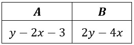  
  
Manakah hubungan yang benar antara kuantitas A dan B berikut berdasarkan informasi yang diberikan …

- **A.** 2A < B
- **B.** A = B
- **C.** Hubungan A dan B tidak dapat ditentukan
- **D.** A > B
- **E.** 3A > 2B

**Kunci:** A

**Pembahasan:** A = y − 2x − 3 = 3 − 2(−1) − 3 = 2  
  
B = 2y − 4x = 2(3) − 4(−1) = 6 + 4 = 10  
  
Mari kita substitusi pada masing-masing opsi  
  
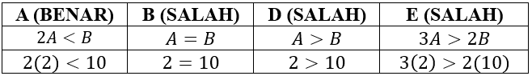  
  
Jawaban: A

---

#### 12584 · no 12

Diketahui nilai P = −4,  
  
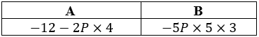  
  
Manakah hubungan yang benar antara kuantitas A dan B berikut berdasarkan informasi yang diberikan...

- **A.** A > B
- **B.** 2A > B
- **C.** Hubungan A dan B tidak dapat ditentukan
- **D.** 3A = 2B
- **E.** 3A < 2B

**Kunci:** E

**Pembahasan:** Diketahui nilai P = −4,  
  
Lalu disubstitusikan ke persamaan berikut  
  
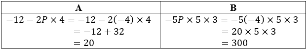  
  
Mari kita substitusi pada masing-masing opsi  
  
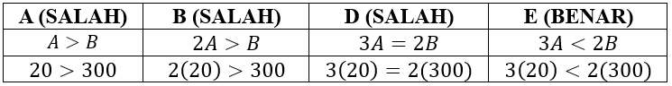  
  
Jawaban: E

---

#### 12584 · no 13

Diketahui  
  
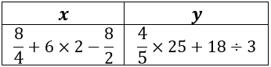  
  
Manakah hubungan yang benar antara kuantitas x dan y berikut berdasarkan informasi yang diberikan....

- **A.** 3x < 2y
- **B.** 4x < y
- **C.** Hubungan x dan y tidak dapat ditentukan
- **D.** 3x > 2y
- **E.** 2x > 3y

**Kunci:** A

**Pembahasan:** x  → 8 4  + 6 ×  2 − 8 2 = 8 4 + 12 − 16 4 = 12 −  8 4 = 12 − 2 = 10  
  
y  → 4 5 ×  25 + 18 ÷ 3 = 20 + 6 = 26  
  
Sehingga perbandingan  
  
X: Y = 10 : 26 = 5: 13  
  
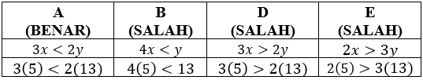  
  
Jawaban: A

---

#### 12584 · no 14

Sebuah tempat parkir menetapkan tarif sebesar Rp6.000,00 untuk 2 jam pertama dan Rp2.500,00 untuk setiap 1 jam berikutnya. Jika kendaraan Andi parkir selama 7 jam, maka total biaya parkir yang harus dibayarkan adalah …

- **A.** Rp16.000,00
- **B.** Rp17.500,00
- **C.** Rp18.500,00
- **D.** Rp19.000,00
- **E.** Rp20.500,00

**Kunci:** C

**Pembahasan:** Diketahui biaya parkir 2 jam pertama Rp6.000,00.  
  
Total waktu kendaraan Andi parkir = 7 jam  
  
Sisa Waktu parkir = 7 - 2 = 5 jam  
  
Biaya Parkir 5 jam berikutnya = 5 ×  2.500 = 12.500  
  
Total biaya parkir selama 7 jam = 6000 + 12.500 = 18.500  
  
Jawaban: C

---

#### 12584 · no 15

Sekelompok gajah menghabiskan satu gudang stok pakan. Dengan 4 ekor gajah, stok pakan tersebut habis dalam waktu 30 hari.  
  
| A | B |  
|---|---|  
| Waktu yang diperlukan jika jumlah gajah bertambah menjadi 6 ekor untuk menghabiskan stok pakan yang sama (hari) | 22 |  
  
Tentukanlah hubungan antara A dan B yang benar…

- **A.** 2A = B
- **B.** 2A < B
- **C.** 3A > 2B
- **D.** 4A < 3B
- **E.** 2A > 3B

**Kunci:** C

**Pembahasan:** Diketahui 4 ekor gajah mampu menghabiskan satu gudang stok pakan dalam 30 hari  
  
A → Waktu yang diperlukan jika jumlah gajah bertambah menjadi 6 ekor untuk menghabiskan stok pakan yang sama (hari)  
  
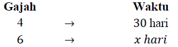  
  
Menggunakan perbandingan tak senilai:  
  
Trik: Alfaiz aab =  a t a s   ×   a t a s b a w a h  
  
x = 4   ×   30 6  
  
= 4 ×  5  
  
= 20  
  
B → 22  
  
Perbandingan A: B = 20: 22  
  
                           = 10: 11  
  
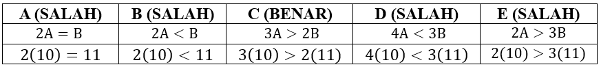  
  
Jawaban: C

---

#### 12584 · no 16

Sebuah mesin dapat menyelesaikan 24 unit produk dalam waktu 3 jam secara efektif. Mesin tersebut kemudian bekerja selama 7,5 jam, namun 30 menit pertama digunakan untuk pemanasan sehingga belum menghasilkan produk. Jika kecepatan kerja mesin tetap, berapa jumlah unit produk yang dapat diselesaikan mesin tersebut?

- **A.** 48 unit
- **B.** 54 unit
- **C.** 56 unit
- **D.** 60 unit
- **E.** 62 unit

**Kunci:** C

**Pembahasan:** Diketahui  
  
- Sebuah mesin dapat menyelesaikan 24 unit produk dalam waktu 3 jam secara efektif.  
  
- Mesin tersebut kemudian bekerja selama 7,5 jam, namun 30 menit pertama digunakan untuk pemanasan sehingga belum menghasilkan produk → sehingga waktu kerja efektif adalah 7 jam  
  
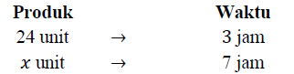  
  
Perbandingan senilai  
  
24 x  = 3 7  
  
8 x  = 1 7  
  
x = 56 unit  
  
Jawaban: C

---

#### 12584 · no 17

Sebuah proyek perbaikan jalan direncanakan selesai dalam 90 hari oleh 40 pekerja. Pada hari kerja ke 19, 8 pekerja harus dipindahkan ke proyek lain. Dengan produktivitas pekerja tetap sama, berapa tambahan hari yang diperlukan agar proyek tersebut dapat diselesaikan?

- **A.** 12 hari
- **B.** 15 hari
- **C.** 18 hari
- **D.** 20 hari
- **E.** 24 hari

**Kunci:** C

**Pembahasan:** Untuk menyelesaikan soal tersebut dapat kita gunakan Al Faiz Batako, misalkan h adalah tambahan hari yang dibutuhkan untuk menyelesaikan bangunan tersebut.  
  
T ×  W = H  
  
40 ×  90 = 3600 } Rencana  
  
40 ×  18 = 720   } 18 hari kerja oleh 40 pekerja  
  
32 ×  72 = 2304 } sisa hari dari 90 hari (90 − 18 = 72 hari) oleh 32 pekerja (8 pekerja dipindahkan)  
  
32  × h = 576  
  
h = 18  
  
Sehingga tambahan hari yang diperlukan adalah 18 hari.  
  
Jawaban: C

---

#### 12584 · no 18

Andi merencanakan perjalanan sejauh 350 km yang harus selesai dalam waktu 5 jam. Di tengah perjalanan, Andi ingin mampir di rumah sahabatnya selama 90 menit. Agar tetap tiba tepat waktu, berapa kecepatan rata-rata kendaraan Andi saat berjalan?

- **A.** 80 km/jam
- **B.** 85 km/jam
- **C.** 90 km/jam
- **D.** 100 km/jam
- **E.** 105 km/jam

**Kunci:** D

**Pembahasan:** Diketahui:  
  
Kecepatan Andi = 350 5  = 70 km/jam  
  
Istirahat 90 menit  
  
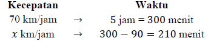  
  
Menggunakan perbandingan tak senilai:  
  
Trik: Alfaiz aab = a t a s   ×   a t a s b a w a h  
  
x = 70   ×   300 210  = 1   ×   300 3  = 100 km/jam  
  
Jawaban: D

---

#### 12584 · no 19

Sebanyak 6 pekerja dapat membangun 3 rumah dalam waktu 15 hari. Berapa banyak rumah yang dapat dibangun oleh 9 pekerja dalam waktu 20 hari, dengan tingkat produktivitas yang sama?

- **A.** 5 rumah
- **B.** 6 rumah
- **C.** 7 rumah
- **D.** 8 rumah
- **E.** 9 rumah

**Kunci:** B

**Pembahasan:** Diketahui  
  
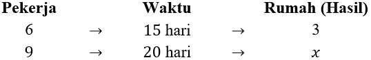  
  
T  × W = H  
  
6 9 ×   15 20 = 3 x  
  
2 3 ×   5 20  = 1 x  
  
2 3 ×   1 4  = 1 x  
  
1 3 ×   1 2  = 1 x  
  
x = 3 ×  2  
  
   = 6  
  
Jawaban: B

---

#### 12584 · no 20

16, 12, 60, 55, 275, …

- **A.** 271
- **B.** 270
- **C.** 269
- **D.** 268
- **E.** 267

**Kunci:** C

**Pembahasan:** 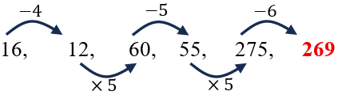  
  
Jawaban: C

---

#### 12584 · no 21

2, 5, 10, 17, 26, 37,...

- **A.** 48
- **B.** 49
- **C.** 50
- **D.** 51
- **E.** 52

**Kunci:** C

**Pembahasan:** 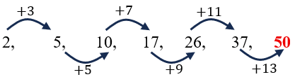  
  
Jawaban: C

---

#### 12584 · no 22

120,24,6,…,1,1

- **A.** 1
- **B.** 2
- **C.** 3
- **D.** 4
- **E.** 5

**Kunci:** B

**Pembahasan:** 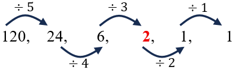  
  
Jawaban: B

---

#### 12584 · no 23

Perhatikan tabel hasil ujian berikut:  
  
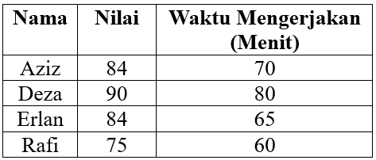  
  
Tentukan urutan peserta berdasarkan nilai tertinggi ke terendah. Jika terdapat nilai yang sama, maka urutkan berdasarkan waktu mengerjakan yang lebih cepat lebih dahulu.

- **A.** Deza – Aziz – Erlan – Rafi
- **B.** Deza – Erlan – Aziz – Rafi
- **C.** Erlan – Deza – Aziz – Rafi
- **D.** Deza – Erlan – Rafi – Aziz
- **E.** Erlan – Aziz – Deza – Rafi

**Kunci:** B

**Pembahasan:** Nilai tertinggi: 90 → Deza.  
  
Nilai berikutnya: 84 →  Aziz dan Erlan.  
  
Karena sama, pilih yang waktu lebih cepat: Erlan (65 menit) dan Aziz (70 menit)  
  
Nilai terakhir: 75 → Rafi  
  
Maka urutannya adalah: Deza – Erlan – Aziz – Rafi  
  
Jawaban: B

---

#### 12584 · no 24

Affan, Miko, Raza, Haikal, Fella, Syifa, Lova, dan Salma sedang berdiskusi dalam sebuah rapat dan duduk mengelilingi meja bundar.  
  
(1) Affan duduk tepat di sebelah kiri Miko.  
  
(2) Fella duduk berhadapan dengan Affan.  
  
(3) Raza duduk di antara Haikal dan Syifa.  
  
(4) Lova duduk dua kursi dari Miko (ada satu orang di antara mereka).  
  
Siapakah yang duduk berhadapan dengan Raza?

- **A.** Affan
- **B.** Salma
- **C.** Fella
- **D.** Lova
- **E.** Miko

**Kunci:** B

**Pembahasan:** Informasi yang diberikan  
  
(1) Affan duduk tepat di sebelah kiri Miko.  
  
(2) Fella duduk berhadapan dengan Affan.  
  
(3) Raza duduk di antara Haikal dan Syifa.  
  
(4) Lova duduk dua kursi dari Miko (ada satu orang di antara mereka).  
  
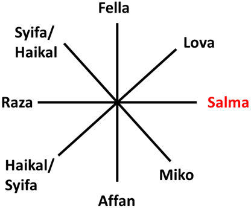  
  
Sehingga yang berhadapan dengan Raza adalah Salma.  
  
Jawaban: B

---

#### 12584 · no 25

Dalam sebuah keluarga, ayah, ibu, serta dua anaknya Philo dan Nico masing-masing menyukai olahraga. Ayah menyukai semua olahraga yang menggunakan bola. Ibu menyukai renang dan olahraga atletik. Philo menyukai olahraga renang, futsal dan badminton. Sedangkan Nico menyukai badminton dan basket. Berdasarkan informasi tersebut, siapa saja yang menyukai olahraga futsal?

- **A.** Ayah dan Philo
- **B.** Nico dan Philo
- **C.** Ayah dan Nico
- **D.** Ibu dan Philo
- **E.** Ibu dan Nico

**Kunci:** A

**Pembahasan:** Informasi yang diberikan:  
  
(1) Ayah menyukai semua olahraga yang menggunakan bola.  
  
(2) Ibu menyukai renang dan olahraga atletik.  
  
(3) Philo menyukai olahraga renang, futsal dan badminton.  
  
(4) Nico menyukai badminton dan basket.  
  
Dari pernyataan, jelas bahwa yang menyukai olahraga futsal adalah Ayah dan Philo  
  
Jawaban: A

---

#### 12584 · no 26

Seorang pegawai bernama Raka ingin pergi dari Kota P menuju Kota Z. Dari Kota P, Raka dapat menuju Kota Q atau Kota R. Jika Raka memilih menuju Kota Q, ia dapat melanjutkan ke Kota S atau Kota T. Dari Kota S, Raka dapat menuju Kota W, sedangkan dari Kota T, Raka dapat menuju Kota U. Kota W terhubung ke Kota V, dan Kota V terhubung langsung ke Kota Z. Sementara itu, Kota U terhubung langsung ke Kota Z. Jika Raka memilih menuju Kota R, ia dapat melanjutkan ke Kota X atau Kota Y. Kota X terhubung ke Kota V, sedangkan Kota Y terhubung langsung ke Kota Z.  
  
Jika Raka harus singgah terlebih dahulu di Kota V sebelum menuju Kota Z dan memilih rute dengan jumlah kota paling sedikit, rute manakah yang dapat ia tempuh?

- **A.** P-R-Y-Z
- **B.** P-R-X-V-Z
- **C.** P-Q-S-W-V-Z
- **D.** P-Q-T-U-Z
- **E.** R-X-V-Z

**Kunci:** B

**Pembahasan:** 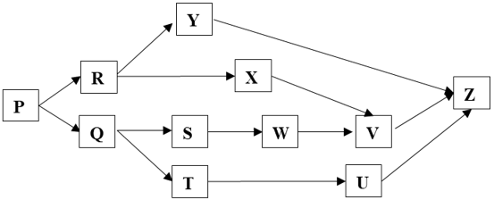  
  
Diperoleh rute:  
  
(1) P-R-Y-Z  
  
(2) P-R-X-V-Z  
  
(3) P-Q-S-W-V-Z  
  
(4) P-Q-T-U-Z  
  
Rute yang dipilih Raka adalah melewati Kota V dan rute dengan jumlah kota paling sedikit yaitu P-R-X-V-Z  
  
Jawaban: B

---

#### 12584 · no 27

Perhatikan gambar berikut!  
  
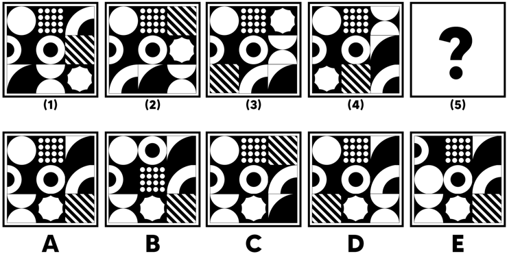

- **A.** A
- **B.** B
- **C.** C
- **D.** D
- **E.** E

**Kunci:** A

**Pembahasan:** 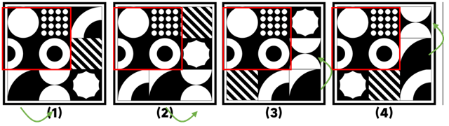  
  
Berdasarkan gambar yang diketahui terdapat beberapa pola  
  
- Dari garmbar (1) sampai gambar (4) objek yang berada pada kotak merah bersifat tetap dan tidak berubah  
  
- Dari gambar (1) sampai gambar (4) objek yang berada dibagian bawah dan kanan saling bergeser berlawanan arah jarum jam.  
  
Sehingga mengikuti pola tersebut gambar yang tepat mengisi gambar (5) adalah  
  
  
  
Jawaban: A

---

#### 12584 · no 28

Perhatikan gambar berikut!  
  
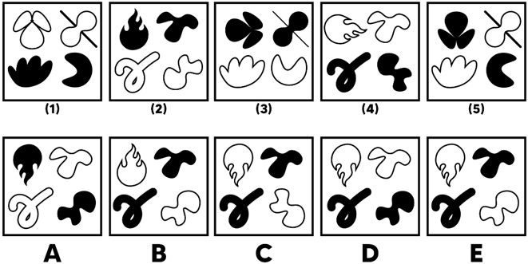

- **A.** A
- **B.** B
- **C.** C
- **D.** D
- **E.** E

**Kunci:** E

**Pembahasan:** 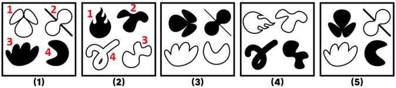  
  
Berdasarkan gambar yang diketahui terdapat pola gambar (1), (3) dan (5) kemudian gambar (2), (4). Yang setiap jenis objek 1,2,3,4 memiliki pola gerakan masing-masing  
  
- objek 1, dari gambar (1) (3) (5) memiliki pola berputar berlawanan arah jarum jam 90°. Kemudian memiliki pola berubahan warna yaitu ubah – tetap  
  
- objek 2, dari gambar (1), (3), (5) memiliki pola perubahan warna  
  
- objek 3, dari gambar (1), (3), (5) memiliki pola ubah warna yaitu ubah – tetap – ubah  
  
- objek 4, dari gambar (1), (3), (5) memiliki pola berputar searah jarum jam 90° dan memiliki pola perubahan warna setiap langkahnya.  
  
Dengan menggunakan pola yang sama pola gambar (2) (4) (6), maka gambar (6) yang tepat adalah  
  
  
  
Jawaban: E

---

#### 12584 · no 29

Perhatikan gambar berikut!  
  
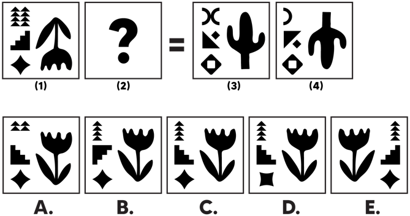

- **A.** A
- **B.** B
- **C.** C
- **D.** D
- **E.** E

**Kunci:** C

**Pembahasan:** 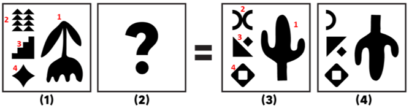  
  
Pola objek gambar (3) ke (4) = gambar (1) ke (2).  
  
Untuk pola gambar (3) ke (4) yaitu  
  
- Objek 1 dicerminkan secara horizontal  
  
- Objek 2 sebagian objeknya berkurang ½ bagian kanan  
  
- Objek 3 berputar 90° searah jarum jam  
  
- Objek 4 tetap  
  
Sehingga menggunakan pola yang sama untuk gambar (1) ke (2). Gambar yang tepat mengisi gambar (2) adalah  
  
  
  
Jawaban: C

---

#### 12584 · no 30

Perhatikan gambar berikut!  
  
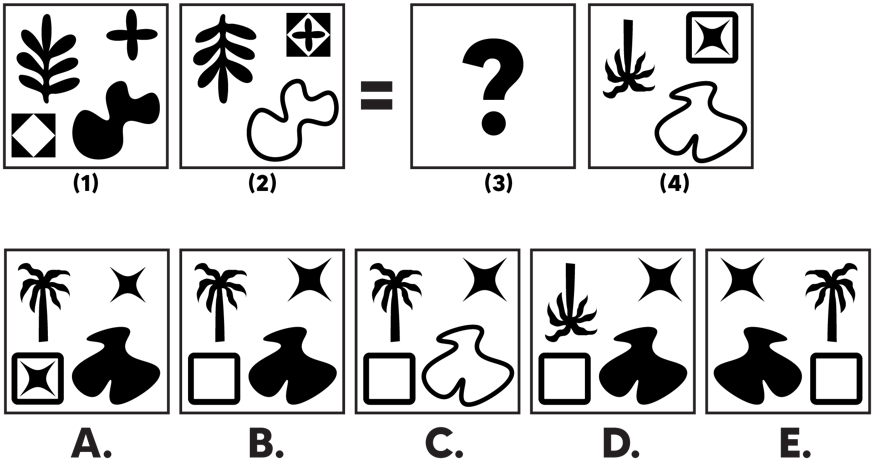

- **A.** A
- **B.** B
- **C.** C
- **D.** D
- **E.** E

**Kunci:** B

**Pembahasan:** 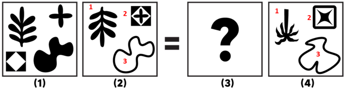  
  
Pola objek gambar (2) ke (1) = gambar (4) ke (3).  
  
Untuk pola gambar (2) ke (1) yaitu  
  
- Objek 1 dicerminkan secara horizontal  
  
- Objek 2 bagian luar objek berpindah ke sisi kiri bawah dan bagian dalam objek ukurannya membesar  
  
- Objek 3 berubah warna  
  
Sehingga menggunakan pola yang sama untuk gambar (4) ke (3). Gambar yang tepat mengisi gambar (3) adalah  
  
  
  
Jawaban: B

---

#### 12584 · no 31

Perhatikan gambar berikut!  
  
KETAKSAMAAN  
  
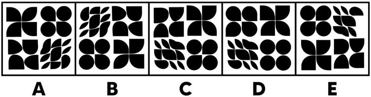

- **A.** A
- **B.** B
- **C.** C
- **D.** D
- **E.** E

**Kunci:** D

**Pembahasan:**   
  
Jika diperhatikan terdapat bentuk objek yang berbeda dari yang lain pada opsi D, maka opsi yang tepat adalah D.  
  
Jawaban: D

---

#### 12584 · no 32

Perhatikan gambar berikut  
  
KETAKSAMAAN  
  
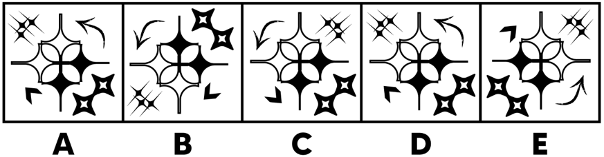

- **A.** A
- **B.** B
- **C.** C
- **D.** D
- **E.** E

**Kunci:** C

**Pembahasan:** Objek pada opsi A jika dirotasi akan menghasilkan bentuk dan arah yang sama seperti di opsi B, D, dan E. Kecuali pada opsi C arah yang berbeda. Maka jawaban yang tepat adalah C.  
  
Jawaban: C

---

#### 12584 · no 33

Perhatikan gambar berikut!  
  
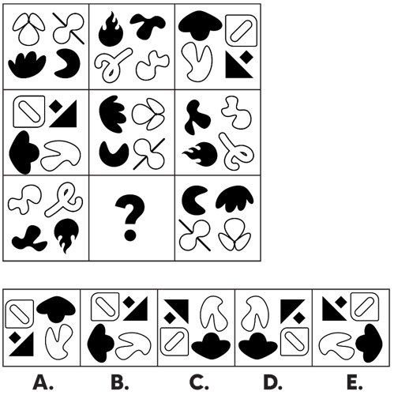

- **A.** A
- **B.** B
- **C.** C
- **D.** D
- **E.** E

**Kunci:** C

**Pembahasan:** 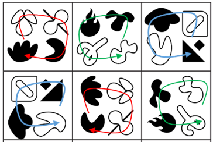  
  
Jika diperhatikan pola objek pada figural 9 kotak ini adalah pengelompokan objek. Gambar yang ditandai dengan warna yang sama memiliki bentuk objek yang sama, hanya saja kelompok objek tersebut dirotasi. Kelompok yang ditandai warna merah semua objeknya dirotasi secara bersama 90° searah jarum jam, kemudian kelompok yang ditandai warna hijau dan biru semua objeknya dirotasi secara bersama 90° berlawanan arah jarum jam. Sehingga gambar yang tepat untuk mengisi gambar di baris ketiga kolom kedua adalah  
  
  
  
Jawaban: C

---

#### 12584 · no 34

Perhatikan gambar berikut!  
  
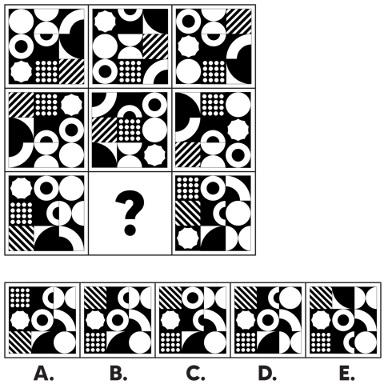

- **A.** A
- **B.** B
- **C.** C
- **D.** D
- **E.** E

**Kunci:** B

**Pembahasan:** 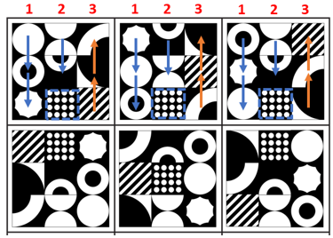  
  
Dari gambar tersebut memiliki pola setiap barisnya.  
  
Baris pertama  
  
- Setiap objek dikolom 1 bergeser selangkah ke bawah  
  
- Dua objek kolom 2 bergeser selangkah ke bawah (bertukar tempat) setiap langkahnya  
  
- Setiap objek di kolom 3 bergeser selangkah ke atas  
  
Mengikuti pola yang sama pada baris ketiga  
  
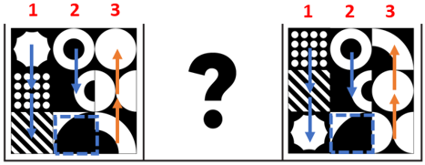  
  
Maka gambar yang tepat untuk mengisi gambar pada baris ketiga kolom kedua adalah  
  
  
  
Jawaban: B

---

#### 12584 · no 35

Perhatikan gambar berikut!  
  
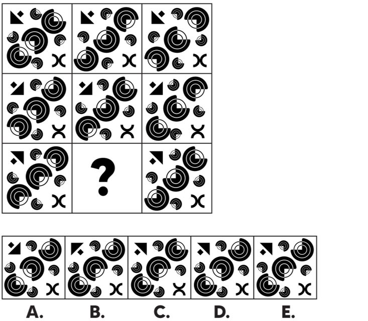

- **A.** A
- **B.** B
- **C.** C
- **D.** D
- **E.** E

**Kunci:** D

**Pembahasan:** 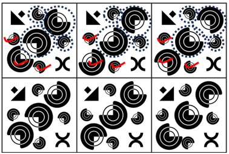  
  
Dari gambar tersebut memiliki pola setiap barisnya.  
  
Baris pertama  
  
- Objek yang ditandai garis lingkaran putus-putus berputar 90° searah jarum jam  
  
- Objek yang ditandai dengan ceklis merah berputar 90° berlawanan arah jarum jam.  
  
Sehingga gambar yang tepat untuk mengisi di baris ketiga kolom kedua adalah  
  
  
  
Jawaban: D

---

### TKP

#### 12584 · no 1

Anda bertugas sebagai petugas layanan pengaduan di Dinas Perhubungan. Sejumlah warga melapor melalui media sosial bahwa lampu lalu lintas di persimpangan utama sering mati pada jam sibuk, menyebabkan kemacetan dan hampir terjadi kecelakaan. Laporan serupa sudah masuk beberapa kali, namun perbaikan belum terlihat. Apa tindakan Anda … (Pelayanan Publik)

- **A.** Menenangkan warga dengan menjelaskan bahwa laporan akan diteruskan ke bidang teknis dan meminta mereka bersabar menunggu proses perbaikan.
- **B.** Segera mengoordinasikan laporan tersebut ke tim teknis, memantau progres perbaikan, dan memberikan pembaruan informasi kepada warga.
- **C.** Mencatat laporan warga sebagai arsip pengaduan dan menunggu instruksi dari atasan sebelum bertindak lebih lanjut.
- **D.** Menyarankan warga melapor langsung ke kantor pusat Dinas Perhubungan agar keluhan lebih cepat ditangani.
- **E.** Menyampaikan permohonan maaf atas ketidaknyamanan dan menjelaskan bahwa perbaikan membutuhkan waktu karena keterbatasan teknis.

**Kunci:** B

**Pembahasan:** SKOR JAWABAN:  
  
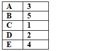  
  
Situasi ini menguji kemampuan Anda dalam menangani pengaduan masyarakat secara responsif, solutif, dan akuntabel. Sebagai petugas layanan pengaduan, Anda tidak cukup hanya menerima keluhan, tetapi juga perlu memastikan laporan ditindaklanjuti karena masalah lampu lalu lintas yang mati menyangkut kelancaran lalu lintas dan keselamatan pengguna jalan. Dalam pelayanan publik, kecepatan koordinasi dan kejelasan informasi sangat penting untuk menjaga kepercayaan masyarakat. Pilihan B paling tepat karena Anda segera mengoordinasikan laporan kepada tim teknis, memantau progres perbaikan, dan memberikan pembaruan informasi kepada warga. Langkah ini menunjukkan sikap proaktif, tanggung jawab, serta orientasi pada penyelesaian masalah, sehingga layak mendapat skor 5. Pilihan E mendapat skor 4 karena sudah menunjukkan empati melalui permohonan maaf dan memberikan penjelasan kepada warga. Namun, langkah ini belum menunjukkan tindakan nyata untuk memastikan masalah segera ditangani.Pilihan A bernilai 3 karena berusaha menenangkan warga dan meneruskan laporan, tetapi masih bersifat pasif karena hanya meminta warga menunggu tanpa memastikan tindak lanjut.Pilihan D mendapat skor 2 karena justru mengalihkan tanggung jawab kepada warga untuk melapor ke pihak lain, padahal laporan sudah diterima oleh unit Anda. Sementara itu, pilihan C menjadi yang terendah karena hanya mencatat laporan dan menunggu instruksi, sehingga kurang responsif terhadap masalah yang berulang dan berdampak pada keselamatan publik.

---

#### 12584 · no 2

Anda bertugas sebagai petugas layanan akademik di sebuah perguruan tinggi negeri. Seorang mahasiswa datang dengan wajah cemas karena nilai salah satu mata kuliahnya belum muncul di sistem, padahal batas waktu pendaftaran beasiswa akan segera berakhir. Ia merasa khawatir tidak bisa melanjutkan proses pendaftaran jika nilai tersebut belum terinput. Setelah dicek, nilai memang belum divalidasi oleh dosen pengampu. Apa langkah terbaik yang Anda lakukan…  
  
(Pelayanan Publik)

- **A.** Menjelaskan bahwa proses input nilai sepenuhnya menjadi kewenangan dosen dan mahasiswa perlu menunggu.
- **B.** Meminta mahasiswa tersebut menghubungi dosen pengampu secara mandiri untuk mempercepat proses validasi nilai.
- **C.** Mengecek kelengkapan data nilai, menjelaskan posisi prosesnya, serta membantu mengoordinasikan tindak lanjut ke dosen atau bagian terkait.
- **D.** Menyarankan mahasiswa menunda pendaftaran beasiswa hingga nilai resmi muncul di sistem.
- **E.** Mengarahkan mahasiswa menyampaikan keluhan melalui layanan pengaduan akademik kampus.

**Kunci:** C

**Pembahasan:** SKOR JAWABAN:  
  
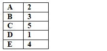  
  
Pilihan terbaik adalah C karena petugas secara aktif mengecek kelengkapan data, memberikan penjelasan yang jelas mengenai posisi proses nilai, serta membantu mengoordinasikan tindak lanjut dengan dosen atau unit terkait. Tindakan ini menunjukkan sikap berorientasi pelayanan, komunikatif, dan bertanggung jawab dalam membantu mahasiswa mendapatkan kepastian layanan sehingga mendapat skor 5. Pilihan E juga cukup baik karena tetap memberikan saluran resmi bagi mahasiswa untuk menyampaikan keluhan sehingga masalah dapat tercatat secara formal. Namun, langkah ini kurang responsif karena tidak memberikan bantuan langsung terhadap kebutuhan mendesak mahasiswa sehingga mendapat skor 4. Pilihan B cukup tepat karena mendorong mahasiswa untuk berinisiatif menghubungi dosen pengampu. Akan tetapi, langkah ini cenderung melepaskan peran petugas layanan akademik sebagai fasilitator sehingga bantuan yang diberikan belum optimal dan mendapat skor 3. Pilihan A kurang tepat karena hanya menjelaskan batas kewenangan tanpa memberikan solusi atau upaya pendampingan, sehingga mahasiswa tetap berada dalam ketidakpastian dan mendapat skor 2. Pilihan D paling tidak tepat karena menyarankan penundaan pendaftaran beasiswa tanpa menawarkan alternatif solusi, yang berpotensi merugikan mahasiswa dan tidak mencerminkan orientasi pelayanan publik sehingga mendapat skor 1.

---

#### 12584 · no 3

Anda bertugas sebagai petugas pengelola data di instansi pemerintah daerah. Suatu hari, seorang rekan kerja meminta Anda memberikan data pribadi warga (NIK dan alamat) dengan alasan untuk keperluan laporan cepat. Namun, permintaan tersebut belum disertai surat tugas atau persetujuan atasan. Apa langkah terbaik yang Anda lakukan… (Pelayanan Publik)

- **A.** Memberikan data tersebut karena masih satu instansi dan tujuannya untuk pekerjaan.
- **B.** Menolak permintaan tersebut secara tegas tanpa memberikan penjelasan.
- **C.** Menyarankan rekan kerja mengajukan permintaan resmi sesuai prosedur sebelum data diberikan.
- **D.** Memberikan sebagian data yang dianggap tidak terlalu sensitif agar pekerjaan tetap berjalan.
- **E.** Menunda pemberian data sambil menunggu instruksi lebih lanjut dari atasan.

**Kunci:** C

**Pembahasan:** SKOR JAWABAN:  
  
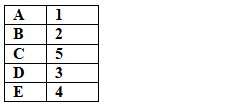  
  
Pilihan terbaik adalah C karena menjaga keamanan data pribadi warga sekaligus tetap mendukung kelancaran pekerjaan dengan mematuhi prosedur resmi. Sikap ini mencerminkan nilai Akuntabel dan Profesional, sehingga mendapat skor 5. Pilihan E cukup baik karena berhati-hati dan tidak langsung memberikan data, namun kurang proaktif dalam memberikan solusi prosedural sehingga mendapat skor 4. Pilihan D kurang tepat karena tetap berisiko melanggar prinsip perlindungan data meskipun hanya sebagian sehingga mendapat skor 3. Pilihan B kurang baik karena menolak tanpa komunikasi yang baik sehingga berpotensi menimbulkan konflik kerja dan mendapat skor 2. Pilihan A paling tidak tepat karena mengabaikan etika dan keamanan data sehingga mendapat skor 1.

---

#### 12584 · no 4

Anda bertugas sebagai admin layanan aplikasi internal. Seorang pegawai mengeluh karena akunnya tidak bisa digunakan untuk mengakses sistem, padahal tenggat pelaporan sangat dekat. Setelah dicek, kesalahan terjadi karena kelalaian pegawai tersebut sendiri saat memperbarui data. Apa langkah terbaik yang Anda lakukan… (Pelayanan Publik)

- **A.** Menolak membantu karena kesalahan bukan berasal dari sistem.
- **B.** Membantu memperbaiki akun sambil menjelaskan prosedur yang benar agar tidak terulang.
- **C.** Meminta pegawai tersebut mengajukan tiket layanan baru dan menunggu antrean.
- **D.** Melaporkan pegawai tersebut ke atasan karena kelalaiannya mengganggu sistem.
- **E.** Membiarkan akun diperbaiki nanti setelah tenggat pelaporan selesai.

**Kunci:** B

**Pembahasan:** SKOR JAWABAN:  
  
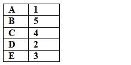  
  
Pilihan terbaik adalah B karena tetap memberikan bantuan meskipun kesalahan berasal dari pengguna, sekaligus melakukan edukasi agar tidak terulang. Hal ini mencerminkan nilai Berorientasi Pelayanan dan Kompeten, sehingga mendapat skor 5. Pilihan C cukup baik karena sesuai prosedur, tetapi kurang responsif terhadap kondisi mendesak sehingga mendapat skor 4. Pilihan E kurang tepat karena menunda penyelesaian dan berpotensi menghambat kinerja pegawai sehingga mendapat skor 3. Pilihan D tidak tepat karena bersifat menghukum dan tidak solutif sehingga mendapat skor 2. Pilihan A paling tidak tepat karena tidak menunjukkan sikap pelayanan sama sekali sehingga mendapat skor 1.

---

#### 12584 · no 5

Anda adalah ASN yang mengelola akun media sosial unit kerja. Anda menemukan komentar masyarakat yang provokatif dan menyudutkan instansi dengan informasi yang belum tentu benar. Komentar tersebut mulai memicu perdebatan antarwarganet. Apa langkah terbaik yang Anda lakukan? (Pelayanan Publik)

- **A.** Menghapus komentar tersebut agar tidak memperkeruh suasana.
- **B.** Membalas komentar dengan nada tegas untuk meluruskan kesalahan informasi.
- **C.** Memberikan klarifikasi resmi secara netral dan berbasis data tanpa memperkeruh perdebatan.
- **D.** Membiarkan komentar tersebut sebagai bentuk kebebasan berekspresi.
- **E.** Menonaktifkan kolom komentar sementara waktu.

**Kunci:** C

**Pembahasan:** SKOR JAWABAN:  
  
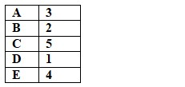  
  
Pilihan C paling tepat karena menunjukkan inisiatif aktif dengan memverifikasi dokumen sekaligus berkoordinasi ke pihak berwenang agar masalah tidak berlarut. Ini mencerminkan pelayanan yang bertanggung jawab dan berorientasi solusi. D mendapat skor 4 karena realistis, tetapi tetap membuat warga menunggu tanpa kepastian tindakan. A berada di skor 3 karena memberi penjelasan, namun cenderung pasif. B hanya skor 2 karena prosedural dan tidak membantu secara langsung. E paling rendah karena melepaskan tanggung jawab dan berpotensi merusak kepercayaan publik.

---

#### 12584 · no 6

Anda bertugas sebagai resepsionis di kantor pusat perusahaan. Seorang tamu datang tanpa janji temu dan meminta bertemu pimpinan dengan alasan mendesak. Jadwal pimpinan hari itu penuh. Apa langkah terbaik yang Anda lakukan? (Pelayanan Publik)

- **A.** Menyampaikan bahwa pimpinan tidak dapat ditemui tanpa janji temu dan meminta tamu datang kembali di lain waktu.
- **B.** Mengizinkan tamu menunggu di area resepsionis sambil berharap ada jadwal pimpinan yang kosong.
- **C.** Menyampaikan kondisi jadwal pimpinan dengan sopan, menggali keperluan tamu secara singkat, lalu menghubungi unit terkait untuk menindaklanjuti sesuai prosedur.
- **D.** Menjelaskan bahwa jadwal pimpinan penuh, menawarkan untuk menyampaikan pesan atau mengatur jadwal pertemuan di waktu lain.
- **E.** Meminta tamu menunggu sementara Anda mencoba menghubungi pimpinan meskipun jadwalnya sudah penuh.

**Kunci:** C

**Pembahasan:** SKOR JAWABAN:  
  
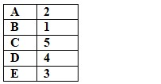  
  
Pilihan terbaik adalah C karena resepsionis bersikap sopan, menjelaskan kondisi jadwal pimpinan secara transparan, serta secara aktif menggali keperluan tamu dan menindaklanjutinya melalui unit atau pihak yang berwenang. Tindakan ini menunjukkan kemampuan komunikasi yang baik, orientasi pelayanan, serta kepatuhan terhadap prosedur tanpa mengabaikan kebutuhan tamu, sehingga mendapat skor 5. Pilihan D juga merupakan tindakan yang cukup tepat karena resepsionis menyampaikan kondisi jadwal pimpinan dengan baik dan menawarkan alternatif berupa penyampaian pesan atau pengaturan jadwal ulang. Namun, langkah ini belum menunjukkan upaya untuk memahami tingkat urgensi kebutuhan tamu dan belum memastikan adanya tindak lanjut langsung, sehingga mendapat skor 4. Pilihan E cukup baik karena menunjukkan inisiatif untuk membantu tamu. Namun, tindakan ini berpotensi mengganggu pimpinan yang memiliki jadwal penuh dan kurang memperhatikan prosedur kerja yang berlaku, sehingga mendapat skor 3. Pilihan A kurang tepat karena resepsionis bersikap terlalu kaku dengan langsung menolak permintaan tamu tanpa menawarkan solusi lain. Hal ini dapat menimbulkan kesan kurang ramah dan tidak berorientasi pada pelayanan, sehingga mendapat skor 2. Pilihan B paling tidak tepat karena hanya membiarkan tamu menunggu tanpa kepastian dan tanpa melakukan langkah lanjutan. Tindakan ini tidak mencerminkan profesionalisme dan berpotensi menimbulkan ketidakpuasan tamu, sehingga mendapat skor 1.

---

#### 12584 · no 7

Anda bertugas sebagai resepsionis hotel. Seorang tamu komplain karena kamar yang diterimanya tidak sesuai dengan tipe yang dipesan, sementara hotel sedang penuh. Apa langkah terbaik yang Anda lakukan? (Pelayanan Publik)

- **A.** Menjelaskan bahwa seluruh kamar sesuai tipe pesanan sedang penuh dan meminta tamu memahami kondisi okupansi hotel saat ini.
- **B.** Menyampaikan permohonan maaf, menjelaskan kondisi kamar yang tersedia, lalu menawarkan pemindahan kamar jika ada pembatalan dari tamu lain.
- **C.** Meminta maaf, memverifikasi ulang data pemesanan, serta menawarkan kompensasi yang setara sambil memastikan kebutuhan utama tamu tetap terpenuhi.
- **D.** Menjelaskan kesalahan secara terbuka, meminta persetujuan tamu untuk tetap menempati kamar yang ada, dan memberikan fasilitas tambahan sebagai bentuk tanggung jawab.
- **E.** Meminta maaf, melakukan pengecekan detail pemesanan, berkoordinasi dengan bagian terkait, serta memberikan solusi terbaik yang disepakati bersama tamu tanpa mengganggu kenyamanan tamu lain.

**Kunci:** E

**Pembahasan:** SKOR JAWABAN:  
  
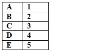  
  
Pilihan terbaik adalah E karena resepsionis menunjukkan sikap paling komprehensif dalam pelayanan. Petugas tidak hanya meminta maaf dan memverifikasi pemesanan, tetapi juga aktif berkoordinasi dengan bagian terkait serta mengajak tamu menyepakati solusi terbaik tanpa mengganggu kenyamanan tamu lain. Pendekatan ini mencerminkan orientasi pelayanan, profesionalisme, dan kemampuan mengelola situasi sensitif secara seimbang, sehingga mendapat skor 5. Pilihan D sangat baik karena resepsionis bersikap terbuka terhadap kesalahan, meminta persetujuan tamu, serta memberikan fasilitas tambahan sebagai bentuk tanggung jawab. Namun, solusi yang ditawarkan masih bersifat reaktif dan terbatas pada kompensasi, belum menekankan koordinasi lintas bagian atau kesepakatan menyeluruh, sehingga mendapat skor 4. Pilihan C cukup baik karena petugas memverifikasi data pemesanan dan menawarkan kompensasi yang setara. Langkah ini menunjukkan sikap profesional dan akuntabel, tetapi pendekatan yang diambil masih fokus pada aspek administratif dan belum sepenuhnya berorientasi pada pengalaman tamu secara holistik, sehingga mendapat skor 3. Pilihan B kurang tepat karena meskipun menunjukkan empati dan memberikan harapan solusi, langkah ini bergantung pada kondisi yang belum pasti (menunggu pembatalan) sehingga tidak memberikan kepastian bagi tamu, sehingga mendapat skor 2. Pilihan A paling tidak tepat karena hanya menyampaikan keterbatasan hotel tanpa menunjukkan tanggung jawab atau upaya solusi. Sikap ini berpotensi memperburuk ketidakpuasan tamu dan tidak mencerminkan nilai pelayanan prima, sehingga mendapat skor 1.

---

#### 12584 · no 8

Anda bertugas sebagai petugas front office di sebuah balai pelatihan kerja milik pemerintah. Seorang peserta pelatihan datang meminta Anda mengubah tanggal kehadiran di sistem karena ia tidak hadir pada hari tertentu dan khawatir akan dinyatakan gugur. Ia beralasan sedang mengalami masalah keluarga dan berharap Anda bisa membantu karena data tersebut hanya diketahui internal. Apa tindakan terbaik yang Anda lakukan.. (Pelayanan Publik)

- **A.** Menyetujui perubahan data kehadiran karena alasan peserta cukup manusiawi dan tidak merugikan pihak lain.
- **B.** Menolak permintaan tersebut secara tegas tanpa memberikan penjelasan lebih lanjut.
- **C.** Mengarahkan peserta ke petugas lain agar keputusan tidak berada di tangan Anda.
- **D.** Meminta peserta membuat surat pernyataan pribadi agar perubahan data bisa dipertimbangkan.
- **E.** Menjelaskan dengan sopan bahwa data kehadiran tidak dapat diubah secara sepihak, serta menyampaikan mekanisme resmi pengajuan dispensasi sesuai ketentuan.

**Kunci:** E

**Pembahasan:** SKOR JAWABAN:  
  
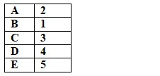  
  
Pilihan E merupakan jawaban paling tepat karena mampu menjaga keseimbangan antara keterbukaan pelayanan dan perlindungan data. Dengan menjelaskan secara sopan batasan informasi yang bersifat tertutup sekaligus menawarkan alternatif informasi yang boleh diakses, petugas tetap menunjukkan sikap profesional, komunikatif, dan berorientasi pada pelayanan tanpa melanggar aturan. Pendekatan ini juga membantu meredakan tekanan dari warga karena disertai penjelasan rasional dan solusi yang masih dapat diberikan. Pilihan D mendapat skor 4 karena menunjukkan upaya prosedural agar permintaan dapat diproses secara resmi dan akuntabel. Namun, tidak semua data dapat dibuka meskipun melalui surat permohonan, sehingga langkah ini berpotensi menimbulkan harapan keliru jika tidak disertai penjelasan batasan informasi. Pilihan C berada pada skor 3 karena mengalihkan warga ke petugas lain memang dapat meredam konflik, tetapi tidak menyelesaikan substansi persoalan dan berisiko dianggap menghindari tanggung jawab. Pilihan A memperoleh skor 2 karena meskipun bertujuan meredakan kekecewaan, tetap berisiko melanggar prinsip kerahasiaan dengan memberikan informasi yang seharusnya dibatasi, sehingga tidak mencerminkan kehati-hatian aparatur. Pilihan B menjadi yang paling rendah karena penolakan tanpa penjelasan berpotensi memicu konflik, menurunkan kepercayaan publik, dan tidak mencerminkan pelayanan yang komunikatif maupun berorientasi pada masyarakat.

---

#### 12584 · no 9

Anda bertugas di loket pelayanan fasilitas umum. Seorang warga datang untuk menanyakan penggunaan gedung serbaguna milik pemerintah daerah yang sebelumnya diinformasikan dapat dipakai oleh masyarakat. Namun saat hari pelaksanaan semakin dekat, jadwal penggunaan gedung tersebut berubah karena adanya kegiatan resmi mendadak dari instansi. Warga merasa kecewa karena sudah menyebarkan undangan dan meminta kejelasan serta solusi agar kegiatannya tetap bisa berjalan. Sikap Anda adalah … (Pelayanan Publik)

- **A.** Menjelaskan bahwa kegiatan resmi pemerintah menjadi prioritas dan meminta warga memahami perubahan tersebut.
- **B.** Menyampaikan perubahan jadwal secara terbuka serta meminta warga menunggu informasi lanjutan dari pihak pengelola.
- **C.** Menjelaskan alasan perubahan jadwal, menyampaikan permohonan maaf, dan membantu mengusulkan penjadwalan ulang sesuai prosedur.
- **D.** Menjelaskan perubahan jadwal secara rinci, menyampaikan dasar kebijakan, serta secara aktif membantu mencarikan alternatif fasilitas atau solusi lain yang memungkinkan.
- **E.** Menyarankan warga menyampaikan keberatan melalui mekanisme pengaduan resmi agar mendapatkan kepastian.

**Kunci:** D

**Pembahasan:** SKOR JAWABAN:  
  
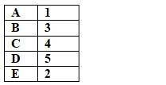  
  
Pilihan D merupakan jawaban paling tepat karena mencerminkan prinsip pelayanan publik yang responsif, transparan, dan proaktif, di mana petugas tidak hanya menjelaskan perubahan jadwal secara rinci serta menyampaikan dasar kebijakan yang melatarbelakanginya, tetapi juga secara aktif membantu mencarikan alternatif fasilitas atau solusi lain yang memungkinkan sehingga warga tetap memperoleh jalan keluar atas permasalahannya, sehingga layak mendapat skor 5. Pilihan C berada satu tingkat di bawahnya karena petugas telah menjelaskan alasan perubahan jadwal, menyampaikan permohonan maaf, dan membantu mengusulkan penjadwalan ulang sesuai prosedur, namun solusi yang diberikan masih terbatas dan belum menunjukkan inisiatif untuk mencari alternatif lain yang lebih fleksibel bagi warga, sehingga layak mendapat skor 4. Pilihan B menunjukkan adanya transparansi awal dengan menyampaikan perubahan jadwal, tetapi sikap meminta warga menunggu informasi lanjutan tanpa kepastian waktu maupun bentuk solusi mencerminkan pelayanan yang pasif dan kurang berorientasi pada kebutuhan warga, sehingga layak mendapat skor 3. Pilihan E mengarahkan warga pada mekanisme pengaduan resmi yang memang sah, namun langkah ini kurang tepat apabila permasalahan masih dapat ditangani langsung di loket pelayanan karena berpotensi memperpanjang proses dan menambah ketidakpuasan, sehingga layak mendapat skor 2. Sementara itu, pilihan A menjadi yang paling tidak tepat karena hanya menekankan prioritas kegiatan pemerintah tanpa disertai empati, penjelasan mendalam, maupun upaya solusi, sehingga berpotensi menurunkan kepercayaan masyarakat terhadap pelayanan publik, sehingga layak mendapat skor 1.

---

#### 12584 · no 10

Anda tergabung dalam tim kerja lintas instansi yang melibatkan pemerintah daerah, pihak swasta, dan komunitas masyarakat. Dalam pelaksanaannya, salah satu mitra eksternal aktif bergerak di lapangan namun sering mengambil keputusan sendiri tanpa menginformasikan tim lain. Di sisi lain, menghentikan peran mitra tersebut berpotensi menghambat capaian program. Sikap Anda adalah (Jejaring Kerja)

- **A.** Mengingatkan mitra tersebut agar selalu melapor sebelum mengambil keputusan dan membatasi ruang geraknya.
- **B.** Membiarkan mitra tetap bergerak mandiri selama target program masih tercapai.
- **C.** Mengajak mitra dan tim terkait menyepakati ulang pola koordinasi serta batas kewenangan secara jelas.
- **D.** Memfasilitasi diskusi bersama seluruh jejaring untuk menyelaraskan tujuan, alur komunikasi, dan mekanisme pengambilan keputusan ke depan.
- **E.** Melaporkan perilaku mitra kepada pimpinan agar ditentukan langkah tegas.

**Kunci:** D

**Pembahasan:** SKOR JAWABAN:  
  
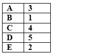  
  
Pilihan D merupakan jawaban paling tepat karena mencerminkan kemampuan membangun dan menjaga jejaring kerja secara kolaboratif dan berkelanjutan. Dengan memfasilitasi diskusi bersama seluruh jejaring untuk menyelaraskan tujuan, alur komunikasi, serta mekanisme pengambilan keputusan, petugas tidak hanya menyelesaikan masalah koordinasi yang muncul, tetapi juga memperkuat kerja sama lintas instansi ke depan tanpa mematikan kontribusi salah satu pihak, sehingga layak mendapat skor 5. Pilihan C berada pada tingkat berikutnya karena mengajak mitra dan tim terkait menyepakati ulang pola koordinasi serta batas kewenangan secara jelas sudah menunjukkan upaya menjaga keteraturan kerja sama, namun pendekatannya masih terbatas pada klarifikasi struktural dan belum sepenuhnya memperkuat dinamika jejaring secara menyeluruh, sehingga layak mendapat skor 4. Pilihan A menunjukkan niat menjaga koordinasi dengan mengingatkan mitra agar melapor sebelum mengambil keputusan, tetapi pembatasan ruang gerak berpotensi menurunkan fleksibilitas dan kepercayaan dalam jejaring kerja, sehingga layak mendapat skor 3. Pilihan E mengedepankan jalur struktural dengan melaporkan mitra kepada pimpinan, namun langkah ini cenderung represif dan berpotensi merusak hubungan kerja sama apabila masih dapat diselesaikan melalui komunikasi dan fasilitasi langsung, sehingga layak mendapat skor 2. Sementara itu, pilihan B menjadi yang paling tidak tepat karena membiarkan mitra bergerak tanpa koordinasi hanya demi capaian target jangka pendek dapat menimbulkan konflik dan ketidaksinergian di kemudian hari, sehingga layak mendapat skor 1.

---

#### 12584 · no 11

Anda ditunjuk sebagai koordinator kerja sama lintas lembaga dalam kegiatan pendataan calon peserta pelatihan kerja. Salah satu lembaga mitra belum menyelesaikan rekap hasil verifikasi lapangan tepat waktu karena adanya pergantian personel di internal mereka. Padahal, data tersebut segera dibutuhkan sebagai dasar penetapan peserta oleh tim pusat. Sikap Anda adalah (Jejaring Kerja)

- **A.** Memberi kelonggaran waktu penuh kepada mitra dan menyesuaikan ulang seluruh tahapan kegiatan.
- **B.** Menyampaikan secara tegas bahwa keterlambatan tersebut akan menjadi catatan kinerja tanpa membahas solusi lebih lanjut.
- **C.** Mengajak mitra berdiskusi untuk mencari cara agar sebagian hasil verifikasi bisa dikirim lebih dulu sesuai kebutuhan mendesak.
- **D.** Mengambil alih proses rekap data agar target pengiriman ke tim pusat tetap terpenuhi.
- **E.** Menyampaikan kondisi keterlambatan kepada pimpinan sambil tetap berkoordinasi dengan mitra agar pekerjaan segera diselesaikan.

**Kunci:** C

**Pembahasan:** SKOR JAWABAN:  
  
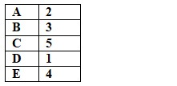  
  
Pilihan C merupakan jawaban paling tepat karena menunjukkan kemampuan membangun jejaring kerja secara kolaboratif dan solutif. Dengan mengajak mitra berdiskusi untuk mencari cara agar sebagian hasil verifikasi dapat dikirim lebih dulu, kebutuhan mendesak tim pusat tetap terpenuhi tanpa mengabaikan keterbatasan yang dihadapi mitra. Sikap ini mencerminkan fleksibilitas, komunikasi yang baik, serta fokus pada keberlanjutan kerja sama, sehingga layak mendapat skor 5. Pilihan E berada satu tingkat di bawahnya karena menyampaikan kondisi keterlambatan kepada pimpinan memang diperlukan sebagai bentuk transparansi, namun langkah tersebut masih bersifat pelaporan dan belum menjadi solusi utama atas hambatan teknis yang terjadi, sehingga layak mendapat skor 4. Pilihan B menunjukkan ketegasan dengan menjadikan keterlambatan sebagai catatan kinerja, tetapi tanpa disertai upaya mencari jalan keluar bersama, pendekatan ini berpotensi merusak hubungan kerja dan tidak membantu percepatan penyelesaian tugas, sehingga layak mendapat skor 3. Pilihan A memberikan kelonggaran penuh dengan menyesuaikan seluruh tahapan kegiatan, namun sikap ini mengabaikan urgensi kebutuhan data dan berisiko mengganggu jadwal pihak lain, sehingga layak mendapat skor 2. Sementara itu, pilihan D menjadi yang paling tidak tepat karena mengambil alih pekerjaan mitra dapat menimbulkan ketergantungan, melemahkan peran jejaring kerja, serta berpotensi menimbulkan konflik kewenangan di kemudian hari, sehingga layak mendapat skor 1.

---

#### 12584 · no 12

Anda menjadi anggota tim koordinasi lintas instansi dalam sebuah program bersama. Dalam pelaksanaannya, setiap instansi sudah menjalankan tugasnya masing-masing, tetapi cara kerja dan standar pelaporan yang digunakan berbeda-beda sehingga hasil kerja sulit digabungkan dan berpotensi menimbulkan kesalahpahaman. Beberapa pihak mulai saling menyalahkan karena merasa sudah bekerja sesuai versi mereka masing-masing. Sikap Anda adalah (Jejaring Kerja)

- **A.** Memahami bahwa perbedaan cara kerja antarinstansi adalah hal yang sulit dihindari dalam kerja bersama.
- **B.** Menyesuaikan hasil kerja Anda dengan standar instansi lain agar tidak terjadi perdebatan.
- **C.** Menyampaikan masukan kepada pimpinan tim agar dibuat kesepakatan standar kerja bersama.
- **D.** Mengusulkan secara terbuka dalam forum tim agar disepakati format dan alur kerja bersama untuk memudahkan koordinasi.
- **E.** Tetap menjalankan tugas sesuai standar instansi Anda tanpa ikut terlibat dalam perbedaan tersebut.

**Kunci:** D

**Pembahasan:** SKOR JAWABAN:  
  
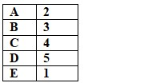  
  
Pilihan D merupakan jawaban paling tepat karena menunjukkan inisiatif dalam membangun jejaring kerja secara kolaboratif tanpa melampaui kewenangan sebagai anggota tim. Dengan mengusulkan secara terbuka dalam forum tim agar disepakati format dan alur kerja bersama, masalah perbedaan standar dapat dibahas dan diselesaikan secara kolektif sehingga meminimalkan kesalahpahaman serta saling menyalahkan antarinstansi, sehingga layak mendapat skor 5. Pilihan C berada satu tingkat di bawahnya karena menyampaikan masukan kepada pimpinan tim agar dibuat kesepakatan bersama tetap mencerminkan kepedulian terhadap kelancaran kerja sama, namun pendekatan ini lebih bersifat tidak langsung dan kurang menunjukkan peran aktif dalam membangun koordinasi di tingkat tim, sehingga layak mendapat skor 4. Pilihan B menunjukkan sikap kompromi dengan menyesuaikan hasil kerja sendiri agar selaras dengan pihak lain, tetapi tindakan ini bersifat individual dan tidak menyelesaikan akar permasalahan perbedaan standar kerja yang dialami bersama, sehingga layak mendapat skor 3. Pilihan A mencerminkan sikap pasif karena hanya menerima perbedaan cara kerja tanpa upaya perbaikan atau penyelarasan, sehingga berpotensi membuat masalah terus berulang, sehingga layak mendapat skor 2. Sementara itu, pilihan E merupakan sikap paling tidak tepat karena memilih untuk tidak terlibat dan tetap bekerja sesuai standar sendiri justru dapat memperbesar kesenjangan koordinasi dan melemahkan jejaring kerja lintas instansi, sehingga layak mendapat skor 1.

---

#### 12584 · no 13

Anda tergabung dalam tim lintas unit yang sedang menyusun laporan bersama. Salah satu unit meminta agar temuan yang kurang menguntungkan bagi mereka tidak dicantumkan demi menjaga citra. Jika ditolak, mereka mengisyaratkan akan mengurangi dukungan kerja sama ke depan. Apa sikap terbaik Anda? (Jejaring Kerja)

- **A.** Menyetujui usulan tersebut demi menjaga hubungan kerja sama antarunit.
- **B.** Menolak usulan tersebut karena rekomendasi harus disusun berdasarkan hasil evaluasi yang ada.
- **C.** Mengajak unit terkait membahas cara merumuskan rekomendasi yang tetap berlandaskan temuan lapangan namun disampaikan secara konstruktif.
- **D.** Menyampaikan kondisi tersebut kepada pimpinan tim agar diputuskan secara struktural.
- **E.** Mengurangi porsi rekomendasi tersebut agar tidak menimbulkan keberatan dari pihak lain.

**Kunci:** C

**Pembahasan:** SKOR JAWABAN:  
  
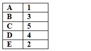  
  
Pilihan C merupakan jawaban paling tepat karena menunjukkan kemampuan menjaga jejaring kerja sekaligus mempertahankan integritas substansi pekerjaan. Dengan mengajak unit terkait membahas cara merumuskan rekomendasi yang tetap berlandaskan temuan lapangan namun disampaikan secara konstruktif, kebutuhan akan objektivitas tetap terpenuhi tanpa mengorbankan hubungan kerja sama. Sikap ini mencerminkan komunikasi yang dewasa, kolaboratif, dan berorientasi pada solusi bersama, sehingga layak mendapat skor 5. Pilihan D berada satu tingkat di bawahnya karena menyampaikan persoalan kepada pimpinan merupakan langkah yang sah dan aman secara struktural, namun pendekatan ini cenderung mengalihkan penyelesaian masalah ke pihak lain dan kurang menunjukkan upaya membangun kesepahaman langsung dalam jejaring kerja, sehingga layak mendapat skor 4. Pilihan B menunjukkan sikap menjunjung objektivitas dengan menolak usulan tersebut, tetapi penolakan tanpa upaya dialog berpotensi memicu ketegangan dan tidak membantu menjaga keberlanjutan kerja sama lintas unit, sehingga layak mendapat skor 3. Pilihan E berupaya meredam potensi konflik dengan mengurangi porsi rekomendasi, namun langkah ini tetap mengaburkan substansi evaluasi dan tidak menyelesaikan tekanan yang muncul secara prinsip, sehingga layak mendapat skor 2. Sementara itu, pilihan A menjadi yang paling tidak tepat karena mengorbankan integritas hasil kerja demi menjaga hubungan semu, yang dalam jangka panjang justru merusak kepercayaan dan profesionalitas dalam jejaring kerja, sehingga layak mendapat skor 1.

---

#### 12584 · no 14

Dalam kerja sama lintas instansi, mitra Anda melaksanakan kegiatan tanpa mengikuti alur koordinasi yang telah disepakati. Akibatnya, jadwal berbenturan dan muncul keluhan dari peserta. Setelah dikonfirmasi, mitra tersebut mengakui kesalahan dan khawatir hubungan kerja sama ke depan terganggu. Sikap Anda adalah (Jejaring Kerja)

- **A.** Menjadikan kejadian tersebut sebagai catatan evaluasi tanpa membahas tindak lanjut.
- **B.** Menganggap masalah selesai karena mitra telah mengakui kesalahan.
- **C.** Mengajak mitra mengevaluasi kejadian dan menyepakati langkah perbaikan agar tidak terulang.
- **D.** Mengurangi peran mitra pada kegiatan berikutnya untuk mencegah masalah serupa.
- **E.** Melaporkan kejadian tersebut kepada pimpinan tanpa melibatkan mitra dalam pembahasan solusi.

**Kunci:** C

**Pembahasan:** SKOR JAWABAN:  
  
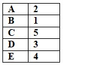  
  
Sikap paling tepat adalah opsi C karena menunjukkan upaya menjaga jejaring kerja melalui evaluasi bersama dan penyusunan langkah perbaikan yang disepakati, sehingga masalah diselesaikan tanpa menyalahkan dan kolaborasi tetap berjalan sehat, sehingga layak mendapat skor 5. Opsi E menekankan akuntabilitas melalui pelaporan kepada pimpinan, namun tidak melibatkan mitra dalam penyelesaian masalah sehingga berpotensi memperlebar jarak koordinasi, sehingga layak mendapat skor 4. Opsi D bertujuan mencegah kesalahan berulang dengan mengurangi peran mitra, tetapi langkah ini dapat menurunkan kepercayaan dan tidak menyentuh akar masalah, sehingga layak mendapat skor 3. Opsi A hanya menjadikan kejadian sebagai catatan evaluasi tanpa tindak lanjut perbaikan yang konkret, sehingga risiko kesalahan terulang tetap ada, sehingga layak mendapat skor 2. Sementara itu, opsi B mengabaikan dampak kesalahan meskipun sudah diakui dan tidak mencerminkan tanggung jawab dalam menjaga kualitas koordinasi jejaring kerja, sehingga layak mendapat skor 1.

---

#### 12584 · no 15

Anda berperan sebagai penghubung dalam kerja sama antara dinas kesehatan dan sebuah organisasi nonpemerintah pada program penyuluhan gizi di sekolah. Saat pelaksanaan, pihak NGO menilai jadwal kegiatan sering berubah sepihak, sementara dinas merasa perubahan dilakukan karena menyesuaikan agenda sekolah. Ketegangan mulai mengganggu kelancaran program. Sikap Anda adalah (Jejaring Kerja)

- **A.** Mengajak kedua pihak duduk bersama untuk mengevaluasi pola koordinasi dan menyepakati mekanisme penjadwalan yang lebih jelas.
- **B.** Meminta NGO menyesuaikan diri karena dinas memiliki kewenangan lebih besar dalam program pemerintah.
- **C.** Menyarankan program tetap berjalan sambil masalah koordinasi dibahas di akhir kegiatan.
- **D.** Menghentikan sementara kegiatan sampai masing-masing pihak memperbaiki koordinasi internal.
- **E.** Menyampaikan permasalahan tersebut kepada pimpinan tanpa melibatkan kedua pihak dalam pembahasan awal.

**Kunci:** A

**Pembahasan:** SKOR JAWABAN:  
  
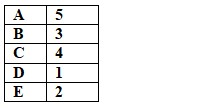  
  
Sikap paling tepat adalah opsi A karena mengedepankan peran koordinatif dalam jejaring kerja dengan mempertemukan kedua pihak untuk mengevaluasi pola komunikasi dan menyepakati mekanisme penjadwalan yang jelas, sehingga akar masalah dapat diselesaikan tanpa memperbesar konflik dan program tetap berjalan efektif, sehingga layak mendapat skor 5. Opsi C menunjukkan upaya menjaga kelangsungan program dengan menunda pembahasan konflik, namun tidak segera menyentuh sumber permasalahan sehingga berisiko menimbulkan gangguan berulang, sehingga layak mendapat skor 4. Opsi B cenderung berpihak pada salah satu pihak dengan alasan kewenangan, yang dapat merusak keseimbangan kemitraan dan menurunkan kepercayaan dalam jejaring kerja, sehingga layak mendapat skor 3. Opsi E menempuh jalur struktural dengan melapor ke pimpinan, tetapi mengabaikan fungsi mediasi awal yang seharusnya dilakukan pada level koordinasi, sehingga layak mendapat skor 2. Sementara itu, opsi D menghentikan kegiatan tanpa upaya penyelesaian bersama sehingga berpotensi merugikan tujuan program dan melemahkan kerja sama antar pihak, sehingga layak mendapat skor 1.

---

#### 12584 · no 16

Anda menjadi penghubung antara pemerintah daerah dan sebuah organisasi relawan lingkungan dalam program pengelolaan sampah terpadu. Dalam pelaksanaannya, relawan merasa kurang dilibatkan dalam pengambilan keputusan teknis, sementara pemerintah menilai relawan sering bergerak di luar kesepakatan awal. Ketegangan mulai muncul dan koordinasi melemah. Apa langkah terbaik yang Anda lakukan? (Jejaring Kerja)

- **A.** Meminta relawan mengikuti seluruh keputusan pemerintah agar program tetap terkendali.
- **B.** Menginisiasi forum evaluasi bersama untuk menyepakati ulang peran, batas kewenangan, dan mekanisme koordinasi.
- **C.** Membiarkan masing-masing pihak menjalankan perannya agar konflik mereda dengan sendirinya.
- **D.** Menyampaikan keluhan kedua pihak kepada pimpinan tanpa mempertemukan mereka.
- **E.** Mengurangi ruang keterlibatan relawan agar koordinasi lebih sederhana.

**Kunci:** B

**Pembahasan:** SKOR JAWABAN:  
  
  
  
Pilihan B paling tepat karena Anda menginisiasi forum evaluasi bersama untuk menyepakati ulang peran, batas kewenangan, dan mekanisme koordinasi. Langkah ini menunjukkan pendekatan kolaboratif, terbuka, dan berorientasi solusi jangka panjang. Dengan mempertemukan kedua pihak, potensi miskomunikasi dapat diselesaikan secara langsung dan hubungan kerja sama dapat diperkuat kembali, sehingga layak mendapat skor 5. Pilihan E mendapat skor 4 karena berupaya menyederhanakan koordinasi, namun dengan mengurangi keterlibatan relawan justru berisiko menurunkan partisipasi dan semangat kolaborasi. Pilihan D bernilai 3 karena menyampaikan keluhan kepada pimpinan dapat membantu, tetapi tidak menyelesaikan akar masalah karena kedua pihak tidak dipertemukan secara langsung. Pilihan A mendapat skor 2 karena cenderung sepihak dan tidak menghargai peran relawan, sehingga berpotensi memperbesar konflik. Sementara itu, pilihan C menjadi yang terendah karena membiarkan masing-masing pihak berjalan sendiri justru akan memperparah miskomunikasi dan melemahkan kerja sama dalam jangka panjang.

---

#### 12584 · no 17

Anda berperan sebagai penghubung dalam jejaring kerja program literasi digital bagi masyarakat. Pada tahap pelaksanaan, narasumber teknis yang biasanya mendampingi sesi praktik tiba-tiba tidak dapat mengikuti beberapa jadwal karena penugasan lain. Sementara itu, peserta sudah terdaftar dan pelatihan harus tetap berjalan sesuai rencana. Apa langkah paling tepat yang Anda ambil? (Jejaring Kerja)

- **A.** Mengatur pembagian tugas pendampingan kepada anggota tim lain yang memiliki kemampuan teknis sejenis agar kegiatan tetap berjalan.
- **B.** Menunda seluruh rangkaian pelatihan sampai narasumber utama dapat kembali mendampingi.
- **C.** Meminta narasumber utama menyiapkan panduan materi tertulis sebagai pegangan sementara bagi peserta.
- **D.** Mengalihkan sesi praktik menjadi pemaparan umum tanpa pendampingan teknis.
- **E.** Menyerahkan sepenuhnya pelaksanaan sesi kepada panitia lapangan tanpa pengawasan pendamping.

**Kunci:** A

**Pembahasan:** SKOR JAWABAN:  
  
  
  
Sikap paling tepat adalah opsi A karena menunjukkan kemampuan mengelola jejaring kerja secara adaptif dengan memanfaatkan sumber daya yang ada, yaitu membagi peran pendampingan kepada anggota tim lain yang memiliki kompetensi serupa sehingga kegiatan tetap berjalan tanpa mengorbankan kualitas pelaksanaan, sehingga layak mendapat skor 5. Opsi C merupakan alternatif yang cukup baik karena tetap melibatkan narasumber utama melalui penyediaan panduan tertulis, namun efektivitas pendampingan praktik tetap lebih rendah dibandingkan kehadiran fasilitator pengganti secara langsung, sehingga layak mendapat skor 4. Opsi D berupaya menjaga keberlangsungan kegiatan dengan mengubah bentuk sesi, tetapi mengurangi substansi pendampingan teknis yang menjadi tujuan utama program, sehingga layak mendapat skor 3. Opsi E menyerahkan pelaksanaan sepenuhnya kepada panitia lapangan tanpa dukungan pendamping yang memadai, sehingga berisiko menurunkan kualitas kegiatan dan melemahkan fungsi jejaring kerja, sehingga layak mendapat skor 2. Sementara itu, opsi B menunda seluruh kegiatan sampai narasumber utama kembali aktif tanpa mencari solusi alternatif, sehingga berpotensi mengecewakan peserta dan menghambat capaian program, sehingga layak mendapat skor 1.

---

#### 12584 · no 18

Anda menjadi koordinator kegiatan komunitas pemuda yang anggotanya berasal dari berbagai daerah dan kebiasaan sosial. Dalam beberapa pertemuan, sebagian anggota sering bercanda menggunakan gaya humor internal kelompoknya sendiri, yang tanpa disadari membuat anggota lain jarang terlibat dan memilih diam. Belum ada konflik terbuka, tetapi suasana kebersamaan mulai berkurang. Apa langkah paling tepat yang Anda ambil? (Sosial Budaya)

- **A.** Membiarkan gaya interaksi tersebut berjalan alami karena setiap kelompok memiliki cara bergaul masing-masing.
- **B.** Menyarankan anggota yang kurang nyaman untuk lebih aktif menyesuaikan diri agar tidak tertinggal.
- **C.** Mengajak anggota berdiskusi bersama untuk membangun pola interaksi yang saling menghargai dan inklusif.
- **D.** Mengurangi sesi diskusi bebas agar potensi ketidaknyamanan tidak muncul.
- **E.** Menetapkan aturan tegas mengenai cara bercanda dan berkomunikasi dalam setiap kegiatan.

**Kunci:** C

**Pembahasan:** SKOR JAWABAN:  
  
  
  
Sikap paling tepat adalah opsi C karena menunjukkan kepekaan sosial budaya dengan mengajak seluruh anggota berdiskusi untuk membangun pola interaksi yang lebih inklusif dan saling menghargai tanpa meniadakan ekspresi sosial masing-masing, sehingga kebersamaan dapat dipulihkan dan potensi jarak sosial dapat dicegah sejak awal, sehingga layak mendapat skor 5. Opsi E bertujuan menciptakan keteraturan melalui aturan tegas, namun berpotensi membatasi ekspresi sosial secara kaku dan kurang mendorong kesadaran bersama, sehingga layak mendapat skor 4. Opsi D berusaha menghindari sumber masalah dengan mengurangi ruang interaksi, tetapi langkah ini tidak menyelesaikan akar persoalan dan justru mengurangi kualitas kebersamaan, sehingga layak mendapat skor 3. Opsi A membiarkan kondisi berlangsung tanpa intervensi sehingga risiko eksklusivitas dan jarak sosial semakin besar, sehingga layak mendapat skor 2. Sementara itu, opsi B membebankan penyesuaian sepenuhnya kepada pihak yang merasa tidak nyaman dan tidak mencerminkan sikap inklusif dalam lingkungan multikultural, sehingga layak mendapat skor 1.

---

#### 12584 · no 19

Anda bertugas sebagai fasilitator dalam kegiatan musyawarah warga yang diikuti oleh peserta dari berbagai latar kebiasaan sosial. Selama pertemuan, sebagian warga terbiasa menyampaikan pendapat secara lugas dan langsung, sementara yang lain merasa cara tersebut terlalu keras dan kurang menghargai perasaan. Perbedaan ini mulai menghambat partisipasi beberapa peserta. Apa langkah paling tepat yang Anda lakukan? (Sosial Budaya)

- **A.** Meminta peserta menyampaikan pendapat dengan cara yang lebih halus agar tidak menyinggung pihak lain.
- **B.** Mengajak peserta menyepakati aturan penyampaian pendapat yang saling menghormati tanpa menghilangkan ciri komunikasi masing-masing.
- **C.** Memisahkan sesi musyawarah berdasarkan kelompok yang memiliki gaya komunikasi serupa.
- **D.** Mengarahkan pertemuan agar berjalan singkat dan langsung pada keputusan untuk menghindari perdebatan.
- **E.** Memberi ruang diskusi tidak resmi di luar forum utama agar peserta dapat menyampaikan pendapat dengan bebas.

**Kunci:** B

**Pembahasan:** SKOR JAWABAN:  
  
  
  
Sikap paling tepat adalah opsi B karena menunjukkan kemampuan mengelola perbedaan sosial budaya dengan melibatkan seluruh peserta untuk menyepakati aturan penyampaian pendapat yang saling menghormati tanpa meniadakan ciri komunikasi masing-masing, sehingga partisipasi dapat kembali merata dan suasana musyawarah tetap inklusif, sehingga layak mendapat skor 5. Opsi E memberi ruang alternatif bagi peserta untuk menyalurkan pendapat secara lebih bebas, namun tidak langsung menyelesaikan hambatan partisipasi yang terjadi di forum utama, sehingga layak mendapat skor 4. Opsi D berupaya meredam perbedaan dengan membatasi diskusi, tetapi berisiko mengurangi kualitas musyawarah dan kesempatan menyampaikan pandangan secara utuh, sehingga layak mendapat skor 3. Opsi A cenderung memihak salah satu gaya komunikasi dan berpotensi menekan ekspresi sebagian peserta, sehingga kurang mencerminkan sikap saling menghargai, sehingga layak mendapat skor 2. Sementara itu, opsi C memisahkan peserta berdasarkan gaya komunikasi sehingga berpotensi memperlebar jarak sosial dan bertentangan dengan semangat kebersamaan dalam lingkungan multikultural, sehingga layak mendapat skor 1.

---

#### 12584 · no 20

Anda menjadi pendamping kegiatan PKK di sebuah kelurahan. Dalam pelaksanaan program bulanan, muncul keluhan bahwa sebagian ibu PKK merasa ide dan usulan mereka jarang ditindaklanjuti karena keputusan lebih sering diambil oleh pengurus lama. Akibatnya, beberapa anggota mulai enggan hadir dalam kegiatan. Apa langkah paling tepat yang Anda lakukan? (Sosial Budaya)

- **A.** Membiarkan mekanisme yang ada berjalan karena pengurus lama dianggap lebih berpengalaman.
- **B.** Mengingatkan anggota PKK agar tetap menghormati keputusan pengurus inti.
- **C.** Mengajak pengurus dan anggota PKK menyepakati mekanisme penyaluran dan pembahasan usulan secara terbuka.
- **D.** Mengganti pengurus lama dengan anggota baru agar suasana lebih segar.
- **E.** Menyarankan anggota yang kurang puas menyampaikan keluhan secara pribadi kepada ketua PKK.

**Kunci:** C

**Pembahasan:** SKOR JAWABAN:  
  
  
  
Sikap paling tepat adalah opsi C karena menunjukkan kepekaan sosial budaya dengan membuka ruang dialog antara pengurus dan anggota PKK untuk menyepakati mekanisme penyaluran serta pembahasan usulan secara terbuka, sehingga setiap anggota merasa dihargai dan partisipasi dapat meningkat kembali, sehingga layak mendapat skor 5. Opsi E memberikan saluran penyampaian keluhan secara pribadi yang dapat meredam ketegangan sementara, namun tidak menyelesaikan persoalan secara kolektif dan berpotensi mengulang masalah yang sama, sehingga layak mendapat skor 4. Opsi D menawarkan perubahan struktural dengan mengganti pengurus lama, tetapi langkah ini berisiko menimbulkan konflik baru dan tidak menyentuh akar masalah komunikasi, sehingga layak mendapat skor 3. Opsi A mempertahankan pola lama tanpa evaluasi sehingga mengabaikan aspirasi anggota dan dapat memperkuat rasa ketidakadilan, sehingga layak mendapat skor 2. Sementara itu, opsi B hanya menekankan kepatuhan terhadap pengurus inti tanpa membuka ruang perbaikan, sehingga tidak mencerminkan upaya membangun kebersamaan dalam kegiatan PKK, sehingga layak mendapat skor 1.

---

#### 12584 · no 21

Anda bekerja di sebuah kantor pemerintah dengan pegawai dari latar belakang yang beragam. Dalam praktik sehari-hari, bantuan pekerjaan dan informasi lebih sering berputar di kelompok tertentu saja, sehingga sebagian pegawai merasa tersisih dan kurang dilibatkan. Situasi ini mulai mengganggu kerja tim. Apa sikap paling tepat yang Anda ambil? (Sosial Budaya)

- **A.** Menginisiasi forum kerja lintas tim untuk membahas pola kolaborasi tanpa menyinggung kelompok tertentu secara langsung.
- **B.** Mengajak pimpinan mengevaluasi budaya kerja yang berkembang dan menyusun mekanisme kolaborasi yang lebih inklusif.
- **C.** Menyampaikan kepada rekan kerja bahwa pola bantuan yang eksklusif dapat berdampak pada kinerja tim secara keseluruhan.
- **D.** Mengusulkan sistem rotasi tugas dan kerja kelompok agar interaksi antarpegawai lebih merata.
- **E.** Tetap bekerja seperti biasa sambil berharap dinamika tim membaik dengan sendirinya.

**Kunci:** A

**Pembahasan:** SKOR JAWABAN:  
  
  
  
Pilihan A paling tepat karena menginisiasi forum kerja lintas tim membantu membuka ruang komunikasi yang netral tanpa menyasar kelompok tertentu secara langsung, sehingga semua pegawai dapat menyampaikan pandangan dan bersama-sama membangun pola kolaborasi yang lebih inklusif tanpa memicu konflik personal, langkah ini juga menunjukkan inisiatif profesional dalam menjaga keharmonisan kerja tim dan memperbaiki sistem secara konstruktif sehingga layak mendapat skor 5, pilihan B tetap baik karena melibatkan pimpinan untuk evaluasi budaya kerja namun cenderung melewati upaya penyelesaian langsung di tingkat rekan kerja sehingga layak mendapat skor 4, pilihan D cukup membantu meningkatkan interaksi tetapi lebih berfokus pada teknis pembagian tugas daripada akar masalah komunikasi sehingga layak mendapat skor 3, pilihan C hanya berupa penyampaian pendapat yang berpotensi menimbulkan kesalahpahaman tanpa solusi sistematis sehingga layak mendapat skor 2, sedangkan pilihan E bersifat pasif dan tidak berkontribusi pada perbaikan situasi sehingga layak mendapat skor 1.

---

#### 12584 · no 22

Anda menjabat sebagai pimpinan unit kerja di instansi pemerintah yang pegawainya memiliki latar keyakinan dan budaya beragam. Menjelang peringatan hari besar nasional, muncul usulan agar kantor mengadakan kegiatan yang bernuansa keagamaan tertentu karena dianggap paling mencerminkan nilai moral, sementara pegawai lain mengusulkan kegiatan kebangsaan yang bersifat netral agar semua dapat terlibat. Perbedaan pandangan ini mulai memicu perdebatan internal. Apa sikap paling tepat yang Anda lakukan? (Sosial Budaya)

- **A.** Mengarahkan unit kerja untuk memilih satu bentuk kegiatan yang dinilai paling aman agar tidak memperpanjang perdebatan.
- **B.** Mengajak perwakilan pegawai berdiskusi untuk merumuskan bentuk kegiatan yang menonjolkan nilai kebangsaan tanpa mengabaikan sensitivitas keberagaman.
- **C.** Menetapkan dua kegiatan berbeda dalam waktu yang sama agar seluruh usulan dapat terakomodasi.
- **D.** Meminta pendapat pimpinan tertinggi lalu melaksanakan keputusan tersebut tanpa diskusi lanjutan.
- **E.** Menunda peringatan hingga seluruh pihak sepakat agar tidak menimbulkan ketegangan.

**Kunci:** B

**Pembahasan:** SKOR JAWABAN:  
  
  
  
Sikap paling tepat adalah opsi B karena mengedepankan pengelolaan perbedaan sosial budaya secara inklusif dengan melibatkan perwakilan pegawai untuk merumuskan bentuk kegiatan yang menonjolkan nilai kebangsaan sekaligus sensitif terhadap keberagaman keyakinan, sehingga semua pihak merasa dihargai dan kebersamaan tetap terjaga, sehingga layak mendapat skor 5. Opsi C berupaya mengakomodasi seluruh usulan dengan menetapkan dua kegiatan sekaligus, namun tanpa perumusan bersama langkah ini berpotensi menimbulkan fragmentasi partisipasi dan tidak menyelesaikan perbedaan pandangan, sehingga layak mendapat skor 4. Opsi A memilih jalan praktis dengan menetapkan satu kegiatan demi efisiensi, tetapi mengabaikan aspirasi sebagian pegawai dan dapat menimbulkan rasa tidak dilibatkan, sehingga layak mendapat skor 3. Opsi D menyerahkan keputusan sepenuhnya kepada pimpinan tertinggi tanpa dialog, sehingga partisipasi dan rasa memiliki pegawai terhadap kegiatan menjadi rendah, sehingga layak mendapat skor 2. Sementara itu, opsi E menunda kegiatan tanpa solusi yang jelas, sehingga berpotensi menghilangkan momentum kebersamaan dan tidak menyelesaikan perbedaan yang ada, sehingga layak mendapat skor 1.

---

#### 12584 · no 23

Anda adalah ASN di unit pelayanan publik. Di kantor, ada kebiasaan mendahulukan warga yang sudah dikenal. Praktik ini jarang dipermasalahkan, tetapi berpotensi merusak keadilan layanan. Sikap paling tepat adalah … (Sosial Budaya)

- **A.** Menyesuaikan diri dengan kebiasaan yang ada agar tidak menimbulkan gesekan internal.
- **B.** Menjaga pelayanan pribadi tetap adil tanpa ikut campur praktik rekan kerja.
- **C.** Mengajak tim mendiskusikan standar layanan yang sama bagi semua warga secara bertahap.
- **D.** Melaporkan kebiasaan tersebut kepada atasan agar segera dihentikan.
- **E.** Mengingatkan rekan kerja di hadapan warga agar menjadi pembelajaran bersama.

**Kunci:** C

**Pembahasan:** SKOR JAWABAN:  
  
  
  
Pilihan C merupakan jawaban paling tepat karena menunjukkan kemampuan mengelola perbedaan secara sistematis dan berorientasi pada perbaikan bersama, dengan mengajak tim berdiskusi untuk menyusun standar layanan yang lebih adil dan inklusif tanpa menyalahkan pihak tertentu, sehingga layak mendapatkan skor 5. Pilihan D mencerminkan ketegasan pimpinan, namun cenderung top-down dan berpotensi menimbulkan resistensi karena perubahan dilakukan tanpa proses dialog, sehingga hanya layak mendapatkan skor 4. Pilihan A menunjukkan upaya menjaga keharmonisan, tetapi mengorbankan prinsip keadilan dan profesionalisme dalam pelayanan, sehingga kurang tepat dan layak mendapatkan skor 3. Pilihan B bersifat pasif dan individual karena hanya menyesuaikan diri tanpa berkontribusi menyelesaikan masalah di tingkat tim, sehingga layak mendapatkan skor 2. Sementara itu, pilihan E tidak mencerminkan etika kerja dan kepemimpinan ASN karena berisiko mempermalukan rekan kerja serta memperkeruh suasana kerja, sehingga menjadi pilihan paling tidak tepat dan hanya layak mendapatkan skor 1.

---

#### 12584 · no 24

Anda bekerja sebagai ASN baru di sebuah instansi. Ada kebiasaan tidak tertulis bahwa pegawai junior ikut patungan rutin untuk kebutuhan pribadi atasan. Kebiasaan ini tidak pernah diwajibkan, tetapi penolakan berpotensi berdampak pada relasi kerja. Sikap paling tepat adalah… (Sosial Budaya)

- **A.** Menolak secara langsung dengan alasan prinsip, tanpa mempertimbangkan dampak relasi kerja.
- **B.** Mengikuti kebiasaan tersebut sambil menunda sikap sampai posisi Anda lebih aman.
- **C.** Menyampaikan keberatan secara personal dengan pendekatan profesional dan mencari titik temu yang tidak melanggar norma.
- **D.** Mengumpulkan dukungan rekan junior agar kebiasaan tersebut dihentikan bersama-sama.
- **E.** Mendokumentasikan praktik tersebut dan menyiapkan langkah formal jika tekanan berlanjut.

**Kunci:** C

**Pembahasan:** SKOR JAWABAN:  
  
  
  
Pilihan C merupakan jawaban paling tepat karena menunjukkan kemampuan menjaga nilai etika, norma organisasi, dan relasi kerja secara seimbang dengan menyampaikan keberatan secara personal dan profesional, sehingga masalah dapat disikapi tanpa konfrontasi terbuka maupun pelanggaran prinsip ASN, sehingga layak mendapatkan skor 5. Pilihan D mencerminkan keberanian dan upaya kolektif, namun berisiko memicu resistensi dan dinamika kelompok yang kurang sehat jika tidak melalui pendekatan struktural, sehingga layak mendapatkan skor 4. Pilihan E menunjukkan kewaspadaan dan kesiapan menghadapi tekanan lanjutan, tetapi cenderung reaktif dan belum mengedepankan penyelesaian sosial di tahap awal, sehingga layak mendapatkan skor 3. Pilihan A menekankan prinsip pribadi, namun mengabaikan konteks sosial dan potensi dampak relasi kerja sebagai ASN baru, sehingga layak mendapatkan skor 2. Sementara itu, pilihan B paling tidak tepat karena mencerminkan kompromi terhadap praktik yang menyimpang demi kenyamanan pribadi, yang berpotensi melanggengkan budaya tidak sehat, sehingga hanya layak mendapatkan skor 1.

---

#### 12584 · no 25

Dalam tim Anda, pegawai yang aktif di kegiatan informal kantor cenderung dianggap lebih loyal, sehingga lebih sering mendapat kesempatan pengembangan. Pegawai yang fokus bekerja mulai merasa dirugikan. Apa langkah paling tepat? (Sosial Budaya)

- **A.** Mendorong penyesuaian kriteria penilaian melalui jalur resmi dengan menekankan dampak jangka panjang terhadap profesionalisme.
- **B.** Menyarankan rekan kerja meningkatkan keterlibatan sosial agar tidak tertinggal peluang.
- **C.** Menerima kondisi tersebut sebagai bagian dari budaya organisasi yang sulit diubah.
- **D.** Menjaga jarak dari sistem penilaian dan fokus pada kinerja pribadi saja.
- **E.** Mengkritik kecenderungan tersebut secara terbuka agar pimpinan merasa tertekan.

**Kunci:** A

**Pembahasan:** SKOR JAWABAN:  
  
  
  
Pilihan A merupakan jawaban paling tepat karena menunjukkan pola pikir strategis dan berorientasi pada perbaikan sistem dengan mendorong penyesuaian kriteria penilaian melalui jalur resmi, sehingga profesionalisme dan keadilan organisasi dapat terjaga dalam jangka panjang, sehingga layak mendapatkan skor 5. Pilihan E menunjukkan keberanian menyuarakan kritik, namun dilakukan secara terbuka dan konfrontatif sehingga berpotensi menimbulkan konflik serta resistensi pimpinan, sehingga layak mendapatkan skor 4. Pilihan B bersifat adaptif terhadap budaya yang ada, tetapi cenderung menyarankan penyesuaian individu tanpa menyentuh akar ketidakadilan sistem, sehingga layak mendapatkan skor 3. Pilihan D bersikap pasif karena hanya berfokus pada kinerja pribadi tanpa kontribusi pada perbaikan lingkungan kerja, sehingga layak mendapatkan skor 2. Adapun pilihan C paling tidak tepat karena menerima kondisi yang tidak adil tanpa upaya perbaikan, yang bertentangan dengan nilai profesionalisme dan meritokrasi ASN, sehingga hanya layak mendapatkan skor 1.

---

#### 12584 · no 26

Di unit kerja Anda, ada kebiasaan berbagi akun aplikasi kerja agar tugas cepat selesai saat salah satu pegawai berhalangan. Suatu hari Anda diminta menggunakan akun milik rekan untuk mengunggah laporan karena tenggat sudah dekat. Apa sikap paling tepat yang Anda ambil? (Teknologi Informasi dan Komunikasi)

- **A.** Menggunakan akun tersebut karena sudah menjadi kebiasaan di tim.
- **B.** Menggunakan akun rekan hanya untuk tugas itu lalu keluar kembali.
- **C.** Menolak secara halus dan mengusulkan penggunaan akun resmi sesuai prosedur.
- **D.** Menggunakan akun rekan sambil mencatat aktivitas sebagai bentuk tanggung jawab.
- **E.** Menunda pengunggahan tanpa memberi penjelasan agar tidak terlibat risiko.

**Kunci:** C

**Pembahasan:** SKOR JAWABAN:  
  
  
  
Pilihan C merupakan jawaban paling tepat karena menunjukkan pemahaman terhadap etika dan keamanan penggunaan sistem teknologi informasi dengan tetap menjaga kepatuhan pada prosedur resmi, sekaligus disampaikan secara halus agar tidak merusak hubungan kerja, sehingga layak mendapatkan skor 5. Pilihan D berada satu tingkat di bawah karena meskipun ada upaya bertanggung jawab dengan mencatat aktivitas, penggunaan akun milik orang lain tetap melanggar prinsip keamanan dan akuntabilitas sistem, sehingga hanya layak mendapatkan skor 4. Pilihan B menunjukkan kesadaran risiko yang lebih baik dibanding mengikuti kebiasaan sepenuhnya, namun tetap membenarkan penggunaan akun bersama meski hanya sementara, sehingga belum sepenuhnya tepat dan layak mendapatkan skor 3. Pilihan A mencerminkan sikap permisif terhadap praktik yang salah dengan alasan kebiasaan dan efisiensi, yang berpotensi menimbulkan masalah keamanan dan akuntabilitas di kemudian hari, sehingga layak mendapatkan skor 2. Sementara itu, pilihan E menjadi yang paling tidak tepat karena bersikap pasif, tidak profesional, dan berpotensi menghambat pekerjaan tim tanpa komunikasi yang jelas, sehingga layak mendapatkan skor 1.

---

#### 12584 · no 27

Di unit kerja Anda, grup percakapan internal sering digunakan untuk koordinasi. Namun, belakangan beberapa pegawai mulai membagikan meme dan candaan yang berpotensi menyinggung serta mencampuradukkan urusan pribadi dengan informasi kerja. Kondisi ini mulai mengganggu fokus dan profesionalisme komunikasi. Sikap paling tepat adalah (Teknologi Informasi dan Komunikasi)

- **A.** Membiarkan kebiasaan tersebut karena grup percakapan bersifat informal.
- **B.** Keluar dari grup dan hanya berkomunikasi melalui jalur resmi lainnya.
- **C.** Mengusulkan kesepakatan penggunaan grup agar tetap fokus pada keperluan kerja.
- **D.** Menegur pengirim pesan secara langsung di dalam grup agar menjadi efek jera.
- **E.** Menyimpan bukti percakapan untuk berjaga-jaga jika terjadi masalah di kemudian hari.

**Kunci:** C

**Pembahasan:** SKOR JAWABAN:  
  
  
  
Pilihan C merupakan jawaban paling tepat karena menunjukkan kemampuan menjaga profesionalisme komunikasi digital dengan cara yang konstruktif, yaitu mengusulkan kesepakatan bersama agar penggunaan grup tetap fokus pada kepentingan kerja tanpa menyalahkan pihak tertentu, sehingga layak mendapatkan skor 5. Pilihan D berada di bawahnya karena meskipun bertujuan menghentikan perilaku yang tidak tepat, menegur secara langsung di dalam grup berpotensi menimbulkan rasa tidak nyaman dan konflik terbuka, sehingga hanya layak mendapatkan skor 4. Pilihan E menunjukkan sikap berjaga-jaga, tetapi bersifat pasif dan tidak menyelesaikan akar masalah komunikasi yang mengganggu, sehingga layak mendapatkan skor 3. Pilihan B mencerminkan upaya menghindari masalah dengan menarik diri dari grup, namun langkah ini dapat menghambat koordinasi kerja dan tidak mencerminkan tanggung jawab sebagai bagian dari tim, sehingga layak mendapatkan skor 2. Sementara itu, pilihan A menjadi yang paling tidak tepat karena membiarkan komunikasi tidak profesional terus berlangsung dan berpotensi merusak etika serta efektivitas kerja, sehingga layak mendapatkan skor 1.

---

#### 12584 · no 28

Di kantor Anda mulai digunakan aplikasi berbasis kecerdasan buatan untuk membantu menyusun draf laporan. Beberapa rekan langsung menyalin hasil aplikasi tersebut tanpa meninjau ulang isinya. Anda diminta ikut menggunakan cara yang sama agar pekerjaan cepat selesai. Sikap paling tepat adalah (Teknologi Informasi dan Komunikasi)

- **A.** Menggunakan hasil aplikasi sepenuhnya karena tujuannya membantu efisiensi kerja.
- **B.** Menggunakan aplikasi sebagai referensi awal lalu menyesuaikan isi sesuai konteks dan tanggung jawab pekerjaan.
- **C.** Menolak penggunaan aplikasi apa pun karena berisiko menurunkan kualitas kerja.
- **D.** Menggunakan aplikasi hanya untuk bagian yang bersifat umum tanpa koreksi lanjutan.
- **E.** Mengikuti cara rekan kerja agar tidak dianggap menghambat proses tim.

**Kunci:** B

**Pembahasan:** SKOR JAWABAN:  
  
  
  
Pilihan B merupakan jawaban paling tepat karena menunjukkan pemanfaatan teknologi secara bijak dengan tetap menempatkan tanggung jawab profesional pada ASN, yaitu menggunakan aplikasi kecerdasan buatan sebagai alat bantu awal sambil tetap meninjau, menyesuaikan, dan memastikan isi laporan sesuai konteks serta akurat, sehingga layak mendapatkan skor 5. Pilihan D berada sedikit di bawah karena sudah ada upaya membatasi penggunaan aplikasi hanya pada bagian umum, namun masih kurang optimal karena tidak menekankan kewajiban pengecekan dan penyesuaian secara menyeluruh, sehingga layak mendapatkan skor 4. Pilihan C mencerminkan kehati-hatian terhadap risiko teknologi, tetapi bersifat terlalu kaku dan menutup peluang peningkatan efisiensi kerja yang sebenarnya dapat dikelola dengan baik, sehingga layak mendapatkan skor 3. Pilihan A menunjukkan pemahaman yang kurang tepat karena menyerahkan sepenuhnya hasil kerja pada aplikasi tanpa kontrol manusia, yang berisiko menurunkan kualitas dan akuntabilitas pekerjaan, sehingga layak mendapatkan skor 2. Sementara itu, pilihan E menjadi yang paling tidak tepat karena lebih mengutamakan tekanan sosial daripada prinsip profesionalisme dan tanggung jawab kerja, sehingga layak mendapatkan skor 1.

---

#### 12584 · no 29

Di unit kerja Anda, terdapat kebiasaan menggunakan template presentasi lama yang desainnya kurang ramah akses (tulisan kecil, kontras rendah), padahal audiens rapat sering berasal dari berbagai usia dan latar belakang. Anda diminta menyiapkan materi presentasi berikutnya. Apa langkah paling tepat? (Teknologi Informasi dan Komunikasi)

- **A.** Menggunakan template lama agar konsisten dengan kebiasaan unit.
- **B.** Mengubah desain presentasi agar lebih ramah akses sambil tetap menjaga substansi materi.
- **C.** Mengikuti template lama lalu menjelaskan isi secara lisan lebih detail.
- **D.** Mengusulkan perubahan desain setelah rapat selesai agar tidak mengganggu jadwal.
- **E.** Menyerahkan desain sepenuhnya kepada rekan yang biasa membuat presentasi.

**Kunci:** B

**Pembahasan:** SKOR JAWABAN:  
  
  
  
Jawaban B paling tepat karena menunjukkan pemanfaatan teknologi informasi yang peka terhadap kebutuhan pengguna dengan latar belakang yang beragam, di mana perbaikan desain presentasi seperti ukuran teks dan kontras warna membantu audiens memahami materi tanpa mengubah isi utama, sehingga layak mendapatkan skor 5. Pilihan D masih cukup baik karena ada kesadaran untuk melakukan perbaikan, namun menundanya membuat masalah aksesibilitas tetap terjadi pada rapat yang sedang berlangsung, sehingga layak mendapatkan skor 4. Pilihan C berada di tingkat berikutnya karena meskipun berusaha mengompensasi desain yang kurang ramah akses melalui penjelasan lisan, cara ini kurang efektif dan tidak menyelesaikan akar masalah, sehingga layak mendapatkan skor 3. Pilihan E menunjukkan sikap pasif karena menyerahkan sepenuhnya kepada rekan tanpa memastikan kualitas dan keterbacaan materi presentasi, sehingga layak mendapatkan skor 2. Sementara itu, pilihan A merupakan opsi paling tidak tepat karena mempertahankan kebiasaan lama tanpa mempertimbangkan efektivitas penyampaian informasi kepada audiens, sehingga layak mendapatkan skor 1.

---

#### 12584 · no 30

Di unit kerja Anda, pegawai terbiasa menyimpan file kerja di perangkat pribadi masing-masing dengan penamaan yang berbeda-beda. Saat salah satu pegawai cuti mendadak, pekerjaan tertunda karena file sulit ditemukan dan tidak sinkron. Anda diminta memberi masukan perbaikan. Apa langkah paling tepat? (Teknologi Informasi dan Komunikasi)

- **A.** Mengingatkan pegawai agar lebih rapi menyimpan file di perangkat masing-masing.
- **B.** Menyusun kesepakatan penamaan file dan lokasi penyimpanan bersama yang mudah diakses.
- **C.** Menyarankan pegawai mencadangkan file secara mandiri agar tidak hilang.
- **D.** Menunggu pimpinan menetapkan aturan resmi terkait pengelolaan file.
- **E.** Meminta pegawai yang cuti tetap dihubungi jika file dibutuhkan.

**Kunci:** B

**Pembahasan:** SKOR JAWABAN:  
  
  
  
Pilihan B merupakan jawaban paling tepat karena menunjukkan pemahaman TIK yang berorientasi pada efektivitas kerja tim dan keberlanjutan sistem, dengan menyusun kesepakatan penamaan file serta lokasi penyimpanan bersama sehingga informasi mudah diakses, risiko ketergantungan pada individu berkurang, dan kolaborasi tetap berjalan meski ada pegawai berhalangan, sehingga layak mendapatkan skor 5. Pilihan D mencerminkan kepatuhan terhadap struktur organisasi, namun terlalu pasif karena menunggu kebijakan formal tanpa inisiatif perbaikan di level unit kerja, sehingga hanya layak mendapatkan skor 4. Pilihan C menunjukkan kesadaran akan pentingnya pencadangan data, tetapi masih bersifat individual dan tidak menyelesaikan masalah keterpaduan akses file tim, sehingga layak mendapatkan skor 3. Pilihan A menekankan kerapian pribadi tanpa solusi sistemik, sehingga dampaknya terbatas dan hanya layak mendapatkan skor 2. Sementara itu, pilihan E sangat tidak tepat karena mencampuradukkan urusan pribadi dan pekerjaan serta berpotensi melanggar etika dan efisiensi kerja, sehingga layak mendapatkan skor 1.

---

#### 12584 · no 31

Sekolah Anda mulai menggunakan sistem ujian berbasis komputer. Saat simulasi, beberapa siswa terlihat saling memotret layar soal menggunakan ponsel yang disembunyikan, sementara pengawas belum menyadari hal tersebut. Jika Anda menjadi panitia pelaksana, langkah paling tepat adalah … (Teknologi Informasi dan Komunikasi)

- **A.** Menghentikan simulasi dan langsung menyita seluruh ponsel siswa tanpa penjelasan lebih lanjut.
- **B.** Membiarkan simulasi berjalan karena belum terbukti terjadi pelanggaran serius.
- **C.** Mengevaluasi sistem pengawasan dan pengaturan teknis ujian agar celah penyalahgunaan teknologi dapat diminimalkan.
- **D.** Memberikan sanksi kepada seluruh siswa peserta simulasi agar menimbulkan efek jera.
- **E.** Menghapus hasil simulasi dan mengulang ujian dengan soal yang sama di hari lain.

**Kunci:** C

**Pembahasan:** SKOR JAWABAN:  
  
  
  
Pilihan C paling tepat karena fokus pada perbaikan sistem pengawasan dan pengaturan teknis ujian membantu mencegah penyalahgunaan teknologi secara menyeluruh, bukan hanya menangani kejadian saat itu saja, sehingga simulasi benar-benar berfungsi sebagai bahan evaluasi untuk meningkatkan keamanan pelaksanaan ujian berbasis komputer di masa depan, langkah ini bersifat preventif, objektif, dan profesional sehingga layak mendapat skor 5, pilihan E masih cukup baik karena menjaga integritas ujian dengan mengulang simulasi namun belum menyentuh akar masalah pada sistem pengawasan sehingga layak mendapat skor 4, pilihan A menunjukkan ketegasan tetapi terlalu reaktif dan kurang edukatif sehingga layak mendapat skor 3, pilihan D bersifat tidak adil karena memberi sanksi menyeluruh tanpa pembuktian individual sehingga layak mendapat skor 2, sedangkan pilihan B membiarkan potensi pelanggaran terus terjadi tanpa upaya perbaikan sehingga layak mendapat skor 1.

---

#### 12584 · no 32

Di instansi Anda diterapkan sistem arsip digital yang mencatat jejak aktivitas pengguna, seperti waktu membuka, mengedit, dan mengunduh dokumen. Beberapa pegawai merasa tidak nyaman karena aktivitas kerjanya menjadi sangat terpantau, meskipun sistem tersebut bertujuan meningkatkan akuntabilitas. Sikap paling tepat adalah (Teknologi Informasi dan Komunikasi)

- **A.** Menolak menggunakan sistem arsip digital karena berpotensi melanggar privasi pegawai.
- **B.** Menggunakan sistem secara minimal agar aktivitas tidak terlalu terekam.
- **C.** Menggunakan sistem sesuai ketentuan sambil mendorong kejelasan batas pemanfaatan data aktivitas.
- **D.** Mengabaikan rasa tidak nyaman karena pengawasan merupakan konsekuensi teknologi modern.
- **E.** Menyampaikan keberatan secara terbuka kepada publik agar instansi mengevaluasi kebijakannya.

**Kunci:** C

**Pembahasan:** SKOR JAWABAN:  
  
  
  
Pilihan C merupakan jawaban paling tepat karena menunjukkan sikap profesional dalam pemanfaatan teknologi informasi dengan tetap mematuhi sistem arsip digital sebagai alat akuntabilitas, sekaligus bersikap kritis dan konstruktif dengan mendorong kejelasan batas penggunaan data aktivitas agar tidak melanggar privasi pegawai, sehingga layak mendapatkan skor 5. Pilihan E mencerminkan kepedulian terhadap isu transparansi, namun cara menyampaikan keberatan ke ranah publik tanpa melalui mekanisme internal berpotensi menimbulkan citra negatif institusi dan konflik kebijakan, sehingga hanya layak mendapatkan skor 4. Pilihan D menunjukkan penerimaan terhadap teknologi, tetapi bersifat pasif dan mengabaikan aspek etika serta kenyamanan kerja pegawai, sehingga kurang optimal dan layak mendapatkan skor 3. Pilihan A terlihat tegas dalam membela privasi, namun tidak realistis karena menolak sistem resmi tanpa menawarkan solusi alternatif yang seimbang antara pengawasan dan akuntabilitas, sehingga layak mendapatkan skor 2. Sementara itu, pilihan B mencerminkan sikap menghindari tanggung jawab dengan memanipulasi penggunaan sistem, yang bertentangan dengan prinsip integritas ASN dan tata kelola TIK yang baik, sehingga menjadi pilihan paling tidak tepat dan hanya layak mendapatkan skor 1.

---

#### 12584 · no 33

Anda ditugaskan membantu sebuah unit kerja yang baru beralih menggunakan sistem tiket digital untuk pengaduan internal. Dalam praktiknya, banyak pegawai memilih menyampaikan keluhan lewat chat pribadi karena merasa sistem terlalu rumit dan takut laporannya tercatat permanen. Akibatnya, data pengaduan tidak terdokumentasi dengan baik. Apa langkah paling tepat yang Anda lakukan? (Teknologi Informasi dan Komunikasi)

- **A.** Menegaskan bahwa seluruh pengaduan wajib masuk sistem tanpa pengecualian.
- **B.** Menyederhanakan alur penggunaan sistem dan menjelaskan manfaatnya bagi perlindungan pelapor.
- **C.** Membiarkan dua jalur berjalan bersamaan agar pegawai tidak merasa tertekan.
- **D.** Mengambil alih penginputan laporan agar pegawai tidak perlu menggunakan sistem langsung.
- **E.** Mengusulkan evaluasi sistem setelah semua pegawai terbiasa dengan penggunaan digital.

**Kunci:** B

**Pembahasan:** SKOR JAWABAN:  
  
  
  
Pilihan B merupakan jawaban paling tepat karena menunjukkan pemahaman TIK yang berorientasi pada perubahan perilaku pengguna dengan cara memperbaiki pengalaman penggunaan sistem sekaligus memberikan edukasi mengenai manfaat dokumentasi digital dan perlindungan data pelapor, sehingga mendorong adopsi sistem secara berkelanjutan dan layak mendapatkan skor 5. Pilihan E mencerminkan sikap reflektif terhadap efektivitas sistem, namun bersifat reaktif karena evaluasi baru dilakukan setelah masalah berlangsung cukup lama, sehingga hanya layak mendapatkan skor 4. Pilihan D menunjukkan upaya membantu secara praktis, tetapi tidak menyelesaikan akar masalah karena ketergantungan pegawai tetap tinggi dan pemanfaatan sistem tidak meningkat, sehingga layak mendapatkan skor 3. Pilihan A menekankan kepatuhan aturan, namun mengabaikan aspek psikologis pengguna dan berpotensi menimbulkan resistensi terhadap sistem digital, sehingga hanya layak mendapatkan skor 2. Sementara itu, pilihan C justru melemahkan tujuan transformasi digital karena membiarkan praktik informal terus berlangsung dan data tidak terdokumentasi dengan baik, sehingga menjadi pilihan paling tidak tepat dan hanya layak mendapatkan skor 1.

---

#### 12584 · no 34

Anda bertugas mengelola akun resmi instansi untuk kegiatan internal. Suatu pagi, Anda mendapati ada unggahan di akun tersebut yang menampilkan tangkapan layar sistem internal, termasuk nama pengguna dan sebagian informasi teknis. Unggahan itu sudah dilihat banyak orang, tetapi belum ada klarifikasi dari siapa pun. Apa langkah paling tepat yang segera Anda lakukan? (Teknologi Informasi dan Komunikasi)

- **A.** Menghapus unggahan tersebut secepatnya tanpa penjelasan agar tidak menarik perhatian lebih luas.
- **B.** Menyimpan bukti unggahan, mengamankan akun, lalu melaporkan kejadian kepada atasan dan tim terkait.
- **C.** Membiarkan unggahan tetap ada sambil menunggu arahan resmi dari pimpinan.
- **D.** Memberikan klarifikasi di kolom komentar bahwa unggahan tersebut tidak bermasalah.
- **E.** Mengganti kata sandi akun setelah unggahan dihapus dan menganggap masalah selesai.

**Kunci:** B

**Pembahasan:** SKOR JAWABAN:  
  
  
  
Pilihan B paling tepat karena langkah menyimpan bukti, mengamankan akun, dan segera melaporkan kejadian menunjukkan penanganan insiden yang sistematis dan profesional, sehingga masalah keamanan dapat ditelusuri sekaligus dicegah agar tidak berulang, tindakan ini juga menjaga akuntabilitas dan koordinasi dengan pihak terkait sehingga layak mendapat skor 5, pilihan E cukup baik karena ada upaya pengamanan akun tetapi terlalu menyederhanakan masalah dan mengabaikan proses pelaporan resmi sehingga layak mendapat skor 4, pilihan A membantu membatasi penyebaran informasi sensitif namun kurang lengkap karena tidak disertai pengamanan dan pelaporan sehingga layak mendapat skor 3, pilihan D berisiko menyesatkan publik dan tidak menyentuh aspek keamanan sehingga layak mendapat skor 2, sedangkan pilihan C membiarkan potensi risiko keamanan terus berlangsung tanpa tindakan cepat sehingga layak mendapat skor 1.

---

#### 12584 · no 35

Di unit kerja Anda, beberapa pegawai lebih sering berbagi informasi penting secara informal melalui percakapan pribadi, bukan lewat kanal resmi tim. Akibatnya, Anda dan beberapa rekan lain kerap tertinggal informasi yang berdampak pada pelaksanaan tugas. Sebagai bagian dari tim, sikap profesional yang paling tepat adalah… (Profesionalisme)

- **A.** Mencari tahu informasi secara mandiri agar pekerjaan tetap berjalan tanpa perlu bergantung pada rekan lain.
- **B.** Meminta agar setiap informasi penting selalu disampaikan melalui media kerja resmi dengan pendekatan kolaboratif.
- **C.** Menyesuaikan diri dengan kebiasaan tersebut agar tidak tertinggal arus informasi.
- **D.** Menyampaikan keluhan secara pribadi kepada rekan yang sering berbagi informasi terbatas.
- **E.** Melaporkan pola komunikasi tersebut kepada pimpinan sebagai bentuk ketidakterbukaan tim.

**Kunci:** B

**Pembahasan:** SKOR JAWABAN:  
  
  
  
Pilihan B merupakan jawaban paling tepat karena menunjukkan sikap profesional yang berorientasi pada perbaikan sistem kerja dengan mendorong penggunaan kanal komunikasi resmi secara kolaboratif, sehingga seluruh anggota tim memperoleh informasi yang sama dan pekerjaan dapat berjalan lebih efektif, sehingga layak mendapatkan skor 5. Pilihan E mencerminkan kepedulian terhadap kinerja tim, namun bersifat eskalatif dan berpotensi menimbulkan ketegangan karena melibatkan pimpinan tanpa upaya perbaikan komunikasi terlebih dahulu di tingkat tim, sehingga layak mendapatkan skor 4. Pilihan D menunjukkan upaya menyampaikan keberatan, tetapi dilakukan secara personal dan terbatas sehingga dampaknya tidak menyentuh akar masalah komunikasi tim secara menyeluruh, sehingga layak mendapatkan skor 3. Pilihan A bersifat individualistis karena hanya berfokus pada penyelamatan tugas pribadi tanpa berkontribusi memperbaiki pola kerja bersama, sehingga layak mendapatkan skor 2. Sementara itu, pilihan C mencerminkan sikap tidak profesional karena menormalisasi praktik komunikasi yang tidak inklusif dan berpotensi merugikan kinerja tim dalam jangka panjang, sehingga hanya layak mendapatkan skor 1.

---

#### 12584 · no 36

Anda bertugas melakukan final review laporan evaluasi kinerja program sebelum diserahkan ke pimpinan. Secara umum laporan sudah sesuai, namun Anda menemukan satu indikator penilaian yang disajikan dengan pilihan kata ambigu sehingga bisa menimbulkan penafsiran terlalu positif dibanding kondisi sebenarnya. Tenggat pengumpulan laporan tinggal beberapa jam lagi. Sikap Anda… ((Profesionalisme)

- **A.** Membiarkan redaksi tetap seperti semula karena tidak ada data yang dimanipulasi secara langsung.
- **B.** Mengoreksi redaksi indikator tersebut dan menyampaikan alasannya kepada tim penyusun sebelum laporan dikirim.
- **C.** Menyederhanakan bahasa laporan agar lebih singkat tanpa mengubah substansi indikator.
- **D.** Menyerahkan laporan apa adanya dan menyampaikan catatan tersebut secara lisan jika diminta pimpinan.
- **E.** Menghapus indikator tersebut agar tidak menimbulkan salah tafsir di kemudian hari.

**Kunci:** B

**Pembahasan:** SKOR JAWABAN:  
  
  
  
Pilihan B merupakan jawaban paling tepat karena mencerminkan profesionalisme melalui upaya menjaga akurasi, kejujuran, dan tanggung jawab substansi laporan dengan memperbaiki redaksi yang berpotensi menyesatkan serta mengomunikasikan alasannya secara terbuka kepada tim sebelum laporan diserahkan, sehingga layak mendapatkan skor 5. Pilihan D menunjukkan kesadaran terhadap potensi masalah, namun bersifat pasif karena membiarkan laporan tetap dikirim tanpa perbaikan dan hanya mengandalkan klarifikasi lisan jika diminta, sehingga layak mendapatkan skor 4. Pilihan C berupaya mengurangi risiko melalui penyederhanaan bahasa, tetapi tidak secara langsung menyelesaikan persoalan utama terkait ambiguitas makna indikator, sehingga layak mendapatkan skor 3. Pilihan A kurang mencerminkan integritas profesional karena mengabaikan potensi bias penafsiran demi mengejar tenggat waktu, sehingga hanya layak mendapatkan skor 2. Sementara itu, pilihan E merupakan tindakan tidak tepat karena menghilangkan indikator penting tanpa dasar prosedural dan berpotensi merusak kelengkapan laporan, sehingga layak mendapatkan skor 1.

---

#### 12584 · no 37

Anda menjadi anggota tim kecil yang sedang menyusun jadwal kerja proyek lintas bagian. Di tengah proses, salah satu rekan meminta penyesuaian jadwal karena alasan pribadi, tetapi perubahan tersebut berpotensi membebani anggota tim lain dan mempersempit waktu penyelesaian. Tidak ada aturan tertulis yang dilanggar, namun keputusan Anda akan memengaruhi dinamika kerja tim. Sikap paling profesional yang sebaiknya Anda ambil adalah … (Profesionalisme)

- **A.** Menyetujui penyesuaian jadwal demi menjaga hubungan baik dengan rekan tersebut.
- **B.** Menolak permintaan tersebut karena berisiko mengganggu target tim secara keseluruhan.
- **C.** Mengajak tim membahas opsi penyesuaian yang tetap adil tanpa memberatkan pihak lain.
- **D.** Menyerahkan keputusan sepenuhnya kepada pimpinan agar tidak terlibat konflik.
- **E.** Menunda keputusan sambil melihat perkembangan situasi kerja ke depan.

**Kunci:** C

**Pembahasan:** SKOR JAWABAN:  
  
  
  
Pilihan C paling tepat karena mengajak seluruh tim berdiskusi menunjukkan sikap profesional yang menyeimbangkan empati terhadap kebutuhan individu dan tanggung jawab terhadap kepentingan bersama, sehingga keputusan yang diambil tetap adil dan transparan tanpa membebani pihak lain sehingga layak mendapat skor 5, pilihan D cukup baik karena melibatkan pimpinan dapat membantu meredakan konflik tetapi menunjukkan kurangnya inisiatif dalam menyelesaikan masalah di tingkat tim sehingga layak mendapat skor 4, pilihan B berfokus pada kepentingan target kerja namun cenderung kaku dan kurang mempertimbangkan aspek kemanusiaan sehingga layak mendapat skor 3, pilihan A lebih mengutamakan hubungan pribadi daripada keadilan bagi tim sehingga layak mendapat skor 2, sedangkan pilihan E menunjukkan sikap pasif yang berpotensi memperbesar masalah sehingga layak mendapat skor 1.

---

#### 12584 · no 38

Anda mendapat tugas menyusun laporan kinerja bulanan tim. Saat mengolah data, Anda melihat ada satu target utama yang tidak tercapai karena kesalahan koordinasi di awal pekerjaan. Biasanya, hal seperti ini tidak terlalu dibahas dan laporan dibuat agar terlihat aman. Secara aturan, laporan tetap bisa disusun tanpa masalah. Sikap paling profesional yang sebaiknya Anda lakukan adalah (Profesionalisme)

- **A.** Menyusun laporan dengan bahasa yang dibuat lebih positif agar tidak menurunkan penilaian tim.
- **B.** Menyajikan hasil apa adanya disertai penjelasan penyebab dan rencana perbaikan ke depan.
- **C.** Tidak memasukkan indikator tersebut agar laporan tetap terlihat rapi.
- **D.** Menuliskan capaian seolah sudah membaik meskipun perbaikannya belum sepenuhnya berjalan.
- **E.** Menunggu instruksi pimpinan sebelum menentukan isi laporan.

**Kunci:** B

**Pembahasan:** SKOR JAWABAN:  
  
  
  
Pilihan B merupakan jawaban paling tepat karena menunjukkan sikap profesional yang jujur, bertanggung jawab, dan berorientasi pada perbaikan, dengan menyajikan hasil kinerja apa adanya sekaligus menjelaskan penyebab kegagalan serta rencana tindak lanjut sehingga laporan tetap akuntabel dan dapat menjadi dasar evaluasi yang konstruktif, sehingga layak mendapatkan skor 5. Pilihan E mencerminkan kehati-hatian dan kepatuhan pada hierarki, namun kurang menunjukkan inisiatif profesional karena tanggung jawab penyusunan laporan seharusnya tetap dijalankan secara mandiri sesuai tugas yang diberikan, sehingga layak mendapatkan skor 4. Pilihan D menunjukkan upaya menjaga citra tim, tetapi tidak mencerminkan integritas karena menampilkan kondisi yang belum sesuai fakta, sehingga hanya layak mendapatkan skor 3. Pilihan A berusaha mengamankan penilaian tim dengan cara mengaburkan kondisi sebenarnya, namun mengorbankan transparansi dan fungsi laporan sebagai alat evaluasi, sehingga kurang tepat dan layak mendapatkan skor 2. Sementara itu, pilihan C merupakan sikap paling tidak profesional karena sengaja menghilangkan indikator penting dan menyesatkan pembaca laporan, sehingga hanya layak mendapatkan skor 1.

---

#### 12584 · no 39

Anda ditugaskan sebagai anggota tim yang menilai hasil kerja sebuah proyek internal. Dalam rapat evaluasi, atasan meminta Anda menyampaikan pendapat. Anda mengetahui bahwa salah satu rekan satu tim melakukan kesalahan kecil yang tidak fatal, tetapi jika disebutkan bisa memengaruhi penilaian terhadapnya. Di sisi lain, evaluasi ini akan menjadi dasar perbaikan kerja ke depan. Sikap paling profesional yang Anda lakukan adalah … (Profesionalisme)

- **A.** Tidak menyampaikan temuan tersebut agar tidak merusak hubungan kerja.
- **B.** Menyampaikan evaluasi secara jujur dengan fokus pada perbaikan, bukan menyalahkan individu.
- **C.** Menunggu rekan lain menyampaikan terlebih dahulu lalu menyesuaikan pendapat Anda.
- **D.** Menyampaikan kesalahan tersebut secara rinci agar atasan mengetahui semuanya.
- **E.** Membahas kesalahan tersebut di luar rapat agar tidak muncul dalam forum resmi.

**Kunci:** B

**Pembahasan:** SKOR JAWABAN:  
  
  
  
Pilihan B merupakan jawaban paling tepat karena menunjukkan sikap profesional dengan menyampaikan evaluasi secara jujur namun tetap berorientasi pada perbaikan kinerja tim, bukan pada menyalahkan individu, sehingga masukan yang diberikan tetap objektif, konstruktif, dan bermanfaat untuk peningkatan kualitas kerja ke depan, sehingga layak mendapatkan skor 5. Pilihan D mencerminkan keterbukaan, tetapi penyampaian kesalahan secara rinci berpotensi menimbulkan rasa tidak nyaman dan menurunkan semangat kerja jika tidak disertai pendekatan yang proporsional, sehingga hanya layak mendapatkan skor 4. Pilihan C menunjukkan sikap berhati-hati, namun cenderung pasif karena tidak mencerminkan tanggung jawab profesional dalam menyampaikan penilaian secara mandiri, sehingga layak mendapatkan skor 3. Pilihan A berupaya menjaga hubungan kerja, tetapi mengorbankan prinsip objektivitas dan kesempatan perbaikan kinerja, sehingga kurang tepat dan layak mendapatkan skor 2. Sementara itu, pilihan E tidak mencerminkan etika profesional karena menghindari forum resmi dan berpotensi menimbulkan kesalahpahaman atau gosip, sehingga menjadi pilihan paling tidak tepat dan hanya layak mendapatkan skor 1.

---

#### 12584 · no 40

Anda bekerja dalam satu tim pelayanan. Saat jam kerja masih berlangsung, ada rekan yang sering meninggalkan meja untuk urusan pribadi sehingga tugas pelayanan sering dialihkan ke Anda tanpa konfirmasi. Jika dibiarkan, kondisi ini berpotensi menimbulkan ketidakadilan kerja. Sikap paling profesional yang sebaiknya Anda lakukan adalah … (Profesionalisme)

- **A.** Menerima tambahan tugas tersebut agar pelayanan tetap berjalan lancar.
- **B.** Menyampaikan keberatan secara santai kepada rekan tersebut dan menyepakati pembagian tugas yang lebih jelas.
- **C.** Mengurangi kualitas pekerjaan sebagai bentuk protes tidak langsung.
- **D.** Menghindari rekan tersebut dan hanya fokus pada tugas sendiri.
- **E.** Melaporkan perilaku tersebut ke atasan tanpa mencoba menyelesaikannya terlebih dahulu.

**Kunci:** B

**Pembahasan:** SKOR JAWABAN:  
  
  
  
Pilihan B merupakan jawaban paling tepat karena menunjukkan sikap profesional dengan mengedepankan komunikasi langsung, terbuka, dan berorientasi pada solusi melalui kesepakatan pembagian tugas yang adil tanpa memperkeruh suasana kerja, sehingga layak mendapatkan skor 5. Pilihan E mencerminkan ketegasan, namun terlalu cepat membawa masalah ke atasan tanpa upaya penyelesaian di tingkat rekan kerja, sehingga berpotensi menimbulkan ketegangan dan hanya layak mendapatkan skor 4. Pilihan A menunjukkan sikap kooperatif, tetapi jika dilakukan terus-menerus justru memperkuat kebiasaan tidak adil dan mengorbankan profesionalisme, sehingga layak mendapatkan skor 3. Pilihan D bersifat pasif dan tidak menyentuh akar masalah karena hanya menghindari rekan kerja tanpa memperbaiki pola kerja tim, sehingga layak mendapatkan skor 2. Sementara itu, pilihan C tidak mencerminkan etika kerja karena menurunkan kualitas pelayanan dan berpotensi merugikan organisasi serta pengguna layanan, sehingga menjadi pilihan paling tidak tepat dan hanya layak mendapatkan skor 1.

---

#### 12584 · no 41

Anda menjadi ASN yang bertugas mengelola akun media sosial instansi. Suatu hari, Anda menemukan kolom komentar berisi ajakan mengikuti kanal tertentu yang sering membingkai isu nasional dengan narasi kebencian dan memecah belah, meskipun tidak secara terang-terangan menyebut ideologi ekstrem. Beberapa pegawai menganggap hal tersebut tidak perlu ditanggapi karena bukan unggahan resmi instansi. Sikap paling tepat yang Anda lakukan adalah… (Anti Radikalisme)

- **A.** Membiarkan komentar tersebut karena tidak berkaitan langsung dengan tugas instansi.
- **B.** Menghapus komentar tanpa tindak lanjut agar kolom tetap bersih
- **C.** Menyampaikan temuan tersebut kepada tim pengelola dan menyusun langkah penanganan yang sesuai kebijakan komunikasi publik.
- **D.** Menanggapi komentar tersebut secara pribadi untuk meluruskan pandangan yang disampaikan.
- **E.** Menutup kolom komentar sementara agar tidak muncul perdebatan.

**Kunci:** C

**Pembahasan:** SKOR JAWABAN:  
  
  
  
Pilihan C merupakan jawaban paling tepat karena menunjukkan sikap waspada terhadap potensi penyebaran paham yang mengarah pada radikalisme dengan tetap mengedepankan prosedur dan etika kerja ASN, yaitu menyampaikan temuan kepada tim pengelola serta menyusun langkah penanganan yang sesuai kebijakan komunikasi publik sehingga respons yang diambil tidak bersifat reaktif, personal, atau gegabah, sehingga layak mendapatkan skor 5. Pilihan D menunjukkan kepedulian dan keberanian meluruskan narasi, namun dilakukan secara personal dan berisiko memicu perdebatan terbuka yang justru memperluas jangkauan pesan bermuatan kebencian, sehingga hanya layak mendapatkan skor 4. Pilihan B terlihat cepat dan praktis, tetapi bersifat reaktif karena hanya menghapus tanpa upaya pencegahan lanjutan atau pembelajaran bagi tim, sehingga layak mendapatkan skor 3. Pilihan E bertujuan menjaga kondusivitas, namun menutup kolom komentar justru mengorbankan ruang komunikasi publik yang sehat dan tidak menyentuh akar masalah, sehingga layak mendapatkan skor 2. Sementara itu, pilihan A paling tidak tepat karena sikap membiarkan menunjukkan kurangnya kepekaan terhadap potensi penyebaran paham radikal di ruang publik instansi, sehingga hanya layak mendapatkan skor 1.

---

#### 12584 · no 42

Anda menjadi anggota tim pengelola kegiatan kepemudaan di instansi. Dalam salah satu sesi diskusi, seorang peserta mulai menyampaikan pandangan yang membenarkan penggunaan kekerasan atas nama perjuangan tertentu dan mendapat respons setuju dari beberapa peserta lain. Situasi masih terkendali, tetapi berpotensi memengaruhi peserta lain. Sikap paling tepat yang Anda lakukan adalah… (Anti-radikalisme)

- **A.** Membiarkan diskusi berjalan agar semua pendapat tersalurkan secara terbuka.
- **B.** Menghentikan diskusi secara sepihak dan membubarkan sesi tersebut.
- **C.** Meluruskan pandangan tersebut dengan pendekatan dialogis dan menegaskan nilai kebangsaan serta hukum yang berlaku.
- **D.** Menegur peserta tersebut setelah kegiatan selesai agar tidak menimbulkan konflik saat forum berlangsung.
- **E.** Melaporkan peserta tersebut kepada pimpinan tanpa melakukan intervensi dalam forum

**Kunci:** C

**Pembahasan:** SKOR JAWABAN:  
  
  
  
Pilihan C merupakan jawaban paling tepat karena menunjukkan kemampuan mencegah penyebaran paham radikal secara dini melalui pendekatan dialogis, edukatif, dan kontekstual dengan tetap menjaga suasana forum tetap kondusif serta menegaskan nilai kebangsaan dan hukum tanpa bersikap represif, sehingga layak mendapatkan skor 5. Pilihan E menunjukkan kewaspadaan terhadap potensi radikalisme, namun bersifat reaktif dan melewatkan kesempatan klarifikasi serta edukasi langsung di forum, sehingga layak mendapatkan skor 4. Pilihan D mencerminkan kehati-hatian, tetapi kurang efektif karena membiarkan pandangan bermasalah berkembang tanpa penyeimbang saat forum berlangsung, sehingga layak mendapatkan skor 3. Pilihan B memang menghentikan potensi risiko, tetapi dilakukan secara sepihak dan berisiko menimbulkan resistensi serta rasa tidak adil, sehingga hanya layak mendapatkan skor 2. Sementara itu, pilihan A paling tidak tepat karena sikap membiarkan dapat memperkuat normalisasi kekerasan dan paham radikal di ruang diskusi, sehingga hanya layak mendapatkan skor 1.

---

#### 12584 · no 43

Anda bertugas mengelola konten internal organisasi. Dalam proses kurasi materi, Anda menemukan bahan bacaan yang secara halus menyudutkan kelompok tertentu dan menanamkan sikap eksklusif, meskipun tidak mengandung ajakan kekerasan secara langsung. Materi tersebut rencananya akan dibagikan ke seluruh anggota. Apa langkah paling tepat?… (Anti-radikalisme)

- **A.** Tetap membagikan materi karena tidak melanggar aturan secara eksplisit.
- **B.** Menghapus materi tersebut tanpa penjelasan agar tidak menimbulkan polemik.
- **C.** Mengganti materi dengan konten yang lebih inklusif dan memperkuat nilai kebhinekaan.
- **D.** Membagikan materi tersebut dengan catatan agar pembaca bersikap kritis.
- **E.** Menunggu arahan pimpinan tanpa melakukan penilaian awal.

**Kunci:** C

**Pembahasan:** SKOR JAWABAN:  
  
  
  
Pilihan C merupakan jawaban paling tepat karena menunjukkan sikap proaktif dalam mencegah penyebaran narasi eksklusif yang berpotensi mengarah pada radikalisme dengan menggantinya menggunakan konten yang lebih inklusif dan sejalan dengan nilai kebangsaan, sehingga layak mendapatkan skor 5. Pilihan D menunjukkan kesadaran akan potensi masalah, namun tetap berisiko karena materi bermuatan bias tetap tersebar dan dapat disalahpahami oleh pembaca, sehingga layak mendapatkan skor 4. Pilihan B bersifat cepat dan aman secara praktis, tetapi kurang edukatif karena tidak disertai upaya membangun pemahaman yang lebih sehat, sehingga layak mendapatkan skor 3. Pilihan E menunjukkan kehati-hatian, namun terlalu pasif dan berpotensi membiarkan konten bermasalah lolos tanpa penyaringan awal, sehingga layak mendapatkan skor 2. Sementara itu, pilihan A paling tidak tepat karena mengabaikan dampak jangka panjang dari narasi eksklusif terhadap sikap dan pola pikir anggota, sehingga hanya layak mendapatkan skor 1.

---

#### 12584 · no 44

Anda menjadi panitia kegiatan orientasi pegawai baru. Dalam salah satu sesi informal, beredar ajakan bergabung ke komunitas tertentu yang mengklaim paling benar dan meminta anggotanya membatasi interaksi dengan pihak di luar kelompok. Ajakan tersebut mulai menarik perhatian beberapa peserta. Sikap paling tepat yang Anda lakukan adalah… (Anti-radikalisme)

- **A.** Membiarkan ajakan tersebut karena belum ada pelanggaran yang terlihat jelas.
- **B.** Mengingatkan peserta agar berhati-hati tanpa menyinggung isi ajakan tersebut.
- **C.** Menyisipkan penguatan nilai kebangsaan dan keterbukaan dalam sesi lanjutan kegiatan.
- **D.** Melarang seluruh bentuk komunitas di luar kegiatan resmi kantor.
- **E.** Mengumpulkan nama peserta yang tertarik untuk dilaporkan ke atasan.

**Kunci:** C

**Pembahasan:** SKOR JAWABAN:  
  
  
  
Pilihan C merupakan jawaban paling tepat karena menunjukkan upaya pencegahan radikalisme secara halus dan preventif melalui penguatan nilai kebangsaan, keterbukaan, dan kebersamaan tanpa menimbulkan stigma atau resistensi di kalangan peserta, sehingga layak mendapatkan skor 5. Pilihan E menunjukkan kewaspadaan, namun cenderung represif dan berpotensi menimbulkan ketakutan serta salah sasaran karena belum ada pelanggaran nyata, sehingga layak mendapatkan skor 4. Pilihan B mencerminkan kehati-hatian, tetapi kurang menyentuh akar masalah karena tidak memberikan penyeimbang nilai yang jelas terhadap ajakan eksklusif, sehingga layak mendapatkan skor 3. Pilihan D terlalu berlebihan dan tidak proporsional karena membatasi ruang sosial secara ekstrem yang justru bisa memicu penolakan, sehingga hanya layak mendapatkan skor 2. Sementara itu, pilihan A paling tidak tepat karena sikap membiarkan dapat membuat paham eksklusif berkembang tanpa kontrol, sehingga hanya layak mendapatkan skor 1.

---

#### 12584 · no 45

Dalam diskusi daring internal, Anda melihat unggahan rekan kerja yang membagikan konten provokatif berisi narasi ketidakpercayaan terhadap negara dan ajakan menarik diri dari sistem yang ada. Unggahan tersebut mendapat beberapa tanda suka, namun belum ditanggapi secara terbuka. Apa langkah paling tepat……

- **A.** Mengabaikan unggahan tersebut agar tidak memperbesar isu.
- **B.** Menegur rekan tersebut secara terbuka di kolom komentar.
- **C.** Menyampaikan klarifikasi dan sudut pandang alternatif secara santun berbasis fakta.
- **D.** Melaporkan unggahan tersebut tanpa melakukan interaksi apa pun.
- **E.** Meminta admin menghapus unggahan tanpa penjelasan.

**Kunci:** C

**Pembahasan:** SKOR JAWABAN:  
  
  
  
Pilihan C merupakan jawaban paling tepat karena menunjukkan sikap dewasa dan profesional dalam menangkal narasi radikal dengan cara dialogis, berbasis fakta, dan tetap menjaga etika komunikasi tanpa mempermalukan pihak lain, sehingga layak mendapatkan skor 5. Pilihan D menunjukkan kesadaran terhadap risiko penyebaran paham bermasalah, namun bersifat reaktif dan melewatkan kesempatan edukasi langsung yang konstruktif, sehingga layak mendapatkan skor 4. Pilihan E cukup aman secara teknis, tetapi kurang mendidik karena hanya menghilangkan konten tanpa memperbaiki pemahaman, sehingga layak mendapatkan skor 3. Pilihan B tidak tepat karena berpotensi memicu konflik terbuka dan memperkeruh suasana diskusi, sehingga hanya layak mendapatkan skor 2. Sementara itu, pilihan A paling tidak tepat karena sikap diam dapat memperkuat persepsi bahwa narasi provokatif tersebut dapat diterima, sehingga hanya layak mendapatkan skor 1.

---

## TRY OUT SKD CASN 2027 - PART 28

### TWK

#### 12585 · no 1

Pasal 28B ayat (2) UUD 1945 menjamin hak anak untuk tumbuh dan berkembang serta memperoleh perlindungan dari kekerasan dan diskriminasi. Penerapan ketentuan tersebut yang paling tepat dalam kehidupan sehari-hari adalah …

- **A.** Orang tua membiasakan pola asuh yang menghargai pilihan anak tanpa tekanan berlebihan.
- **B.** Anak mengikuti kegiatan pendidikan yang mendukung pengembangan minat dan bakatnya.
- **C.** Sekolah membangun sistem pembelajaran yang menjamin keamanan dan perlindungan seluruh peserta didik.
- **D.** Masyarakat membangun lingkungan sosial yang adil dan aman bagi seluruh anggota masyarakat.
- **E.** Pemerintah mendorong peningkatan kualitas pendidikan untuk mendukung masa depan anak.

**Kunci:** C

**Pembahasan:** Pasal 28B ayat (2) UUD 1945 secara tegas menekankan hak anak untuk tumbuh dan berkembang serta memperoleh perlindungan dari kekerasan dan diskriminasi. Oleh karena itu, implementasi yang paling tepat harus bersifat langsung, konkret, dan secara spesifik melindungi anak dari ancaman tersebut dalam kehidupan sehari-hari. Opsi C paling tepat karena menunjukkan peran sekolah sebagai lingkungan utama anak dalam menyediakan sistem pembelajaran yang aman dan melindungi peserta didik dari kekerasan maupun perlakuan diskriminatif, sehingga hak anak terlindungi secara nyata. Opsi A mencerminkan pola asuh yang baik, namun fokus pada kebebasan dan kenyamanan psikologis anak tanpa penekanan langsung pada aspek perlindungan dari kekerasan dan diskriminasi. Opsi B berkaitan dengan pengembangan minat dan bakat yang mendukung tumbuh kembang anak, tetapi tidak menekankan perlindungan. Opsi D menggambarkan nilai keadilan dan keamanan sosial secara umum, namun terlalu luas dan tidak spesifik pada perlindungan anak. Opsi E bersifat kebijakan makro dan tidak menunjukkan penerapan langsung dalam kehidupan sehari-hari anak. Dengan demikian, jawaban yang paling tepat adalah C.  
  
Jawaban: C.

---

#### 12585 · no 2

Berdasarkan pasal 14 ayat 2 UUD 1945 Presiden memiliki kewenangan memberikan amnesti dan abolisi dengan tujuan yang berbeda. Penerapan yang paling tepat untuk membedakan kedua kewenangan tersebut adalah …

- **A.** Amnesti menghapus akibat hukum pidana seseorang, sedangkan abolisi menghentikan proses penuntutan pidana.
- **B.** Amnesti dan abolisi sama-sama diberikan setelah adanya putusan pengadilan berkekuatan hukum tetap.
- **C.** Amnesti diberikan pada tahap pemeriksaan perkara, sedangkan abolisi diberikan setelah putusan dijatuhkan.
- **D.** Amnesti menghapus kesalahan pelaku, sedangkan abolisi memulihkan hak dan kedudukan hukum.
- **E.** Amnesti dan abolisi diberikan melalui putusan pengadilan atas permohonan terpidana.

**Kunci:** A

**Pembahasan:** Dalam sistem hukum Indonesia, amnesti dan abolisi merupakan hak prerogatif Presiden yang diberikan dalam konteks kepentingan negara dan kemanusiaan, serta memiliki tujuan dan akibat hukum yang berbeda. Amnesti diberikan untuk menghapus akibat hukum pidana yang telah dijatuhkan kepada seseorang, sehingga status hukum terpidana tidak lagi dibebani akibat pidana tersebut. Sementara itu, abolisi diberikan untuk menghentikan proses penuntutan pidana sebelum perkara diputus oleh pengadilan, sehingga proses hukum tidak dilanjutkan ke tahap putusan. Oleh karena itu, opsi A paling tepat karena secara jelas membedakan fungsi utama amnesti dan abolisi sesuai ketentuan hukum yang berlaku. Opsi B dan C keliru karena menempatkan abolisi pada tahap setelah putusan, padahal abolisi justru diberikan sebelum putusan dijatuhkan. Opsi D salah memahami akibat hukum dari kedua kewenangan tersebut, sedangkan opsi E tidak tepat karena amnesti dan abolisi merupakan kewenangan Presiden, bukan hasil putusan pengadilan. Dengan demikian, jawaban yang paling tepat adalah A.  
  
Jawaban: A.

---

#### 12585 · no 3

Perhatikan pernyataan berikut ini!  
  
1) Menjaga keutuhan wilayah NKRI dengan mengamankan perbatasan darat dan laut.  
  
2) Memandang wilayah darat, laut, dan udara sebagai satu kesatuan wilayah negara  
  
3) Mengembangkan kebijakan daerah kepulauan sesuai potensi dan karakteristik lokal.  
  
4) Mengelola sumber daya laut sebagai kekayaan nasional untuk kepentingan seluruh rakyat  
  
5) Melestarikan budaya maritim sebagai bagian dari identitas bangsa Indonesia.  
  
6) Meningkatkan kesejahteraan masyarakat pesisir melalui program pembangunan daerah  
  
Manakah yang merupakan bentuk implementasi Pasal 25A UUD 1945 tentang NKRI sebagai negara kepulauan (negara Nusantara)?

- **A.** 1, 3, dan 6
- **B.** 2, 3, dan 5
- **C.** 1, 2, dan 4
- **D.** 3, 4, dan 6
- **E.** 2, 5, dan 6

**Kunci:** C

**Pembahasan:** Pasal 25A UUD 1945 menegaskan bahwa Indonesia adalah negara kepulauan yang berciri Nusantara, sehingga seluruh wilayah darat, laut, dan udara dipandang sebagai satu kesatuan yang utuh, termasuk kekayaan alam di dalamnya, serta dikelola untuk kepentingan nasional. Implementasi pasal ini harus mencerminkan cara pandang kesatuan wilayah dan orientasi kepentingan nasional, bukan semata-mata pembangunan atau kebijakan daerah. Pernyataan (1) mencerminkan upaya menjaga keutuhan dan kedaulatan wilayah NKRI sebagai negara kepulauan. Pernyataan (2) secara langsung menegaskan inti Pasal 25A, yaitu memandang wilayah darat, laut, dan udara sebagai satu kesatuan wilayah negara. Pernyataan (4) menunjukkan pengelolaan sumber daya laut sebagai kekayaan nasional yang dimanfaatkan untuk kepentingan seluruh rakyat Indonesia. Sebaliknya, pernyataan (3), (5), dan (6) bernilai positif, namun lebih menekankan aspek pembangunan daerah, pelestarian budaya, dan kesejahteraan lokal, sehingga tidak secara langsung mencerminkan esensi Pasal 25A tentang kesatuan wilayah Nusantara. Oleh karena itu, kombinasi pernyataan yang paling tepat adalah 1, 2, dan 4.  
  
Jawaban: C.

---

#### 12585 · no 4

Pancasila berkedudukan sebagai paradigma pembangunan nasional yang menjadi kerangka acuan dalam merancang dan melaksanakan pembangunan di berbagai bidang. Sikap yang paling tepat mencerminkan kedudukan tersebut adalah …

- **A.** Menyusun kebijakan pembangunan yang mendorong pertumbuhan ekonomi agar daya saing nasional meningkat.
- **B.** Menjalankan program pembangunan secara berkelanjutan dengan menyesuaikan kebutuhan masyarakat.
- **C.** Menempatkan keberhasilan pembangunan fisik sebagai ukuran utama kemajuan bangsa.
- **D.** Mengarahkan pembangunan agar berlandaskan nilai keadilan sosial dan kesejahteraan seluruh rakyat.
- **E.** Mendorong partisipasi masyarakat dalam pembangunan sesuai peran dan kapasitas masing-masing.

**Kunci:** D

**Pembahasan:** Pancasila sebagai paradigma pembangunan berarti bahwa seluruh arah dan kebijakan pembangunan nasional harus berlandaskan nilai-nilai Pancasila sebagai kerangka dasar, bukan semata-mata pada pertimbangan teknis, ekonomi, atau kepentingan sektoral. Dalam konteks ini, pembangunan tidak hanya diukur dari pertumbuhan atau keberhasilan fisik, tetapi dari sejauh mana pembangunan tersebut mampu mewujudkan keadilan sosial dan kesejahteraan bagi seluruh rakyat. Opsi D paling tepat karena secara langsung menempatkan nilai keadilan sosial dan kesejahteraan rakyat sebagai orientasi utama pembangunan, sesuai dengan fungsi Pancasila sebagai paradigma pembangunan nasional. Opsi A menekankan pertumbuhan dan daya saing yang penting, tetapi lebih bersifat tujuan ekonomi. Opsi B menyoroti keberlanjutan dan kebutuhan masyarakat, namun masih berada pada tataran pendekatan kebijakan. Opsi C terlalu sempit karena menjadikan pembangunan fisik sebagai ukuran utama kemajuan bangsa. Opsi E menekankan partisipasi masyarakat yang merupakan mekanisme pelaksanaan, bukan kerangka nilai pembangunan. Dengan demikian, jawaban yang paling tepat adalah D.  
  
Jawaban: D.

---

#### 12585 · no 5

Butir sila ke-5 Pancasila yang berbunyi “Suka memberi pertolongan kepada orang lain agar dapat berdiri sendiri” paling tepat tercermin dalam sikap berikut …

- **A.** Memberikan bantuan sosial kepada masyarakat kurang mampu untuk meringankan beban hidup sehari-hari.
- **B.** Menyalurkan bantuan dana kepada kelompok rentan agar kebutuhan dasarnya dapat terpenuhi.
- **C.** Menggalang donasi bersama sebagai bentuk tanggung jawab sosial terhadap sesama yang membutuhkan.
- **D.** Membantu masyarakat yang membutuhkan melalui program bantuan kemanusiaan secara berkala.
- **E.** Memberikan bantuan disertai pelatihan keterampilan dan pendampingan agar penerima mampu mandiri.

**Kunci:** E

**Pembahasan:** Butir sila ke-5 Pancasila menegaskan bahwa pertolongan kepada sesama harus berorientasi pada kemandirian, sehingga bantuan tidak berhenti pada pemenuhan kebutuhan sesaat, melainkan memberdayakan penerima agar mampu berdiri sendiri. Opsi E paling tepat karena menggabungkan bantuan dengan pelatihan keterampilan dan pendampingan, yang secara langsung membangun kapasitas dan kemandirian penerima sesuai tujuan keadilan sosial. Opsi A dan B bernilai positif karena membantu meringankan beban dan memenuhi kebutuhan dasar, namun sifatnya masih konsumtif dan berdampak jangka pendek. Opsi C juga baik karena menekankan tanggung jawab sosial, tetapi fokusnya pada penggalangan bantuan tanpa jaminan adanya proses pemberdayaan menuju kemandirian. Opsi D menunjukkan kepedulian yang berkelanjutan, namun jika tidak disertai pemberdayaan, berisiko menumbuhkan ketergantungan. Oleh karena itu, pilihan yang paling tepat adalah E.  
  
Jawaban: E.

---

#### 12585 · no 6

Perhatikan pernyataan berikut ini!  
  
1) Memperlakukan setiap orang secara setara tanpa membedakan latar belakang apa pun.  
  
2) Menumbuhkan sikap empati dalam berinteraksi dengan sesama di lingkungan masyarakat.  
  
3) Mengedepankan kepentingan bersama demi menjaga stabilitas sosial.  
  
4) Menghargai martabat dan hak setiap manusia secara adil dan beradab.  
  
5) Menyesuaikan kebijakan sosial agar sejalan dengan nilai dan norma masyarakat setempat.  
  
6) Menolak segala bentuk perlakuan tidak adil terhadap individu atau kelompok tertentu.  
  
Manakah yang paling mencerminkan manfaat penerapan sila ke-2 Pancasila dalam mencegah sikap diskriminatif?

- **A.** 1, 2, dan 3
- **B.** 2, 3, dan 5
- **C.** 1, 4, dan 6
- **D.** 1, 4, dan 5
- **E.** 3, 5, dan 6

**Kunci:** C

**Pembahasan:** Sila ke-2 Pancasila menegaskan pengakuan terhadap martabat manusia yang setara serta perlakuan yang adil dan beradab tanpa diskriminasi. Manfaat penerapan sila ini dalam kehidupan sosial adalah mencegah perlakuan tidak adil terhadap individu atau kelompok tertentu. Pernyataan (1) menunjukkan perlakuan setara, (4) menegaskan penghargaan terhadap martabat dan hak asasi manusia, dan (6) secara langsung menolak segala bentuk ketidakadilan, sehingga paling relevan dalam mencegah sikap diskriminatif. Pernyataan (2) dan (3) bernilai positif karena mendukung harmoni sosial, namun tidak secara langsung menargetkan pencegahan diskriminasi. Pernyataan (5) terlihat baik, tetapi penyesuaian kebijakan terhadap norma tertentu justru berpotensi membuka ruang diskriminasi jika tidak dikontrol oleh prinsip keadilan. Oleh karena itu, kombinasi yang paling tepat adalah 1, 4, dan 6.  
  
Jawaban: C.

---

#### 12585 · no 7

Peringatan 1 Juni sebagai Hari Lahir Pancasila tidak hanya bersifat seremonial, tetapi memiliki makna penting bagi kehidupan berbangsa di tengah keberagaman. Sikap yang paling tepat dalam memaknai peringatan tersebut adalah …

- **A.** Mengikuti upacara peringatan sebagai bentuk penghormatan terhadap Pancasila dan sejarah bangsa.
- **B.** Menjadikan nilai-nilai Pancasila sebagai pedoman bersikap dalam menyikapi perbedaan di masyarakat.
- **C.** Menghafalkan rumusan Pancasila agar tidak melupakan jati diri bangsa.
- **D.** Menjaga ketertiban sosial demi menciptakan suasana kehidupan yang aman dan harmonis.
- **E.** Menghargai simbol-simbol negara sebagai wujud rasa cinta tanah air terhadap bangsa Indonesia.

**Kunci:** B

**Pembahasan:** Peringatan 1 Juni sebagai Hari Lahir Pancasila memiliki makna penting sebagai momentum untuk meneguhkan kembali Pancasila sebagai pedoman hidup dalam kehidupan berbangsa, terutama di tengah keberagaman masyarakat Indonesia saat ini. Makna tersebut tidak cukup diwujudkan melalui kegiatan simbolik atau seremonial semata, melainkan melalui pengamalan nilai Pancasila dalam sikap dan perilaku sehari-hari. Opsi B paling tepat karena menekankan penerapan nilai-nilai Pancasila sebagai pedoman bersikap dalam menyikapi perbedaan di masyarakat, yang merupakan tantangan nyata kehidupan berbangsa dewasa ini. Opsi A bernilai positif karena menunjukkan penghormatan terhadap sejarah bangsa, namun cenderung bersifat seremonial. Opsi C juga baik karena berkaitan dengan pemahaman Pancasila, tetapi masih terbatas pada aspek kognitif tanpa menjamin pengamalan nilai. Opsi D mencerminkan sikap menjaga ketertiban dan harmoni sosial, namun lebih berfungsi sebagai dampak lanjutan, bukan inti pemaknaan Hari Lahir Pancasila. Opsi E menunjukkan rasa cinta tanah air melalui penghargaan simbol negara, tetapi masih bersifat simbolik dan tidak langsung mencerminkan pengamalan nilai Pancasila. Oleh karena itu, pilihan yang paling tepat adalah B.  
  
Jawaban: B.

---

#### 12585 · no 8

Peristiwa Rengasdengklok mencerminkan dinamika pemikiran para tokoh bangsa menjelang Proklamasi Kemerdekaan. Makna paling tepat dari peristiwa tersebut bagi proses kemerdekaan Indonesia adalah …

- **A.** Munculnya perbedaan cara pandang yang mendorong percepatan pengambilan keputusan penting bangsa.
- **B.** Terjadinya perdebatan antar generasi yang memperkaya strategi perjuangan menuju kemerdekaan.
- **C.** Dorongan kuat golongan muda agar proklamasi segera dilakukan karena situasi politik global.
- **D.** Dinamika perbedaan strategi perjuangan yang tetap diarahkan pada tujuan kemerdekaan nasional.
- **E.** Proses pendewasaan sikap politik para tokoh bangsa dalam menghadapi situasi yang mendesak

**Kunci:** D

**Pembahasan:** Peristiwa Rengasdengklok mencerminkan perbedaan pandangan dan strategi perjuangan antara golongan muda dan golongan tua dalam menyikapi momentum kemerdekaan Indonesia yang sangat mendesak. Golongan muda mendorong percepatan proklamasi, sementara golongan tua mempertimbangkan aspek politis dan strategis, namun seluruh dinamika tersebut tetap berlandaskan pada tujuan yang sama, yaitu mewujudkan kemerdekaan nasional. Makna utama peristiwa ini terletak pada dinamika perbedaan strategi yang tidak memecah perjuangan, melainkan justru menjadi bagian dari proses pengambilan keputusan bangsa menuju kemerdekaan. Opsi D paling tepat karena secara utuh menangkap esensi tersebut, yakni adanya perbedaan strategi perjuangan yang tetap diarahkan pada tujuan kemerdekaan nasional. Opsi A benar karena menunjukkan adanya perbedaan cara pandang, tetapi terlalu menekankan aspek percepatan keputusan tanpa menggambarkan kesatuan tujuan perjuangan. Opsi B relevan karena memang terjadi perdebatan antar generasi, namun fokusnya lebih pada dinamika internal dan belum menyentuh makna strategis nasional. Opsi C bersifat deskriptif terhadap dorongan golongan muda, sehingga lebih menggambarkan peristiwa, bukan makna utamanya. Opsi E bersifat reflektif dan interpretatif sehingga kurang tepat untuk menggambarkan makna historis yang paling substansial dari Peristiwa Rengasdengklok.  
  
Jawaban: D.

---

#### 12585 · no 9

Filosofi pendidikan Taman Siswa menekankan pendidikan yang memerdekakan serta membentuk karakter kebangsaan. Dalam konteks perbaikan pendidikan Indonesia saat ini, aspek yang paling mendesak untuk dibenahi agar sejalan dengan semangat tersebut adalah …

- **A.** Penguatan pendidikan karakter dan kemandirian peserta didik dalam proses pembelajaran.
- **B.** Peningkatan standar akademik agar lulusan mampu bersaing di tingkat global.
- **C.** Penyesuaian kurikulum nasional dengan kebutuhan industri dan dunia kerja.
- **D.** Pemerataan sarana dan prasarana pendidikan untuk mengurangi kesenjangan antardaerah.
- **E.** Optimalisasi pemanfaatan teknologi pembelajaran untuk meningkatkan efisiensi pendidikan.

**Kunci:** A

**Pembahasan:** Filosofi pendidikan Taman Siswa menempatkan pendidikan sebagai sarana pembebasan manusia yang bertujuan membentuk pribadi yang berkarakter, mandiri, dan berjiwa kebangsaan, bukan sekadar mengejar capaian akademik atau kebutuhan pragmatis. Oleh karena itu, perbaikan pendidikan yang paling mendesak adalah pembenahan orientasi pendidikan agar benar-benar memerdekakan peserta didik dalam berpikir, bersikap, dan bertindak. Opsi A paling tepat karena secara langsung menekankan penguatan pendidikan karakter dan kemandirian peserta didik dalam proses pembelajaran, yang merupakan inti semangat Taman Siswa. Opsi B bernilai positif karena mendorong daya saing global, namun fokusnya lebih pada hasil akademik. Opsi C relevan dengan kebutuhan dunia kerja, tetapi berisiko mereduksi pendidikan menjadi alat ekonomi semata. Opsi D penting untuk keadilan akses pendidikan, namun lebih menyentuh aspek struktural, bukan esensi pendidikan yang memerdekakan. Opsi E mendukung efektivitas pembelajaran, tetapi bersifat instrumen pendukung dan tidak langsung mencerminkan tujuan utama pendidikan menurut filosofi Taman Siswa. Oleh karena itu, pilihan yang paling tepat adalah A.  
  
Jawaban: A.

---

#### 12585 · no 10

Semboyan Bhinneka Tunggal Ika membawa perubahan cara pandang bangsa Indonesia terhadap keberagaman. Perbedaan paling mendasar antara kondisi sebelum dan sesudah pemaknaan semboyan tersebut adalah …

- **A.** Perbedaan yang sebelumnya dikelola secara terbatas kini diakui sebagai bagian dari kehidupan berbangsa.
- **B.** Perbedaan yang sebelumnya dihindari kini diberi ruang agar setiap kelompok dapat mengekspresikan diri.
- **C.** Keberagaman yang semula dianggap sensitif kini disesuaikan dengan kepentingan sosial yang lebih luas.
- **D.** Perbedaan yang dahulu dipandang sebagai masalah kini diatur agar tidak mengganggu ketertiban umum.
- **E.** Keberagaman yang dahulu berpotensi memicu gesekan kini diarahkan untuk memperkuat persatuan bangsa.

**Kunci:** E

**Pembahasan:** Makna utama semboyan Bhinneka Tunggal Ika terletak pada perubahan cara pandang bangsa Indonesia terhadap keberagaman, yaitu dari sesuatu yang berpotensi memecah menjadi kekuatan yang justru memperkokoh persatuan. Semboyan ini tidak meniadakan perbedaan, tetapi menempatkan perbedaan sebagai bagian yang harus dikelola dan diarahkan untuk tujuan bersama sebagai satu bangsa. Opsi E paling tepat karena secara jelas menggambarkan pergeseran cara pandang tersebut, yakni keberagaman yang semula berpotensi menimbulkan gesekan kini dimaknai dan diarahkan untuk memperkuat persatuan bangsa. Opsi A bernilai positif karena menekankan pengakuan terhadap perbedaan, namun belum menegaskan arah persatuan. Opsi B terlihat mendukung kebebasan berekspresi, tetapi tidak mencerminkan upaya penyatuan dalam keberagaman. Opsi C dan D tampak menjaga stabilitas sosial, namun lebih menekankan pengaturan dan penyesuaian perbedaan, bukan pemaknaan perbedaan sebagai kekuatan pemersatu. Oleh karena itu, pilihan yang paling tepat adalah E.  
  
Jawaban: E.

---

#### 12585 · no 11

Konflik horizontal kerap muncul akibat perbedaan kepentingan dan persepsi antarkelompok dalam masyarakat. Upaya paling tepat untuk mencegah konflik horizontal agar tidak berkembang menjadi perpecahan sosial adalah …

- **A.** Menetapkan aturan umum yang berlaku sama bagi seluruh kelompok demi menjaga ketertiban.
- **B.** Mengarahkan kelompok yang berpotensi konflik agar menyesuaikan diri dengan norma yang berlaku.
- **C.** Mengarahkan ruang publik pada isu-isu konstruktif untuk meredam potensi gesekan sosial.
- **D.** Menjaga stabilitas lingkungan dengan mengendalikan perbedaan agar tidak memicu ketegangan.
- **E.** Membangun komunikasi dan kerja sama antarkelompok berdasarkan kesetaraan dan saling menghormati.

**Kunci:** E

**Pembahasan:** Konflik horizontal tidak muncul karena perbedaan semata, melainkan karena perbedaan tersebut tidak dikelola secara adil, terbuka, dan inklusif. Pencegahan yang paling efektif harus menyentuh akar persoalan melalui komunikasi dan pembangunan kepercayaan antarkelompok. Opsi E paling tepat karena menekankan komunikasi dan kerja sama yang berlandaskan kesetaraan dan saling menghormati, sehingga setiap kelompok merasa diakui dan potensi konflik dapat diredam secara berkelanjutan. Opsi A tampak adil secara formal, tetapi belum tentu menyelesaikan konflik jika perbedaan kepentingan tidak dibahas. Opsi B menjaga keteraturan, namun penyesuaian sepihak berisiko memicu rasa ketidakadilan. Opsi C terdengar positif dan menenangkan, tetapi hanya mengalihkan fokus tanpa menyelesaikan akar konflik. Opsi D menjaga stabilitas jangka pendek, namun pengendalian perbedaan tanpa dialog berpotensi menimbulkan konflik laten. Oleh karena itu, jawaban yang paling tepat adalah E.  
  
Jawaban: E.

---

#### 12585 · no 12

Ancaman spionase dapat membahayakan kedaulatan negara karena menyasar informasi strategis. Sikap yang paling tepat untuk mencegah ancaman tersebut adalah …

- **A.** Menerapkan prinsip kehati-hatian dalam berbagi informasi agar tidak menimbulkan kecurigaan pihak lain.
- **B.** Menjaga etika profesional dalam bekerja supaya data negara tetap digunakan secara bertanggung jawab.
- **C.** Membatasi akses informasi strategis secara ketat sesuai kewenangan dan prosedur yang berlaku.
- **D.** Mengedepankan keterbukaan informasi sebagai bentuk transparansi dan akuntabilitas publik.
- **E.** Memperkuat koordinasi antarindividu dan instansi agar stabilitas nasional tetap terjaga.

**Kunci:** C

**Pembahasan:** Ancaman spionase menuntut negara dan aparatur untuk mengutamakan perlindungan informasi strategis, bukan sekadar sikap umum seperti profesionalisme atau koordinasi. Opsi C paling tepat karena secara langsung menekankan pembatasan akses informasi sensitif berdasarkan kewenangan dan prosedur resmi, yang merupakan inti pencegahan spionase dalam sistem keamanan negara. Opsi E tampak strategis dan nasionalis, tetapi terlalu umum dan tidak spesifik menyasar perlindungan informasi. Opsi B mencerminkan etika kerja yang baik, namun profesionalisme saja tidak cukup tanpa sistem pembatasan akses yang jelas. Opsi A terlihat hati-hati, tetapi lebih berfokus pada persepsi pihak lain, bukan pada pengamanan informasi itu sendiri. Opsi D menjunjung transparansi, namun dalam konteks ancaman spionase, keterbukaan informasi justru harus dibatasi demi kepentingan kedaulatan negara.  
  
Jawaban: C.

---

#### 12585 · no 13

Peristiwa Sumpah Pemuda 1928 menandai perubahan penting dalam arah perjuangan nasional Indonesia. Perubahan saat ini yang paling mendasar yang ditunjukkan oleh peristiwa tersebut adalah …

- **A.** Perjuangan yang semula bersifat kedaerahan mulai diarahkan pada cita-cita nasional bersama.
- **B.** Organisasi pemuda semakin aktif menyusun strategi perlawanan terhadap penjajahan.
- **C.** Pemuda Indonesia mulai menyatukan kekuatan untuk memperkuat gerakan politik nasional.
- **D.** Kesadaran pemuda terhadap pentingnya pendidikan dan pergerakan sosial semakin meningkat.
- **E.** Perlawanan terhadap penjajahan dilakukan secara lebih terbuka dan terkoordinasi.

**Kunci:** A

**Pembahasan:** Peristiwa Sumpah Pemuda 1928 merupakan tonggak penting yang menunjukkan perubahan mendasar dalam orientasi perjuangan bangsa Indonesia. Sebelum Sumpah Pemuda, perjuangan masih banyak dipengaruhi semangat kedaerahan, di mana organisasi dan gerakan lebih berfokus pada kepentingan suku atau wilayah masing-masing. Melalui Sumpah Pemuda, para pemuda secara sadar menegaskan satu tanah air, satu bangsa, dan satu bahasa, sehingga arah perjuangan bergeser menuju cita-cita nasional bersama sebagai bangsa Indonesia. Opsi A paling tepat karena secara langsung menggambarkan perubahan fundamental tersebut, yaitu peralihan dari perjuangan yang terfragmentasi secara kedaerahan menuju perjuangan yang berlandaskan identitas dan tujuan nasional. Opsi B dan C tampak relevan karena berkaitan dengan aktivitas organisasi dan penguatan gerakan politik, namun lebih merupakan dampak lanjutan dari perubahan orientasi tersebut, bukan perubahan mendasarnya. Opsi D menyoroti peningkatan kesadaran pendidikan dan sosial yang memang penting, tetapi bukan inti makna Sumpah Pemuda. Opsi E juga terlihat kuat karena menyebut perlawanan yang lebih terbuka dan terkoordinasi, namun hal tersebut lebih mencerminkan tahap perjuangan berikutnya, bukan esensi perubahan arah perjuangan yang ditandai oleh Sumpah Pemuda. Oleh karena itu, jawaban yang paling tepat adalah A.  
  
Jawaban: A.

---

#### 12585 · no 14

Dalam konteks Indonesia sebagai negara hukum, sikap yang paling tepat mencerminkan nasionalisme yang berorientasi pada persatuan bangsa melalui penegakan hukum adalah …

- **A.** Mendukung kebijakan pemerintah sepanjang ditujukan untuk menjaga keutuhan dan stabilitas negara.
- **B.** Mematuhi hukum yang berlaku serta menyelesaikan perbedaan melalui mekanisme konstitusional.
- **C.** Mengutamakan kepentingan nasional dengan menempatkan stabilitas sebagai prioritas dalam situasi tertentu.
- **D.** Menerapkan hukum secara bijaksana dengan mempertimbangkan kondisi sosial masyarakat.
- **E.** Menjaga ketertiban umum dengan mendorong kesamaan pandangan hukum di tengah masyarakat.

**Kunci:** B

**Pembahasan:** Nasionalisme yang berorientasi pada persatuan bukan berarti membungkam perbedaan atau sekadar mengejar stabilitas, melainkan memastikan bahwa setiap perbedaan pandangan dan kepentingan diselesaikan melalui aturan yang sah agar tidak berkembang menjadi konflik. Opsi B paling tepat karena menegaskan dua hal kunci, yaitu kepatuhan pada hukum dan penyelesaian perbedaan melalui mekanisme konstitusional, ini mencerminkan persatuan yang dibangun lewat supremasi hukum dan penghormatan pada prosedur demokratis. Opsi A terlihat nasionalis karena mendukung kebijakan pemerintah demi keutuhan negara, tetapi dukungan yang terlalu umum belum menekankan peran hukum sebagai rujukan utama dan berisiko mengabaikan fungsi kontrol dalam negara hukum. Opsi C juga tampak mengutamakan kepentingan nasional, namun menempatkan stabilitas sebagai prioritas “dalam situasi tertentu” dapat membuka ruang pembenaran untuk mengesampingkan prosedur hukum. Opsi D terdengar bijaksana, tetapi jika “mempertimbangkan kondisi sosial” dimaknai sebagai menyesuaikan penerapan hukum secara situasional, hal itu dapat melemahkan kepastian hukum dan rasa keadilan yang justru penting untuk persatuan. Opsi E bertujuan menjaga ketertiban, namun mendorong kesamaan pandangan hukum cenderung mengarah pada penyeragaman, padahal persatuan dalam negara demokratis tetap memberi ruang perbedaan tafsir yang diselesaikan melalui mekanisme hukum. Oleh karena itu, jawaban yang paling tepat adalah B.  
  
Jawaban: B.

---

#### 12585 · no 15

Perhatikan beberapa sikap berikut!  
  
1) Menghormati perbedaan latar belakang sosial dan budaya dalam kehidupan bermasyarakat.  
  
2) Mengutamakan keharmonisan lingkungan dengan menyesuaikan diri pada kebiasaan mayoritas.  
  
3) Berperan aktif membangun kegiatan ekonomi swasta untuk kepentingan masyarakat desa.  
  
4) Menjaga ketertiban sosial dengan membatasi keterlibatan pada isu-isu yang berpotensi sensitif  
  
5) Menunjukkan empati dan solidaritas kepada kelompok lain yang menghadapi kesulitan sosial.  
  
6) Menjalin hubungan sosial secara terbuka tanpa membedakan latar belakang kelompok.  
  
Manakah pernyataan diatas yang merupakan sikap nasionalisme di bidang sosial?

- **A.** 1, 2, dan 6
- **B.** 2, 3, dan 5
- **C.** 3, 4, dan 6
- **D.** 1, 3, dan 5
- **E.** 1, 5, dan 6

**Kunci:** E

**Pembahasan:** Nasionalisme di bidang sosial menekankan upaya memperkuat persatuan dan solidaritas masyarakat melalui sikap yang inklusif serta menghargai keberagaman sosial dan budaya. Nasionalisme ini tidak diwujudkan dengan penyeragaman atau penghindaran perbedaan, melainkan dengan membangun relasi sosial yang setara dan saling peduli antarkelompok. Pernyataan (1) menunjukkan penghormatan terhadap perbedaan latar belakang sosial dan budaya sebagai dasar persatuan, (5) mencerminkan empati dan solidaritas sosial yang menjadi perekat hubungan antarkelompok, dan (6) menegaskan keterbukaan dalam menjalin hubungan sosial tanpa diskriminasi, sehingga paling relevan dalam mencerminkan nasionalisme di bidang sosial. Pernyataan (2) bernilai positif karena menjaga keharmonisan, namun penyesuaian pada kebiasaan mayoritas berpotensi mengabaikan kelompok minoritas. Pernyataan (3) juga tampak baik karena mendukung kepentingan masyarakat desa, tetapi lebih berkaitan dengan aspek ekonomi daripada nasionalisme sosial. Pernyataan (4) terlihat menjaga ketertiban, namun pembatasan keterlibatan pada isu sensitif justru dapat menghindari dialog yang diperlukan untuk memperkuat persatuan. Oleh karena itu, kombinasi yang paling tepat adalah 1, 5, dan 6.  
  
Jawaban: E.

---

#### 12585 · no 16

Di tengah arus globalisasi yang semakin kuat, generasi muda Indonesia dihadapkan pada tantangan menjaga jati diri bangsa. Dampak paling utama jika generasi muda tetap berpegang teguh pada nasionalisme adalah …

- **A.** Terbentuknya generasi muda yang adaptif terhadap budaya global dan aktif mengikuti perkembangan internasional.
- **B.** Terjaganya identitas dan kepentingan nasional Indonesia di tengah pengaruh global yang semakin luas.
- **C.** Meningkatnya kemampuan generasi muda menyaring pengaruh global yang dianggap relevan dengan kebutuhan zaman.
- **D.** Berkembangnya sikap terbuka generasi muda dalam menerima nilai universal demi kemajuan bangsa.
- **E.** Meningkatnya daya saing generasi muda Indonesia melalui penguasaan standar global dan teknologi modern.

**Kunci:** B

**Pembahasan:** Di tengah arus globalisasi, nasionalisme berfungsi sebagai landasan utama untuk menjaga jati diri bangsa agar generasi muda tidak kehilangan identitas, nilai, dan kepentingan nasional Indonesia di tengah kuatnya pengaruh global. Opsi B paling tepat karena secara langsung menegaskan dampak paling mendasar dari nasionalisme, yaitu terjaganya identitas dan kepentingan nasional sebagai inti keberlangsungan bangsa. Opsi A bernilai positif karena menekankan adaptasi dan partisipasi global, tetapi lebih mencerminkan respons terhadap globalisasi, bukan dampak utama nasionalisme. Opsi C juga relevan karena nasionalisme mendorong sikap selektif, namun itu lebih merupakan mekanisme atau proses, bukan tujuan paling utama. Opsi D menekankan keterbukaan terhadap nilai universal, yang justru berisiko mengaburkan jati diri jika tidak dibingkai oleh kepentingan nasional. Opsi E menyoroti daya saing dan teknologi, yang lebih merupakan dampak turunan dari globalisasi, bukan makna utama dari berpegang pada nasionalisme. Oleh karena itu, jawaban yang paling tepat adalah B.  
  
Jawaban: B

---

#### 12585 · no 17

Undang-Undang Nomor 3 Tahun 2002 tentang Pertahanan Negara menegaskan bahwa sistem pertahanan Indonesia bersifat semesta dan melibatkan seluruh warga negara. Ketentuan tersebut menunjukkan bahwa bela negara dimaknai sebagai …

- **A.** Keterlibatan warga negara dalam kegiatan pertahanan yang bersifat militer sesuai arahan negara.
- **B.** Kewajiban warga negara mengikuti pelatihan pertahanan fisik secara berkala.
- **C.** Peran aktif seluruh warga negara dalam menjaga kedaulatan dan keutuhan negara sesuai fungsi masing-masing.
- **D.** Bentuk kepatuhan warga negara terhadap kebijakan pertahanan yang ditetapkan pemerintah.
- **E.** Sikap kesediaan warga negara untuk mendukung upaya pertahanan negara secara moral.

**Kunci:** C

**Pembahasan:** Undang-Undang Nomor 3 Tahun 2002 menegaskan bahwa pertahanan negara Indonesia diselenggarakan melalui sistem pertahanan semesta, yang melibatkan seluruh warga negara, wilayah, dan sumber daya nasional secara terpadu. Hal ini menunjukkan bahwa bela negara tidak dimaknai secara sempit sebagai aktivitas militer atau latihan fisik, melainkan sebagai tanggung jawab bersama seluruh warga negara yang dijalankan sesuai peran, profesi, dan kapasitas masing-masing. Opsi C paling tepat karena secara komprehensif mencerminkan keterlibatan aktif seluruh warga negara dalam menjaga kedaulatan dan keutuhan negara, sejalan dengan konsep pertahanan semesta. Opsi A dan B terlihat tegas, tetapi terlalu menekankan aspek militer dan fisik sehingga tidak mencakup peran nonmiliter. Opsi D menekankan kepatuhan, namun belum menggambarkan partisipasi aktif warga negara. Opsi E bernilai positif karena menunjukkan dukungan moral, tetapi belum mencerminkan peran nyata dan menyeluruh dalam sistem pertahanan negara. Oleh karena itu, jawaban yang paling tepat adalah C.  
  
Jawaban: C.

---

#### 12585 · no 18

Sejak awal kemerdekaan, para pendahulu bangsa menempatkan bela negara sebagai amanat penting. Alasan utama bela negara diperlukan untuk menjaga eksistensi Indonesia adalah …

- **A.** Membentuk kesiapan warga negara agar mampu menghadapi berbagai ancaman fisik dari luar negeri.
- **B.** Membangun kekuatan pertahanan negara agar memiliki posisi tawar yang kuat di tingkat internasional.
- **C.** Menumbuhkan kesadaran dan partisipasi seluruh warga negara dalam menjaga keberlangsungan negara.
- **D.** Menyesuaikan kebijakan pertahanan nasional dengan perkembangan situasi politik global yang dinamis.
- **E.** Menjaga loyalitas warga negara terhadap pemerintah sebagai simbol kekuasaan negara yang sah.

**Kunci:** C

**Pembahasan:** Sejak awal kemerdekaan, para pendahulu bangsa memandang bela negara sebagai amanat penting karena keberlangsungan suatu negara tidak hanya ditentukan oleh kekuatan militer atau posisi politik di tingkat internasional, melainkan terutama oleh kesadaran dan keterlibatan seluruh warga negaranya. Negara akan tetap eksis apabila rakyatnya memiliki rasa tanggung jawab bersama untuk menjaga kedaulatan, persatuan, dan nilai kebangsaan dalam berbagai situasi. Opsi C paling tepat karena menekankan tumbuhnya kesadaran dan partisipasi seluruh warga negara sebagai fondasi utama keberlangsungan negara, sejalan dengan semangat perjuangan kolektif para pendahulu bangsa dalam mempertahankan kemerdekaan. Opsi A dan B tampak kuat karena berkaitan dengan ancaman fisik dan kekuatan pertahanan, namun terlalu menitikberatkan aspek militer dan eksternal, padahal bela negara juga mencakup peran nonfisik dan partisipasi sipil. Opsi D terlihat relevan dengan dinamika global, tetapi penyesuaian kebijakan pertahanan bukan alasan utama bela negara dijadikan amanat historis. Opsi E bernilai positif karena menekankan loyalitas, namun bela negara tidak dimaksudkan untuk menjaga kesetiaan kepada pemerintah semata, melainkan kepada negara dan bangsa secara keseluruhan.  
  
Jawaban: C

---

#### 12585 · no 19

Globalisasi membuka peluang kemajuan di berbagai bidang. Dalam perspektif bela negara, sikap paling tepat dalam memanfaatkan dampak positif globalisasi adalah …

- **A.** Mengikuti perkembangan global untuk meningkatkan kualitas sumber daya manusia nasional.
- **B.** Mengadopsi praktik global yang dinilai maju guna mempercepat modernisasi bangsa.
- **C.** Memanfaatkan kemajuan global sebagai sarana penguatan daya saing Indonesia di dunia.
- **D.** Mengintegrasikan kemajuan global dengan kepentingan nasional dan nilai kebangsaan.
- **E.** Mengoptimalkan keterbukaan global agar Indonesia mampu beradaptasi secara cepat.

**Kunci:** D

**Pembahasan:** Globalisasi membawa berbagai kemajuan di bidang ilmu pengetahuan, teknologi, ekonomi, dan budaya yang dapat dimanfaatkan untuk meningkatkan kualitas bangsa. Dalam perspektif bela negara, sikap yang tepat bukanlah menolak globalisasi, melainkan mengelolanya secara cerdas agar memberikan manfaat maksimal bagi kepentingan nasional. Opsi D paling tepat karena menegaskan bahwa kemajuan global harus diintegrasikan dengan kepentingan nasional dan nilai kebangsaan, sehingga globalisasi menjadi sarana penguatan daya saing dan identitas bangsa, bukan sekadar arus yang diikuti tanpa arah. Opsi A dan C tampak relevan karena menekankan peningkatan kualitas sumber daya manusia dan daya saing Indonesia, namun belum secara jelas menunjukkan upaya menjaga nilai kebangsaan sebagai inti bela negara. Opsi B terlihat progresif karena mendorong modernisasi, tetapi adopsi praktik global tanpa penegasan kepentingan nasional berpotensi mengabaikan jati diri bangsa. Opsi E bernilai positif karena menekankan adaptasi cepat terhadap perubahan global, namun keterbukaan semata tanpa penyaringan nilai tidak sepenuhnya mencerminkan semangat bela negara.  
  
Jawaban: D

---

#### 12585 · no 20

Keikutsertaan warga negara dalam pemilu merupakan salah satu wujud cinta tanah air. Makna paling mendasar dari partisipasi tersebut bagi kehidupan berbangsa dan bernegara adalah …

- **A.** Melaksanakan hak dan tanggung jawab warga negara demi menjaga keberlangsungan negara.
- **B.** Menunjukkan kebebasan warga negara dalam menentukan pilihan politik secara pribadi.
- **C.** Menyalurkan aspirasi politik agar kepentingan individu dapat terwakili oleh negara.
- **D.** Mendukung stabilitas pemerintahan agar roda kekuasaan berjalan tanpa gangguan.
- **E.** Mematuhi mekanisme pemilu sebagai bentuk kepatuhan terhadap sistem ketatanegaraan.

**Kunci:** A

**Pembahasan:** Partisipasi warga negara dalam pemilu merupakan perwujudan kedaulatan rakyat sekaligus bentuk cinta tanah air karena menunjukkan kepedulian terhadap masa depan bangsa dan negara. Pemilu tidak hanya dimaknai sebagai penggunaan hak pilih, tetapi juga sebagai tanggung jawab konstitusional warga negara dalam menjaga keberlangsungan negara dan sistem demokrasi. Opsi A paling tepat karena secara utuh memaknai keikutsertaan dalam pemilu sebagai pelaksanaan hak sekaligus tanggung jawab warga negara demi keberlangsungan negara. Opsi B dan C terlihat benar karena berkaitan dengan kebebasan dan aspirasi politik, namun lebih menekankan kepentingan individu. Opsi D bernilai positif karena mengarah pada stabilitas pemerintahan, tetapi stabilitas merupakan dampak, bukan tujuan utama partisipasi demokratis. Opsi E menunjukkan kepatuhan terhadap aturan, namun belum mencerminkan kesadaran substantif sebagai wujud cinta tanah air. Oleh karena itu, jawaban yang paling tepat adalah A.  
  
Jawaban: A.

---

#### 12585 · no 21

Peristiwa bersejarah Proklamasi Kemerdekaan 17 Agustus 1945 mencerminkan kuatnya jiwa kepahlawanan para pendiri bangsa. Sikap berikut yang kurang mencerminkan makna jiwa kepahlawanan dari peristiwa tersebut jika diterapkan dalam kehidupan berbangsa saat ini adalah …

- **A.** Mengutamakan kepentingan bangsa di atas kepentingan pribadi dan golongan.
- **B.** Berani mengambil keputusan penting demi kepentingan nasional meskipun berisiko.
- **C.** Menjaga persatuan dan kesatuan bangsa dalam menghadapi berbagai perbedaan.
- **D.** Menunjukkan keteguhan sikap dalam mempertahankan kepentingan nasional di tengah tekanan.
- **E.** Mengupayakan keberhasilan kelompok atau institusi agar tujuan bersama tercapai secara efektif.

**Kunci:** E

**Pembahasan:** Proklamasi Kemerdekaan 17 Agustus 1945 mencerminkan jiwa kepahlawanan para pendiri bangsa yang menempatkan kepentingan nasional di atas kepentingan pribadi maupun kelompok. Nilai utama yang dapat diteladani dari peristiwa tersebut adalah keberanian mengambil keputusan besar, keteguhan menghadapi tekanan, serta komitmen menjaga persatuan demi tujuan nasional jangka panjang. Opsi E meskipun bernilai positif karena menekankan efektivitas dan keberhasilan, namun orientasinya masih terbatas pada kepentingan kelompok atau institusi tertentu, sehingga kurang mencerminkan makna jiwa kepahlawanan yang bersifat nasional dan menyeluruh. Opsi A, B, C, dan D secara langsung mencerminkan pengutamaan kepentingan bangsa, keberanian, persatuan, dan keteguhan sikap yang menjadi inti jiwa kepahlawanan para pendiri bangsa. Oleh karena itu, jawaban yang paling tepat adalah E.  
  
Jawaban: E.

---

#### 12585 · no 22

Mohammad Hatta dikenal menjunjung integritas melalui keselarasan antara prinsip dan tindakan. Dalam situasi kerja sehari-hari, sikap yang paling mencerminkan nilai integritas tersebut adalah …

- **A.** Bekerja dengan sungguh-sungguh dan konsisten agar hasil kerja memenuhi target yang ditetapkan.
- **B.** Memprioritaskan tanggung jawab dan kelancaran tugas agar pekerjaan bersama tetap berjalan efektif.
- **C.** Menjalankan keputusan tim secara tertib dan patuh sebagai bentuk disiplin dalam bekerja.
- **D.** Berani mengambil langkah paling aman untuk menghindari risiko dan potensi permasalahan kerja.
- **E.** Menyampaikan hasil pekerjaan sesuai keadaan sebenarnya meskipun berdampak pada diri sendiri.

**Kunci:** E

**Pembahasan:** Nilai integritas yang dijunjung oleh Mohammad Hatta tercermin pada keselarasan antara prinsip moral dan tindakan nyata, khususnya kejujuran, tanggung jawab, dan keberanian menyampaikan kebenaran meskipun berisiko secara pribadi. Dalam konteks kerja, integritas tidak hanya soal bekerja rajin atau patuh aturan, tetapi terutama tentang kejujuran dalam proses dan hasil kerja. Opsi E paling tepat karena menyampaikan hasil pekerjaan sesuai keadaan sebenarnya menunjukkan konsistensi antara nilai kejujuran dan tindakan, bahkan ketika hal tersebut berpotensi merugikan diri sendiri, sehingga inilah inti integritas sebagaimana dicontohkan Hatta. Opsi A mencerminkan etos kerja dan profesionalisme, namun fokus pada target belum tentu menunjukkan kejujuran ketika menghadapi kegagalan atau kendala. Opsi B menekankan tanggung jawab kolektif dan efektivitas kerja, tetapi masih berada pada ranah kerja sama, bukan integritas personal. Opsi C menunjukkan disiplin dan kepatuhan, namun integritas menuntut lebih dari sekadar patuh pada keputusan tim jika keputusan tersebut tidak mencerminkan kebenaran. Opsi D justru kurang tepat karena memilih langkah paling aman demi menghindari risiko dapat bertentangan dengan integritas apabila kebenaran dikorbankan demi kenyamanan pribadi.  
  
Jawaban: E.

---

#### 12585 · no 23

Ir. Soekarno menekankan bahwa kepemimpinan harus lahir dari musyawarah yang jujur dan bertanggung jawab demi kepentingan rakyat. Sikap integritas yang paling mencerminkan nilai Sila Keempat Pancasila dalam konteks tersebut adalah …

- **A.** Mengutamakan keputusan mayoritas meskipun proses diskusi tidak melibatkan semua pihak.
- **B.** Menyampaikan pendapat secara terbuka dalam musyawarah walaupun berbeda dengan arus utama.
- **C.** Menjalankan hasil musyawarah selama tidak merugikan posisi pribadi dalam kepemimpinan.
- **D.** Mengikuti keputusan pimpinan sebagai bentuk loyalitas agar stabilitas tetap terjaga.
- **E.** Menyesuaikan pendapat dengan situasi forum demi tercapainya kesepakatan cepat.

**Kunci:** B

**Pembahasan:** Nilai integritas yang sering diteladankan oleh Soekarno sangat erat dengan makna Sila Keempat Pancasila, yaitu Kerakyatan yang dipimpin oleh hikmat kebijaksanaan dalam permusyawaratan/perwakilan. Sila ini menekankan proses musyawarah yang jujur, terbuka, dan berorientasi pada kepentingan rakyat, bukan sekadar hasil atau kepentingan pribadi. Opsi B menjadi pilihan paling tepat karena keberanian menyampaikan pendapat secara terbuka meskipun berbeda dengan arus utama menunjukkan integritas pribadi, kejujuran moral, serta tanggung jawab dalam proses musyawarah, sejalan dengan semangat kepemimpinan Soekarno yang menempatkan hikmat dan kebijaksanaan di atas kepentingan diri atau kelompok. Opsi A terlihat demokratis karena mengutamakan suara mayoritas, namun mengabaikan kualitas proses musyawarah yang inklusif sehingga kurang mencerminkan hikmat kebijaksanaan. Opsi C masih mempertimbangkan kepentingan pribadi, yang bertentangan dengan prinsip kerakyatan yang berintegritas. Opsi D menekankan loyalitas struktural, tetapi mengabaikan peran aktif rakyat dan wakilnya dalam musyawarah. Opsi E tampak moderat dan pragmatis, namun menyesuaikan pendapat demi kesepakatan cepat dapat mengorbankan kejujuran dan nilai kebenaran dalam proses demokratis.  
  
Jawaban: B.

---

#### 12585 · no 24

Seorang pejabat struktural mengetahui bahwa keputusan yang akan ditetapkan telah sesuai prosedur formal, namun sebagian data pendukungnya belum sepenuhnya akurat. Di sisi lain, keputusan tersebut dibutuhkan segera agar program tetap berjalan. Sikap yang paling mencerminkan integritas adalah …

- **A.** Menetapkan keputusan sambil memperbaiki data pendukung secara bertahap agar program tidak terhambat.
- **B.** Mengedepankan keberlanjutan program dengan mempertimbangkan urgensi kebutuhan masyarakat.
- **C.** Menunda penetapan keputusan sampai data diverifikasi secara menyeluruh sesuai ketentuan.
- **D.** Menyesuaikan kelengkapan data dengan kondisi lapangan agar kebijakan dapat segera diterapkan.
- **E.** Mengonsultasikan keputusan tersebut kepada pihak terkait untuk memperoleh dukungan bersama.

**Kunci:** C

**Pembahasan:** Integritas bagi seorang pejabat tercermin dari keselarasan antara kepatuhan prosedur, kejujuran terhadap fakta, dan tanggung jawab moral dalam pengambilan keputusan. Dalam konteks soal ini, masalah utama bukan pada urgensi program, tetapi pada keakuratan data yang menjadi dasar kebijakan. Opsi C paling mencerminkan integritas karena menunda penetapan keputusan hingga data diverifikasi secara menyeluruh menunjukkan kejujuran, kehati-hatian, serta komitmen pada akuntabilitas, sejalan dengan prinsip penyelenggaraan pemerintahan yang bersih dan bertanggung jawab meskipun berisiko memperlambat program. Opsi A tampak solutif dan pragmatis, tetapi memperbaiki data setelah keputusan ditetapkan berpotensi menormalisasi ketidakakuratan. Opsi B berorientasi pada kepentingan masyarakat, namun mengabaikan validitas data dapat melemahkan legitimasi kebijakan. Opsi D terlihat adaptif terhadap kondisi lapangan, tetapi menyesuaikan data justru bertentangan dengan kejujuran dan objektivitas. Opsi E menunjukkan sikap koordinatif, namun tanpa memastikan kebenaran data, keputusan tetap berisiko tidak berintegritas.  
  
Jawaban: C.

---

#### 12585 · no 25

(1) Wisata berkelanjutan kini menjadi tren utama dalam industri pariwisata global demi menjaga kelestarian alam serta kekayaan budaya lokal. (2) Konsep ini mengedepankan prinsip minim dampak lingkungan agar keindahan destinasi wisata tetap terjaga bagi generasi mendatang. (3) Selain aspek lingkungan, kesejahteraan ekonomi masyarakat setempat juga menjadi prioritas utama dalam pengembangan kawasan wisata tersebut. (4) Para wisatawan pun kini cenderung lebih memilih pengalaman yang autentik dan edukatif dibandingkan sekadar hiburan masif yang merusak. (5) Pihak pengelola destinasi mulai menerapkan pembatasan jumlah kunjungan harian untuk mencegah kerusakan ekosistem yang berlebihan.  
  
Ide pokok paragraf di atas adalah...

- **A.** Dampak positif pembatasan jumlah kunjungan harian bagi ekosistem wisata.
- **B.** Perubahan minat wisatawan global dari hiburan masif ke pengalaman edukatif.
- **C.** Wisata berkelanjutan sebagai model pariwisata yang menjaga kelestarian dan kesejahteraan.
- **D.** Prioritas kesejahteraan ekonomi masyarakat lokal dalam industri pariwisata modern.
- **E.** Penerapan prinsip minimalisasi dampak lingkungan pada destinasi wisata populer.

**Kunci:** C

**Pembahasan:** Paragraf tersebut memiliki kalimat utama yang berada di awal paragraf (Kalimat 1). Kalimat tersebut menyatakan bahwa wisata berkelanjutan adalah tren global untuk menjaga kelestarian dan budaya. Opsi C: Paling lengkap karena merangkum esensi dari seluruh paragraf, yaitu wisata berkelanjutan yang mencakup kelestarian lingkungan dan kesejahteraan (ekonomi/budaya).  
  
Jawaban: C

---

#### 12585 · no 26

(1) Usaha Mikro, Kecil, dan Menengah (UMKM) memegang peranan vital sebagai tulang punggung perekonomian nasional Indonesia di tengah dinamika pasar global. (2) Sektor ini terbukti memiliki daya tahan yang luar biasa dalam menghadapi berbagai gejolak krisis ekonomi yang pernah terjadi. (3) Selain itu, UMKM memberikan kontribusi besar terhadap penyerapan tenaga kerja sehingga secara signifikan mampu menekan angka pengangguran di berbagai daerah. (4) Pemerintah pun terus berupaya mendorong digitalisasi bagi para pelaku usaha kecil agar mereka dapat memperluas jangkauan pasar hingga ke mancanegara. (5) Kendati demikian, tantangan seperti sulitnya akses permodalan dan standarisasi kualitas produk masih sering menjadi kendala utama dalam pengembangannya. (6) Oleh karena itu, sinergi antara dukungan kebijakan pemerintah dan inovasi pelaku usaha sangat diperlukan untuk mengoptimalkan potensi UMKM demi kemajuan ekonomi bangsa.  
  
Kesimpulan paragraf di atas adalah...

- **A.** Digitalisasi merupakan satu-satunya solusi bagi pelaku UMKM untuk memperluas jangkauan pasar hingga ke luar negeri.
- **B.** Perlunya sinergi antara kebijakan pemerintah dan inovasi pelaku usaha untuk memaksimalkan peran UMKM bagi ekonomi nasional.
- **C.** Daya tahan UMKM dalam menghadapi krisis ekonomi menjadikannya sektor yang paling aman bagi para pencari kerja.
- **D.** Kendala akses permodalan dan kualitas produk menyebabkan posisi UMKM sebagai tulang punggung ekonomi mulai terancam.
- **E.** Kontribusi UMKM terhadap penyerapan tenaga kerja menjadikannya prioritas tunggal dalam kebijakan ekonomi pemerintah.

**Kunci:** B

**Pembahasan:** Kesimpulan yang baik harus merepresentasikan awal, tengah, dan akhir paragraf secara seimbang. Paragraf ini diawali dengan pernyataan peran vital UMKM (kalimat 1-3), lalu menyebutkan adanya dukungan sekaligus tantangan (kalimat 4-5), dan ditutup dengan sebuah jalan keluar atau harapan di kalimat (6). Opsi B berhasil merangkum inti dari seluruh kalimat tersebut: mengakui potensi UMKM sekaligus menekankan pentingnya kerja sama (sinergi) untuk mengatasi tantangan yang ada demi kemajuan ekonomi.  
  
Jawaban: B

---

#### 12585 · no 27

(1) Pengembangan sumber pangan lokal merupakan strategi kunci untuk memperkuat ketahanan pangan nasional di tengah ketidakpastian iklim global. (2) Indonesia memiliki kekayaan hayati luar biasa, seperti sagu, jagung, dan umbi-umbian, yang potensinya selama ini belum dimanfaatkan secara maksimal. (3) Ketergantungan yang terlalu tinggi terhadap satu jenis komoditas pokok, yakni beras, membuat stabilitas pangan nasional menjadi rentan terhadap fluktuasi harga dunia. (4) Dengan mendiversifikasi konsumsi pangan, masyarakat dapat membantu mengurangi beban impor gandum dan beras yang sering membebani devisa negara. (5) Pemerintah daerah pun perlu menggalakkan promosi konsumsi pangan lokal melalui berbagai festival kuliner dan edukasi gizi di sekolah-sekolah. (6) Melalui langkah integrasi ini, kemandirian pangan Indonesia diharapkan tidak lagi bergantung sepenuhnya pada pasokan dari luar negeri.  
  
Kalimat utama pada paragraf tersebut adalah nomor...

- **A.** (1)
- **B.** (2)
- **C.** (3)
- **D.** (4)
- **E.** (6)

**Kunci:** A

**Pembahasan:** Paragraf di atas adalah paragraf deduktif yang kalimat utama diletakkan di awal paragraf (Kalimat 1) sebagai pernyataan umum yang akan dijelaskan lebih lanjut oleh kalimat-kalimat berikutnya. Semua detail pada kalimat (2) hingga (6) mengacu dan mendukung pernyataan pada kalimat (1).  
  
Jawaban: A

---

#### 12585 · no 28

Manakah kalimat di bawah ini yang merupakan kalimat efektif …

- **A.** Bagi para peserta yang mengikuti ujian diharapkan untuk membawa kartu identitas masing-masing.
- **B.** Tahap penelitian ini meliputi pengumpulan data, penganalisisan data, dan menyusun laporan akhir.
- **C.** Meskipun hari sudah larut malam, tetapi para petugas kebersihan tetap semangat bekerja.
- **D.** Keberhasilan pembangunan nasional bergantung pada kerja sama antara pemerintah dan masyarakat.
- **E.** Seluruh hadirin semua dimohon untuk segera berdiri karena acara akan dimulai.

**Kunci:** D

**Pembahasan:** Kalimat pada opsi D merupakan kalimat yang efektif karena memiliki subjek yaitu keberhasilan pembangunan nasional dan predikat yaitu bergantung yang jelas, tidak boros kata, dan logis.  
  
Jawaban: D

---

#### 12585 · no 29

(1) Di era transformasi digital, setiap perusahaan harus memiliki strategi pemasaran yang kreatif untuk menarik minat konsumen di tengah persaingan yang ketat. (2) Selain itu, ketersediaan tenaga kerja yang handal menjadi modal utama dalam menjalankan setiap rencana operasional secara efektif dan efisien. (3) Proses seleksi karyawan dilakukan melalui analisis kompetensi yang mendalam guna mendapatkan kandidat yang paling sesuai dengan kebutuhan organisasi. (4) Struktur hierarki di dalam organisasi perlu dirancang sesederhana mungkin agar alur pengambilan keputusan menjadi lebih cepat dan tidak berbelit-belit. (5) Pendekatan yang komprehensif dalam mengelola sumber daya manusia terbukti mampu meningkatkan produktivitas perusahaan secara signifikan.  
  
Manakah kata bercetak tebal yang tidak baku pada paragraf tersebut …

- **A.** Kreatif (kalimat 1)
- **B.** Handal (kalimat 2)
- **C.** Analisis (kalimat 3)
- **D.** Hierarki (kalimat 4)
- **E.** Komprehensif (kalimat 5)

**Kunci:** B

**Pembahasan:** Kata handal pada opsi B adalah kata yang tidak baku. Meskipun kita sangat sering mendengar dan menggunakan kata ini, menurut KBBI bentuk bakunya adalah andal.  
  
Jawaban: B

---

#### 12585 · no 30

(1) Industri kelapa sawit merupakan salah satu penyumbang devisa terbesar bagi perekonomian nasional saat ini. (2) Selain menciptakan jutaan lapangan kerja, sektor ini juga mendorong pembangunan infrastruktur di berbagai daerah pelosok. (3) Banyak aktivis lingkungan menyatakan, bahwa pembukaan lahan gambut untuk perluasan kebun memicu pelepasan emisi karbon yang sangat tinggi. (4) Oleh karena itu, pemerintah terus berupaya menerapkan sertifikasi Indonesian Sustainable Palm Oil (ISPO) secara lebih ketat. (5) Langkah strategis ini diharapkan mampu menyeimbangkan antara kepentingan ekonomi negara dan kelestarian ekosistem jangka panjang.  
  
Berdasarkan paragraf di atas, kalimat manakah yang mengandung penggunaan tanda baca yang salah …

- **A.** Kalimat (1)
- **B.** Kalimat (2)
- **C.** Kalimat (3)
- **D.** Kalimat (4)
- **E.** Kalimat (5)

**Kunci:** C

**Pembahasan:** Kalimat 3 memiliki kesalahan pada penggunaan tanda baca koma (,). Tanda koma tidak boleh dipakai untuk memisahkan predikat (kata kerja: menyatakan) dari objeknya (anak kalimat pemerjelas yang diawali kata bahwa). Kalimat 3 seharusnya "Banyak aktivis lingkungan menyatakan bahwa pembukaan lahan gambut untuk perluasan kebun memicu..."  
  
Jawaban: C

---

### TIU

#### 12585 · no 1

Tidak ada siswa kelas XII IPA yang tergabung dalam klub teater.  
  
Sebagian anggota klub teater mengikuti lomba pidato tingkat kota.  
  
Kesimpulan yang paling tepat adalah...

- **A.** Semua siswa kelas XII IPA tidak pernah mengikuti lomba pidato.
- **B.** Tidak ada peserta lomba pidato yang bersekolah di sekolah tersebut.
- **C.** Beberapa peserta lomba pidato bukan siswa kelas XII IPA.
- **D.** Semua peserta lomba pidato berasal dari klub teater.
- **E.** Siswa kelas XII IPA hanya mengikuti kegiatan akademik.

**Kunci:** C

**Pembahasan:** Premis 1: Tidak ada siswa kelas XII IPA yang tergabung dalam klub teater.  
  
Artinya, Semua siswa kelas XII IPA tidak tergabung dalam klub teater.  
  
Premis 2: Sebagian anggota klub teater mengikuti lomba pidato tingkat kota.  
  
Karena anggota klub teater bukan siswa kelas XII IPA, maka sebagian peserta lomba pidato tersebut bukan siswa kelas XII IPA.  
  
Jadi, kesimpulan yang tepat adalah bahwa beberapa peserta lomba pidato bukan siswa kelas XII IPA.  
  
Jawaban: C

---

#### 12585 · no 2

Semua siswa yang tidak mengumpulkan tugas tepat waktu mendapatkan peringatan dari wali kelas.  
  
Tidak semua siswa yang mendapatkan peringatan harus mengikuti kelas tambahan.  
  
Kesimpulan dari kedua premis di atas adalah...

- **A.** Semua siswa yang tidak mengumpulkan tugas tepat waktu harus mengikuti kelas tambahan.
- **B.** Sebagian siswa yang mengumpulkan tugas tepat waktu harus mengikuti kelas tambahan.
- **C.** Tidak ada siswa yang tidak mengumpulkan tugas tepat waktu mengikuti kelas tambahan.
- **D.** Sebagian siswa yang tidak mengumpulkan tugas tepat waktu tidak mengikuti kelas tambahan
- **E.** Semua siswa yang tidak mendapat peringatan tidak mengikuti kelas tambahan.

**Kunci:** D

**Pembahasan:** Premis 1: Semua siswa yang tidak mengumpulkan tugas tepat waktu mendapatkan peringatan dari wali kelas.  
  
p: Semua siswa yang tidak mengumpulkan tugas tepat waktu  
  
q: mendapatkan peringatan dari wali kelas  
  
Premis 2: Tidak semua siswa yang mendapatkan peringatan harus mengikuti kelas tambahan.  
  
Artinya, Beberapa siswa yang mendapatkan peringatan tidak mengikuti kelas tambahan.  
  
q: Beberapa siswa yang mendapatkan peringatan  
  
r: tidak mengikuti kelas tambahan.  
  
Maka, dapat kita selesaikan menggunakan rumus silogisme:  
  
P1: Semua p → q  
  
P2: Sebagian q → r  
  
Kesimpulan: Sebagian p → r  
  
Maka, jawaban yang tepat adalah yang D. Sebagian siswa yang tidak mengumpulkan tugas tepat waktu tidak mengikuti kelas tambahan.  
  
Jawaban: D

---

#### 12585 · no 3

Semua mahasiswa yang mengikuti program bimbingan skripsi mendapatkan akses ke ruang konsultasi.  
  
Tidak ada pemegang akses ruang konsultasi yang diperbolehkan masuk tanpa kartu identitas resmi.  
  
Kesimpulan dari kedua premis di atas adalah...

- **A.** Beberapa mahasiswa tanpa kartu identitas resmi tetap dapat masuk ke ruang konsultasi.
- **B.** Sebagian mahasiswa yang tidak mengikuti program bimbingan skripsi juga mendapatkan akses ruang konsultasi.
- **C.** Tidak ada mahasiswa program bimbingan skripsi yang dapat masuk ke ruang konsultasi.
- **D.** Semua mahasiswa yang mengikuti program bimbingan skripsi tidak mungkin masuk tanpa kartu identitas resmi.
- **E.** Semua mahasiswa yang memiliki kartu identitas resmi pasti mengikuti program bimbingan skripsi.

**Kunci:** D

**Pembahasan:** Premis 1: Semua mahasiswa yang mengikuti program bimbingan skripsi mendapatkan akses ruang konsultasi.  
  
p = mahasiswa yang mengikuti bimbingan skripsi  
  
q = mendapatkan akses ruang konsultasi  
  
Maka: Semua p → q  
  
Premis 2: Tidak ada pemegang akses ruang konsultasi yang diperbolehkan masuk tanpa kartu identitas resmi.  
  
Artinya, semua pemegang akses ruang konsultasi hanya diperbolehkan masuk dengan kartu identitas resmi.  
  
q = mendapatkan akses ruang konsultasi  
  
r = masuk dengan kartu identitas resmi  
  
Maka: Semua q → r  
  
Rumus silogisme:  
  
P1: Semua p → q  
  
P2: Semua q → r  
  
Kesimpulan: Semua p → r  
  
Jadi, semua mahasiswa yang mengikuti program bimbingan skripsi tidak mungkin masuk tanpa kartu identitas resmi.  
  
Jawaban: D

---

#### 12585 · no 4

KONSTITUSI: AMANDEMEN =...

- **A.** Undang-undang: DPR
- **B.** Buku: Edisi
- **C.** Perjanjian: Adendum
- **D.** Pidato: Orasi
- **E.** Laporan: Catatan

**Kunci:** C

**Pembahasan:** Hubungan analoginya adalah dokumen formal dan istilah untuk perubahan. Konstitusi secara resmi diubah atau ditambah melalui proses yang disebut amandemen. Hal yang sama yaitu perjanjian (kontrak) secara resmi diubah atau ditambah melalui dokumen tambahan yang disebut adendum.  
  
Jawaban: C

---

#### 12585 · no 5

REBOISASI: HUTAN =...

- **A.** Abrasi: Pantai
- **B.** Renovasi: Bangunan
- **C.** Irigasi: Sawah
- **D.** Polusi: Udara
- **E.** Kurasi: Museum

**Kunci:** B

**Pembahasan:** Hubungan analoginya adalah tindakan perbaikan dan objek yang diperbaiki. Reboisasi adalah tindakan untuk memperbaiki atau memulihkan hutan. Hal yang sama yaitu renovasi adalah tindakan untuk memperbaiki atau memulihkan kondisi bangunan.  
  
Jawaban: B

---

#### 12585 · no 6

Informasi yang diberikan bersifat ambigu dan mendua sehingga sulit dipahami.  
  
Hubungan ini sama dengan...

- **A.** Suasana di dalam gua itu terasa sangat sunyi dan senyap.
- **B.** Dia merasa sangat letih namun tetap terlihat ceria.
- **C.** Kita harus rajin berlatih agar menjadi mahir.
- **D.** Ayah membeli koran dan majalah di toko buku.
- **E.** Laptop digunakan untuk bekerja dan belajar.

**Kunci:** A

**Pembahasan:** Pola hubungan pada kalimat soal adalah penggunaan dua kata yang merupakan persamaan kata dalam satu kalimat untuk memberikan penekanan, yaitu ambigu dan mendua. Opsi A tepat karena memiliki pola yang identik, yaitu penggunaan dua kata bersinonim yaitu sunyi dan senyap.  
  
Jawaban: A

---

#### 12585 · no 7

Seorang pelukis membutuhkan imajinasi dan kuas untuk menghasilkan sebuah lukisan yang indah.  
  
Hubungan ini sama dengan...

- **A.** Penjahit memerlukan kain dan benang untuk membuat pakaian yang rapi.
- **B.** Guru menggunakan buku dan spidol untuk menjelaskan materi di depan kelas.
- **C.** Penulis memerlukan ide dan komputer untuk menyusun sebuah naskah cerita.
- **D.** Petani membutuhkan bibit dan cangkul untuk menanam padi di sawah.
- **E.** Sopir memerlukan bensin dan mobil untuk mengantar penumpang ke tujuan.

**Kunci:** C

**Pembahasan:** Seorang pelukis membutuhkan imajinasi dan kuas (alat fisik) agar bisa melukis. Hal yang sama yaitu seorang penulis membutuhkan ide dan komputer (alat fisik) untuk menyusun naskah  
  
Jawaban: C

---

#### 12585 · no 8

7 8  + 2,4 − 3 5  + 1,75 − 9 10  =...

- **A.** 3,500
- **B.** 3,525
- **C.** 3,725
- **D.** 4,000
- **E.** 4,150

**Kunci:** B

**Pembahasan:** 7 8  + 2,4 − 3 5  + 1,75 − 9 10  = 0,875 + 2,4 − 0,6 + 1,75 − 0,9   
  
= 3,525  
  
Jawaban: B

---

#### 12585 · no 9

1 4  × 0,8 − 3 5  ÷ 6 5  + 1 =...

- **A.** 1 2 5
- **B.** 2 3 5
- **C.** 7 10
- **D.** 9 10
- **E.** 3 11

**Kunci:** C

**Pembahasan:** 1 4  × 0,8 − 3 5  ÷ 6 5  + 1 = 1 4  × 8 10  − 3 5  × 5 6  + 1  
  
= 1 5  − 1 2  + 1  
  
= 2 - 5 10  + 1  
  
= - 3 10  + 10 10  
  
= 7 10  
  
Jawaban: C

---

#### 12585 · no 10

Hasil dari 0, 8 ÷ 4 1, 6  ÷ 0, 9 45  =...

- **A.** 3
- **B.** 4,25
- **C.** 5
- **D.** 6,25
- **E.** 6,5

**Kunci:** D

**Pembahasan:** 0, 8 ÷ 4 1, 6  ÷ 0, 9 45  = 0, 2 1, 6  × 45 0, 9    
  
= 2 16  × 450 9    
  
= 1 8  × 50   
  
= 6,25  
  
Jawaban: D

---

#### 12585 · no 11

Jika R  = −3  
  
  
  
Manakah hubungan yang benar antara kuantitas X dan Y berdasarkan informasi yang diberikan...

- **A.** 3X > 2Y
- **B.** 5X < 3Y
- **C.** 5X = 3Y
- **D.** 3X < Y
- **E.** 3X > 5Y

**Kunci:** C

**Pembahasan:** R  = −3  
  
X → R  + 6 × 2 − 3 = (−3) + 6 × 2 − 3  
  
= (−3) + 12 − 3  
  
= 6  
  
Y → 4 × 3 + R  + 1 = 4 × 3 + (−3) + 1  
  
= 12 + (−3) + 1  
  
= 10  
  
Perbandingan X: Y = 6: 10  
  
= 3: 5  
  
Mari kita uji coba ke masing-masing opsi  
  
  
  
Jawaban: C

---

#### 12585 · no 12

Diketahui nilai x  = 3 2 dan y  = −1  
  
  
  
Manakah hubungan yang benar antara kuantitas A dan B berikut berdasarkan informasi yang diberikan...

- **A.** A  <  B
- **B.** A  = 8 B
- **C.** A  − 8 >  B
- **D.** 4 A  =  B 2
- **E.** A  > 4 B

**Kunci:** E

**Pembahasan:** A  = 2(2 x  − y)  
  
= 4 x  − 2 y    
  
= 4 3 2  − 2(−1)  
  
= 6 + 2  
  
= 8  
  
B  = 2 x  + 3 y    
  
= 2 3 2  + 3(−1)  
  
= 3 − 3  
  
= 0  
  
Maka kita uji coba ke masing-masing opsi  
  
  
  
Jawaban: E

---

#### 12585 · no 13

Diketahui  
  
  
  
Manakah hubungan yang benar antara A dan B?

- **A.** 1 5 A  > B
- **B.** A  < 3 B
- **C.** Hubungan A dan B tidak dapat ditentukan
- **D.** A  = 5 B
- **E.** 2 A  <  B

**Kunci:** D

**Pembahasan:** Nilai A  
  
1 kodi = 20 potong  
  
3 1 2 kodi × 20 = 70 potong  
  
Persediaan kaos Bu Ijah → 70 − 25 = 45 potong  
  
Nilai B  
  
9 potong  
  
Didapatkan nilai:  
  
A  : B  = 45: 9  
  
A  : B  = 5: 1  
  
Maka kita uji coba ke masing-masing opsi  
  
  
  
Jawaban: D

---

#### 12585 · no 14

Sebuah kafe sedang mengadakan promo akhir pekan. Dita memesan 3 paket minuman spesial dengan harga Rp28.000 per paket. Setelah itu, ia memutuskan menambah 5 paket lagi. Kasir memberitahukan bahwa pembelian tersebut mendapatkan potongan harga sebesar 15% dari total transaksi. Berapa total yang harus dibayar Dita setelah potongan harga?

- **A.** Rp170.600
- **B.** Rp176.000
- **C.** Rp189.500
- **D.** Rp190.400
- **E.** Rp192.500

**Kunci:** D

**Pembahasan:** • Harga satu paket = Rp28.000  
  
• Total paket yang dipesan: 3 + 5 = 8  
  
• Total harga sebelum diskon: 8 × 28.000 = Rp224.000  
  
• Diskon 15% dari total harga: 15% × 224.000 = Rp33.600  
  
• Total yang harus dibayar setelah diskon: Rp224.000 − Rp33.600 = Rp190.400  
  
Jawaban: D

---

#### 12585 · no 15

Sebuah papan reklame berbentuk persegi panjang memiliki panjang 6 meter dan tinggi 3 meter. Untuk mengecat seluruh permukaannya diperlukan 3 liter cat. Di lokasi lain terdapat papan reklame kedua dengan panjang 9 meter dan tinggi 4 meter. Jika jenis dan kualitas cat yang digunakan sama, berapa liter cat yang diperlukan untuk mengecat papan reklame kedua tersebut?

- **A.** 6 liter
- **B.** 6,5 liter
- **C.** 7 liter
- **D.** 8 liter
- **E.** 8,2 liter

**Kunci:** A

**Pembahasan:** Papan Reklame 1  
  
Panjang = 6 m  
  
Tinggi = 3 m  
  
Luas = 6 × 3 = 18 m 2  
  
Papan Reklame 2    
  
Panjang = 9 m   
  
Tinggi = 4 m  
  
Luas = 9 × 4 = 36 m 2  
  
  
  
Untuk menyelesaikan soal tersebut dapat kita gunakan perbandingan senilai.  
  
18 36  =  3 x  
  
1 2  =  3 x  
  
x  = 6 l i t e r    
  
Jawaban: A

---

#### 12585 · no 16

Di sebuah peternakan, terdapat 18 sapi yang dapat menghabiskan persediaan jerami dalam 17 hari. Kemudian jumlah sapi ditambah 6 ekor. Jika persediaan jerami tetap sama, maka jerami tersebut akan habis dalam berapa hari?

- **A.** 10 hari
- **B.** 11 hari
- **C.** 12 hari
- **D.** 13 hari
- **E.** 14 hari

**Kunci:** D

**Pembahasan:**   
  
Untuk menyelesaikan soal tersebut dapat kita gunakan perbandingan tak senilai.  
  
  
  
x  = 18 × 17 24  
  
= 3 × 17 4  
  
= 51 4  
  
= 12,75  
  
≈ 13 hari.  
  
Jawaban: D

---

#### 12585 · no 17

Seorang kurir ekspedisi mengantarkan paket dari Gudang X ke Kota Y yang berjarak 300 km. Pada 3 jam pertama, ia melaju dengan kecepatan rata-rata 50 km/jam. Setelah itu, ia berhenti untuk makan selama 30 menit. Selanjutnya, ia melanjutkan perjalanan dengan kecepatan rata-rata 75 km/jam hingga tiba di tujuan. Berapa lama total waktu perjalanan kurir tersebut, termasuk waktu berhenti?

- **A.** 5 jam
- **B.** 5,5 jam
- **C.** 6 jam
- **D.** 6,5 jam
- **E.** 7 jam

**Kunci:** B

**Pembahasan:** • Jarak yang ditempuh sebelum berhenti  
  
Kecepatan awal = 50 km/jam  
  
Waktu tempuh = 3 jam  
  
Jarak = 50 × 3 = 150 k m  
  
Maka, sisa jarak setelah berhenti: 300 km – 150 km = 150 km  
  
• Waktu tempuh setelah berhenti  
  
Kecepatan setelah berhenti = 75 km/jam  
  
Waktu = 150   k m 75 k m j a m  = 2 jam  
  
Waktu sebelum berhenti = 3 jam  
  
Waktu berhenti = 30 menit = 0,5 jam  
  
Waktu setelah berhenti = 2 jam  
  
Sehingga, total waktu perjalanan = 3 + 0,5 + 2 = 5,5 jam  
  
Jawaban: B

---

#### 12585 · no 18

Sebuah percetakan mampu mencetak 1.800 buku dalam waktu 30 hari dengan 12 karyawan. Setelah bekerja selama 20 hari, percetakan tersebut menambah 6 karyawan agar pesanan selesai lebih cepat. Berapa total hari yang dibutuhkan untuk menyelesaikan pencetakan 1.800 buku tersebut?

- **A.** 26 hari
- **B.** 27 hari
- **C.** 28 hari
- **D.** 29 hari
- **E.** 30 hari

**Kunci:** B

**Pembahasan:**   
  
18 × x  = 120  
  
= 120 18  
  
= 6,67  
  
≈ 7  
  
Sehingga, total hari untuk menyelesaikan pencetakan 1.800 buku = 20 + 7 = 27 hari  
  
Jawaban: B

---

#### 12585 · no 19

Seorang kurir mengantar paket selama 5 jam dengan kecepatan rata-rata 36 km/jam. Ia ingin menempuh jarak yang sama hanya dalam waktu 3 jam. Berapakah tambahan kecepatan yang harus dicapai kurir tersebut?

- **A.** 15 km/jam
- **B.** 21 km/jam
- **C.** 24 km/jam
- **D.** 30 km/jam
- **E.** 60 km/jam

**Kunci:** C

**Pembahasan:** Diketahui:  
  
  
  
Menggunakan perbandingan tak senilai:  
  
  
  
x  = 36 × 5 3  
  
x  = 60 km/jam  
  
Tambahan kecepatan = 60 − 36 = 24 km/jam  
  
Jawaban: C

---

#### 12585 · no 20

...,1,6,−6,−1,1

- **A.** −6
- **B.** −3
- **C.** −1
- **D.** 0
- **E.** 1

**Kunci:** C

**Pembahasan:**   
  
Jawaban: C

---

#### 12585 · no 21

240,120,40,...,2, 1 3

- **A.** 30
- **B.** 20
- **C.** 10
- **D.** 8
- **E.** 6

**Kunci:** C

**Pembahasan:**   
  
Jawaban: C

---

#### 12585 · no 22

1,7,4,28,23,161,...

- **A.** 82
- **B.** 98
- **C.** 112
- **D.** 126
- **E.** 154

**Kunci:** E

**Pembahasan:**   
  
Jawaban: E

---

#### 12585 · no 23

Bu Rina menyusun 6 buku pelajaran di rak secara vertikal. Buku tersebut adalah buku Matematika, Bahasa Indonesia, IPA, IPS, Bahasa Inggris, dan PPKn. Buku Matematika berada tepat di bawah IPA dan di atas buku Bahasa Indonesia. Buku IPA berada di bawah IPS. Buku Bahasa Indonesia berada di atas buku Bahasa Inggris yang berada di posisi kedua dari bawah. Buku PPKn berada di posisi paling bawah. Urutkan susunan buku dari yang paling atas ke paling bawah!

- **A.** Bahasa Indonesia – IPS – IPA – Matematika – Bahasa Inggris – PPKn
- **B.** IPS – IPA – Matematika – Bahasa Indonesia – Bahasa Inggris – PPKn
- **C.** PPKn – Bahasa Inggris – Matematika – Bahasa Indonesia – IPS – IPA
- **D.** IPA – Matematika – Bahasa Indonesia – IPS – Bahasa Inggris – PPKn
- **E.** IPA – IPS – Bahasa Indonesia – Bahasa Inggris – Matematika – PPKn

**Kunci:** B

**Pembahasan:** Informasi yang diberikan:  
  
- Buku Matematika berada tepat di bawah IPA dan di atas buku Bahasa Indonesia  
  
- Buku IPA berada di bawah IPS  
  
- Buku Bahasa Indonesia berada di atas buku Bahasa Inggris yang berada di posisi kedua dari bawah  
  
- Buku PPKn berada di posisi paling bawah  
  
  
  
Maka urutan buku dari paling atas ke bawah adalah IPS – IPA – Matematika – Bahasa Indonesia – Bahasa Inggris – PPKn.  
  
Jawaban: B

---

#### 12585 · no 24

Delapan orang A, B, C, D, P, Q, R, dan S duduk dalam dua baris yang masing-masing terdiri atas empat kursi. P menempati kursi paling ujung kiri di baris depan. D duduk tepat di belakang P dan B duduk tepat di belakang Q. S berada pada tepat di sebelah kanan P dan di depan A. C duduk di antara S dan Q dengan Q berada di kursi paling ujung kanan pada baris depan. Berdasarkan informasi tersebut, di manakah posisi R?

- **A.** Di sebelah kanan D
- **B.** Tepat di sebelah kiri C
- **C.** Di samping B
- **D.** Berhadapan dengan A
- **E.** Tidak dapat ditentukan

**Kunci:** C

**Pembahasan:** Informasi yang diberikan:  
  
- Delapan orang yaitu A, B, C, D, P, Q, R, dan S duduk dalam dua baris.  
  
- P menempati kursi paling ujung kiri di baris depan.  
  
- D duduk tepat di belakang P dan B duduk tepat di belakang Q.  
  
- S berada pada tepat di sebelah kanan P dan di depan A  
  
- C duduk di antara S dan Q dengan Q berada di kursi paling ujung kanan pada baris depan.  
  
Sehingga susunannya menjadi  
  
  
  
Jawaban: C

---

#### 12585 · no 25

Seorang pengemudi berangkat dari kota S menuju kota tujuan akhir kota Z. Dari kota S, ia dapat memilih dua jalur awal, yaitu melalui kota T atau kota U. Kota T terhubung dengan kota V, yang langsung terhubung ke kota Z. Sementara itu, kota U terhubung dengan kota Y dan R, yang keduanya juga memiliki akses langsung ke kota Z. Jika pengemudi memilih jalur melalui kota T, berapa banyak kota yang akan dilalui sebelum sampai di kota Z?

- **A.** 3
- **B.** 4
- **C.** 5
- **D.** 6
- **E.** 7

**Kunci:** A

**Pembahasan:** Informasi yang diberikan:  
  
- Dari kota S, ia memiliki dua pilihan jalur yaitu menuju kota T atau menuju kota U.  
  
- Jika ia memilih lewat kota T, maka ia harus melalui kota V terlebih dahulu sebelum sampai di kota Z.  
  
- Jika ia memilih lewat kota U, ada dua pilihan jalur yaitu menuju kota Y atau R sebelum sampai di kota Z.  
  
  
  
Jika pengemudi memilih jalur melalui kota T, kota yang akan dilalui sebelum sampai di kota Z adalah:  
  
S – T – V (3 kota)  
  
Jawaban: A

---

#### 12585 · no 26

Perhatikan tabel berikut!  
  
  
  
Tabel di atas menyajikan data sebuah perusahaan ekspedisi yang mencatat jumlah paket yang berhasil dikirim oleh 6 kurir dalam satu minggu. Adapun syarat yang memenuhi standar kinerja perusahaan adalah mengirim minimal 35 paket reguler dan minimal 25 paket kilat. Berdasarkan data tersebut, tentukan tiga kurir dengan total pengiriman terbanyak yang memenuhi standar kinerja!

- **A.** Caca, Aldi, Erika
- **B.** Aldi, Bagas, Faris
- **C.** Caca, Faris, Aldi
- **D.** Faris, Caca, Bagas
- **E.** Aldi, Faris, Damar

**Kunci:** C

**Pembahasan:** Pertama, tentukan kurir yang memenuhi standar kinerja, kemudian hitung total paket yang diantarkan oleh kurir tersebut.  
  
  
  
Kurir yang memenuhi standar kinerja adalah Aldi, Caca dan Faris.  
  
Tiga kurir dengan total pengiriman terbanyak adalah Caca, Faris, Aldi.  
  
Jawaban: C

---

#### 12585 · no 27

Perhatikan gambar berikut!  
  

- **A.** A
- **B.** B
- **C.** C
- **D.** D
- **E.** E

**Kunci:** E

**Pembahasan:**   
  
Pada gambar di atas terdapat 4 objek dengan pola:  
  
• Objek besar yang berada di tengah cabangnya bertambah 1  
  
• Objek yang ditandai dengan warna merah berputar sebesar 90° searah jarum jam  
  
• Objek yang ditandai dengan warna biru berubah setiap 2 gambar sekali  
  
• Objek yang ditandai dengan warna hijau berubah dari zig-zag menjadi bergelombang dan seterusnya.  
  
Berdasarkan pola tersebut maka, gambar yang sesuai untuk gambar (3) adalah yang E.  
  
Jawaban: E

---

#### 12585 · no 28

Perhatikan gambar berikut!  
  

- **A.** A
- **B.** B
- **C.** C
- **D.** D
- **E.** E

**Kunci:** D

**Pembahasan:**   
  
Pada gambar di atas terdapat 4 objek dengan pola:  
  
• Objek yang ditandai dengan warna merah berputar sebesar 90° searah jarum jam  
  
• Objek yang ditandai dengan warna biru berputar sebesar 90° berlawanan arah jarum jam  
  
• Objek yang ditandai dengan warna hijau berputar sebesar 90° searah jarum jam  
  
• Objek yang ditandai dengan warna kuning berubah setiap 2 gambar sekali  
  
Berdasarkan pola tersebut maka, gambar yang sesuai untuk gambar (5) adalah yang D.  
  
Jawaban: D

---

#### 12585 · no 29

Perhatikan gambar berikut!  
  

- **A.** A
- **B.** B
- **C.** C
- **D.** D
- **E.** E

**Kunci:** A

**Pembahasan:** Pola gambar (1) ke gambar (2)  
  
  
  
Gambar (1) berputar sebesar 90° berlawanan arah jarum jam sehingga menghasilkan gambar (2).  
  
Pola gambar (3) ke gambar (4) sama dengan pola gambar (1) ke gambar (2).  
  
Maka, jawaban yang tepat adalah yang A.  
  
Jawaban: A

---

#### 12585 · no 30

Perhatikan gambar berikut!  
  

- **A.** A
- **B.** B
- **C.** C
- **D.** D
- **E.** E

**Kunci:** E

**Pembahasan:** Pola gambar (1) ke gambar (2)  
  
  
  
Gambar (3) berputar sebesar 90° berlawanan arah jarum jam dan objek berwarna hitam yang dilingkari warna merah berubah menjadi putih sehingga menghasilkan gambar (4)  
  
Pola gambar (1) ke gambar (2) sama dengan pola gambar (3) ke gambar (4).  
  
Maka, jawaban yang tepat adalah yang E.  
  
Jawaban: E

---

#### 12585 · no 31

Perhatikan gambar berikut!  
  

- **A.** A
- **B.** B
- **C.** C
- **D.** D
- **E.** E

**Kunci:** E

**Pembahasan:**   
  
Pada opsi A, B, C dan D objek yang berada di tengah memiliki 4 cabang dan objek yang dilingkari warna merah memiliki 5 cabang. Sedangkan opsi E objek yang berada di tengah memiliki 3 cabang dan objek yang dilingkari warna merah memiliki 6 cabang.  
  
Jawaban: E

---

#### 12585 · no 32

Perhatikan gambar berikut!  
  

- **A.** A
- **B.** B
- **C.** C
- **D.** D
- **E.** E

**Kunci:** D

**Pembahasan:**   
  
Dapat dilihat pada gambar, yang ditandai dengan warna merah objeknya berbeda kecuali gambar D.  
  
Jawaban: D

---

#### 12585 · no 33

Perhatikan gambar berikut!  
  

- **A.** A
- **B.** B
- **C.** C
- **D.** D
- **E.** E

**Kunci:** C

**Pembahasan:**   
  
Pola gambar pada setiap baris yaitu objek yang dilingkari dengan warna merah bergeser berlawanan arah jarum jam. Objek yang dilingkari dengan warna biru bergeser berlawanan arah jarum jam dan berputar sebesar 90° berlawanan arah jarum. Sedangkan objek yang berada di tengah tetap. Sehingga gambar yang tepat pada kolom ke-3 adalah yang C.  
  
Jawaban: C

---

#### 12585 · no 34

Perhatikan gambar berikut!  
  

- **A.** A
- **B.** B
- **C.** C
- **D.** D
- **E.** E

**Kunci:** B

**Pembahasan:**   
  
Pola gambar pada setiap baris yaitu objek yang ditandai dengan warna merah, kuning, hijau, biru, oranye bergeser berlawanan arah jarum jam. Sehingga gambar yang tepat pada kolom ke-3 adalah yang B.  
  
Jawaban: B

---

#### 12585 · no 35

Perhatikan gambar berikut!  
  

- **A.** A
- **B.** B
- **C.** C
- **D.** D
- **E.** E

**Kunci:** A

**Pembahasan:**   
  
Pola gambar pada setiap baris yaitu objek yang dilingkari dengan warna merah bergeser searah jarum jam dan berputar sebesar 90°. Objek yang dilingkari dengan warna biru bergeser searah jarum jam dan berputar sebesar 90° arah jarum. Sehingga gambar yang tepat pada kolom ke-3 adalah yang A.  
  
Jawaban: A

---

### TKP

#### 12585 · no 1

Anda sebagai staf administrasi rumah sakit menemukan adanya manipulasi data klaim oleh salah satu petugas untuk keuntungan pribadi. Jika dibiarkan, hal ini bisa merugikan institusi dan mencoreng reputasi pelayanan publik. Apa langkah paling profesional yang Anda lakukan? (Profesionalisme)

- **A.** Mengumpulkan bukti yang jelas lalu melaporkannya kepada manajemen sesuai prosedur resmi.
- **B.** Berkonsultasi dengan penasihat hukum sebelum menyampaikan laporan resmi.
- **C.** Mengusulkan pelatihan etika kerja agar seluruh pegawai memahami pentingnya transparansi.
- **D.** Mengajak tim berdiskusi untuk membangun budaya kerja yang lebih jujur dan terbuka.
- **E.** Mengajak yang bersangkutan berbicara secara pribadi untuk membahas perbuatannya.

**Kunci:** A

**Pembahasan:** SKOR JAWABAN:  
  
  
  
Manipulasi data klaim adalah pelanggaran serius terhadap integritas institusi. Semakin tegas dan sesuai prosedur langkah yang diambil, maka semakin tinggi profesionalismenya. Pilihan A paling tepat karena mengumpulkan bukti jelas lalu melaporkan sesuai prosedur menunjukkan integritas dan akuntabilitas tinggi. Ini mencerminkan nilai Akuntabel, Loyal pada institusi, dan Profesional, sehingga mendapat skor 5. Pilihan C juga sangat baik karena pelatihan etika memperkuat pencegahan jangka panjang, sehingga mendapat skor 4. Pilihan D cukup tepat karena membangun budaya jujur penting, namun belum menyelesaikan pelanggaran konkret yang terjadi, sehingga mendapat skor 3. Pilihan E menunjukkan upaya personal, tetapi berisiko jika tidak ditindaklanjuti sesuai aturan resmi, sehingga mendapat skor 2. Pilihan B paling rendah karena konsultasi hukum sebelum melapor berpotensi memperlambat tindakan pada pelanggaran yang jelas, sehingga mendapat skor 1.

---

#### 12585 · no 2

Anda baru ditunjuk sebagai koordinator relawan dalam program bantuan bencana. Anda melihat adanya perbedaan cara kerja dan miskomunikasi antaranggota tim. Jika tidak segera dibenahi, efektivitas bantuan bisa terganggu. Apa langkah yang Anda lakukan? (Profesionalisme)

- **A.** Mengirim pesan umum kepada relawan tentang pentingnya kerja sama dalam tim.
- **B.** Mengadakan pertemuan individu untuk memahami harapan dan kendala masing-masing anggota.
- **C.** Menyusun program kerja yang inklusif dan kolaboratif agar semua anggota merasa dihargai.
- **D.** Mengundang fasilitator luar untuk memberi arahan tentang kerja tim yang efektif.
- **E.** Mengadakan kegiatan kebersamaan untuk mempererat hubungan antarrelawan.

**Kunci:** C

**Pembahasan:** SKOR JAWABAN:  
  
  
  
Koordinator relawan harus mampu membangun sistem kerja inklusif agar bantuan tetap efektif. Semakin terstruktur dan kolaboratif program kerja yang disusun, maka semakin tinggi nilainya. Pilihan C paling tepat karena menyusun program kerja inklusif dan kolaboratif memberi arah jelas sekaligus menghargai kontribusi anggota. Ini mencerminkan nilai Kolaboratif dan Profesional, sehingga mendapat skor 5. Pilihan E juga baik karena mempererat hubungan tim mendukung kerja sama, sehingga mendapat skor 4. Pilihan B cukup tepat karena memahami kendala individu penting, namun belum membangun sistem kerja menyeluruh, sehingga mendapat skor 3. Pilihan D menghadirkan fasilitator luar dapat membantu, tetapi tidak langsung membenahi struktur internal, sehingga mendapat skor 2. Pilihan A paling rendah karena pesan umum saja tidak cukup mengatasi miskomunikasi yang kompleks, sehingga mendapat skor 1.

---

#### 12585 · no 3

Anda sebagai pengelola BUMDes ingin meningkatkan semangat kerja tim dalam mengembangkan usaha desa. Target pendapatan meningkat, namun motivasi anggota belum merata. Anda ingin menciptakan suasana kerja yang produktif dan kreatif. Apa langkah paling tepat? (Profesionalisme)

- **A.** Mendorong anggota meningkatkan keterampilan teknis agar kerja lebih produktif.
- **B.** Mengusulkan ide baru untuk memperbaiki sistem kerja agar hasil lebih optimal.
- **C.** Membuat sistem penghargaan yang adil untuk mengapresiasi kontribusi setiap anggota.
- **D.** Mengadakan kegiatan bersama untuk mempererat hubungan tim.
- **E.** Membantu anggota yang kesulitan agar pekerjaan tetap berjalan lancar.

**Kunci:** C

**Pembahasan:** SKOR JAWABAN:  
  
  
  
Meningkatkan motivasi tim membutuhkan sistem apresiasi yang adil dan mendorong kinerja berkelanjutan. Semakin jelas sistem penghargaan dan semakin memotivasi kontribusi, maka semakin tinggi nilainya. Pilihan C paling tepat karena membuat sistem penghargaan yang adil mendorong semangat kerja dan produktivitas. Ini mencerminkan nilai Profesional dan kepemimpinan yang adil, sehingga mendapat skor 5. Pilihan B juga sangat baik karena memperbaiki sistem kerja meningkatkan efektivitas, sehingga mendapat skor 4. Pilihan E cukup tepat karena membantu anggota yang kesulitan menjaga stabilitas kerja, sehingga mendapat skor 3. Pilihan D mempererat hubungan tim, namun belum langsung meningkatkan produktivitas, sehingga mendapat skor 2. Pilihan A paling rendah karena peningkatan keterampilan teknis saja tidak otomatis menaikkan motivasi secara menyeluruh, sehingga mendapat skor 1.

---

#### 12585 · no 4

Anda sebagai kepala unit pelayanan pajak daerah menghadapi lonjakan wajib pajak yang datang bersamaan. Beberapa pegawai terlihat kewalahan sementara yang lain mampu beradaptasi. Anda ingin menjaga semangat kerja tim agar pelayanan tetap optimal. Apa langkah paling tepat? (Profesionalisme)

- **A.** Menyediakan sesi konsultasi pribadi bagi pegawai yang merasa terbebani.
- **B.** Mengadakan pertemuan terbuka untuk menjelaskan situasi dan menyepakati solusi bersama.
- **C.** Mengadakan diskusi kecil untuk membagi beban kerja secara lebih merata.
- **D.** Menyusun pedoman kerja baru tanpa perlu pembahasan tambahan dengan tim.
- **E.** Membagikan panduan manajemen waktu agar pegawai dapat mengatur pekerjaan lebih baik.

**Kunci:** B

**Pembahasan:** SKOR JAWABAN:  
  
  
  
Lonjakan wajib pajak membutuhkan kepemimpinan yang transparan dan kolaboratif agar tim tetap solid. Semakin terbuka komunikasi dan semakin disepakati solusi bersama, maka semakin tinggi nilainya. Pilihan B paling tepat karena mengadakan pertemuan terbuka untuk menjelaskan situasi dan menyepakati solusi bersama memperkuat solidaritas dan rasa tanggung jawab kolektif. Ini mencerminkan nilai Kolaboratif, Akuntabel, dan profesionalisme kepemimpinan, sehingga mendapat skor 5. Pilihan A juga sangat baik karena menyediakan sesi konsultasi pribadi membantu pegawai yang terbebani, sehingga mendapat skor 4. Pilihan C cukup tepat karena membagi beban kerja secara merata membantu stabilitas operasional, sehingga mendapat skor 3. Pilihan E memberi panduan manajemen waktu yang bermanfaat, namun tidak menyentuh koordinasi tim secara menyeluruh, sehingga mendapat skor 2. Pilihan D paling rendah karena menyusun pedoman baru tanpa pembahasan tim berpotensi menurunkan rasa memiliki terhadap kebijakan tersebut, sehingga mendapat skor 1.

---

#### 12585 · no 5

Anda sebagai koordinator perpustakaan daerah mengetahui beberapa petugas menggunakan ruang baca dan komputer layanan untuk keperluan pribadi setelah jam operasional tanpa izin resmi. Jika dibiarkan, kebiasaan ini bisa menurunkan disiplin kerja dan merusak fasilitas publik. Apa langkah paling tepat yang Anda lakukan? (Profesionalisme)

- **A.** Mengumpulkan bukti penggunaan fasilitas lalu melaporkannya kepada pimpinan sesuai aturan yang berlaku.
- **B.** Mengimbau seluruh petugas agar lebih bijak dalam menggunakan fasilitas perpustakaan.
- **C.** Mengusulkan sistem pengawasan tambahan agar penggunaan fasilitas lebih terkontrol.
- **D.** Mengajukan perubahan aturan agar penggunaan fasilitas di luar jam kerja lebih dibatasi.
- **E.** Mengingatkan secara langsung petugas yang terlibat tentang aturan penggunaan fasilitas.

**Kunci:** A

**Pembahasan:** SKOR JAWABAN:  
  
  
  
Dalam konteks fasilitas publik, profesionalisme berarti menjaga aset negara secara akuntabel dan menegakkan aturan secara konsisten agar disiplin kerja tidak menurun. Semakin tegas langkah yang diambil sesuai prosedur dan semakin kuat efek jera serta pencegahannya, maka semakin tinggi nilainya. Pilihan A paling tepat karena mengumpulkan bukti lalu melaporkan sesuai aturan menunjukkan penanganan yang objektif, terukur, dan akuntabel sehingga tidak berbasis asumsi. Ini mencerminkan nilai Akuntabel dan Profesional, sehingga mendapat skor 5. Pilihan C juga sangat baik karena mengusulkan sistem pengawasan tambahan memperkuat pencegahan jangka panjang, sehingga mendapat skor 4. Pilihan E cukup tepat karena mengingatkan langsung petugas terkait dapat menghentikan perilaku cepat, namun dampak pencegahannya terbatas bila tidak dibarengi mekanisme formal, sehingga mendapat skor 3. Pilihan B menunjukkan upaya umum membangun kesadaran, tetapi terlalu luas dan kurang menargetkan perilaku yang sudah terjadi, sehingga mendapat skor 2. Pilihan D paling rendah karena mengubah aturan agar lebih dibatasi cenderung reaktif dan belum menyelesaikan pelanggaran yang sudah berlangsung serta belum tentu menjadi solusi paling proporsional, sehingga mendapat skor 1.

---

#### 12585 · no 6

Anda sebagai supervisor operasional bandara melihat salah satu petugas sering terlambat membuat laporan penerbangan dan kurang disiplin dalam prosedur keselamatan. Kondisi ini berisiko mengganggu standar keamanan. Apa tindakan paling tepat yang Anda ambil? (Profesionalisme)

- **A.** Memberi kesempatan kepada petugas menjelaskan kendala sebelum menentukan langkah perbaikan.
- **B.** Menyediakan pelatihan manajemen waktu agar petugas dapat bekerja lebih teratur.
- **C.** Mengadakan pertemuan pribadi untuk membahas masalah dan memberi arahan agar disiplin kerja meningkat.
- **D.** Mengajak seluruh tim meningkatkan koordinasi agar standar keselamatan terjaga bersama.
- **E.** Memberikan teguran resmi tanpa dialog lanjutan agar menjadi pelajaran bagi yang lain.

**Kunci:** C

**Pembahasan:** SKOR JAWABAN:  
  
  
  
Dalam operasional bandara, disiplin laporan dan kepatuhan prosedur keselamatan adalah standar kritis yang tidak bisa ditawar. Penanganan terbaik adalah yang langsung menyasar perilaku bermasalah, memberi arahan jelas, dan memastikan perbaikan terukur. Pilihan C paling tepat karena pertemuan pribadi untuk membahas masalah dan memberi arahan membangun akuntabilitas individu sekaligus memberi ruang pembinaan yang tegas dan manusiawi. Ini mencerminkan nilai Profesional, Kompeten, dan Akuntabel, sehingga mendapat skor 5. Pilihan A juga sangat baik karena memberi kesempatan menjelaskan kendala membantu menemukan akar masalah sebelum tindakan lanjutan, sehingga mendapat skor 4. Pilihan B cukup tepat karena pelatihan manajemen waktu dapat membantu, namun tidak selalu menyelesaikan unsur disiplin prosedur keselamatan yang lebih mendasar, sehingga mendapat skor 3. Pilihan D menekankan koordinasi tim yang penting, tetapi masalah utamanya adalah perilaku individu yang perlu ditangani lebih spesifik, sehingga mendapat skor 2. Pilihan E paling rendah karena teguran resmi tanpa dialog berisiko tidak menyentuh akar masalah dan dapat memicu resistensi tanpa perbaikan perilaku yang berkelanjutan, sehingga mendapat skor 1.

---

#### 12585 · no 7

Anda sebagai kepala tim pelayanan rumah sakit mendapati salah satu perawat sering mengubah jadwal pelayanan tanpa koordinasi sehingga membingungkan pasien dan rekan kerja. Jika tidak segera ditangani, mutu layanan bisa menurun. Apa langkah paling tepat? (Profesionalisme)

- **A.** Mengajak perawat tersebut berdiskusi secara pribadi tentang pentingnya koordinasi dalam pelayanan.
- **B.** Memberi kesempatan perawat menjelaskan alasan perubahan jadwal sebelum mengambil keputusan.
- **C.** Mengadakan pertemuan tim untuk menyelaraskan kembali pembagian tugas pelayanan.
- **D.** Menyusun pedoman kerja yang lebih rinci agar semua mengikuti alur yang sama.
- **E.** Mengimbau tim agar saling mendukung tanpa membahas persoalan secara langsung.

**Kunci:** A

**Pembahasan:** SKOR JAWABAN:  
  
  
  
Dalam pelayanan rumah sakit, perubahan jadwal tanpa koordinasi berdampak langsung pada pasien dan sistem kerja tim. Profesionalisme menuntut klarifikasi cepat, komunikasi yang tepat, dan pembinaan agar perilaku tidak terulang. Pilihan A paling tepat karena mengajak diskusi pribadi tentang pentingnya koordinasi menyasar akar masalah secara langsung, menjaga martabat pihak terkait, dan memperbaiki perilaku dengan cara yang konstruktif. Ini mencerminkan nilai Harmonis, Akuntabel, dan Profesional, sehingga mendapat skor 5. Pilihan B juga sangat baik karena memberi kesempatan menjelaskan alasan menunjukkan objektivitas sebelum keputusan, sehingga mendapat skor 4. Pilihan C cukup tepat karena menyelaraskan tugas tim membantu memperjelas alur kerja, namun belum tentu menyelesaikan kebiasaan individu yang menyebabkan gangguan, sehingga mendapat skor 3. Pilihan D memberi pedoman rinci yang bermanfaat, tetapi lebih bersifat administratif dan bisa lambat jika kasus perlu ditangani segera, sehingga mendapat skor 2. Pilihan E paling rendah karena imbauan umum tanpa membahas persoalan inti berisiko membuat masalah berulang dan mutu layanan tetap terganggu, sehingga mendapat skor 1.

---

#### 12585 · no 8

Anda sebagai peneliti di lembaga riset pemerintah mendapat tambahan proyek penelitian di tengah tanggung jawab keluarga yang cukup padat. Anda ingin tetap menjaga kinerja profesional tanpa mengabaikan kehidupan pribadi. Apa langkah paling tepat yang Anda lakukan? (Profesionalisme)

- **A.** Meminta rekan kerja mengambil sebagian tugas agar beban Anda berkurang.
- **B.** Berdiskusi dengan pimpinan untuk mengatur kembali prioritas proyek agar lebih realistis.
- **C.** Menyelesaikan pekerjaan tambahan di luar jam kerja agar tanggung jawab utama tetap terpenuhi.
- **D.** Memprioritaskan pekerjaan dan menunda urusan pribadi sementara waktu.
- **E.** Menyusun jadwal kerja yang teratur dan disiplin membagi waktu antara proyek dan keluarga.

**Kunci:** E

**Pembahasan:** SKOR JAWABAN:  
  
  
  
Profesionalisme juga mencakup kemampuan mengelola prioritas dan menjaga keseimbangan kerja serta kehidupan pribadi secara bertanggung jawab. Semakin mandiri seseorang mengatur waktu dan semakin konsisten menjaga kualitas hasil kerja, maka semakin tinggi nilainya. Pilihan E paling tepat karena menyusun jadwal kerja teratur dan disiplin membagi waktu antara proyek dan keluarga menunjukkan pengendalian diri, perencanaan, dan komitmen terhadap kualitas kinerja. Ini mencerminkan nilai Akuntabel dan Profesional, sehingga mendapat skor 5. Pilihan B juga sangat baik karena berdiskusi dengan pimpinan untuk mengatur prioritas proyek menunjukkan komunikasi profesional dan manajemen ekspektasi yang sehat, sehingga mendapat skor 4. Pilihan C cukup tepat karena menyelesaikan tambahan kerja di luar jam kerja dapat menjaga target, namun bila menjadi kebiasaan berisiko menurunkan keseimbangan jangka panjang, sehingga mendapat skor 3. Pilihan D menunda urusan pribadi sementara waktu menunjukkan fokus kerja, tetapi kurang sehat dan berpotensi menurunkan stabilitas jangka panjang, sehingga mendapat skor 2. Pilihan A paling rendah karena langsung meminta rekan mengambil sebagian tugas tanpa dasar pembagian yang jelas dapat melemahkan akuntabilitas pribadi, sehingga mendapat skor 1.

---

#### 12585 · no 9

Anda sebagai kepala unit teknologi informasi di sebuah instansi pemerintah memiliki anggaran terbatas untuk meningkatkan keamanan sistem. Di sisi lain, pegawai juga masih kurang memahami risiko keamanan data. Anda harus memilih langkah yang paling bijak agar sistem tetap aman dan pegawai juga lebih sadar akan risiko digital. Apa yang Anda lakukan? (TIK)

- **A.** Menggunakan seluruh anggaran untuk memperbarui sistem keamanan agar risiko serangan siber dapat ditekan.
- **B.** Menyusun rencana bertahap dengan memprioritaskan pelatihan kesadaran keamanan sambil memperbarui sistem secara perlahan.
- **C.** Memberikan pelatihan keamanan kepada pegawai terlebih dahulu dan menunda pembaruan sistem sementara waktu.
- **D.** Membagi anggaran untuk memperbarui sistem penting sekaligus mengadakan pelatihan dasar keamanan informasi.
- **E.** Mengajukan tambahan anggaran agar pembaruan sistem dan pelatihan dapat dilakukan bersamaan di masa depan.

**Kunci:** D

**Pembahasan:** SKOR JAWABAN:  
  
  
  
Dalam pengelolaan keamanan sistem dengan anggaran terbatas, pendekatan paling efektif adalah yang seimbang antara aspek teknis dan kesadaran pengguna. Semakin komprehensif solusi yang dipilih dan semakin langsung mengurangi risiko sistemik, maka semakin tinggi nilainya. Pilihan D paling tepat karena membagi anggaran untuk memperbarui sistem penting sekaligus mengadakan pelatihan dasar keamanan menciptakan perlindungan berlapis. Ini mencerminkan nilai Kompeten, Akuntabel, dan pengelolaan risiko yang rasional, sehingga mendapat skor 5. Pilihan B juga sangat baik karena menyusun rencana bertahap dengan prioritas pelatihan menunjukkan perencanaan strategis, sehingga mendapat skor 4. Pilihan A cukup tepat karena pembaruan sistem penting, tetapi tanpa peningkatan kesadaran pegawai risiko tetap ada, sehingga mendapat skor 3. Pilihan C berfokus pada pelatihan saja tanpa pembaruan sistem yang rentan, sehingga mendapat skor 2. Pilihan E paling rendah karena hanya mengajukan tambahan anggaran tanpa solusi segera kurang responsif terhadap kondisi mendesak, sehingga mendapat skor 1.

---

#### 12585 · no 10

Anda sebagai kepala tim proyek digital di sebuah instansi pemerintah sedang menyiapkan program sosialisasi daring skala nasional. Tim Anda bekerja dari lokasi yang berbeda sehingga koordinasi harus berjalan rapi dan terpantau. Anda perlu memilih cara paling efektif memanfaatkan aplikasi kolaborasi agar komunikasi lancar dan target tercapai. Apa langkah yang Anda ambil? (TIK)

- **A.** Menjadwalkan pertemuan rutin melalui aplikasi untuk memantau perkembangan dan membahas kendala secara berkala.
- **B.** Mengaktifkan notifikasi otomatis agar setiap perubahan informasi dapat segera diketahui seluruh anggota tim.
- **C.** Menggunakan aplikasi yang memungkinkan tim berbagi dan mengedit dokumen secara langsung agar pekerjaan lebih terintegrasi.
- **D.** Memilih aplikasi dengan fitur pembagian tugas dan pengingat agar setiap anggota menyelesaikan pekerjaan tepat waktu.
- **E.** Mengadakan pelatihan singkat penggunaan aplikasi agar semua anggota memahami cara kerja dan fitur yang tersedia.

**Kunci:** C

**Pembahasan:** SKOR JAWABAN:  
  
  
  
Pilihan C paling tepat karena menggunakan aplikasi yang memungkinkan berbagi dan mengedit dokumen secara langsung membuat pekerjaan tim yang tersebar di berbagai lokasi tetap terintegrasi dalam satu sistem, meminimalkan kesalahan versi, mempercepat revisi, dan memastikan semua anggota bekerja pada data yang sama sehingga koordinasi menjadi efektif dan target lebih mudah tercapai sehingga layak mendapat skor 5, pilihan A cukup kuat karena pertemuan rutin membantu memantau progres dan menyelesaikan kendala namun masih bergantung pada komunikasi verbal dan belum tentu mengatasi persoalan integrasi dokumen sehingga layak mendapat skor 4, pilihan D membantu menjaga kedisiplinan melalui pembagian tugas dan pengingat tetapi tidak secara langsung menjamin kelancaran arus informasi dan kolaborasi konten sehingga layak mendapat skor 3, pilihan B hanya bersifat pendukung dalam penyampaian informasi dan kurang menyentuh manajemen kerja secara menyeluruh sehingga layak mendapat skor 2, sedangkan pilihan E penting sebagai langkah awal namun bukan strategi utama dalam memastikan efektivitas kolaborasi proyek sehingga layak mendapat skor 1.

---

#### 12585 · no 11

Anda mengikuti seminar daring tentang perkembangan kecerdasan buatan dan mendapat penjelasan bahwa teknologi tersebut akan terus berkembang pesat di berbagai bidang. Informasi yang disampaikan cukup umum dan membuka banyak kemungkinan baru. Agar pemahaman Anda tidak berhenti pada satu sudut pandang saja, apa sikap yang Anda ambil? (TIK)

- **A.** Menerima penjelasan tersebut sebagai informasi dasar tanpa mencari sumber tambahan lainnya.
- **B.** Meminta pembicara mengubah penjelasan karena Anda kurang sepakat dengan gambaran masa depan AI.
- **C.** Mencari referensi lain seperti artikel dan jurnal agar pemahaman tentang AI menjadi lebih luas dan mendalam.
- **D.** Menyampaikan pendapat berbeda dalam forum diskusi untuk memperkaya sudut pandang peserta lain.
- **E.** Mengakhiri diskusi lebih awal karena merasa informasi yang diberikan belum sesuai harapan.

**Kunci:** C

**Pembahasan:** SKOR JAWABAN:  
  
  
  
Dalam menghadapi perkembangan teknologi seperti kecerdasan buatan, sikap adaptif dan terbuka terhadap berbagai sumber informasi sangat penting. Semakin luas referensi yang dicari dan semakin kritis pemahaman yang dibangun, maka semakin tinggi nilainya. Pilihan C paling tepat karena mencari referensi tambahan seperti artikel dan jurnal memperkaya sudut pandang dan memperdalam pemahaman. Ini mencerminkan nilai Kompeten dan Adaptif, sehingga mendapat skor 5. Pilihan D juga baik karena menyampaikan pendapat berbeda dalam forum memperkaya diskusi, sehingga mendapat skor 4. Pilihan A cukup tepat karena menerima informasi sebagai dasar, tetapi kurang menunjukkan eksplorasi lanjutan, sehingga mendapat skor 3. Pilihan E menunjukkan sikap kurang terbuka terhadap diskusi, sehingga mendapat skor 2. Pilihan B paling rendah karena meminta pembicara mengubah penjelasan hanya karena kurang sepakat menunjukkan kurangnya sikap terbuka terhadap perbedaan perspektif, sehingga mendapat skor 1.

---

#### 12585 · no 12

Anda adalah pegawai baru di unit pengelola sistem informasi sebuah instansi pemerintah. Anda mendapat informasi tentang forum diskusi nasional mengenai keamanan data pemerintahan. Anda tertarik ikut, tetapi merasa kemampuan Anda masih terbatas dibanding peserta lain. Apa sikap yang Anda ambil? (TIK)

- **A.** Mengikuti forum sebagai peserta pasif terlebih dahulu untuk memahami dasar pembahasan tanpa banyak terlibat diskusi.
- **B.** Menghubungi panitia untuk meminta bahan awal agar Anda merasa lebih siap sebelum mengikuti forum tersebut.
- **C.** Bergabung lebih dulu dengan komunitas diskusi daring agar mendapat gambaran awal sebelum hadir dalam forum resmi.
- **D.** Mengajak rekan kerja ikut bersama agar Anda merasa lebih percaya diri saat mengikuti kegiatan tersebut.
- **E.** Mendaftar sebagai peserta aktif dan menyiapkan beberapa pertanyaan agar pemahaman Anda tentang keamanan data semakin meningkat.

**Kunci:** E

**Pembahasan:** SKOR JAWABAN:  
  
  
  
Sebagai pegawai baru, keberanian belajar aktif dan membangun kepercayaan diri melalui partisipasi menjadi kunci pengembangan kompetensi. Semakin proaktif dan semakin siap berkontribusi, maka semakin tinggi nilainya. Pilihan E paling tepat karena mendaftar sebagai peserta aktif dan menyiapkan pertanyaan menunjukkan inisiatif serta komitmen belajar. Ini mencerminkan nilai Kompeten dan Adaptif, sehingga mendapat skor 5. Pilihan C juga baik karena bergabung dengan komunitas daring memberi gambaran awal yang memperkuat kesiapan, sehingga mendapat skor 4. Pilihan A cukup tepat karena hadir sebagai peserta pasif tetap memberi pengalaman belajar, namun kurang maksimal dalam eksplorasi, sehingga mendapat skor 3. Pilihan B menunjukkan persiapan administratif, tetapi belum tentu meningkatkan keberanian terlibat aktif, sehingga mendapat skor 2. Pilihan D paling rendah karena bergantung pada rekan kerja untuk kepercayaan diri kurang menunjukkan kemandirian profesional, sehingga mendapat skor 1.

---

#### 12585 · no 13

Anda adalah kepala unit teknologi di sebuah dinas yang sistem pelayanannya mulai lambat karena jumlah pengguna meningkat tajam. Jika tidak segera diatasi, masyarakat bisa kesulitan mengakses layanan digital yang tersedia. Anda harus memilih langkah paling tepat agar sistem tetap stabil dan responsif. Apa yang Anda lakukan? (TIK)

- **A.** Mengaktifkan pemantauan sistem secara langsung untuk mendeteksi gangguan sebelum berdampak luas.
- **B.** Menggunakan layanan cadangan dari pihak luar yang diaktifkan saat sistem utama mencapai batas maksimal.
- **C.** Meningkatkan kapasitas server dan penyimpanan agar sistem mampu menampung lonjakan akses pengguna.
- **D.** Memberikan pelatihan kepada tim agar dapat mengoptimalkan sistem yang sudah ada secara lebih efisien.
- **E.** Menerapkan sistem pembagi beban akses agar lalu lintas data terbagi merata dan tidak menumpuk pada satu server.

**Kunci:** E

**Pembahasan:** SKOR JAWABAN:  
  
  
  
Lonjakan pengguna pada layanan digital membutuhkan solusi teknis yang langsung menyasar kestabilan sistem. Semakin sistematis dan semakin menyentuh akar masalah beban akses, maka semakin tinggi nilainya. Pilihan E paling tepat karena menerapkan sistem pembagi beban akses memastikan lalu lintas data terbagi merata sehingga mencegah penumpukan pada satu server. Ini mencerminkan nilai Kompeten dan pengelolaan sistem yang efektif, sehingga mendapat skor 5. Pilihan C juga sangat baik karena meningkatkan kapasitas server memperkuat daya tampung sistem, sehingga mendapat skor 4. Pilihan A cukup tepat karena pemantauan langsung membantu deteksi dini gangguan, namun belum menyelesaikan lonjakan kapasitas, sehingga mendapat skor 3. Pilihan D berfokus pada optimalisasi tim, tetapi masalah utama adalah beban sistem teknis, sehingga mendapat skor 2. Pilihan B paling rendah karena mengandalkan layanan cadangan luar berpotensi meningkatkan biaya tanpa memperbaiki sistem inti, sehingga mendapat skor 1.

---

#### 12585 · no 14

Anda sebagai operator sistem di sebuah dinas sedang memimpin peluncuran layanan administrasi daring yang diakses ratusan warga secara langsung. Saat proses demonstrasi berlangsung, sistem tiba-tiba tidak dapat menampilkan data dengan benar. Jika tidak segera ditangani, kepercayaan masyarakat bisa menurun. Apa langkah paling tepat yang Anda lakukan? (TIK)

- **A.** Menggunakan sistem cadangan yang sudah disiapkan sebelumnya agar kegiatan tetap berlangsung tanpa gangguan berarti.
- **B.** Menghubungi tim teknis untuk membantu mengatasi gangguan sambil tetap memberi penjelasan kepada peserta.
- **C.** Menghentikan kegiatan dan meminta peserta menunggu sampai permasalahan benar-benar selesai diperbaiki.
- **D.** Menyampaikan permohonan maaf kepada peserta dan mencoba memperbaiki sistem secara langsung agar layanan tetap berjalan.
- **E.** Menunda peluncuran layanan dan menjadwalkan ulang setelah memastikan sistem benar-benar stabil.

**Kunci:** A

**Pembahasan:** SKOR JAWABAN:  
  
  
  
Dalam situasi gangguan sistem saat peluncuran layanan, respons cepat dan kesiapan cadangan menjadi penentu kepercayaan publik. Semakin minim gangguan yang dirasakan pengguna dan semakin profesional penanganannya, maka semakin tinggi nilainya. Pilihan A paling tepat karena menggunakan sistem cadangan yang telah disiapkan menunjukkan manajemen risiko yang matang dan menjaga kelangsungan layanan. Ini mencerminkan nilai Akuntabel dan Kompeten, sehingga mendapat skor 5. Pilihan B juga sangat baik karena melibatkan tim teknis sambil memberi penjelasan kepada peserta menunjukkan transparansi, sehingga mendapat skor 4. Pilihan D cukup tepat karena mencoba memperbaiki langsung disertai permohonan maaf, namun berisiko jika solusi belum stabil, sehingga mendapat skor 3. Pilihan C menunjukkan sikap hati-hati tetapi menghentikan kegiatan dapat menurunkan kepercayaan publik, sehingga mendapat skor 2. Pilihan E paling rendah karena menunda peluncuran sepenuhnya menunjukkan kurangnya kesiapan mitigasi risiko, sehingga mendapat skor 1.

---

#### 12585 · no 15

Anda baru ditempatkan di unit pengolahan data sebuah instansi pemerintah. Setelah beberapa hari bekerja, Anda menyadari perangkat pribadi yang Anda gunakan tidak mampu menjalankan aplikasi resmi yang dibutuhkan untuk tugas harian. Kondisi ini membuat pekerjaan menjadi lambat dan kurang optimal. Apa langkah paling tepat yang Anda lakukan? (TIK)

- **A.** Menggunakan perangkat dengan spesifikasi yang sesuai agar pekerjaan dapat diselesaikan secara maksimal dan profesional.
- **B.** Tetap menggunakan perangkat yang ada meskipun membutuhkan waktu lebih lama dalam menyelesaikan tugas.
- **C.** Mengajukan permohonan kepada atasan untuk mendapatkan dukungan fasilitas kerja yang lebih memadai.
- **D.** Meminjam perangkat rekan kerja setiap kali mengalami kendala agar pekerjaan tetap dapat diselesaikan.
- **E.** Menghubungi tim IT untuk meminta solusi sementara menggunakan fasilitas perangkat kantor yang tersedia.

**Kunci:** A

**Pembahasan:** SKOR JAWABAN:  
  
  
  
Profesionalisme dalam pekerjaan digital menuntut penggunaan perangkat yang sesuai standar agar hasil kerja optimal dan aman. Semakin memastikan kesiapan sarana kerja yang memadai, maka semakin tinggi nilainya. Pilihan A paling tepat karena menggunakan perangkat dengan spesifikasi sesuai menjamin kualitas dan efisiensi kerja secara maksimal. Ini mencerminkan nilai Kompeten dan Profesional, sehingga mendapat skor 5. Pilihan E juga sangat baik karena menghubungi tim IT untuk solusi sementara menunjukkan tanggung jawab dan koordinasi, sehingga mendapat skor 4. Pilihan C cukup tepat karena mengajukan dukungan fasilitas merupakan langkah formal yang rasional, sehingga mendapat skor 3. Pilihan D menunjukkan solusi praktis tetapi berpotensi mengganggu pekerjaan rekan kerja, sehingga mendapat skor 2. Pilihan B paling rendah karena tetap menggunakan perangkat yang tidak memadai berisiko menurunkan kualitas kinerja, sehingga mendapat skor 1.

---

#### 12585 · no 16

Anda ditugaskan mengoordinasikan kerja sama beberapa pihak dalam program pengembangan usaha warga di suatu daerah. Setiap calon mitra menawarkan cara kerja dan manfaat yang berbeda. Keputusan Anda harus memberi manfaat nyata dan bisa berjalan dalam jangka panjang. Sikap yang paling tepat adalah … (Jejaring Kerja)

- **A.** Memilih mitra yang menawarkan biaya paling rendah agar program bisa segera dilaksanakan sesuai anggaran.
- **B.** Menentukan mitra yang menawarkan konsep paling baru supaya program terlihat lebih menarik dan modern.
- **C.** Bekerja sama dengan mitra yang berkomitmen memberi manfaat jangka panjang bagi warga dan lingkungan sekitar.
- **D.** Menyetujui mitra yang memberi keuntungan pribadi karena dinilai dapat memperlancar pelaksanaan program.
- **E.** Menggandeng mitra yang sudah sering bekerja sama karena dianggap lebih aman dan minim hambatan.

**Kunci:** C

**Pembahasan:** SKOR JAWABAN:  
  
  
  
Dalam membangun jejaring kerja, ukuran keberhasilan bukan hanya pada cepat terlaksananya program, tetapi pada besarnya manfaat yang dirasakan masyarakat serta keberlanjutan dampaknya. Semakin luas kontribusi yang diberikan mitra dan semakin kuat komitmen jangka panjangnya, maka semakin tinggi nilainya. Pilihan C paling tepat karena menekankan komitmen manfaat jangka panjang bagi warga dan lingkungan sekitar. Ini mencerminkan nilai Kolaboratif, Berorientasi Pelayanan, dan Akuntabel, sebab keputusan diambil berdasarkan dampak strategis bukan kepentingan sesaat, sehingga mendapat skor 5. Pilihan B juga baik karena mempertimbangkan inovasi dan pembaruan konsep agar program lebih menarik, mencerminkan sikap Adaptif, namun belum tentu menjamin keberlanjutan manfaat yang konkret, sehingga mendapat skor 4. Pilihan E cukup rasional karena mempertimbangkan pengalaman kerja sama sebelumnya demi stabilitas pelaksanaan, tetapi cenderung aman tanpa analisis kontribusi yang lebih luas, sehingga mendapat skor 3. Pilihan A berorientasi pada efisiensi biaya yang penting dalam pengelolaan anggaran, namun terlalu sempit karena tidak menilai kualitas dampak program secara menyeluruh, sehingga mendapat skor 2. Pilihan D paling lemah karena berorientasi pada keuntungan pribadi dan tidak mencerminkan integritas serta nilai Akuntabel dan Loyal, sehingga mendapat skor 1.

---

#### 12585 · no 17

Anda sebagai kepala dinas pendidikan ingin membuat program praktik kerja bagi siswa SMK agar mereka siap masuk dunia kerja setelah lulus. Beberapa perusahaan tertarik bekerja sama, namun masing-masing memiliki kebutuhan dan pola kerja yang berbeda. Anda ingin program ini benar-benar memberi manfaat nyata bagi siswa dan berjalan dalam jangka panjang. Langkah yang paling tepat adalah … (Jejaring Kerja)

- **A.** Menghubungi beberapa perusahaan besar untuk membuat program praktik bersama yang dapat menampung siswa dari berbagai jurusan.
- **B.** Mendorong para guru meningkatkan kemampuan teknis siswa agar mereka lebih siap ketika diterima praktik di perusahaan.
- **C.** Menyusun pelatihan tambahan di sekolah sebelum praktik agar siswa memiliki bekal keterampilan dasar yang cukup.
- **D.** Menjalin kerja sama dengan perusahaan yang sudah dekat dengan Anda agar program lebih mudah dijalankan tanpa banyak penyesuaian.
- **E.** Mengadakan pertemuan dengan pihak perusahaan untuk memahami kebutuhan mereka lalu menyesuaikan program agar sesuai dengan standar dunia kerja.

**Kunci:** E

**Pembahasan:** SKOR JAWABAN:  
  
  
  
Jejaring kerja dalam bidang pendidikan harus dibangun dengan prinsip keselarasan antara kebutuhan industri dan kesiapan siswa agar manfaatnya nyata serta berkelanjutan. Semakin besar dampak terhadap kesiapan siswa menghadapi dunia kerja dan semakin kuat sinergi dengan mitra, maka semakin tinggi nilainya. Pilihan E paling tepat karena menunjukkan langkah strategis membangun komunikasi dua arah dengan perusahaan untuk memahami kebutuhan mereka lalu menyesuaikan program sesuai standar industri. Ini mencerminkan nilai Kolaboratif, Kompeten, dan Berorientasi Pelayanan, sehingga mendapat skor 5. Pilihan A juga baik karena memperluas akses dengan melibatkan perusahaan besar sehingga peluang praktik meningkat, namun belum tentu memastikan kesesuaian kompetensi secara mendalam, sehingga mendapat skor 4. Pilihan B menunjukkan upaya peningkatan kualitas guru sebagai faktor pendukung, namun masih bersifat internal dan belum memperkuat kemitraan strategis secara langsung, sehingga mendapat skor 3. Pilihan C berfokus pada pelatihan tambahan di sekolah yang bermanfaat bagi kesiapan siswa, tetapi belum menyentuh keselarasan kebutuhan industri sebagai mitra utama, sehingga mendapat skor 2. Pilihan D paling lemah karena didasarkan pada kedekatan personal, bukan pertimbangan profesional dan kebutuhan program, sehingga tidak mencerminkan nilai Akuntabel dan Profesional, dan mendapat skor 1.

---

#### 12585 · no 18

Anda bekerja sebagai desainer grafis lepas dan ingin mengembangkan karier agar mendapat proyek yang lebih besar. Anda mendapat informasi tentang beberapa kegiatan yang bisa diikuti untuk menambah relasi dan wawasan. Waktu dan biaya Anda terbatas sehingga harus memilih satu yang paling berdampak untuk perkembangan jangka panjang. Apa yang Anda lakukan? (Jejaring Kerja)

- **A.** Mengikuti kegiatan yang membahas teknik komunikasi dengan klien agar kerja sama berjalan lebih lancar dan profesional.
- **B.** Menghadiri kegiatan yang mempertemukan banyak profesional sehingga bisa membangun relasi kerja jangka panjang.
- **C.** Menunda mengikuti kegiatan apa pun dan memilih fokus menyelesaikan proyek yang sedang berjalan saat ini.
- **D.** Mendaftar kegiatan yang membahas tren terbaru di bidang desain agar karya Anda tetap relevan dengan pasar.
- **E.** Mengikuti kegiatan yang memberi kesempatan memamerkan karya pribadi agar lebih dikenal oleh peserta lain.

**Kunci:** B

**Pembahasan:** SKOR JAWABAN:  
  
  
  
Dalam konteks pengembangan karier profesional lepas, jejaring kerja yang kuat menjadi modal utama untuk memperoleh proyek berkelanjutan. Semakin luas relasi strategis yang dibangun dan semakin besar peluang kolaborasi jangka panjangnya, maka semakin tinggi nilainya. Pilihan B paling tepat karena menghadiri kegiatan yang mempertemukan banyak profesional membuka peluang relasi kerja jangka panjang serta memperluas akses proyek besar. Hal ini mencerminkan nilai Kolaboratif dan berpikir strategis dalam pengembangan karier, sehingga mendapat skor 5. Pilihan A juga baik karena meningkatkan kemampuan komunikasi dengan klien yang mendukung profesionalisme kerja, namun dampaknya lebih pada peningkatan kualitas individu daripada perluasan jaringan luas, sehingga mendapat skor 4. Pilihan D berorientasi pada pembaruan tren desain yang penting untuk kompetensi teknis dan mencerminkan sikap Kompeten, tetapi tidak secara langsung memperluas jejaring relasi, sehingga mendapat skor 3. Pilihan E memberi peluang promosi diri melalui pameran karya, namun sifatnya lebih pada eksposur sesaat dibanding pembangunan relasi profesional yang mendalam, sehingga mendapat skor 2. Pilihan C paling rendah karena menunda pengembangan jejaring demi fokus proyek saat ini sehingga berisiko menghambat pertumbuhan jangka panjang, sehingga mendapat skor 1.

---

#### 12585 · no 19

Anda sebagai koordinator program di sebuah perusahaan rintisan sedang menyiapkan rencana kerja baru untuk meningkatkan penjualan. Sebelum mengambil keputusan, Anda perlu mengevaluasi kinerja tim dan menentukan langkah selanjutnya. Keputusan yang diambil akan memengaruhi target perusahaan dalam beberapa bulan ke depan. Apa langkah yang paling tepat Anda lakukan? (Jejaring Kerja)

- **A.** Menyusun agenda rapat yang jelas dan terarah agar pembahasan fokus pada evaluasi dan rencana kerja berikutnya.
- **B.** Menyusun laporan evaluasi sendiri tanpa rapat agar proses pengambilan keputusan dapat berjalan lebih cepat.
- **C.** Mengundang beberapa anggota tim yang paling memahami proyek untuk memberi pertimbangan sebelum menentukan keputusan.
- **D.** Mengundang seluruh anggota tim dalam rapat agar setiap orang dapat memberi masukan dan keputusan diambil secara terbuka.
- **E.** Meminta setiap anggota menyiapkan usulan strategi tertulis lalu membahasnya bersama pimpinan perusahaan.

**Kunci:** D

**Pembahasan:** SKOR JAWABAN:  
  
  
  
Sebagai koordinator program di perusahaan rintisan, keputusan strategis harus mempertimbangkan keterlibatan tim karena dampaknya memengaruhi target beberapa bulan ke depan. Dalam jejaring kerja internal, semakin luas partisipasi dan semakin terbuka proses pengambilan keputusan, maka semakin besar kualitas keputusan serta komitmen pelaksanaannya. Pilihan D paling tepat karena mengundang seluruh anggota tim dalam rapat memberi ruang partisipasi terbuka sehingga setiap orang dapat menyampaikan perspektifnya. Ini mencerminkan nilai Kolaboratif, Akuntabel, dan Berorientasi Pelayanan terhadap tujuan organisasi, sehingga mendapat skor 5. Pilihan A juga baik karena menyusun agenda yang jelas menunjukkan profesionalisme dan efektivitas rapat, namun belum tentu menjamin keterlibatan menyeluruh jika partisipasi tidak ditekankan, sehingga mendapat skor 4. Pilihan C cukup tepat karena melibatkan anggota yang paling memahami proyek sehingga diskusi tetap fokus dan berkualitas, tetapi ruang partisipasinya lebih terbatas, sehingga mendapat skor 3. Pilihan E menunjukkan upaya sistematis dengan usulan tertulis, namun pembahasan hanya bersama pimpinan membuat partisipasi tim menjadi tidak optimal, sehingga mendapat skor 2. Pilihan B paling rendah karena menyusun laporan sendiri tanpa melibatkan tim mengurangi unsur kolaborasi dan dapat melemahkan komitmen bersama dalam pelaksanaan keputusan, sehingga mendapat skor 1.

---

#### 12585 · no 20

Anda sebagai pegawai di kantor pelayanan publik sering menerima masukan dari atasan, rekan kerja, dan masyarakat terkait cara Anda memberikan pelayanan. Anda ingin menjadikan masukan tersebut sebagai bahan pengembangan diri agar kualitas layanan semakin baik. Apa yang Anda lakukan? (Jejaring Kerja)

- **A.** Memperhatikan setiap masukan dengan serius dan berusaha belajar dari kritik tersebut agar kualitas pelayanan terus meningkat.
- **B.** Meminta arahan langsung kepada atasan setiap kali menerima kritik agar langkah perbaikan lebih terarah.
- **C.** Mengumpulkan masukan yang diterima dan menjadikannya bahan evaluasi rutin untuk melihat perkembangan kinerja.
- **D.** Mencatat semua masukan lalu menyusun rencana perbaikan secara bertahap sesuai tingkat prioritas pelayanan.
- **E.** Mengajak rekan kerja berdiskusi untuk membahas masukan yang diterima dan mencari cara memperbaikinya bersama.

**Kunci:** A

**Pembahasan:** SKOR JAWABAN:  
  
  
  
Dalam konteks pelayanan publik, jejaring kerja bukan hanya relasi antarpegawai tetapi juga keterhubungan dengan atasan dan masyarakat sebagai penerima layanan. Semakin terbuka seseorang terhadap masukan dan semakin konsisten menjadikannya sebagai bahan pengembangan diri, maka semakin tinggi nilainya. Pilihan A paling tepat karena menunjukkan sikap terbuka menerima kritik dan menjadikannya sarana belajar untuk meningkatkan kualitas pelayanan secara berkelanjutan. Ini mencerminkan nilai Kompeten, Akuntabel, dan Berorientasi Pelayanan, sehingga mendapat skor 5. Pilihan D juga baik karena mencatat masukan dan menyusun rencana perbaikan bertahap sesuai prioritas menunjukkan sistematika dan profesionalisme, sehingga mendapat skor 4. Pilihan E cukup baik karena mengajak rekan kerja berdiskusi mencerminkan nilai Kolaboratif, namun belum sepenuhnya menunjukkan komitmen pengembangan diri yang kuat, sehingga mendapat skor 3. Pilihan C menunjukkan evaluasi rutin yang bermanfaat, tetapi belum secara eksplisit menggambarkan tindakan konkret perbaikan, sehingga mendapat skor 2. Pilihan B paling rendah karena terlalu bergantung pada arahan atasan dan kurang menunjukkan inisiatif pribadi dalam mengelola masukan sebagai bagian dari pengembangan profesional, sehingga mendapat skor 1.

---

#### 12585 · no 21

Anda sebagai kepala seksi pelayanan di sebuah dinas memimpin tim dengan latar belakang dan pengalaman yang berbeda. Dalam rapat evaluasi, muncul perbedaan pendapat tentang cara terbaik menangani pengaduan masyarakat yang cukup rumit. Anda perlu menjaga suasana tetap kondusif dan keputusan tetap berkualitas. Apa yang Anda lakukan? (Jejaring Kerja)

- **A.** Mengatur ulang komposisi tim agar perbedaan pendapat tidak kembali menimbulkan perdebatan.
- **B.** Mendorong tim berdiskusi lebih mendalam sampai ditemukan solusi yang dapat diterima bersama.
- **C.** Menyimpulkan berbagai masukan yang muncul lalu memilih solusi dengan mempertimbangkan semua pendapat.
- **D.** Menunjuk satu anggota yang paling berpengalaman untuk memimpin pembahasan solusi yang akan diterapkan.
- **E.** Mengambil keputusan berdasarkan pendapat yang paling banyak disetujui agar rapat segera selesai.

**Kunci:** B

**Pembahasan:** SKOR JAWABAN:  
  
  
  
Memimpin tim dengan latar belakang berbeda menuntut kemampuan menjaga harmoni sekaligus menghasilkan keputusan berkualitas. Dalam jejaring kerja, semakin kuat ruang dialog dan semakin inklusif proses pencarian solusi, maka semakin tinggi kualitas kolaborasinya. Pilihan B paling tepat karena mendorong diskusi mendalam hingga ditemukan solusi yang dapat diterima bersama. Ini mencerminkan nilai Kolaboratif, Harmonis, dan Akuntabel, karena keputusan dihasilkan melalui proses partisipatif yang matang, sehingga mendapat skor 5. Pilihan C juga baik karena menyimpulkan berbagai masukan dan mempertimbangkan semua pendapat sebelum memilih solusi menunjukkan kepemimpinan yang adil dan rasional, sehingga mendapat skor 4. Pilihan D cukup tepat karena menunjuk anggota berpengalaman dapat menjaga kualitas teknis pembahasan, namun ruang partisipasi menjadi lebih terbatas, sehingga mendapat skor 3. Pilihan E berorientasi pada efektivitas waktu dengan mengikuti suara terbanyak, tetapi belum tentu menghasilkan solusi paling komprehensif, sehingga mendapat skor 2. Pilihan A paling rendah karena mengatur ulang komposisi tim demi menghindari perbedaan justru mengurangi dinamika sehat dalam diskusi dan tidak mencerminkan kemampuan mengelola keberagaman pendapat, sehingga mendapat skor 1.

---

#### 12585 · no 22

Anda baru ditempatkan sebagai pegawai di sebuah kantor pemerintahan dengan rekan kerja yang memiliki gaya komunikasi dan latar belakang yang berbeda. Agar pekerjaan berjalan lancar dan hubungan kerja terbangun dengan baik, Anda ingin mulai membangun komunikasi yang efektif sejak awal. Apa yang Anda lakukan? (Jejaring Kerja)

- **A.** Mengamati cara kerja dan karakter rekan terlebih dahulu lalu mulai membangun komunikasi secara bertahap.
- **B.** Fokus menyelesaikan tugas pribadi lebih dulu sebelum aktif membangun hubungan dengan rekan kerja.
- **C.** Mengajak beberapa rekan berbincang santai agar suasana kerja terasa lebih nyaman dan terbuka.
- **D.** Membangun komunikasi lebih intens dengan rekan yang memiliki jabatan penting dalam unit kerja.
- **E.** Aktif hadir dalam setiap rapat tim dan terlibat dalam diskusi agar memahami pola kerja bersama.

**Kunci:** E

**Pembahasan:** SKOR JAWABAN:  
  
  
  
Sebagai pegawai baru di lingkungan pemerintahan, keberhasilan membangun jejaring kerja sangat ditentukan oleh kemampuan memahami pola kerja bersama dan terlibat aktif dalam dinamika tim. Semakin cepat seseorang beradaptasi dan semakin luas keterlibatannya dalam komunikasi tim, maka semakin besar peluang terciptanya kolaborasi yang efektif. Pilihan E paling tepat karena aktif hadir dalam setiap rapat dan terlibat dalam diskusi menunjukkan komitmen memahami pola kerja bersama secara langsung. Ini mencerminkan nilai Kolaboratif, Adaptif, dan Harmonis, sehingga mendapat skor 5. Pilihan A juga baik karena mengamati karakter dan gaya kerja rekan terlebih dahulu menunjukkan kehati-hatian dan kecerdasan sosial, namun sifatnya lebih pasif dibanding keterlibatan langsung, sehingga mendapat skor 4. Pilihan C cukup baik karena membangun suasana santai dapat mencairkan hubungan kerja, tetapi belum tentu menyentuh aspek profesional dalam koordinasi pekerjaan, sehingga mendapat skor 3. Pilihan B menunjukkan fokus pada tanggung jawab pribadi, namun kurang membangun relasi kerja yang diperlukan dalam tim, sehingga mendapat skor 2. Pilihan D paling rendah karena membangun komunikasi hanya dengan rekan yang memiliki jabatan penting menunjukkan orientasi hierarkis dan tidak mencerminkan semangat kolaborasi menyeluruh, sehingga mendapat skor 1.

---

#### 12585 · no 23

Anda sebagai staf penyusun laporan di sebuah dinas sering menerima saran dari atasan dan rekan kerja terkait hasil kerja Anda. Anda ingin menjadikan saran tersebut sebagai bahan pengembangan diri agar kualitas pekerjaan semakin baik. Apa yang Anda lakukan? (Jejaring Kerja)

- **A.** Meminta rekan kerja menjelaskan saran secara langsung agar lebih memahami bagian yang harus diperbaiki.
- **B.** Mengumpulkan semua saran lalu menyusun rencana perbaikan bertahap sesuai tingkat prioritas pekerjaan.
- **C.** Mencari tambahan masukan dari pegawai yan g lebih berpengalaman agar mendapat sudut pandang lebih luas.
- **D.** Menganalisis saran yang diterima lalu memasukkannya ke dalam rencana pengembangan diri jangka panjang.
- **E.** Menerima semua saran dengan terbuka dan berusaha memperbaiki setiap bagian yang dinilai perlu ditingkatkan.

**Kunci:** E

**Pembahasan:** SKOR JAWABAN:  
  
  
  
Dalam konteks pengembangan diri berbasis jejaring kerja, semakin terbuka seseorang terhadap masukan dan semakin konsisten mengubahnya menjadi perbaikan nyata, maka semakin tinggi nilainya. Pilihan E paling tepat karena menerima semua saran secara terbuka dan langsung berupaya memperbaiki bagian yang perlu ditingkatkan menunjukkan sikap Kompeten, Akuntabel, dan berorientasi pada peningkatan kualitas kerja secara nyata, sehingga mendapat skor 5. Pilihan B juga baik karena menyusun rencana perbaikan bertahap sesuai prioritas menunjukkan sistematika dan profesionalisme dalam mengelola masukan, sehingga mendapat skor 4. Pilihan A cukup baik karena meminta penjelasan langsung membantu memperjelas arah perbaikan, namun belum menunjukkan tindakan konkret secara menyeluruh, sehingga mendapat skor 3. Pilihan C menunjukkan upaya memperluas sudut pandang dengan mencari masukan tambahan, tetapi belum tentu langsung berdampak pada perbaikan hasil kerja, sehingga mendapat skor 2. Pilihan D paling rendah karena hanya memasukkan saran dalam rencana jangka panjang tanpa menunjukkan respons nyata dalam waktu dekat, sehingga kurang mencerminkan kecepatan adaptasi terhadap kebutuhan pekerjaan, dan mendapat skor 1.

---

#### 12585 · no 24

Anda sebagai kepala seksi di sebuah dinas memimpin tim yang tersebar di beberapa wilayah kerja. Dalam pelaksanaan program, sering terjadi keterlambatan laporan, kurang koordinasi, dan miskomunikasi antarpegawai. Anda ingin meningkatkan kinerja tim agar program berjalan lebih efektif dan terpantau. Apa yang Anda lakukan? (Jejaring Kerja)

- **A.** Menerapkan aturan pengamanan dokumen serta menggunakan sistem kerja bersama yang lebih terintegrasi.
- **B.** Menekankan kembali pentingnya tenggat waktu dan memberi peringatan jika laporan tidak tepat waktu.
- **C.** Mendorong pegawai meningkatkan manajemen waktu agar pekerjaan dapat diselesaikan lebih teratur.
- **D.** Menyusun sistem pelaporan yang jelas serta menetapkan rapat rutin untuk memperkuat koordinasi tim.
- **E.** Mengalihkan sebagian pekerjaan kepada pihak luar agar beban kerja pegawai menjadi lebih ringan.

**Kunci:** D

**Pembahasan:** SKOR JAWABAN:  
  
  
  
Memimpin tim yang tersebar di beberapa wilayah membutuhkan sistem koordinasi yang jelas dan konsisten. Semakin terstruktur sistem komunikasi dan semakin rutin evaluasi dilakukan, maka semakin tinggi efektivitas jejaring kerja internal. Pilihan D paling tepat karena menyusun sistem pelaporan yang jelas serta menetapkan rapat rutin memperkuat koordinasi dan meminimalkan miskomunikasi. Ini mencerminkan nilai Kolaboratif, Akuntabel, dan kepemimpinan yang sistematis, sehingga mendapat skor 5. Pilihan A juga baik karena menerapkan sistem kerja terintegrasi meningkatkan keamanan dan efisiensi, namun belum secara langsung menyentuh pembenahan pola komunikasi tim secara menyeluruh, sehingga mendapat skor 4. Pilihan B menekankan disiplin tenggat waktu yang penting untuk kinerja, tetapi lebih bersifat pengawasan daripada perbaikan sistem koordinasi, sehingga mendapat skor 3. Pilihan C mendorong peningkatan manajemen waktu individu yang bermanfaat, namun masalah utama adalah koordinasi tim sehingga dampaknya lebih terbatas, sehingga mendapat skor 2. Pilihan E paling rendah karena mengalihkan pekerjaan ke pihak luar tidak menyelesaikan akar masalah komunikasi internal dan dapat melemahkan kapasitas tim, sehingga mendapat skor 1.

---

#### 12585 · no 25

Anda sebagai kepala bidang pelayanan di sebuah kantor kecamatan melihat banyak warga mengeluh karena proses pengurusan dokumen sering terlambat. Setelah Anda telusuri, ternyata alur kerja antarbagian kurang jelas dan komunikasi belum berjalan dengan baik. Jika kondisi ini terus dibiarkan, kepercayaan masyarakat bisa menurun. Apa langkah paling tepat yang Anda lakukan? (Pelayanan Publik)

- **A.** Mengusulkan penggunaan sistem digital untuk mempercepat proses dan memudahkan koordinasi antarbagian.
- **B.** Membuat laporan kinerja harian untuk memantau pekerjaan setiap pegawai secara lebih terkontrol.
- **C.** Memberikan pelatihan kepada pegawai agar lebih cepat dan sigap dalam melayani kebutuhan masyarakat.
- **D.** Mengajukan penambahan pegawai agar beban kerja terbagi lebih merata di setiap bagian pelayanan.
- **E.** Mengadakan rapat evaluasi rutin antarbagian untuk memperbaiki alur kerja dan memperkuat koordinasi bersama.

**Kunci:** E

**Pembahasan:** SKOR JAWABAN:  
  
  
  
Dalam pelayanan publik, kepercayaan masyarakat sangat dipengaruhi oleh kejelasan alur kerja dan kualitas koordinasi antarbagian. Semakin sistematis perbaikan yang dilakukan dan semakin kuat sinergi antarunit, maka semakin tinggi dampaknya terhadap kualitas layanan. Pilihan E paling tepat karena mengadakan rapat evaluasi rutin antarbagian langsung menyasar akar masalah yaitu kurangnya koordinasi dan ketidakjelasan alur kerja. Ini mencerminkan nilai Berorientasi Pelayanan, Kolaboratif, dan Akuntabel, sehingga mendapat skor 5. Pilihan C juga baik karena pelatihan meningkatkan kompetensi pegawai dalam melayani masyarakat, namun belum tentu menyelesaikan masalah sistem koordinasi antarbagian, sehingga mendapat skor 4. Pilihan A menunjukkan upaya modernisasi melalui sistem digital yang relevan, tetapi jika alur kerja belum jelas maka digitalisasi saja tidak cukup efektif, sehingga mendapat skor 3. Pilihan D mengusulkan penambahan pegawai yang dapat membantu beban kerja, namun belum tentu menyentuh masalah utama komunikasi dan sistem kerja, sehingga mendapat skor 2. Pilihan B paling rendah karena laporan kinerja harian bersifat kontrol administratif dan tidak langsung memperbaiki koordinasi antarbagian yang menjadi akar permasalahan, sehingga mendapat skor 1.

---

#### 12585 · no 26

Anda sebagai lurah ingin memperluas layanan kesehatan bagi warga karena banyak masyarakat kesulitan mendapat akses yang cepat dan terjangkau. Untuk mendapatkan dukungan dari kementerian dan dinas terkait, Anda perlu membangun kerja sama yang kuat dan tepat sasaran. Langkah Anda akan menentukan apakah program benar-benar berjalan atau hanya berhenti di rencana. Apa yang Anda lakukan? (Pelayanan Publik)

- **A.** Membuat rencana kerja tahunan yang memuat program kesehatan lalu menyosialisasikannya kepada masyarakat.
- **B.** Mengadakan diskusi internal dengan perangkat kelurahan untuk membahas kendala akses layanan kesehatan.
- **C.** Menjalin komunikasi dengan instansi terkait untuk menyamakan prioritas dan memastikan dukungan sesuai kebutuhan warga.
- **D.** Menyusun proposal lengkap berbasis data kebutuhan warga agar setiap instansi memahami urgensi program tersebut.
- **E.** Menugaskan staf melakukan survei lapangan guna memperkuat dasar perencanaan layanan kesehatan yang dibutuhkan.

**Kunci:** C

**Pembahasan:** SKOR JAWABAN:  
  
  
  
Sebagai lurah yang ingin memperluas layanan kesehatan, keberhasilan program sangat ditentukan oleh kemampuan membangun jejaring lintas instansi secara strategis dan selaras dengan kebutuhan warga. Semakin kuat sinergi yang dibangun dan semakin tepat sasaran dukungan yang diperoleh, maka semakin besar peluang program berjalan nyata dan berkelanjutan. Pilihan C paling tepat karena menjalin komunikasi dengan instansi terkait untuk menyamakan prioritas dan memastikan dukungan sesuai kebutuhan warga secara langsung menyasar aspek kolaborasi eksternal yang menjadi kunci realisasi program. Ini mencerminkan nilai Berorientasi Pelayanan, Kolaboratif, dan Akuntabel, sehingga mendapat skor 5. Pilihan D juga sangat baik karena menyusun proposal berbasis data kebutuhan warga menunjukkan perencanaan yang kuat dan argumentatif, namun masih bersifat dokumen pendukung sebelum terjalin kesepahaman prioritas lintas instansi, sehingga mendapat skor 4. Pilihan E cukup tepat karena survei lapangan memperkuat dasar perencanaan, tetapi dampaknya masih pada tahap pengumpulan data internal, sehingga mendapat skor 3. Pilihan A berfokus pada rencana kerja tahunan dan sosialisasi, namun belum membangun dukungan konkret dari kementerian atau dinas terkait, sehingga mendapat skor 2. Pilihan B paling rendah karena diskusi internal saja tidak cukup untuk memperluas layanan tanpa membangun kerja sama eksternal, sehingga mendapat skor 1.

---

#### 12585 · no 27

Anda sebagai dokter di rumah sakit umum ingin meningkatkan kepuasan pasien karena muncul keluhan tentang pelayanan yang kurang responsif. Anda menyadari bahwa pelayanan yang baik bukan hanya soal tindakan medis, tetapi juga cara berinteraksi dengan pasien. Apa langkah paling tepat yang Anda lakukan? (Pelayanan Publik)

- **A.** Menggunakan bahasa yang sopan dan menghormati pasien agar suasana pelayanan terasa lebih nyaman.
- **B.** Menyediakan waktu untuk mendengar keluhan pasien serta memberi penjelasan yang jelas dan mudah dipahami.
- **C.** Menjaga kerahasiaan data pasien sesuai aturan yang berlaku di rumah sakit.
- **D.** Menunjukkan sikap empati dan kepedulian terhadap kondisi pasien agar mereka merasa diperhatikan.
- **E.** Memantau perkembangan kesehatan pasien dan memberi saran lanjutan setelah pemeriksaan selesai.

**Kunci:** B

**Pembahasan:** SKOR JAWABAN:  
  
  
  
Pelayanan kesehatan yang berkualitas tidak hanya ditentukan oleh tindakan medis, tetapi juga kualitas komunikasi dan empati terhadap pasien. Semakin responsif dan semakin jelas interaksi yang diberikan kepada pasien, maka semakin tinggi tingkat kepuasan pelayanan. Pilihan B paling tepat karena menyediakan waktu untuk mendengar keluhan serta memberi penjelasan yang jelas dan mudah dipahami menunjukkan pelayanan yang komprehensif dan humanis. Hal ini mencerminkan nilai Berorientasi Pelayanan, Kompeten, dan Harmonis, sehingga mendapat skor 5. Pilihan D juga sangat baik karena menunjukkan empati dan kepedulian sehingga pasien merasa diperhatikan, namun belum secara eksplisit menyentuh aspek komunikasi informatif yang utuh, sehingga mendapat skor 4. Pilihan E cukup tepat karena memantau perkembangan dan memberi saran lanjutan menunjukkan tanggung jawab profesional, namun belum secara langsung memperbaiki keluhan tentang responsivitas, sehingga mendapat skor 3. Pilihan A menunjukkan kesopanan yang penting dalam etika pelayanan, tetapi masih pada level dasar interaksi, sehingga mendapat skor 2. Pilihan C paling rendah karena menjaga kerahasiaan data adalah kewajiban standar yang memang harus dilakukan, namun tidak secara langsung menjawab persoalan kepuasan dan respons pelayanan, sehingga mendapat skor 1.

---

#### 12585 · no 28

Anda sebagai pimpinan rumah sakit daerah ingin menjaga kualitas layanan tetap baik meskipun anggaran dan sumber daya terbatas. Beberapa cabang memiliki kebutuhan berbeda dan penggunaan alat serta obat belum merata. Anda perlu mengambil langkah yang membuat pengelolaan sumber daya lebih efisien tanpa menurunkan mutu pelayanan. Apa yang Anda lakukan? (Pelayanan Publik)

- **A.** Menjalin kerja sama dengan pemasok untuk mendapatkan harga obat dan alat medis yang lebih hemat.
- **B.** Menyusun anggaran rinci lalu membagi sumber daya sesuai prioritas kebutuhan tiap unit pelayanan.
- **C.** Mengadakan pelatihan tenaga medis agar penggunaan alat dan obat menjadi lebih tepat guna.
- **D.** Mengurangi pengadaan alat yang jarang digunakan agar fokus pada kebutuhan yang lebih mendesak.
- **E.** Melakukan evaluasi rutin untuk memantau penggunaan sumber daya dan memastikan efisiensi berjalan baik.

**Kunci:** E

**Pembahasan:** SKOR JAWABAN:  
  
  
  
Dalam kondisi anggaran dan sumber daya terbatas, kepemimpinan yang efektif harus mampu menjaga kualitas layanan melalui pengelolaan yang sistematis dan berkelanjutan. Semakin konsisten evaluasi dilakukan dan semakin terukur efisiensi yang dicapai, maka semakin tinggi nilainya. Pilihan E paling tepat karena melakukan evaluasi rutin untuk memantau penggunaan sumber daya memastikan efisiensi berjalan tanpa mengorbankan mutu pelayanan. Ini mencerminkan nilai Akuntabel, Kompeten, dan Berorientasi Pelayanan, sehingga mendapat skor 5. Pilihan B juga sangat baik karena menyusun anggaran rinci dan membagi sumber daya sesuai prioritas menunjukkan perencanaan strategis, sehingga mendapat skor 4. Pilihan C cukup tepat karena pelatihan tenaga medis meningkatkan efektivitas penggunaan alat dan obat, namun belum menyentuh sistem pengawasan berkelanjutan, sehingga mendapat skor 3. Pilihan D menunjukkan upaya rasionalisasi pengadaan, tetapi berisiko jika kebutuhan mendadak muncul tanpa evaluasi komprehensif, sehingga mendapat skor 2. Pilihan A paling rendah karena fokus pada negosiasi harga pemasok saja belum menjamin distribusi dan efisiensi penggunaan sumber daya secara menyeluruh, sehingga mendapat skor 1.

---

#### 12585 · no 29

Anda sebagai petugas pelayanan di kantor perizinan usaha menerima pengajuan izin dari seorang warga yang ingin membuka usaha kecil. Setelah Anda periksa, ada beberapa dokumen yang belum sesuai dengan persyaratan yang berlaku. Jika langsung ditolak, warga tersebut harus mengulang proses dari awal. Apa langkah paling tepat yang Anda lakukan? (Pelayanan Publik)

- **A.** Menyampaikan bahwa berkas belum bisa diproses dan meminta warga datang kembali setelah semua syarat lengkap.
- **B.** Menawarkan bantuan mengurus kekurangan dokumen terlebih dahulu lalu menunda proses pengajuan ke waktu berikutnya.
- **C.** Menyarankan warga berkonsultasi dengan pihak lain agar berkasnya lebih cepat disetujui.
- **D.** Menjelaskan dengan sopan letak kekurangan berkas serta memberi panduan yang jelas untuk melengkapinya.
- **E.** Memberi kesempatan warga melengkapi dokumen dalam batas waktu tertentu tanpa mengulang proses dari awal.

**Kunci:** D

**Pembahasan:** SKOR JAWABAN:  
  
  
  
Pelayanan publik yang baik harus memadukan kepatuhan pada aturan dengan pendekatan yang membantu masyarakat memahami proses secara jelas. Semakin solutif dan semakin memudahkan warga tanpa melanggar ketentuan, maka semakin tinggi nilainya. Pilihan D paling tepat karena menjelaskan dengan sopan letak kekurangan berkas serta memberi panduan yang jelas menunjukkan pelayanan yang informatif, edukatif, dan tidak merugikan warga. Ini mencerminkan nilai Berorientasi Pelayanan, Harmonis, dan Akuntabel, sehingga mendapat skor 5. Pilihan E juga sangat baik karena memberi kesempatan melengkapi dokumen dalam batas waktu tertentu tanpa mengulang proses menunjukkan fleksibilitas dalam koridor aturan, sehingga mendapat skor 4. Pilihan A cukup tepat karena menyampaikan ketentuan sesuai aturan, tetapi kurang memberi solusi konkret yang membantu warga memahami langkah perbaikan, sehingga mendapat skor 3. Pilihan C menunjukkan upaya memberi alternatif, namun belum tentu memastikan warga mendapat arahan yang tepat dan sesuai prosedur resmi, sehingga mendapat skor 2. Pilihan B paling rendah karena menawarkan bantuan mengurus kekurangan dokumen berpotensi melampaui kewenangan dan mengaburkan batas profesionalitas pelayanan, sehingga mendapat skor 1.

---

#### 12585 · no 30

Anda baru ditunjuk sebagai kepala unit pelayanan di sebuah kantor pemerintah yang sering mendapat keluhan karena respons terhadap masyarakat dinilai lambat. Jika kondisi ini tidak segera diperbaiki, kepercayaan publik bisa semakin menurun. Anda ingin melakukan perubahan yang berdampak nyata dan berkelanjutan. Apa langkah paling tepat yang Anda lakukan? (Pelayanan Publik)

- **A.** Membuat program penghargaan bagi pegawai yang mampu menunjukkan peningkatan kualitas dan kecepatan pelayanan.
- **B.** Mengajak masyarakat mengisi survei kepuasan untuk mengetahui kekurangan layanan dan dasar perbaikan ke depan.
- **C.** Meninjau ulang aturan internal yang memperlambat proses agar alur pelayanan menjadi lebih sederhana.
- **D.** Mengusulkan penambahan jumlah pegawai agar beban kerja berkurang dan pel ayanan lebih cepat.
- **E.** Mengumpulkan seluruh pegawai untuk menyepakati target baru yang fokus pada peningkatan kualitas pelayanan.

**Kunci:** B

**Pembahasan:** SKOR JAWABAN:  
  
  
  
Sebagai kepala unit pelayanan, perubahan yang berdampak nyata dan berkelanjutan harus berbasis kebutuhan masyarakat dan disertai perbaikan sistem. Semakin partisipatif proses evaluasi dan semakin berbasis data kebutuhan publik, maka semakin tinggi nilainya. Pilihan B paling tepat karena mengajak masyarakat mengisi survei kepuasan memberi dasar objektif untuk mengetahui kekurangan layanan serta arah perbaikan yang tepat sasaran. Ini mencerminkan nilai Berorientasi Pelayanan, Akuntabel, dan Kolaboratif, sehingga mendapat skor 5. Pilihan E juga baik karena menyepakati target baru bersama pegawai menunjukkan komitmen internal terhadap peningkatan kualitas, sehingga mendapat skor 4. Pilihan C cukup tepat karena meninjau ulang aturan internal dapat mempercepat alur pelayanan, namun belum berbasis masukan langsung dari masyarakat sebagai penerima layanan, sehingga mendapat skor 3. Pilihan D menunjukkan solusi penambahan pegawai, tetapi belum tentu menyentuh akar masalah sistem dan koordinasi, sehingga mendapat skor 2. Pilihan A paling rendah karena program penghargaan hanya memotivasi individu tanpa terlebih dahulu mengidentifikasi sumber masalah pelayanan secara menyeluruh, sehingga mendapat skor 1.

---

#### 12585 · no 31

Anda sebagai kepala dinas sosial di sebuah kabupaten menghadapi masalah penyaluran bantuan sembako yang sering terlambat ke wilayah pegunungan dan pulau kecil. Kondisi jalan sulit dan jarak tempuh cukup jauh membuat distribusi tidak merata. Anda ingin memastikan bantuan sampai tepat waktu dan tepat sasaran tanpa membuang anggaran. Apa langkah paling tepat yang Anda lakukan? (Pelayanan Publik)

- **A.** Mengalokasikan anggaran tambahan untuk memperbaiki sarana pendukung distribusi di wilayah terpencil.
- **B.** Melakukan pendataan ulang wilayah untuk menentukan daerah yang harus mendapat prioritas bantuan lebih dulu.
- **C.** Membentuk tim khusus yang fokus menangani distribusi di wilayah paling sulit agar bantuan lebih cepat sampai.
- **D.** Membuat sistem pemantauan rutin agar penyaluran bantuan dapat diawasi dan dievaluasi secara berkala.
- **E.** Mengajak masyarakat setempat bekerja sama agar proses penyaluran bantuan lebih mudah menjangkau wilayah sulit.

**Kunci:** C

**Pembahasan:** SKOR JAWABAN:  
  
  
  
Sebagai kepala dinas sosial, tantangan distribusi bantuan di wilayah sulit harus diselesaikan dengan pendekatan strategis yang tepat sasaran dan efisien anggaran. Semakin langsung solusi menyentuh akar masalah distribusi dan semakin spesifik intervensinya, maka semakin tinggi nilainya. Pilihan C paling tepat karena membentuk tim khusus yang fokus menangani distribusi di wilayah paling sulit merupakan langkah konkret, terarah, dan responsif terhadap kendala geografis. Ini mencerminkan nilai Berorientasi Pelayanan, Akuntabel, dan kepemimpinan yang adaptif, sehingga mendapat skor 5. Pilihan D juga sangat baik karena sistem pemantauan rutin memperkuat kontrol dan evaluasi distribusi secara berkelanjutan, sehingga mendapat skor 4. Pilihan E cukup tepat karena melibatkan masyarakat setempat membantu efektivitas lapangan, namun tetap membutuhkan struktur pengendalian yang kuat, sehingga mendapat skor 3. Pilihan A menunjukkan perhatian pada sarana pendukung, tetapi menambah anggaran belum tentu menyelesaikan manajemen distribusi jika sistem belum diperbaiki, sehingga mendapat skor 2. Pilihan B paling rendah karena pendataan ulang saja tidak secara langsung mempercepat distribusi bantuan yang sudah jelas mengalami kendala teknis, sehingga mendapat skor 1.

---

#### 12585 · no 32

Anda sebagai petugas layanan di kantor pelayanan terpadu menerima keluhan dari seorang warga terkait pelayanan yang kurang memuaskan minggu lalu. Pelayanan tersebut bukan Anda yang menangani, tetapi warga tersebut tetap menyampaikan protes kepada Anda hari ini. Situasi ini bisa memengaruhi citra kantor jika tidak ditangani dengan baik. Apa langkah paling tepat yang Anda lakukan? (Pelayanan Publik)

- **A.** Mengarahkan warga untuk menemui petugas yang menangani sebelumnya agar masalah dibahas lebih detail.
- **B.** Mencatat keluhan warga lalu menyampaikan kepada pihak terkait untuk segera ditindaklanjuti.
- **C.** Menyampaikan bahwa Anda akan menunggu petugas sebelumnya agar penanganan dilakukan oleh yang bersangkutan.
- **D.** Menjelaskan bahwa pelayanan sebelumnya ditangani petugas lain sambil menawarkan bantuan untuk menyelesaikan masalah tersebut.
- **E.** Mendengarkan keluhan dengan empati, meminta maaf atas ketidaknyamanan, dan memberi solusi yang jelas dan tepat.

**Kunci:** E

**Pembahasan:** SKOR JAWABAN:  
  
  
  
Dalam pelayanan publik, setiap petugas adalah representasi institusi. Semakin empatik dan semakin solutif respons terhadap keluhan, maka semakin tinggi kualitas pelayanan. Pilihan E paling tepat karena mendengarkan keluhan dengan empati, meminta maaf atas ketidaknyamanan, serta memberi solusi jelas menunjukkan tanggung jawab kolektif dan profesionalisme. Ini mencerminkan nilai Berorientasi Pelayanan, Harmonis, dan Akuntabel, sehingga mendapat skor 5. Pilihan B juga baik karena mencatat dan menyampaikan keluhan untuk ditindaklanjuti menunjukkan tanggung jawab administratif, sehingga mendapat skor 4. Pilihan D cukup tepat karena tetap menawarkan bantuan meskipun bukan penanggung jawab sebelumnya, namun belum sepenuhnya menyentuh aspek empati dan solusi langsung, sehingga mendapat skor 3. Pilihan C menunjukkan upaya menunggu petugas sebelumnya, tetapi berpotensi memperlambat penyelesaian masalah, sehingga mendapat skor 2. Pilihan A paling rendah karena langsung mengarahkan warga ke petugas lain tanpa upaya awal membantu dapat memperburuk persepsi pelayanan, sehingga mendapat skor 1.

---

#### 12585 · no 33

Anda sebagai pegawai di sebuah instansi pemerintah mengikuti diskusi daring internal yang membahas kebijakan publik yang sedang ramai diperbincangkan. Dalam diskusi tersebut muncul perbedaan pendapat yang cukup tajam dan berpotensi memecah suasana kerja. Anda ingin tetap menjaga sikap profesional dan menghargai keberagaman pandangan. Apa sikap yang Anda ambil? (Anti Radikalisme)

- **A.** Mendengarkan setiap pendapat dengan terbuka lalu menyampaikan pandangan Anda secara sopan dan tidak memihak.
- **B.** Mengurangi intensitas diskusi jika suasana mulai panas sambil mencoba menyampaikan pandangan yang seimbang.
- **C.** Mengajak rekan kerja mengikuti pandangan mayoritas agar perbedaan tidak semakin meluas.
- **D.** Memilih tidak terlibat dalam diskusi agar tidak menimbulkan konflik di lingkungan kerja.
- **E.** Menyampaikan pendapat pribadi dengan tenang serta tetap menghormati pandangan yang berbeda dari rekan kerja.

**Kunci:** A

**Pembahasan:** SKOR JAWABAN:  
  
  
  
Dalam diskusi kebijakan publik yang memunculkan perbedaan tajam, profesionalisme ditunjukkan melalui sikap terbuka, toleran, dan menghargai keberagaman pandangan. Semakin inklusif dan semakin mampu menjaga harmoni tanpa kehilangan prinsip profesional, maka semakin tinggi nilainya. Pilihan A paling tepat karena mendengarkan setiap pendapat dengan terbuka lalu menyampaikan pandangan secara sopan dan tidak memihak menunjukkan sikap moderat dan menjunjung nilai keberagaman. Ini mencerminkan nilai Harmonis, Loyal pada institusi, dan semangat anti radikalisme yang menolak sikap eksklusif, sehingga mendapat skor 5. Pilihan E juga sangat baik karena menyampaikan pendapat dengan tenang dan menghormati perbedaan menjaga profesionalisme, sehingga mendapat skor 4. Pilihan B cukup tepat karena mencoba menyeimbangkan suasana diskusi, namun belum sepenuhnya menunjukkan keterbukaan dialog yang kuat, sehingga mendapat skor 3. Pilihan C menunjukkan kecenderungan mengikuti mayoritas demi meredam perbedaan, tetapi kurang mencerminkan sikap kritis dan independen, sehingga mendapat skor 2. Pilihan D paling rendah karena memilih tidak terlibat mengurangi ruang dialog sehat yang penting dalam lingkungan kerja profesional, sehingga mendapat skor 1.

---

#### 12585 · no 34

Anda sebagai ketua panitia kegiatan lintas agama di lingkungan masyarakat berencana mengadakan dialog untuk memperkuat toleransi. Namun, muncul penolakan dari sekelompok pihak yang tidak setuju dengan kegiatan tersebut. Anda ingin tetap menjaga keamanan sekaligus mempertahankan nilai kebersamaan. Apa langkah yang Anda ambil? (Anti Radikalisme)

- **A.** Menyesuaikan konsep kegiatan agar tetap berjalan tanpa memicu ketegangan dengan pihak yang menolak.
- **B.** Berkoordinasi dengan aparat keamanan agar kegiatan tetap aman dan terhindar dari gangguan.
- **C.** Mengajak panitia berdiskusi untuk menyusun strategi yang lebih matang dalam menghadapi situasi ini.
- **D.** Menggandeng pihak berwenang untuk membuka ruang dialog antara pihak yang menolak dan pihak pendukung kegiatan.
- **E.** Mengadakan forum terbuka yang melibatkan semua pihak agar setiap pandangan didengar dan tercapai kesepahaman.

**Kunci:** E

**Pembahasan:** SKOR JAWABAN:  
  
  
  
Dalam kegiatan lintas agama, tantangan penolakan harus disikapi dengan pendekatan inklusif yang menjaga keamanan sekaligus memperkuat nilai kebersamaan. Semakin terbuka ruang dialog yang dibangun dan semakin banyak pihak dilibatkan secara setara, maka semakin tinggi dampak pencegahan polarisasi. Pilihan E paling tepat karena mengadakan forum terbuka yang melibatkan semua pihak memberi ruang setiap pandangan didengar sehingga tercapai kesepahaman bersama. Ini mencerminkan nilai Harmonis, Kolaboratif, dan semangat moderasi, sehingga mendapat skor 5. Pilihan C juga sangat baik karena menyusun strategi matang bersama panitia menunjukkan kesiapan organisasi dalam menghadapi dinamika sosial, sehingga mendapat skor 4. Pilihan D cukup tepat karena menggandeng pihak berwenang membuka ruang dialog terarah, namun ruang partisipasinya lebih terbatas dibanding forum terbuka, sehingga mendapat skor 3. Pilihan A menunjukkan kompromi dengan menyesuaikan konsep kegiatan, tetapi berpotensi mengurangi substansi tujuan awal, sehingga mendapat skor 2. Pilihan B paling rendah karena fokus pada keamanan saja tanpa membangun dialog sosial berkelanjutan belum menyentuh akar perbedaan pandangan, sehingga mendapat skor 1.

---

#### 12585 · no 35

Anda sebagai kepala bagian SDM di sebuah instansi pemerintah melihat adanya penyebaran konten provokatif di grup internal pegawai. Untuk mencegah berkembangnya paham radikal di lingkungan kerja, Anda ingin mengadakan kegiatan edukatif yang berdampak luas dan tidak menimbulkan polarisasi. Apa langkah paling tepat yang Anda lakukan? (Anti Radikalisme)

- **A.** Mengundang satu tokoh agama untuk menjelaskan pentingnya menjaga persatuan dalam menghadapi paham radikal.
- **B.** Menghadirkan tokoh masyarakat yang berpengaruh agar pegawai lebih sadar tentang bahaya radikalisme.
- **C.** Mengundang pakar sosial dan psikologi untuk membahas faktor penyebab radikalisme dan cara pencegahannya.
- **D.** Menyelenggarakan forum yang melibatkan tokoh agama, tokoh masyarakat, dan pakar agar sudut pandang yang disampaikan lebih beragam.
- **E.** Mengadakan diskusi internal bersama pegawai untuk menyusun langkah pencegahan di lingkungan kerja.

**Kunci:** D

**Pembahasan:** SKOR JAWABAN:  
  
  
  
Pencegahan radikalisme di lingkungan kerja harus dilakukan secara komprehensif agar tidak menimbulkan polarisasi baru. Semakin beragam perspektif yang dihadirkan dan semakin edukatif pendekatannya, maka semakin tinggi nilainya. Pilihan D paling tepat karena menyelenggarakan forum yang melibatkan tokoh agama, tokoh masyarakat, dan pakar menciptakan sudut pandang beragam dan objektif. Ini mencerminkan nilai Harmonis, Kolaboratif, dan komitmen menjaga persatuan secara inklusif, sehingga mendapat skor 5. Pilihan B juga baik karena menghadirkan tokoh masyarakat berpengaruh memperkuat pesan persatuan, sehingga mendapat skor 4. Pilihan C cukup tepat karena pakar sosial dan psikologi memberi pemahaman mendalam, namun tanpa perspektif keagamaan dan sosial lain dampaknya kurang menyeluruh, sehingga mendapat skor 3. Pilihan E menunjukkan diskusi internal yang bermanfaat, tetapi skalanya terbatas dan belum tentu memberi sudut pandang luas, sehingga mendapat skor 2. Pilihan A paling rendah karena hanya menghadirkan satu tokoh agama berpotensi dipersepsikan tidak mewakili keberagaman perspektif, sehingga mendapat skor 1.

---

#### 12585 · no 36

Anda sebagai aparatur kelurahan mendapat laporan adanya kelompok warga yang mulai terpengaruh narasi intoleran di media sosial. Anda ingin mengambil langkah pencegahan agar kondisi tetap aman dan harmonis. Pendekatan apa yang paling efektif Anda lakukan? (Anti Radikalisme)

- **A.** Mengadakan pertemuan terbuka agar warga dapat menyampaikan pandangan dan memperkuat rasa kebersamaan.
- **B.** Menyelenggarakan program edukasi tentang nilai kebangsaan dan pemikiran moderat secara rutin dan terarah.
- **C.** Bekerja sama dengan tokoh masyarakat untuk mendukung kampanye melawan radikalisme secara berkelanjutan.
- **D.** Membentuk sistem pemantauan warga untuk mendeteksi lebih awal munculnya pemikiran radikal di lingkungan tersebut.
- **E.** Menggandeng lembaga pendidikan setempat untuk memberikan pemahaman tentang bahaya radikalisme kepada generasi muda.

**Kunci:** B

**Pembahasan:** SKOR JAWABAN:  
  
  
  
Pencegahan narasi intoleran harus dilakukan melalui edukasi berkelanjutan yang membangun kesadaran kritis masyarakat. Semakin sistematis dan semakin terarah program yang dibuat, maka semakin tinggi nilainya. Pilihan B paling tepat karena menyelenggarakan program edukasi nilai kebangsaan dan pemikiran moderat secara rutin menciptakan benteng preventif jangka panjang. Ini mencerminkan nilai Loyal pada NKRI, Harmonis, dan Berorientasi Pelayanan sosial, sehingga mendapat skor 5. Pilihan E juga sangat baik karena menggandeng lembaga pendidikan memberi dampak pada generasi muda, sehingga mendapat skor 4. Pilihan C cukup tepat karena bekerja sama dengan tokoh masyarakat memperkuat legitimasi sosial, sehingga mendapat skor 3. Pilihan A membuka ruang dialog, namun belum tentu berkelanjutan tanpa program terstruktur, sehingga mendapat skor 2. Pilihan D paling rendah karena pendekatan pemantauan berisiko menimbulkan ketidakpercayaan jika tidak disertai edukasi yang membangun, sehingga mendapat skor 1.

---

#### 12585 · no 37

Anda sebagai staf kecamatan menerima informasi bahwa ada kegiatan tertutup di salah satu wilayah yang diduga menyebarkan paham intoleran secara terstruktur. Jika tidak ditangani dengan tepat, hal ini bisa memicu keresahan warga. Anda ingin mengambil langkah yang tepat tanpa memperkeruh situasi. Apa yang Anda lakukan? (Anti Radikalisme)

- **A.** Mengumpulkan informasi yang akurat lalu berdiskusi dengan tokoh masyarakat untuk merumuskan langkah yang bijak.
- **B.** Mengadakan kegiatan kebersamaan warga untuk memperkuat pemahaman tentang bahaya radikalisme dan pentingnya persatuan.
- **C.** Melaporkan dugaan tersebut kepada aparat berwenang agar dilakukan penanganan sesuai prosedur hukum.
- **D.** Mengimbau warga untuk menjaga jarak dari kelompok tersebut agar tidak terpengaruh ajaran mereka.
- **E.** Mengajak perwakilan kelompok tersebut berdialog untuk memahami tujuan mereka dan mencari solusi damai.

**Kunci:** A

**Pembahasan:** SKOR JAWABAN:  
  
  
  
Menangani dugaan penyebaran intoleransi harus dilakukan secara hati-hati agar tidak memperkeruh situasi. Semakin berbasis data dan semakin melibatkan tokoh masyarakat dalam perumusan langkah, maka semakin tinggi nilainya. Pilihan A paling tepat karena mengumpulkan informasi akurat lalu berdiskusi dengan tokoh masyarakat mencerminkan pendekatan bijak dan preventif. Ini mencerminkan nilai Akuntabel, Harmonis, dan kepemimpinan yang moderat, sehingga mendapat skor 5. Pilihan E juga sangat baik karena membuka ruang dialog dengan kelompok terkait untuk memahami tujuan mereka dan mencari solusi damai, sehingga mendapat skor 4. Pilihan C cukup tepat karena melaporkan ke aparat adalah langkah formal, namun tanpa pemetaan sosial dapat memicu ketegangan, sehingga mendapat skor 3. Pilihan B memperkuat kebersamaan warga, tetapi belum menyasar kelompok yang diduga menyebarkan narasi intoleran, sehingga mendapat skor 2. Pilihan D paling rendah karena sekadar mengimbau warga menjaga jarak tidak menyelesaikan akar persoalan, sehingga mendapat skor 1..

---

#### 12585 · no 38

Anda sebagai guru di sebuah sekolah negeri melihat beberapa siswa mulai terpapar konten intoleran dari media sosial. Anda ingin mencegah berkembangnya pemikiran radikal tanpa membuat mereka merasa disalahkan atau dikucilkan. Apa langkah paling tepat yang Anda lakukan? (Anti Radikalisme)

- **A.** Membuat kampanye terbuka di media sosial sekolah yang secara tegas menolak paham radikal.
- **B.** Mengadakan dialog kelas tentang pentingnya toleransi dan berpikir kritis dalam menyaring informasi.
- **C.** Melaporkan akun yang menyebarkan konten radikal kepada pihak berwenang agar segera ditindak.
- **D.** Membentuk forum diskusi agar siswa dapat menyampaikan pendapat sambil dikenalkan nilai kebangsaan.
- **E.** Mengedukasi orang tua agar lebih aktif mengawasi aktivitas daring anak-anak mereka.

**Kunci:** D

**Pembahasan:** SKOR JAWABAN:  
  
  
  
Dalam lingkungan sekolah, pencegahan radikalisme harus dilakukan melalui pendekatan edukatif dan dialogis agar siswa tidak merasa dihakimi. Semakin partisipatif forum yang dibangun dan semakin menanamkan nilai kebangsaan secara reflektif, maka semakin tinggi nilainya. Pilihan D paling tepat karena membentuk forum diskusi memberi ruang siswa menyampaikan pendapat sekaligus dikenalkan nilai kebangsaan secara dialogis. Ini mencerminkan nilai Harmonis dan pendekatan pendidikan moderat, sehingga mendapat skor 5. Pilihan B juga sangat baik karena dialog kelas tentang toleransi dan berpikir kritis memperkuat literasi, sehingga mendapat skor 4. Pilihan E cukup tepat karena melibatkan orang tua membantu pengawasan, sehingga mendapat skor 3. Pilihan A menunjukkan sikap tegas, namun kampanye terbuka tanpa dialog berisiko terasa menghakimi, sehingga mendapat skor 2. Pilihan C paling rendah karena pelaporan langsung tanpa pendekatan edukatif dapat memperlebar jarak dan rasa tidak percaya, sehingga mendapat skor 1.

---

#### 12585 · no 39

Anda sebagai guru di sebuah sekolah negeri mendengar salah satu guru lain sering menyampaikan pandangan yang bernuansa intoleran saat diskusi informal. Anda khawatir hal ini bisa memengaruhi siswa dan lingkungan sekolah. Anda ingin memastikan situasi ini ditangani dengan bijak tanpa menimbulkan konflik baru. Apa langkah yang Anda ambil? (Anti Radikalisme)

- **A.** Melaporkan hal tersebut kepada kepala sekolah agar dapat ditindak sesuai aturan yang berlaku.
- **B.** Membuat kegiatan literasi kebangsaan di sekolah untuk memperkuat nilai toleransi secara umum.
- **C.** Menjaga jarak dari rekan tersebut agar tidak terlibat dalam pembahasan yang sensitif.
- **D.** Mengajak rekan tersebut berdialog untuk memahami pandangannya dan meluruskan jika ada kesalahpahaman.
- **E.** Mengamati lebih lanjut sikap dan perilakunya sebelum mengambil langkah lanjutan agar tidak salah menilai.

**Kunci:** D

**Pembahasan:** SKOR JAWABAN:  
  
  
  
Menangani pandangan intoleran di lingkungan sekolah membutuhkan pendekatan dialogis agar tidak memicu konflik baru. Semakin langsung klarifikasi dilakukan secara profesional dan terbuka, maka semakin tinggi nilainya. Pilihan D paling tepat karena mengajak rekan berdialog untuk memahami pandangan dan meluruskan kesalahpahaman mencerminkan sikap moderat dan solutif. Ini mencerminkan nilai Harmonis dan Kolaboratif, sehingga mendapat skor 5. Pilihan E juga baik karena mengamati lebih lanjut menunjukkan kehati-hatian sebelum mengambil tindakan, sehingga mendapat skor 4. Pilihan A cukup tepat karena melaporkan ke kepala sekolah dapat menjadi langkah formal, namun belum tentu menjadi solusi awal yang dialogis, sehingga mendapat skor 3. Pilihan B memperkuat literasi kebangsaan, tetapi tidak langsung menyasar sumber persoalan, sehingga mendapat skor 2. Pilihan C paling rendah karena menjaga jarak tidak menyelesaikan masalah dan berpotensi membiarkan pengaruh terus berkembang, sehingga mendapat skor 1.

---

#### 12585 · no 40

Anda sebagai ketua forum warga di lingkungan yang terdiri dari berbagai suku dan budaya sedang menyiapkan perayaan hari besar daerah. Terjadi perbedaan pendapat tentang unsur budaya mana yang lebih ditonjolkan. Anda ingin menjaga persatuan sekaligus menghargai keberagaman. Apa langkah paling tepat? (Sosial Budaya)

- **A.** Mendorong semua pihak saling mendengarkan sebelum memutuskan konsep acara bersama.
- **B.** Membuat aturan diskusi agar perbedaan tidak berkembang menjadi konflik.
- **C.** Memberi apresiasi kepada pihak yang menunjukkan sikap paling terbuka.
- **D.** Mengajak perwakilan setiap budaya berdiskusi untuk menemukan titik temu yang adil.
- **E.** Mengadakan sesi khusus membahas pentingnya toleransi dalam kegiatan bersama.

**Kunci:** A

**Pembahasan:** SKOR JAWABAN:  
  
  
  
Dalam forum warga yang majemuk, menjaga persatuan berarti memastikan proses pengambilan keputusan berlangsung inklusif dan menghargai semua pihak. Semakin kuat budaya saling mendengar dan semakin adil proses mencapai titik temu, maka semakin tinggi nilainya. Pilihan A paling tepat karena mendorong semua pihak saling mendengarkan sebelum memutuskan konsep acara membangun suasana dialog yang sehat, menurunkan potensi konflik, dan memperkuat kebersamaan. Ini mencerminkan nilai Harmonis dan komunikasi inklusif, sehingga mendapat skor 5. Pilihan D juga sangat baik karena mengajak perwakilan setiap budaya mencari titik temu yang adil menunjukkan inklusivitas yang terstruktur, sehingga mendapat skor 4. Pilihan E cukup tepat karena sesi khusus tentang toleransi memperkuat pemahaman, namun belum tentu menyelesaikan perbedaan konsep acara secara langsung, sehingga mendapat skor 3. Pilihan B membuat aturan diskusi membantu ketertiban, tetapi fokusnya lebih pada kontrol daripada membangun kesepahaman, sehingga mendapat skor 2. Pilihan C paling rendah karena apresiasi pada pihak terbuka bersifat simbolik dan tidak langsung menyelesaikan inti perbedaan pendapat, sehingga mendapat skor 1.

---

#### 12585 · no 41

Anda sebagai relawan kesehatan ditugaskan bekerja sama dengan relawan lain yang memiliki kebiasaan dan cara berkomunikasi berbeda karena latar belakang budaya yang tidak sama. Anda merasa kurang nyaman, tetapi program pelayanan harus tetap berjalan dengan baik. Apa sikap paling tepat yang Anda lakukan? (Sosial Budaya)

- **A.** Menerima tugas tersebut dan menjaga hubungan profesional sambil mengesampingkan perbedaan yang ada.
- **B.** Membicarakan perbedaan secara terbuka agar tidak mengganggu komunikasi selama pelayanan berlangsung.
- **C.** Fokus pada target pelayanan tanpa terlalu memikirkan perbedaan budaya yang ada.
- **D.** Menghargai keberagaman dan berusaha memahami latar belakang rekan agar kerja sama berjalan lebih efektif.
- **E.** Meminta koordinator mengganti pasangan kerja agar suasana lebih nyaman bagi Anda.

**Kunci:** D

**Pembahasan:** SKOR JAWABAN:  
  
  
  
Kerja sama lintas budaya menuntut kemampuan menghargai perbedaan sekaligus membangun komunikasi efektif agar pelayanan tetap berjalan. Semakin besar upaya memahami latar belakang rekan dan menyesuaikan cara berinteraksi secara profesional, maka semakin tinggi nilainya. Pilihan D paling tepat karena menghargai keberagaman dan berusaha memahami latar belakang rekan menunjukkan kedewasaan sosial, empati, dan adaptasi komunikasi yang berdampak langsung pada efektivitas kerja sama. Ini mencerminkan nilai Harmonis dan Kolaboratif, sehingga mendapat skor 5. Pilihan A juga baik karena menjaga hubungan profesional dan tetap menjalankan tugas menunjukkan keteguhan, tetapi belum menyentuh upaya memahami perbedaan agar kolaborasi makin efektif, sehingga mendapat skor 4. Pilihan B cukup tepat karena membicarakan perbedaan secara terbuka dapat mencegah miskomunikasi, namun efektivitasnya bergantung pada cara penyampaian dan kesiapan pihak lain, sehingga mendapat skor 3. Pilihan C fokus pada target saja membantu penyelesaian tugas, tetapi berisiko membiarkan hambatan komunikasi tetap ada, sehingga mendapat skor 2. Pilihan E paling rendah karena meminta ganti pasangan kerja mengurangi kesempatan membangun toleransi dan adaptasi, sehingga mendapat skor 1.

---

#### 12585 · no 42

Anda sebagai atlet muda dalam tim daerah merasa kurang dilibatkan dalam diskusi strategi karena berasal dari latar budaya yang berbeda dengan mayoritas tim. Anda ingin tetap berkontribusi dan dihargai dalam tim. Apa langkah paling tepat yang Anda lakukan? (Sosial Budaya)

- **A.** Mengajukan diri secara aktif dalam diskusi dan menyampaikan pendapat dengan percaya diri.
- **B.** Membangun komunikasi santai di luar latihan agar hubungan dengan rekan lebih dekat.
- **C.** Mengusulkan sesi khusus membahas pentingnya keberagaman dalam tim olahraga.
- **D.** Membuktikan kemampuan melalui latihan tanpa banyak terlibat dalam diskusi.
- **E.** Berbicara dengan pelatih untuk meminta arahan agar bisa lebih terlibat dalam tim.

**Kunci:** A

**Pembahasan:** SKOR JAWABAN:  
  
  
  
Dalam tim olahraga, kontribusi yang dihargai lahir dari keberanian berkomunikasi dan menunjukkan kapasitas secara terbuka. Semakin aktif seseorang berpartisipasi dalam diskusi dan menyampaikan gagasan dengan percaya diri, maka semakin besar peluang diterima tanpa memperlebar jarak sosial. Pilihan A paling tepat karena mengajukan diri aktif dalam diskusi dan menyampaikan pendapat dengan percaya diri menunjukkan proaktif, asertif, dan berorientasi kontribusi. Ini mencerminkan nilai Percaya diri yang sehat dan komunikasi inklusif, sehingga mendapat skor 5. Pilihan E juga sangat baik karena berbicara dengan pelatih meminta arahan adalah langkah strategis yang tetap profesional dan terarah, sehingga mendapat skor 4. Pilihan B cukup tepat karena membangun komunikasi santai dapat mempererat relasi, namun belum tentu meningkatkan keterlibatan dalam diskusi strategi, sehingga mendapat skor 3. Pilihan C mengusulkan sesi khusus tentang keberagaman baik untuk edukasi, tetapi kurang langsung membantu keterlibatan diri dalam strategi, sehingga mendapat skor 2. Pilihan D paling rendah karena hanya membuktikan lewat latihan tanpa terlibat diskusi membuat peluang kontribusi strategis tetap tertutup, sehingga mendapat skor 1.

---

#### 12585 · no 43

Anda baru bekerja di museum nasional dengan rekan kerja dari berbagai negara. Anda merasa kebiasaan kerja mereka berbeda dengan kebiasaan Anda. Agar dapat beradaptasi secara profesional, langkah apa yang paling tepat Anda ambil? (Sosial Budaya)

- **A.** Bertanya secara terbuka dalam rapat agar ekspektasi kerja lebih jelas.
- **B.** Mengamati kebiasaan kerja rekan dan menyesuaikan diri secara perlahan.
- **C.** Mencari referensi tentang adaptasi lintas budaya melalui sumber belajar tambahan.
- **D.** Berdiskusi dengan pegawai senior untuk memahami budaya kerja yang berlaku.
- **E.** Tetap menggunakan cara kerja sendiri selama hasil pekerjaan tetap baik.

**Kunci:** D

**Pembahasan:** SKOR JAWABAN:  
  
  
  
Adaptasi profesional di lingkungan multinasional membutuhkan pemahaman budaya kerja yang berlaku agar standar kerja selaras dan minim gesekan. Semakin tepat sumber informasi yang digunakan dan semakin cepat memperoleh kejelasan budaya kerja, maka semakin tinggi nilainya. Pilihan D paling tepat karena berdiskusi dengan pegawai senior membantu memahami budaya kerja yang berlaku secara praktis, termasuk norma tidak tertulis yang sering menentukan kelancaran koordinasi. Ini mencerminkan nilai Adaptif, Kolaboratif, dan pembelajaran kontekstual, sehingga mendapat skor 5. Pilihan A juga baik karena bertanya terbuka dalam rapat membuat ekspektasi jelas, namun ruangnya lebih formal dan belum tentu detail pada kebiasaan kerja harian, sehingga mendapat skor 4. Pilihan B cukup tepat karena mengamati dan menyesuaikan diri perlahan membantu adaptasi bertahap, tetapi lebih lambat dan berisiko salah tafsir, sehingga mendapat skor 3. Pilihan C mencari referensi adaptasi lintas budaya bermanfaat, namun tidak sekuat sumber internal yang memahami konteks museum tersebut, sehingga mendapat skor 2. Pilihan E paling rendah karena tetap menggunakan cara kerja sendiri dapat menghambat kolaborasi dan memperbesar jarak budaya kerja, sehingga mendapat skor 1.

---

#### 12585 · no 44

Anda ditugaskan menjadi dosen tamu di kampus daerah dengan budaya belajar yang berbeda dari tempat Anda sebelumnya. Mahasiswa memiliki gaya komunikasi yang tidak biasa bagi Anda. Agar proses belajar tetap efektif, sikap apa yang Anda ambil? (Sosial Budaya)

- **A.** Mengusulkan pergantian tugas jika merasa kesulitan beradaptasi.
- **B.** Mengajak mahasiswa menyesuaikan diri dengan metode pengajaran Anda.
- **C.** Menggunakan metode standar yang biasa Anda pakai dengan sedikit penyesuaian.
- **D.** Meminta bantuan staf kampus untuk memahami kebiasaan belajar mahasiswa setempat.
- **E.** Mempelajari budaya lokal dan menyesuaikan metode pengajaran agar lebih sesuai dengan karakter mahasiswa.

**Kunci:** E

**Pembahasan:** SKOR JAWABAN:  
  
  
  
Sebagai dosen tamu, efektivitas belajar sangat dipengaruhi kemampuan pengajar menyesuaikan pendekatan dengan karakter mahasiswa. Semakin proaktif memahami budaya lokal dan semakin relevan metode yang digunakan, maka semakin tinggi dampaknya. Pilihan E paling tepat karena mempelajari budaya lokal dan menyesuaikan metode pengajaran menunjukkan adaptasi yang matang, empati, dan fokus pada keberhasilan pembelajaran. Ini mencerminkan nilai Adaptif, Kompeten, dan komunikasi inklusif, sehingga mendapat skor 5. Pilihan D juga sangat baik karena meminta bantuan staf kampus membantu memahami kebiasaan belajar secara cepat dan akurat, sehingga mendapat skor 4. Pilihan C cukup tepat karena menggunakan metode standar dengan sedikit penyesuaian tetap menjaga struktur, namun berisiko kurang sesuai dengan karakter mahasiswa setempat, sehingga mendapat skor 3. Pilihan B meminta mahasiswa menyesuaikan diri dengan metode Anda menunjukkan pendekatan satu arah yang kurang inklusif, sehingga mendapat skor 2. Pilihan A paling rendah karena mengusulkan pergantian tugas menunjukkan ketidakmauan beradaptasi dan mengurangi tanggung jawab profesional, sehingga mendapat skor 1.

---

#### 12585 · no 45

Anda sebagai koordinator kru dalam acara internasional melihat anggota tim mulai terpecah karena perbedaan budaya dan gaya kerja. Jika tidak segera ditangani, kerja sama tim bisa terganggu. Apa langkah paling tepat yang Anda lakukan? (Sosial Budaya)

- **A.** Mengarahkan tim untuk menghindari pembahasan isu perbedaan budaya agar tidak terjadi konflik.
- **B.** Membuat proyek kolaboratif yang melibatkan semua anggota agar fokus pada tujuan bersama.
- **C.** Mengadakan pertemuan untuk membahas pentingnya saling menghargai perbedaan.
- **D.** Menekankan pentingnya toleransi tanpa membuat langkah kerja baru.
- **E.** Mengundang pembicara yang berpengalaman dalam kerja lintas budaya untuk berbagi inspirasi.

**Kunci:** B

**Pembahasan:** SKOR JAWABAN:  
  
  
  
Perpecahan tim lintas budaya harus ditangani dengan langkah yang menyatukan kerja pada tujuan bersama, bukan sekadar imbauan normatif. Semakin konkret langkah kolaboratif yang dibuat dan semakin banyak anggota terlibat dalam satu sistem kerja, maka semakin tinggi efektivitasnya. Pilihan B paling tepat karena membuat proyek kolaboratif yang melibatkan semua anggota mengalihkan energi dari perbedaan menuju tujuan bersama, sekaligus membangun interaksi kerja yang nyata. Ini mencerminkan nilai Kolaboratif dan Harmonis, sehingga mendapat skor 5. Pilihan E juga sangat baik karena menghadirkan pembicara berpengalaman memberi inspirasi dan perspektif praktis, sehingga mendapat skor 4. Pilihan D cukup tepat karena menekankan toleransi membantu sikap, namun tanpa langkah kerja baru dampaknya bisa terbatas, sehingga mendapat skor 3. Pilihan C membahas pentingnya saling menghargai bermanfaat, tetapi cenderung normatif jika tidak diikuti mekanisme kerja kolaboratif, sehingga mendapat skor 2. Pilihan A paling rendah karena menghindari pembahasan isu perbedaan budaya justru menutup ruang pemahaman dan membuat masalah berpotensi terpendam, sehingga mendapat skor 1.

---
