# Kumpulan Soal dan Pembahasan SKD CPNS (Sumber: Web)
**Sumber:** Web  
**Total Soal:** 1096 Butir  
*(TWK: 236, TIU: 565, TKP: 295)*  
*(Figural Bergambar: 126 butir, Figural Teks: 7 butir)*

---

## Bagian: TWK (236 Soal)

---

### Soal Nomor 1 (TWK - Nasionalisme)

Sekelompok warga dari berbagai suku bergotong royong membersihkan lingkungan dan menolak meneruskan kabar provokatif yang memecah belah antarkelompok. Sikap ini paling tepat disebut...

* **A.** Individualisme
* **B.** Nasionalisme
* **C.** Separatisme
* **D.** Primordialisme
* **E.** Chauvinisme

#### Pembahasan Nomor 1

* **Jawaban:** **B**
* **Penjelasan:**
  Mengutamakan persatuan dan kepentingan bangsa di atas golongan adalah nasionalisme. Chauvinisme berarti bangga berlebihan sambil merendahkan bangsa lain.

---

### Soal Nomor 2 (TWK - Nasionalisme)

Organisasi modern pertama yang menandai Kebangkitan Nasional pada 20 Mei 1908 adalah...

* **A.** Budi Utomo
* **B.** Taman Siswa
* **C.** Indische Partij
* **D.** Partai Nasional Indonesia
* **E.** Muhammadiyah

#### Pembahasan Nomor 2

* **Jawaban:** **A**
* **Penjelasan:**
  Budi Utomo berdiri 20 Mei 1908 dan harinya diperingati sebagai Hari Kebangkitan Nasional.

---

### Soal Nomor 3 (TWK - Nasionalisme)

Kongres Pemuda II yang melahirkan Sumpah Pemuda berlangsung pada...

* **A.** 18 Agustus 1945
* **B.** 17 Agustus 1945
* **C.** 28 Oktober 1928
* **D.** 20 Mei 1908
* **E.** 1 Juni 1945

#### Pembahasan Nomor 3

* **Jawaban:** **C**
* **Penjelasan:**
  Sumpah Pemuda diikrarkan 28 Oktober 1928: satu tanah air, satu bangsa, satu bahasa persatuan.

---

### Soal Nomor 4 (TWK - Nasionalisme)

Seorang relawan menembus arus banjir untuk mengevakuasi warga di daerah lain tanpa bayaran, meski keselamatannya sendiri terancam. Semangat yang paling menonjol adalah....

* **A.** Cinta tanah air semata
* **B.** Etnosentrisme
* **C.** Patriotisme
* **D.** Chauvinisme
* **E.** Primordialisme

#### Pembahasan Nomor 4

* **Jawaban:** **C**
* **Penjelasan:**
  Patriotisme adalah semangat rela berkorban dan berani demi bangsa dan sesama warga negara.

---

### Soal Nomor 5 (TWK - Nasionalisme)

Seorang tokoh berkata, "Bangsa kita paling unggul di dunia, jadi tidak perlu belajar apa pun dari bangsa lain." Sikap ini paling tepat disebut....

* **A.** Cinta tanah air
* **B.** Bela negara
* **C.** Nasionalisme
* **D.** Chauvinisme
* **E.** Patriotisme

#### Pembahasan Nomor 5

* **Jawaban:** **D**
* **Penjelasan:**
  Merasa bangsa sendiri paling unggul dan menutup diri dari bangsa lain adalah chauvinisme. Nasionalisme yang sehat tetap terbuka belajar dari luar.

---

### Soal Nomor 6 (TWK - Nasionalisme)

Seorang pelatih tim nasional hanya memilih pemain dari satu suku karena yakin suku itu paling layak membela Indonesia, padahal ada pemain lain yang lebih berprestasi. Keyakinan ini paling tepat dikritik sebagai....

* **A.** patriotisme yang sehat karena berorientasi pada kemenangan
* **B.** internasionalisme karena melampaui kepentingan daerah
* **C.** realisme kompetitif yang wajar dalam olahraga
* **D.** meritokrasi karena kesetiaan dinilai dari asal-usul
* **E.** etnosentrisme yang bertentangan dengan nasionalisme inklusif

#### Pembahasan Nomor 6

* **Jawaban:** **E**
* **Penjelasan:**
  Menilai kelayakan membela bangsa dari suku adalah etnosentrisme. Nasionalisme Indonesia inklusif dan menilai warga dari kemampuan, bukan asal-usul.

---

### Soal Nomor 7 (TWK - Nasionalisme)

Sebuah ajakan di media sosial menuntut warga keturunan asing disingkirkan dari jabatan publik demi kemurnian bangsa. Penilaian yang paling tepat adalah....

* **A.** sah, karena menjaga kemurnian identitas adalah tujuan nasionalisme
* **B.** keliru, karena nasionalisme Indonesia menjamin kesamaan hak semua warga negara
* **C.** sah, selama ajakan disampaikan dengan sopan dan damai
* **D.** sah, karena jabatan publik sebaiknya dipegang kelompok mayoritas
* **E.** keliru hanya bila ajakan itu disertai kekerasan fisik

#### Pembahasan Nomor 7

* **Jawaban:** **B**
* **Penjelasan:**
  Semua warga negara memiliki kedudukan yang sama. Ajakan diskriminatif tetap keliru walaupun disampaikan damai atau tanpa kekerasan.

---

### Soal Nomor 8 (TWK - Nasionalisme)

Seorang ASN pengadaan memilih produk dalam negeri yang spesifikasinya tidak memenuhi kebutuhan layanan dan harganya jauh lebih mahal, dengan alasan cinta produk sendiri. Sikap ini paling tepat dinilai sebagai....

* **A.** nasionalisme ideal, karena pengorbanan anggaran adalah bukti cinta tanah air
* **B.** pelanggaran nasionalisme, karena produk impor selalu lebih unggul
* **C.** nasionalisme yang tidak rasional, karena produk dalam negeri tetap harus memenuhi spesifikasi, harga wajar, dan akuntabilitas
* **D.** sikap netral yang tidak berkaitan dengan nasionalisme
* **E.** patriotisme yang patut dicontoh seluruh ASN pengadaan

#### Pembahasan Nomor 8

* **Jawaban:** **C**
* **Penjelasan:**
  Keberpihakan pada produk dalam negeri sah bila memenuhi kebutuhan dan harga wajar. Tanpa itu, ia merugikan keuangan negara dan layanan publik.

---

### Soal Nomor 9 (TWK - Nasionalisme)

Proklamasi 17 Agustus 1945 adalah awal perjuangan mewujudkan masyarakat yang maju, sejahtera, dan bebas dari ketertinggalan. Sikap generasi penerus yang paling selaras dengan cita-cita itu adalah....

* **A.** meningkatkan prestasi akademik pribadi untuk bersaing secara global
* **B.** berkontribusi meningkatkan kualitas pendidikan dan kesejahteraan masyarakat
* **C.** melestarikan kebudayaan daerah sebagai bagian identitas nasional
* **D.** mengikuti upacara bendera secara rutin dengan khidmat
* **E.** mengembangkan kemampuan bela diri untuk menghadapi ancaman terhadap bangsa

#### Pembahasan Nomor 9

* **Jawaban:** **B**
* **Penjelasan:**
  Kata kunci soal: sejahtera dan bebas ketertinggalan. Yang paling langsung adalah kontribusi bagi pendidikan dan kesejahteraan masyarakat.

---

### Soal Nomor 10 (TWK - Nasionalisme)

Sutan Sjahrir menjabat Perdana Menteri pada awal kemerdekaan dan memimpin diplomasi dengan Belanda. Jasanya yang paling tepat dikaitkan dengan....

* **A.** Persetujuan Renville yang menetapkan garis Van Mook
* **B.** penyelenggaraan Konferensi Asia Afrika di Bandung
* **C.** perundingan yang menghasilkan pengakuan de facto Belanda atas Jawa, Madura, dan Sumatra
* **D.** Perjanjian Roem-Royen yang membuka jalan kembalinya pemerintahan ke Yogyakarta
* **E.** penyerahan kedaulatan melalui Konferensi Meja Bundar

#### Pembahasan Nomor 10

* **Jawaban:** **C**
* **Penjelasan:**
  Perundingan Linggarjati pada masa Sjahrir mengakui secara de facto Jawa, Madura, dan Sumatra.

---

### Soal Nomor 11 (TWK - Nasionalisme)

Prasasti Yupa yang menjadi bukti kerajaan Hindu tertua di Indonesia berasal dari kerajaan...

* **A.** Tarumanegara
* **B.** Kutai
* **C.** Sriwijaya
* **D.** Mataram Kuno
* **E.** Majapahit

#### Pembahasan Nomor 11

* **Jawaban:** **B**
* **Penjelasan:**
  Prasasti Yupa ditemukan di Kalimantan Timur dan menyebut Raja Mulawarman dari Kerajaan Kutai.

---

### Soal Nomor 12 (TWK - Nasionalisme)

Tokoh Majapahit yang bersumpah menyatukan Nusantara melalui Sumpah Palapa adalah...

* **A.** Hayam Wuruk
* **B.** Gajah Mada
* **C.** Mpu Prapanca
* **D.** Mpu Tantular
* **E.** Raden Wijaya

#### Pembahasan Nomor 12

* **Jawaban:** **B**
* **Penjelasan:**
  Sumpah Palapa diucapkan Mahapatih Gajah Mada pada masa pemerintahan Hayam Wuruk.

---

### Soal Nomor 13 (TWK - Nasionalisme)

Presiden Soeharto menyatakan berhenti pada 21 Mei 1998 dan digantikan oleh...

* **A.** Try Sutrisno
* **B.** B.J. Habibie
* **C.** Abdurrahman Wahid
* **D.** Megawati Soekarnoputri
* **E.** Harmoko

#### Pembahasan Nomor 13

* **Jawaban:** **B**
* **Penjelasan:**
  Wakil Presiden B.J. Habibie dilantik menjadi presiden setelah Soeharto mundur.

---

### Soal Nomor 14 (TWK - Nasionalisme)

Rumusan ikrar ketiga Sumpah Pemuda 28 Oktober 1928 yang benar adalah....

* **A.** berbahasa satu, yaitu bahasa Indonesia
* **B.** menjunjung bahasa persatuan, bahasa Indonesia
* **C.** menjunjung bahasa kesatuan, yaitu bahasa Indonesia
* **D.** menjunjung bahasa persatuan, bahasa Melayu
* **E.** menjunjung bahasa ibu, bahasa Indonesia

#### Pembahasan Nomor 14

* **Jawaban:** **B**
* **Penjelasan:**
  Teks aslinya: "mendjoendjoeng bahasa persatoean, bahasa Indonesia". Ikrar pertama "bertumpah darah satu" dan kedua "berbangsa satu"; hanya ikrar ketiga yang memakai kata menjunjung.

---

### Soal Nomor 15 (TWK - Nasionalisme)

Konsep naskah Proklamasi Kemerdekaan Indonesia ditulis tangan oleh... dan diketik oleh....

* **A.** Mohammad Hatta; Soekarni
* **B.** Soekarno; Sayuti Melik
* **C.** Ahmad Soebardjo; Sayuti Melik
* **D.** Soekarno; B.M. Diah
* **E.** Mohammad Hatta; Sayuti Melik

#### Pembahasan Nomor 15

* **Jawaban:** **B**
* **Penjelasan:**
  Konsep ditulis tangan Soekarno di rumah Laksamana Maeda (Hatta dan Soebardjo ikut menyusun gagasan), lalu diketik Sayuti Melik dengan perubahan seperlunya.

---

### Soal Nomor 16 (TWK - Nasionalisme)

Organisasi yang dikenal sebagai partai politik pertama di Hindia Belanda dengan semboyan "Hindia untuk orang Hindia" adalah....

* **A.** Budi Utomo
* **B.** Sarekat Islam
* **C.** Indische Partij
* **D.** Perhimpunan Indonesia
* **E.** Partai Nasional Indonesia

#### Pembahasan Nomor 16

* **Jawaban:** **C**
* **Penjelasan:**
  Indische Partij (1912) didirikan Tiga Serangkai: E.F.E. Douwes Dekker, Cipto Mangunkusumo, dan Suwardi Suryaningrat (Ki Hajar Dewantara).

---

### Soal Nomor 17 (TWK - Nasionalisme)

Gagasan politik luar negeri "mendayung di antara dua karang" disampaikan oleh... pada tahun....

* **A.** Mohammad Hatta; 1948
* **B.** Soekarno; 1955
* **C.** Sutan Sjahrir; 1946
* **D.** Mohammad Hatta; 1955
* **E.** Soekarno; 1948

#### Pembahasan Nomor 17

* **Jawaban:** **A**
* **Penjelasan:**
  Hatta menyampaikannya pada 1948 di hadapan BP KNIP sebagai dasar politik luar negeri bebas aktif.

---

### Soal Nomor 18 (TWK - Nasionalisme)

Sebuah gerakan daring menyerukan agar seluruh kerja sama dengan pihak asing diputus dan setiap orang yang memakai produk luar negeri disebut pengkhianat bangsa, dengan dalih membela kepentingan nasional. Menurut nilai nasionalisme Indonesia, gerakan itu....

* **A.** sejalan dengan nasionalisme, karena kemandirian bangsa hanya terwujud jika seluruh hubungan dengan pihak asing diputus
* **B.** mengarah pada chauvinisme, karena nasionalisme Indonesia tetap menghargai kerja sama setara yang saling menguntungkan
* **C.** sejalan dengan nasionalisme, karena kesetiaan pada bangsa diukur dari penolakan terhadap segala hal dari luar negeri
* **D.** bertentangan dengan nasionalisme, karena mendahulukan produk dalam negeri bukan bagian dari nilai kebangsaan
* **E.** berada di luar wilayah nasionalisme, karena kerja sama dan pilihan produk hanyalah urusan pribadi setiap warga

#### Pembahasan Nomor 18

* **Jawaban:** **B**
* **Penjelasan:**
  Nasionalisme Indonesia bersifat terbuka: mencintai bangsa tanpa memusuhi bangsa lain (selaras sila ke-2 dan ke-3). Menuduh pengkhianat dan memutus semua hubungan adalah chauvinisme. Mendahulukan produk dalam negeri sendiri tidak dilarang, jadi opsi 4 keliru.

---

### Soal Nomor 19 (TWK - Nasionalisme)

Pada penutupan Kongres Pemuda II tanggal 28 Oktober 1928, lagu "Indonesia Raya" pertama kali diperdengarkan di hadapan peserta kongres oleh W.R. Supratman dengan cara....

* **A.** dinyanyikan bersama oleh seluruh peserta kongres dengan teks lengkap
* **B.** dimainkan secara instrumental dengan biola tanpa dinyanyikan syairnya
* **C.** dinyanyikan paduan suara pelajar dengan iringan piano
* **D.** diputar dari piringan hitam rekaman yang dibawa dari Bandung
* **E.** dinyanyikan sendiri oleh Supratman tanpa iringan alat musik apa pun

#### Pembahasan Nomor 19

* **Jawaban:** **B**
* **Penjelasan:**
  Supratman memperdengarkannya lewat gesekan biola tanpa syair, antara lain karena pengawasan ketat aparat kolonial terhadap kongres.

---

### Soal Nomor 20 (TWK - Nasionalisme)

Deklarasi Djuanda tanggal 13 Desember 1957 menegaskan bahwa....

* **A.** laut di antara dan di sekitar pulau-pulau Indonesia adalah bagian dari wilayah kedaulatan Indonesia, bukan laut bebas
* **B.** Indonesia berhak atas seluruh kekayaan alam di dasar laut hingga 200 mil dari garis pangkal kepulauan
* **C.** lebar laut wilayah Indonesia ditetapkan hanya tiga mil dari garis pantai setiap pulau besar maupun kecil
* **D.** Indonesia menguasai seluruh landas kontinen yang terbentang di kawasan Asia Tenggara hingga Samudra Pasifik
* **E.** pelayaran kapal asing di perairan antarpulau dilarang sepenuhnya dalam keadaan apa pun, termasuk lintas damai

#### Pembahasan Nomor 20

* **Jawaban:** **A**
* **Penjelasan:**
  Deklarasi Djuanda melahirkan asas negara kepulauan: laut antarpulau satu kesatuan wilayah. Diakui dunia lewat UNCLOS 1982 (diratifikasi UU No. 17/1985). Opsi 3 adalah aturan lama (Ordonansi 1939); ZEE 200 mil baru lahir dalam rezim UNCLOS.

---

### Soal Nomor 21 (TWK - Nasionalisme)

Wawasan Nusantara adalah....

* **A.** cara pandang bangsa Indonesia mengenai diri dan lingkungannya berdasarkan Pancasila dan UUD NRI 1945
* **B.** cara pandang bangsa Indonesia mengenai lingkungan global berdasarkan kepentingan ekonomi nasional
* **C.** cara pandang pemerintah terhadap wilayah laut berdasarkan hukum internasional
* **D.** cara pandang bangsa Indonesia mengenai kekuatan militernya berdasarkan Pancasila
* **E.** cara pandang bangsa Indonesia mengenai diri dan lingkungannya berdasarkan Sumpah Pemuda

#### Pembahasan Nomor 21

* **Jawaban:** **A**
* **Penjelasan:**
  Wawasan Nusantara: cara pandang bangsa tentang diri dan lingkungannya berlandaskan Pancasila dan UUD NRI 1945.

---

### Soal Nomor 22 (TWK - Nasionalisme)

Ikrar kedua Sumpah Pemuda 28 Oktober 1928 berbunyi....

* **A.** Kami putra dan putri Indonesia mengaku berbangsa satu, bangsa Indonesia
* **B.** Kami putra dan putri Indonesia mengaku bertanah air satu, tanah air Indonesia
* **C.** Kami putra dan putri Indonesia mengaku berbangsa satu, yaitu bangsa Melayu
* **D.** Kami putra dan putri Indonesia menjunjung bangsa persatuan, bangsa Indonesia
* **E.** Kami putra dan putri Indonesia berbangsa satu, bertanah air satu, dan berbahasa satu

#### Pembahasan Nomor 22

* **Jawaban:** **A**
* **Penjelasan:**
  Ikrar pertama bertumpah darah satu, kedua berbangsa satu, ketiga menjunjung bahasa persatuan.

---

### Soal Nomor 23 (TWK - Nasionalisme)

Tujuan negara pada alinea keempat Pembukaan UUD NRI 1945 adalah....

* **A.** melindungi segenap bangsa dan seluruh tumpah darah Indonesia, memajukan kesejahteraan umum, mencerdaskan kehidupan bangsa, dan ikut melaksanakan ketertiban dunia
* **B.** melindungi segenap bangsa dan seluruh tumpah darah Indonesia, memajukan kesejahteraan umum, mencerdaskan kehidupan bangsa, dan ikut menjaga stabilitas kawasan Asia Tenggara
* **C.** melindungi segenap bangsa dan seluruh tumpah darah Indonesia, memajukan perekonomian nasional, mencerdaskan kehidupan bangsa, dan ikut melaksanakan ketertiban dunia
* **D.** melindungi segenap bangsa dan seluruh tumpah darah Indonesia, memajukan kesejahteraan umum, mencerdaskan kehidupan bangsa, dan menjadi pemimpin dunia
* **E.** mempertahankan kemerdekaan, memajukan kesejahteraan umum, mencerdaskan kehidupan bangsa, dan ikut melaksanakan ketertiban dunia

#### Pembahasan Nomor 23

* **Jawaban:** **A**
* **Penjelasan:**
  Empat tujuan negara pada alinea keempat tersusun persis seperti opsi pertama.

---

### Soal Nomor 24 (TWK - Nasionalisme)

Tiga tuntutan rakyat (Tritura) pada 1966 adalah...

* **A.** Bubarkan PKI, bersihkan kabinet dari unsur PKI, turunkan harga
* **B.** Bubarkan DPR, ganti presiden, naikkan upah
* **C.** Cabut Supersemar, bubarkan ABRI, turunkan pajak
* **D.** Adakan pemilu, bubarkan MPRS, turunkan harga
* **E.** Bubarkan PKI, adakan referendum, naikkan gaji

#### Pembahasan Nomor 24

* **Jawaban:** **A**
* **Penjelasan:**
  Tritura: bubarkan PKI, bersihkan kabinet dari unsur PKI, dan turunkan harga.

---

### Soal Nomor 25 (TWK - Nasionalisme)

Sistem Tanam Paksa (Cultuurstelsel) mulai diterapkan pada 1830 atas gagasan...

* **A.** Daendels
* **B.** Raffles
* **C.** Van den Bosch
* **D.** Van Deventer
* **E.** Coen

#### Pembahasan Nomor 25

* **Jawaban:** **C**
* **Penjelasan:**
  Gubernur Jenderal Johannes van den Bosch menerapkan Tanam Paksa pada 1830. Van Deventer dikenal lewat Politik Etis.

---

### Soal Nomor 26 (TWK - Integritas)

Haji Agus Salim dikenal sebagai diplomat ulung yang menguasai banyak bahasa asing dan mewakili Indonesia di berbagai forum internasional. Ketika berkumpul dengan para diplomat Eropa yang berpenampilan necis, ia justru mengenakan jas sederhana dengan jahitan di beberapa bagian. Selama menjabat, ia beberapa kali berpindah rumah kontrakan sederhana bersama keluarganya.
Nilai integritas Haji Agus Salim yang patut diteladani adalah...

* **A.** Menguasai banyak bahasa asing untuk kepentingan pergaulan dengan diplomat internasional
* **B.** Menyesuaikan gaya berpakaian dengan kebiasaan para diplomat di negara Eropa
* **C.** Mengutamakan kenyamanan pribadi dalam menjalankan berbagai tugas kenegaraan yang penting
* **D.** Menonjolkan penampilan berbeda agar mudah dikenali oleh diplomat negara lain
* **E.** Menjaga kesederhanaan hidup meski mengemban jabatan tinggi dalam pemerintahan negara

#### Pembahasan Nomor 26

* **Jawaban:** **E**
* **Penjelasan:**
  Godaan: gengsi di antara diplomat Eropa dan jabatan tinggi. Sikap tokoh: tetap sederhana. Menguasai bahasa asing benar tentang tokoh tapi itu kompetensi, bukan integritas.

---

### Soal Nomor 27 (TWK - Integritas)

Mohammad Hatta mengetahui lebih dahulu rencana kebijakan pemotongan nilai uang yang akan diumumkan pemerintah. Meski demikian, ia tidak memberitahukan hal itu kepada keluarganya maupun kerabat dekatnya. Akibatnya, tabungan istrinya yang lama dikumpulkan untuk membeli sebuah mesin jahit menjadi tidak lagi mencukupi.
Nilai integritas Mohammad Hatta yang tercermin dari peristiwa tersebut adalah...

* **A.** Memanfaatkan informasi jabatan untuk melindungi kepentingan keuangan keluarganya sendiri
* **B.** Menunda pembelian barang karena harganya dianggap terlalu mahal pada saat itu
* **C.** Mempercayakan seluruh urusan keuangan rumah tangga kepada sang istri
* **D.** Menjaga kerahasiaan kebijakan negara meski merugikan kepentingan pribadi keluarganya
* **E.** Mengutamakan penghematan belanja rumah tangga sebagai gaya hidup keluarganya

#### Pembahasan Nomor 27

* **Jawaban:** **D**
* **Penjelasan:**
  Kata meski demikian menandai godaan: menyelamatkan keluarga. Hatta memilih menjaga kerahasiaan kebijakan negara. Opsi a melanggar amanah, b, c, dan e tidak sesuai inti kisah.

---

### Soal Nomor 28 (TWK - Integritas)

Manakah pemberian berikut yang paling jelas wajib dilaporkan sebagai gratifikasi?

* **A.** Honor resmi sebagai narasumber seminar sesuai ketentuan instansi dan disetujui atasan
* **B.** Tunjangan kinerja yang diterima sesuai peraturan
* **C.** Uang hari raya dari penyedia barang yang sedang berkontrak dengan unit tempat Anda bekerja
* **D.** Hadiah ulang tahun dari orang tua kandung Anda
* **E.** Hadiah pernikahan dalam batas wajar dari sepupu Anda yang tidak berurusan dengan jabatan Anda

#### Pembahasan Nomor 28

* **Jawaban:** **C**
* **Penjelasan:**
  Gratifikasi wajib lapor bila berhubungan dengan jabatan dan berpotensi memengaruhi keputusan. Penyedia yang sedang berkontrak jelas punya kepentingan. Yang lain adalah penghasilan sah atau hubungan keluarga tanpa kaitan jabatan.

---

### Soal Nomor 29 (TWK - Integritas)

Manakah pasangan kasus dan nilai antikorupsi yang TEPAT?

* **A.** Melaporkan penyimpangan atasan walau berisiko dimutasi: Berani
* **B.** Menolak titipan berkas dari kerabat pejabat: Peduli
* **C.** Hidup sesuai penghasilan resmi meski rekan hidup mewah: Disiplin
* **D.** Menyelesaikan tugas dengan kemampuan sendiri tanpa menyalin hasil rekan: Adil
* **E.** Menyelesaikan laporan sebelum tenggat: Peduli

#### Pembahasan Nomor 29

* **Jawaban:** **A**
* **Penjelasan:**
  Menolak titipan = Adil. Mengerjakan sendiri = Mandiri. Hidup sesuai penghasilan = Sederhana. Menyelesaikan sebelum tenggat = Disiplin.

---

### Soal Nomor 30 (TWK - Integritas)

Anda menetapkan pemenang lelang, lalu sadar pemenangnya perusahaan milik adik kandung Anda. Tidak ada uang berpindah tangan dan Anda tidak mengatur spesifikasi. Masalah utama dalam kasus ini adalah....

* **A.** pemerasan jabatan terhadap peserta lelang lain
* **B.** suap pasif karena ada hubungan keluarga
* **C.** penggelapan dalam jabatan atas dokumen lelang
* **D.** konflik kepentingan yang mengharuskan Anda mundur dari penetapan dan melapor
* **E.** gratifikasi karena ada keuntungan bagi keluarga

#### Pembahasan Nomor 30

* **Jawaban:** **D**
* **Penjelasan:**
  Tanpa pemberian atau permintaan imbalan, masalahnya konflik kepentingan. Pejabat wajib mendeklarasikannya dan tidak ikut memutuskan.

---

### Soal Nomor 31 (TWK - Integritas)

Atasan memerintahkan secara lisan agar izin usaha diterbitkan tanpa verifikasi lapangan demi mengejar target. Tindakan ASN yang paling tepat adalah....

* **A.** meminta perintah tertulis lalu menjalankannya agar tanggung jawab berpindah
* **B.** menjalankan sambil mencatat keberatan di buku pribadi
* **C.** meneruskan perintah itu kepada bawahan untuk dilaksanakan
* **D.** menolak melewati verifikasi, menjelaskan dasar aturannya, dan menawarkan percepatan yang tetap sesuai prosedur
* **E.** menjalankan karena perintah atasan adalah dasar tindakan

#### Pembahasan Nomor 31

* **Jawaban:** **D**
* **Penjelasan:**
  Perintah yang melanggar aturan tidak boleh dijalankan. Perintah tertulis atau catatan pribadi tidak menghapus pelanggaran.

---

### Soal Nomor 32 (TWK - Integritas)

Anda menemukan rekan mengubah angka laporan agar kinerja unit tampak mencapai target, dan atasan mengetahuinya tetapi membiarkan. Langkah yang paling tepat adalah....

* **A.** meminta rekan memperbaikinya sendiri lalu menunggu sebulan
* **B.** menghubungi media agar atasan tertekan untuk bertindak
* **C.** mengoreksi angka di sistem rekan secara diam-diam
* **D.** melapor ke inspektorat atau kanal pengaduan instansi dengan bukti yang dapat diverifikasi
* **E.** membiarkan karena atasan sudah mengetahuinya

#### Pembahasan Nomor 32

* **Jawaban:** **D**
* **Penjelasan:**
  Jalur resmi disertai bukti melindungi pelapor dan memungkinkan penindakan. Mengoreksi diam-diam atau membocorkan ke media melewati mekanisme yang sah.

---

### Soal Nomor 33 (TWK - Integritas)

Anda menemukan kesalahan input yang membuat kerabat Anda tercatat sebagai penerima bantuan sosial padahal belum tentu berhak. Tindakan yang paling tepat adalah....

* **A.** menunggu sampai ada warga yang mengajukan keberatan
* **B.** melaporkan kesalahan dan hubungan kekerabatan agar verifikasi dilakukan pihak lain
* **C.** membiarkannya karena kerabat memang hidup sederhana
* **D.** mencoret nama kerabat tanpa memberi tahu siapa pun
* **E.** memperbaiki sendiri datanya agar cepat selesai

#### Pembahasan Nomor 33

* **Jawaban:** **B**
* **Penjelasan:**
  Memegang data yang menyangkut kerabat adalah konflik kepentingan. Deklarasikan, lalu biarkan pihak independen memverifikasi.

---

### Soal Nomor 34 (TWK - Integritas)

Anda menemukan indikasi pemalsuan kuitansi oleh rekan setingkat. Atasan langsung Anda bersahabat karib dengan rekan itu. Langkah yang paling tepat adalah....

* **A.** mengumpulkan bukti lalu melapor ke unit pengawasan internal, karena atasan langsung berpotensi memiliki konflik kepentingan
* **B.** meminta pegawai yang lebih senior menyampaikan laporan agar identitas Anda terlindungi
* **C.** mengumpulkan bukti lalu menyampaikannya kepada atasan langsung terlebih dahulu karena itu jalur hierarki yang lazim
* **D.** melapor langsung ke aparat penegak hukum tanpa mengumpulkan bukti terlebih dahulu
* **E.** menegur rekan secara pribadi dan memberinya waktu satu bulan memperbaiki sebelum melapor

#### Pembahasan Nomor 34

* **Jawaban:** **A**
* **Penjelasan:**
  Bila atasan langsung berpotensi berkonflik kepentingan, laporan disampaikan ke pengawas internal beserta bukti. Menegur dulu atau melapor tanpa bukti melemahkan penanganan.

---

### Soal Nomor 35 (TWK - Integritas)

Kepala seksi meminta Anda memberi tahu kerabatnya jadwal dan syarat lelang yang baru dibahas di rapat internal dan belum diumumkan, dengan dalih "toh nanti diumumkan juga". Tindakan yang paling tepat...

* **A.** Menolak membocorkan, menjelaskan bahwa informasi belum publik, dan melaporkan bila permintaan berulang
* **B.** Memberi tahu garis besarnya saja, karena rincian teknis baru dibahas dan masih bisa berubah
* **C.** Menyarankan kerabat memantau pengumuman resmi sambil memberi petunjuk waktu perkiraan rilisnya
* **D.** Menolak membocorkan, lalu mencatat permintaan itu untuk dilaporkan setelah lelang selesai
* **E.** Menolak secara lisan dan meminta kepala seksi menyampaikannya sendiri kepada kerabatnya

#### Pembahasan Nomor 35

* **Jawaban:** **A**
* **Penjelasan:**
  Informasi internal sebelum diumumkan tidak boleh dibagikan; alasan "toh nanti diumumkan" adalah jebakan.

---

### Soal Nomor 36 (TWK - Integritas)

Hasil seleksi internal menempatkan Anda di peringkat atas karena kesalahan input panitia. Tindakan Anda...

* **A.** Menyampaikan kesalahan itu kepada panitia agar dikoreksi
* **B.** Menunggu hasil final dan baru menyampaikan bila ada pihak lain yang mempersoalkannya
* **C.** Mengikuti tahap berikutnya sambil menyampaikan kekeliruan kepada atasan langsung saja
* **D.** Menyampaikan kekeliruan itu kepada panitia setelah pengumuman akhir agar proses tidak terganggu
* **E.** Menyampaikannya kepada peserta lain agar mereka yang mengajukan keberatan

#### Pembahasan Nomor 36

* **Jawaban:** **A**
* **Penjelasan:**
  Jujur meski merugikan diri sendiri.

---

### Soal Nomor 37 (TWK - Integritas)

Atasan meminta Anda tidak melaporkan selisih kas Rp500.000 karena "akan dibereskan minggu depan". Anda tahu ia jujur dan sedang kesulitan keluarga. Tindakan paling tepat...

* **A.** Mencatat dan melaporkan sesuai prosedur sambil tetap bersikap empati kepada atasan
* **B.** Memberi atasan batas waktu satu minggu lalu melaporkan bila selisih belum dibereskan
* **C.** Mencatat selisih dalam catatan sendiri dan melaporkannya bersama pemeriksaan kas bulanan
* **D.** Menyampaikan kepada atasannya lagi secara lisan dan menunggu arahan sebelum mencatat
* **E.** Membantu menutup selisih dengan uang pribadi sambil meminta atasan mencatat utangnya

#### Pembahasan Nomor 37

* **Jawaban:** **A**
* **Penjelasan:**
  Empati boleh, tetapi kewajiban melapor dan prosedur tidak boleh ditawar, sebesar apa pun nominalnya.

---

### Soal Nomor 38 (TWK - Integritas)

Manakah yang BUKAN gratifikasi yang wajib dilaporkan?

* **A.** Ponsel dari rekanan saat Anda dipromosikan
* **B.** Voucher belanja dari pemohon izin setelah izin terbit
* **C.** Honor narasumber yang sah sesuai ketentuan instansi dan disetujui atasan
* **D.** Tiket wisata gratis dari kontraktor
* **E.** Uang saku dari penyedia jasa di luar ketentuan resmi

#### Pembahasan Nomor 38

* **Jawaban:** **C**
* **Penjelasan:**
  Honor sah sesuai ketentuan dan tercatat bukan gratifikasi; pemberian yang terkait jabatan dan tidak sah wajib dilaporkan.

---

### Soal Nomor 39 (TWK - Integritas)

Anda menemukan penyalahgunaan wewenang oleh pimpinan lembaga lain yang tidak berada di bawah pengawasan lembaga Anda. Tindakan paling tepat...

* **A.** Melapor lewat kanal lembaga pengawas yang berwenang disertai bukti
* **B.** Menyampaikan temuan kepada pimpinan lembaga Anda agar diteruskan secara informal ke pimpinan itu
* **C.** Melapor ke lembaga pengawas tanpa bukti karena pembuktian menjadi tugas pemeriksa
* **D.** Menghubungi pimpinan tersebut secara pribadi dan memberi peringatan sebelum dilaporkan
* **E.** Mengumpulkan bukti dan menyimpannya sampai pimpinan itu berganti agar tidak berbenturan

#### Pembahasan Nomor 39

* **Jawaban:** **A**
* **Penjelasan:**
  Tidak berwenang mengawasi bukan berarti harus diam; laporkan ke pihak yang berwenang.

---

### Soal Nomor 40 (TWK - Integritas)

Anda menerima undangan seminar berbayar dari perusahaan yang sedang ikut tender di unit Anda. Sikap paling tepat...

* **A.** Menolak dan melaporkan undangan sesuai ketentuan gratifikasi dan benturan kepentingan
* **B.** Hadir dengan biaya sendiri dan menyampaikan kehadiran itu kepada atasan sebelum tender selesai
* **C.** Menolak undangan tetapi tidak melaporkannya karena tidak ada barang yang diterima
* **D.** Hadir sebagai pengamat dan melapor setelah tender selesai agar tidak menghambat proses
* **E.** Mengirim rekan dari unit lain dan melaporkan undangan itu hanya jika diminta

#### Pembahasan Nomor 40

* **Jawaban:** **A**
* **Penjelasan:**
  Fasilitas dari pihak ber-tender berpotensi gratifikasi dan benturan kepentingan.

---

### Soal Nomor 41 (TWK - Integritas)

Perilaku "memegang teguh ideologi Pancasila, UUD 1945, dan setia pada NKRI serta pemerintahan yang sah; menjaga nama baik sesama ASN, pimpinan, instansi, dan negara; menjaga rahasia jabatan dan negara" termasuk nilai BerAKHLAK....

* **A.** Akuntabel
* **B.** Harmonis
* **C.** Loyal
* **D.** Adaptif
* **E.** Kolaboratif

#### Pembahasan Nomor 41

* **Jawaban:** **C**
* **Penjelasan:**
  Rumusan tersebut adalah panduan perilaku nilai Loyal. Jebakan: "menjaga rahasia jabatan" terdengar seperti Akuntabel, padahal berada pada panduan Loyal.

---

### Soal Nomor 42 (TWK - Integritas)

Seorang ASN membagikan ulang (share) video kampanye salah satu calon kepala daerah di akun media sosial pribadinya tanpa tambahan komentar apa pun. Menurut prinsip netralitas ASN, tindakan itu....

* **A.** tidak melanggar, karena akun pribadi berada di luar urusan kedinasan dan tidak membawa nama instansi
* **B.** melanggar netralitas, karena membagikan konten kampanye menunjukkan keberpihakan walau tanpa komentar
* **C.** tidak melanggar, karena ia tidak menambahkan ajakan memilih maupun komentar pribadi apa pun
* **D.** melanggar apabila ia mencantumkan jabatan dan nama instansi pada profil akun media sosial tersebut
* **E.** melanggar apabila unggahan dilakukan pada jam kerja dan memakai perangkat milik instansi

#### Pembahasan Nomor 42

* **Jawaban:** **B**
* **Penjelasan:**
  ASN dilarang menunjukkan keberpihakan, termasuk menyukai, mengomentari, atau membagikan konten kampanye di media sosial, baik di jam kerja maupun akun pribadi.

---

### Soal Nomor 43 (TWK - Integritas)

Anda anggota tim penilai seleksi jabatan, dan salah satu peserta adalah sahabat dekat Anda. Seluruh penilaian memakai rubrik yang objektif. Tindakan paling tepat adalah....

* **A.** tetap menilai karena rubrik objektif sudah menghilangkan peluang keberpihakan
* **B.** menyatakan hubungan itu kepada ketua tim dan tidak menilai peserta tersebut
* **C.** tetap menilai tetapi memberi nilai paling rendah agar tidak dituduh memihak
* **D.** menilai bersama anggota lain agar tindakan Anda saling diawasi
* **E.** meminta peserta itu mengundurkan diri agar tidak menimbulkan masalah

#### Pembahasan Nomor 43

* **Jawaban:** **B**
* **Penjelasan:**
  Benturan kepentingan diselesaikan dengan deklarasi dan tidak ikut memutuskan. Memberi nilai rendah sengaja pun bentuk bias.

---

### Soal Nomor 44 (TWK - Integritas)

Seorang ASN menerima bingkisan dari warga yang pernah dilayaninya, tanpa diminta dan tanpa perjanjian apa pun. Menurut ketentuan gratifikasi dalam UU Tipikor, tindakan yang tepat adalah....

* **A.** melaporkan kepada KPK paling lambat 14 hari kerja sejak diterima
* **B.** melaporkan kepada KPK paling lambat 30 hari kerja sejak diterima
* **C.** melaporkan kepada KPK paling lambat 30 hari kalender sejak diterima
* **D.** melaporkan kepada KPK paling lambat 60 hari kerja sejak diterima
* **E.** melaporkan setelah ada pihak yang mempersoalkan penerimaan tersebut

#### Pembahasan Nomor 44

* **Jawaban:** **B**
* **Penjelasan:**
  Gratifikasi yang berhubungan dengan jabatan wajib dilaporkan kepada KPK paling lambat 30 hari kerja sejak diterima (Pasal 12C UU 20/2001).

---

### Soal Nomor 45 (TWK - Integritas)

Seorang pegawai yang ikut terlibat pengaturan tender mengakui perbuatannya, bukan pelaku utama, dan bersedia membuka peran pihak lain. Status yang paling tepat untuknya adalah....

* **A.** whistleblower (saksi pelapor)
* **B.** justice collaborator
* **C.** saksi mahkota (crown witness)
* **D.** saksi ahli yang meringankan terdakwa
* **E.** saksi korban yang dirugikan

#### Pembahasan Nomor 45

* **Jawaban:** **B**
* **Penjelasan:**
  Justice collaborator adalah pelaku yang mengakui perbuatan, bukan pelaku utama, dan bekerja sama membuka pelaku lain. Whistleblower bukan pelaku dalam kejahatan yang dilaporkannya.

---

### Soal Nomor 46 (TWK - Integritas)

Pelaku korupsi berkata, "Ini hanya pinjaman sementara, nanti saya kembalikan." Dalam teori segitiga kecurangan (fraud triangle), pernyataan itu merupakan unsur....

* **A.** tekanan atau kebutuhan
* **B.** kesempatan atau peluang
* **C.** rasionalisasi
* **D.** kapabilitas pelaku
* **E.** arogansi pelaku

#### Pembahasan Nomor 46

* **Jawaban:** **C**
* **Penjelasan:**
  Fraud triangle: tekanan, kesempatan, rasionalisasi. Membenarkan perbuatan dengan alasan pinjaman adalah rasionalisasi.

---

### Soal Nomor 47 (TWK - Integritas)

Seorang ASN menerima bingkisan berharga dari pihak yang pernah dilayani instansinya. Barang sudah dikirim ke rumahnya sehingga tidak sempat ditolak. Menurut ketentuan pemberantasan korupsi, penerima gratifikasi wajib melaporkannya kepada KPK paling lambat....

* **A.** tujuh hari kerja sejak gratifikasi diterima
* **B.** empat belas hari kalender sejak gratifikasi diterima
* **C.** tiga puluh hari kerja sejak gratifikasi diterima
* **D.** tiga puluh hari kalender sejak gratifikasi diterima
* **E.** empat puluh lima hari kerja sejak gratifikasi diterima

#### Pembahasan Nomor 47

* **Jawaban:** **C**
* **Penjelasan:**
  UU Tipikor Pasal 12C: lapor ke KPK paling lambat 30 hari kerja sejak gratifikasi diterima. Jebakan: satuan hari kerja vs kalender.

---

### Soal Nomor 48 (TWK - Integritas)

Setelah aturan layanan perizinan berubah, seorang ASN tanpa menunggu perintah menyusun alur kerja baru, mengujinya pada sebagian layanan, lalu menyempurnakannya dari masukan pengguna. Perilaku ini paling mencerminkan nilai BerAKHLAK....

* **A.** Kompeten
* **B.** Adaptif
* **C.** Kolaboratif
* **D.** Akuntabel
* **E.** Harmonis

#### Pembahasan Nomor 48

* **Jawaban:** **B**
* **Penjelasan:**
  Adaptif: cepat menyesuaikan diri terhadap perubahan, inovatif, dan proaktif. Kompeten berfokus meningkatkan kapabilitas diri.

---

### Soal Nomor 49 (TWK - Integritas)

Bendahara menawarkan Anda "uang lelah" dari sisa anggaran perjalanan dinas yang sebenarnya tidak pernah dilaksanakan, asalkan Anda ikut menandatangani laporan pertanggungjawaban. Tindakan yang paling sesuai dengan nilai integritas adalah....

* **A.** menolak uang itu, tidak menandatangani laporan, dan melaporkannya lewat saluran pengaduan resmi
* **B.** menolak uang itu, tetapi tetap menandatangani laporan karena tanda tangan hanya urusan administrasi
* **C.** menerima uang itu lalu menyetorkannya kembali ke kas negara setelah laporan ditandatangani
* **D.** menolak uang itu dan menegur bendahara secara pribadi tanpa melapor kepada pihak lain
* **E.** menandatangani laporan dan menyimpan salinannya sebagai bukti bahwa Anda hanya mengikuti arahan

#### Pembahasan Nomor 49

* **Jawaban:** **A**
* **Penjelasan:**
  Menandatangani laporan fiktif berarti ikut memalsukan pertanggungjawaban. Menegur saja tidak menghentikan penyimpangan; menyetor setelah menandatangani tetap keliru.

---

### Soal Nomor 50 (TWK - Integritas)

Seorang pegawai ikut terlibat dalam kasus pengadaan fiktif, tetapi bersedia mengungkap pelaku utama, mengembalikan hasil kejahatan, dan membuka jaringan perkara. Dalam sistem hukum pidana, posisinya paling tepat disebut....

* **A.** Kompeten, karena menekankan peningkatan kapabilitas diri dan pembelajaran
* **B.** Adaptif, karena menunjukkan penyesuaian cepat, inovasi, dan sikap proaktif
* **C.** Kolaboratif, karena menekankan kerja sama lintas pihak menyelesaikan tugas
* **D.** Akuntabel, karena menekankan tanggung jawab penuh atas hasil kerja
* **E.** Harmonis, karena menekankan hubungan kerja yang kondusif dengan semua pihak

#### Pembahasan Nomor 50

* **Jawaban:** **B**
* **Penjelasan:**
  Justice collaborator adalah pelaku yang bekerja sama membongkar perkara. Whistleblower bukan pelaku; saksi mahkota adalah terdakwa yang bersaksi atas terdakwa lain dalam perkara terpisah.

---

### Soal Nomor 51 (TWK - Integritas)

Dalam Putusan Mahkamah Konstitusi Nomor 121/PUU-XXII/2024, pembentuk undang-undang diperintahkan membentuk....

* **A.** menolak uang itu, tidak menandatangani laporan, dan melapor lewat saluran pengaduan resmi
* **B.** Badan Kepegawaian Negara sebagai satu-satunya pengawas sistem merit ASN, paling lama satu tahun sejak putusan diucapkan
* **C.** dewan kehormatan ASN di bawah Menteri PANRB untuk mengawasi sistem merit, paling lama dua tahun sejak putusan diucapkan
* **D.** pengadilan khusus ASN untuk mengadili pelanggaran netralitas, paling lama lima tahun sejak putusan diucapkan
* **E.** komisi pengawas ASN yang anggotanya dipilih langsung oleh Presiden, paling lama tiga tahun sejak putusan diucapkan

#### Pembahasan Nomor 51

* **Jawaban:** **A**
* **Penjelasan:**
  Putusan 16 Oktober 2025: pengawasan sistem merit harus oleh lembaga independen, dibentuk paling lama dua tahun. MK menilai perlu pemisahan pembuat, pelaksana, dan pengawas kebijakan agar tidak ada benturan kepentingan.

---

### Soal Nomor 52 (TWK - Integritas)

Rumah seorang pejabat searah dengan sekolah anaknya dan kantornya. Ia memakai mobil dinas mengantar anak ke sekolah tiap pagi tanpa menambah jarak tempuh maupun biaya bahan bakar. Menurut nilai integritas dan pengelolaan barang milik negara, tindakan itu....

* **A.** dapat dibenarkan karena tidak ada kerugian negara yang nyata dan biaya tidak bertambah
* **B.** tidak dapat dibenarkan, karena barang milik negara hanya dipakai untuk kepentingan dinas
* **C.** dapat dibenarkan asalkan atasan langsung mengetahui dan tidak berkeberatan
* **D.** tidak dapat dibenarkan hanya apabila bahan bakar dibayar dari anggaran kantor
* **E.** dapat dibenarkan apabila pejabat mengganti biaya bahan bakar dengan uang pribadi

#### Pembahasan Nomor 52

* **Jawaban:** **B**
* **Penjelasan:**
  Integritas menuntut konsisten walau tanpa kerugian nyata: aset negara untuk kepentingan dinas. Izin atasan atau mengganti biaya tidak mengubah sifat pemakaian pribadi.

---

### Soal Nomor 53 (TWK - Integritas)

Dua pejabat dan rekanan secara diam-diam bersepakat menaikkan harga pengadaan agar ketiganya memperoleh keuntungan. Perbuatan itu paling tepat disebut....

* **A.** kolusi, yaitu permufakatan melawan hukum antar-penyelenggara negara atau dengan pihak lain yang merugikan negara
* **B.** nepotisme, yaitu perbuatan menguntungkan keluarga dan/atau kroni secara melawan hukum oleh penyelenggara negara
* **C.** gratifikasi, yaitu pemberian dalam arti luas yang berhubungan dengan jabatan dan tugas penerimanya
* **D.** konflik kepentingan, yaitu keadaan ketika kepentingan pribadi memengaruhi keputusan jabatan seorang pejabat
* **E.** pungutan liar, yaitu pemungutan biaya tanpa dasar hukum oleh petugas layanan kepada warga

#### Pembahasan Nomor 53

* **Jawaban:** **A**
* **Penjelasan:**
  Kolusi = permufakatan melawan hukum yang merugikan negara.

---

### Soal Nomor 54 (TWK - Integritas)

Perilaku "menghargai setiap orang apa pun latar belakangnya, suka menolong orang lain, dan membangun lingkungan kerja yang kondusif" merupakan panduan perilaku nilai BerAKHLAK....

* **A.** Harmonis
* **B.** Kolaboratif
* **C.** Berorientasi Pelayanan
* **D.** Loyal
* **E.** Adaptif

#### Pembahasan Nomor 54

* **Jawaban:** **A**
* **Penjelasan:**
  Itu panduan perilaku Harmonis. Kolaboratif menekankan kontribusi berbagai pihak dan nilai tambah bersama.

---

### Soal Nomor 55 (TWK - Integritas)

Asas netralitas dalam penyelenggaraan manajemen ASN berarti setiap pegawai ASN....

* **A.** tidak berpihak dari segala pengaruh mana pun dan tidak memihak kepentingan siapa pun
* **B.** tidak berpihak dari pengaruh partai politik tertentu dan memihak kepentingan negara
* **C.** tidak memihak kepentingan pribadi, tetapi boleh memihak kepentingan pimpinan
* **D.** tidak ikut kampanye, tetapi boleh menyatakan dukungan di media sosial
* **E.** tidak memihak kepada kepentingan siapa pun kecuali kepentingan atasan langsung

#### Pembahasan Nomor 55

* **Jawaban:** **A**
* **Penjelasan:**
  Netralitas: tidak berpihak dari segala bentuk pengaruh dan tidak memihak kepentingan siapa pun.

---

### Soal Nomor 56 (TWK - Integritas)

Perilaku "memberi kesempatan kepada berbagai pihak untuk berkontribusi, terbuka dalam bekerja sama untuk menghasilkan nilai tambah, dan menggerakkan pemanfaatan berbagai sumber daya untuk tujuan bersama" termasuk nilai BerAKHLAK....

* **A.** Kolaboratif
* **B.** Harmonis
* **C.** Berorientasi Pelayanan
* **D.** Adaptif
* **E.** Akuntabel

#### Pembahasan Nomor 56

* **Jawaban:** **A**
* **Penjelasan:**
  Itu panduan perilaku Kolaboratif.

---

### Soal Nomor 57 (TWK - Integritas)

Perilaku "menggunakan kekayaan dan barang milik negara secara bertanggung jawab, efektif, dan efisien" termasuk nilai BerAKHLAK....

* **A.** Akuntabel
* **B.** Berorientasi Pelayanan
* **C.** Kolaboratif
* **D.** Harmonis
* **E.** Adaptif

#### Pembahasan Nomor 57

* **Jawaban:** **A**
* **Penjelasan:**
  Itu panduan perilaku Akuntabel.

---

### Soal Nomor 58 (TWK - Integritas)

Menurut ketentuan tindak pidana korupsi, gratifikasi kepada pegawai negeri dianggap pemberian suap apabila....

* **A.** berhubungan dengan jabatannya dan berlawanan dengan kewajiban atau tugasnya
* **B.** berhubungan dengan jabatannya dan bernilai lebih dari sepuluh juta rupiah
* **C.** berhubungan dengan jabatannya tetapi sejalan dengan kewajiban atau tugasnya
* **D.** diterima pada jam kerja dan tidak dilaporkan kepada atasan langsung
* **E.** diberikan oleh pihak yang sedang mengajukan permohonan layanan kepada instansinya

#### Pembahasan Nomor 58

* **Jawaban:** **A**
* **Penjelasan:**
  Pasal 12B: gratifikasi dianggap suap bila berhubungan dengan jabatan dan berlawanan dengan kewajiban atau tugas.

---

### Soal Nomor 59 (TWK - Integritas)

Perilaku "meningkatkan kompetensi diri untuk menjawab tantangan yang selalu berubah, membantu orang lain belajar, dan melaksanakan tugas dengan kualitas terbaik" termasuk nilai BerAKHLAK....

* **A.** Kompeten
* **B.** Adaptif
* **C.** Akuntabel
* **D.** Kolaboratif
* **E.** Harmonis

#### Pembahasan Nomor 59

* **Jawaban:** **A**
* **Penjelasan:**
  Itu panduan perilaku Kompeten.

---

### Soal Nomor 60 (TWK - Integritas)

Perilaku "cepat menyesuaikan diri menghadapi perubahan, terus berinovasi dan mengembangkan kreativitas, serta bertindak proaktif" termasuk nilai BerAKHLAK....

* **A.** Adaptif
* **B.** Kompeten
* **C.** Kolaboratif
* **D.** Berorientasi Pelayanan
* **E.** Akuntabel

#### Pembahasan Nomor 60

* **Jawaban:** **A**
* **Penjelasan:**
  Itu panduan perilaku Adaptif.

---

### Soal Nomor 61 (TWK - Integritas)

Seorang kepala dinas menempatkan keponakannya pada jabatan strategis tanpa seleksi, padahal ada pegawai yang lebih kompeten. Perbuatan itu paling tepat disebut....

* **A.** nepotisme, yaitu perbuatan penyelenggara negara yang melawan hukum menguntungkan keluarganya dan/atau kroninya di atas kepentingan bangsa
* **B.** kolusi, yaitu permufakatan atau kerja sama melawan hukum antar-penyelenggara negara atau dengan pihak lain yang merugikan negara
* **C.** gratifikasi, yaitu pemberian dalam arti luas yang berhubungan dengan jabatan penerimanya dan bertentangan dengan tugasnya
* **D.** pungutan liar, yaitu pemungutan biaya tanpa dasar hukum oleh petugas layanan kepada warga yang dilayaninya
* **E.** konflik kepentingan, yaitu keadaan ketika pejabat mengambil keputusan tanpa memberi tahu atasan mengenai hubungannya

#### Pembahasan Nomor 61

* **Jawaban:** **A**
* **Penjelasan:**
  UU 28/1999: nepotisme = menguntungkan keluarga dan/atau kroni secara melawan hukum.

---

### Soal Nomor 62 (TWK - Integritas)

Perilaku "menjaga nama baik sesama ASN, pimpinan, instansi, dan negara serta menjaga rahasia jabatan dan negara" termasuk nilai BerAKHLAK....

* **A.** Loyal
* **B.** Akuntabel
* **C.** Harmonis
* **D.** Kompeten
* **E.** Kolaboratif

#### Pembahasan Nomor 62

* **Jawaban:** **A**
* **Penjelasan:**
  Itu panduan perilaku Loyal, di samping setia pada Pancasila, UUD 1945, NKRI, dan pemerintah yang sah.

---

### Soal Nomor 63 (TWK - Bela Negara)

Bela negara tidak selalu diwujudkan melalui kegiatan yang bersifat fisik atau kemiliteran. Setiap warga negara dapat berkontribusi sesuai profesi dan kemampuannya. Perhatikan perilaku berikut.
1. Mengikuti pelatihan dasar kemiliteran di resimen mahasiswa kampusnya
2. Membayar pajak tepat waktu sesuai ketentuan peraturan perundang-undangan
3. Ikut bertempur mempertahankan wilayah perbatasan dari serangan pasukan asing
4. Menyebarkan literasi digital untuk menangkal berita bohong di masyarakat
5. Mendaftar menjadi prajurit melalui seleksi penerimaan Tentara Nasional Indonesia
Perilaku yang mencerminkan bela negara secara nonfisik ditunjukkan oleh nomor...

* **A.** 4 dan 5
* **B.** 2 dan 4
* **C.** 1 dan 3
* **D.** 3 dan 5
* **E.** 1 dan 2

#### Pembahasan Nomor 63

* **Jawaban:** **B**
* **Penjelasan:**
  Nonfisik adalah peran sipil sesuai profesi: membayar pajak (2) dan literasi digital (4). Nomor 1, 3, dan 5 berciri militer, jadi fisik.

---

### Soal Nomor 64 (TWK - Bela Negara)

Perhatikan perilaku berikut.
1. Membersihkan sungai di lingkungan tempat tinggal bersama warga
2. Mengikuti latihan komponen cadangan
3. Mengikuti operasi militer di wilayah perbatasan
4. Mengajar anak-anak di daerah tertinggal secara sukarela
Perilaku bela negara nonfisik ditunjukkan oleh nomor...

* **A.** 1 dan 2
* **B.** 3 dan 4
* **C.** 2 dan 3
* **D.** 2 dan 4
* **E.** 1 dan 4

#### Pembahasan Nomor 64

* **Jawaban:** **E**
* **Penjelasan:**
  Menjaga lingkungan (1) dan mengajar (4) adalah peran sipil nonfisik. Latihan komponen cadangan (2) dan operasi militer (3) berciri militer, jadi fisik.

---

### Soal Nomor 65 (TWK - Bela Negara)

Setiap negara memiliki keterbatasan sumber daya dan teknologi sehingga membutuhkan kerja sama internasional. Alasan mendasar kerja sama tersebut adalah....

* **A.** Memenuhi kebutuhan melalui pertukaran potensi antarnegara
* **B.** Meningkatkan ketergantungan terhadap negara yang lebih maju
* **C.** Meningkatkan pengaruh politik dalam hubungan internasional
* **D.** Memperluas pasar produk untuk memperoleh keuntungan ekonomi
* **E.** Memperkuat dominasi ekonomi dalam perdagangan global

#### Pembahasan Nomor 65

* **Jawaban:** **A**
* **Penjelasan:**
  Karena tiap negara terbatas, kebutuhan dipenuhi lewat pertukaran potensi. Dominasi dan ketergantungan bukan alasan dasar.

---

### Soal Nomor 66 (TWK - Bela Negara)

Indonesia memperoleh tawaran kerja sama pertahanan dari suatu negara. Kerja sama tersebut memberikan keuntungan strategis, tetapi berpotensi menempatkan Indonesia pada posisi yang berseberangan dengan negara lain. Pertimbangan yang paling sesuai dengan politik luar negeri Indonesia adalah....

* **A.** Menerima selama negara mitra memiliki kekuatan ekonomi yang lebih besar
* **B.** Menyerahkan keputusan kepada organisasi regional agar tidak menimbulkan konflik
* **C.** Mengkaji kerja sama berdasarkan kepentingan nasional dan prinsip bebas aktif
* **D.** Menolak karena Indonesia tidak boleh bekerja sama di bidang pertahanan
* **E.** Menerima karena memberikan keuntungan strategis bagi pertahanan

#### Pembahasan Nomor 66

* **Jawaban:** **C**
* **Penjelasan:**
  Politik luar negeri bebas aktif: setiap kerja sama dikaji berdasarkan kepentingan nasional. Menerima langsung, menolak total, atau menyerahkan keputusan ke pihak lain tidak tepat.

---

### Soal Nomor 67 (TWK - Bela Negara)

Pemerintah memutuskan tidak bergabung dengan pakta militer blok mana pun, tetapi aktif menjadi mediator perdamaian dunia. Sikap ini mencerminkan politik luar negeri....

* **A.** Isolasi
* **B.** Netralitas mutlak
* **C.** Satu blok
* **D.** Ekspansi
* **E.** Bebas aktif

#### Pembahasan Nomor 67

* **Jawaban:** **E**
* **Penjelasan:**
  Bebas: tidak memihak blok. Aktif: ikut menciptakan perdamaian dunia.

---

### Soal Nomor 68 (TWK - Bela Negara)

Perilaku berikut yang BUKAN cerminan bela negara adalah...

* **A.** Mematuhi aturan lalu lintas
* **B.** Menjaga fasilitas umum
* **C.** Menggunakan jabatan untuk menekan warga memilih calon tertentu
* **D.** Mengikuti kegiatan penanggulangan bencana
* **E.** Memverifikasi informasi sebelum membagikan

#### Pembahasan Nomor 68

* **Jawaban:** **C**
* **Penjelasan:**
  Penyalahgunaan jabatan merusak demokrasi dan kepentingan bersama.

---

### Soal Nomor 69 (TWK - Bela Negara)

Serangan siber melumpuhkan server layanan kependudukan secara nasional. Dalam kerangka pertahanan negara, ancaman ini paling tepat digolongkan sebagai....

* **A.** ancaman militer yang hanya boleh ditangani TNI
* **B.** ancaman nonmiliter, dengan lembaga pemerintah di luar bidang pertahanan sebagai unsur utama penanganan
* **C.** ancaman militer, karena melumpuhkan infrastruktur negara
* **D.** gangguan teknis biasa tanpa kaitan dengan pertahanan
* **E.** ancaman nonmiliter yang sepenuhnya menjadi urusan swasta

#### Pembahasan Nomor 69

* **Jawaban:** **B**
* **Penjelasan:**
  Ancaman nonmiliter dihadapi terutama oleh lembaga di luar bidang pertahanan sesuai sifat ancamannya. Unsur lain, termasuk TNI, dapat mendukung.

---

### Soal Nomor 70 (TWK - Bela Negara)

Seorang pegawai mengunggah foto instalasi vital negara beserta koordinat dan denah penjagaannya sebagai konten wisata. Penilaian yang paling tepat adalah....

* **A.** tidak bermasalah karena informasi di internet bersifat bebas
* **B.** bermasalah hanya bila diunggah oleh orang asing
* **C.** melemahkan bela negara, karena membuka informasi sensitif sehingga niat baik tidak menghapus risikonya
* **D.** bermasalah hanya jika terbukti ada pihak yang menyalahgunakan
* **E.** bela negara, karena mempromosikan kebanggaan nasional

#### Pembahasan Nomor 70

* **Jawaban:** **C**
* **Penjelasan:**
  Informasi sensitif pertahanan tidak boleh disebarkan. Risiko timbul saat diunggah, bukan menunggu terbukti disalahgunakan.

---

### Soal Nomor 71 (TWK - Bela Negara)

Sebuah komunitas mengirim relawan ke daerah bencana tanpa koordinasi dengan BPBD, sehingga bantuan menumpuk dan jalur terhambat. Evaluasi yang paling tepat adalah....

* **A.** niat sudah benar, tetapi pelaksanaannya harus terkoordinasi dengan otoritas agar efektif
* **B.** sudah ideal karena kecepatan lebih penting daripada koordinasi
* **C.** bela negara tidak boleh dilakukan warga sipil
* **D.** bukan bela negara karena tidak terjadi perang
* **E.** tindakan salah total karena tanpa komando militer

#### Pembahasan Nomor 71

* **Jawaban:** **A**
* **Penjelasan:**
  Bela negara mencakup kontribusi sipil, tetapi dampaknya bergantung pada koordinasi dengan pihak berwenang.

---

### Soal Nomor 72 (TWK - Bela Negara)

Sebuah kementerian menyimpan seluruh data strategisnya pada satu penyedia layanan awan asing demi efisiensi biaya. Penilaian yang paling tepat dari sisi ketahanan dan kedaulatan data adalah....

* **A.** tidak berkaitan dengan pertahanan karena hanya urusan teknis TI
* **B.** aman, karena penyedia besar memiliki sistem keamanan lebih baik daripada instansi pemerintah
* **C.** aman, selama kontraknya memuat klausul harga yang kompetitif
* **D.** berisiko, sehingga data strategis perlu disimpan dengan kendali dan cadangan yang berada di bawah yurisdiksi nasional
* **E.** berisiko, sehingga seluruh layanan digital pemerintah sebaiknya dihentikan

#### Pembahasan Nomor 72

* **Jawaban:** **D**
* **Penjelasan:**
  Data strategis perlu dikendalikan dan dicadangkan di bawah yurisdiksi nasional. Menghentikan layanan digital berlebihan, dan efisiensi biaya bukan ukuran keamanan.

---

### Soal Nomor 73 (TWK - Bela Negara)

Menjelang pemilu, ujaran kebencian meningkat, sementara pembatasan konten yang berlebihan dikhawatirkan membungkam kritik. Kebijakan yang paling tepat adalah....

* **A.** meningkatkan literasi digital dan menegakkan hukum secara terukur terhadap ujaran kebencian, sambil menjamin kritik yang sah
* **B.** memperkuat pengendalian melalui lembaga negara dan pengawasan masyarakat
* **C.** memperketat pengawasan konten melalui regulasi dan sanksi tegas bagi seluruh pelanggar
* **D.** mengutamakan kebebasan berekspresi dan menyerahkan pengendalian pada tanggung jawab pengguna
* **E.** mendorong platform menyaring konten secara mandiri dan mengurangi peran pengawasan negara

#### Pembahasan Nomor 73

* **Jawaban:** **A**
* **Penjelasan:**
  Ancaman persatuan dan kebebasan sama-sama harus dijaga. Edukasi digabung penegakan hukum yang proporsional menjawab keduanya.

---

### Soal Nomor 74 (TWK - Bela Negara)

ASN bidang TIK menemukan celah yang membuat data kependudukan dapat diakses publik. Langkah yang paling mencerminkan bela negara di ranah siber...

* **A.** Melapor segera kepada pimpinan dan tim keamanan siber tanpa menyebarkan detail celah
* **B.** Menguji celah itu secukupnya untuk memastikan cakupan datanya, lalu melapor ke pimpinan
* **C.** Menunggu jadwal audit keamanan berkala agar temuan dilaporkan bersama temuan lain
* **D.** Menutup celah sendiri dengan akses administratornya lalu melapor setelah selesai
* **E.** Memberi peringatan di grup pesan kantor lengkap dengan cara kerja celah agar semua waspada

#### Pembahasan Nomor 74

* **Jawaban:** **A**
* **Penjelasan:**
  Melapor lewat jalur resmi melindungi data tanpa memperbesar risiko.

---

### Soal Nomor 75 (TWK - Bela Negara)

Manakah contoh bela negara nonfisik yang paling nyata bagi ASN?

* **A.** Menjalankan tugas jujur, melayani adil, dan melawan hoaks
* **B.** Mengikuti pelatihan kedisiplinan semi-militer secara rutin di luar jam kerja
* **C.** Memakai produk dalam negeri dan menghindari seluruh produk buatan luar negeri
* **D.** Mengunggah konten kebanggaan nasional di media sosial secara konsisten
* **E.** Merahasiakan seluruh informasi kantor dari masyarakat demi keamanan negara

#### Pembahasan Nomor 75

* **Jawaban:** **A**
* **Penjelasan:**
  Bela negara ASN diwujudkan lewat kerja berintegritas dan layanan publik.

---

### Soal Nomor 76 (TWK - Bela Negara)

Dua desa berebut air irigasi dan saling memblokade jalan. Pendekatan yang paling sesuai semangat bela negara...

* **A.** Memfasilitasi musyawarah dengan data debit air dan melibatkan pemerintah daerah
* **B.** Memfasilitasi musyawarah tetapi memutuskan pembagian air berdasarkan jumlah penduduk desa saja
* **C.** Menempatkan petugas di lokasi blokade agar jalan dibuka dulu, pembagian air dibahas kemudian
* **D.** Meminta kedua desa berunding sendiri dan pemerintah daerah hanya mencatat hasilnya
* **E.** Menetapkan jadwal giliran air secara sepihak oleh dinas tanpa mendengar kedua desa

#### Pembahasan Nomor 76

* **Jawaban:** **A**
* **Penjelasan:**
  Persatuan dijaga lewat musyawarah berbasis data, bukan adu kekuatan.

---

### Soal Nomor 77 (TWK - Bela Negara)

Akun palsu meniru instansi Anda dan menyebarkan informasi menyesatkan. Langkah paling sesuai peran ASN...

* **A.** Melapor ke platform dan tim humas atau keamanan siber, lalu mengklarifikasi lewat kanal resmi
* **B.** Melapor ke platform dan mengklarifikasi langsung di kolom komentar akun palsu itu
* **C.** Mengklarifikasi lewat kanal resmi dan menunggu platform menindak tanpa melapor
* **D.** Melapor ke tim humas lalu meminta karyawan membagikan klarifikasi dari akun pribadi masing-masing
* **E.** Mengunggah peringatan penipuan di akun pribadi beserta tangkapan layar akun palsu

#### Pembahasan Nomor 77

* **Jawaban:** **A**
* **Penjelasan:**
  Klarifikasi resmi dan pelaporan memutus disinformasi tanpa menambah kegaduhan.

---

### Soal Nomor 78 (TWK - Bela Negara)

Warga negara yang telah dilatih dan disiapkan untuk dikerahkan melalui mobilisasi guna memperbesar kekuatan dan kemampuan komponen utama disebut....

* **A.** komponen utama
* **B.** komponen cadangan
* **C.** komponen pendukung
* **D.** komponen nirmiliter
* **E.** komponen dasar

#### Pembahasan Nomor 78

* **Jawaban:** **B**
* **Penjelasan:**
  Menurut UU Pengelolaan Sumber Daya Nasional untuk Pertahanan Negara, komponen cadangan disiapkan untuk dikerahkan melalui mobilisasi memperbesar kekuatan komponen utama (TNI). Komponen pendukung meningkatkan kekuatan komponen utama dan cadangan.

---

### Soal Nomor 79 (TWK - Bela Negara)

Gatra alamiah (trigatra) dalam konsep Ketahanan Nasional terdiri atas....

* **A.** ideologi, politik, dan ekonomi
* **B.** geografi, demografi, dan sumber kekayaan alam
* **C.** ekonomi, sosial budaya, dan pertahanan keamanan
* **D.** geografi, politik, dan sumber kekayaan alam
* **E.** demografi, ideologi, dan sosial budaya

#### Pembahasan Nomor 79

* **Jawaban:** **B**
* **Penjelasan:**
  Trigatra: geografi, demografi, sumber kekayaan alam. Pancagatra: ideologi, politik, ekonomi, sosial budaya, pertahanan keamanan.

---

### Soal Nomor 80 (TWK - Bela Negara)

Pasal 27 ayat (3) dan Pasal 30 ayat (1) UUD NRI 1945 sama-sama menegaskan bahwa pembelaan dan pertahanan negara merupakan....

* **A.** kewajiban TNI dan Polri, sedangkan warga sipil bersifat sukarela
* **B.** hak sekaligus kewajiban setiap warga negara
* **C.** kewajiban warga negara yang memenuhi syarat usia militer
* **D.** hak warga negara yang dapat dilepaskan secara tertulis
* **E.** kewajiban yang baru timbul ketika negara dinyatakan dalam keadaan perang

#### Pembahasan Nomor 80

* **Jawaban:** **B**
* **Penjelasan:**
  Kedua pasal memakai rumusan "berhak dan wajib": setiap warga negara memiliki hak sekaligus kewajiban ikut serta, dalam keadaan damai maupun perang.

---

### Soal Nomor 81 (TWK - Bela Negara)

Suatu pihak memadukan penempatan pasukan terbatas di wilayah sengketa, serangan siber ke layanan publik, kampanye disinformasi masif, dan tekanan ekonomi secara terkoordinasi tanpa menyatakan perang. Ancaman semacam ini paling tepat digolongkan sebagai ancaman....

* **A.** militer
* **B.** nirmiliter
* **C.** hibrida
* **D.** konvensional
* **E.** ideologis

#### Pembahasan Nomor 81

* **Jawaban:** **C**
* **Penjelasan:**
  Ancaman hibrida memadukan sarana militer dan nirmiliter secara terkoordinasi. Jika tanpa unsur militer, barulah nirmiliter.

---

### Soal Nomor 82 (TWK - Bela Negara)

Setelah banjir bandang memutus akses beberapa wilayah, TNI dikerahkan membuka jalan, mengevakuasi warga, dan mendistribusikan logistik atas permintaan pemerintah. Pengerahan itu termasuk....

* **A.** operasi militer untuk perang
* **B.** operasi militer selain perang
* **C.** mobilisasi komponen cadangan
* **D.** operasi intelijen strategis
* **E.** pemberlakuan keadaan darurat militer

#### Pembahasan Nomor 82

* **Jawaban:** **B**
* **Penjelasan:**
  Membantu menanggulangi akibat bencana alam adalah operasi militer selain perang (OMSP) menurut UU TNI.

---

### Soal Nomor 83 (TWK - Bela Negara)

Berikut adalah nilai dasar bela negara, KECUALI....

* **A.** cinta tanah air dan bangga terhadap bangsa sendiri
* **B.** sadar berbangsa dan bernegara serta memahami haknya
* **C.** yakin Pancasila sebagai ideologi negara yang final
* **D.** rela berkorban untuk bangsa dan negara sewaktu diperlukan
* **E.** memiliki loyalitas penuh kepada pimpinan instansi

#### Pembahasan Nomor 83

* **Jawaban:** **E**
* **Penjelasan:**
  Lima nilai dasar: cinta tanah air, sadar berbangsa dan bernegara, yakin Pancasila sebagai ideologi, rela berkorban, dan memiliki kemampuan awal bela negara. Loyalitas kepada pimpinan instansi bukan nilai dasar bela negara.

---

### Soal Nomor 84 (TWK - Bela Negara)

Pasal 30 ayat (2) UUD NRI 1945 menyatakan usaha pertahanan dan keamanan negara dilaksanakan melalui sistem....

* **A.** pertahanan dan keamanan rakyat semesta oleh TNI dan Polri sebagai kekuatan utama, dan rakyat sebagai kekuatan pendukung
* **B.** pertahanan dan keamanan rakyat semesta oleh rakyat sebagai kekuatan utama, dan TNI serta Polri sebagai kekuatan pendukung
* **C.** pertahanan militer profesional oleh TNI sebagai satu-satunya kekuatan, dengan rakyat sebagai komponen cadangan
* **D.** keamanan dan ketertiban oleh Polri sebagai kekuatan utama, dan TNI sebagai kekuatan pendukung
* **E.** pertahanan dan keamanan nasional terpadu di bawah kendali langsung Presiden tanpa peran rakyat

#### Pembahasan Nomor 84

* **Jawaban:** **A**
* **Penjelasan:**
  Bunyi Pasal 30 ayat (2): sistem pertahanan dan keamanan rakyat semesta oleh TNI dan Polri sebagai kekuatan utama, rakyat sebagai kekuatan pendukung. Opsi 2 menukar peran.

---

### Soal Nomor 85 (TWK - Bela Negara)

Di grup warga beredar video hasil rekayasa kecerdasan buatan yang seolah memperlihatkan tokoh daerah menghina suku tertentu dan memicu kemarahan. Tindakan yang paling sesuai dengan nilai bela negara di ruang digital adalah....

* **A.** tidak meneruskan video, mengklarifikasi di grup dengan sumber resmi, dan melapor ke platform serta kanal aduan
* **B.** tidak meneruskan video dan melaporkannya ke platform tanpa menanggapi apa pun di grup warga tersebut
* **C.** menanggapi dengan video rekayasa tandingan agar pelaku merasakan sendiri dampaknya di grup warga
* **D.** menelusuri identitas pembuat video lalu mengumumkan data pribadinya agar pelaku merasa dipermalukan
* **E.** meneruskan video disertai peringatan "belum tentu benar" agar warga lain ikut berhati-hati

#### Pembahasan Nomor 85

* **Jawaban:** **A**
* **Penjelasan:**
  Menghentikan rantai penyebaran, meluruskan, dan memakai jalur resmi. Meneruskan dengan peringatan tetap memperluas sebaran; doxing dan hoaks tandingan melanggar hukum.

---

### Soal Nomor 86 (TWK - Bela Negara)

Pasal 27 ayat (3) UUD NRI 1945 menyatakan bahwa....

* **A.** setiap warga negara berhak dan wajib ikut serta dalam upaya pembelaan negara
* **B.** setiap warga negara wajib mengikuti wajib militer dalam upaya pembelaan negara
* **C.** setiap warga negara berhak, tetapi tidak wajib, ikut serta dalam upaya pembelaan negara
* **D.** setiap warga negara wajib ikut serta dalam usaha pertahanan dan keamanan negara
* **E.** setiap penduduk berhak dan wajib ikut serta dalam upaya pembelaan negara

#### Pembahasan Nomor 86

* **Jawaban:** **A**
* **Penjelasan:**
  Pasal 27 ayat (3) memakai frasa "upaya pembelaan negara" dan subjek "warga negara". Opsi 4 mengacu Pasal 30 ayat (1); opsi 5 memakai subjek penduduk.

---

### Soal Nomor 87 (TWK - Bela Negara)

Menurut Undang-Undang Pertahanan Negara, upaya bela negara diwujudkan melalui....

* **A.** pendidikan kewarganegaraan, pelatihan dasar kemiliteran secara wajib, pengabdian sebagai prajurit TNI secara sukarela atau wajib, dan pengabdian sesuai dengan profesi
* **B.** pendidikan kewarganegaraan, pelatihan dasar kemiliteran secara sukarela, pengabdian sebagai prajurit TNI secara wajib, dan pengabdian sesuai dengan profesi
* **C.** pendidikan kewarganegaraan, pelatihan dasar kemiliteran secara wajib, pengabdian sebagai prajurit TNI secara sukarela, dan pengabdian sebagai komponen cadangan
* **D.** pendidikan pancasila, pelatihan dasar kemiliteran secara wajib, pengabdian sebagai prajurit TNI secara sukarela atau wajib, dan pengabdian sesuai dengan profesi
* **E.** pendidikan kewarganegaraan, pelatihan bela negara secara wajib, pengabdian sebagai prajurit TNI secara wajib, dan pengabdian sesuai dengan profesi

#### Pembahasan Nomor 87

* **Jawaban:** **A**
* **Penjelasan:**
  UU 3/2002 Pasal 9 ayat (2): empat bentuk yang rumusannya persis seperti opsi pertama.

---

### Soal Nomor 88 (TWK - Bela Negara)

Menurut Undang-Undang Pertahanan Negara, pertahanan negara adalah segala usaha untuk....

* **A.** mempertahankan kedaulatan negara, keutuhan wilayah NKRI, dan keselamatan bangsa dari ancaman dan gangguan terhadap keutuhan bangsa dan negara
* **B.** mempertahankan kedaulatan negara, keutuhan wilayah NKRI, dan keselamatan segenap bangsa dari ancaman militer negara lain semata
* **C.** mempertahankan kedaulatan negara dan keutuhan wilayah NKRI dengan TNI sebagai satu-satunya komponen yang berperan
* **D.** menjaga ketertiban umum, keutuhan wilayah NKRI, dan keselamatan segenap bangsa dari gangguan yang datang dari dalam negeri
* **E.** mempertahankan kedaulatan negara, keutuhan wilayah NKRI, dan kepentingan ekonomi nasional dari ancaman yang datang dari luar negeri

#### Pembahasan Nomor 88

* **Jawaban:** **A**
* **Penjelasan:**
  Definisi UU 3/2002 mencakup ancaman dan gangguan, bukan hanya ancaman militer.

---

### Soal Nomor 89 (TWK - Bela Negara)

Seorang dokter bertugas di puskesmas wilayah perbatasan dan melayani warga dengan sungguh-sungguh. Menurut Undang-Undang Pertahanan Negara, tindakannya termasuk upaya bela negara dalam bentuk....

* **A.** pengabdian sesuai dengan profesi
* **B.** pendidikan kewarganegaraan
* **C.** pelatihan dasar kemiliteran secara wajib
* **D.** pengabdian sebagai prajurit TNI secara sukarela
* **E.** pengabdian sebagai komponen cadangan

#### Pembahasan Nomor 89

* **Jawaban:** **A**
* **Penjelasan:**
  Pasal 9 ayat (2) huruf d: pengabdian sesuai dengan profesi.

---

### Soal Nomor 90 (TWK - Pancasila)

Menghormati teman yang beribadah menurut keyakinan berbeda merupakan pengamalan sila ke...

* **A.** Kelima
* **B.** Ketiga
* **C.** Keempat
* **D.** Pertama
* **E.** Kedua

#### Pembahasan Nomor 90

* **Jawaban:** **D**
* **Penjelasan:**
  Toleransi dan kebebasan beribadah adalah inti sila pertama, Ketuhanan Yang Maha Esa.

---

### Soal Nomor 91 (TWK - Pancasila)

Nilai dasarnya tetap, tetapi penjabarannya menyesuaikan zaman. Ini menunjukkan Pancasila sebagai ideologi...

* **A.** Terbuka
* **B.** Tertutup
* **C.** Liberal
* **D.** Totaliter
* **E.** Komunis

#### Pembahasan Nomor 91

* **Jawaban:** **A**
* **Penjelasan:**
  Ideologi terbuka: nilai dasar tetap, nilai instrumental dan praksis berkembang.

---

### Soal Nomor 92 (TWK - Pancasila)

Badan yang bersidang pada 29 Mei sampai 1 Juni 1945 untuk membahas rumusan dasar negara adalah...

* **A.** BPUPKI
* **B.** Chuo Sangi In
* **C.** Panitia Sembilan
* **D.** Jawa Hokokai
* **E.** PPKI

#### Pembahasan Nomor 92

* **Jawaban:** **A**
* **Penjelasan:**
  BPUPKI bersidang pertama pada 29 Mei sampai 1 Juni 1945. Panitia Sembilan baru bekerja pada 22 Juni 1945.

---

### Soal Nomor 93 (TWK - Pancasila)

Rapat RW menetapkan jadwal ronda setelah semua warga menyampaikan pendapat dan keputusan diambil dengan mufakat. Ini mencerminkan sila...

* **A.** Ke-4
* **B.** Ke-2
* **C.** Ke-5
* **D.** Ke-3
* **E.** Ke-1

#### Pembahasan Nomor 93

* **Jawaban:** **A**
* **Penjelasan:**
  Musyawarah mufakat adalah pengamalan sila kerakyatan.

---

### Soal Nomor 94 (TWK - Pancasila)

Panitia bantuan membagikan sembako hanya kepada kerabat dekat dan mengabaikan warga yang berhak. Nilai yang dilanggar adalah sila...

* **A.** Ke-2
* **B.** Ke-5
* **C.** Ke-3
* **D.** Ke-1
* **E.** Ke-4

#### Pembahasan Nomor 94

* **Jawaban:** **B**
* **Penjelasan:**
  Keadilan sosial berarti bantuan diberikan adil kepada yang berhak.

---

### Soal Nomor 95 (TWK - Pancasila)

Kepala desa memutuskan alokasi dana desa sendirian tanpa forum musyawarah, namun hasilnya dirasakan merata oleh warga. Dari sudut Pancasila, penilaian yang paling tepat adalah....

* **A.** sesuai sila ke-5 sepenuhnya karena hasil merata sehingga proses tidak penting
* **B.** sesuai sila ke-4 karena kepala desa adalah wakil rakyat
* **C.** menyimpang dari sila ke-3 karena warga menjadi terpecah
* **D.** tetap menyimpang dari sila ke-4, karena proses musyawarah adalah bagian dari nilai itu sendiri
* **E.** sesuai sila ke-2 karena warga diperlakukan manusiawi

#### Pembahasan Nomor 95

* **Jawaban:** **D**
* **Penjelasan:**
  Sila ke-4 menilai cara pengambilan keputusan, bukan hanya hasil. Hasil yang baik tidak menggantikan musyawarah.

---

### Soal Nomor 96 (TWK - Pancasila)

Perda pengaturan jam operasional pasar ditinjau ulang tiap lima tahun mengikuti kebutuhan zaman. Dalam kerangka nilai Pancasila, perda ini paling tepat tergolong....

* **A.** nilai praksis, karena diterapkan langsung di pasar
* **B.** nilai ideal yang bersifat abadi
* **C.** nilai dasar, karena menyangkut kehidupan sehari-hari
* **D.** nilai instrumental, karena menjabarkan nilai dasar dan dapat disesuaikan dengan zaman
* **E.** bukan nilai, karena sekadar urusan teknis

#### Pembahasan Nomor 96

* **Jawaban:** **D**
* **Penjelasan:**
  Peraturan perundang-undangan adalah nilai instrumental. Nilai praksis adalah pengamalan nyata, sedangkan nilai dasar bersifat tetap.

---

### Soal Nomor 97 (TWK - Pancasila)

Mayoritas warga bermusyawarah dan memutuskan menolak berdirinya rumah ibadah kelompok minoritas yang persyaratan administrasinya lengkap. Sikap ASN yang paling tepat adalah....

* **A.** menjelaskan bahwa hak beribadah dijamin konstitusi dan tidak dapat dibatalkan oleh suara mayoritas, lalu memfasilitasi penyelesaian sesuai aturan
* **B.** mengikuti hasil musyawarah karena itu pengamalan sila ke-4
* **C.** memihak minoritas dan mengabaikan keberatan warga
* **D.** menyarankan kelompok minoritas mencari lokasi di luar kota
* **E.** menunda keputusan tanpa batas waktu sampai situasi reda

#### Pembahasan Nomor 97

* **Jawaban:** **A**
* **Penjelasan:**
  Musyawarah tidak dapat meniadakan hak konstitusional. ASN memfasilitasi penyelesaian sesuai aturan dan tetap mendengar warga.

---

### Soal Nomor 98 (TWK - Pancasila)

Bantuan sosial dibagi dalam jumlah sama kepada seluruh keluarga, termasuk yang berpenghasilan tinggi, dengan alasan semua warga setara. Dari sudut sila ke-5, pembagian ini....

* **A.** kurang tepat, karena keadilan sosial menuntut pemberian sesuai kebutuhan, bukan sama rata
* **B.** paling adil karena semua mendapat jumlah yang sama
* **C.** tepat selama dibagikan secara terbuka
* **D.** tidak berkaitan dengan keadilan sosial
* **E.** melanggar sila ke-3 karena menimbulkan kecemburuan

#### Pembahasan Nomor 98

* **Jawaban:** **A**
* **Penjelasan:**
  Keadilan sosial bersifat proporsional terhadap kebutuhan. Sama rata dapat menjadi tidak adil bagi yang membutuhkan.

---

### Soal Nomor 99 (TWK - Pancasila)

Contoh berikut yang BUKAN pengamalan sila ke-2 adalah....?

* **A.** menegakkan aturan sama rata dengan hukuman yang merendahkan martabat pelanggar
* **B.** menghormati hak orang lain menyampaikan pendapat
* **C.** menjenguk tetangga berbeda keyakinan yang sedang sakit
* **D.** menolak perlakuan sewenang-wenang terhadap pekerja
* **E.** menolong korban kecelakaan tanpa memandang asal-usulnya

#### Pembahasan Nomor 99

* **Jawaban:** **A**
* **Penjelasan:**
  Sila ke-2 menuntut perlakuan adil dan beradab. Penegakan aturan pun tidak boleh merendahkan martabat manusia.

---

### Soal Nomor 100 (TWK - Pancasila)

Pemda mempercepat pembangunan bendungan, namun sebagian warga terdampak menolak nilai ganti rugi. Tindakan pejabat yang paling tepat adalah....

* **A.** menaikkan ganti rugi hanya bagi warga yang paling vokal agar penolakan reda
* **B.** melanjutkan musyawarah ganti rugi yang layak sesuai aturan, sambil menyiapkan mekanisme hukum bila terjadi sengketa
* **C.** menunda proyek sampai seluruh warga terdampak menyatakan setuju
* **D.** menyerahkan penyelesaian sepenuhnya kepada kontraktor agar pemda tidak terlibat
* **E.** melanjutkan pembangunan karena kepentingan umum didahulukan atas kepentingan perorangan

#### Pembahasan Nomor 100

* **Jawaban:** **B**
* **Penjelasan:**
  Kepentingan umum tidak menghapus hak warga atas ganti rugi yang layak. Musyawarah dan mekanisme hukum menjaga keadilan bagi semua pihak.

---

### Soal Nomor 101 (TWK - Pancasila)

Lurah memutuskan penggunaan dana kelurahan sepihak tanpa mendengar warga. Sila yang paling langsung diabaikan adalah...

* **A.** Sila ke-1
* **B.** Sila ke-2
* **C.** Sila ke-3
* **D.** Sila ke-4
* **E.** Sila ke-5

#### Pembahasan Nomor 101

* **Jawaban:** **D**
* **Penjelasan:**
  Keputusan tanpa musyawarah mengabaikan nilai sila ke-4.

---

### Soal Nomor 102 (TWK - Pancasila)

Pemda membagi bantuan hanya ke kelompok pendukung kepala daerah. Sila yang paling langsung dilanggar...

* **A.** Sila ke-1
* **B.** Sila ke-2
* **C.** Sila ke-3
* **D.** Sila ke-4
* **E.** Sila ke-5

#### Pembahasan Nomor 102

* **Jawaban:** **E**
* **Penjelasan:**
  Keadilan sosial bagi seluruh rakyat dilanggar oleh pembagian yang diskriminatif.

---

### Soal Nomor 103 (TWK - Pancasila)

Pemerintah kabupaten menyusun rencana pembangunan lewat musyawarah dengan perwakilan petani, nelayan, perempuan, dan penyandang disabilitas, lalu memprioritaskan desa yang paling tertinggal. Dua nilai Pancasila yang paling tampak adalah....

* **A.** sila ke-1 dan sila ke-2
* **B.** sila ke-2 dan sila ke-3
* **C.** sila ke-3 dan sila ke-5
* **D.** sila ke-4 dan sila ke-5
* **E.** sila ke-1 dan sila ke-4

#### Pembahasan Nomor 103

* **Jawaban:** **D**
* **Penjelasan:**
  Musyawarah melibatkan banyak pihak (sila ke-4) dan prioritas bagi yang tertinggal (sila ke-5, keadilan sosial).

---

### Soal Nomor 104 (TWK - Pancasila)

Dalam susunan sila-sila Pancasila yang bersifat hierarkis piramidal, sila kedua....

* **A.** dijiwai sila pertama serta meliputi dan menjiwai sila ketiga, keempat, dan kelima
* **B.** menjiwai sila pertama serta dijiwai sila ketiga, keempat, dan kelima
* **C.** dijiwai sila kelima serta meliputi dan menjiwai sila pertama, ketiga, dan keempat
* **D.** sejajar dengan sila pertama dan tidak saling meliputi dengan sila yang lain
* **E.** dijiwai sila ketiga serta meliputi dan menjiwai sila keempat dan kelima

#### Pembahasan Nomor 104

* **Jawaban:** **A**
* **Penjelasan:**
  Dalam hierarki piramidal, sila di atas meliputi dan menjiwai sila di bawahnya: sila 1 menjiwai sila 2, sila 2 menjiwai sila 3, 4, dan 5, dan seterusnya.

---

### Soal Nomor 105 (TWK - Pancasila)

Dalam rapat warga, usulan relokasi pasar diputuskan lewat pemungutan suara setelah perdebatan singkat, padahal sebagian peserta belum sempat menyampaikan pendapat. Menurut nilai sila keempat, proses itu....

* **A.** tepat, karena suara terbanyak merupakan prinsip utama dari sila keempat
* **B.** kurang tepat, karena pemungutan suara ditempuh sebelum upaya mufakat melalui musyawarah maksimal
* **C.** tepat, karena waktu rapat terbatas dan hasil hitungannya sah secara administratif
* **D.** kurang tepat, karena keputusan harus diambil oleh pemimpin rapat setelah mendengar seluruh usulan peserta
* **E.** kurang tepat, karena sila keempat tidak membolehkan pemungutan suara dalam bentuk apa pun

#### Pembahasan Nomor 105

* **Jawaban:** **B**
* **Penjelasan:**
  Sila ke-4 mengutamakan musyawarah untuk mufakat. Pemungutan suara adalah jalan terakhir setelah upaya mufakat ditempuh dengan sungguh-sungguh dan semua pihak diberi kesempatan bicara.

---

### Soal Nomor 106 (TWK - Pancasila)

Perubahan rumusan sila pertama dari "Ketuhanan dengan kewajiban menjalankan syariat Islam bagi pemeluk-pemeluknya" menjadi "Ketuhanan Yang Maha Esa" ditetapkan pada....

* **A.** sidang BPUPKI tanggal 1 Juni 1945
* **B.** penandatanganan Piagam Jakarta tanggal 22 Juni 1945
* **C.** sidang PPKI tanggal 18 Agustus 1945
* **D.** pembacaan Proklamasi tanggal 17 Agustus 1945
* **E.** Dekrit Presiden tanggal 5 Juli 1959

#### Pembahasan Nomor 106

* **Jawaban:** **C**
* **Penjelasan:**
  Rumusan Piagam Jakarta (22 Juni 1945) diubah menjadi "Ketuhanan Yang Maha Esa" pada sidang PPKI 18 Agustus 1945 saat UUD 1945 disahkan.

---

### Soal Nomor 107 (TWK - Pancasila)

Atasan menjadwalkan rapat penting pada hari Jumat pukul 11.30 sampai 13.00. Beberapa pegawai beragama Islam keberatan karena bersamaan dengan salat Jumat. Sikap yang paling sesuai dengan sila pertama adalah....

* **A.** tetap menjalankan rapat karena urusan kedinasan lebih penting dari kegiatan keagamaan
* **B.** menggeser jadwal ke waktu yang tidak bersinggungan dengan ibadah wajib para pegawai
* **C.** menjalankan rapat tetapi mengizinkan pegawai yang keberatan hadir terlambat tanpa catatan
* **D.** menjadwalkan rapat terpisah bagi pegawai yang keberatan pada hari lain
* **E.** meminta pegawai yang keberatan mengirim wakil untuk menghadiri rapat tersebut

#### Pembahasan Nomor 107

* **Jawaban:** **B**
* **Penjelasan:**
  Sila ke-1 menuntut penghormatan kebebasan beribadah. Solusi terbaik menghindari benturan jadwal bagi semua pegawai, bukan memisahkan atau menomorduakan yang beribadah.

---

### Soal Nomor 108 (TWK - Pancasila)

Pemerintah daerah menyediakan jalur afirmasi penerimaan murid baru bagi keluarga kurang mampu agar mereka memperoleh kesempatan belajar yang layak. Kebijakan ini paling selaras dengan nilai....

* **A.** sila kedua, karena yang ditekankan adalah memperlakukan setiap orang secara persis sama tanpa pengecualian
* **B.** sila kelima, karena keadilan sosial menghendaki pemerataan kesempatan bagi mereka yang kurang beruntung
* **C.** sila ketiga, karena tujuannya menyatukan seluruh daerah dalam satu sistem
* **D.** sila keempat, karena kebijakan itu lahir dari musyawarah wakil rakyat
* **E.** sila pertama, karena membantu sesama merupakan perintah agama

#### Pembahasan Nomor 108

* **Jawaban:** **B**
* **Penjelasan:**
  Keadilan sosial berarti pemerataan kesempatan dan perlakuan adil secara proporsional, bukan perlakuan identik.

---

### Soal Nomor 109 (TWK - Pancasila)

Urutan lima dasar negara yang diusulkan Ir. Soekarno dalam pidato 1 Juni 1945 di sidang BPUPKI adalah....

* **A.** Kebangsaan Indonesia; Internasionalisme; Mufakat atau demokrasi; Kesejahteraan sosial; Ketuhanan
* **B.** Ketuhanan; Kebangsaan Indonesia; Perikemanusiaan; Mufakat atau demokrasi; Kesejahteraan sosial
* **C.** Kebangsaan Indonesia; Mufakat atau demokrasi; Internasionalisme; Ketuhanan; Kesejahteraan sosial
* **D.** Peri kebangsaan; Peri kemanusiaan; Peri ketuhanan; Peri kerakyatan; Kesejahteraan rakyat
* **E.** Ketuhanan Yang Maha Esa; Kemanusiaan; Persatuan; Kerakyatan; Keadilan sosial

#### Pembahasan Nomor 109

* **Jawaban:** **A**
* **Penjelasan:**
  Opsi 4 rumusan Muhammad Yamin (29 Mei 1945); opsi 5 rumusan final (18 Agustus 1945).

---

### Soal Nomor 110 (TWK - Pancasila)

Pancasila disebut ideologi terbuka. Pernyataan yang paling tepat tentang makna keterbukaan itu adalah....

* **A.** nilai dasarnya tetap, sedangkan nilai instrumentalnya dapat dikembangkan sesuai zaman
* **B.** seluruh sila dapat diubah rumusannya jika disetujui oleh mayoritas rakyat Indonesia
* **C.** nilai dari ideologi lain boleh menggantikan sila tertentu bila dinilai lebih bermanfaat
* **D.** tafsir Pancasila diserahkan sepenuhnya kepada masing-masing kelompok masyarakat
* **E.** Pembukaan UUD dapat diganti tanpa mengubah dasar negara yang sudah disepakati

#### Pembahasan Nomor 110

* **Jawaban:** **A**
* **Penjelasan:**
  Keterbukaan hanya pada nilai instrumental dan praksis (UU, kebijakan); nilai dasar bersifat tetap.

---

### Soal Nomor 111 (TWK - Pancasila)

Sila kelima Pancasila berbunyi....

* **A.** Keadilan sosial bagi seluruh rakyat Indonesia
* **B.** Keadilan sosial bagi seluruh warga negara Indonesia
* **C.** Keadilan sosial bagi seluruh penduduk Indonesia
* **D.** Kesejahteraan sosial bagi seluruh rakyat Indonesia
* **E.** Keadilan sosial bagi seluruh bangsa Indonesia

#### Pembahasan Nomor 111

* **Jawaban:** **A**
* **Penjelasan:**
  Rumusan resmi: Keadilan sosial bagi seluruh rakyat Indonesia.

---

### Soal Nomor 112 (TWK - Pancasila)

Sila keempat Pancasila berbunyi....

* **A.** Kerakyatan yang dipimpin oleh hikmat kebijaksanaan dalam permusyawaratan/perwakilan
* **B.** Kerakyatan yang dipimpin oleh hikmat kebijaksanaan dalam permusyawaratan dan pemungutan suara
* **C.** Kedaulatan rakyat yang dipimpin oleh hikmat kebijaksanaan dalam permusyawaratan/perwakilan
* **D.** Kerakyatan yang dipimpin oleh kebijaksanaan dalam permusyawaratan/perwakilan
* **E.** Kerakyatan yang dipimpin oleh hikmat kebijaksanaan dalam musyawarah untuk mufakat

#### Pembahasan Nomor 112

* **Jawaban:** **A**
* **Penjelasan:**
  Pengecoh mengganti satu unsur: pemungutan suara, kedaulatan, hilangnya kata hikmat, atau musyawarah untuk mufakat.

---

### Soal Nomor 113 (TWK - Pancasila)

Sikap yang paling mencerminkan nilai sila ketiga Pancasila adalah....

* **A.** mengutamakan kepentingan bangsa di atas golongan tanpa meniadakan identitas daerah
* **B.** mengutamakan kepentingan daerah di atas kepentingan bangsa agar identitas daerah terjaga
* **C.** menghilangkan identitas daerah demi mempercepat persatuan seluruh bangsa
* **D.** mengutamakan kepentingan golongan sendiri selama tidak merugikan golongan lain
* **E.** menyerahkan urusan persatuan kepada aparat keamanan dan tokoh masyarakat

#### Pembahasan Nomor 113

* **Jawaban:** **A**
* **Penjelasan:**
  Persatuan Indonesia: kepentingan bangsa didahulukan, keberagaman tetap dihormati.

---

### Soal Nomor 114 (TWK - Pancasila)

Sila kedua Pancasila berbunyi....

* **A.** Kemanusiaan yang adil dan beradab
* **B.** Kemanusiaan yang adil dan bermartabat
* **C.** Perikemanusiaan yang adil dan beradab
* **D.** Kemanusiaan yang beradab dan berkeadilan
* **E.** Kemanusiaan yang adil dan berbudaya

#### Pembahasan Nomor 114

* **Jawaban:** **A**
* **Penjelasan:**
  Rumusan resmi: Kemanusiaan yang adil dan beradab.

---

### Soal Nomor 115 (TWK - Pancasila)

Rumusan Pancasila yang sah sebagai dasar negara tercantum dalam....

* **A.** alinea keempat Pembukaan UUD NRI 1945
* **B.** alinea ketiga Pembukaan UUD NRI 1945
* **C.** alinea kedua Pembukaan UUD NRI 1945
* **D.** Pasal 1 Batang Tubuh UUD NRI 1945
* **E.** Penjelasan UUD NRI 1945

#### Pembahasan Nomor 115

* **Jawaban:** **A**
* **Penjelasan:**
  Pancasila sebagai dasar negara dirumuskan dalam alinea keempat Pembukaan.

---

### Soal Nomor 116 (TWK - UUD 1945)

Pasal 33 ayat (1) UUD NRI Tahun 1945 mengatur perekonomian berdasarkan asas kekeluargaan. Dalam menghadapi persaingan ekonomi modern, prinsip utama yang harus tetap dipertahankan Indonesia adalah....

* **A.** Menyerahkan pengelolaan kegiatan ekonomi kepada pemerintah secara menyeluruh
* **B.** Mendorong persaingan usaha sebagai dasar peningkatan pertumbuhan ekonomi nasional
* **C.** Mengutamakan kepentingan bersama melalui kerja sama dan pemerataan kesejahteraan ekonomi
* **D.** Memberikan kebebasan kepada individu untuk mengembangkan usaha demi memperoleh keuntungan
* **E.** Memberikan kesempatan kepada setiap individu untuk menguasai sumber daya ekonomi

#### Pembahasan Nomor 116

* **Jawaban:** **C**
* **Penjelasan:**
  Asas kekeluargaan = usaha bersama, kepentingan bersama, pemerataan. Opsi individualistik, serba pemerintah, dan serba persaingan tidak sesuai.

---

### Soal Nomor 117 (TWK - UUD 1945)

Pemerintah menyatakan air, tanah, dan kekayaan alam di dalam bumi dikuasai negara untuk sebesar-besar kemakmuran rakyat. Ketentuan ini terdapat pada....

* **A.** Pasal 27 ayat (2)
* **B.** Pasal 33 ayat (3)
* **C.** Pasal 33 ayat (1)
* **D.** Pasal 34 ayat (1)
* **E.** Pasal 33 ayat (2)

#### Pembahasan Nomor 117

* **Jawaban:** **B**
* **Penjelasan:**
  Ayat 1 asas kekeluargaan, ayat 2 cabang produksi penting, ayat 3 bumi, air, dan kekayaan alam dikuasai negara.

---

### Soal Nomor 118 (TWK - UUD 1945)

Bentuk badan usaha yang paling mencerminkan asas kekeluargaan menurut Pasal 33 ayat (1) UUD 1945 adalah....

* **A.** Perseroan terbatas
* **B.** Firma
* **C.** Persekutuan komanditer (CV)
* **D.** Usaha perseorangan
* **E.** Koperasi

#### Pembahasan Nomor 118

* **Jawaban:** **E**
* **Penjelasan:**
  Koperasi dipandang paling sesuai dengan usaha bersama atas asas kekeluargaan: anggota adalah pemilik sekaligus pengguna.

---

### Soal Nomor 119 (TWK - UUD 1945)

Presiden dan DPR membahas sebuah rancangan undang-undang. Setelah memperoleh persetujuan bersama, rancangan tersebut belum ditandatangani Presiden hingga melewati 30 hari. Berdasarkan UUD NRI Tahun 1945, keadaan tersebut berarti....

* **A.** MPR mengambil alih pengesahan karena Presiden tidak menjalankan kewenangannya
* **B.** Rancangan harus diajukan kembali dalam persidangan DPR berikutnya
* **C.** Rancangan tetap sah menjadi undang-undang dan wajib diundangkan
* **D.** Rancangan otomatis gugur karena belum memperoleh pengesahan Presiden
* **E.** DPR dapat mengesahkan rancangan tersebut tanpa melibatkan Presiden

#### Pembahasan Nomor 119

* **Jawaban:** **C**
* **Penjelasan:**
  Pasal 20 ayat 5: sudah disetujui bersama lalu 30 hari tidak disahkan Presiden, RUU sah menjadi UU dan wajib diundangkan.

---

### Soal Nomor 120 (TWK - UUD 1945)

Mahkamah Agung mengadili perkara pada tingkat kasasi sekaligus melakukan pengujian terhadap peraturan di bawah undang-undang yang dianggap bertentangan dengan undang-undang. Peran tersebut menunjukkan bahwa badan yudikatif berfungsi....

* **A.** Menjalankan kekuasaan kehakiman melalui penyelesaian perkara dan pengujian hukum
* **B.** Memastikan pelaksanaan pemerintahan berjalan sesuai kebijakan nasional
* **C.** Mengendalikan lembaga eksekutif agar seluruh kebijakan sesuai kepentingan rakyat
* **D.** Membentuk norma hukum baru sebagai pelengkap kekosongan hukum
* **E.** Mengawasi lembaga legislatif dalam membentuk undang-undang yang berlaku

#### Pembahasan Nomor 120

* **Jawaban:** **A**
* **Penjelasan:**
  Kasasi dan pengujian peraturan adalah penyelesaian perkara dan pengujian hukum: kekuasaan kehakiman. Yudikatif tidak membentuk norma baru atau mengendalikan lembaga lain.

---

### Soal Nomor 121 (TWK - UUD 1945)

Presiden menetapkan peraturan pemerintah sebagai tindak lanjut dari undang-undang yang telah berlaku. Tindakan tersebut menunjukkan hubungan antara fungsi....

* **A.** Yudikatif sebagai pembentuk norma hukum dan eksekutif sebagai penguji pelaksanaannya
* **B.** Legislatif sebagai pembentuk undang-undang dan eksekutif sebagai pelaksana ketentuan undang-undang
* **C.** Yudikatif sebagai penguji undang-undang dan legislatif sebagai pelaksana putusan pengadilan
* **D.** Legislatif sebagai pengawas dan yudikatif sebagai pelaksana kebijakan berdasarkan undang-undang
* **E.** Eksekutif sebagai pembentuk undang-undang dan legislatif sebagai pelaksana kebijakan pemerintah

#### Pembahasan Nomor 121

* **Jawaban:** **B**
* **Penjelasan:**
  Pasal 5 ayat 2: Presiden menetapkan PP untuk menjalankan UU. DPR membentuk UU, Presiden melaksanakannya.

---

### Soal Nomor 122 (TWK - UUD 1945)

Sebuah undang-undang diduga bertentangan dengan UUD NRI Tahun 1945. Pihak yang berkepentingan mengajukan pengujian agar dapat dinilai kesesuaiannya dengan konstitusi. Peran yang dijalankan dalam kasus tersebut merupakan fungsi....

* **A.** Legislatif dalam memastikan produk hukum tetap sesuai kebutuhan masyarakat
* **B.** Eksekutif melalui kewenangan mengoreksi substansi undang-undang yang berlaku
* **C.** Eksekutif dalam mengendalikan pelaksanaan undang-undang yang dianggap bermasalah
* **D.** Yudikatif melalui pengujian konstitusionalitas undang-undang terhadap UUD
* **E.** Legislatif melalui evaluasi terhadap undang-undang yang telah dibentuk bersama

#### Pembahasan Nomor 122

* **Jawaban:** **D**
* **Penjelasan:**
  Pengujian UU terhadap UUD dilakukan Mahkamah Konstitusi (Pasal 24C), lembaga yudikatif.

---

### Soal Nomor 123 (TWK - UUD 1945)

Seorang warga merasa dirugikan oleh peraturan daerah yang diduga bertentangan dengan undang-undang. Lembaga yang berwenang menguji peraturan tersebut adalah....

* **A.** Mahkamah Konstitusi
* **B.** Komisi Yudisial
* **C.** Mahkamah Agung
* **D.** Dewan Perwakilan Daerah
* **E.** DPRD provinsi

#### Pembahasan Nomor 123

* **Jawaban:** **C**
* **Penjelasan:**
  Peraturan di bawah UU diuji terhadap UU oleh Mahkamah Agung (Pasal 24A).

---

### Soal Nomor 124 (TWK - UUD 1945)

Dua lembaga negara yang kewenangannya diberikan UUD 1945 berselisih mengenai batas kewenangan masing-masing. Lembaga yang berwenang memutus sengketa tersebut adalah....

* **A.** Mahkamah Konstitusi
* **B.** Komisi Yudisial
* **C.** Majelis Permusyawaratan Rakyat
* **D.** Mahkamah Agung
* **E.** Dewan Perwakilan Rakyat

#### Pembahasan Nomor 124

* **Jawaban:** **A**
* **Penjelasan:**
  Pasal 24C ayat 1: MK memutus sengketa kewenangan lembaga negara yang kewenangannya diberikan UUD.

---

### Soal Nomor 125 (TWK - UUD 1945)

Ketentuan bahwa kedaulatan berada di tangan rakyat dan dilaksanakan menurut UUD terdapat pada...

* **A.** Pasal 6A
* **B.** Pasal 1 ayat (3)
* **C.** Pasal 1 ayat (2)
* **D.** Pasal 28
* **E.** Pasal 2 ayat (1)

#### Pembahasan Nomor 125

* **Jawaban:** **C**
* **Penjelasan:**
  Pasal 1 ayat (2) tentang kedaulatan rakyat. Ayat (3) menyatakan Indonesia negara hukum.

---

### Soal Nomor 126 (TWK - UUD 1945)

Menurut Pasal 7 UUD 1945, Presiden dan Wakil Presiden memegang jabatan selama lima tahun dan sesudahnya dapat dipilih kembali untuk...

* **A.** Dua kali masa jabatan
* **B.** Tiga kali masa jabatan
* **C.** Lima kali masa jabatan
* **D.** Satu kali masa jabatan
* **E.** Tanpa batas masa jabatan

#### Pembahasan Nomor 126

* **Jawaban:** **D**
* **Penjelasan:**
  Setelah amandemen, cuma untuk satu kali masa jabatan pada jabatan yang sama.

---

### Soal Nomor 127 (TWK - UUD 1945)

Sebuah Peraturan Pemerintah dinilai bertentangan dengan undang-undang. Lembaga yang berwenang mengujinya, dan lembaga yang berwenang menguji undang-undang terhadap UUD 1945, secara berurutan adalah....

* **A.** Mahkamah Agung; Mahkamah Agung
* **B.** Mahkamah Konstitusi; Mahkamah Agung
* **C.** Mahkamah Agung; Mahkamah Konstitusi
* **D.** Komisi Yudisial; Mahkamah Konstitusi
* **E.** Mahkamah Konstitusi; Mahkamah Konstitusi

#### Pembahasan Nomor 127

* **Jawaban:** **C**
* **Penjelasan:**
  MA menguji peraturan di bawah undang-undang terhadap undang-undang. MK menguji undang-undang terhadap UUD 1945.

---

### Soal Nomor 128 (TWK - UUD 1945)

Dalam keadaan darurat negara dapat membatasi sejumlah hak warga. Hak yang tidak dapat dikurangi dalam keadaan apa pun adalah....

* **A.** hak memperoleh informasi
* **B.** hak memperoleh pekerjaan yang layak
* **C.** hak atas kemerdekaan pikiran dan hati nurani
* **D.** hak berserikat
* **E.** hak berkumpul secara damai

#### Pembahasan Nomor 128

* **Jawaban:** **C**
* **Penjelasan:**
  Pasal 28I ayat 1 UUD 1945 menyebut hak yang tidak dapat dikurangi, antara lain hak hidup, bebas dari penyiksaan, dan kemerdekaan pikiran dan hati nurani.

---

### Soal Nomor 129 (TWK - UUD 1945)

Pemerintah membatasi unjuk rasa di sekitar rumah sakit demi akses ambulans, melalui peraturan dan secara proporsional. Pembatasan ini....

* **A.** sah selama pejabat menyatakannya secara lisan
* **B.** melanggar HAM karena hanya MK yang boleh membatasi
* **C.** sah, karena negara bebas membatasi hak apa pun yang dianggap perlu
* **D.** sah, karena HAM boleh dibatasi lewat undang-undang untuk menjamin hak orang lain dan ketertiban umum secara proporsional
* **E.** melanggar HAM karena hak berkumpul bersifat mutlak

#### Pembahasan Nomor 129

* **Jawaban:** **D**
* **Penjelasan:**
  Pasal 28J membolehkan pembatasan hak lewat undang-undang untuk menjamin hak orang lain dan ketertiban umum. Pembatasan harus proporsional.

---

### Soal Nomor 130 (TWK - UUD 1945)

Presiden menerbitkan Perppu karena hal ihwal kegentingan yang memaksa. Pernyataan yang paling tepat tentang Perppu tersebut adalah....

* **A.** harus diajukan ke DPR pada persidangan berikutnya, dan bila tidak disetujui harus dicabut
* **B.** hanya dapat diuji oleh Mahkamah Agung karena bukan undang-undang
* **C.** harus mendapat persetujuan MPR sebelum dapat diberlakukan
* **D.** otomatis menjadi undang-undang setelah enam puluh hari berlaku
* **E.** berlaku tetap tanpa persetujuan DPR karena Presiden memegang kekuasaan pemerintahan

#### Pembahasan Nomor 130

* **Jawaban:** **A**
* **Penjelasan:**
  Pasal 22 UUD 1945: Perppu harus mendapat persetujuan DPR pada persidangan berikutnya. Jika ditolak, Perppu harus dicabut.

---

### Soal Nomor 131 (TWK - UUD 1945)

Presiden dapat memberikan grasi dengan berbagai pertimbangan, kecuali....

* **A.** sikap dan perilaku terpidana selama menjalani masa pidana
* **B.** kondisi kesehatan terpidana yang tidak memungkinkan menjalani pidana
* **C.** terpidana masih mengajukan kasasi atas putusan yang menjeratnya
* **D.** kepentingan negara berdasarkan pertimbangan khusus terhadap terpidana
* **E.** pertimbangan kemanusiaan dengan tetap memperhatikan rasa keadilan

#### Pembahasan Nomor 131

* **Jawaban:** **C**
* **Penjelasan:**
  Grasi hanya untuk putusan yang sudah berkekuatan hukum tetap. Selama kasasi berjalan, grasi belum dapat diajukan.

---

### Soal Nomor 132 (TWK - UUD 1945)

Presiden memberi amnesti kepada sekelompok orang yang terlibat tindak pidana politik tertentu dan abolisi kepada seorang tersangka yang perkaranya masih pada tahap penuntutan. Pernyataan yang paling tepat adalah....

* **A.** keduanya diberikan tanpa pertimbangan lembaga lain karena hak prerogatif Presiden
* **B.** keduanya mensyaratkan pertimbangan Mahkamah Agung karena menyangkut perkara pidana
* **C.** amnesti menghapus akibat hukum pidana, abolisi menghentikan penuntutan, dan keduanya dengan pertimbangan DPR
* **D.** abolisi menghapus status bersalah terpidana, amnesti mengurangi lama pidana
* **E.** amnesti hanya dapat diberikan setelah putusan berkekuatan hukum tetap, abolisi sebelum penuntutan

#### Pembahasan Nomor 132

* **Jawaban:** **C**
* **Penjelasan:**
  Pasal 14 ayat 2: amnesti dan abolisi dengan pertimbangan DPR. Amnesti menghapus akibat hukum pidana, abolisi menghentikan proses penuntutan.

---

### Soal Nomor 133 (TWK - UUD 1945)

Seorang warga sempat ditahan, lalu dinyatakan tidak bersalah, tetapi nama baiknya telanjur tercemar. Ia memohon pemulihan harkat dan martabatnya kepada Presiden. Hak Presiden yang digunakan dan lembaga pemberi pertimbangannya adalah....

* **A.** grasi, dengan pertimbangan Mahkamah Agung
* **B.** amnesti, dengan pertimbangan DPR
* **C.** rehabilitasi, dengan pertimbangan Mahkamah Agung
* **D.** rehabilitasi, dengan pertimbangan DPR
* **E.** abolisi, dengan pertimbangan DPR

#### Pembahasan Nomor 133

* **Jawaban:** **C**
* **Penjelasan:**
  Rehabilitasi memulihkan kedudukan dan nama baik, dengan pertimbangan MA. Pasangan MA adalah grasi dan rehabilitasi.

---

### Soal Nomor 134 (TWK - UUD 1945)

Seorang terpidana dijatuhi penjara satu tahun yang telah berkekuatan hukum tetap, lalu mengajukan grasi. Penilaian yang paling tepat adalah....

* **A.** dapat diterima karena semua putusan berkekuatan hukum tetap dapat dimintakan grasi
* **B.** dapat diterima, tetapi harus diajukan oleh jaksa penuntut umum
* **C.** ditolak karena grasi hanya dapat diajukan paling lama satu tahun sejak putusan
* **D.** tidak memenuhi syarat karena grasi hanya untuk pidana mati, seumur hidup, atau penjara paling rendah dua tahun
* **E.** ditolak karena grasi hanya untuk putusan yang belum berkekuatan hukum tetap

#### Pembahasan Nomor 134

* **Jawaban:** **D**
* **Penjelasan:**
  Putusan yang dapat digrasi: pidana mati, penjara seumur hidup, atau penjara paling rendah 2 tahun. Batas satu tahun sudah dihapus MK (Putusan 107/PUU-XIII/2015).

---

### Soal Nomor 135 (TWK - UUD 1945)

Presiden mengabulkan grasi dengan mengubah pidana mati seorang terpidana menjadi penjara seumur hidup. Akibat hukum yang paling tepat adalah....

* **A.** seluruh akibat hukum pidana terhapus seperti pada amnesti
* **B.** terpidana harus dibebaskan dalam waktu satu tahun
* **C.** putusan dan status bersalah tetap ada, hanya pelaksanaan pidananya yang berubah
* **D.** putusan pengadilan dibatalkan sehingga terpidana dianggap tidak bersalah
* **E.** perkara diperiksa ulang melalui peninjauan kembali

#### Pembahasan Nomor 135

* **Jawaban:** **C**
* **Penjelasan:**
  Grasi mengubah, meringankan, mengurangi, atau menghapus pelaksanaan pidana. Putusan pengadilan dan status bersalah tidak hilang.

---

### Soal Nomor 136 (TWK - UUD 1945)

Pasal 33 ayat (3) UUD 1945 menyatakan bumi, air, dan kekayaan alam dikuasai negara untuk kemakmuran rakyat. Pernyataan yang paling tepat tentang pelibatan swasta adalah....

* **A.** dimungkinkan asalkan seluruh keuntungan diserahkan kepada pemerintah daerah
* **B.** dilarang mutlak karena sumber daya alam hanya boleh dikelola BUMN
* **C.** dimungkinkan hanya bila swasta berasal dari daerah penghasil
* **D.** bebas sepenuhnya selama swasta membayar pajak
* **E.** dimungkinkan selama penguasaan tetap pada negara dan hasilnya diarahkan bagi kemakmuran rakyat

#### Pembahasan Nomor 136

* **Jawaban:** **E**
* **Penjelasan:**
  Penguasaan oleh negara tidak berarti hanya dikelola BUMN. Swasta boleh terlibat selama negara menguasai dan hasilnya untuk kemakmuran rakyat.

---

### Soal Nomor 137 (TWK - UUD 1945)

Lembaga yang menerima pengaduan masyarakat tentang maladministrasi pelayanan publik adalah...

* **A.** Komnas HAM
* **B.** KPK
* **C.** Ombudsman RI
* **D.** Bawaslu
* **E.** Mahkamah Agung

#### Pembahasan Nomor 137

* **Jawaban:** **C**
* **Penjelasan:**
  Ombudsman RI mengawasi penyelenggaraan pelayanan publik dan menangani maladministrasi.

---

### Soal Nomor 138 (TWK - UUD 1945)

Perda melarang kegiatan usaha tertentu secara total dan bertentangan dengan UU. Upaya hukum yang tepat...

* **A.** Uji materi perda ke Mahkamah Agung
* **B.** Uji materi perda ke Mahkamah Konstitusi
* **C.** Gugat ke PTUN atas UU
* **D.** Meminta DPR membatalkan perda
* **E.** Mengabaikan perda

#### Pembahasan Nomor 138

* **Jawaban:** **A**
* **Penjelasan:**
  Perda di bawah UU diuji ke MA; UU terhadap UUD diuji ke MK.

---

### Soal Nomor 139 (TWK - UUD 1945)

Dinas sosial mengunggah daftar lengkap penerima bantuan beserta alamat dan nomor induk kependudukan di papan pengumuman terbuka. Hak konstitusional yang paling terdampak adalah....

* **A.** hak memperoleh informasi menurut Pasal 28F
* **B.** hak atas rasa aman dari ancaman perang menurut Pasal 30
* **C.** perlindungan diri pribadi, keluarga, dan harta benda menurut Pasal 28G ayat (1)
* **D.** hak beragama menurut Pasal 29 ayat (2)
* **E.** hak mengembangkan diri melalui pemenuhan kebutuhan dasar menurut Pasal 28C ayat (1)

#### Pembahasan Nomor 139

* **Jawaban:** **C**
* **Penjelasan:**
  Data pribadi masuk perlindungan diri pribadi (Pasal 28G ayat 1). Keterbukaan informasi (Pasal 28F) tidak berarti membuka data pribadi.

---

### Soal Nomor 140 (TWK - UUD 1945)

DPR tidak menyetujui rancangan APBN yang diajukan Presiden. Akibat menurut Pasal 23 ayat (3) UUD 1945 adalah....

* **A.** pemerintah menjalankan APBN tahun lalu
* **B.** pemerintah menunda semua belanja sampai ada kesepakatan
* **C.** Presiden menetapkan APBN dengan Perppu
* **D.** MPR mengesahkan APBN sementara
* **E.** Mahkamah Konstitusi memutus APBN yang berlaku

#### Pembahasan Nomor 140

* **Jawaban:** **A**
* **Penjelasan:**
  Jika DPR tidak menyetujui, pemerintah menjalankan APBN tahun yang lalu. Contoh pasal yang sering diuji dalam bentuk akibat hukum.

---

### Soal Nomor 141 (TWK - UUD 1945)

Rancangan undang-undang telah disetujui bersama oleh DPR dan Presiden, tetapi Presiden tidak mengesahkannya dalam waktu tiga puluh hari sejak persetujuan itu. Akibat hukum yang paling tepat adalah....

* **A.** rancangan itu gugur dan harus diajukan ulang pada masa sidang DPR yang sama setelah dibahas kembali
* **B.** rancangan itu sah menjadi undang-undang dan wajib diundangkan sebagaimana mestinya
* **C.** rancangan itu dikembalikan kepada DPR untuk dibahas ulang mulai dari awal
* **D.** rancangan itu baru berlaku setelah mendapat persetujuan dari Mahkamah Konstitusi
* **E.** rancangan itu ditangguhkan sampai Presiden bersedia untuk mengesahkannya

#### Pembahasan Nomor 141

* **Jawaban:** **B**
* **Penjelasan:**
  Pasal 20 ayat (5) UUD NRI 1945: RUU yang telah disetujui bersama tetapi tidak disahkan Presiden dalam 30 hari sah menjadi UU dan wajib diundangkan. Jebakan: larangan diajukan lagi pada masa sidang yang sama (Pasal 20 ayat 3) berlaku bagi RUU yang TIDAK mendapat persetujuan bersama.

---

### Soal Nomor 142 (TWK - UUD 1945)

Urutan proses pemberhentian Presiden dalam masa jabatannya karena dugaan pelanggaran hukum yang paling tepat menurut UUD NRI 1945 adalah....

* **A.** DPR langsung mengusulkan kepada MPR, lalu MK memeriksa pendapat DPR dan MPR memutus
* **B.** DPR menyatakan pendapat, MK memutus pendapat itu, DPR mengusulkan ke MPR, lalu MPR memutus
* **C.** DPR menyatakan pendapat, MPR memutus, lalu MK mengesahkan putusan MPR sebagai putusan akhir
* **D.** MK memeriksa dugaan pelanggaran atas inisiatif sendiri, lalu MPR memutus tanpa melalui DPR
* **E.** DPR menyatakan pendapat, MA memutus pendapat itu, DPR mengusulkan ke MPR, lalu MPR memutus

#### Pembahasan Nomor 142

* **Jawaban:** **B**
* **Penjelasan:**
  Pasal 7B: DPR menyatakan pendapat, MK memeriksa dan memutus pendapat itu, DPR mengusulkan kepada MPR, lalu MPR memutus dalam rapat paripurna. MK memutus pendapat DPR, bukan MA, dan MPR memutus paling akhir.

---

### Soal Nomor 143 (TWK - UUD 1945)

Seorang kepala dinas menerbitkan pungutan baru yang dinilai bermanfaat bagi masyarakat, disetujui tokoh masyarakat, dan sejalan dengan visi kepala daerah, tetapi belum ada dasar peraturannya. Menurut prinsip negara hukum, pungutan tersebut....

* **A.** sah, karena persetujuan tokoh masyarakat sudah mencerminkan kehendak rakyat di daerah itu dan tidak perlu dasar lain
* **B.** belum sah, karena tindakan pemerintahan harus bersandar pada kewenangan yang diatur peraturan
* **C.** sah, karena manfaat bagi masyarakat merupakan dasar kewenangan yang sudah mencukupi
* **D.** sah untuk sementara waktu, sampai ada keberatan resmi yang diajukan oleh masyarakat
* **E.** sah, karena sejalan dengan visi kepala daerah sebagai pemegang kekuasaan pemerintahan

#### Pembahasan Nomor 143

* **Jawaban:** **B**
* **Penjelasan:**
  Pasal 1 ayat (3): Indonesia negara hukum. Asas legalitas menuntut setiap tindakan pemerintah berdasarkan peraturan perundang-undangan. Manfaat, dukungan, dan visi pimpinan bukan sumber kewenangan.

---

### Soal Nomor 144 (TWK - UUD 1945)

DPR menggunakan hak untuk menyelidiki pelaksanaan suatu undang-undang dan/atau kebijakan pemerintah yang diduga bertentangan dengan peraturan perundang-undangan. Hak yang digunakan adalah hak....

* **A.** interpelasi
* **B.** angket
* **C.** menyatakan pendapat
* **D.** anggaran
* **E.** imunitas

#### Pembahasan Nomor 144

* **Jawaban:** **B**
* **Penjelasan:**
  Angket = penyelidikan. Interpelasi = meminta keterangan tentang kebijakan penting. Menyatakan pendapat = sikap DPR atas kebijakan atau dugaan pelanggaran.

---

### Soal Nomor 145 (TWK - UUD 1945)

Menurut Pasal 6A ayat (3) UUD NRI 1945, pasangan calon Presiden dan Wakil Presiden terpilih apabila memperoleh....

* **A.** lebih dari 50% suara dengan sedikitnya 20% suara di setiap provinsi yang tersebar di lebih dari separuh jumlah provinsi
* **B.** lebih dari 50% suara dengan sedikitnya 25% suara di setiap provinsi yang tersebar di lebih dari separuh jumlah provinsi
* **C.** lebih dari 50% suara dengan sedikitnya 20% suara di setiap provinsi yang tersebar di lebih dari dua pertiga jumlah provinsi
* **D.** lebih dari 40% suara dengan sedikitnya 20% suara di setiap provinsi yang tersebar di lebih dari separuh jumlah provinsi
* **E.** lebih dari 50% suara dengan sedikitnya 20% suara di setiap provinsi yang tersebar di sekurang-kurangnya sepertiga provinsi

#### Pembahasan Nomor 145

* **Jawaban:** **A**
* **Penjelasan:**
  Pasal 6A ayat (3): lebih dari 50% suara dengan sedikitnya 20% di setiap provinsi, tersebar di lebih dari separuh jumlah provinsi.

---

### Soal Nomor 146 (TWK - UUD 1945)

Presiden menandatangani perjanjian internasional yang menimbulkan akibat luas dan mendasar bagi kehidupan rakyat serta mengharuskan perubahan sebuah undang-undang. Menurut Pasal 11 UUD NRI 1945, perjanjian itu....

* **A.** cukup dengan pertimbangan Mahkamah Agung karena menyangkut hukum nasional
* **B.** harus dengan persetujuan DPR karena berakibat luas dan mengubah undang-undang
* **C.** cukup dengan persetujuan MPR karena menyangkut dasar negara
* **D.** cukup ditetapkan dengan Peraturan Presiden karena Presiden memegang kekuasaan pemerintahan
* **E.** wajib mendapat pertimbangan DPD terlebih dahulu sebelum diberlakukan

#### Pembahasan Nomor 146

* **Jawaban:** **B**
* **Penjelasan:**
  Pasal 11 ayat (2): perjanjian internasional yang berakibat luas dan mendasar, membebani keuangan negara, dan/atau mengharuskan perubahan atau pembentukan UU memerlukan persetujuan DPR.

---

### Soal Nomor 147 (TWK - UUD 1945)

Sembilan hakim konstitusi diajukan masing-masing tiga orang oleh....

* **A.** Mahkamah Agung, DPR, dan Presiden
* **B.** Mahkamah Agung, DPR, dan DPD
* **C.** Mahkamah Agung, Komisi Yudisial, dan Presiden
* **D.** DPR, DPD, dan Presiden
* **E.** Mahkamah Agung, MPR, dan Presiden

#### Pembahasan Nomor 147

* **Jawaban:** **A**
* **Penjelasan:**
  Pasal 24C ayat (3): tiga hakim konstitusi diajukan MA, tiga oleh DPR, dan tiga oleh Presiden, lalu ditetapkan Presiden.

---

### Soal Nomor 148 (TWK - UUD 1945)

Pemerintah membatasi unggahan ujaran kebencian terhadap kelompok tertentu melalui undang-undang. Dasar konstitusional yang paling tepat bagi pembatasan hak berekspresi tersebut adalah....

* **A.** Pasal 28E ayat (3) UUD NRI 1945
* **B.** Pasal 28I ayat (1) UUD NRI 1945
* **C.** Pasal 28J ayat (1) UUD NRI 1945
* **D.** Pasal 28J ayat (2) UUD NRI 1945
* **E.** Pasal 28F UUD NRI 1945

#### Pembahasan Nomor 148

* **Jawaban:** **D**
* **Penjelasan:**
  Pasal 28J ayat (2): pembatasan HAM dengan undang-undang untuk menjamin hak orang lain dan memenuhi tuntutan keadilan, moral, nilai agama, keamanan, dan ketertiban umum. Ayat (1) hanya kewajiban menghormati HAM orang lain; 28E(3) justru menjamin kebebasan berpendapat.

---

### Soal Nomor 149 (TWK - UUD 1945)

Seseorang dituntut atas perbuatan yang saat dilakukan belum dinyatakan sebagai tindak pidana oleh peraturan mana pun. UUD NRI 1945 melarang hal ini sebagai hak yang tidak dapat dikurangi dalam keadaan apa pun, yaitu hak untuk tidak dituntut atas dasar hukum yang berlaku surut, tercantum dalam....

* **A.** Pasal 28D ayat (1)
* **B.** Pasal 28G ayat (1)
* **C.** Pasal 28I ayat (1)
* **D.** Pasal 28H ayat (2)
* **E.** Pasal 27 ayat (1)

#### Pembahasan Nomor 149

* **Jawaban:** **C**
* **Penjelasan:**
  Pasal 28I ayat (1) memuat hak yang tidak dapat dikurangi, termasuk hak tidak dituntut atas dasar hukum yang berlaku surut. Pasal 28D ayat (1) tentang kepastian hukum yang adil lebih umum.

---

### Soal Nomor 150 (TWK - UUD 1945)

Dua permohonan diajukan: (1) pengujian pasal dalam undang-undang tentang KUHAP terhadap UUD NRI 1945; (2) pengujian sebuah Peraturan Pemerintah terhadap undang-undang. Lembaga yang berwenang menguji masing-masing adalah....

* **A.** (1) Mahkamah Agung; (2) Mahkamah Konstitusi
* **B.** (1) Mahkamah Konstitusi; (2) Mahkamah Konstitusi
* **C.** (1) Mahkamah Konstitusi; (2) Mahkamah Agung
* **D.** (1) Mahkamah Agung; (2) Mahkamah Agung
* **E.** (1) Mahkamah Konstitusi; (2) Komisi Yudisial

#### Pembahasan Nomor 150

* **Jawaban:** **C**
* **Penjelasan:**
  UU terhadap UUD diuji MK (Pasal 24C); peraturan di bawah UU terhadap UU diuji MA (Pasal 24A). Komisi Yudisial tidak menguji peraturan.

---

### Soal Nomor 151 (TWK - UUD 1945)

Pasal 28B ayat (2) UUD NRI 1945 menyatakan bahwa setiap anak berhak atas....

* **A.** kelangsungan hidup, tumbuh, dan berkembang serta atas perlindungan dari kekerasan dan diskriminasi
* **B.** kelangsungan hidup, tumbuh, dan berkembang serta atas perlindungan dari eksploitasi dan perdagangan anak
* **C.** kelangsungan hidup dan tumbuh kembang serta atas pendidikan dasar tanpa biaya dari pemerintah
* **D.** kelangsungan hidup, tumbuh, dan berkembang serta atas pengasuhan oleh kedua orang tuanya
* **E.** perlindungan dari eksploitasi serta atas jaminan sosial dari pemerintah bagi setiap anak

#### Pembahasan Nomor 151

* **Jawaban:** **A**
* **Penjelasan:**
  Bunyi Pasal 28B ayat (2): kelangsungan hidup, tumbuh, dan berkembang serta perlindungan dari kekerasan dan diskriminasi.

---

### Soal Nomor 152 (TWK - UUD 1945)

Menurut Pasal 20A ayat (1) UUD NRI 1945, Dewan Perwakilan Rakyat memiliki fungsi....

* **A.** legislasi, anggaran, dan pengawasan
* **B.** legislasi, anggaran, dan representasi
* **C.** legislasi, anggaran, dan peradilan
* **D.** legislasi, pengawasan, dan pertimbangan
* **E.** anggaran, pengawasan, dan pemerintahan

#### Pembahasan Nomor 152

* **Jawaban:** **A**
* **Penjelasan:**
  Fungsi DPR: legislasi, anggaran, dan pengawasan.

---

### Soal Nomor 153 (TWK - UUD 1945)

Seorang mahasiswa hukum menelaah Pasal 27 ayat (1) UUD NRI 1945 tentang kedudukan warga negara. Prinsip yang secara utuh terkandung dalam pasal tersebut adalah....

* **A.** persamaan kedudukan warga negara di dalam hukum dan pemerintahan disertai kewajiban menjunjung hukum dan pemerintahan itu
* **B.** kesetaraan perlakuan warga negara di dalam hukum dan pemerintahan disertai hak untuk menafsirkan hukum dan pemerintahan itu
* **C.** kesamaan hak warga negara dalam bidang hukum dan pemerintahan disertai kewajiban membayar pajak kepada negara
* **D.** kesederajatan status warga negara di hadapan hukum dan pemerintahan disertai kewajiban membela negara
* **E.** keseimbangan posisi warga negara dalam sistem hukum dan pemerintahan disertai kewajiban menjaga ketertiban umum

#### Pembahasan Nomor 153

* **Jawaban:** **A**
* **Penjelasan:**
  Pasal 27 ayat (1): segala warga negara bersamaan kedudukannya di dalam hukum dan pemerintahan dan wajib menjunjung hukum dan pemerintahan itu dengan tidak ada kecualinya. Unsur kewajiban menjunjung hukum menjadi pembeda.

---

### Soal Nomor 154 (TWK - UUD 1945)

Salah satu wewenang Mahkamah Konstitusi menurut UUD NRI 1945 adalah....

* **A.** menguji undang-undang terhadap Undang-Undang Dasar
* **B.** menguji peraturan daerah terhadap undang-undang
* **C.** menguji peraturan pemerintah terhadap undang-undang
* **D.** meninjau ulang undang-undang yang telah disahkan Presiden
* **E.** mengevaluasi undang-undang berdasarkan kebutuhan masyarakat

#### Pembahasan Nomor 154

* **Jawaban:** **A**
* **Penjelasan:**
  Pasal 24C ayat (1): MK menguji undang-undang terhadap UUD. Pengujian peraturan di bawah undang-undang terhadap undang-undang adalah wewenang Mahkamah Agung.

---

### Soal Nomor 155 (TWK - UUD 1945)

Menurut Pasal 18B ayat (2) UUD NRI 1945, negara mengakui dan menghormati kesatuan masyarakat hukum adat beserta hak tradisionalnya....

* **A.** sepanjang masih hidup dan sesuai dengan perkembangan masyarakat dan prinsip Negara Kesatuan Republik Indonesia, yang diatur dalam undang-undang
* **B.** sepanjang masih hidup dan tidak bertentangan dengan peraturan perundang-undangan, yang diatur dalam peraturan daerah
* **C.** sepanjang masih hidup dan sesuai dengan prinsip Negara Kesatuan Republik Indonesia, yang diatur dalam peraturan pemerintah
* **D.** sepanjang masih hidup dan telah ditetapkan dengan keputusan kepala daerah setempat, yang diatur dalam undang-undang
* **E.** sepanjang masih hidup dan sesuai dengan perkembangan zaman dan kepentingan pembangunan nasional, yang diatur dalam undang-undang

#### Pembahasan Nomor 155

* **Jawaban:** **A**
* **Penjelasan:**
  Pasal 18B ayat (2) memuat tiga unsur: masih hidup, sesuai perkembangan masyarakat dan prinsip NKRI, serta diatur dalam undang-undang.

---

### Soal Nomor 156 (TWK - UUD 1945)

Pasal 29 ayat (2) UUD NRI 1945 menyatakan bahwa negara menjamin....

* **A.** kemerdekaan tiap-tiap penduduk untuk memeluk agamanya masing-masing dan beribadat menurut agama dan kepercayaannya itu
* **B.** kemerdekaan tiap-tiap warga negara untuk memeluk agama yang terdaftar dan beribadat menurut agamanya itu
* **C.** kebebasan tiap-tiap penduduk untuk beribadat tanpa pembatasan apa pun dalam keadaan apa pun
* **D.** kemerdekaan tiap-tiap penduduk memeluk satu agama resmi dan beribadat menurut ketentuan pemerintah
* **E.** kemerdekaan tiap-tiap penduduk untuk memeluk agamanya dan beribadat selama tidak mengganggu kegiatan kedinasan

#### Pembahasan Nomor 156

* **Jawaban:** **A**
* **Penjelasan:**
  Bunyi Pasal 29 ayat (2): jaminan bagi tiap-tiap penduduk memeluk agamanya masing-masing dan beribadat menurut agama dan kepercayaannya.

---

### Soal Nomor 157 (TWK - UUD 1945)

Pasal 33 ayat (3) UUD NRI 1945 menyatakan bahwa bumi, air, dan kekayaan alam yang terkandung di dalamnya....

* **A.** dikuasai oleh negara dan dipergunakan untuk sebesar-besar kemakmuran rakyat
* **B.** dimiliki oleh negara dan dikelola untuk kemakmuran rakyat sebesar mungkin
* **C.** dikuasai oleh negara dan dipergunakan untuk sebesar-besar pendapatan negara
* **D.** dikuasai oleh pemerintah daerah dan dipergunakan untuk kemakmuran daerah
* **E.** dikelola oleh badan usaha dan hasilnya dibagikan kepada seluruh rakyat

#### Pembahasan Nomor 157

* **Jawaban:** **A**
* **Penjelasan:**
  Kata kunci: dikuasai (bukan dimiliki) oleh negara dan untuk sebesar-besar kemakmuran rakyat.

---

### Soal Nomor 158 (TWK - UUD 1945)

Pasal 31 ayat (2) UUD NRI 1945 mengatur bahwa....

* **A.** setiap warga negara wajib mengikuti pendidikan dasar dan pemerintah wajib membiayainya
* **B.** setiap warga negara berhak mendapat pendidikan dasar dan orang tua wajib membiayainya
* **C.** setiap penduduk wajib mengikuti pendidikan menengah dan pemerintah wajib membiayainya
* **D.** setiap warga negara wajib mengikuti pendidikan dasar dan pemerintah daerah wajib membiayainya
* **E.** setiap warga negara berhak mengikuti pendidikan dasar dan masyarakat wajib membiayainya

#### Pembahasan Nomor 158

* **Jawaban:** **A**
* **Penjelasan:**
  Ayat (1) mengatur hak mendapat pendidikan; ayat (2) mewajibkan warga mengikuti pendidikan dasar dan pemerintah membiayainya.

---

### Soal Nomor 159 (TWK - UUD 1945)

Menurut Pasal 6A ayat (1) UUD NRI 1945, Presiden dan Wakil Presiden....

* **A.** dipilih dalam satu pasangan secara langsung oleh rakyat
* **B.** dipilih dalam satu pasangan oleh Majelis Permusyawaratan Rakyat
* **C.** dipilih secara langsung oleh rakyat, masing-masing secara terpisah
* **D.** dipilih dalam satu pasangan oleh anggota DPR dan DPD
* **E.** ditetapkan dalam satu pasangan oleh partai politik pemenang pemilu

#### Pembahasan Nomor 159

* **Jawaban:** **A**
* **Penjelasan:**
  Pasal 6A ayat (1): dipilih dalam satu pasangan secara langsung oleh rakyat.

---

### Soal Nomor 160 (TWK - UUD 1945)

Pasal 22E ayat (1) UUD NRI 1945 mengatur bahwa pemilihan umum dilaksanakan....

* **A.** secara langsung, umum, bebas, rahasia, jujur, dan adil setiap lima tahun sekali
* **B.** secara langsung, umum, bebas, rahasia, jujur, dan adil setiap empat tahun sekali
* **C.** secara umum, bebas, rahasia, jujur, dan adil setiap lima tahun sekali
* **D.** secara langsung, umum, bebas, rahasia, transparan, dan akuntabel setiap lima tahun sekali
* **E.** secara langsung, umum, bebas, tertutup, jujur, dan adil setiap lima tahun sekali

#### Pembahasan Nomor 160

* **Jawaban:** **A**
* **Penjelasan:**
  Asas pemilu: langsung, umum, bebas, rahasia, jujur, dan adil; dilaksanakan setiap lima tahun sekali.

---

### Soal Nomor 161 (TWK - UUD 1945)

Pasal 30 ayat (1) UUD NRI 1945 menyatakan bahwa....

* **A.** tiap-tiap warga negara berhak dan wajib ikut serta dalam usaha pertahanan dan keamanan negara
* **B.** tiap-tiap warga negara berhak dan wajib ikut serta dalam upaya pembelaan negara
* **C.** tiap-tiap warga negara wajib mengikuti wajib militer dalam usaha pertahanan dan keamanan negara
* **D.** tiap-tiap penduduk berhak dan wajib ikut serta dalam usaha pertahanan dan keamanan negara
* **E.** tiap-tiap warga negara berhak ikut serta dalam usaha pertahanan dan keamanan negara melalui TNI

#### Pembahasan Nomor 161

* **Jawaban:** **A**
* **Penjelasan:**
  Pasal 30 ayat (1) memakai frasa "usaha pertahanan dan keamanan negara"; frasa "upaya pembelaan negara" ada pada Pasal 27 ayat (3).

---

### Soal Nomor 162 (TWK - UUD 1945)

Mahkamah Agung berwenang mengadili pada tingkat kasasi dan....

* **A.** menguji peraturan perundang-undangan di bawah undang-undang terhadap undang-undang
* **B.** menguji undang-undang terhadap Undang-Undang Dasar
* **C.** menguji peraturan perundang-undangan di bawah Undang-Undang Dasar terhadap Undang-Undang Dasar
* **D.** memutus sengketa kewenangan lembaga negara yang kewenangannya diberikan UUD
* **E.** memutus perselisihan tentang hasil pemilihan umum

#### Pembahasan Nomor 162

* **Jawaban:** **A**
* **Penjelasan:**
  Pasal 24A ayat (1): MA menguji peraturan di bawah undang-undang terhadap undang-undang.

---

### Soal Nomor 163 (TWK - UUD 1945)

Pasal 28D ayat (1) UUD NRI 1945 menyatakan bahwa setiap orang berhak atas....

* **A.** pengakuan, jaminan, perlindungan, dan kepastian hukum yang adil serta perlakuan yang sama di hadapan hukum
* **B.** pengakuan, jaminan, dan perlindungan hukum yang cepat serta perlakuan yang setara menurut hukum
* **C.** pengakuan, jaminan, perlindungan, dan kepastian hukum yang adil serta perlakuan khusus di hadapan hukum
* **D.** pengakuan dan perlindungan hukum yang adil serta perlakuan yang sama dalam pemerintahan
* **E.** jaminan dan kepastian hukum yang adil serta perlakuan yang sama di hadapan pengadilan

#### Pembahasan Nomor 163

* **Jawaban:** **A**
* **Penjelasan:**
  Rumusan lengkap: pengakuan, jaminan, perlindungan, dan kepastian hukum yang adil serta perlakuan yang sama di hadapan hukum.

---

### Soal Nomor 164 (TWK - UUD 1945)

Pasal 1 ayat (2) UUD NRI 1945 menyatakan bahwa kedaulatan....

* **A.** berada di tangan rakyat dan dilaksanakan menurut Undang-Undang Dasar
* **B.** berada di tangan Majelis Permusyawaratan Rakyat dan dilaksanakan menurut Undang-Undang Dasar
* **C.** berada di tangan rakyat dan dilaksanakan sepenuhnya oleh Majelis Permusyawaratan Rakyat
* **D.** berada di tangan rakyat dan dilaksanakan menurut undang-undang
* **E.** berada di tangan rakyat dan dilaksanakan oleh Dewan Perwakilan Rakyat

#### Pembahasan Nomor 164

* **Jawaban:** **A**
* **Penjelasan:**
  Setelah perubahan UUD, kedaulatan di tangan rakyat dan dilaksanakan menurut Undang-Undang Dasar, bukan sepenuhnya oleh MPR.

---

### Soal Nomor 165 (TWK - UUD 1945)

Salah satu wewenang Mahkamah Konstitusi menurut UUD NRI 1945 adalah memutus....

* **A.** pembubaran partai politik
* **B.** pendaftaran partai politik
* **C.** sengketa internal partai politik
* **D.** pengesahan partai politik
* **E.** verifikasi partai politik

#### Pembahasan Nomor 165

* **Jawaban:** **A**
* **Penjelasan:**
  Pasal 24C ayat (1): MK memutus pembubaran partai politik.

---

### Soal Nomor 166 (TWK - UUD 1945)

Pasal 32 ayat (1) UUD NRI 1945 menyatakan bahwa negara memajukan kebudayaan nasional Indonesia....

* **A.** di tengah peradaban dunia dengan menjamin kebebasan masyarakat memelihara dan mengembangkan nilai-nilai budayanya
* **B.** di tengah peradaban dunia dengan menyeragamkan nilai-nilai budaya masyarakat menjadi satu budaya nasional
* **C.** di tengah peradaban dunia dengan melindungi seluruh budaya asing yang masuk ke Indonesia
* **D.** di atas peradaban dunia dengan menjamin kebebasan masyarakat memelihara nilai-nilai budaya daerahnya saja
* **E.** di tengah peradaban dunia dengan menjamin kebebasan pemerintah daerah mengatur nilai-nilai budaya masyarakat

#### Pembahasan Nomor 166

* **Jawaban:** **A**
* **Penjelasan:**
  Negara memajukan kebudayaan nasional di tengah peradaban dunia dan menjamin kebebasan masyarakat memelihara dan mengembangkan nilai budayanya.

---

### Soal Nomor 167 (TWK - UUD 1945)

Menurut Pasal 3 ayat (1) UUD NRI 1945, Majelis Permusyawaratan Rakyat berwenang....

* **A.** mengubah dan menetapkan Undang-Undang Dasar
* **B.** mengubah dan menafsirkan Undang-Undang Dasar
* **C.** menetapkan dan menafsirkan Undang-Undang Dasar
* **D.** mengubah dan mengesahkan undang-undang
* **E.** menetapkan dan menguji Undang-Undang Dasar

#### Pembahasan Nomor 167

* **Jawaban:** **A**
* **Penjelasan:**
  Pasal 3 ayat (1): MPR berwenang mengubah dan menetapkan UUD.

---

### Soal Nomor 168 (TWK - UUD 1945)

Menurut Pasal 7 UUD NRI 1945, Presiden dan Wakil Presiden memegang jabatan selama....

* **A.** lima tahun dan sesudahnya dapat dipilih kembali dalam jabatan yang sama paling banyak satu kali masa jabatan
* **B.** lima tahun dan sesudahnya dapat dipilih kembali dalam jabatan yang sama paling banyak dua kali masa jabatan
* **C.** empat tahun dan sesudahnya dapat dipilih kembali dalam jabatan yang sama paling banyak satu kali masa jabatan
* **D.** lima tahun dan sesudahnya tidak dapat dipilih kembali dalam jabatan yang sama
* **E.** lima tahun dan sesudahnya dapat dipilih kembali dalam jabatan yang sama tanpa batas masa jabatan

#### Pembahasan Nomor 168

* **Jawaban:** **A**
* **Penjelasan:**
  Pasal 7: lima tahun, dapat dipilih kembali hanya untuk satu kali masa jabatan.

---

### Soal Nomor 169 (TWK - UUD 1945)

Pasal 23A UUD NRI 1945 menyatakan bahwa pajak dan pungutan lain yang bersifat memaksa untuk keperluan negara....

* **A.** diatur dengan undang-undang
* **B.** diatur dengan peraturan pemerintah
* **C.** diatur dengan peraturan daerah
* **D.** diatur dengan keputusan menteri keuangan
* **E.** diatur dengan undang-undang setelah mendapat pertimbangan DPD saja

#### Pembahasan Nomor 169

* **Jawaban:** **A**
* **Penjelasan:**
  Pungutan yang bersifat memaksa harus berdasar undang-undang (legalitas).

---

### Soal Nomor 170 (TWK - UUD 1945)

Pasal 1 ayat (3) UUD NRI 1945 menyatakan Indonesia adalah negara hukum. Makna yang paling tepat adalah....

* **A.** kekuasaan penyelenggara negara dibatasi hukum dan setiap tindakan pemerintah harus berdasar hukum
* **B.** tindakan pemerintah dibenarkan selama bermanfaat bagi masyarakat dan diterima banyak pihak
* **C.** hukum berlaku bagi warga negara, sedangkan pejabat tunduk pada kebijakan pimpinan
* **D.** penyelenggara negara boleh menyimpang dari hukum dalam keadaan mendesak tanpa pertanggungjawaban
* **E.** hukum hanya diterapkan oleh lembaga peradilan dan tidak mengikat lembaga pemerintahan

#### Pembahasan Nomor 170

* **Jawaban:** **A**
* **Penjelasan:**
  Asas legalitas dan pembatasan kekuasaan oleh hukum.

---

### Soal Nomor 171 (TWK - UUD 1945)

Pasal 35 UUD NRI 1945 menyatakan bahwa Bendera Negara Indonesia ialah....

* **A.** Sang Merah Putih
* **B.** Sang Saka Merah Putih
* **C.** Sang Dwiwarna
* **D.** Sang Saka Dwiwarna
* **E.** Merah Putih Kemerdekaan

#### Pembahasan Nomor 171

* **Jawaban:** **A**
* **Penjelasan:**
  Bunyi Pasal 35: Bendera Negara Indonesia ialah Sang Merah Putih.

---

### Soal Nomor 172 (TWK - UUD 1945)

Lembaga yang bertugas mengawasi tahapan penyelenggaraan pemilu adalah...

* **A.** KPU
* **B.** Bawaslu
* **C.** DKPP
* **D.** MK
* **E.** KPI

#### Pembahasan Nomor 172

* **Jawaban:** **B**
* **Penjelasan:**
  KPU menyelenggarakan, Bawaslu mengawasi, dan DKPP memeriksa pelanggaran kode etik penyelenggara pemilu.

---

### Soal Nomor 173 (TWK - NKRI & Integrasi)

Gubernur selaku wakil pemerintah pusat melaksanakan urusan pusat yang dilimpahkan kepadanya, dan dananya berasal dari APBN. Asas yang digunakan adalah....

* **A.** federalisme
* **B.** dekonsentrasi
* **C.** otonomi khusus
* **D.** tugas pembantuan
* **E.** desentralisasi

#### Pembahasan Nomor 173

* **Jawaban:** **B**
* **Penjelasan:**
  Pelimpahan wewenang pusat kepada gubernur sebagai wakil pusat disebut dekonsentrasi. Desentralisasi adalah penyerahan urusan kepada daerah otonom.

---

### Soal Nomor 174 (TWK - NKRI & Integrasi)

Pemerintah pusat menugaskan kabupaten membangun irigasi tersier dengan dana dari pusat, dan kabupaten mempertanggungjawabkannya kepada pusat. Asas yang digunakan adalah....

* **A.** tugas pembantuan
* **B.** desentralisasi
* **C.** dekonsentrasi
* **D.** sentralisasi
* **E.** otonomi daerah luas

#### Pembahasan Nomor 174

* **Jawaban:** **A**
* **Penjelasan:**
  Penugasan dari pusat kepada daerah untuk urusan tertentu, disertai pembiayaan dan pertanggungjawaban kepada pusat, adalah tugas pembantuan.

---

### Soal Nomor 175 (TWK - NKRI & Integrasi)

Menurut UU Pemerintahan Daerah, urusan pemerintahan absolut yang tidak dapat diserahkan kepada daerah adalah....

* **A.** ketertiban umum dan ketenteraman masyarakat
* **B.** perumahan rakyat dan kawasan permukiman
* **C.** politik luar negeri
* **D.** kesehatan masyarakat
* **E.** pendidikan menengah

#### Pembahasan Nomor 175

* **Jawaban:** **C**
* **Penjelasan:**
  Urusan absolut: politik luar negeri, pertahanan, keamanan, yustisi, moneter dan fiskal nasional, serta agama. Ketertiban umum termasuk urusan konkuren.

---

### Soal Nomor 176 (TWK - NKRI & Integrasi)

Dua daerah bertetangga berselisih soal pengelolaan sungai lintas wilayah yang menyebabkan banjir di salah satunya. Langkah yang paling tepat adalah....

* **A.** daerah yang dirugikan menuntut ganti rugi sebelum berunding
* **B.** menyerahkan keputusan kepada kelompok masyarakat yang paling terdampak
* **C.** daerah hulu menghentikan seluruh aktivitas yang berkaitan dengan sungai
* **D.** pemerintah provinsi atau pusat memfasilitasi kerja sama dan koordinasi pengelolaan terpadu lintas daerah
* **E.** masing-masing daerah membuat peraturan sendiri untuk melindungi wilayahnya

#### Pembahasan Nomor 176

* **Jawaban:** **D**
* **Penjelasan:**
  Urusan lintas daerah memerlukan koordinasi oleh tingkat pemerintahan yang lebih tinggi dalam kerangka negara kesatuan.

---

### Soal Nomor 177 (TWK - NKRI & Integrasi)

ASEAN didirikan pada 8 Agustus 1967 melalui Deklarasi...

* **A.** Jakarta
* **B.** Manila
* **C.** Bangkok
* **D.** Bandung
* **E.** Kuala Lumpur

#### Pembahasan Nomor 177

* **Jawaban:** **C**
* **Penjelasan:**
  Deklarasi Bangkok melahirkan ASEAN dengan lima pendiri: Indonesia, Malaysia, Filipina, Singapura, Thailand.

---

### Soal Nomor 178 (TWK - NKRI & Integrasi)

Konferensi Asia Afrika 1955 di Bandung menghasilkan...

* **A.** Piagam ASEAN
* **B.** Dasasila Bandung
* **C.** Deklarasi Djuanda
* **D.** Piagam PBB
* **E.** Perjanjian Renville

#### Pembahasan Nomor 178

* **Jawaban:** **B**
* **Penjelasan:**
  Dasasila Bandung memuat sepuluh prinsip kerja sama dan perdamaian bangsa Asia dan Afrika.

---

### Soal Nomor 179 (TWK - NKRI & Integrasi)

Urusan pemerintahan konkuren yang termasuk urusan wajib berkaitan dengan pelayanan dasar menurut UU Pemerintahan Daerah adalah....

* **A.** administrasi kependudukan dan pencatatan sipil di daerah
* **B.** ketenteraman, ketertiban umum, dan pelindungan masyarakat
* **C.** koperasi, usaha kecil, dan menengah serta penanaman modal daerah
* **D.** pemberdayaan perempuan dan pelindungan anak di daerah
* **E.** komunikasi dan informatika serta persandian di daerah

#### Pembahasan Nomor 179

* **Jawaban:** **B**
* **Penjelasan:**
  Urusan wajib pelayanan dasar: pendidikan, kesehatan, pekerjaan umum dan penataan ruang, perumahan rakyat dan kawasan permukiman, ketenteraman-ketertiban umum-pelindungan masyarakat, dan sosial. Opsi lain termasuk urusan wajib nonpelayanan dasar.

---

### Soal Nomor 180 (TWK - NKRI & Integrasi)

Dampak utama Deklarasi Djuanda 13 Desember 1957 bagi wilayah Indonesia adalah....

* **A.** laut teritorial ditetapkan sejauh 3 mil dari garis pantai tiap pulau, sehingga laut antarpulau tetap menjadi laut bebas
* **B.** laut antarpulau menjadi perairan nasional dengan laut teritorial 12 mil dari garis pangkal kepulauan
* **C.** zona ekonomi eksklusif ditetapkan sejauh 200 mil dari garis pangkal kepulauan di seluruh perairan nasional
* **D.** laut antarpulau menjadi laut bebas yang dapat dilalui semua kapal asing tanpa izin dan tanpa pengawasan
* **E.** laut teritorial ditetapkan sejauh 12 mil dari garis pantai masing-masing pulau, bukan dari garis pangkal kepulauan

#### Pembahasan Nomor 180

* **Jawaban:** **B**
* **Penjelasan:**
  Ordonansi 1939 memberi laut teritorial 3 mil dari garis pantai tiap pulau, sehingga laut antarpulau terbuka. Deklarasi Djuanda menarik garis pangkal lurus kepulauan dan laut teritorial 12 mil dari garis itu.

---

### Soal Nomor 181 (TWK - NKRI & Integrasi)

Kekhususan Daerah Istimewa Yogyakarta yang membedakannya dari provinsi lain menurut Undang-Undang Nomor 13 Tahun 2012 adalah....

* **A.** Gubernur dan Wakil Gubernur dijabat Sultan dan Adipati Paku Alam yang bertakhta, tanpa pemilihan
* **B.** adanya partai politik lokal yang dapat mengikuti pemilihan anggota DPRD provinsi dan kabupaten/kota
* **C.** adanya Wali Nanggroe sebagai pemimpin adat dan pemersatu yang dilembagakan oleh undang-undang
* **D.** adanya Majelis Rakyat sebagai representasi kultural orang asli di tingkat provinsi
* **E.** kewenangan memungut seluruh pajak daerah tanpa pembagian hasil dengan Pemerintah Pusat

#### Pembahasan Nomor 181

* **Jawaban:** **A**
* **Penjelasan:**
  Opsi 2 dan 3 kekhususan Aceh; opsi 4 Majelis Rakyat Papua.

---

### Soal Nomor 182 (TWK - NKRI & Integrasi)

Prinsip "ancaman terhadap satu wilayah NKRI adalah ancaman terhadap seluruh wilayah dan bangsa" paling tepat diwujudkan dalam tindakan....

* **A.** mengajukan protes diplomatik dan meningkatkan patroli atas klaim sepihak negara lain terhadap pulau terluar tak berpenghuni
* **B.** memusatkan anggaran pertahanan pada pulau berpenduduk padat karena dianggap lebih bernilai strategis bagi negara
* **C.** menugaskan pemerintah kabupaten terdekat menangani klaim negara lain atas pulau terluar yang berada di wilayahnya
* **D.** menyatakan klaim negara lain belum perlu direspons karena pulau tersebut dinilai tidak bernilai ekonomi
* **E.** membatasi respons pada pembangunan fasilitas wisata di pulau terluar agar klaim negara lain terbantahkan

#### Pembahasan Nomor 182

* **Jawaban:** **A**
* **Penjelasan:**
  Wawasan kebangsaan memandang NKRI satu kesatuan: kedaulatan atas pulau terluar yang kecil sekalipun wajib dibela lewat jalur diplomasi dan kehadiran negara.

---

### Soal Nomor 183 (TWK - NKRI & Integrasi)

Pasal 25A UUD NRI 1945 menegaskan bahwa Negara Kesatuan Republik Indonesia adalah....

* **A.** negara kepulauan yang berciri Nusantara dengan wilayah yang batas-batas dan hak-haknya ditetapkan dengan undang-undang
* **B.** negara maritim yang berciri Nusantara dengan wilayah yang batas-batas dan hak-haknya ditetapkan dengan undang-undang
* **C.** negara kepulauan yang berciri Nusantara dengan wilayah yang batas-batas dan hak-haknya ditetapkan dengan peraturan pemerintah
* **D.** negara kepulauan yang berciri bahari dengan wilayah yang batas-batas dan hak-haknya ditetapkan dengan undang-undang
* **E.** negara kesatuan yang berciri Nusantara dengan wilayah yang batas-batasnya ditetapkan dengan keputusan Presiden

#### Pembahasan Nomor 183

* **Jawaban:** **A**
* **Penjelasan:**
  Pasal 25A: negara kepulauan yang berciri Nusantara; batas dan hak wilayah ditetapkan dengan undang-undang.

---

### Soal Nomor 184 (TWK - NKRI & Integrasi)

Sekelompok orang mengusulkan agar bentuk negara diubah menjadi federal melalui perubahan UUD. Menurut Pasal 37 ayat (5) UUD NRI 1945, usulan itu....

* **A.** tidak dapat dilakukan karena bentuk Negara Kesatuan Republik Indonesia tidak dapat dilakukan perubahan
* **B.** dapat dilakukan bila disetujui seluruh provinsi dalam sidang MPR yang dihadiri semua anggota
* **C.** dapat dilakukan melalui referendum nasional yang diikuti seluruh warga negara yang berhak memilih
* **D.** dapat dilakukan bila disetujui dua pertiga anggota MPR yang hadir dalam sidang paripurna
* **E.** dapat dilakukan melalui putusan Mahkamah Konstitusi atas permohonan masyarakat luas

#### Pembahasan Nomor 184

* **Jawaban:** **A**
* **Penjelasan:**
  Pasal 37 ayat (5): khusus bentuk NKRI tidak dapat dilakukan perubahan.

---

### Soal Nomor 185 (TWK - NKRI & Integrasi)

Menurut Pasal 18 ayat (5) UUD NRI 1945, pemerintahan daerah menjalankan otonomi seluas-luasnya....

* **A.** kecuali urusan pemerintahan yang oleh undang-undang ditentukan sebagai urusan Pemerintah Pusat
* **B.** kecuali urusan pemerintahan yang oleh peraturan daerah ditentukan sebagai urusan provinsi
* **C.** dan seluruh urusan pemerintahan diserahkan kepada daerah tanpa kecuali
* **D.** kecuali urusan pemerintahan yang oleh Presiden ditentukan sebagai urusan Pemerintah Pusat
* **E.** dengan seluruh urusan pemerintahan ditentukan oleh peraturan pemerintah

#### Pembahasan Nomor 185

* **Jawaban:** **A**
* **Penjelasan:**
  Otonomi seluas-luasnya, kecuali urusan yang oleh undang-undang ditentukan sebagai urusan Pemerintah Pusat.

---

### Soal Nomor 186 (TWK - NKRI & Integrasi)

Pasal 18B ayat (1) UUD NRI 1945 menyatakan bahwa negara mengakui dan menghormati satuan pemerintahan daerah yang bersifat khusus atau bersifat istimewa....

* **A.** yang diatur dengan undang-undang
* **B.** yang diatur dengan peraturan pemerintah
* **C.** yang ditetapkan dengan keputusan Presiden
* **D.** yang diatur dengan peraturan daerah provinsi
* **E.** yang diatur dengan undang-undang setelah disetujui pemerintah daerah

#### Pembahasan Nomor 186

* **Jawaban:** **A**
* **Penjelasan:**
  Pasal 18B ayat (1): daerah khusus atau istimewa diatur dengan undang-undang.

---

### Soal Nomor 187 (TWK - NKRI & Integrasi)

Gubernur dan wakil gubernur yang dijabat oleh Sultan dan Adipati Paku Alam berlaku di...

* **A.** Aceh
* **B.** Papua
* **C.** DKI Jakarta
* **D.** DI Yogyakarta
* **E.** Bali

#### Pembahasan Nomor 187

* **Jawaban:** **D**
* **Penjelasan:**
  Keistimewaan DIY diatur dalam UU 13/2012 dan didasarkan pada Pasal 18B UUD 1945.

---

### Soal Nomor 188 (TWK - Bhinneka Tunggal Ika)

Pemerintah hendak memperkuat persatuan dengan meniadakan seluruh bahasa daerah dari pembelajaran karena dianggap menghambat. Dari semangat Bhinneka Tunggal Ika, kebijakan ini....

* **A.** tepat, karena bahasa daerah tidak berguna bagi kemajuan bangsa
* **B.** keliru, karena bahasa Indonesia tidak perlu diajarkan
* **C.** tepat, karena persatuan hanya tercapai bila semua sama
* **D.** keliru, karena persatuan dibangun dengan merawat keragaman, bukan menyeragamkannya
* **E.** tepat, asalkan bahasa Indonesia tetap dilestarikan

#### Pembahasan Nomor 188

* **Jawaban:** **D**
* **Penjelasan:**
  Bhinneka Tunggal Ika menyatukan dalam keragaman. Bahasa Indonesia sebagai bahasa persatuan berjalan bersama pelestarian bahasa daerah.

---

### Soal Nomor 189 (TWK - Bhinneka Tunggal Ika)

Seorang warga mendiamkan perundungan terhadap tetangga dari kelompok minoritas dengan alasan tidak mau ikut campur, meski ia sendiri tidak ikut merundung. Sikap ini paling tepat dinilai sebagai....

* **A.** toleransi pasif yang belum cukup, karena kebinekaan menuntut keberpihakan pada perlindungan hak setiap warga
* **B.** intoleransi aktif yang setara dengan perundungnya
* **C.** sikap yang sesuai nasionalisme karena menjaga ketertiban
* **D.** toleransi sejati karena ia tidak melakukan kekerasan
* **E.** netralitas ideal bagi setiap warga

#### Pembahasan Nomor 189

* **Jawaban:** **A**
* **Penjelasan:**
  Tidak menyakiti belum berarti melindungi. Kehidupan berbineka menuntut kepedulian agar hak semua warga terjamin.

---

### Soal Nomor 190 (TWK - Bhinneka Tunggal Ika)

Panitia beasiswa menyediakan kuota khusus bagi pelajar wilayah 3T karena akses pendidikan di sana timpang. Kebijakan ini paling tepat dinilai sebagai....

* **A.** diskriminasi karena membedakan warga berdasarkan daerah asal
* **B.** kebijakan yang harus berlaku selamanya tanpa evaluasi
* **C.** tidak sah karena beasiswa hanya boleh berdasarkan nilai
* **D.** tindakan afirmatif sementara demi kesetaraan, sepanjang kriterianya jelas dan dievaluasi
* **E.** pelanggaran sila ke-3 karena memecah bangsa

#### Pembahasan Nomor 190

* **Jawaban:** **D**
* **Penjelasan:**
  Afirmasi bertujuan mengejar ketertinggalan agar kesempatan setara. Ia perlu kriteria jelas dan evaluasi berkala.

---

### Soal Nomor 191 (TWK - Bhinneka Tunggal Ika)

Kepala sekolah negeri mewajibkan semua siswa mengikuti doa bersama menurut satu agama setiap pagi. Koreksi yang paling tepat adalah....

* **A.** meminta siswa minoritas menyesuaikan diri demi keseragaman
* **B.** menghapus seluruh kegiatan keagamaan di sekolah demi netralitas
* **C.** mempertahankan kebijakan karena sebagian besar siswa seagama
* **D.** menyediakan doa menurut keyakinan masing-masing secara bergantian atau hening, tanpa memaksa ritual satu agama
* **E.** menjadikan doa opsional dengan siswa lain diminta keluar kelas saat doa berlangsung

#### Pembahasan Nomor 191

* **Jawaban:** **D**
* **Penjelasan:**
  Sekolah negeri melayani semua keyakinan. Solusinya akomodatif tanpa memaksa ritual satu agama dan tanpa mengisolasi siswa.

---

### Soal Nomor 192 (TWK - Bhinneka Tunggal Ika)

Sebuah kota merayakan keberagaman, tetapi sebagian warga merasa acaranya hanya menampilkan budaya mayoritas. Kebijakan yang paling tepat bagi panitia adalah....

* **A.** menampilkan satu budaya paling populer agar acara lebih meriah
* **B.** menyerahkan seluruh pengaturan kepada penyelenggara komersial
* **C.** membatasi acara pada seni daerah asli kota saja
* **D.** membuat acara terpisah untuk tiap kelompok tanpa titik temu
* **E.** melibatkan perwakilan berbagai komunitas dalam perencanaan dan penyajian acara

#### Pembahasan Nomor 192

* **Jawaban:** **E**
* **Penjelasan:**
  Keberagaman dirayakan bersama bila setiap komunitas ikut menentukan isi acara.

---

### Soal Nomor 193 (TWK - Bhinneka Tunggal Ika)

Semboyan "Bhinneka Tunggal Ika tan hana dharma mangrwa" dalam Kakawin Sutasoma karya Mpu Tantular, bagian "tan hana dharma mangrwa", bermakna....

* **A.** tidak ada kebenaran yang mendua
* **B.** tidak ada perbedaan di antara pemeluk dharma
* **C.** tidak ada kebenaran selain dharma penguasa
* **D.** tidak ada dharma yang boleh berbeda satu sama lain
* **E.** tidak ada perpecahan di dalam sebuah kerajaan

#### Pembahasan Nomor 193

* **Jawaban:** **A**
* **Penjelasan:**
  "Tan hana dharma mangrwa" berarti tidak ada kebenaran yang mendua: kebenaran itu satu meski jalan dan wujudnya beragam.

---

### Soal Nomor 194 (TWK - Bhinneka Tunggal Ika)

Jumlah bulu pada sayap, ekor, pangkal ekor, dan leher Garuda Pancasila secara berurutan adalah....

* **A.** 17, 8, 19, 45
* **B.** 17, 8, 45, 19
* **C.** 8, 17, 19, 45
* **D.** 17, 19, 8, 45
* **E.** 45, 8, 19, 17

#### Pembahasan Nomor 194

* **Jawaban:** **A**
* **Penjelasan:**
  Sayap 17, ekor 8, pangkal ekor 19, leher 45, melambangkan 17-8-1945.

---

### Soal Nomor 195 (TWK - Bhinneka Tunggal Ika)

Kelompok warga minoritas mengajukan izin mendirikan rumah ibadah dan telah memenuhi seluruh persyaratan peraturan. Sebagian warga sekitar keberatan dan mengancam mengerahkan massa. Sebagai pejabat berwenang, sikap yang paling sesuai dengan nilai Bhinneka Tunggal Ika dan negara hukum adalah....

* **A.** memperlambat proses izin sampai seluruh warga sekitar setuju agar tidak timbul keributan di lingkungan
* **B.** menerbitkan izin sesuai ketentuan sambil memfasilitasi dialog dengan warga yang keberatan dan menjaga ketertiban
* **C.** menerbitkan izin dan menyatakan keberatan warga di luar kewenangan pejabat untuk didengar karena tidak berdasar hukum
* **D.** menolak izin demi ketertiban, lalu menawarkan lokasi pengganti di luar kawasan permukiman warga setempat
* **E.** menyerahkan keputusan kepada pemuka masyarakat sekitar dan mengikuti apa pun hasil keputusan mereka

#### Pembahasan Nomor 195

* **Jawaban:** **B**
* **Penjelasan:**
  Hak beribadah dijamin konstitusi; pejabat menegakkan hukum, tetap mendengar keberatan lewat dialog, dan tidak tunduk pada ancaman massa.

---

### Soal Nomor 196 (TWK - Bahasa Indonesia)

Kalimat yang seluruhnya menggunakan kata baku adalah...

* **A.** Rapat membahas risiko dan aktifitas proyek.
* **B.** Rapat membahas resiko dan aktivitas proyek.
* **C.** Rapat membahas risiko dan aktivitas proyek.
* **D.** Rapat membahas resiko dan aktifitas proyek.
* **E.** Rapat membahas resiko dan aktivitas projek.

#### Pembahasan Nomor 196

* **Jawaban:** **C**
* **Penjelasan:**
  Bentuk baku: risiko, aktivitas, proyek.

---

### Soal Nomor 197 (TWK - Bahasa Indonesia)

Kata yang baku adalah...

* **A.** Analisa
* **B.** Praktek
* **C.** Nafas
* **D.** Izin
* **E.** Ijin

#### Pembahasan Nomor 197

* **Jawaban:** **D**
* **Penjelasan:**
  Bentuk baku: analisis, praktik, izin, napas.

---

### Soal Nomor 198 (TWK - Bahasa Indonesia)

Kalimat yang penulisannya benar adalah...

* **A.** Dokumen itu diambil di-meja kerja.
* **B.** Dokumen itu di ambil dimeja kerja.
* **C.** Dokumen itu diambil di meja kerja.
* **D.** Dokumen itu diambil dimeja kerja.
* **E.** Dokumen itu di ambil di meja kerja.

#### Pembahasan Nomor 198

* **Jawaban:** **C**
* **Penjelasan:**
  Awalan di- serangkai dengan kata kerja (diambil). Kata depan di dipisah (di meja).

---

### Soal Nomor 199 (TWK - Bahasa Indonesia)

Kalimat yang efektif adalah...

* **A.** Banyak para peserta hadir.
* **B.** Agar supaya lancar, rapat dimulai.
* **C.** Naik ke atas panggung sekarang juga.
* **D.** Hadirin dimohon berdiri.
* **E.** Para hadirin sekalian dimohon berdiri.

#### Pembahasan Nomor 199

* **Jawaban:** **D**
* **Penjelasan:**
  Pilihan lain mengandung pleonasme: para hadirin sekalian, agar supaya, banyak para, naik ke atas.

---

### Soal Nomor 200 (TWK - Bahasa Indonesia)

Bentuk baku yang tepat adalah...

* **A.** Hipotesa
* **B.** Hipotesis
* **C.** Hipotesiz
* **D.** Hypotesis
* **E.** Hipotese

#### Pembahasan Nomor 200

* **Jawaban:** **B**
* **Penjelasan:**
  Bentuk baku: hipotesis, bukan hipotesa.

---

### Soal Nomor 201 (TWK - Bahasa Indonesia)

Paragraf yang kalimat utamanya berada di akhir disebut paragraf...

* **A.** Induktif
* **B.** Deduktif
* **C.** Campuran
* **D.** Deskriptif
* **E.** Naratif

#### Pembahasan Nomor 201

* **Jawaban:** **A**
* **Penjelasan:**
  Induktif: kalimat utama di akhir. Deduktif: di awal.

---

### Soal Nomor 202 (TWK - Bahasa Indonesia)

(1) Banjir tahunan di kota itu dipicu sampah yang menyumbat saluran air. (2) Selain itu, banyak bangunan berdiri di daerah resapan. (3) Kondisi tersebut membuat air hujan tidak terserap. (4) Misalnya, hujan dua jam saja sudah menggenangi jalan utama.
Kalimat utama paragraf tersebut terdapat pada kalimat nomor...

* **A.** 1
* **B.** 2
* **C.** 3
* **D.** 4
* **E.** Tidak ada kalimat utama

#### Pembahasan Nomor 202

* **Jawaban:** **A**
* **Penjelasan:**
  Kalimat 2, 3, 4 diawali selain itu, kondisi tersebut, dan misalnya: penjelas. Kalimat 1 umum dan berdiri sendiri: kalimat utama.

---

### Soal Nomor 203 (TWK - Bahasa Indonesia)

(1) Banjir tahunan di kota itu dipicu sampah yang menyumbat saluran air. (2) Selain itu, banyak bangunan berdiri di daerah resapan. (3) Kondisi tersebut membuat air hujan tidak terserap. (4) Misalnya, hujan dua jam saja sudah menggenangi jalan utama.
Ide pokok paragraf tersebut adalah...

* **A.** Cara mengatasi banjir di kota
* **B.** Dampak banjir bagi warga
* **C.** Penyebab banjir tahunan di kota
* **D.** Sejarah banjir kota
* **E.** Pentingnya membangun saluran baru

#### Pembahasan Nomor 203

* **Jawaban:** **C**
* **Penjelasan:**
  Ide pokok berupa gagasan singkat dari kalimat utama: penyebab banjir tahunan. Pilihan lain berupa saran atau hal yang tidak dibahas.

---

### Soal Nomor 204 (TWK - Bahasa Indonesia)

(1) Setiap pagi Rina menyiapkan bekal sendiri. (2) Ia juga mencuci pakaian dan merapikan kamarnya tanpa disuruh. (3) Sore hari ia membantu ibu menyiram tanaman. (4) Dengan demikian, Rina adalah anak yang mandiri.
Paragraf tersebut termasuk paragraf...

* **A.** Naratif
* **B.** Induktif
* **C.** Deduktif
* **D.** Ineratif
* **E.** Campuran

#### Pembahasan Nomor 204

* **Jawaban:** **B**
* **Penjelasan:**
  Kalimat utama berada di akhir, diawali dengan demikian: induktif.

---

### Soal Nomor 205 (TWK - Bahasa Indonesia)

Pulau Jawa adalah pulau terpadat di Indonesia. Hampir separuh penduduk Indonesia tinggal di sana. Kepadatan itu terlihat dari ramainya kota besar seperti Jakarta dan Surabaya.
Paragraf tersebut termasuk paragraf...

* **A.** Campuran
* **B.** Ineratif
* **C.** Induktif
* **D.** Deduktif
* **E.** Argumentasi

#### Pembahasan Nomor 205

* **Jawaban:** **D**
* **Penjelasan:**
  Kalimat pertama bersifat umum dan kalimat berikutnya merinci: deduktif.

---

### Soal Nomor 206 (TWK - Bahasa Indonesia)

(1) Membaca buku penting bagi pengembangan wawasan. (2) Dari buku kita memperoleh pengetahuan baru, melatih kosakata, dan belajar berpikir kritis. (3) Singkatnya, membaca buku sangat penting untuk menambah wawasan.
Jenis paragraf tersebut adalah...

* **A.** Ineratif
* **B.** Campuran
* **C.** Induktif
* **D.** Deduktif
* **E.** Deskriptif

#### Pembahasan Nomor 206

* **Jawaban:** **B**
* **Penjelasan:**
  Kalimat akhir mengulang gagasan kalimat awal dengan kata berbeda: campuran.

---

### Soal Nomor 207 (TWK - Bahasa Indonesia)

Paragraf yang kalimat utamanya berada di tengah, setelah ilustrasi, disebut paragraf...

* **A.** Naratif
* **B.** Induktif
* **C.** Campuran
* **D.** Ineratif
* **E.** Deduktif

#### Pembahasan Nomor 207

* **Jawaban:** **D**
* **Penjelasan:**
  Ineratif: kalimat utama di tengah paragraf.

---

### Soal Nomor 208 (TWK - Bahasa Indonesia)

Kalimat berikut yang paling mungkin menjadi kalimat penjelas adalah...

* **A.** Korupsi merusak sendi kehidupan bernegara.
* **B.** Lingkungan bersih menjadikan warga sehat.
* **C.** Kebiasaan membaca perlu ditanamkan sejak dini.
* **D.** Pendidikan adalah kunci kemajuan bangsa.
* **E.** Misalnya, anak yang membaca 15 menit tiap hari menguasai lebih banyak kosakata.

#### Pembahasan Nomor 208

* **Jawaban:** **E**
* **Penjelasan:**
  Kalimat berawalan misalnya memberi contoh dan tidak berdiri sendiri: penjelas. Yang lain umum dan bisa berdiri sendiri.

---

### Soal Nomor 209 (TWK - Bahasa Indonesia)

Kata yang paling sering menandai kalimat simpulan pada paragraf induktif adalah...

* **A.** Dengan demikian
* **B.** Sebaliknya
* **C.** Selain itu
* **D.** Misalnya
* **E.** Bahkan

#### Pembahasan Nomor 209

* **Jawaban:** **A**
* **Penjelasan:**
  Dengan demikian, jadi, oleh karena itu, dan oleh sebab itu menandai simpulan.

---

### Soal Nomor 210 (TWK - Bahasa Indonesia)

Sepanjang 2025, jumlah pengguna layanan administrasi daring di kota X naik dua kali lipat. Waktu pengurusan dokumen turun dari tiga hari menjadi satu hari. Pengaduan warga terkait antrean juga menurun.
Simpulan yang tepat adalah...

* **A.** Pengaduan warga turun hanya karena antrean berkurang
* **B.** Pemerintah kota harus menambah loket tatap muka
* **C.** Seluruh warga pasti puas dengan layanan daring
* **D.** Penggunaan layanan administrasi daring meningkat dan mempercepat pengurusan dokumen
* **E.** Layanan daring merupakan satu-satunya solusi antrean

#### Pembahasan Nomor 210

* **Jawaban:** **D**
* **Penjelasan:**
  Simpulan merangkum penggunaan naik dan layanan lebih cepat. Pilihan lain memakai kata mutlak (satu-satunya, seluruh, pasti, hanya) atau berisi saran.

---

### Soal Nomor 211 (TWK - Bahasa Indonesia)

Pilihan simpulan yang kemungkinan besar salah adalah yang...

* **A.** Memakai kata merupakan atau menunjukkan
* **B.** Memakai kata dipicu atau disebabkan
* **C.** Sejalan dengan isi bacaan
* **D.** Memakai kata hanya, pasti, atau seluruh
* **E.** Mencakup semua informasi penting

#### Pembahasan Nomor 211

* **Jawaban:** **D**
* **Penjelasan:**
  Kata mutlak (hanya, pasti, seluruh, satu-satunya) adalah ciri jawaban jebakan.

---

### Soal Nomor 212 (TWK - Bahasa Indonesia)

Simpulan paragraf yang benar bersifat...

* **A.** Menambah gagasan baru di luar bacaan
* **B.** Berisi saran atau solusi bagi pembaca
* **C.** Bertentangan dengan sebagian isi bacaan
* **D.** Mengulang persis satu kalimat bacaan
* **E.** Merangkum semua informasi penting dan sejalan dengan isi

#### Pembahasan Nomor 212

* **Jawaban:** **E**
* **Penjelasan:**
  Simpulan harus mencakup semua informasi penting, tidak menambah hal baru, dan sejalan dengan isi.

---

### Soal Nomor 213 (TWK - Bahasa Indonesia)

Penulisan di dan ke yang benar terdapat pada kalimat...

* **A.** Surat itu di kirim kekantor pusat.
* **B.** Surat itu di-kirim ke kantor pusat.
* **C.** Surat itu di kirim ke kantor pusat.
* **D.** Surat itu dikirim kekantor pusat.
* **E.** Surat itu dikirim ke kantor pusat.

#### Pembahasan Nomor 213

* **Jawaban:** **E**
* **Penjelasan:**
  Dikirim: awalan di- melekat pada kata kerja. Ke kantor pusat: kata depan tempat, dipisah.

---

### Soal Nomor 214 (TWK - Bahasa Indonesia)

Penulisan huruf kapital yang tepat adalah...

* **A.** Kemarin gubernur Sulawesi Selatan meresmikan jembatan.
* **B.** Kemarin Gubernur Sulawesi Selatan meresmikan jembatan.
* **C.** Kemarin gubernur itu Meresmikan jembatan.
* **D.** Kemarin Gubernur itu meresmikan jembatan.
* **E.** Kemarin gubernur Sulawesi Selatan Meresmikan jembatan.

#### Pembahasan Nomor 214

* **Jawaban:** **B**
* **Penjelasan:**
  Jabatan diikuti nama tempat atau orang ditulis kapital: Gubernur Sulawesi Selatan. Bila berdiri sendiri: gubernur itu.

---

### Soal Nomor 215 (TWK - Bahasa Indonesia)

Penulisan partikel pun yang benar adalah...

* **A.** Sayapun ikut rapat.
* **B.** Meski pun lelah, ia tetap bekerja.
* **C.** Bagaimana pun juga, rapat dimulai.
* **D.** Saya pun ikut rapat.
* **E.** Walau pun hujan, ia tetap datang.

#### Pembahasan Nomor 215

* **Jawaban:** **D**
* **Penjelasan:**
  Pun dipisah pada umumnya (saya pun). Walaupun, meskipun, dan bagaimanapun ditulis serangkai.

---

### Soal Nomor 216 (TWK - Bahasa Indonesia)

Kalimat dengan penggunaan tanda koma yang tepat adalah...

* **A.** Acara, ditunda karena hujan.
* **B.** Karena hujan acara ditunda.
* **C.** Karena, hujan acara ditunda.
* **D.** Karena hujan, acara ditunda.
* **E.** Acara ditunda, karena hujan.

#### Pembahasan Nomor 216

* **Jawaban:** **D**
* **Penjelasan:**
  Anak kalimat yang mendahului induk diberi koma. Bila induk lebih dulu, tidak memakai koma.

---

### Soal Nomor 217 (TWK - Bahasa Indonesia)

Penggunaan tanda titik dua yang tepat adalah...

* **A.** Acara itu yaitu: lomba dan bazar.
* **B.** Peserta meliputi: guru, siswa, dan staf.
* **C.** Kegiatan seperti: lomba dan bazar.
* **D.** Kami membutuhkan tiga hal: dana, waktu, dan tenaga.
* **E.** Bahan yang dibawa antara lain: buku dan pena.

#### Pembahasan Nomor 217

* **Jawaban:** **D**
* **Penjelasan:**
  Titik dua dipakai setelah pernyataan lengkap yang diikuti rincian. Tidak dipakai setelah meliputi, antara lain, yaitu, seperti.

---

### Soal Nomor 218 (TWK - Bahasa Indonesia)

Kalimat yang efektif adalah...

* **A.** Para hadirin sekalian dimohon tenang.
* **B.** Banyak warga menghadiri kerja bakti.
* **C.** Agar supaya lancar, rapat dimulai tepat waktu.
* **D.** Banyak para warga menghadiri kerja bakti.
* **E.** Naik ke atas panggung, ia berpidato.

#### Pembahasan Nomor 218

* **Jawaban:** **B**
* **Penjelasan:**
  Pilihan lain boros: banyak para, naik ke atas, agar supaya, para hadirin sekalian.

---

### Soal Nomor 219 (TWK - Bahasa Indonesia)

Perbaikan yang tepat untuk kalimat "Dalam rapat itu membahas anggaran tahunan" adalah...

* **A.** Dalam rapat itu yang membahas anggaran tahunan.
* **B.** Dalam rapat itu, membahas anggaran tahunan.
* **C.** Di dalam rapat itu membahas anggaran tahunan.
* **D.** Rapat itu membahas anggaran tahunan.
* **E.** Pada rapat itu membahas anggaran tahunan.

#### Pembahasan Nomor 219

* **Jawaban:** **D**
* **Penjelasan:**
  Subjek didahului kata depan (dalam), sehingga kalimat tidak bersubjek. Buang kata depan: Rapat itu membahas anggaran tahunan.

---

### Soal Nomor 220 (TWK - Bahasa Indonesia)

Kalimat yang bentuk katanya sejajar adalah...

* **A.** Panitia menyusun, pelaksana, dan evaluasi.
* **B.** Panitia menyusun, pelaksanaan, dan dievaluasi.
* **C.** Panitia menyusun, melaksanakan, dan mengevaluasi program.
* **D.** Panitia menyusun, dilaksanakan, dan mengevaluasi.
* **E.** Panitia penyusunan, melaksanakan, dan evaluasi program.

#### Pembahasan Nomor 220

* **Jawaban:** **C**
* **Penjelasan:**
  Ketiga kata kerja aktif sejajar: menyusun, melaksanakan, mengevaluasi.

---

### Soal Nomor 221 (TWK - Bahasa Indonesia)

Kalimat yang tidak logis adalah...

* **A.** Waktu dan tempat kami persilakan.
* **B.** Ibu Kepala Sekolah kami persilakan memberi arahan.
* **C.** Bapak Ahmad kami persilakan menyampaikan sambutan.
* **D.** Para tamu kami persilakan duduk.
* **E.** Bapak Ketua kami persilakan membuka acara.

#### Pembahasan Nomor 221

* **Jawaban:** **A**
* **Penjelasan:**
  Yang dipersilakan adalah orang, bukan waktu dan tempat.

---

### Soal Nomor 222 (TWK - Bahasa Indonesia)

Kalimat yang mengandung keterangan berlebihan adalah...

* **A.** Harga bahan pokok sedang naik.
* **B.** Harga bahan pokok naik setiap tiga bulan sekali.
* **C.** Harga bahan pokok naik sejak Mei.
* **D.** Harga bahan pokok naik tiap tiga bulan.
* **E.** Harga bahan pokok naik pada bulan ini.

#### Pembahasan Nomor 222

* **Jawaban:** **B**
* **Penjelasan:**
  Setiap dan sekali bermakna sama, pilih salah satu: tiap tiga bulan atau tiga bulan sekali.

---

### Soal Nomor 223 (TWK - Bahasa Indonesia)

Kalimat yang tidak efektif karena memakai dua kata bermakna sama adalah...

* **A.** Ia belajar demi kelulusan.
* **B.** Ia belajar agar lulus ujian.
* **C.** Ia belajar supaya lulus ujian.
* **D.** Ia belajar agar supaya lulus ujian.
* **E.** Ia belajar untuk lulus ujian.

#### Pembahasan Nomor 223

* **Jawaban:** **D**
* **Penjelasan:**
  Agar supaya bermakna sama, cukup satu.

---

### Soal Nomor 224 (TWK - Bahasa Indonesia)

Warga kampung bergantian membawa makanan dan menolong keluarga yang rumahnya terbakar tanpa diminta. Nilai yang dominan pada kutipan tersebut adalah...

* **A.** Nilai moral
* **B.** Nilai sosial
* **C.** Nilai pendidikan
* **D.** Nilai budaya
* **E.** Nilai agama

#### Pembahasan Nomor 224

* **Jawaban:** **B**
* **Penjelasan:**
  Banyak orang saling membantu: interaksi antartokoh dalam masyarakat, nilai sosial.

---

### Soal Nomor 225 (TWK - Bahasa Indonesia)

Rudi menimbang lama, lalu mengembalikan dompet yang ditemukannya meski ia sangat membutuhkan uang itu. Nilai yang dominan adalah...

* **A.** Nilai moral
* **B.** Nilai agama
* **C.** Nilai budaya
* **D.** Nilai sosial
* **E.** Nilai pendidikan

#### Pembahasan Nomor 225

* **Jawaban:** **A**
* **Penjelasan:**
  Pergulatan batin satu tokoh untuk berbuat jujur: nilai moral.

---

### Soal Nomor 226 (TWK - Bahasa Indonesia)

Setiap menjelang magrib, Nenek mengajak cucunya bersyukur dan berdoa atas hasil panen. Nilai yang dominan adalah...

* **A.** Nilai sosial
* **B.** Nilai moral
* **C.** Nilai pendidikan
* **D.** Nilai budaya
* **E.** Nilai agama

#### Pembahasan Nomor 226

* **Jawaban:** **E**
* **Penjelasan:**
  Bersyukur dan berdoa adalah ajaran keagamaan: nilai agama.

---

### Soal Nomor 227 (TWK - Bahasa Indonesia)

Para pemuda mengenakan pakaian adat dan menggelar upacara adat setiap panen raya. Nilai yang dominan adalah...

* **A.** Nilai pendidikan
* **B.** Nilai agama
* **C.** Nilai moral
* **D.** Nilai sosial
* **E.** Nilai budaya

#### Pembahasan Nomor 227

* **Jawaban:** **E**
* **Penjelasan:**
  Pakaian dan upacara adat: nilai budaya.

---

### Soal Nomor 228 (TWK - Bahasa Indonesia)

Meski kehabisan biaya, Sari belajar tiap malam dan pantang menyerah mengejar beasiswa. Nilai yang dominan adalah...

* **A.** Nilai moral
* **B.** Nilai sosial
* **C.** Nilai budaya
* **D.** Nilai agama
* **E.** Nilai pendidikan

#### Pembahasan Nomor 228

* **Jawaban:** **E**
* **Penjelasan:**
  Semangat belajar dan pantang menyerah: nilai pendidikan.

---

### Soal Nomor 229 (TWK - Bahasa Indonesia)

Kutipan cerpen yang menampilkan pergulatan batin seorang tokoh untuk berbuat benar menunjukkan nilai...

* **A.** Pendidikan
* **B.** Budaya
* **C.** Sosial
* **D.** Agama
* **E.** Moral

#### Pembahasan Nomor 229

* **Jawaban:** **E**
* **Penjelasan:**
  Nilai moral menyoroti sikap batin satu tokoh. Nilai sosial menyoroti interaksi antartokoh.

---

### Soal Nomor 230 (TWK - Bahasa Indonesia)

Ejaan baku yang benar adalah...

* **A.** Resiko
* **B.** Risiko
* **C.** Rizico
* **D.** Risco
* **E.** Risiko-nya

#### Pembahasan Nomor 230

* **Jawaban:** **B**
* **Penjelasan:**
  KBBI membakukan risiko, bukan resiko.

---

### Soal Nomor 231 (TWK - Bahasa Indonesia)

Rangkaian kata berikut yang seluruhnya baku adalah....

* **A.** analisa, apotik, resiko
* **B.** analisis, apotek, risiko
* **C.** analisis, apotik, risiko
* **D.** analisa, apotek, risiko
* **E.** analisis, apotek, resiko

#### Pembahasan Nomor 231

* **Jawaban:** **B**
* **Penjelasan:**
  Bentuk baku: analisis, apotek, risiko. Setiap pengecoh hanya salah pada satu atau dua kata.

---

### Soal Nomor 232 (TWK - Bahasa Indonesia)

Kalimat dengan penulisan awalan di- dan kata depan di yang tepat adalah....

* **A.** Surat itu di tandatangani oleh Kepala Dinas di ruang rapat.
* **B.** Surat itu ditandatangani oleh Kepala Dinas diruang rapat.
* **C.** Surat itu ditandatangani oleh Kepala Dinas di ruang rapat.
* **D.** Surat itu di tanda tangani oleh Kepala Dinas di ruang rapat.
* **E.** Surat itu ditandatangani oleh Kepala Dinas di ruangrapat.

#### Pembahasan Nomor 232

* **Jawaban:** **C**
* **Penjelasan:**
  "Ditandatangani" ditulis serangkai karena di- adalah awalan pada kata kerja, sedangkan "di ruang rapat" memakai kata depan yang dipisah.

---

### Soal Nomor 233 (TWK - Bahasa Indonesia)

Kalimat yang efektif adalah....

* **A.** Adalah merupakan kewajiban setiap ASN untuk menjaga netralitas.
* **B.** Menjaga netralitas merupakan kewajiban setiap ASN.
* **C.** Kewajiban setiap ASN adalah untuk menjaga netralitas daripada ASN itu sendiri.
* **D.** Setiap ASN-ASN wajib untuk menjaga netralitasnya.
* **E.** Netralitas wajib dijaga oleh setiap ASN yang dimana berstatus pegawai.

#### Pembahasan Nomor 233

* **Jawaban:** **B**
* **Penjelasan:**
  Opsi lain memuat pemborosan (adalah merupakan), pengulangan jamak (ASN-ASN), dan kesalahan kata hubung (yang dimana).

---

### Soal Nomor 234 (TWK - Bahasa Indonesia)

Kalimat dengan penggunaan tanda baca dan huruf kapital yang tepat adalah....

* **A.** Pak Rudi berkata, "dokumen itu harus diserahkan hari ini".
* **B.** Pak Rudi berkata "Dokumen itu harus diserahkan hari ini."
* **C.** Pak Rudi berkata, "Dokumen itu harus diserahkan hari ini."
* **D.** Pak Rudi berkata: "Dokumen itu harus, diserahkan hari ini."
* **E.** Pak Rudi berkata, "Dokumen itu harus diserahkan hari ini".

#### Pembahasan Nomor 234

* **Jawaban:** **C**
* **Penjelasan:**
  Petikan langsung didahului koma, diawali huruf kapital, dan tanda titik berada di dalam tanda petik.

---

### Soal Nomor 235 (TWK - Bahasa Indonesia)

Rangkaian kata berimbuhan yang seluruhnya baku adalah....

* **A.** mempengaruhi, menyosialisasikan, menyukseskan
* **B.** memengaruhi, mensosialisasikan, menyukseskan
* **C.** memengaruhi, menyosialisasikan, menyukseskan
* **D.** memengaruhi, menyosialisasikan, mensukseskan
* **E.** mempengaruhi, mensosialisasikan, mensukseskan

#### Pembahasan Nomor 235

* **Jawaban:** **C**
* **Penjelasan:**
  Konsonan awal p, s, t, k luluh: memengaruhi, menyosialisasikan, menyukseskan.

---

### Soal Nomor 236 (TWK - Bahasa Indonesia)

Pasal 36 UUD NRI 1945 menyatakan bahwa....

* **A.** bahasa negara ialah Bahasa Indonesia
* **B.** bahasa nasional ialah Bahasa Indonesia
* **C.** bahasa persatuan ialah Bahasa Indonesia
* **D.** bahasa resmi negara ialah Bahasa Indonesia dan bahasa daerah
* **E.** bahasa negara ialah Bahasa Melayu

#### Pembahasan Nomor 236

* **Jawaban:** **A**
* **Penjelasan:**
  Pasal 36: Bahasa Negara ialah Bahasa Indonesia. Istilah bahasa persatuan berasal dari Sumpah Pemuda.

---

## Bagian: TIU (565 Soal)

---

### Soal Nomor 237 (TIU - Analogi)

KOMPOR: MEMASAK =...

* **A.** Pena: menulis
* **B.** Buku: perpustakaan
* **C.** Hujan: payung
* **D.** Beras: nasi
* **E.** Dokter: pasien

#### Pembahasan Nomor 237

* **Jawaban:** **A**
* **Penjelasan:**
  Hubungannya alat dan fungsinya: kompor dipakai untuk memasak, pena dipakai untuk menulis.

---

### Soal Nomor 238 (TIU - Analogi)

API: PANAS = ES:...

* **A.** mencair
* **B.** minum
* **C.** dingin
* **D.** air
* **E.** kulkas

#### Pembahasan Nomor 238

* **Jawaban:** **C**
* **Penjelasan:**
  Hubungan ciri atau sifat: api bersifat panas, es bersifat dingin. Pilihan lain cuma sama topik, bukan sama hubungan.

---

### Soal Nomor 239 (TIU - Analogi)

PETANI: SAWAH = NELAYAN:...

* **A.** pantai
* **B.** ikan
* **C.** perahu
* **D.** laut
* **E.** jaring

#### Pembahasan Nomor 239

* **Jawaban:** **D**
* **Penjelasan:**
  Hubungan pelaku dan tempat kerja: petani bekerja di sawah, nelayan bekerja di laut. Perahu dan jaring adalah alat, bukan tempat.

---

### Soal Nomor 240 (TIU - Analogi)

BENIH: POHON = TELUR:...

* **A.** kuning
* **B.** ayam
* **C.** cangkang
* **D.** induk
* **E.** sarang

#### Pembahasan Nomor 240

* **Jawaban:** **B**
* **Penjelasan:**
  Hubungan tahap tumbuh: benih tumbuh menjadi pohon, telur menetas menjadi ayam. Kuning dan cangkang cuma bagian telur.

---

### Soal Nomor 241 (TIU - Analogi)

DOKTER: STETOSKOP =...

* **A.** Polisi: penjara
* **B.** Pilot: bandara
* **C.** Guru: sekolah
* **D.** Petani: cangkul
* **E.** Nelayan: laut

#### Pembahasan Nomor 241

* **Jawaban:** **D**
* **Penjelasan:**
  Hubungan profesi dan alat kerjanya: dokter memakai stetoskop, petani memakai cangkul.

---

### Soal Nomor 242 (TIU - Analogi)

HARIMAU: KARNIVORA =...

* **A.** Sapi: herbivora
* **B.** Kucing: mengeong
* **C.** Sapi: daging
* **D.** Ikan: akuarium
* **E.** Ayam: kandang

#### Pembahasan Nomor 242

* **Jawaban:** **A**
* **Penjelasan:**
  Hubungan hewan dan jenis makanannya: harimau pemakan daging, sapi pemakan tumbuhan.

---

### Soal Nomor 243 (TIU - Analogi)

DINGIN: BEKU = PANAS:...

* **A.** Mendidih
* **B.** Matahari
* **C.** Kompor
* **D.** Hangat
* **E.** Api

#### Pembahasan Nomor 243

* **Jawaban:** **A**
* **Penjelasan:**
  Hubungan tingkatan: beku adalah puncak dingin, mendidih adalah puncak panas.

---

### Soal Nomor 244 (TIU - Analogi)

Dokter: Pasien = Guru:...

* **A.** Sekolah
* **B.** Murid
* **C.** Buku
* **D.** Kelas
* **E.** Ujian

#### Pembahasan Nomor 244

* **Jawaban:** **B**
* **Penjelasan:**
  Hubungan: pihak yang melayani dan pihak yang dilayani.

---

### Soal Nomor 245 (TIU - Analogi)

Panas: Dingin = Terang:...

* **A.** Lampu
* **B.** Siang
* **C.** Gelap
* **D.** Redup
* **E.** Matahari

#### Pembahasan Nomor 245

* **Jawaban:** **C**
* **Penjelasan:**
  Hubungan antonim.

---

### Soal Nomor 246 (TIU - Silogisme)

Semua pegawai yang disiplin mendapat penghargaan. Sebagian pegawai kantor ini disiplin. Kesimpulan yang pasti benar adalah...

* **A.** Semua pegawai kantor ini mendapat penghargaan
* **B.** Semua yang mendapat penghargaan adalah pegawai kantor ini
* **C.** Tidak ada pegawai kantor ini yang mendapat penghargaan
* **D.** Sebagian pegawai kantor ini tidak mendapat penghargaan
* **E.** Sebagian pegawai kantor ini mendapat penghargaan

#### Pembahasan Nomor 246

* **Jawaban:** **E**
* **Penjelasan:**
  Sebagian yang disiplin pasti mendapat penghargaan (semua yang disiplin mendapat penghargaan), jadi sebagian pegawai kantor ini mendapat penghargaan.

---

### Soal Nomor 247 (TIU - Silogisme)

Semua pegawai teladan jujur. Semua yang jujur dipercaya atasan. Kesimpulan yang pasti benar adalah...

* **A.** Semua yang dipercaya atasan adalah pegawai teladan
* **B.** Tidak ada pegawai teladan yang dipercaya atasan
* **C.** Sebagian pegawai teladan tidak dipercaya atasan
* **D.** Sebagian yang dipercaya atasan bukan pegawai teladan
* **E.** Semua pegawai teladan dipercaya atasan

#### Pembahasan Nomor 247

* **Jawaban:** **E**
* **Penjelasan:**
  teladan → jujur → dipercaya
Rantai nyambung: semua teladan dipercaya
Semua yang dipercaya adalah teladan
dibalik!

---

### Soal Nomor 248 (TIU - Silogisme)

Tidak ada pegawai malas yang naik pangkat. Semua pegawai berprestasi naik pangkat. Kesimpulan yang tepat adalah...

* **A.** Tidak ada pegawai berprestasi yang malas
* **B.** Semua pegawai malas berprestasi
* **C.** Sebagian pegawai berprestasi malas
* **D.** Semua pegawai berprestasi malas
* **E.** Tidak dapat disimpulkan

#### Pembahasan Nomor 248

* **Jawaban:** **A**
* **Penjelasan:**
  berprestasi ⊂ naik pangkat
malas ✗ naik pangkat
Komplek berprestasi masuk komplek naik pangkat, yang temboknya tidak nyambung ke malas
Jadi tidak ada berprestasi yang malas

---

### Soal Nomor 249 (TIU - Silogisme)

Sebagian peserta tes adalah lulusan SMA. Sebagian lulusan SMA adalah atlet. Kesimpulan yang tepat adalah...

* **A.** Sebagian peserta tes adalah atlet
* **B.** Tidak dapat disimpulkan
* **C.** Sebagian atlet bukan peserta tes
* **D.** Tidak ada peserta tes yang atlet
* **E.** Semua peserta tes adalah atlet

#### Pembahasan Nomor 249

* **Jawaban:** **B**
* **Penjelasan:**
  peserta ∩ SMA = ada
SMA ∩ atlet = ada
Dua tamu beda komplek belum tentu orang yang sama
Peserta ∩ atlet =? tidak dapat disimpulkan

---

### Soal Nomor 250 (TIU - Silogisme)

Jika hujan deras, maka jalan banjir. Ternyata jalan tidak banjir. Kesimpulannya...

* **A.** Hujan tidak deras
* **B.** Hujan deras dan jalan banjir
* **C.** Mungkin hujan deras
* **D.** Hujan deras
* **E.** Tidak dapat disimpulkan

#### Pembahasan Nomor 250

* **Jawaban:** **A**
* **Penjelasan:**
  hujan deras → banjir
banjir = TIDAK
Kontraposisi: tidak banjir → tidak hujan deras
Mungkin hujan deras
akibat gagal = sebab pasti gagal

---

### Soal Nomor 251 (TIU - Silogisme)

Jika Dina belajar, maka Dina lulus. Ternyata Dina lulus. Kesimpulannya...

* **A.** Dina pasti tidak lulus tanpa belajar
* **B.** Dina tidak belajar
* **C.** Dina belajar
* **D.** Tidak dapat disimpulkan
* **E.** Dina belajar keras

#### Pembahasan Nomor 251

* **Jawaban:** **D**
* **Penjelasan:**
  belajar → lulus
lulus = YA
Lulus bisa karena sebab lain (remedial, beruntung)
Dina belajar
mengakui akibat, jebakan!
tidak dapat disimpulkan

---

### Soal Nomor 252 (TIU - Silogisme)

Jika anggaran disetujui, maka proyek dimulai. Jika proyek dimulai, maka tenaga kerja terserap. Pernyataan yang pasti benar adalah...

* **A.** Anggaran disetujui dan tenaga kerja tidak terserap
* **B.** Jika tenaga kerja terserap, maka anggaran disetujui
* **C.** Jika anggaran tidak disetujui, maka tenaga kerja tidak terserap
* **D.** Proyek dimulai tanpa persetujuan anggaran
* **E.** Jika anggaran disetujui, maka tenaga kerja terserap

#### Pembahasan Nomor 252

* **Jawaban:** **E**
* **Penjelasan:**
  anggaran → proyek
proyek → tenaga kerja
Sambung kayak kereta: anggaran → tenaga kerja
arah dibalik
tidak berlaku

---

### Soal Nomor 253 (TIU - Silogisme)

Ingkaran dari pernyataan "Semua pegawai hadir tepat waktu" adalah...

* **A.** Semua pegawai terlambat
* **B.** Tidak ada pegawai yang hadir tepat waktu
* **C.** Sebagian pegawai hadir tepat waktu
* **D.** Ada pegawai yang tidak hadir tepat waktu
* **E.** Semua pegawai tidak hadir tepat waktu

#### Pembahasan Nomor 253

* **Jawaban:** **D**
* **Penjelasan:**
  Semua tidak hadir tepat waktu
terlalu ekstrem
Lawan "semua" cukup 1 pengecualian:
ada yang tidak

---

### Soal Nomor 254 (TIU - Silogisme)

Ingkaran dari "Jika harga naik, maka permintaan turun" adalah...

* **A.** Jika harga tidak naik, maka permintaan tidak turun
* **B.** Jika harga turun, maka permintaan naik
* **C.** Harga tidak naik atau permintaan turun
* **D.** Harga naik dan permintaan tidak turun
* **E.** Harga naik atau permintaan tidak turun

#### Pembahasan Nomor 254

* **Jawaban:** **D**
* **Penjelasan:**
  Ingkaran (jika P maka Q) = P dan bukan Q
P = harga naik
Q = permintaan turun
Janji "jika... maka..." gagal kalau P terjadi tapi Q tidak

---

### Soal Nomor 255 (TIU - Silogisme)

Tidak ada pegawai honorer yang memiliki NIP. Tidak ada yang memiliki NIP yang bekerja paruh waktu. Kesimpulan yang tepat adalah...

* **A.** Semua pegawai honorer bekerja paruh waktu
* **B.** Sebagian pegawai honorer bekerja paruh waktu
* **C.** Tidak ada pegawai honorer yang bekerja paruh waktu
* **D.** Tidak dapat disimpulkan
* **E.** Sebagian pegawai honorer tidak bekerja paruh waktu

#### Pembahasan Nomor 255

* **Jawaban:** **D**
* **Penjelasan:**
  honorer ✗ NIP
NIP ✗ paruh waktu
Dua "tidak": tembok ketemu tembok, tidak ada jembatan
tidak dapat disimpulkan

---

### Soal Nomor 256 (TIU - Silogisme)

Setiap ASN yang melanggar disiplin dikenai sanksi. Rudi seorang ASN dan tidak dikenai sanksi. Kesimpulannya...

* **A.** Rudi bukan ASN
* **B.** Tidak dapat disimpulkan
* **C.** Rudi melanggar disiplin
* **D.** Rudi tidak melanggar disiplin
* **E.** Rudi melanggar disiplin tetapi lolos

#### Pembahasan Nomor 256

* **Jawaban:** **D**
* **Penjelasan:**
  ASN langgar → sanksi
Rudi: sanksi = TIDAK
Kontraposisi: tidak sanksi → tidak langgar
Rudi bukan ASN
di soal Rudi ASN!

---

### Soal Nomor 257 (TIU - Silogisme)

Pernyataan yang ekuivalen dengan "Jika hujan turun, maka tanah basah" adalah...

* **A.** Jika tanah basah, maka hujan turun
* **B.** Jika tanah tidak basah, maka hujan tidak turun
* **C.** Jika hujan tidak turun, maka tanah tidak basah
* **D.** Hujan turun dan tanah tidak basah
* **E.** Hujan tidak turun dan tanah basah

#### Pembahasan Nomor 257

* **Jawaban:** **B**
* **Penjelasan:**
  P = hujan turun, Q = tanah basah P → Q sama dengan kontraposisi ¬Q → ¬P
jika tanah tidak basah, maka hujan tidak turun
jika tanah basah maka hujan turun
konvers
jika tidak hujan maka tidak basah
invers
hujan dan tidak basah
ingkaran

---

### Soal Nomor 258 (TIU - Silogisme)

Konvers dari "Jika Rani rajin, maka Rani lulus" adalah...

* **A.** Jika Rani tidak rajin, maka Rani tidak lulus
* **B.** Rani rajin dan tidak lulus
* **C.** Jika Rani tidak lulus, maka Rani tidak rajin
* **D.** Jika Rani lulus, maka Rani rajin
* **E.** Rani tidak rajin atau lulus

#### Pembahasan Nomor 258

* **Jawaban:** **D**
* **Penjelasan:**
  Konvers = tukar posisi aja P → Q jadi Q → P
jika lulus, maka rajin
jika tidak rajin, maka tidak lulus
invers
jika tidak lulus, maka tidak rajin
kontraposisi

---

### Soal Nomor 259 (TIU - Silogisme)

"Tidak benar bahwa Andi pintar dan rajin" ekuivalen dengan...

* **A.** Andi tidak pintar saja
* **B.** Andi tidak pintar atau tidak rajin
* **C.** Andi pintar atau rajin
* **D.** Andi pintar tetapi tidak rajin
* **E.** Andi tidak pintar dan tidak rajin

#### Pembahasan Nomor 259

* **Jawaban:** **B**
* **Penjelasan:**
  Ingkaran "dan" (De Morgan) Tukar dan → atau, lawankan tiap bagian
tidak pintar atau tidak rajin
tidak pintar dan tidak rajin
itu ingkaran "atau"

---

### Soal Nomor 260 (TIU - Silogisme)

Pegawai mendapat bonus hanya jika ia disiplin. Budi mendapat bonus. Kesimpulannya...

* **A.** Budi mungkin tidak disiplin
* **B.** Tidak dapat disimpulkan
* **C.** Budi tidak disiplin
* **D.** Budi disiplin
* **E.** Semua yang disiplin mendapat bonus

#### Pembahasan Nomor 260

* **Jawaban:** **D**
* **Penjelasan:**
  "Hanya jika": bonus → disiplin Budi bonus → Budi disiplin
Semua yang disiplin bisa bonus
dibalik, belum tentu

---

### Soal Nomor 261 (TIU - Silogisme)

Auditor eksternal wajib menyerahkan laporan analisis kepatuhan keuangan triwulan. Tidak ada orang yang menyerahkan laporan analisis kepatuhan keuangan triwulan yang dibebaskan dari kewajiban memaparkan hasil temuan di depan dewan pengawas. Sebagian pegawai baru di Biro Keuangan ditugaskan menjadi auditor eksternal. Kesimpulan yang tepat adalah...

* **A.** Sebagian pegawai baru di Biro Keuangan wajib memaparkan hasil temuan di depan dewan pengawas.
* **B.** Tidak ada auditor eksternal yang merupakan pegawai baru di Biro Keuangan.
* **C.** Sebagian yang memaparkan hasil temuan di depan dewan pengawas adalah pegawai baru di Biro Keuangan.
* **D.** Orang yang wajib memaparkan hasil temuan adalah pegawai baru di Biro Keuangan.
* **E.** Pegawai baru di Biro Keuangan wajib memaparkan hasil temuan di depan dewan pengawas.

#### Pembahasan Nomor 261

* **Jawaban:** **A**
* **Penjelasan:**
  P1: auditor eksternal → wajib menyerahkan laporan
P2: tidak ada penyerah laporan yang dibebaskan memaparkan
negatif ketemu negatif jadi positif: semua penyerah laporan wajib memaparkan
P3: sebagian pegawai baru = auditor eksternal
Rantai: pegawai baru (sebagian) → auditor → penyerah laporan → wajib memaparkan
A. Pegawai baru wajib memaparkan
P3 cuma sebagian, jangan loncat ke semua
C dan E. dibalik
yang memaparkan bisa auditor lain juga
D. Tidak ada auditor yang pegawai baru
melawan P3
B. Sebagian pegawai baru wajib memaparkan

---

### Soal Nomor 262 (TIU - Silogisme)

Jika target serapan anggaran dinas tercapai di atas 95%, maka alokasi dana insentif daerah untuk tahun depan akan dinaikkan. Jika alokasi dana insentif daerah untuk tahun depan dinaikkan, maka program pembangunan infrastruktur desa dapat dipercepat atau kuota beasiswa daerah ditambah. Program pembangunan infrastruktur desa tidak dapat dipercepat dan kuota beasiswa daerah tidak ditambah. Kesimpulan yang tepat adalah...

* **A.** Alokasi dana insentif daerah untuk tahun depan tetap dinaikkan secara bertahap.
* **B.** Target serapan anggaran dinas tidak tercapai di atas 95%.
* **C.** Target serapan anggaran dinas tercapai di atas 95% namun dana insentif tetap naik.
* **D.** Pembangunan infrastruktur desa dialihkan ke tahun anggaran berikutnya.
* **E.** Kuota beasiswa daerah ditambahkan melalui skema anggaran perubahan.

#### Pembahasan Nomor 262

* **Jawaban:** **B**
* **Penjelasan:**
  P = target serapan di atas 95%, Q = insentif naik, R = infrastruktur dipercepat, S = beasiswa ditambah
P1: P → Q
P2: Q → (R atau S)
P3: ¬R dan ¬S
¬R dan ¬S = ingkaran (R atau S) (De Morgan), jadi P3 melawan akibat P2
Kontraposisi P2: ¬(R atau S) → ¬Q
Kontraposisi P1: ¬Q → ¬P
Rantai: ¬(R atau S) → ¬Q → ¬P
A, C, D, E. P, Q, S, R
semuanya melawan ¬P, ¬Q, ¬S, ¬R
B. Target serapan tidak tercapai di atas 95%

---

### Soal Nomor 263 (TIU - Silogisme)

Jika seorang pranata komputer tidak memperbarui sertifikat keamanan siber secara berkala, maka ia tidak diizinkan mengelola server database utama instansi. Jika seorang pranata komputer tidak diizinkan mengelola server database utama instansi, maka ia wajib mengikuti kelas pendampingan teknis khusus di akhir pekan. Hari ini, Dani yang berprofesi sebagai pranata komputer dinyatakan tidak wajib mengikuti kelas pendampingan teknis khusus di akhir pekan. Kesimpulan yang sah adalah...

* **A.** Dani tidak memperbarui sertifikat keamanan siber secara berkala.
* **B.** Dani telah memperbarui sertifikat keamanan siber secara berkala.
* **C.** Server database utama instansi sedang mengalami gangguan teknis keamanan.
* **D.** Dani tidak diizinkan mengelola server database utama instansi.
* **E.** Dani diizinkan mengelola server database utama instansi namun belum memperbarui sertifikat keamanan.

#### Pembahasan Nomor 263

* **Jawaban:** **B**
* **Penjelasan:**
  P = memperbarui sertifikat, Q = diizinkan kelola server, R = wajib ikut kelas
P1: ¬P → ¬Q
P2: ¬Q → R
P3: Dani ¬R
Lawankan akibat P2: ¬R → Q (Dani diizinkan)
Lawankan akibat P1: Q → P (Dani memperbarui)
Rantai: ¬R → Q → P
A. diizinkan tapi belum memperbarui
belum memperbarui = ¬P, padahal ¬P → ¬Q
B dan D. kebalikan hasil rantai
E. gangguan teknis
pengetahuan di luar premis
C. Dani telah memperbarui sertifikat

---

### Soal Nomor 264 (TIU - Silogisme)

Premis 1: Instansi pemerintah yang menerapkan zonasi integritas, bebas dari pungutan liar. Premis 2: Beberapa unit pelaksana teknis daerah adalah instansi pemerintah yang menerapkan zonasi integritas. Diberikan kesimpulan: (1) Semua unit pelaksana teknis daerah bebas dari pungutan liar. (2) Beberapa unit pelaksana teknis daerah bebas dari pungutan liar. Tentukan pernyataan yang benar!

* **A.** Hanya kesimpulan (1) yang tepat.
* **B.** Hanya kesimpulan (2) yang tepat.
* **C.** Kesimpulan (1) atau (2) dapat dipilih secara bebas.
* **D.** Baik kesimpulan (1) maupun (2) tidak ada yang tepat.
* **E.** Kesimpulan (1) dan (2) tidak relevan dengan pernyataan.

#### Pembahasan Nomor 264

* **Jawaban:** **B**
* **Penjelasan:**
  P1: semua instansi zonasi integritas bebas pungli
P2: beberapa UPTD = instansi zonasi integritas
Gambar: (UPTD sebagian (zonasi integritas (bebas pungli)))
Cuma UPTD di irisan zonasi yang pasti bebas pungli
(1) Semua UPTD bebas pungli
UPTD di luar irisan tidak diketahui statusnya
(2) Beberapa UPTD bebas pungli: pasti
Sebagian + semua: kesimpulan ikut sebagian
B. Hanya kesimpulan (2) yang tepat

---

### Soal Nomor 265 (TIU - Silogisme)

Semua ASN wajib netral. Budi adalah ASN. Kesimpulan yang tepat...

* **A.** Budi tidak wajib netral
* **B.** Budi wajib netral
* **C.** Sebagian ASN tidak netral
* **D.** Budi bukan ASN yang baik
* **E.** Tidak ada kesimpulan

#### Pembahasan Nomor 265

* **Jawaban:** **B**
* **Penjelasan:**
  Premis umum berlaku untuk Budi sebagai bagian dari ASN.

---

### Soal Nomor 266 (TIU - Silogisme)

Sebagian pegawai adalah atlet. Semua atlet disiplin. Kesimpulan...

* **A.** Semua pegawai disiplin
* **B.** Sebagian pegawai disiplin
* **C.** Tidak ada pegawai disiplin
* **D.** Semua atlet pegawai
* **E.** Sebagian atlet tidak disiplin

#### Pembahasan Nomor 266

* **Jawaban:** **B**
* **Penjelasan:**
  Pegawai yang atlet pasti disiplin.

---

### Soal Nomor 267 (TIU - Silogisme)

Semua ikan bernapas dengan insang. Paus tidak bernapas dengan insang. Kesimpulan...

* **A.** Paus adalah ikan
* **B.** Paus bukan ikan
* **C.** Sebagian paus ikan
* **D.** Semua ikan paus
* **E.** Tidak ada kesimpulan

#### Pembahasan Nomor 267

* **Jawaban:** **B**
* **Penjelasan:**
  Modus tollens: tidak berinsang berarti bukan ikan.

---

### Soal Nomor 268 (TIU - Silogisme)

Sebagian mahasiswa adalah aktivis. Tidak ada aktivis yang apatis. Kesimpulan yang pasti benar...

* **A.** Semua mahasiswa tidak apatis
* **B.** Sebagian mahasiswa tidak apatis
* **C.** Tidak ada mahasiswa apatis
* **D.** Semua aktivis adalah mahasiswa
* **E.** Sebagian aktivis apatis

#### Pembahasan Nomor 268

* **Jawaban:** **B**
* **Penjelasan:**
  Mahasiswa yang aktivis pasti tidak apatis, tetapi hanya sebagian mahasiswa.

---

### Soal Nomor 269 (TIU - Silogisme)

Semua ASN wajib netral. Sebagian pegawai kontrak bukan ASN. Kesimpulan yang pasti benar...

* **A.** Semua pegawai kontrak tidak netral
* **B.** Sebagian pegawai kontrak wajib netral
* **C.** Tidak ada kesimpulan pasti tentang kewajiban netral pegawai kontrak
* **D.** Semua pegawai wajib netral
* **E.** Pegawai kontrak boleh tidak netral

#### Pembahasan Nomor 269

* **Jawaban:** **C**
* **Penjelasan:**
  Premis hanya mengatur ASN; status netral pegawai kontrak tidak dapat dipastikan.

---

### Soal Nomor 270 (TIU - Silogisme)

Tidak ada pegawai teladan yang terlambat. Sebagian pegawai senior terlambat. Kesimpulan yang pasti benar...

* **A.** Semua pegawai senior teladan
* **B.** Sebagian pegawai senior bukan pegawai teladan
* **C.** Tidak ada pegawai senior yang teladan
* **D.** Semua pegawai teladan senior
* **E.** Sebagian pegawai teladan terlambat

#### Pembahasan Nomor 270

* **Jawaban:** **B**
* **Penjelasan:**
  Pegawai senior yang terlambat pasti bukan pegawai teladan.

---

### Soal Nomor 271 (TIU - Silogisme)

Jika anggaran disetujui, proyek dimulai. Proyek tidak dimulai. Kesimpulan...

* **A.** Anggaran disetujui
* **B.** Anggaran tidak disetujui
* **C.** Proyek selesai
* **D.** Anggaran mungkin disetujui
* **E.** Tidak ada kesimpulan

#### Pembahasan Nomor 271

* **Jawaban:** **B**
* **Penjelasan:**
  Kontraposisi: bukan dimulai berarti bukan disetujui.

---

### Soal Nomor 272 (TIU - Silogisme)

Semua perawat memakai masker. Sebagian orang yang memakai masker adalah mahasiswa. Kesimpulan yang pasti benar...

* **A.** Sebagian perawat adalah mahasiswa
* **B.** Semua mahasiswa memakai masker
* **C.** Hubungan antara perawat dan mahasiswa tidak dapat dipastikan
* **D.** Tidak ada perawat yang mahasiswa
* **E.** Semua perawat adalah mahasiswa

#### Pembahasan Nomor 272

* **Jawaban:** **C**
* **Penjelasan:**
  Dua kelompok bagian dari pemakai masker belum tentu beririsan.

---

### Soal Nomor 273 (TIU - Silogisme)

Jika hujan turun, jalan basah. Jalan basah. Kesimpulan yang tepat...

* **A.** Hujan turun
* **B.** Hujan tidak turun
* **C.** Tidak dapat disimpulkan apakah hujan turun
* **D.** Jalan kering
* **E.** Hujan pasti turun besok

#### Pembahasan Nomor 273

* **Jawaban:** **C**
* **Penjelasan:**
  Menegaskan akibat tidak membuktikan sebab: jalan bisa basah karena hal lain.

---

### Soal Nomor 274 (TIU - Silogisme)

Semua ASN jujur wajib melapor. Sebagian pegawai tidak melapor. Kesimpulan yang pasti benar...

* **A.** Sebagian pegawai itu bukan ASN jujur
* **B.** Semua pegawai bukan ASN
* **C.** Pegawai itu semua ASN jujur
* **D.** Tidak ada pegawai melapor
* **E.** Tidak dapat disimpulkan

#### Pembahasan Nomor 274

* **Jawaban:** **A**
* **Penjelasan:**
  Yang tidak melapor pasti bukan ASN jujur (kontraposisi).

---

### Soal Nomor 275 (TIU - Silogisme)

Jika lulus ujian maka dapat sertifikat. Rina tidak dapat sertifikat. Kesimpulan...

* **A.** Rina lulus
* **B.** Rina tidak lulus
* **C.** Tidak dapat disimpulkan
* **D.** Rina curang
* **E.** Ujian dibatalkan

#### Pembahasan Nomor 275

* **Jawaban:** **B**
* **Penjelasan:**
  Kontraposisi: tidak dapat sertifikat berarti tidak lulus.

---

### Soal Nomor 276 (TIU - Silogisme)

Semua auditor jujur. Tidak ada orang jujur yang menerima suap. Sebagian pegawai adalah auditor. Kesimpulan yang pasti benar...

* **A.** Semua pegawai tidak menerima suap
* **B.** Sebagian pegawai tidak menerima suap
* **C.** Tidak ada pegawai menerima suap
* **D.** Semua yang tidak menerima suap adalah auditor
* **E.** Sebagian auditor menerima suap

#### Pembahasan Nomor 276

* **Jawaban:** **B**
* **Penjelasan:**
  Auditor pasti jujur sehingga tidak menerima suap, tetapi hanya sebagian pegawai yang auditor.

---

### Soal Nomor 277 (TIU - Silogisme)

Jika harga naik maka permintaan turun. Jika permintaan turun maka produksi dikurangi. Produksi tidak dikurangi. Kesimpulan yang pasti benar adalah....

* **A.** Harga tidak naik
* **B.** Harga naik dan permintaan turun
* **C.** Permintaan turun tetapi harga tidak naik
* **D.** Produksi berkurang karena harga turun
* **E.** Tidak dapat disimpulkan

#### Pembahasan Nomor 277

* **Jawaban:** **A**
* **Penjelasan:**
  Kontraposisi berantai: produksi tidak dikurangi, maka permintaan tidak turun, maka harga tidak naik.

---

### Soal Nomor 278 (TIU - Silogisme)

Sebagian dosen adalah peneliti. Tidak ada peneliti yang malas. Semua orang yang tidak malas mendapat penghargaan. Kesimpulan yang pasti benar adalah....

* **A.** Semua dosen mendapat penghargaan
* **B.** Sebagian dosen mendapat penghargaan
* **C.** Sebagian dosen malas
* **D.** Semua peneliti adalah dosen
* **E.** Tidak ada dosen yang mendapat penghargaan

#### Pembahasan Nomor 278

* **Jawaban:** **B**
* **Penjelasan:**
  Dosen yang peneliti tidak malas, sehingga mendapat penghargaan. Yang pasti hanya sebagian dosen.

---

### Soal Nomor 279 (TIU - Silogisme)

Semua pejabat yang mengikuti seleksi lulus verifikasi. Sebagian peserta seleksi bukan pejabat. Tidak ada orang yang lulus verifikasi mendapat teguran. Pak Dedi adalah pejabat yang mengikuti seleksi. Kesimpulan yang pasti benar adalah....

* **A.** Pak Dedi tidak mendapat teguran
* **B.** Pak Dedi mendapat teguran
* **C.** Semua peserta seleksi tidak mendapat teguran
* **D.** Sebagian pejabat tidak lulus verifikasi
* **E.** Tidak dapat disimpulkan

#### Pembahasan Nomor 279

* **Jawaban:** **A**
* **Penjelasan:**
  Pak Dedi pejabat peserta seleksi, maka lulus verifikasi, maka tidak mendapat teguran. Semua peserta belum pasti karena status peserta nonpejabat tidak diketahui.

---

### Soal Nomor 280 (TIU - Silogisme)

Tidak semua pegawai honorer berstatus PPPK. Semua PPPK memperoleh tunjangan. Kesimpulan yang pasti benar adalah....

* **A.** Sebagian pegawai honorer tidak memperoleh tunjangan
* **B.** Sebagian pegawai honorer bukan PPPK
* **C.** Semua pegawai honorer tidak memperoleh tunjangan
* **D.** Semua PPPK adalah pegawai honorer
* **E.** Tidak ada pegawai honorer yang berstatus PPPK

#### Pembahasan Nomor 280

* **Jawaban:** **B**
* **Penjelasan:**
  "Tidak semua" berarti sebagian honorer bukan PPPK. Kita tidak tahu apakah yang bukan PPPK memperoleh tunjangan atau tidak.

---

### Soal Nomor 281 (TIU - Silogisme)

Semua pegawai bersertifikasi dapat ditugaskan pada proyek. Sebagian pegawai tidak dapat ditugaskan pada proyek. Kesimpulan yang pasti benar adalah....

* **A.** Semua pegawai bersertifikasi
* **B.** Sebagian pegawai bersertifikasi tidak dapat ditugaskan
* **C.** Tidak ada pegawai yang bersertifikasi
* **D.** Sebagian pegawai tidak bersertifikasi
* **E.** Tidak dapat ditarik kesimpulan

#### Pembahasan Nomor 281

* **Jawaban:** **D**
* **Penjelasan:**
  Kontraposisi: yang tidak dapat ditugaskan pasti tidak bersertifikasi, maka sebagian pegawai tidak bersertifikasi.

---

### Soal Nomor 282 (TIU - Silogisme)

Jika hujan deras maka sungai meluap. Jika sungai meluap maka jalan ditutup. Jalan tidak ditutup. Kesimpulan yang pasti benar dan paling lengkap adalah....

* **A.** Sungai tidak meluap
* **B.** Tidak hujan deras
* **C.** Sungai tidak meluap dan tidak hujan deras
* **D.** Sungai meluap tetapi tidak hujan deras
* **E.** Hujan deras tetapi sungai tidak meluap

#### Pembahasan Nomor 282

* **Jawaban:** **C**
* **Penjelasan:**
  Jalan tidak ditutup → sungai tidak meluap → tidak hujan deras. Opsi 1 dan 2 benar tetapi belum lengkap.

---

### Soal Nomor 283 (TIU - Silogisme)

Semua dokumen rahasia disimpan di lemari besi. Sebagian dokumen di lemari besi adalah dokumen keuangan. Kesimpulan yang pasti benar adalah....

* **A.** Sebagian dokumen keuangan adalah dokumen rahasia
* **B.** Semua dokumen keuangan disimpan di lemari besi
* **C.** Sebagian dokumen keuangan disimpan di lemari besi
* **D.** Tidak ada dokumen keuangan yang rahasia
* **E.** Semua dokumen di lemari besi adalah dokumen rahasia

#### Pembahasan Nomor 283

* **Jawaban:** **C**
* **Penjelasan:**
  Kesimpulan langsung dari premis kedua. Hubungan dokumen keuangan dengan dokumen rahasia tidak ditentukan.

---

### Soal Nomor 284 (TIU - Silogisme)

Setiap peserta yang lolos seleksi adalah pelamar jalur reguler atau jalur afirmasi. Tidak ada pelamar jalur afirmasi yang gagal tes kesehatan. Budi lolos seleksi dan gagal tes kesehatan. Kesimpulan yang pasti benar adalah....

* **A.** Budi pelamar jalur afirmasi
* **B.** Budi pelamar jalur reguler
* **C.** Budi pelamar jalur reguler dan afirmasi
* **D.** Budi bukan pelamar jalur reguler
* **E.** Tidak dapat ditarik kesimpulan

#### Pembahasan Nomor 284

* **Jawaban:** **B**
* **Penjelasan:**
  Budi gagal tes kesehatan sehingga bukan pelamar afirmasi; karena lolos, ia pasti pelamar jalur reguler.

---

### Soal Nomor 285 (TIU - Silogisme)

Tidak ada ASN yang boleh berkampanye. Sebagian warga desa adalah ASN. Kesimpulan yang pasti benar adalah....

* **A.** Semua warga desa tidak boleh berkampanye
* **B.** Sebagian warga desa boleh berkampanye
* **C.** Sebagian warga desa tidak boleh berkampanye
* **D.** Sebagian warga desa bukan ASN
* **E.** Semua ASN adalah warga desa

#### Pembahasan Nomor 285

* **Jawaban:** **C**
* **Penjelasan:**
  Warga desa yang ASN tidak boleh berkampanye, jadi sebagian warga desa tidak boleh berkampanye. Opsi 1 terlalu luas.

---

### Soal Nomor 286 (TIU - Analitis)

Ani, Budi, Cici, dan Dedi duduk berjajar dalam satu baris. Ani di ujung kiri. Budi tidak duduk di sebelah Ani. Cici duduk tepat di sebelah kanan Budi. Siapa yang duduk di ujung kanan?

* **A.** Budi
* **B.** Cici
* **C.** Ani
* **D.** Dedi
* **E.** Tidak dapat ditentukan

#### Pembahasan Nomor 286

* **Jawaban:** **B**
* **Penjelasan:**
  1. Gambar 4 kotak. Ani di ujung kiri: isi kotak 1.
2. Budi tidak di sebelah Ani, jadi Budi bukan kotak 2. Kalau Budi di kotak 4, Cici (tepat di kanannya) tidak punya tempat. Jadi Budi di kotak 3.
3. Cici tepat di kanan Budi: kotak 4. Sisanya Dedi di kotak 2.
[gambar]
Ujung kanan: Cici

---

### Soal Nomor 287 (TIU - Analitis)

Empat orang (P, Q, R, S) duduk berderet. Q di ujung kiri. S tepat di sebelah kanan Q. P tidak duduk di ujung. R tepat di sebelah kanan P. Siapa di ujung kanan?

* **A.** P
* **B.** Tidak dapat ditentukan
* **C.** S
* **D.** R
* **E.** Q

#### Pembahasan Nomor 287

* **Jawaban:** **D**
* **Penjelasan:**
  1. Q di ujung kiri: kotak 1. S tepat di kanan Q: kotak 2.
2. Sisa kotak 3 dan 4. P tidak boleh di ujung, jadi P di kotak 3. R tepat di kanan P: kotak 4.
[gambar]
Ujung kanan: R

---

### Soal Nomor 288 (TIU - Analitis)

Ani berkata: Budi berbohong. Budi berkata: Cici berbohong. Cici berkata: Ani dan Budi berbohong. Siapa yang jujur?

* **A.** Cici
* **B.** Ani
* **C.** Budi
* **D.** Tidak ada
* **E.** Ani dan Cici

#### Pembahasan Nomor 288

* **Jawaban:** **C**
* **Penjelasan:**
  1. Misalkan satu orang jujur, lalu uji akibatnya pada ucapan lain.

Misal jujur | Akibat | Hasil
Ani | Budi bohong, lalu ucapan Budi salah, jadi Cici jujur. Tapi Cici bilang Ani bohong | ✗
Cici | Ani dan Budi bohong. Ani bohong berarti Budi jujur, bertabrakan | ✗
Budi | Cici bohong dan Ani bohong. Ucapan Cici (Ani dan Budi bohong) memang salah, cocok | ✓

Hanya satu skenario yang konsisten: Budi jujur.

---

### Soal Nomor 289 (TIU - Analitis)

Lima pegawai (Andi, Bela, Candra, Dewi, dan Eka) mendapat jadwal piket pada hari yang berbeda dari Senin sampai Jumat. Andi tidak piket pada hari Kamis. Dewi piket tepat sehari setelah Bela. Candra piket lebih awal daripada Andi. Eka piket tepat sehari setelah Candra.
Pernyataan yang pasti benar berdasarkan informasi tersebut adalah...

* **A.** Candra piket tepat sehari sebelum Eka
* **B.** Eka piket tepat sehari setelah Dewi
* **C.** Eka piket pada hari Jumat
* **D.** Dewi piket pada hari Jumat
* **E.** Bela piket lebih awal daripada Andi

#### Pembahasan Nomor 289

* **Jawaban:** **A**
* **Penjelasan:**
  1. Tulis petunjuk: ① Andi tidak piket pada hari Kamis. ② Dewi piket tepat sehari setelah Bela. ③ Candra piket lebih awal daripada Andi. ④ Eka piket tepat sehari setelah Candra.
2. Tarik garis hari dan isi dari yang pasti. Ada 3 susunan sah:
[gambar]
3. Uji tiap opsi (cari yang benar di SEMUA susunan):
A. Bela piket lebih awal daripada Andi → hanya benar di susunan ②,③, belum pasti
B. Dewi piket pada hari Jumat → hanya benar di susunan ①, belum pasti
C. Eka piket tepat sehari setelah Dewi → salah di semua susunan, tidak mungkin benar
D. Candra piket tepat sehari sebelum Eka → benar di semua susunan, pasti benar
E. Eka piket pada hari Jumat → salah di semua susunan, tidak mungkin benar

---

### Soal Nomor 290 (TIU - Analitis)

Lima pegawai (Gani, Hesti, Irma, Joko, dan Kiki) mendapat jadwal piket pada hari yang berbeda dari Senin sampai Jumat. Gani piket tepat sehari setelah Kiki. Joko piket pada hari Jumat. Hesti tidak piket pada hari Jumat. Gani tidak piket pada hari Jumat. Hesti piket tepat sehari sebelum Joko.
Pernyataan yang TIDAK MUNGKIN benar berdasarkan informasi tersebut adalah...

* **A.** Kiki piket tepat sehari setelah Irma
* **B.** Hesti piket tepat sehari sebelum Gani
* **C.** Kiki piket pada hari Selasa
* **D.** Irma piket lebih awal daripada Hesti
* **E.** Kiki piket tepat sehari sebelum Gani

#### Pembahasan Nomor 290

* **Jawaban:** **B**
* **Penjelasan:**
  1. Tulis petunjuk: ① Gani piket tepat sehari setelah Kiki. ② Joko piket pada hari Jumat. ③ Hesti tidak piket pada hari Jumat. ④ Gani tidak piket pada hari Jumat. ⑤ Hesti piket tepat sehari sebelum Joko.
2. Tarik garis hari dan isi dari yang pasti. Ada 2 susunan sah:
[gambar]
3. Uji tiap opsi (cari yang tidak benar di SATU PUN susunan):
A. Kiki piket pada hari Selasa → hanya benar di susunan ②, belum pasti
B. Hesti piket tepat sehari sebelum Gani → salah di semua susunan, tidak mungkin benar
C. Kiki piket tepat sehari setelah Irma → hanya benar di susunan ②, belum pasti
D. Kiki piket tepat sehari sebelum Gani → benar di semua susunan, pasti benar
E. Irma piket lebih awal daripada Hesti → benar di semua susunan, pasti benar

---

### Soal Nomor 291 (TIU - Analitis)

Lima pegawai (Fajar, Gita, Hana, Indra, dan Joni) mendapat jadwal piket pada hari yang berbeda dari Senin sampai Jumat. Joni piket lebih awal daripada Indra. Indra piket pada hari Kamis. Hana piket tepat sehari sebelum Gita.
Pernyataan yang pasti benar berdasarkan informasi tersebut adalah...

* **A.** Gita piket pada hari Jumat
* **B.** Fajar piket tepat sehari setelah Indra
* **C.** Hana piket pada hari Selasa
* **D.** Indra piket tepat sehari sebelum Joni
* **E.** Gita piket tepat sehari sebelum Indra

#### Pembahasan Nomor 291

* **Jawaban:** **B**
* **Penjelasan:**
  1. Tulis petunjuk: ① Joni piket lebih awal daripada Indra. ② Indra piket pada hari Kamis. ③ Hana piket tepat sehari sebelum Gita.
2. Tarik garis hari dan isi dari yang pasti. Ada 2 susunan sah:
[gambar]
3. Uji tiap opsi (cari yang benar di SEMUA susunan):
A. Hana piket pada hari Selasa → hanya benar di susunan ②, belum pasti
B. Gita piket tepat sehari sebelum Indra → hanya benar di susunan ②, belum pasti
C. Indra piket tepat sehari sebelum Joni → salah di semua susunan, tidak mungkin benar
D. Gita piket pada hari Jumat → salah di semua susunan, tidak mungkin benar
E. Fajar piket tepat sehari setelah Indra → benar di semua susunan, pasti benar

---

### Soal Nomor 292 (TIU - Analitis)

Lima pegawai (Andi, Bela, Candra, Dewi, dan Eka) mendapat jadwal piket pada hari yang berbeda dari Senin sampai Jumat. Bela dan Andi piket dengan jeda minimal satu hari. Candra piket tepat sehari sebelum Eka. Andi piket tepat sehari sebelum Candra. Andi piket lebih awal daripada Eka. Dewi dan Andi piket dengan jeda minimal satu hari.
Pernyataan yang TIDAK MUNGKIN benar berdasarkan informasi tersebut adalah...

* **A.** Eka piket lebih awal daripada Bela
* **B.** Dewi piket lebih awal daripada Bela
* **C.** Eka piket tepat sehari setelah Candra
* **D.** Dewi piket pada hari Jumat
* **E.** Candra piket tepat sehari setelah Bela

#### Pembahasan Nomor 292

* **Jawaban:** **E**
* **Penjelasan:**
  1. Tulis petunjuk: ① Bela dan Andi piket dengan jeda minimal satu hari. ② Candra piket tepat sehari sebelum Eka. ③ Andi piket tepat sehari sebelum Candra. ④ Andi piket lebih awal daripada Eka. ⑤ Dewi dan Andi piket dengan jeda minimal satu hari.
2. Tarik garis hari dan isi dari yang pasti. Ada 2 susunan sah:
[gambar]
3. Uji tiap opsi (cari yang tidak benar di SATU PUN susunan):
A. Candra piket tepat sehari setelah Bela → salah di semua susunan, tidak mungkin benar
B. Dewi piket lebih awal daripada Bela → hanya benar di susunan ②, belum pasti
C. Dewi piket pada hari Jumat → hanya benar di susunan ①, belum pasti
D. Eka piket lebih awal daripada Bela → benar di semua susunan, pasti benar
E. Eka piket tepat sehari setelah Candra → benar di semua susunan, pasti benar

---

### Soal Nomor 293 (TIU - Analitis)

Lima pegawai (Gani, Hesti, Irma, Joko, dan Kiki) mendapat jadwal piket pada hari yang berbeda dari Senin sampai Jumat. Irma piket tepat sehari sebelum Joko. Hesti piket tepat sehari sebelum Irma. Irma piket pada hari Kamis.
Pernyataan yang pasti benar adalah...
I. Kiki piket tepat sehari sebelum Gani
II. Joko piket tepat sehari sebelum Gani
III. Kiki piket lebih awal daripada Joko

* **A.** III saja
* **B.** I dan II
* **C.** II dan III
* **D.** I saja
* **E.** I, II, dan III

#### Pembahasan Nomor 293

* **Jawaban:** **A**
* **Penjelasan:**
  1. Tulis petunjuk: ① Irma piket tepat sehari sebelum Joko. ② Hesti piket tepat sehari sebelum Irma. ③ Irma piket pada hari Kamis.
2. Garis hari, semua susunan sah:
[gambar]
3. Centang tiap pernyataan di tiap susunan. Satu ✗ saja berarti tidak pasti:

Pernyataan | ① | ② | Hasil
I | ✗ | ✓ | mungkin saja
II | ✗ | ✗ | salah
III | ✓ | ✓ | pasti

4. Yang pasti benar semua kolom: III saja

---

### Soal Nomor 294 (TIU - Analitis)

Lima pegawai (Fajar, Gita, Hana, Indra, dan Joni) mendapat jadwal piket pada hari yang berbeda dari Senin sampai Jumat. Joni piket pada hari Selasa. Hana piket pada hari Jumat. Indra tidak piket pada hari Selasa. Joni piket tepat sehari sebelum Fajar.
Pernyataan yang pasti benar adalah...
I. Gita piket dua hari sebelum Indra
II. Indra piket pada hari Senin
III. Fajar piket pada hari Rabu

* **A.** I dan II
* **B.** II dan III
* **C.** III saja
* **D.** I, II, dan III
* **E.** I saja

#### Pembahasan Nomor 294

* **Jawaban:** **C**
* **Penjelasan:**
  1. Tulis petunjuk: ① Joni piket pada hari Selasa. ② Hana piket pada hari Jumat. ③ Indra tidak piket pada hari Selasa. ④ Joni piket tepat sehari sebelum Fajar.
2. Garis hari, semua susunan sah:
[gambar]
3. Centang tiap pernyataan di tiap susunan. Satu ✗ saja berarti tidak pasti:

Pernyataan | ① | ② | Hasil
I | ✗ | ✗ | salah
II | ✗ | ✓ | mungkin saja
III | ✓ | ✓ | pasti

4. Yang pasti benar semua kolom: III saja

---

### Soal Nomor 295 (TIU - Analitis)

Empat peserta pelatihan, yaitu Gani, Hesti, Irma, dan Joko, berasal dari kota yang berbeda (Medan, Solo, Kupang, Ambon) dan datang dengan moda yang berbeda (pesawat, kereta, kapal, bus). Irma datang menggunakan kereta. Peserta yang berasal dari Ambon datang menggunakan kapal. Irma berasal dari Medan. Peserta yang berasal dari Solo tidak menggunakan kereta. Hesti datang menggunakan kapal. Joko bukan berasal dari Kupang. Gani tidak menggunakan bus. Pasangan peserta, kota asal, dan moda transportasi yang tepat adalah...

* **A.** Irma – Solo – kereta
* **B.** Irma – Kupang – kapal
* **C.** Hesti – Medan – kereta
* **D.** Irma – Medan – kereta
* **E.** Irma – Medan – kapal

#### Pembahasan Nomor 295

* **Jawaban:** **D**
* **Penjelasan:**
  1. Tulis petunjuk: ① Irma datang menggunakan kereta. ② Peserta yang berasal dari Ambon datang menggunakan kapal. ③ Irma berasal dari Medan. ④ Peserta yang berasal dari Solo tidak menggunakan kereta. ⑤ Hesti datang menggunakan kapal. ⑥ Joko bukan berasal dari Kupang. ⑦ Gani tidak menggunakan bus.
2. Buat tabel centang dan silang (peserta × kota, peserta × moda). Isi yang pasti dulu, coret yang gugur. Petunjuk "peserta dari kota X naik Y" disimpan sebagai pasangan kota–moda sampai orangnya ketemu.
3. Tarik garis peserta → kota → moda:
[gambar]
Hasil akhir:
Gani – Kupang – pesawat
Hesti – Ambon – kapal
Irma – Medan – kereta
Joko – Solo – bus
Opsi jebakan memakai satu atau dua data yang benar, tapi bertabrakan dengan petunjuk lain.

---

### Soal Nomor 296 (TIU - Analitis)

Empat peserta pelatihan, yaitu Lina, Maman, Nina, dan Oka, berasal dari kota yang berbeda (Padang, Bogor, Manado, Dili) dan datang dengan moda yang berbeda (pesawat, kereta, kapal, bus). Peserta yang berasal dari Dili tidak menggunakan kapal. Peserta yang berasal dari Manado tidak menggunakan kapal. Maman bukan berasal dari Dili. Nina berasal dari Dili. Peserta yang berasal dari Bogor datang menggunakan kapal. Maman bukan berasal dari Dili dan tidak menggunakan kereta. Maman datang menggunakan bus. Lina datang menggunakan kereta. Peserta yang berasal dari Padang tidak menggunakan kereta. Nina bukan berasal dari Bogor. Pasangan peserta, kota asal, dan moda transportasi yang tepat adalah...

* **A.** Oka – Bogor – kapal
* **B.** Nina – Dili – kapal
* **C.** Nina – Dili – kereta
* **D.** Lina – Dili – pesawat
* **E.** Oka – Bogor – kereta

#### Pembahasan Nomor 296

* **Jawaban:** **A**
* **Penjelasan:**
  1. Tulis petunjuk: ① Peserta yang berasal dari Dili tidak menggunakan kapal. ② Peserta yang berasal dari Manado tidak menggunakan kapal. ③ Maman bukan berasal dari Dili. ④ Nina berasal dari Dili. ⑤ Peserta yang berasal dari Bogor datang menggunakan kapal. ⑥ Maman bukan berasal dari Dili dan tidak menggunakan kereta. ⑦ Maman datang menggunakan bus. ⑧ Lina datang menggunakan kereta. ⑨ Peserta yang berasal dari Padang tidak menggunakan kereta. ⑩ Nina bukan berasal dari Bogor.
2. Buat tabel centang dan silang (peserta × kota, peserta × moda). Isi yang pasti dulu, coret yang gugur. Petunjuk "peserta dari kota X naik Y" disimpan sebagai pasangan kota–moda sampai orangnya ketemu.
3. Tarik garis peserta → kota → moda:
[gambar]
Hasil akhir:
Lina – Manado – kereta
Maman – Padang – bus
Nina – Dili – pesawat
Oka – Bogor – kapal
Opsi jebakan memakai satu atau dua data yang benar, tapi bertabrakan dengan petunjuk lain.

---

### Soal Nomor 297 (TIU - Analitis)

Empat peserta pelatihan, yaitu Putri, Raka, Sari, dan Teguh, berasal dari kota yang berbeda (Aceh, Malang, Ternate, Jambi) dan datang dengan moda yang berbeda (pesawat, kereta, kapal, bus). Peserta yang berasal dari Jambi tidak menggunakan kereta. Peserta yang berasal dari Ternate datang menggunakan kapal. Putri bukan berasal dari Malang dan tidak menggunakan bus. Sari bukan berasal dari Malang dan tidak menggunakan kapal. Sari bukan berasal dari Malang dan tidak menggunakan pesawat. Teguh berasal dari Malang. Sari tidak menggunakan pesawat. Putri datang menggunakan kereta. Peserta yang berasal dari Aceh tidak menggunakan pesawat. Pasangan peserta, kota asal, dan moda transportasi yang tepat adalah...

* **A.** Teguh – Aceh – kapal
* **B.** Putri – Aceh – pesawat
* **C.** Putri – Aceh – kereta
* **D.** Putri – Aceh – bus
* **E.** Teguh – Ternate – kapal

#### Pembahasan Nomor 297

* **Jawaban:** **C**
* **Penjelasan:**
  1. Tulis petunjuk: ① Peserta yang berasal dari Jambi tidak menggunakan kereta. ② Peserta yang berasal dari Ternate datang menggunakan kapal. ③ Putri bukan berasal dari Malang dan tidak menggunakan bus. ④ Sari bukan berasal dari Malang dan tidak menggunakan kapal. ⑤ Sari bukan berasal dari Malang dan tidak menggunakan pesawat. ⑥ Teguh berasal dari Malang. ⑦ Sari tidak menggunakan pesawat. ⑧ Putri datang menggunakan kereta. ⑨ Peserta yang berasal dari Aceh tidak menggunakan pesawat.
2. Buat tabel centang dan silang (peserta × kota, peserta × moda). Isi yang pasti dulu, coret yang gugur. Petunjuk "peserta dari kota X naik Y" disimpan sebagai pasangan kota–moda sampai orangnya ketemu.
3. Tarik garis peserta → kota → moda:
[gambar]
Hasil akhir:
Putri – Aceh – kereta
Raka – Ternate – kapal
Sari – Jambi – bus
Teguh – Malang – pesawat
Opsi jebakan memakai satu atau dua data yang benar, tapi bertabrakan dengan petunjuk lain.

---

### Soal Nomor 298 (TIU - Analitis)

Delapan orang (Ayu, Bayu, Citra, Dika, Eko, Fitri, Gita, dan Hadi) duduk mengelilingi sebuah meja bundar dengan jarak antarkursi yang sama. Fitri duduk satu kursi setelah Dika searah jarum jam. Fitri tidak duduk bersebelahan dengan Eko. Citra tidak duduk bersebelahan dengan Dika. Hadi duduk satu kursi setelah Ayu searah jarum jam. Bayu duduk bersebelahan dengan Dika. Ayu tidak duduk bersebelahan dengan Citra. Bayu tidak duduk bersebelahan dengan Ayu. Ayu duduk bersebelahan dengan Gita. Dika duduk satu kursi setelah Bayu searah jarum jam. Citra tidak duduk bersebelahan dengan Gita. Ayu duduk berhadapan dengan Fitri.
Orang yang duduk berhadapan dengan Citra adalah...

* **A.** Ayu
* **B.** Eko
* **C.** Bayu
* **D.** Hadi
* **E.** Fitri

#### Pembahasan Nomor 298

* **Jawaban:** **D**
* **Penjelasan:**
  1. Gambar lingkaran, nomori kursi 1 sampai 8 searah jarum jam. Berhadapan = selisih 4 kursi (1↔5, 2↔6, 3↔7, 4↔8).
2. Isi dulu petunjuk yang pasti (berhadapan, satu kursi setelah). Petunjuk "tidak bersebelahan" dipakai belakangan buat menyaring.
[gambar]
3. Citra di kursi 6, garis merah lewat tengah ke kursi 2: Hadi
Opsi lain duduk 1 atau 3 kursi dari Citra, jadi menggoda tapi bukan berhadapan.

---

### Soal Nomor 299 (TIU - Analitis)

Delapan orang (Ayu, Bayu, Citra, Dika, Eko, Fitri, Gita, dan Hadi) duduk mengelilingi sebuah meja bundar dengan jarak antarkursi yang sama. Ayu duduk satu kursi setelah Gita searah jarum jam. Dika tidak duduk bersebelahan dengan Gita. Gita duduk satu kursi setelah Bayu searah jarum jam. Dika duduk bersebelahan dengan Hadi. Gita tidak duduk bersebelahan dengan Citra. Bayu duduk bersebelahan dengan Citra. Eko duduk satu kursi setelah Fitri searah jarum jam. Gita duduk bersebelahan dengan Bayu. Citra duduk bersebelahan dengan Bayu. Dika duduk bersebelahan dengan Ayu.
Orang yang duduk berhadapan dengan Eko adalah...

* **A.** Fitri
* **B.** Dika
* **C.** Gita
* **D.** Ayu
* **E.** Citra

#### Pembahasan Nomor 299

* **Jawaban:** **D**
* **Penjelasan:**
  1. Gambar lingkaran, nomori kursi 1 sampai 8 searah jarum jam. Berhadapan = selisih 4 kursi (1↔5, 2↔6, 3↔7, 4↔8).
2. Isi dulu petunjuk yang pasti (berhadapan, satu kursi setelah). Petunjuk "tidak bersebelahan" dipakai belakangan buat menyaring.
[gambar]
3. Eko di kursi 5, garis merah lewat tengah ke kursi 1: Ayu
Opsi lain duduk 1 atau 3 kursi dari Eko, jadi menggoda tapi bukan berhadapan.

---

### Soal Nomor 300 (TIU - Analitis)

Delapan orang (Ayu, Bayu, Citra, Dika, Eko, Fitri, Gita, dan Hadi) duduk mengelilingi sebuah meja bundar dengan jarak antarkursi yang sama. Bayu duduk berhadapan dengan Ayu. Dika tidak duduk bersebelahan dengan Bayu. Ayu tidak duduk bersebelahan dengan Hadi. Fitri duduk berhadapan dengan Eko. Gita duduk berhadapan dengan Dika.
Orang yang duduk berhadapan dengan Hadi adalah...

* **A.** Fitri
* **B.** Eko
* **C.** Ayu
* **D.** Citra
* **E.** Bayu

#### Pembahasan Nomor 300

* **Jawaban:** **D**
* **Penjelasan:**
  1. Gambar lingkaran, nomori kursi 1 sampai 8 searah jarum jam. Berhadapan = selisih 4 kursi (1↔5, 2↔6, 3↔7, 4↔8).
2. Isi dulu petunjuk yang pasti (berhadapan, satu kursi setelah). Petunjuk "tidak bersebelahan" dipakai belakangan buat menyaring.
[gambar]
3. Hadi di kursi 4, garis merah lewat tengah ke kursi 8: Citra
Opsi lain duduk 1 atau 3 kursi dari Hadi, jadi menggoda tapi bukan berhadapan.

---

### Soal Nomor 301 (TIU - Analitis)

Delapan orang (Aldi, Bunga, Cahyo, Dinda, Erwin, Fani, Galih, dan Hesti) duduk dalam dua baris yang berhadapan, masing-masing empat orang. Baris 1 menghadap ke selatan dan Baris 2 menghadap ke utara, sehingga kanan dan kiri dihitung menurut arah hadap orang itu. Setiap orang berhadapan dengan tepat satu orang di baris seberang. Galih duduk di Baris 1. Cahyo duduk berhadapan dengan Hesti. Bunga duduk di ujung barat barisnya. Cahyo duduk di Baris 1. Bunga tidak duduk bersebelahan dengan Fani. Dinda duduk di ujung timur barisnya. Aldi duduk di ujung barat barisnya.
Orang yang duduk berhadapan dengan Bunga adalah...

* **A.** Dinda
* **B.** Hesti
* **C.** Cahyo
* **D.** Erwin
* **E.** Aldi

#### Pembahasan Nomor 301

* **Jawaban:** **E**
* **Penjelasan:**
  1. Tulis petunjuk: ① Galih duduk di Baris 1. ② Cahyo duduk berhadapan dengan Hesti. ③ Bunga duduk di ujung barat barisnya. ④ Cahyo duduk di Baris 1. ⑤ Bunga tidak duduk bersebelahan dengan Fani. ⑥ Dinda duduk di ujung timur barisnya. ⑦ Aldi duduk di ujung barat barisnya.
2. Gambar dua baris dan tandai arah hadapnya. Kanan itu menurut arah hadap orangnya, bukan menurut gambar. Garis putus-putus = berhadapan.
[gambar]
3. Bunga di Baris 1 kursi 1. Garis merah lurus ke seberang: Aldi. Orang di kiri atau kanan seberang itu menggoda tapi bukan berhadapan.

---

### Soal Nomor 302 (TIU - Analitis)

Delapan orang (Aldi, Bunga, Cahyo, Dinda, Erwin, Fani, Galih, dan Hesti) duduk dalam dua baris yang berhadapan, masing-masing empat orang. Baris 1 menghadap ke selatan dan Baris 2 menghadap ke utara, sehingga kanan dan kiri dihitung menurut arah hadap orang itu. Setiap orang berhadapan dengan tepat satu orang di baris seberang. Bunga duduk tepat di sebelah kanan Cahyo. Cahyo tidak duduk bersebelahan dengan Fani. Fani tidak duduk bersebelahan dengan Erwin. Fani duduk di Baris 2. Hesti duduk di ujung barat barisnya.
Orang yang duduk tepat di sebelah kanan Cahyo adalah...

* **A.** Fani
* **B.** Erwin
* **C.** Aldi
* **D.** Dinda
* **E.** Bunga

#### Pembahasan Nomor 302

* **Jawaban:** **E**
* **Penjelasan:**
  1. Tulis petunjuk: ① Bunga duduk tepat di sebelah kanan Cahyo. ② Cahyo tidak duduk bersebelahan dengan Fani. ③ Fani tidak duduk bersebelahan dengan Erwin. ④ Fani duduk di Baris 2. ⑤ Hesti duduk di ujung barat barisnya.
2. Gambar dua baris dan tandai arah hadapnya. Kanan itu menurut arah hadap orangnya, bukan menurut gambar. Garis putus-putus = berhadapan.
[gambar]
3. Cahyo menghadap Selatan, jadi kanannya ke BARAT (kiri di gambar): Bunga. Jebakan: sisi sebaliknya adalah kirinya, bukan kanannya.

---

### Soal Nomor 303 (TIU - Analitis)

Delapan orang (Aldi, Bunga, Cahyo, Dinda, Erwin, Fani, Galih, dan Hesti) duduk dalam dua baris yang berhadapan, masing-masing empat orang. Baris 1 menghadap ke selatan dan Baris 2 menghadap ke utara, sehingga kanan dan kiri dihitung menurut arah hadap orang itu. Setiap orang berhadapan dengan tepat satu orang di baris seberang. Aldi tidak duduk bersebelahan dengan Bunga. Galih duduk di Baris 2. Bunga duduk berhadapan dengan Aldi. Aldi duduk tepat di sebelah kanan Hesti. Erwin tidak duduk bersebelahan dengan Cahyo.
Orang yang duduk berhadapan dengan Aldi adalah...

* **A.** Hesti
* **B.** Bunga
* **C.** Dinda
* **D.** Erwin
* **E.** Cahyo

#### Pembahasan Nomor 303

* **Jawaban:** **B**
* **Penjelasan:**
  1. Tulis petunjuk: ① Aldi tidak duduk bersebelahan dengan Bunga. ② Galih duduk di Baris 2. ③ Bunga duduk berhadapan dengan Aldi. ④ Aldi duduk tepat di sebelah kanan Hesti. ⑤ Erwin tidak duduk bersebelahan dengan Cahyo.
2. Gambar dua baris dan tandai arah hadapnya. Kanan itu menurut arah hadap orangnya, bukan menurut gambar. Garis putus-putus = berhadapan.
[gambar]
3. Aldi di Baris 1 kursi 1. Garis merah lurus ke seberang: Bunga. Orang di kiri atau kanan seberang itu menggoda tapi bukan berhadapan.

---

### Soal Nomor 304 (TIU - Analitis)

Delapan orang (Aldi, Bunga, Cahyo, Dinda, Erwin, Fani, Galih, dan Hesti) duduk dalam dua baris yang berhadapan, masing-masing empat orang. Baris 1 menghadap ke selatan dan Baris 2 menghadap ke utara, sehingga kanan dan kiri dihitung menurut arah hadap orang itu. Setiap orang berhadapan dengan tepat satu orang di baris seberang. Cahyo duduk bersebelahan dengan Fani. Erwin duduk di ujung timur barisnya. Dinda duduk bersebelahan dengan Cahyo. Hesti tidak duduk bersebelahan dengan Bunga. Fani duduk di ujung barat barisnya. Hesti tidak duduk bersebelahan dengan Galih. Cahyo duduk di Baris 1.
Orang yang duduk tepat di sebelah kanan Dinda adalah...

* **A.** Cahyo
* **B.** Galih
* **C.** Hesti
* **D.** Erwin
* **E.** Bunga

#### Pembahasan Nomor 304

* **Jawaban:** **A**
* **Penjelasan:**
  1. Tulis petunjuk: ① Cahyo duduk bersebelahan dengan Fani. ② Erwin duduk di ujung timur barisnya. ③ Dinda duduk bersebelahan dengan Cahyo. ④ Hesti tidak duduk bersebelahan dengan Bunga. ⑤ Fani duduk di ujung barat barisnya. ⑥ Hesti tidak duduk bersebelahan dengan Galih. ⑦ Cahyo duduk di Baris 1.
2. Gambar dua baris dan tandai arah hadapnya. Kanan itu menurut arah hadap orangnya, bukan menurut gambar. Garis putus-putus = berhadapan.
[gambar]
3. Dinda menghadap Selatan, jadi kanannya ke BARAT (kiri di gambar): Cahyo. Jebakan: sisi sebaliknya (Hesti) adalah kirinya, bukan kanannya.

---

### Soal Nomor 305 (TIU - Analitis)

Enam pegawai (Dani, Eva, Fikri, Gina, Hendra, dan Intan) akan dibagi ke dalam dua tim, Tim 1 dan Tim 2, masing-masing beranggotakan tiga orang. Aturan pembagian:
① Jika Fikri di Tim 1, maka Gina harus di Tim 2.
② Hendra dan Gina tidak boleh satu tim.
③ Eva dan Gina tidak boleh satu tim.
Susunan tim yang memenuhi semua aturan adalah...

* **A.** Tim 1: Dani, Fikri, Hendra; Tim 2: Eva, Gina, Intan
* **B.** Tim 1: Fikri, Gina, Intan; Tim 2: Dani, Eva, Hendra
* **C.** Tim 1: Eva, Hendra, Intan; Tim 2: Dani, Fikri, Gina
* **D.** Tim 1: Gina, Hendra, Intan; Tim 2: Dani, Eva, Fikri
* **E.** Tim 1: Dani, Gina, Hendra; Tim 2: Eva, Fikri, Intan

#### Pembahasan Nomor 305

* **Jawaban:** **C**
* **Penjelasan:**
  1. Tulis aturan: ① Jika Fikri di Tim 1, maka Gina harus di Tim 2. ② Hendra dan Gina tidak boleh satu tim. ③ Eva dan Gina tidak boleh satu tim.
2. Uji tiap opsi terhadap tiap aturan. Satu ✗ saja langsung gugur:

Opsi | ① | ② | ③
A | ✓ | ✗ | ✓
B | ✗ | ✓ | ✓
C | ✓ | ✓ | ✗
D | ✓ | ✓ | ✓
E | ✓ | ✗ | ✓

3. Yang lolos semua aturan: D
[gambar]
Setiap opsi jebakan memenuhi hampir semua aturan, tapi melanggar tepat satu.

---

### Soal Nomor 306 (TIU - Analitis)

Enam pegawai (Dani, Eva, Fikri, Gina, Hendra, dan Intan) akan dibagi ke dalam dua tim, Tim 1 dan Tim 2, masing-masing beranggotakan tiga orang. Aturan pembagian:
① Jika Intan di Tim 1, maka Eva harus di Tim 2.
② Jika Hendra di Tim 1, maka Fikri harus di Tim 2.
③ Jika Hendra di Tim 1, maka Intan harus di Tim 2.
④ Jika Intan di Tim 1, maka Dani harus di Tim 2.
⑤ Fikri dan Dani tidak boleh satu tim.
Susunan tim yang memenuhi semua aturan adalah...

* **A.** Tim 1: Eva, Fikri, Intan; Tim 2: Dani, Gina, Hendra
* **B.** Tim 1: Dani, Fikri, Gina; Tim 2: Eva, Hendra, Intan
* **C.** Tim 1: Dani, Eva, Gina; Tim 2: Fikri, Hendra, Intan
* **D.** Tim 1: Dani, Gina, Intan; Tim 2: Eva, Fikri, Hendra
* **E.** Tim 1: Eva, Fikri, Hendra; Tim 2: Dani, Gina, Intan

#### Pembahasan Nomor 306

* **Jawaban:** **C**
* **Penjelasan:**
  1. Tulis aturan: ① Jika Intan di Tim 1, maka Eva harus di Tim 2. ② Jika Hendra di Tim 1, maka Fikri harus di Tim 2. ③ Jika Hendra di Tim 1, maka Intan harus di Tim 2. ④ Jika Intan di Tim 1, maka Dani harus di Tim 2. ⑤ Fikri dan Dani tidak boleh satu tim.
2. Uji tiap opsi terhadap tiap aturan. Satu ✗ saja langsung gugur:

Opsi | ① | ② | ③ | ④ | ⑤
A | ✗ | ✓ | ✓ | ✓ | ✓
B | ✓ | ✗ | ✓ | ✓ | ✓
C | ✓ | ✓ | ✓ | ✗ | ✓
D | ✓ | ✓ | ✓ | ✓ | ✗
E | ✓ | ✓ | ✓ | ✓ | ✓

3. Yang lolos semua aturan: E
[gambar]
Setiap opsi jebakan memenuhi hampir semua aturan, tapi melanggar tepat satu.

---

### Soal Nomor 307 (TIU - Analitis)

Enam pegawai (Dani, Eva, Fikri, Gina, Hendra, dan Intan) akan dibagi ke dalam dua tim, Tim 1 dan Tim 2, masing-masing beranggotakan tiga orang. Aturan pembagian:
① Intan dan Fikri tidak boleh satu tim.
② Hendra dan Fikri harus satu tim.
③ Jika Fikri di Tim 1, maka Hendra harus di Tim 2.
Susunan tim yang memenuhi semua aturan adalah...

* **A.** Tim 1: Dani, Eva, Gina; Tim 2: Fikri, Hendra, Intan
* **B.** Tim 1: Dani, Gina, Intan; Tim 2: Eva, Fikri, Hendra
* **C.** Tim 1: Dani, Eva, Fikri; Tim 2: Gina, Hendra, Intan
* **D.** Tim 1: Gina, Hendra, Intan; Tim 2: Dani, Eva, Fikri
* **E.** Tim 1: Fikri, Gina, Hendra; Tim 2: Dani, Eva, Intan

#### Pembahasan Nomor 307

* **Jawaban:** **B**
* **Penjelasan:**
  1. Tulis aturan: ① Intan dan Fikri tidak boleh satu tim. ② Hendra dan Fikri harus satu tim. ③ Jika Fikri di Tim 1, maka Hendra harus di Tim 2.
2. Uji tiap opsi terhadap tiap aturan. Satu ✗ saja langsung gugur:

Opsi | ① | ② | ③
A | ✓ | ✓ | ✗
B | ✓ | ✓ | ✓
C | ✓ | ✗ | ✓
D | ✗ | ✓ | ✓
E | ✓ | ✗ | ✓

3. Yang lolos semua aturan: B
[gambar]
Setiap opsi jebakan memenuhi hampir semua aturan, tapi melanggar tepat satu.

---

### Soal Nomor 308 (TIU - Analitis)

Enam pegawai (Dani, Eva, Fikri, Gina, Hendra, dan Intan) akan dibagi ke dalam dua tim, Tim 1 dan Tim 2, masing-masing beranggotakan tiga orang. Aturan pembagian:
① Hendra dan Intan harus satu tim.
② Intan dan Gina tidak boleh satu tim.
③ Gina dan Dani harus satu tim.
Jika Gina berada di Tim 1, pernyataan yang pasti benar adalah...

* **A.** Dani dan Fikri tidak berada dalam satu tim
* **B.** Dani dan Hendra berada dalam satu tim
* **C.** Hendra berada di Tim 2
* **D.** Fikri dan Intan berada dalam satu tim
* **E.** Hendra dan Intan tidak berada dalam satu tim

#### Pembahasan Nomor 308

* **Jawaban:** **C**
* **Penjelasan:**
  1. Tulis aturan: ① Hendra dan Intan harus satu tim. ② Intan dan Gina tidak boleh satu tim. ③ Gina dan Dani harus satu tim.
2. Tempatkan Gina di Tim 1, lalu isi sisa anggota yang masih sah menurut semua aturan. Ada 2 susunan:
[gambar]
3. Uji tiap opsi (cari yang benar di SEMUA susunan):
A. Dani dan Fikri tidak berada dalam satu tim hanya benar di sebagian susunan
B. Fikri dan Intan berada dalam satu tim hanya benar di sebagian susunan
C. Hendra berada di Tim 2 benar di semua susunan, pasti benar
D. Hendra dan Intan tidak berada dalam satu tim salah di semua susunan
E. Dani dan Hendra berada dalam satu tim salah di semua susunan

---

### Soal Nomor 309 (TIU - Analitis)

Enam pegawai (Dani, Eva, Fikri, Gina, Hendra, dan Intan) akan dibagi ke dalam dua tim, Tim 1 dan Tim 2, masing-masing beranggotakan tiga orang. Aturan pembagian:
① Dani dan Intan tidak boleh satu tim.
② Gina dan Intan harus satu tim.
③ Intan dan Eva tidak boleh satu tim.
Jika Gina berada di Tim 1, pernyataan yang pasti benar adalah...

* **A.** Hendra dan Intan berada dalam satu tim
* **B.** Fikri dan Hendra berada dalam satu tim
* **C.** Dani dan Hendra berada dalam satu tim
* **D.** Dani dan Intan berada dalam satu tim
* **E.** Intan berada di Tim 1

#### Pembahasan Nomor 309

* **Jawaban:** **E**
* **Penjelasan:**
  1. Tulis aturan: ① Dani dan Intan tidak boleh satu tim. ② Gina dan Intan harus satu tim. ③ Intan dan Eva tidak boleh satu tim.
2. Tempatkan Gina di Tim 1, lalu isi sisa anggota yang masih sah menurut semua aturan. Ada 2 susunan:
[gambar]
3. Uji tiap opsi (cari yang benar di SEMUA susunan):
A. Intan berada di Tim 1 benar di semua susunan, pasti benar
B. Hendra dan Intan berada dalam satu tim hanya benar di sebagian susunan
C. Dani dan Hendra berada dalam satu tim hanya benar di sebagian susunan
D. Dani dan Intan berada dalam satu tim salah di semua susunan
E. Fikri dan Hendra berada dalam satu tim salah di semua susunan

---

### Soal Nomor 310 (TIU - Analitis)

Empat orang A, B, C, dan D berlomba lari. A finis sebelum B. C finis setelah B. D finis sebelum A. Siapa yang finis paling akhir?

* **A.** Tidak dapat ditentukan
* **B.** A
* **C.** C
* **D.** B
* **E.** D

#### Pembahasan Nomor 310

* **Jawaban:** **C**
* **Penjelasan:**
  1. Ubah tiap petunjuk jadi panah urutan (kiri = lebih dulu): A → B, B → C, D → A.
[gambar]
Sambung jadi satu garis: D, A, B, C. Paling akhir: C

---

### Soal Nomor 311 (TIU - Analitis)

Rina, Sari, dan Tuti memakai baju merah, biru, dan hijau (masing-masing satu warna). Rina tidak memakai merah. Sari tidak memakai biru maupun merah. Siapa yang memakai baju merah?

* **A.** Rina atau Tuti
* **B.** Sari
* **C.** Tuti
* **D.** Tidak dapat ditentukan
* **E.** Rina

#### Pembahasan Nomor 311

* **Jawaban:** **C**
* **Penjelasan:**
  1. Buat tabel orang × warna. Silang yang dilarang, lalu isi yang tersisa.

| Merah | Biru | Hijau
Rina | ✗ | ✓ | ✗
Sari | ✗ | ✗ | ✓
Tuti | ✓ | ✗ | ✗

Sari tidak merah dan tidak biru, jadi hijau. Rina tidak merah dan hijau sudah terpakai, jadi biru. Sisa merah untuk Tuti.
Yang memakai merah: Tuti

---

### Soal Nomor 312 (TIU - Analitis)

Tiga laporan X, Y, Z diserahkan berurutan. X sebelum Y. Z tepat setelah X. Y bukan yang pertama. Urutan yang benar...

* **A.** Z, X, Y
* **B.** X, Y, Z
* **C.** Y, X, Z
* **D.** X, Z, Y
* **E.** Z, Y, X

#### Pembahasan Nomor 312

* **Jawaban:** **D**
* **Penjelasan:**
  Z tepat setelah X berarti X lalu Z, dan Y sesudahnya.

---

### Soal Nomor 313 (TIU - Analitis)

Jika hujan, rapat ditunda. Rapat tidak ditunda. Kesimpulan yang tepat...

* **A.** Hujan turun
* **B.** Tidak hujan
* **C.** Mungkin hujan
* **D.** Rapat dilaksanakan besok
* **E.** Tidak ada kesimpulan

#### Pembahasan Nomor 313

* **Jawaban:** **B**
* **Penjelasan:**
  Kontraposisi: bukan ditunda berarti bukan hujan.

---

### Soal Nomor 314 (TIU - Analitis)

Budi lebih tinggi dari Ani. Citra lebih pendek dari Ani. Dedi lebih tinggi dari Budi. Urutan dari tertinggi...

* **A.** Dedi, Budi, Ani, Citra
* **B.** Budi, Dedi, Ani, Citra
* **C.** Dedi, Ani, Budi, Citra
* **D.** Ani, Budi, Dedi, Citra
* **E.** Dedi, Budi, Citra, Ani

#### Pembahasan Nomor 314

* **Jawaban:** **A**
* **Penjelasan:**
  Dedi > Budi > Ani > Citra.

---

### Soal Nomor 315 (TIU - Analitis)

Lima rapat A, B, C, D, E satu per hari Senin sampai Jumat. A sebelum C. B tepat sehari setelah A. D pada Jumat. E bukan Senin. Rapat pada hari Selasa adalah...

* **A.** A
* **B.** B
* **C.** C
* **D.** D
* **E.** E

#### Pembahasan Nomor 315

* **Jawaban:** **B**
* **Penjelasan:**
  Hanya A di Senin dan B di Selasa yang memenuhi semua syarat.

---

### Soal Nomor 316 (TIU - Analitis)

Lima orang P, Q, R, S, T duduk berjajar. P di ujung kiri, T di ujung kanan. R tepat di sebelah kiri S. Q berada di antara P dan R. Orang yang duduk di tengah (posisi ketiga)...

* **A.** P
* **B.** Q
* **C.** R
* **D.** S
* **E.** T

#### Pembahasan Nomor 316

* **Jawaban:** **C**
* **Penjelasan:**
  Susunan: P, Q, R, S, T. Posisi ketiga adalah R.

---

### Soal Nomor 317 (TIU - Analitis)

P, Q, R, S, T diurutkan tinggi badan. P lebih tinggi dari Q, R lebih pendek dari S, Q lebih tinggi dari S, T paling pendek. Urutan terpendek ke-2...

* **A.** P
* **B.** Q
* **C.** R
* **D.** S
* **E.** T

#### Pembahasan Nomor 317

* **Jawaban:** **C**
* **Penjelasan:**
  Urutan tertinggi: P, Q, S, R, T. Terpendek ke-2 adalah R.

---

### Soal Nomor 318 (TIU - Analitis)

Lima tamu A-E duduk melingkar. A di sebelah B, C tidak di sebelah A, D di antara C dan E. Siapa duduk di sebelah C selain D?

* **A.** A
* **B.** B
* **C.** E
* **D.** Tidak dapat dipastikan
* **E.** D

#### Pembahasan Nomor 318

* **Jawaban:** **B**
* **Penjelasan:**
  Urutan melingkar: A, B, C, D, E; tetangga C adalah B dan D.

---

### Soal Nomor 319 (TIU - Analitis)

P, Q, R, S, T duduk berderet. P di ujung kiri. R tepat di kanan Q. T tepat di kiri Q. S tidak bersebelahan dengan P. Siapa duduk di posisi tengah (ketiga dari kiri)?

* **A.** P
* **B.** T
* **C.** Q
* **D.** R
* **E.** S

#### Pembahasan Nomor 319

* **Jawaban:** **C**
* **Penjelasan:**
  Blok T-Q-R harus di posisi 2 sampai 4 agar S tidak di samping P, sehingga urutan P, T, Q, R, S.

---

### Soal Nomor 320 (TIU - Analitis)

Lima petugas (A, B, C, D, E) masing-masing piket satu hari berbeda, Senin sampai Jumat. (1) A piket sebelum B dengan selang paling sedikit satu hari. (2) C piket tepat sehari setelah D. (3) E tidak piket pada hari Senin maupun Jumat. (4) B tidak piket pada hari Jumat. Petugas yang piket pada hari Kamis adalah....

* **A.** A
* **B.** B
* **C.** C
* **D.** D
* **E.** E

#### Pembahasan Nomor 320

* **Jawaban:** **D**
* **Penjelasan:**
  Bila C tepat setelah D dan B bukan Jumat, uji tiap kemungkinan: A Senin, E Selasa, B Rabu, D Kamis, C Jumat. Hanya susunan ini yang memenuhi semua syarat.

---

### Soal Nomor 321 (TIU - Analitis)

Enam berkas (P, Q, R, S, T, U) diproses satu per satu secara berurutan. (1) Q diproses sebelum R dengan tepat satu berkas di antara keduanya. (2) R diproses sebelum S. (3) S langsung diikuti oleh T. (4) U diproses sebelum Q. (5) P tidak diproses pertama maupun terakhir. Berkas yang diproses ketiga adalah....

* **A.** P
* **B.** Q
* **C.** R
* **D.** S
* **E.** U

#### Pembahasan Nomor 321

* **Jawaban:** **A**
* **Penjelasan:**
  U sebelum Q, Q-?-R, R sebelum S-T. Susunannya U, Q, P, R, S, T. Berkas ketiga adalah P.

---

### Soal Nomor 322 (TIU - Analitis)

Perhatikan tabel anggaran (dalam miliar rupiah) berikut!
Dinas | Pagu 2025 | Realisasi 2025 | Pagu 2026 | Realisasi 2026
A | 80 | 60 | 90 | 72
B | 50 | 45 | 60 | 51
C | 120 | 90 | 140 | 119
D | 40 | 36 | 50 | 35
(1) Dinas B memiliki persentase realisasi terhadap pagu 2026 tertinggi secara tunggal.
(2) Total realisasi keempat dinas pada 2026 lebih dari 80% total pagu 2026.
(3) Kenaikan realisasi Dinas C dari 2025 ke 2026 lebih besar daripada jumlah kenaikan realisasi Dinas A dan Dinas B.
Pernyataan BENAR jika pasti benar menurut informasi yang diberikan; selain itu SALAH.

* **A.** (1) Salah, (2) Salah, (3) Benar
* **B.** (1) Benar, (2) Salah, (3) Salah
* **C.** (1) Benar, (2) Salah, (3) Benar
* **D.** (1) Salah, (2) Benar, (3) Salah
* **E.** (1) Salah, (2) Benar, (3) Benar

#### Pembahasan Nomor 322

* **Jawaban:** **E**
* **Penjelasan:**
  (1) Salah: B = 85% dan C = 85%, kembar. (2) Benar: 277/340 = 81.5%. (3) Benar: C naik 29, A naik 12 dan B naik 6 (jumlah 18).

---

### Soal Nomor 323 (TIU - Analitis)

Lima pegawai, yaitu P, Q, R, S, dan T, masing-masing mengambil cuti tepat satu hari berbeda pada Senin sampai Jumat. Q cuti sebelum R. S tidak cuti pada hari Senin maupun Jumat. T cuti tepat sehari setelah P. R tidak cuti pada hari Rabu.
(1) Hari Senin dipakai oleh P atau Q.
(2) R cuti pada hari Jumat.
(3) Hari Jumat dipakai oleh R atau T.
Pernyataan BENAR jika pasti benar menurut informasi yang diberikan; selain itu SALAH.

* **A.** (1) Salah, (2) Salah, (3) Benar
* **B.** (1) Salah, (2) Benar, (3) Benar
* **C.** (1) Benar, (2) Salah, (3) Salah
* **D.** (1) Salah, (2) Benar, (3) Salah
* **E.** (1) Benar, (2) Salah, (3) Benar

#### Pembahasan Nomor 323

* **Jawaban:** **E**
* **Penjelasan:**
  Ada lima susunan yang memenuhi syarat. (1) Benar: Senin selalu P atau Q. (2) Salah: pada satu susunan R cuti Selasa. (3) Benar: Jumat selalu R atau T.

---

### Soal Nomor 324 (TIU - Analitis)

Aturan layanan: jika dokumen lengkap maka dokumen diproses; jika dokumen diproses maka nomor registrasi terbit; nomor registrasi terbit hanya jika verifikasi lulus. Dokumen Z tidak mendapat nomor registrasi.
(1) Dokumen Z tidak diproses.
(2) Dokumen Z tidak lengkap.
(3) Verifikasi dokumen Z tidak lulus.
Pernyataan BENAR jika pasti benar menurut informasi yang diberikan; selain itu SALAH.

* **A.** (1) Salah, (2) Salah, (3) Benar
* **B.** (1) Salah, (2) Benar, (3) Benar
* **C.** (1) Benar, (2) Salah, (3) Salah
* **D.** (1) Salah, (2) Benar, (3) Salah
* **E.** (1) Benar, (2) Benar, (3) Salah

#### Pembahasan Nomor 324

* **Jawaban:** **E**
* **Penjelasan:**
  Tidak ada nomor → tidak diproses (1 benar) → tidak lengkap (2 benar). "Nomor terbit hanya jika verifikasi lulus" berarti nomor → lulus; tidak adanya nomor tidak menentukan hasil verifikasi, jadi (3) salah.

---

### Soal Nomor 325 (TIU - Analitis)

Perhatikan tabel jumlah pengaduan per kanal berikut!
Kanal | K1 | K2 | K3 | K4
Loket | 120 | 100 | 90 | 80
Aplikasi | 60 | 90 | 130 | 170
Telepon | 40 | 40 | 35 | 30
(1) Selisih pengaduan aplikasi dan loket pada K4 lebih dari tiga kali selisihnya pada K3.
(2) Total pengaduan seluruh kanal tertinggi terjadi pada K4.
(3) Pengaduan lewat telepon menurun pada setiap kuartal.
Pernyataan BENAR jika pasti benar menurut informasi yang diberikan; selain itu SALAH.

* **A.** (1) Salah, (2) Salah, (3) Salah
* **B.** (1) Benar, (2) Salah, (3) Salah
* **C.** (1) Benar, (2) Salah, (3) Benar
* **D.** (1) Salah, (2) Benar, (3) Benar
* **E.** (1) Salah, (2) Benar, (3) Salah

#### Pembahasan Nomor 325

* **Jawaban:** **E**
* **Penjelasan:**
  (1) Salah: selisih K4 = 90, selisih K3 = 40, tiga kali = 120. (2) Benar: total [220, 230, 255, 280]. (3) Salah: K1 ke K2 tetap 40.

---

### Soal Nomor 326 (TIU - Analitis)

Empat peserta, yaitu A, B, C, dan D, menempati peringkat 1 sampai 4 tanpa peringkat kembar pada sebuah seleksi. A berperingkat lebih baik daripada B. C tidak berperingkat 1. D berperingkat tepat satu tingkat di bawah A.
(1) A berperingkat 1.
(2) B berperingkat 4.
(3) C berperingkat 2.
Pernyataan BENAR jika pasti benar menurut informasi yang diberikan; selain itu SALAH.

* **A.** (1) Salah, (2) Salah, (3) Salah
* **B.** (1) Salah, (2) Benar, (3) Benar
* **C.** (1) Benar, (2) Salah, (3) Benar
* **D.** (1) Salah, (2) Benar, (3) Salah
* **E.** (1) Benar, (2) Salah, (3) Salah

#### Pembahasan Nomor 326

* **Jawaban:** **E**
* **Penjelasan:**
  Hanya ada dua susunan: A1-D2-B3-C4 atau A1-D2-C3-B4. (1) Benar. (2) Salah: B bisa peringkat 3. (3) Salah: C selalu peringkat 3 atau 4.

---

### Soal Nomor 327 (TIU - Logika & Penalaran)

Sebuah sekolah membagikan susu gratis setiap pagi kepada siswanya. Setelah enam bulan, jumlah siswa yang izin sakit menurun. Guru menilai susu membuat daya tahan tubuh siswa meningkat. Pembagian susu dinilai sebagai sebab menurunnya jumlah siswa yang sakit.
Pernyataan berikut yang MEMPERLEMAH paragraf di atas adalah...

* **A.** Biaya pembelian susu itu ditanggung sepenuhnya oleh komite
* **B.** Susu itu dibagikan setiap pukul tujuh sebelum pelajaran mulai
* **C.** Sekolah memperbaiki saluran air bersih pada waktu yang sama
* **D.** Rasa susu yang dibagikan itu disukai oleh hampir semua siswa
* **E.** Sekolah lain di kota itu belum membagikan susu secara gratis

#### Pembahasan Nomor 327

* **Jawaban:** **C**
* **Penjelasan:**
  Kesimpulannya susu menyebabkan siswa lebih jarang sakit. Perbaikan saluran air bersih menawarkan penyebab lain, jadi susu tidak lagi bisa disebut satu-satunya sebab. Pilihan lain membahas rasa, jam, sekolah lain, dan biaya.

---

### Soal Nomor 328 (TIU - Logika & Penalaran)

Sebuah desa memasang jaring pengaman di sepanjang tepi sungai. Dalam setahun, jumlah anak yang jatuh ke sungai menurun. Perangkat desa menilai jaring menghalangi anak mendekat ke tepi. Pemasangan jaring dinilai berhasil menekan angka kecelakaan anak.
Pernyataan berikut yang MEMPERKUAT paragraf di atas adalah...

* **A.** Desa sebelah tanpa jaring tidak mengalami penurunan serupa
* **B.** Warga desa merasa lebih tenang setelah jaring itu dipasang
* **C.** Jaring pengaman itu dipasang bergotong royong oleh warga
* **D.** Biaya pembelian jaring diambil dari dana desa tahun lalu
* **E.** Jaring pengaman itu berwarna hijau dan terbuat dari nilon

#### Pembahasan Nomor 328

* **Jawaban:** **A**
* **Penjelasan:**
  Desa sebelah tanpa jaring adalah kelompok pembanding: penurunan tidak terjadi di mana-mana, jadi jaring memang berperan. Pilihan lain tidak menyentuh bukti dan kesimpulan.

---

### Soal Nomor 329 (TIU - Logika & Penalaran)

Sebuah perusahaan mewajibkan senam pagi 10 menit bagi pegawainya. Tiga bulan kemudian jumlah pegawai yang izin sakit turun 30 persen. Manajer menyimpulkan senam pagi menurunkan angka sakit pegawai.
Pernyataan berikut yang MEMPERLEMAH paragraf di atas adalah...

* **A.** Mayoritas pegawai menyukai senam pagi
* **B.** Senam dipimpin oleh instruktur profesional
* **C.** Biaya senam ditanggung perusahaan
* **D.** Pada periode yang sama perusahaan membagikan vitamin dan memperbaiki ventilasi gedung
* **E.** Senam pagi dilakukan di halaman kantor

#### Pembahasan Nomor 329

* **Jawaban:** **D**
* **Penjelasan:**
  Vitamin dan ventilasi adalah penyebab lain yang bisa menurunkan angka sakit, jadi senam tidak lagi pasti sebabnya.

---

### Soal Nomor 330 (TIU - Logika & Penalaran)

Sebuah kota memperluas jalur sepeda. Setahun kemudian pengguna sepeda untuk berangkat kerja naik 25 persen. Dinas Perhubungan menyimpulkan perluasan jalur sepeda mendorong warga bersepeda ke tempat kerja.
Pernyataan berikut yang MEMPERKUAT paragraf di atas adalah...

* **A.** Harga sepeda turun di kota itu
* **B.** Banyak warga menyukai olahraga bersepeda
* **C.** Biaya perluasan jalur berasal dari anggaran daerah
* **D.** Kenaikan terbesar terjadi di kawasan yang jalurnya diperluas, sedangkan di kawasan tanpa perluasan tidak berubah
* **E.** Jalur sepeda dibangun oleh kontraktor lokal

#### Pembahasan Nomor 330

* **Jawaban:** **D**
* **Penjelasan:**
  Kawasan tanpa perluasan jalur sebagai pembanding menutup penjelasan lain. Harga sepeda turun justru penyebab lain (melemahkan).

---

### Soal Nomor 331 (TIU - Logika & Penalaran)

Survei daring terhadap 200 pembaca sebuah majalah kebugaran menunjukkan 90 persen responden rutin berolahraga. Peneliti menyimpulkan sebagian besar penduduk kota itu rutin berolahraga.
Pernyataan berikut yang MEMPERLEMAH paragraf di atas adalah...

* **A.** Majalah itu terbit tiap bulan
* **B.** Pertanyaan survei berjumlah sepuluh butir
* **C.** Responden hanya pembaca majalah kebugaran, bukan wakil seluruh penduduk kota
* **D.** Peneliti berpengalaman sepuluh tahun
* **E.** Survei dilakukan selama dua minggu

#### Pembahasan Nomor 331

* **Jawaban:** **C**
* **Penjelasan:**
  Sampel bias: pembaca majalah kebugaran tidak mewakili seluruh penduduk, jadi lompatan ke seluruh kota tidak sah.

---

### Soal Nomor 332 (TIU - Logika & Penalaran)

Seorang peneliti menyimpulkan bahwa sebagian besar warga kota menyukai angkutan umum berdasarkan survei terhadap 500 warga.
Pernyataan berikut yang MEMPERKUAT paragraf di atas adalah...

* **A.** Responden dibayar untuk mengisi survei
* **B.** Survei hanya diisi oleh penumpang kereta
* **C.** Survei berlangsung satu hari
* **D.** Survei dilakukan di dua stasiun besar
* **E.** Responden dipilih secara acak dari seluruh kecamatan di kota

#### Pembahasan Nomor 332

* **Jawaban:** **E**
* **Penjelasan:**
  Sampel acak dari seluruh kecamatan mewakili seluruh warga, jadi kesimpulan lebih kuat. Pilihan lain membuat sampel bias.

---

### Soal Nomor 333 (TIU - Logika & Penalaran)

Sebuah kantor mengadakan pelatihan daring bagi pegawainya. Dalam tiga bulan, jumlah laporan yang selesai tepat waktu naik. Kepala kantor menyimpulkan pelatihan daring meningkatkan ketepatan waktu laporan.
Pernyataan berikut yang MEMPERLEMAH paragraf di atas adalah...

* **A.** Pada periode yang sama semua unit memakai aplikasi pelaporan baru yang mempercepat pekerjaan
* **B.** Pelatihan diumumkan lewat surel kantor
* **C.** Kantor sebelah tanpa pelatihan ketepatan laporannya tetap
* **D.** Peserta pelatihan paling banyak menyelesaikan laporan tepat waktu
* **E.** Pelatihan berlaku untuk semua pegawai

#### Pembahasan Nomor 333

* **Jawaban:** **A**
* **Penjelasan:**
  Aplikasi pelaporan baru adalah penyebab lain. Dua pilihan pertama tepat sasaran tetapi arahnya terbalik: keduanya MEMPERKUAT.

---

### Soal Nomor 334 (TIU - Logika & Penalaran)

Pemerintah daerah berencana melarang kendaraan pribadi memasuki pusat kota pada akhir pekan untuk mengurangi kemacetan.
Pernyataan berikut yang MEMPERLEMAH rencana tersebut adalah...

* **A.** Angkutan umum ke pusat kota akan ditambah
* **B.** Larangan serupa berhasil di kota lain
* **C.** Sebagian besar kemacetan akhir pekan disebabkan angkutan umum dan kendaraan logistik, bukan kendaraan pribadi
* **D.** Sebagian warga mendukung larangan itu
* **E.** Parkir di pusat kota disediakan gratis

#### Pembahasan Nomor 334

* **Jawaban:** **C**
* **Penjelasan:**
  Kalau penyebab kemacetan bukan kendaraan pribadi, larangan tidak menyentuh akar masalah. Angkutan tambahan dan keberhasilan kota lain justru memperkuat.

---

### Soal Nomor 335 (TIU - Logika & Penalaran)

Setelah klinik keliling mengunjungi sebuah desa, jumlah warga yang terjangkit demam turun. Kepala puskesmas menyimpulkan klinik keliling menurunkan kasus demam.
Pernyataan berikut yang MEMPERKUAT paragraf di atas adalah...

* **A.** Petugas klinik keliling bersikap ramah
* **B.** Obat dari klinik keliling diberikan gratis
* **C.** Di desa tetangga yang tidak dikunjungi klinik keliling, kasus demam tidak berubah pada periode yang sama
* **D.** Klinik keliling beroperasi sehari dalam seminggu
* **E.** Warga desa senang dengan klinik keliling

#### Pembahasan Nomor 335

* **Jawaban:** **C**
* **Penjelasan:**
  Desa tetangga tanpa klinik tidak berubah: pembanding yang menutup penjelasan lain.

---

### Soal Nomor 336 (TIU - Logika & Penalaran)

Sebuah sekolah mewajibkan siswa membawa bekal dari rumah. Satu semester kemudian nilai rata-rata ujian naik. Kepala sekolah menyimpulkan kewajiban bekal meningkatkan prestasi siswa.
Pernyataan berikut yang MEMPERLEMAH paragraf di atas adalah...

* **A.** Orang tua mendukung kewajiban itu
* **B.** Siswa membawa bekal dalam kotak makan
* **C.** Pada semester yang sama sekolah mengganti metode belajar dan menambah jam les
* **D.** Bekal siswa lebih sehat dibanding jajanan
* **E.** Sekolah memiliki kantin yang bersih

#### Pembahasan Nomor 336

* **Jawaban:** **C**
* **Penjelasan:**
  Metode belajar baru dan jam les adalah penyebab lain naiknya nilai.

---

### Soal Nomor 337 (TIU - Logika & Penalaran)

Pada paragraf argumen empat kalimat (peristiwa, bukti, penilaian pelaku, kesimpulan), kalimat yang wajib dibaca teliti adalah...

* **A.** Bukti dan kesimpulan
* **B.** Peristiwa dan kesimpulan
* **C.** Seluruh kalimat sama penting
* **D.** Peristiwa dan penilaian pelaku
* **E.** Bukti dan penilaian pelaku

#### Pembahasan Nomor 337

* **Jawaban:** **A**
* **Penjelasan:**
  Cukup baca bukti (kalimat 2) dan kesimpulan (kalimat 4). Peristiwa dan penilaian pelaku bisa dilewati.

---

### Soal Nomor 338 (TIU - Logika & Penalaran)

Pilihan jawaban yang benar pada soal memperkuat atau memperlemah harus menyentuh...

* **A.** Biaya pelaksanaan
* **B.** Peristiwa awal di paragraf
* **C.** Waktu pelaksanaan
* **D.** Rasa atau opini pelaku
* **E.** Jarak antara bukti dan kesimpulan

#### Pembahasan Nomor 338

* **Jawaban:** **E**
* **Penjelasan:**
  Jawaban selalu menyentuh jarak antara bukti dan kesimpulan. Hal lain pasti salah sekalipun benar.

---

### Soal Nomor 339 (TIU - Logika & Penalaran)

Jebakan nomor satu pada soal penguatan dan pelemahan argumen adalah...

* **A.** Pilihan yang paling panjang
* **B.** Pilihan yang berisi angka
* **C.** Pilihan yang diawali kata namun
* **D.** Pilihan yang tepat sasaran tetapi arahnya terbalik
* **E.** Paragraf yang terlalu panjang

#### Pembahasan Nomor 339

* **Jawaban:** **D**
* **Penjelasan:**
  Opsi yang menguatkan padahal diminta melemahkan (atau sebaliknya). Bacalah perintah lebih dulu.

---

### Soal Nomor 340 (TIU - Logika & Penalaran)

Pernyataan yang menawarkan penyebab lain terhadap suatu akibat umumnya...

* **A.** Menjadi kesimpulan baru
* **B.** Tidak berpengaruh sama sekali
* **C.** Mengulang bukti
* **D.** Memperlemah kesimpulan sebab-akibat
* **E.** Memperkuat kesimpulan sebab-akibat

#### Pembahasan Nomor 340

* **Jawaban:** **D**
* **Penjelasan:**
  Penyebab lain membuka celah: akibat bisa aja bukan karena sebab yang disimpulkan.

---

### Soal Nomor 341 (TIU - Logika & Penalaran)

Pemerintah kota menyediakan bus sekolah gratis untuk mengurangi kemacetan pada jam berangkat sekolah.
Pernyataan berikut yang MEMPERKUAT rencana tersebut adalah...

* **A.** Bus mulai beroperasi pukul enam pagi
* **B.** Biaya bus ditanggung anggaran daerah
* **C.** Bus sekolah itu dicat berwarna kuning
* **D.** Pengemudi bus sudah mengikuti pelatihan
* **E.** Sebagian besar kemacetan pagi berasal dari mobil pribadi yang mengantar siswa ke sekolah

#### Pembahasan Nomor 341

* **Jawaban:** **E**
* **Penjelasan:**
  Kalau penyebab utama macet adalah mobil pengantar siswa, bus sekolah menyentuh akar masalah. Warna, pelatihan, biaya, dan jam operasi adalah hal lain.

---

### Soal Nomor 342 (TIU - Logika & Penalaran)

Sebuah sekolah meluncurkan aplikasi perpustakaan digital. Tiga bulan kemudian jumlah peminjaman buku naik. Kepala perpustakaan menyimpulkan aplikasi itu meningkatkan minat baca siswa.
Pernyataan berikut yang MEMPERLEMAH paragraf di atas adalah...

* **A.** Tampilan aplikasi dinilai menarik
* **B.** Aplikasi tersedia di ponsel dan komputer
* **C.** Pada periode yang sama guru mewajibkan siswa membaca buku untuk tugas semua mata pelajaran
* **D.** Aplikasi itu dapat diunduh gratis
* **E.** Aplikasi dikembangkan oleh alumni sekolah

#### Pembahasan Nomor 342

* **Jawaban:** **C**
* **Penjelasan:**
  Kewajiban membaca dari guru adalah penyebab lain naiknya peminjaman. Opsi lain tidak menyentuh hubungan aplikasi dengan minat baca.

---

### Soal Nomor 343 (TIU - Logika & Penalaran)

Warga yang rutin berolahraga di pusat kebugaran memiliki tingkat stres lebih rendah daripada warga yang tidak. Seorang peneliti menyimpulkan bahwa berolahraga di pusat kebugaran menurunkan stres.
Pernyataan berikut yang MEMPERLEMAH paragraf di atas adalah...

* **A.** Alat di pusat kebugaran itu selalu baru
* **B.** Pelatih di pusat kebugaran itu bersertifikat
* **C.** Biaya keanggotaan pusat kebugaran cukup mahal
* **D.** Orang yang tingkat stresnya rendah cenderung lebih bersemangat dan lebih mudah rutin berolahraga
* **E.** Pusat kebugaran buka mulai pukul lima pagi

#### Pembahasan Nomor 343

* **Jawaban:** **D**
* **Penjelasan:**
  Arah sebab bisa terbalik: stres rendah membuat orang rutin berolahraga. Ini membuka celah pada kesimpulan sebab-akibat.

---

### Soal Nomor 344 (TIU - Logika & Penalaran)

Kota A berhasil menurunkan polusi udara dengan menerapkan sistem ganjil-genap bagi kendaraan pribadi. Dinas lingkungan Kota B menyimpulkan penerapan sistem yang sama akan menurunkan polusi di Kota B.
Pernyataan berikut yang MEMPERLEMAH paragraf di atas adalah...

* **A.** Sumber polusi utama di Kota B adalah asap pabrik, bukan kendaraan pribadi
* **B.** Kota B memiliki jumlah penduduk yang besar
* **C.** Kota A dan Kota B sama-sama berada di tepi pantai
* **D.** Sistem ganjil-genap diumumkan lewat televisi
* **E.** Warga Kota B menyukai kendaraan pribadi

#### Pembahasan Nomor 344

* **Jawaban:** **A**
* **Penjelasan:**
  Kalau sumber polusi Kota B bukan kendaraan pribadi, kebijakan yang berhasil di Kota A tidak menyentuh masalah di Kota B. Kedua kota berbeda pada hal yang penting.

---

### Soal Nomor 345 (TIU - Logika & Penalaran)

Kota A berhasil mengurangi sampah plastik dengan melarang kantong plastik di pasar dan toko. Kota B berencana melarang hal yang sama dan pemerintahnya menyimpulkan rencana itu akan berhasil.
Pernyataan berikut yang MEMPERKUAT paragraf di atas adalah...

* **A.** Wali kota Kota B baru dilantik tahun ini
* **B.** Kota B lebih luas daripada Kota A
* **C.** Kota A dan Kota B memiliki jumlah penduduk, pola belanja, dan jenis sampah plastik yang hampir sama
* **D.** Pasar di Kota B ramai pada akhir pekan
* **E.** Kota A terletak di pulau yang berbeda

#### Pembahasan Nomor 345

* **Jawaban:** **C**
* **Penjelasan:**
  Kesamaan pada hal yang penting menjembatani lompatan dari Kota A ke Kota B. Analogi menjadi kuat kalau dua hal setara.

---

### Soal Nomor 346 (TIU - Logika & Penalaran)

Sebuah produsen minuman menyatakan minumannya menyehatkan karena penelitian menunjukkan konsumennya jarang sakit. Pihak produsen menyimpulkan minuman itu meningkatkan kesehatan.
Pernyataan berikut yang MEMPERLEMAH paragraf di atas adalah...

* **A.** Harga minuman lebih murah daripada pesaing
* **B.** Kemasan minuman terbuat dari kaca
* **C.** Minuman itu dijual di seluruh kota
* **D.** Penelitian itu dibiayai dan dilakukan sendiri oleh produsen tanpa kelompok pembanding
* **E.** Minuman itu tersedia dalam tiga rasa

#### Pembahasan Nomor 346

* **Jawaban:** **D**
* **Penjelasan:**
  Sumber yang berkepentingan dan tanpa pembanding mempersoalkan cara bukti diambil. Rasa, kemasan, dan harga adalah hal lain.

---

### Soal Nomor 347 (TIU - Logika & Penalaran)

Rata-rata nilai ujian sebuah kelas naik dari 70 menjadi 75 setelah guru memakai metode belajar baru. Guru menyimpulkan metode baru meningkatkan kemampuan seluruh siswa di kelas itu.
Pernyataan berikut yang MEMPERLEMAH paragraf di atas adalah...

* **A.** Metode baru dipakai dua kali seminggu
* **B.** Kenaikan rata-rata hanya berasal dari tiga siswa, sedangkan nilai siswa lain tidak berubah
* **C.** Ujian dilaksanakan di ruang kelas
* **D.** Guru memperoleh metode itu dari pelatihan
* **E.** Siswa senang dengan metode baru

#### Pembahasan Nomor 347

* **Jawaban:** **B**
* **Penjelasan:**
  Kesimpulannya tentang seluruh siswa, tapi cuma tiga siswa yang naik. Bukti tidak mewakili kesimpulan.

---

### Soal Nomor 348 (TIU - Logika & Penalaran)

Sebuah restoran mengganti piring plastik dengan piring daun. Sebulan kemudian jumlah pelanggan bertambah. Pemilik menyimpulkan piring daun menarik pelanggan baru.
Pernyataan berikut yang MEMPERKUAT paragraf di atas adalah...

* **A.** Pada bulan yang sama restoran memasang iklan besar di jalan utama
* **B.** Sebagian besar pelanggan baru mengaku datang karena restoran kini ramah lingkungan
* **C.** Restoran itu berdiri sejak lima tahun lalu
* **D.** Piring daun lebih murah daripada piring plastik
* **E.** Pada bulan yang sama restoran sebelah tutup

#### Pembahasan Nomor 348

* **Jawaban:** **B**
* **Penjelasan:**
  Pengakuan pelanggan menghubungkan piring daun dengan kedatangan mereka. Restoran sebelah tutup dan iklan besar adalah penyebab lain, jadi justru MEMPERLEMAH: jebakan arah.

---

### Soal Nomor 349 (TIU - Logika & Penalaran)

Desa di tepi sungai akan membangun tanggul untuk mencegah banjir pada musim hujan.
Pernyataan berikut yang MEMPERLEMAH rencana tersebut adalah...

* **A.** Biaya tanggul diambil dari dana desa
* **B.** Tanggul itu dicat putih
* **C.** Tanggul dibangun dari beton bertulang
* **D.** Tanggul itu justru mengalihkan aliran air ke permukiman di hilir
* **E.** Pembangunan tanggul dilakukan secara gotong royong

#### Pembahasan Nomor 349

* **Jawaban:** **D**
* **Penjelasan:**
  Efek samping yang memindahkan banjir ke tempat lain membuat rencana tidak menyelesaikan masalah. Bahan, pelaksana, warna, dan biaya adalah hal lain.

---

### Soal Nomor 350 (TIU - Logika & Penalaran)

Sebuah sekolah berencana menggeser jam masuk menjadi lebih siang untuk mengurangi siswa yang mengantuk di kelas.
Pernyataan berikut yang MEMPERKUAT rencana tersebut adalah...

* **A.** Orang tua siswa bekerja mulai pukul tujuh
* **B.** Sekolah memiliki lapangan yang luas
* **C.** Jam pulang sekolah akan diundur satu jam
* **D.** Guru berangkat lebih pagi daripada siswa
* **E.** Di sekolah yang lebih dulu menggeser jam masuk, siswa tidur lebih lama dan keluhan mengantuk berkurang

#### Pembahasan Nomor 350

* **Jawaban:** **E**
* **Penjelasan:**
  Bukti dari sekolah serupa menunjukkan solusi menyentuh akar masalah dan berhasil. Opsi lain tidak membahas rasa kantuk.

---

### Soal Nomor 351 (TIU - Logika & Penalaran)

Urutan pengerjaan soal memperkuat atau memperlemah argumen yang paling tepat adalah...

* **A.** Hitung jumlah kata tiap pilihan, lalu pilih yang terpanjang
* **B.** Pilih opsi yang mengulang isi paragraf
* **C.** Garis bawahi perintah, tandai bukti dan kesimpulan, cari celahnya, lalu uji tiap opsi
* **D.** Baca semua pilihan, pilih yang terasa benar, lalu baca perintah
* **E.** Baca paragraf penuh, hafalkan, lalu cocokkan dengan pilihan

#### Pembahasan Nomor 351

* **Jawaban:** **C**
* **Penjelasan:**
  Empat langkah: perintah, bukti dan kesimpulan, celah, terus uji opsi.

---

### Soal Nomor 352 (TIU - Logika & Penalaran)

Harga cabai turun setelah pemerintah menggelar operasi pasar. Kepala dinas menyimpulkan operasi pasar menurunkan harga cabai.
Pernyataan berikut yang MEMPERKUAT paragraf di atas adalah...

* **A.** Cabai dijual dalam kemasan satu kilogram
* **B.** Petugas operasi pasar berseragam
* **C.** Operasi pasar digelar di lima pasar
* **D.** Pada periode yang sama pasokan cabai dari petani tidak berubah dan tidak ada panen raya
* **E.** Operasi pasar digelar setiap hari Sabtu

#### Pembahasan Nomor 352

* **Jawaban:** **D**
* **Penjelasan:**
  Menutup penjelasan lain (pasokan dan panen raya tidak berubah) membuat operasi pasar menjadi penjelasan yang paling mungkin.

---

### Soal Nomor 353 (TIU - Logika & Penalaran)

Setelah mengikuti pelatihan khusus, tim A memenangi lomba tahun ini. Pelatih menyimpulkan pelatihan itu membuat tim A lebih unggul.
Pernyataan berikut yang MEMPERLEMAH paragraf di atas adalah...

* **A.** Lomba diadakan di gedung olahraga
* **B.** Pelatihan dipimpin pelatih nasional
* **C.** Lawan yang dihadapi tahun ini jauh lebih lemah daripada lawan tahun lalu
* **D.** Anggota tim A berjumlah lima orang
* **E.** Pelatihan berlangsung selama dua minggu

#### Pembahasan Nomor 353

* **Jawaban:** **C**
* **Penjelasan:**
  Pembanding tidak setara: kemenangan bisa karena lawan lemah, bukan karena pelatihan.

---

### Soal Nomor 354 (TIU - Logika & Penalaran)

Mahasiswa yang bekerja paruh waktu rata-rata lulus lebih cepat. Seorang dosen menyimpulkan bahwa bekerja paruh waktu mempercepat kelulusan.
Pernyataan berikut yang MEMPERLEMAH paragraf di atas adalah...

* **A.** Kampus menyediakan lowongan kerja paruh waktu
* **B.** Pekerjaan paruh waktu umumnya berupa kerja kafe
* **C.** Mahasiswa bekerja paruh waktu sekitar empat jam sehari
* **D.** Upah pekerjaan paruh waktu relatif kecil
* **E.** Mahasiswa dengan kemampuan akademik tinggi lebih mudah mendapat pekerjaan paruh waktu dan memang lulus cepat

#### Pembahasan Nomor 354

* **Jawaban:** **E**
* **Penjelasan:**
  Faktor ketiga (kemampuan akademik) bisa menjelaskan keduanya, jadi bekerja paruh waktu belum tentu penyebab lulus cepat.

---

### Soal Nomor 355 (TIU - Logika & Penalaran)

Pada paragraf argumen tentang jaring pengaman di tepi sungai, opsi "Jaring itu berwarna hijau dan terbuat dari nilon" termasuk tipe...

* **A.** Tepat sasaran dan searah
* **B.** Mengulang isi paragraf
* **C.** Hal lain yang salah walau benar
* **D.** Tepat sasaran tetapi arah terbalik
* **E.** Kesimpulan baru

#### Pembahasan Nomor 355

* **Jawaban:** **C**
* **Penjelasan:**
  Warna dan bahan tidak menyentuh jarak antara bukti dan kesimpulan: hal lain, salah walau benar.

---

### Soal Nomor 356 (TIU - Logika & Penalaran)

Setelah tarif parkir di pusat kota dinaikkan, jumlah kendaraan yang masuk turun. Dinas Perhubungan menyimpulkan kenaikan tarif parkir mengurangi kendaraan di pusat kota.
Pernyataan berikut yang MEMPERLEMAH paragraf di atas adalah...

* **A.** Petugas parkir memakai rompi baru
* **B.** Pada periode yang sama dua jalan utama menuju pusat kota ditutup untuk perbaikan
* **C.** Tarif parkir dinaikkan mulai awal bulan
* **D.** Kenaikan tarif diumumkan lewat surat edaran
* **E.** Lahan parkir di pusat kota luas

#### Pembahasan Nomor 356

* **Jawaban:** **B**
* **Penjelasan:**
  Penutupan jalan adalah penyebab lain turunnya kendaraan. Opsi lain cuma hal teknis yang tidak menyentuh celah.

---

### Soal Nomor 357 (TIU - Logika & Penalaran)

Kalimat "Guru menilai susu membuat daya tahan tubuh siswa meningkat" pada soal susu gratis berfungsi sebagai...

* **A.** Dugaan pelaku yang boleh dilewati
* **B.** Perintah soal
* **C.** Bukti yang wajib dibaca teliti
* **D.** Pilihan jawaban
* **E.** Kesimpulan yang diuji

#### Pembahasan Nomor 357

* **Jawaban:** **A**
* **Penjelasan:**
  Itu penilaian atau dugaan pelaku (kalimat 3), cukup dilewati. Yang dibaca adalah bukti (kalimat 2) dan kesimpulan (kalimat 4).

---

### Soal Nomor 358 (TIU - Logika & Penalaran)

Pernyataan yang menunjukkan bahwa bukti diambil dari kelompok yang tidak sebanding dengan kelompok pembanding umumnya...

* **A.** Menjadi kesimpulan baru
* **B.** Memperlemah kesimpulan
* **C.** Mengulang bukti
* **D.** Tidak berpengaruh
* **E.** Memperkuat kesimpulan

#### Pembahasan Nomor 358

* **Jawaban:** **B**
* **Penjelasan:**
  Bukti tidak sebanding membuka celah, jadi memperlemah. Kelompok pembanding yang sebanding justru memperkuat.

---

### Soal Nomor 359 (TIU - Logika & Penalaran)

Setelah CCTV dipasang di Kota X, angka kejahatan turun, sehingga disimpulkan CCTV menurunkan kejahatan. Pernyataan yang paling melemahkan...

* **A.** Warga puas dengan CCTV
* **B.** Pada periode yang sama jumlah patroli polisi digandakan
* **C.** CCTV dibeli dari produsen dalam negeri
* **D.** Biaya CCTV lebih murah dari perkiraan
* **E.** Kota Y juga memasang CCTV

#### Pembahasan Nomor 359

* **Jawaban:** **B**
* **Penjelasan:**
  Penyebab lain yang bersamaan melemahkan hubungan sebab-akibat.

---

### Soal Nomor 360 (TIU - Logika & Penalaran)

Survei di satu sekolah menunjukkan siswa yang sarapan nilainya lebih tinggi, sehingga disimpulkan sarapan meningkatkan nilai. Kelemahan paling mendasar...

* **A.** Faktor lain mungkin memengaruhi keduanya
* **B.** Menu sarapan setiap siswa tidak dirinci secara lengkap dalam laporan survei tersebut
* **C.** Survei dilakukan oleh guru yang mengajar di sekolah tersebut sendiri
* **D.** Sekolah tersebut berada di kota yang cukup besar dan padat penduduk
* **E.** Nilai siswa tidak diumumkan secara terbuka kepada publik umum

#### Pembahasan Nomor 360

* **Jawaban:** **A**
* **Penjelasan:**
  Korelasi belum tentu sebab-akibat.

---

### Soal Nomor 361 (TIU - Logika & Penalaran)

Kota dengan lebih banyak toko es krim juga punya angka tenggelam lebih tinggi, sehingga disimpulkan es krim menyebabkan tenggelam. Kesalahan penalaran yang paling tepat...

* **A.** Menganggap korelasi sebagai sebab tanpa memperhitungkan faktor ketiga seperti cuaca panas
* **B.** Datanya terlalu sedikit
* **C.** Es krim tidak berbahaya
* **D.** Kota tidak dapat dibandingkan
* **E.** Pejabatnya tidak ahli

#### Pembahasan Nomor 361

* **Jawaban:** **A**
* **Penjelasan:**
  Cuaca panas menaikkan kedua hal tersebut.

---

### Soal Nomor 362 (TIU - Logika & Penalaran)

"Semua pelatihan digital gagal karena Pak Ali ikut dan nilainya turun." Kelemahan penalaran...

* **A.** Generalisasi dari satu kasus
* **B.** Datanya terlalu banyak
* **C.** Pak Ali tidak ahli
* **D.** Pelatihan murah
* **E.** Tidak ada kelemahan

#### Pembahasan Nomor 362

* **Jawaban:** **A**
* **Penjelasan:**
  Satu kasus tidak cukup untuk menyimpulkan semua.

---

### Soal Nomor 363 (TIU - Logika & Penalaran)

Pegawai yang rutin sarapan berkinerja lebih baik, sehingga disimpulkan sarapan meningkatkan kinerja. Pernyataan yang paling melemahkan...

* **A.** Sebagian pegawai tidak suka sarapan
* **B.** Pegawai yang sarapan umumnya tidur cukup dan berolahraga, yang juga meningkatkan kinerja
* **C.** Sarapan harganya murah
* **D.** Studi hanya dilakukan di satu kota
* **E.** Sarapan menyehatkan tubuh

#### Pembahasan Nomor 363

* **Jawaban:** **B**
* **Penjelasan:**
  Faktor pengganggu melemahkan klaim sebab-akibat.

---

### Soal Nomor 364 (TIU - Logika & Penalaran)

Setelah jam kerja fleksibel diterapkan, produktivitas naik 10%. Pernyataan yang paling menguatkan bahwa kebijakan itulah penyebabnya...

* **A.** Pada periode sama target kerja dilonggarkan
* **B.** Unit pembanding tanpa jam fleksibel tidak mengalami kenaikan, dengan kondisi lain relatif sama
* **C.** Pegawai menyukai kebijakan itu
* **D.** Kebijakan itu populer di instansi lain
* **E.** Gaji naik dalam jumlah sama

#### Pembahasan Nomor 364

* **Jawaban:** **B**
* **Penjelasan:**
  Kelompok pembanding menguatkan hubungan sebab-akibat.

---

### Soal Nomor 365 (TIU - Logika & Penalaran)

"Sejak aplikasi X dipakai, antrean di loket turun 30%. Karena itu, aplikasi X adalah penyebab turunnya antrean." Pernyataan yang paling memperlemah kesimpulan tersebut adalah....

* **A.** Pada periode yang sama, jam layanan loket dipersingkat sehingga jumlah pemohon yang dilayani menurun
* **B.** Pengguna aplikasi X berasal dari berbagai kelompok umur dan tingkat pendidikan
* **C.** Aplikasi X dinilai mudah digunakan oleh sebagian besar pemohon yang mencobanya
* **D.** Biaya pengembangan aplikasi X lebih rendah dari anggaran yang telah disediakan
* **E.** Aplikasi sejenis juga telah dipakai oleh beberapa instansi pelayanan di daerah lain

#### Pembahasan Nomor 365

* **Jawaban:** **A**
* **Penjelasan:**
  Penyebab alternatif (jam layanan dipersingkat) menjelaskan turunnya antrean tanpa aplikasi, sehingga melemahkan klaim sebab-akibat.

---

### Soal Nomor 366 (TIU - Logika & Penalaran)

"Setelah pelatihan literasi digital diadakan, laporan penipuan daring di daerah kita turun. Maka pelatihan itu menurunkan penipuan daring." Pernyataan yang paling memperkuat kesimpulan tersebut adalah....

* **A.** Di daerah serupa yang tidak mengadakan pelatihan, laporan penipuan daring tidak turun pada periode yang sama
* **B.** Peserta pelatihan menyatakan puas terhadap materi dan narasumber yang dihadirkan
* **C.** Jumlah peserta pelatihan melebihi target yang telah ditetapkan oleh panitia
* **D.** Anggaran pelatihan terserap seluruhnya sesuai rencana kegiatan yang disusun
* **E.** Pelatihan serupa juga pernah diadakan di beberapa daerah lain oleh instansi berbeda

#### Pembahasan Nomor 366

* **Jawaban:** **A**
* **Penjelasan:**
  Pembanding tanpa pelatihan yang tidak mengalami penurunan mengisolasi pengaruh pelatihan, sehingga paling kuat mendukung sebab-akibat.

---

### Soal Nomor 367 (TIU - Logika & Penalaran)

Sebuah kafe kampus memberi diskon kopi setiap Jumat selama satu bulan. Pada periode yang sama, jumlah pengunjung hari Jumat naik 40% dibandingkan rata-rata bulan sebelumnya. Pengelola menyimpulkan bahwa diskon kopi adalah faktor utama yang menyebabkan kenaikan pengunjung.
Manakah informasi berikut yang MELEMAHKAN paragraf di atas?

* **A.** Beberapa pengunjung memesan kopi susu karena dianggap lebih manis.
* **B.** Diskon kopi itu ditanggung bersama oleh pemasok biji kopi.
* **C.** Barista kafe memakai seragam baru sejak awal bulan.
* **D.** Pada bulan yang sama kampus mengadakan ujian akhir sehingga mahasiswa lebih lama berada di area kampus.
* **E.** Kafe itu memiliki dua puluh meja dengan kursi kayu.

#### Pembahasan Nomor 367

* **Jawaban:** **D**
* **Penjelasan:**
  Ujian akhir adalah penyebab lain kenaikan pengunjung, jadi diskon tidak lagi menjadi satu-satunya penyebab. Pilihan lain tidak menyentuh hubungan diskon dan jumlah pengunjung.

---

### Soal Nomor 368 (TIU - Logika & Penalaran)

Sebuah perpustakaan sekolah memperpanjang jam buka hingga pukul empat sore. Satu bulan kemudian, jumlah siswa peminjam buku naik 30%. Kepala perpustakaan menyimpulkan bahwa perpanjangan jam buka menyebabkan naiknya jumlah peminjam.
Manakah informasi berikut yang MEMPERKUAT paragraf di atas?

* **A.** Petugas perpustakaan mengenakan seragam batik setiap Jumat.
* **B.** Perpustakaan itu memiliki rak buku berwarna cokelat tua.
* **C.** Perpanjangan jam buka diumumkan melalui papan pengumuman.
* **D.** Sebagian siswa menyukai buku cerita bergambar.
* **E.** Perpustakaan di sekolah lain yang jam bukanya tidak berubah tidak mengalami kenaikan peminjam pada bulan yang sama.

#### Pembahasan Nomor 368

* **Jawaban:** **E**
* **Penjelasan:**
  Sekolah pembanding tanpa perpanjangan jam buka tidak mengalami kenaikan, sehingga perpanjangan jam memang berperan. Pilihan lain tidak menyentuh hubungan jam buka dan jumlah peminjam.

---

### Soal Nomor 369 (TIU - Logika & Penalaran)

Sebuah kelurahan memasang lampu jalan di seluruh gang. Tiga bulan kemudian, laporan pencurian turun 50%. Lurah menyimpulkan bahwa pemasangan lampu jalan adalah penyebab utama turunnya pencurian.
Manakah informasi berikut yang MELEMAHKAN paragraf di atas?

* **A.** Sebagian warga merasa lebih tenang saat berjalan malam hari.
* **B.** Lampu jalan yang dipasang berwarna putih kekuningan.
* **C.** Pemasangan lampu dikerjakan oleh tenaga warga setempat.
* **D.** Biaya listrik lampu jalan dibayar dari kas kelurahan.
* **E.** Pada waktu yang sama kepolisian menambah patroli malam di kelurahan itu.

#### Pembahasan Nomor 369

* **Jawaban:** **E**
* **Penjelasan:**
  Patroli tambahan adalah penyebab lain turunnya pencurian, sehingga peran lampu jalan melemah. Pilihan lain tidak berkaitan dengan sebab turunnya pencurian.

---

### Soal Nomor 370 (TIU - Logika & Penalaran)

Sebuah puskesmas mengadakan penyuluhan cuci tangan di sebuah desa. Tiga bulan kemudian, kasus diare pada balita di desa itu turun 40%. Kepala puskesmas menyimpulkan bahwa penyuluhan cuci tangan menyebabkan turunnya kasus diare.
Manakah informasi berikut yang MEMPERKUAT paragraf di atas?

* **A.** Puskesmas itu memiliki empat ruang pemeriksaan.
* **B.** Di desa sebelah dengan kondisi air dan musim yang sama tetapi tanpa penyuluhan, kasus diare balita tidak turun.
* **C.** Sebagian ibu mencatat materi penyuluhan di buku kecil.
* **D.** Penyuluh membawa poster dengan gambar tangan berbusa.
* **E.** Penyuluhan dilaksanakan di balai desa pada pagi hari.

#### Pembahasan Nomor 370

* **Jawaban:** **B**
* **Penjelasan:**
  Desa pembanding tanpa penyuluhan dengan kondisi sama tidak mengalami penurunan, sehingga penyuluhan memang berperan. Pilihan lain tidak menyentuh sebab turunnya diare.

---

### Soal Nomor 371 (TIU - Logika & Penalaran)

Sebuah sekolah menerapkan aplikasi belajar daring bagi siswa kelas IX. Satu semester kemudian, nilai rata-rata matematika naik 12 poin. Kepala sekolah menyimpulkan bahwa aplikasi belajar adalah faktor utama yang menaikkan nilai tersebut.
Manakah informasi berikut yang MELEMAHKAN paragraf di atas?

* **A.** Aplikasi itu dikembangkan oleh perusahaan lokal.
* **B.** Pada semester yang sama guru memberikan jam pelajaran tambahan gratis setiap sore bagi seluruh siswa kelas IX.
* **C.** Sekolah membeli lisensi aplikasi dengan harga paket tahunan.
* **D.** Sebagian siswa mengaku tampilan aplikasi cukup menarik.
* **E.** Aplikasi belajar itu dapat dibuka melalui telepon genggam.

#### Pembahasan Nomor 371

* **Jawaban:** **B**
* **Penjelasan:**
  Jam pelajaran tambahan menawarkan penyebab lain naiknya nilai, sehingga aplikasi bukan satu-satunya penyebab. Pilihan lain hanya membahas aplikasi tanpa menyentuh sebab kenaikan nilai.

---

### Soal Nomor 372 (TIU - Logika & Penalaran)

Sebuah pabrik menyelenggarakan pelatihan keselamatan kerja bagi pekerjanya. Enam bulan kemudian, jumlah kecelakaan kerja turun 35%. Manajer menyimpulkan bahwa pelatihan keselamatan kerja menyebabkan turunnya kecelakaan kerja.
Manakah informasi berikut yang MEMPERKUAT paragraf di atas?

* **A.** Pekerja menerima sertifikat setelah mengikuti pelatihan.
* **B.** Selama periode itu jumlah pekerja, jam kerja, dan jenis mesin yang dipakai tidak berubah dari sebelumnya.
* **C.** Pelatihan diselenggarakan di aula pabrik selama dua hari.
* **D.** Pabrik itu memproduksi suku cadang kendaraan.
* **E.** Instruktur pelatihan berasal dari lembaga di ibu kota.

#### Pembahasan Nomor 372

* **Jawaban:** **B**
* **Penjelasan:**
  Kondisi lain yang tidak berubah menutup penjelasan alternatif, sehingga turunnya kecelakaan lebih mungkin karena pelatihan. Pilihan lain tidak menyentuh hubungan pelatihan dan kecelakaan.

---

### Soal Nomor 373 (TIU - Logika & Penalaran)

Dinas kesehatan membagikan kelambu gratis kepada seluruh warga sebuah kecamatan. Enam bulan kemudian, jumlah kasus malaria turun 45%. Dinas menyimpulkan bahwa pembagian kelambu adalah penyebab utama turunnya kasus malaria.
Manakah informasi berikut yang MELEMAHKAN paragraf di atas?

* **A.** Kelambu yang dibagikan berukuran untuk dua orang dewasa.
* **B.** Sebagian warga menyimpan kelambu itu di lemari saat siang hari.
* **C.** Kelambu itu dibeli dari produsen dalam negeri.
* **D.** Pada periode yang sama musim kemarau panjang membuat populasi nyamuk di seluruh wilayah itu menurun drastis.
* **E.** Pembagian kelambu dilakukan di balai kecamatan.

#### Pembahasan Nomor 373

* **Jawaban:** **D**
* **Penjelasan:**
  Turunnya populasi nyamuk akibat kemarau adalah penyebab lain turunnya malaria, sehingga peran kelambu melemah. Pilihan lain tidak berkaitan dengan sebab turunnya kasus.

---

### Soal Nomor 374 (TIU - Logika & Penalaran)

Sebuah kota menerapkan hari tanpa kendaraan bermotor setiap Minggu pagi. Empat bulan kemudian, kadar polusi udara di pusat kota turun 20%. Pemerintah kota menyimpulkan bahwa hari tanpa kendaraan menyebabkan turunnya polusi udara.
Manakah informasi berikut yang MEMPERKUAT paragraf di atas?

* **A.** Pemerintah kota memasang spanduk di sepuluh titik jalan.
* **B.** Banyak warga berolahraga di jalan pada Minggu pagi.
* **C.** Hari tanpa kendaraan diadakan di sepanjang jalan utama kota.
* **D.** Kota tetangga dengan ukuran dan musim yang sama tetapi tanpa program itu tidak mengalami penurunan polusi.
* **E.** Kota itu memiliki dua stasiun pengukur kualitas udara.

#### Pembahasan Nomor 374

* **Jawaban:** **D**
* **Penjelasan:**
  Kota pembanding tanpa program tidak mengalami penurunan, sehingga program memang berperan. Pilihan lain tidak menyentuh hubungan program dan turunnya polusi.

---

### Soal Nomor 375 (TIU - Logika & Penalaran)

Sebuah toko daring memberlakukan gratis ongkos kirim selama dua minggu. Pada periode itu, penjualan naik 35% dibandingkan dua minggu sebelumnya. Manajer menyimpulkan bahwa gratis ongkos kirim adalah penyebab utama kenaikan penjualan.
Manakah informasi berikut yang MELEMAHKAN paragraf di atas?

* **A.** Gratis ongkos kirim diumumkan lewat media sosial toko.
* **B.** Pada waktu yang sama toko ikut serta dalam festival belanja nasional yang diiklankan secara luas.
* **C.** Toko memiliki gudang berukuran cukup besar di pinggir kota.
* **D.** Biaya ongkos kirim ditanggung toko dari margin penjualan.
* **E.** Sebagian pembeli memilih pengiriman reguler yang lebih lambat.

#### Pembahasan Nomor 375

* **Jawaban:** **B**
* **Penjelasan:**
  Festival belanja nasional adalah penyebab lain naiknya penjualan, sehingga gratis ongkos kirim tidak lagi menjadi satu-satunya sebab. Pilihan lain tidak menyentuh sebab kenaikan penjualan.

---

### Soal Nomor 376 (TIU - Logika & Penalaran)

Seorang guru menerapkan metode belajar berbasis proyek di kelasnya. Satu semester kemudian, nilai praktik siswa kelas itu naik 15 poin. Guru menyimpulkan bahwa metode berbasis proyek menyebabkan naiknya nilai praktik.
Manakah informasi berikut yang MEMPERKUAT paragraf di atas?

* **A.** Kelas paralel dengan kemampuan awal setara yang diajar tanpa metode berbasis proyek nilai praktiknya tidak naik.
* **B.** Hasil proyek dipajang di ruang kelas.
* **C.** Guru itu telah mengajar di sekolah tersebut selama lima tahun.
* **D.** Proyek dikerjakan siswa secara berkelompok setiap bulan.
* **E.** Sebagian siswa mengaku proyek itu menyenangkan.

#### Pembahasan Nomor 376

* **Jawaban:** **A**
* **Penjelasan:**
  Kelas pembanding dengan kemampuan awal setara tanpa metode proyek tidak naik, sehingga metode memang berperan. Pilihan lain tidak menyentuh hubungan metode dan nilai.

---

### Soal Nomor 377 (TIU - Logika & Penalaran)

Sebuah kantor menerapkan jam kerja fleksibel bagi seluruh pegawai. Tiga bulan kemudian, jumlah keterlambatan pegawai turun 60%. Bagian kepegawaian menyimpulkan bahwa jam kerja fleksibel adalah penyebab utama turunnya keterlambatan.
Manakah informasi berikut yang MELEMAHKAN paragraf di atas?

* **A.** Kantor itu terdiri dari empat lantai dan satu aula.
* **B.** Jam kerja fleksibel diatur melalui surat edaran pimpinan.
* **C.** Pada bulan yang sama jalan tol baru dibuka sehingga waktu tempuh pegawai ke kantor menjadi jauh lebih singkat.
* **D.** Sebagian pegawai memilih tetap masuk pada jam yang sama.
* **E.** Absensi pegawai dicatat melalui mesin sidik jari.

#### Pembahasan Nomor 377

* **Jawaban:** **C**
* **Penjelasan:**
  Jalan tol baru adalah penyebab lain berkurangnya keterlambatan, sehingga jam fleksibel tidak lagi menjadi satu-satunya sebab. Pilihan lain tidak menyentuh sebab turunnya keterlambatan.

---

### Soal Nomor 378 (TIU - Logika & Penalaran)

Sebuah koperasi memperkenalkan aplikasi pembayaran digital kepada anggotanya. Tiga bulan kemudian, jumlah transaksi anggota naik 50%. Pengurus menyimpulkan bahwa aplikasi pembayaran digital menyebabkan naiknya jumlah transaksi.
Manakah informasi berikut yang MEMPERKUAT paragraf di atas?

* **A.** Logo aplikasi berwarna biru muda dan putih.
* **B.** Aplikasi itu dapat diunduh secara gratis oleh anggota.
* **C.** Koperasi itu memiliki seratus lima puluh anggota aktif.
* **D.** Pengurus memasang tulisan promosi di kantor koperasi.
* **E.** Anggota yang tidak memakai aplikasi itu tidak mengalami kenaikan transaksi pada periode yang sama.

#### Pembahasan Nomor 378

* **Jawaban:** **E**
* **Penjelasan:**
  Anggota pembanding yang tidak memakai aplikasi tidak mengalami kenaikan, sehingga aplikasi memang berperan. Pilihan lain tidak menyentuh hubungan aplikasi dan transaksi.

---

### Soal Nomor 379 (TIU - Logika & Penalaran)

Seorang petani memakai pupuk organik merek baru pada sawahnya. Pada musim panen berikutnya, hasil panen naik 20%. Petani menyimpulkan bahwa pupuk organik merek baru adalah penyebab utama naiknya hasil panen.
Manakah informasi berikut yang MELEMAHKAN paragraf di atas?

* **A.** Pupuk organik itu dijual dalam kemasan karung lima puluh kilogram.
* **B.** Petani membeli pupuk dari koperasi desa.
* **C.** Petani lain di desa itu kurang mengenal merek tersebut.
* **D.** Pupuk itu ditebar pada pagi hari sebelum jam delapan.
* **E.** Curah hujan musim itu lebih baik dari biasanya, dan sawah tetangga yang memakai pupuk lama juga panen lebih banyak.

#### Pembahasan Nomor 379

* **Jawaban:** **E**
* **Penjelasan:**
  Curah hujan yang baik dan panen tetangga yang juga naik menunjukkan penyebab lain, sehingga pupuk tidak lagi menjadi satu-satunya sebab. Pilihan lain tidak menyentuh sebab naiknya hasil panen.

---

### Soal Nomor 380 (TIU - Logika & Penalaran)

Seorang peternak memberi pakan fermentasi pada sapi-sapinya. Dua bulan kemudian, bobot rata-rata sapi naik 18 kilogram. Peternak menyimpulkan bahwa pakan fermentasi menyebabkan naiknya bobot sapi.
Manakah informasi berikut yang MEMPERKUAT paragraf di atas?

* **A.** Pakan fermentasi dibuat dari campuran dedak dan jerami.
* **B.** Peternak memberi pakan dua kali sehari.
* **C.** Sapi-sapi lain di kandang yang sama tetapi tetap diberi pakan lama tidak mengalami kenaikan bobot yang berarti.
* **D.** Peternak membeli sapi dari pasar hewan di kecamatan.
* **E.** Kandang sapi itu terletak di dekat sawah.

#### Pembahasan Nomor 380

* **Jawaban:** **C**
* **Penjelasan:**
  Sapi pembanding di kandang yang sama dengan pakan lama tidak naik bobotnya, sehingga pakan fermentasi memang berperan. Pilihan lain tidak menyentuh hubungan pakan dan bobot.

---

### Soal Nomor 381 (TIU - Logika & Penalaran)

Sebuah restoran mengganti seluruh daftar menunya. Dua bulan kemudian, ulasan positif pelanggan naik dua kali lipat. Pemilik restoran menyimpulkan bahwa menu baru adalah penyebab utama naiknya ulasan positif.
Manakah informasi berikut yang MELEMAHKAN paragraf di atas?

* **A.** Menu baru dicetak pada kertas bertekstur dengan gambar berwarna.
* **B.** Sebagian pelanggan memesan menu yang sama seperti sebelumnya.
* **C.** Harga menu baru tertera dalam satuan ribu rupiah.
* **D.** Pada waktu yang sama restoran mengganti seluruh koki dan pelayan dengan tim yang lebih berpengalaman.
* **E.** Restoran itu buka setiap hari sejak pukul sepuluh pagi.

#### Pembahasan Nomor 381

* **Jawaban:** **D**
* **Penjelasan:**
  Pergantian koki dan pelayan adalah penyebab lain naiknya ulasan positif, sehingga menu baru bukan satu-satunya sebab. Pilihan lain tidak menyentuh sebab naiknya ulasan.

---

### Soal Nomor 382 (TIU - Logika & Penalaran)

Sebuah kelurahan menjalankan program pemilahan sampah rumah tangga. Enam bulan kemudian, volume sampah yang dikirim ke tempat pembuangan akhir turun 25%. Lurah menyimpulkan bahwa program pemilahan sampah menyebabkan turunnya volume sampah.
Manakah informasi berikut yang MEMPERKUAT paragraf di atas?

* **A.** Program itu diumumkan melalui pengeras suara masjid.
* **B.** Selama periode itu jumlah penduduk dan kegiatan ekonomi di kelurahan tersebut tidak berubah.
* **C.** Tempat sampah pilah dicat dengan tiga warna berbeda.
* **D.** Petugas kebersihan mengangkut sampah setiap pagi.
* **E.** Sebagian warga menyukai kegiatan kerja bakti bulanan.

#### Pembahasan Nomor 382

* **Jawaban:** **B**
* **Penjelasan:**
  Jumlah penduduk dan kegiatan ekonomi yang tidak berubah menutup penjelasan alternatif, sehingga turunnya sampah lebih mungkin karena program. Pilihan lain tidak menyentuh hubungan program dan volume sampah.

---

### Soal Nomor 383 (TIU - Logika & Penalaran)

Sebuah taman kota menambah dua wahana permainan baru. Satu bulan kemudian, jumlah pengunjung naik 70% dibanding bulan sebelumnya. Pengelola menyimpulkan bahwa wahana baru adalah penyebab utama naiknya jumlah pengunjung.
Manakah informasi berikut yang MELEMAHKAN paragraf di atas?

* **A.** Tiket masuk taman dijual melalui loket di pintu utama.
* **B.** Dua wahana baru dibeli dari pemasok luar kota.
* **C.** Bulan tersebut bertepatan dengan libur sekolah panjang sehingga banyak keluarga mencari tempat rekreasi.
* **D.** Taman itu memiliki area parkir yang cukup luas.
* **E.** Wahana baru dicat dengan warna-warna cerah.

#### Pembahasan Nomor 383

* **Jawaban:** **C**
* **Penjelasan:**
  Libur sekolah panjang adalah penyebab lain naiknya pengunjung, sehingga wahana baru tidak lagi menjadi satu-satunya sebab. Pilihan lain tidak berkaitan dengan sebab naiknya pengunjung.

---

### Soal Nomor 384 (TIU - Logika & Penalaran)

Sebuah sekolah membentuk klub membaca yang rutin bertemu seminggu sekali. Satu semester kemudian, skor literasi anggota klub naik 20 poin. Kepala sekolah menyimpulkan bahwa kegiatan klub membaca menyebabkan naiknya skor literasi.
Manakah informasi berikut yang MEMPERKUAT paragraf di atas?

* **A.** Klub membaca bertemu di ruang perpustakaan setiap Kamis.
* **B.** Sebagian anggota klub berasal dari kelas yang sama.
* **C.** Anggota klub mendapat gelang bertuliskan nama klub.
* **D.** Siswa yang tidak ikut klub dengan kemampuan awal yang setara skor literasinya tidak naik.
* **E.** Pembina klub adalah guru bahasa Indonesia.

#### Pembahasan Nomor 384

* **Jawaban:** **D**
* **Penjelasan:**
  Siswa pembanding dengan kemampuan awal setara yang tidak ikut klub tidak naik skornya, sehingga klub memang berperan. Pilihan lain tidak menyentuh hubungan klub dan skor literasi.

---

### Soal Nomor 385 (TIU - Logika & Penalaran)

Sebuah dinas meluncurkan aplikasi pengaduan layanan. Tiga bulan kemudian, jumlah keluhan yang masuk turun 40%. Kepala dinas menyimpulkan bahwa aplikasi itu meningkatkan kualitas layanan.
Manakah informasi berikut yang MELEMAHKAN kesimpulan di atas?

* **A.** Aplikasi dikembangkan oleh vendor lokal melalui pengadaan terbuka.
* **B.** Pengaduan lewat loket dan telepon dihentikan, dan pengaduan di aplikasi mewajibkan pengisian formulir panjang yang membuat banyak warga mengurungkan niat.
* **C.** Jumlah pengunduh aplikasi pada bulan pertama melampaui target.
* **D.** Aplikasi tersedia di sistem Android dan iOS.
* **E.** Sebagian pegawai dilatih menggunakan aplikasi sebelum diluncurkan.

#### Pembahasan Nomor 385

* **Jawaban:** **B**
* **Penjelasan:**
  Keluhan turun bisa karena warga sulit mengadu, bukan karena layanan membaik. Opsi lain tidak berhubungan dengan sebab turunnya keluhan.

---

### Soal Nomor 386 (TIU - Logika & Penalaran)

Sebuah SMA melarang penggunaan ponsel selama jam pelajaran. Satu semester kemudian, rata-rata nilai ujian siswa naik 8 poin. Kepala sekolah menyimpulkan bahwa larangan ponsel menyebabkan naiknya nilai.
Manakah informasi berikut yang MEMPERKUAT kesimpulan di atas?

* **A.** Larangan diumumkan melalui surat edaran kepada orang tua.
* **B.** Sekolah lain yang setara dan tidak memberlakukan larangan, pada periode yang sama, nilai ujian siswanya tidak berubah berarti.
* **C.** Sebagian guru mengaku lebih nyaman mengajar.
* **D.** Siswa menyimpan ponselnya di loker yang disediakan sekolah.
* **E.** Nilai ujian tahun lalu juga dicatat dalam laporan kepala sekolah.

#### Pembahasan Nomor 386

* **Jawaban:** **B**
* **Penjelasan:**
  Pembanding tanpa perlakuan yang tidak berubah menyingkirkan penjelasan lain, sehingga memperkuat hubungan sebab-akibat.

---

### Soal Nomor 387 (TIU - Logika & Penalaran)

Sebuah kota menambah jumlah patroli polisi di jalan raya. Enam bulan kemudian, kasus kejahatan jalanan turun 25%. Wali kota menyimpulkan bahwa penambahan patroli menyebabkan turunnya kejahatan.
Manakah informasi berikut yang MELEMAHKAN kesimpulan di atas?

* **A.** Penurunan kejahatan sudah berlangsung sejak sebelum patroli ditambah dan terjadi pula di kota tetangga yang tidak menambah patroli.
* **B.** Patroli tambahan dilakukan pada malam hari.
* **C.** Anggaran patroli bersumber dari pendapatan asli daerah.
* **D.** Polisi yang bertugas telah mengikuti pelatihan khusus.
* **E.** Warga menyambut baik penambahan patroli.

#### Pembahasan Nomor 387

* **Jawaban:** **A**
* **Penjelasan:**
  Tren turun yang sudah ada sebelumnya dan terjadi juga tanpa perlakuan menunjukkan penyebab lain.

---

### Soal Nomor 388 (TIU - Logika & Penalaran)

Hasil pemantauan menunjukkan pegawai yang rutin mengikuti pelatihan daring memiliki skor kinerja lebih tinggi daripada yang jarang mengikuti. Manajer menyimpulkan bahwa pelatihan daring meningkatkan kinerja.
Manakah informasi berikut yang MEMPERKUAT kesimpulan di atas?

* **A.** Pelatihan daring tersedia selama dua puluh empat jam.
* **B.** Pegawai berkinerja tinggi lebih sering diberi izin mengikuti pelatihan.
* **C.** Pada kelompok pegawai yang skor kinerja awalnya sama, yang dipilih acak untuk ikut pelatihan skornya naik lebih tinggi daripada yang tidak ikut.
* **D.** Pelatihan daring diselenggarakan oleh lembaga yang sudah terakreditasi.
* **E.** Sebagian besar pegawai mengikuti pelatihan di luar jam kerja.

#### Pembahasan Nomor 388

* **Jawaban:** **C**
* **Penjelasan:**
  Penugasan acak pada kelompok yang setara awalnya memisahkan efek pelatihan; opsi 2 justru menunjukkan kemungkinan sebab terbalik.

---

### Soal Nomor 389 (TIU - Logika & Penalaran)

Sebuah dinas perhubungan mengganti bahan bakar armada bus menjadi biodiesel. Setahun kemudian, total emisi karbon armada turun 12%. Dinas menyimpulkan bahwa penggantian bahan bakar adalah penyebab turunnya emisi.
Manakah informasi berikut yang MELEMAHKAN kesimpulan di atas?

* **A.** Biodiesel dipasok oleh badan usaha milik negara.
* **B.** Pada tahun yang sama beberapa trayek ditutup sehingga total jarak tempuh armada berkurang sekitar 15%.
* **C.** Bus yang dipakai berkapasitas lima puluh penumpang.
* **D.** Pengemudi mendapat pelatihan mengemudi hemat energi.
* **E.** Biodiesel yang digunakan berasal dari kelapa sawit.

#### Pembahasan Nomor 389

* **Jawaban:** **B**
* **Penjelasan:**
  Berkurangnya jarak tempuh sendiri dapat menurunkan emisi lebih besar daripada 12%, sehingga bahan bakar belum tentu penyebabnya. Pelatihan hemat energi (opsi 4) mengusulkan penyebab lain tetapi tanpa besaran, jadi paling lemah dibanding opsi 2.

---

### Soal Nomor 390 (TIU - Berhitung)

Hasil dari 25% x 360 + 3/4 x 80 adalah...

* **A.** 140
* **B.** 150
* **C.** 160
* **D.** 170
* **E.** 180

#### Pembahasan Nomor 390

* **Jawaban:** **B**
* **Penjelasan:**
  25% x 360 = 90 dan 3/4 x 80 = 60. Jumlahnya 150.

---

### Soal Nomor 391 (TIU - Berhitung)

Hasil dari 48 × 25 adalah...

* **A.** 1.000
* **B.** 1.100
* **C.** 1.150
* **D.** 1.200
* **E.** 1.250

#### Pembahasan Nomor 391

* **Jawaban:** **D**
* **Penjelasan:**
  Kali 25 = bagi 4 terus kali 100: 48 ÷ 4 = 12, terus 12 × 100 = 1.200.

---

### Soal Nomor 392 (TIU - Berhitung)

Hasil dari 3/4 ÷ 3/8 adalah...

* **A.** 1/2
* **B.** 1
* **C.** 3/2
* **D.** 2
* **E.** 9/32

#### Pembahasan Nomor 392

* **Jawaban:** **D**
* **Penjelasan:**
  Bagi pecahan = kali kebalikan: 3/4 × 8/3 = 2.

---

### Soal Nomor 393 (TIU - Berhitung)

Angka satuan dari 7¹³ adalah...

* **A.** 1
* **B.** 3
* **C.** 5
* **D.** 7
* **E.** 9

#### Pembahasan Nomor 393

* **Jawaban:** **D**
* **Penjelasan:**
  Satuan pangkat 7 berpola 7, 9, 3, 1 (ulang tiap 4). 13 dibagi 4 bersisa 1, jadi satuannya 7.

---

### Soal Nomor 394 (TIU - Berhitung)

Nilai dari 8 + 6 × 3² ÷ 2 adalah...

* **A.** 27
* **B.** 35
* **C.** 63
* **D.** 72
* **E.** 81

#### Pembahasan Nomor 394

* **Jawaban:** **B**
* **Penjelasan:**
  Pangkat dulu: 3² = 9. Terus 6 × 9 ÷ 2 = 27. Terakhir 8 + 27 = 35.

---

### Soal Nomor 395 (TIU - Berhitung)

Hasil dari 37 × 99 adalah...

* **A.** 3.553
* **B.** 3.563
* **C.** 3.663
* **D.** 3.673
* **E.** 3.700

#### Pembahasan Nomor 395

* **Jawaban:** **C**
* **Penjelasan:**
  Kali 99 = kali 100 dikurangi satu kali: 3.700 − 37 = 3.663.

---

### Soal Nomor 396 (TIU - Berhitung)

Pasangan pembagian yang menunjukkan nilai yang sama adalah...

* **A.** 135 ÷ 225 sama dengan 180 ÷ 300
* **B.** 180 ÷ 270 sama dengan 210 ÷ 300
* **C.** 144 ÷ 216 sama dengan 160 ÷ 250
* **D.** 160 ÷ 240 sama dengan 200 ÷ 280
* **E.** 175 ÷ 250 sama dengan 210 ÷ 280

#### Pembahasan Nomor 396

* **Jawaban:** **A**
* **Penjelasan:**
  Coretan cepat Sederhanakan tiap pembagian, lalu bandingkan bentuk paling sederhananya
A. 144 ÷ 216 = 2/3 dan 160 ÷ 250 = 16/25 beda
B. 160 ÷ 240 = 2/3 dan 200 ÷ 280 = 5/7 beda
C. 180 ÷ 270 = 2/3 dan 210 ÷ 300 = 7/10 beda
D. 135 ÷ 225 = 3/5 dan 180 ÷ 300 = 3/5 → sama
E. 175 ÷ 250 = 7/10 dan 210 ÷ 280 = 3/4 beda
Cek kali silang: 135 × 300 = 40.500 dan 225 × 180 = 40.500 ✓
Cocok di satu sisi belum cukup: dua-duanya harus sama setelah disederhanakan.

---

### Soal Nomor 397 (TIU - Berhitung)

Pasangan pembagian yang menunjukkan nilai yang sama adalah...

* **A.** 120 ÷ 150 sama dengan 144 ÷ 175
* **B.** 56 ÷ 72 sama dengan 49 ÷ 63
* **C.** 84 ÷ 126 sama dengan 90 ÷ 140
* **D.** 96 ÷ 144 sama dengan 105 ÷ 150
* **E.** 90 ÷ 210 sama dengan 120 ÷ 270

#### Pembahasan Nomor 397

* **Jawaban:** **B**
* **Penjelasan:**
  Coretan cepat Sederhanakan tiap pembagian, lalu bandingkan bentuk paling sederhananya
A. 84 ÷ 126 = 2/3 dan 90 ÷ 140 = 9/14 beda
B. 96 ÷ 144 = 2/3 dan 105 ÷ 150 = 7/10 beda
C. 56 ÷ 72 = 7/9 dan 49 ÷ 63 = 7/9 → sama
D. 120 ÷ 150 = 4/5 dan 144 ÷ 175 = 144/175 beda
E. 90 ÷ 210 = 3/7 dan 120 ÷ 270 = 4/9 beda
Cek kali silang: 56 × 63 = 3.528 dan 72 × 49 = 3.528 ✓
Cocok di satu sisi belum cukup: dua-duanya harus sama setelah disederhanakan.

---

### Soal Nomor 398 (TIU - Berhitung)

Pasangan pembagian yang menunjukkan nilai yang sama adalah...

* **A.** 126 ÷ 210 sama dengan 150 ÷ 260
* **B.** 108 ÷ 162 sama dengan 120 ÷ 175
* **C.** 63 ÷ 84 sama dengan 80 ÷ 100
* **D.** 75 ÷ 125 sama dengan 96 ÷ 160
* **E.** 54 ÷ 90 sama dengan 72 ÷ 130

#### Pembahasan Nomor 398

* **Jawaban:** **D**
* **Penjelasan:**
  Coretan cepat Sederhanakan tiap pembagian, lalu bandingkan bentuk paling sederhananya
A. 63 ÷ 84 = 3/4 dan 80 ÷ 100 = 4/5 beda
B. 75 ÷ 125 = 3/5 dan 96 ÷ 160 = 3/5 → sama
C. 108 ÷ 162 = 2/3 dan 120 ÷ 175 = 24/35 beda
D. 126 ÷ 210 = 3/5 dan 150 ÷ 260 = 15/26 beda
E. 54 ÷ 90 = 3/5 dan 72 ÷ 130 = 36/65 beda
Cek kali silang: 75 × 160 = 12.000 dan 125 × 96 = 12.000 ✓
Cocok di satu sisi belum cukup: dua-duanya harus sama setelah disederhanakan.

---

### Soal Nomor 399 (TIU - Berhitung)

Pasangan pembagian yang menunjukkan nilai yang sama adalah...

* **A.** 96 ÷ 128 sama dengan 135 ÷ 190
* **B.** 105 ÷ 175 sama dengan 90 ÷ 140
* **C.** 132 ÷ 198 sama dengan 140 ÷ 200
* **D.** 225 ÷ 375 sama dengan 150 ÷ 260
* **E.** 144 ÷ 180 sama dengan 168 ÷ 210

#### Pembahasan Nomor 399

* **Jawaban:** **E**
* **Penjelasan:**
  Coretan cepat Sederhanakan tiap pembagian, lalu bandingkan bentuk paling sederhananya
A. 132 ÷ 198 = 2/3 dan 140 ÷ 200 = 7/10 beda
B. 225 ÷ 375 = 3/5 dan 150 ÷ 260 = 15/26 beda
C. 105 ÷ 175 = 3/5 dan 90 ÷ 140 = 9/14 beda
D. 96 ÷ 128 = 3/4 dan 135 ÷ 190 = 27/38 beda
E. 144 ÷ 180 = 4/5 dan 168 ÷ 210 = 4/5 → sama
Cek kali silang: 144 × 210 = 30.240 dan 180 × 168 = 30.240 ✓
Cocok di satu sisi belum cukup: dua-duanya harus sama setelah disederhanakan.

---

### Soal Nomor 400 (TIU - Berhitung)

Pasangan pembagian yang menunjukkan nilai yang sama adalah...

* **A.** 88 ÷ 121 sama dengan 96 ÷ 140
* **B.** 150 ÷ 225 sama dengan 120 ÷ 200
* **C.** 126 ÷ 189 sama dengan 160 ÷ 240
* **D.** 91 ÷ 130 sama dengan 77 ÷ 105
* **E.** 204 ÷ 255 sama dengan 160 ÷ 210

#### Pembahasan Nomor 400

* **Jawaban:** **C**
* **Penjelasan:**
  Coretan cepat Sederhanakan tiap pembagian, lalu bandingkan bentuk paling sederhananya
A. 126 ÷ 189 = 2/3 dan 160 ÷ 240 = 2/3 → sama
B. 91 ÷ 130 = 7/10 dan 77 ÷ 105 = 11/15 beda
C. 150 ÷ 225 = 2/3 dan 120 ÷ 200 = 3/5 beda
D. 88 ÷ 121 = 8/11 dan 96 ÷ 140 = 24/35 beda
E. 204 ÷ 255 = 4/5 dan 160 ÷ 210 = 16/21 beda
Cek kali silang: 126 × 240 = 30.240 dan 189 × 160 = 30.240 ✓
Cocok di satu sisi belum cukup: dua-duanya harus sama setelah disederhanakan.

---

### Soal Nomor 401 (TIU - Berhitung)

Pasangan pembagian yang menunjukkan nilai yang sama adalah...

* **A.** 136 ÷ 170 sama dengan 120 ÷ 160
* **B.** 98 ÷ 126 sama dengan 63 ÷ 81
* **C.** 110 ÷ 165 sama dengan 120 ÷ 170
* **D.** 84 ÷ 140 sama dengan 105 ÷ 165
* **E.** 250 ÷ 350 sama dengan 180 ÷ 270

#### Pembahasan Nomor 401

* **Jawaban:** **B**
* **Penjelasan:**
  Coretan cepat Sederhanakan tiap pembagian, lalu bandingkan bentuk paling sederhananya
A. 110 ÷ 165 = 2/3 dan 120 ÷ 170 = 12/17 beda
B. 84 ÷ 140 = 3/5 dan 105 ÷ 165 = 7/11 beda
C. 98 ÷ 126 = 7/9 dan 63 ÷ 81 = 7/9 → sama
D. 136 ÷ 170 = 4/5 dan 120 ÷ 160 = 3/4 beda
E. 250 ÷ 350 = 5/7 dan 180 ÷ 270 = 2/3 beda
Cek kali silang: 98 × 81 = 7.938 dan 126 × 63 = 7.938 ✓
Cocok di satu sisi belum cukup: dua-duanya harus sama setelah disederhanakan.

---

### Soal Nomor 402 (TIU - Berhitung)

Pasangan perkalian yang menunjukkan nilai yang sama adalah...

* **A.** 210 × 180 sama dengan 270 × 140
* **B.** 165 × 220 sama dengan 180 × 200
* **C.** 140 × 280 sama dengan 160 × 250
* **D.** 195 × 200 sama dengan 210 × 180
* **E.** 125 × 320 sama dengan 150 × 260

#### Pembahasan Nomor 402

* **Jawaban:** **A**
* **Penjelasan:**
  Coretan cepat Coret satu nol tiap angka: 21 × 18 dan 27 × 14
Rasio silang: a × b = c × d berarti a: c = d: b
A. 210 × 180 = 37.800 dan 270 × 140 = 37.800 → sama
B. 165 × 220 = 36.300 dan 180 × 200 = 36.000 beda
C. 140 × 280 = 39.200 dan 160 × 250 = 40.000 beda
D. 195 × 200 = 39.000 dan 210 × 180 = 37.800 beda
E. 125 × 320 = 40.000 dan 150 × 260 = 39.000 beda
Cek rasio silang pilihan A: 210: 270 = 7: 9 dan 140: 180 = 7: 9 ✓
Jangan mengalikan keempat angka satu per satu kalau rasio silang bisa langsung dicek.

---

### Soal Nomor 403 (TIU - Berhitung)

Pasangan perkalian yang menunjukkan nilai yang sama adalah...

* **A.** 160 × 225 sama dengan 180 × 210
* **B.** 135 × 240 sama dengan 150 × 220
* **C.** 120 × 350 sama dengan 140 × 300
* **D.** 175 × 280 sama dengan 200 × 250
* **E.** 144 × 250 sama dengan 160 × 230

#### Pembahasan Nomor 403

* **Jawaban:** **C**
* **Penjelasan:**
  Coretan cepat Coret satu nol tiap angka: 12 × 35 dan 14 × 30
Rasio silang: a × b = c × d berarti a: c = d: b
A. 160 × 225 = 36.000 dan 180 × 210 = 37.800 beda
B. 135 × 240 = 32.400 dan 150 × 220 = 33.000 beda
C. 120 × 350 = 42.000 dan 140 × 300 = 42.000 → sama
D. 175 × 280 = 49.000 dan 200 × 250 = 50.000 beda
E. 144 × 250 = 36.000 dan 160 × 230 = 36.800 beda
Cek rasio silang pilihan C: 120: 140 = 6: 7 dan 300: 350 = 6: 7 ✓
Jangan mengalikan keempat angka satu per satu kalau rasio silang bisa langsung dicek.

---

### Soal Nomor 404 (TIU - Berhitung)

Pasangan perkalian yang menunjukkan nilai yang sama adalah...

* **A.** 130 × 240 sama dengan 150 × 220
* **B.** 240 × 150 sama dengan 250 × 140
* **C.** 225 × 160 sama dengan 200 × 190
* **D.** 180 × 125 sama dengan 150 × 160
* **E.** 150 × 420 sama dengan 180 × 350

#### Pembahasan Nomor 404

* **Jawaban:** **E**
* **Penjelasan:**
  Coretan cepat Coret satu nol tiap angka: 15 × 42 dan 18 × 35
Rasio silang: a × b = c × d berarti a: c = d: b
A. 130 × 240 = 31.200 dan 150 × 220 = 33.000 beda
B. 240 × 150 = 36.000 dan 250 × 140 = 35.000 beda
C. 225 × 160 = 36.000 dan 200 × 190 = 38.000 beda
D. 180 × 125 = 22.500 dan 150 × 160 = 24.000 beda
E. 150 × 420 = 63.000 dan 180 × 350 = 63.000 → sama
Cek rasio silang pilihan E: 150: 180 = 5: 6 dan 350: 420 = 5: 6 ✓
Jangan mengalikan keempat angka satu per satu kalau rasio silang bisa langsung dicek.

---

### Soal Nomor 405 (TIU - Berhitung)

Pasangan perkalian yang menunjukkan nilai yang sama adalah...

* **A.** 48 × 125 sama dengan 60 × 110
* **B.** 36 × 250 sama dengan 45 × 200
* **C.** 72 × 150 sama dengan 90 × 130
* **D.** 64 × 175 sama dengan 80 × 150
* **E.** 84 × 125 sama dengan 105 × 110

#### Pembahasan Nomor 405

* **Jawaban:** **B**
* **Penjelasan:**
  Coretan cepat Rasio silang: a × b = c × d berarti a: c = d: b
A. 48 × 125 = 6.000 dan 60 × 110 = 6.600 beda
B. 36 × 250 = 9.000 dan 45 × 200 = 9.000 → sama
C. 72 × 150 = 10.800 dan 90 × 130 = 11.700 beda
D. 64 × 175 = 11.200 dan 80 × 150 = 12.000 beda
E. 84 × 125 = 10.500 dan 105 × 110 = 11.550 beda
Cek rasio silang pilihan B: 36: 45 = 4: 5 dan 200: 250 = 4: 5 ✓
Jangan mengalikan keempat angka satu per satu kalau rasio silang bisa langsung dicek.

---

### Soal Nomor 406 (TIU - Berhitung)

Pasangan perkalian yang menunjukkan nilai yang sama adalah...

* **A.** 140 × 360 sama dengan 180 × 290
* **B.** 320 × 150 sama dengan 400 × 130
* **C.** 250 × 168 sama dengan 300 × 150
* **D.** 160 × 630 sama dengan 210 × 480
* **E.** 280 × 450 sama dengan 350 × 350

#### Pembahasan Nomor 406

* **Jawaban:** **D**
* **Penjelasan:**
  Coretan cepat Coret satu nol tiap angka: 16 × 63 dan 21 × 48
Rasio silang: a × b = c × d berarti a: c = d: b
A. 140 × 360 = 50.400 dan 180 × 290 = 52.200 beda
B. 320 × 150 = 48.000 dan 400 × 130 = 52.000 beda
C. 250 × 168 = 42.000 dan 300 × 150 = 45.000 beda
D. 160 × 630 = 100.800 dan 210 × 480 = 100.800 → sama
E. 280 × 450 = 126.000 dan 350 × 350 = 122.500 beda
Cek rasio silang pilihan D: 160: 210 = 16: 21 dan 480: 630 = 16: 21 ✓
Jangan mengalikan keempat angka satu per satu kalau rasio silang bisa langsung dicek.

---

### Soal Nomor 407 (TIU - Berhitung)

Pasangan perkalian yang menunjukkan nilai yang sama adalah...

* **A.** 24 × 175 sama dengan 35 × 120
* **B.** 45 × 160 sama dengan 60 × 125
* **C.** 56 × 150 sama dengan 70 × 110
* **D.** 32 × 225 sama dengan 40 × 190
* **E.** 66 × 125 sama dengan 75 × 105

#### Pembahasan Nomor 407

* **Jawaban:** **A**
* **Penjelasan:**
  Coretan cepat Rasio silang: a × b = c × d berarti a: c = d: b
A. 24 × 175 = 4.200 dan 35 × 120 = 4.200 → sama
B. 45 × 160 = 7.200 dan 60 × 125 = 7.500 beda
C. 56 × 150 = 8.400 dan 70 × 110 = 7.700 beda
D. 32 × 225 = 7.200 dan 40 × 190 = 7.600 beda
E. 66 × 125 = 8.250 dan 75 × 105 = 7.875 beda
Cek rasio silang pilihan A: 24: 35 = 24: 35 dan 120: 175 = 24: 35 ✓
Jangan mengalikan keempat angka satu per satu kalau rasio silang bisa langsung dicek.

---

### Soal Nomor 408 (TIU - Berhitung)

Hasil dari 15% x 240 - 1/5 x 90 adalah...

* **A.** 16
* **B.** 18
* **C.** 20
* **D.** 22
* **E.** 24

#### Pembahasan Nomor 408

* **Jawaban:** **B**
* **Penjelasan:**
  15% x 240 = 36 dan 1/5 x 90 = 18. Selisihnya 18.

---

### Soal Nomor 409 (TIU - Berhitung)

Hasil dari 0,25 x 48 + 3,5 x 4 adalah...

* **A.** 24
* **B.** 25
* **C.** 26
* **D.** 27
* **E.** 28

#### Pembahasan Nomor 409

* **Jawaban:** **C**
* **Penjelasan:**
  0,25 x 48 = 12 dan 3,5 x 4 = 14. Jumlahnya 26.

---

### Soal Nomor 410 (TIU - Berhitung)

Hasil dari 1 2 + 6 ÷ 9 − 1 6 adalah....

* **A.** 0,33
* **B.** 0,66
* **C.** 1,00
* **D.** 1,33
* **E.** 1,66

#### Pembahasan Nomor 410

* **Jawaban:** **C**
* **Penjelasan:**
  Coretan cepat Bagi dulu: 6 ÷ 9 = 6/9 = 2 3
1 2 + 2 3 − 1 6
Samakan penyebut 6: 3 6 + 4 6 − 1 6
= 6 6 = 1,00
Rumus: bagi dulu, baru tambah dan kurang
jangan menjumlahkan ½ + 6 lebih dulu

---

### Soal Nomor 411 (TIU - Berhitung)

Hasil dari 1 2 + 3 4 × 2 ÷ 0,5 adalah....

* **A.** 1
* **B.** 1,5
* **C.** 2,5
* **D.** 3,5
* **E.** 4,5

#### Pembahasan Nomor 411

* **Jawaban:** **D**
* **Penjelasan:**
  Coretan cepat Kali dan bagi dulu, dari kiri
3 4 × 2 = 3 2
÷ 0,5 sama dengan × 2: 3 2 × 2 = 3
1 2 + 3 = 3 1 2 = 3,5
Rumus: ÷ 0,5 = × 2
jangan tambah ½ + ¾ dulu

---

### Soal Nomor 412 (TIU - Berhitung)

Hasil dari 3 + 1 1 2 − 1 4 adalah....

* **A.** 2,5
* **B.** 3
* **C.** 4,25
* **D.** 5
* **E.** 6,25

#### Pembahasan Nomor 412

* **Jawaban:** **C**
* **Penjelasan:**
  Coretan cepat Pisahkan bulat dan pecahan
Bulat: 3 + 1 = 4
Pecahan: 1 2 − 1 4 = 2 4 − 1 4 = 1 4
4 1 4 = 4 + 0,25 = 4,25
Rumus: campuran: bulat sendiri, pecahan sendiri
jangan baca 1½ sebagai 1 × ½

---

### Soal Nomor 413 (TIU - Berhitung)

Hasil dari 2 1 3 + 1 1 2 − 5 6 adalah....

* **A.** 2
* **B.** 2,5
* **C.** 3
* **D.** 3,5
* **E.** 4

#### Pembahasan Nomor 413

* **Jawaban:** **C**
* **Penjelasan:**
  Coretan cepat Ubah ke pecahan biasa: 2 1 3 = 7 3, 1 1 2 = 3 2
Penyebut 6: 14 6 + 9 6 − 5 6
= 18 6 = 3
Cara lain: bulat 3, pecahan 1 3 + 1 2 − 5 6 = 0
Rumus: campuran ke biasa: bulat × penyebut + pembilang

---

### Soal Nomor 414 (TIU - Berhitung)

Hasil dari 4 ÷ 1 2 + 3 4 × 8 − 1,5 adalah....

* **A.** 10,5
* **B.** 11
* **C.** 12
* **D.** 12,5
* **E.** 13,5

#### Pembahasan Nomor 414

* **Jawaban:** **D**
* **Penjelasan:**
  Coretan cepat 4 ÷ 1 2 = 4 × 2 = 8
3 4 × 8 = 6
8 + 6 − 1,5
= 14 − 1,5 = 12,5
Rumus: bagi pecahan = kali kebalikan

---

### Soal Nomor 415 (TIU - Berhitung)

Hasil dari 1 1 4 × 2 5 + 0,5 ÷ 1 4 adalah....

* **A.** 2
* **B.** 2,5
* **C.** 3
* **D.** 3,5
* **E.** 4

#### Pembahasan Nomor 415

* **Jawaban:** **B**
* **Penjelasan:**
  Coretan cepat 1 1 4 = 5 4
5 4 × 2 5 = 10 20 = 1 2
0,5 ÷ 1 4 = 1 2 × 4 = 2
1 2 + 2 = 2,5
Rumus: coret silang sebelum dikali: 5 dengan 5, 2 dengan 4

---

### Soal Nomor 416 (TIU - Berhitung)

Hasil dari 2 3 + 3 ÷ 4 − 1 3 adalah....

* **A.** 11 12
* **B.** 1
* **C.** 13 12
* **D.** 5 4
* **E.** 4 3

#### Pembahasan Nomor 416

* **Jawaban:** **C**
* **Penjelasan:**
  Coretan cepat 3 ÷ 4 = 3 4
2 3 + 3 4 − 1 3
Penyebut 12: 8 12 + 9 12 − 4 12
= 13 12
Rumus: penyebut 3 dan 4, KPK-nya 12

---

### Soal Nomor 417 (TIU - Berhitung)

Hasil dari 0,75 + 2 1 2 ÷ 2 − 1 4 adalah....

* **A.** 1,5
* **B.** 1,75
* **C.** 2
* **D.** 2,25
* **E.** 2,5

#### Pembahasan Nomor 417

* **Jawaban:** **B**
* **Penjelasan:**
  Coretan cepat Semua ke desimal: 0,75 + 2,5 ÷ 2 − 0,25
2,5 ÷ 2 = 1,25
0,75 + 1,25 − 0,25
= 2 − 0,25 = 1,75
Rumus: campur desimal dan pecahan: seragamkan dulu

---

### Soal Nomor 418 (TIU - Berhitung)

Hasil dari (3 4 − 1 3) × 12 + 2 ÷ 4 adalah....

* **A.** 4,5
* **B.** 5
* **C.** 5,5
* **D.** 6
* **E.** 6,5

#### Pembahasan Nomor 418

* **Jawaban:** **C**
* **Penjelasan:**
  Coretan cepat Kurung dulu: 3 4 − 1 3 = 9 12 − 4 12 = 5 12
5 12 × 12 = 5
2 ÷ 4 = 0,5
5 + 0,5 = 5,5
Rumus: urutan: kurung, kali bagi, tambah kurang

---

### Soal Nomor 419 (TIU - Berhitung)

Hasil dari 2 1 2 × 1 1 5 ÷ 0,5 adalah....

* **A.** 3
* **B.** 4,5
* **C.** 6
* **D.** 7,5
* **E.** 9

#### Pembahasan Nomor 419

* **Jawaban:** **C**
* **Penjelasan:**
  Coretan cepat 2 1 2 = 5 2 dan 1 1 5 = 6 5
5 2 × 6 5 = 3 (5 dan 5 saling coret, 6 ÷ 2 = 3)
3 ÷ 0,5 = 3 × 2 = 6
Rumus: ubah campuran ke biasa dulu sebelum kali atau bagi
campuran nggak boleh dikali per bagian

---

### Soal Nomor 420 (TIU - Berhitung)

Hasil dari 6 − 4 ÷ 5 8 × 1 4 adalah....

* **A.** 1,6
* **B.** 3,6
* **C.** 4,4
* **D.** 4,6
* **E.** 5,6

#### Pembahasan Nomor 420

* **Jawaban:** **C**
* **Penjelasan:**
  Coretan cepat Kali dan bagi dulu, dari kiri
4 ÷ 5 8 = 4 × 8 5 = 32 5
32 5 × 1 4 = 8 5 = 1,6
6 − 1,6 = 4,4
Rumus: bagi ke kebalikan, terus kali dari kiri
jangan hitung 6 − 4 lebih dulu

---

### Soal Nomor 421 (TIU - Berhitung)

Hasil dari 3 3 4 ÷ 1 1 2 + 0,5 × 2 5 adalah....

* **A.** 2,5
* **B.** 2,7
* **C.** 3
* **D.** 3,2
* **E.** 3,5

#### Pembahasan Nomor 421

* **Jawaban:** **B**
* **Penjelasan:**
  Coretan cepat 3 3 4 = 15 4 dan 1 1 2 = 3 2
15 4 × 2 3 = 30 12 = 2,5
0,5 × 2 5 = 1 2 × 2 5 = 0,2
2,5 + 0,2 = 2,7
Rumus: bagi campuran: ubah ke biasa, balik, kali

---

### Soal Nomor 422 (TIU - Berhitung)

Tentukan operasi bilangan yang memiliki hasil sama dengan 32 × 175 =....

* **A.** 24 × 280
* **B.** 25 × 220
* **C.** 28 × 200
* **D.** 35 × 150
* **E.** 40 × 130

#### Pembahasan Nomor 422

* **Jawaban:** **C**
* **Penjelasan:**
  Coretan cepat Target: 32 × 175 = 5.600
Rumus cepat (faktor geser): satu angka mengecil k kali, pasangannya harus membesar k kali.
A. 24 × 280 = 6.720 beda (lebih besar 1.120)
B. 25 × 220 = 5.500 beda (lebih kecil 100)
C. 28 × 200 = 5.600 → sama
D. 35 × 150 = 5.250 beda (lebih kecil 350)
E. 40 × 130 = 5.200 beda (lebih kecil 400)
Cara kilat tanpa hitung: rasio silang 32: 28 = 8: 7 dan 200: 175 = 8: 7. Sama, berarti opsi C benar.
Jebakan: opsi lain sengaja dibuat selisih kecil (hasil dekat target). Satu angka cocok belum cukup, cek hasil kali atau rasio dua-duanya.

---

### Soal Nomor 423 (TIU - Berhitung)

Tentukan operasi bilangan yang memiliki hasil sama dengan 24 × 150 =....

* **A.** 20 × 180
* **B.** 16 × 200
* **C.** 25 × 140
* **D.** 30 × 110
* **E.** 32 × 120

#### Pembahasan Nomor 423

* **Jawaban:** **A**
* **Penjelasan:**
  Coretan cepat Target: 24 × 150 = 3.600
Rumus cepat (faktor geser): satu angka mengecil k kali, pasangannya harus membesar k kali.
A. 20 × 180 = 3.600 → sama
B. 16 × 200 = 3.200 beda (lebih kecil 400)
C. 25 × 140 = 3.500 beda (lebih kecil 100)
D. 30 × 110 = 3.300 beda (lebih kecil 300)
E. 32 × 120 = 3.840 beda (lebih besar 240)
Cara kilat tanpa hitung: rasio silang 24: 20 = 6: 5 dan 180: 150 = 6: 5. Sama, berarti opsi A benar.
Jebakan: opsi lain sengaja dibuat selisih kecil (hasil dekat target). Satu angka cocok belum cukup, cek hasil kali atau rasio dua-duanya.

---

### Soal Nomor 424 (TIU - Berhitung)

Tentukan operasi bilangan yang memiliki hasil sama dengan 45 × 160 =....

* **A.** 40 × 170
* **B.** 50 × 150
* **C.** 60 × 110
* **D.** 36 × 200
* **E.** 30 × 250

#### Pembahasan Nomor 424

* **Jawaban:** **D**
* **Penjelasan:**
  Coretan cepat Target: 45 × 160 = 7.200
Rumus cepat (faktor geser): satu angka mengecil k kali, pasangannya harus membesar k kali.
A. 40 × 170 = 6.800 beda (lebih kecil 400)
B. 50 × 150 = 7.500 beda (lebih besar 300)
C. 60 × 110 = 6.600 beda (lebih kecil 600)
D. 36 × 200 = 7.200 → sama
E. 30 × 250 = 7.500 beda (lebih besar 300)
Cara kilat tanpa hitung: rasio silang 45: 36 = 5: 4 dan 200: 160 = 5: 4. Sama, berarti opsi D benar.
Jebakan: opsi lain sengaja dibuat selisih kecil (hasil dekat target). Satu angka cocok belum cukup, cek hasil kali atau rasio dua-duanya.

---

### Soal Nomor 425 (TIU - Berhitung)

Tentukan operasi bilangan yang memiliki hasil sama dengan 56 × 125 =....

* **A.** 40 × 180
* **B.** 48 × 150
* **C.** 70 × 110
* **D.** 35 × 200
* **E.** 28 × 260

#### Pembahasan Nomor 425

* **Jawaban:** **D**
* **Penjelasan:**
  Coretan cepat Target: 56 × 125 = 7.000
Rumus cepat (faktor geser): satu angka mengecil k kali, pasangannya harus membesar k kali.
A. 40 × 180 = 7.200 beda (lebih besar 200)
B. 48 × 150 = 7.200 beda (lebih besar 200)
C. 70 × 110 = 7.700 beda (lebih besar 700)
D. 35 × 200 = 7.000 → sama
E. 28 × 260 = 7.280 beda (lebih besar 280)
Cara kilat tanpa hitung: rasio silang 56: 35 = 8: 5 dan 200: 125 = 8: 5. Sama, berarti opsi D benar.
Jebakan: opsi lain sengaja dibuat selisih kecil (hasil dekat target). Satu angka cocok belum cukup, cek hasil kali atau rasio dua-duanya.

---

### Soal Nomor 426 (TIU - Berhitung)

Tentukan operasi bilangan yang memiliki hasil sama dengan 36 × 250 =....

* **A.** 45 × 190
* **B.** 40 × 220
* **C.** 24 × 400
* **D.** 50 × 170
* **E.** 30 × 300

#### Pembahasan Nomor 426

* **Jawaban:** **E**
* **Penjelasan:**
  Coretan cepat Target: 36 × 250 = 9.000
Rumus cepat (faktor geser): satu angka mengecil k kali, pasangannya harus membesar k kali.
A. 45 × 190 = 8.550 beda (lebih kecil 450)
B. 40 × 220 = 8.800 beda (lebih kecil 200)
C. 24 × 400 = 9.600 beda (lebih besar 600)
D. 50 × 170 = 8.500 beda (lebih kecil 500)
E. 30 × 300 = 9.000 → sama
Cara kilat tanpa hitung: rasio silang 36: 30 = 6: 5 dan 300: 250 = 6: 5. Sama, berarti opsi E benar.
Jebakan: opsi lain sengaja dibuat selisih kecil (hasil dekat target). Satu angka cocok belum cukup, cek hasil kali atau rasio dua-duanya.

---

### Soal Nomor 427 (TIU - Berhitung)

15% dari 240 adalah...

* **A.** 32
* **B.** 34
* **C.** 36
* **D.** 38
* **E.** 40

#### Pembahasan Nomor 427

* **Jawaban:** **C**
* **Penjelasan:**
  240 x 15/100 = 36.

---

### Soal Nomor 428 (TIU - Berhitung)

3/4 + 2/3 =...

* **A.** 5/7
* **B.** 17/12
* **C.** 5/12
* **D.** 1 1/6
* **E.** 3/2

#### Pembahasan Nomor 428

* **Jawaban:** **B**
* **Penjelasan:**
  9/12 + 8/12 = 17/12.

---

### Soal Nomor 429 (TIU - Berhitung)

Dari 250 peserta seleksi, 40% adalah laki-laki. Dari peserta laki-laki itu, 30% lolos tahap administrasi. Banyak peserta laki-laki yang lolos...

* **A.** 25
* **B.** 30
* **C.** 35
* **D.** 40
* **E.** 45

#### Pembahasan Nomor 429

* **Jawaban:** **B**
* **Penjelasan:**
  250 x 0,4 = 100; 100 x 0,3 = 30.

---

### Soal Nomor 430 (TIU - Berhitung)

Jumlah siswa sebuah sekolah naik 20% lalu turun 20% dari jumlah yang baru. Dibanding jumlah awal, jumlah akhir...

* **A.** Sama
* **B.** Naik 4%
* **C.** Turun 4%
* **D.** Turun 2%
* **E.** Naik 2%

#### Pembahasan Nomor 430

* **Jawaban:** **C**
* **Penjelasan:**
  1,2 x 0,8 = 0,96, jadi turun 4%.

---

### Soal Nomor 431 (TIU - Berhitung)

Perbandingan jumlah pegawai laki-laki dan perempuan adalah 3: 5. Jika seluruh pegawai 160 orang, selisih keduanya...

* **A.** 20
* **B.** 30
* **C.** 40
* **D.** 50
* **E.** 60

#### Pembahasan Nomor 431

* **Jawaban:** **C**
* **Penjelasan:**
  160: 8 = 20 per bagian; selisih 2 bagian = 40.

---

### Soal Nomor 432 (TIU - Berhitung)

Jika 2x + 3 = 4x - 5, maka nilai 3x adalah...

* **A.** 8
* **B.** 10
* **C.** 12
* **D.** 14
* **E.** 16

#### Pembahasan Nomor 432

* **Jawaban:** **C**
* **Penjelasan:**
  2x = 8, x = 4, jadi 3x = 12.

---

### Soal Nomor 433 (TIU - Berhitung)

Gaji Ani naik 25% menjadi Rp5.000.000. Gaji sebelum kenaikan...

* **A.** Rp3.750.000
* **B.** Rp4.000.000
* **C.** Rp4.250.000
* **D.** Rp3.500.000
* **E.** Rp4.500.000

#### Pembahasan Nomor 433

* **Jawaban:** **B**
* **Penjelasan:**
  1,25 x gaji lama = 5.000.000, jadi gaji lama 4.000.000 (bukan 5.000.000 dikurangi 25%).

---

### Soal Nomor 434 (TIU - Berhitung)

Jika 40% dari x sama dengan 25% dari y, maka perbandingan x: y adalah...

* **A.** 2: 5
* **B.** 5: 8
* **C.** 8: 5
* **D.** 4: 25
* **E.** 5: 2

#### Pembahasan Nomor 434

* **Jawaban:** **B**
* **Penjelasan:**
  0,4x = 0,25y, x/y = 0,25/0,4 = 5/8.

---

### Soal Nomor 435 (TIU - Berhitung)

Hasil dari 10 + 6 x 2 pangkat 2: 3 adalah...

* **A.** 18
* **B.** 21
* **C.** 24
* **D.** 26
* **E.** 16

#### Pembahasan Nomor 435

* **Jawaban:** **A**
* **Penjelasan:**
  KUPAKA-KABATA: pangkat dulu (2 pangkat 2 = 4), lalu 6 x 4: 3 = 8, terakhir 10 + 8 = 18.

---

### Soal Nomor 436 (TIU - Berhitung)

Angka satuan dari 3 pangkat 22 adalah...

* **A.** 1
* **B.** 3
* **C.** 7
* **D.** 9
* **E.** 2

#### Pembahasan Nomor 436

* **Jawaban:** **D**
* **Penjelasan:**
  Pola satuan 3: 3, 9, 7, 1 (ulang tiap 4). 22 dibagi 4 bersisa 2, jadi satuannya 9.

---

### Soal Nomor 437 (TIU - Berhitung)

12,5% dari 480 adalah...

* **A.** 48
* **B.** 56
* **C.** 60
* **D.** 64
* **E.** 72

#### Pembahasan Nomor 437

* **Jawaban:** **C**
* **Penjelasan:**
  12,5% = 1/8, jadi 480: 8 = 60.

---

### Soal Nomor 438 (TIU - Berhitung)

Nilai 53 pangkat 2 adalah...

* **A.** 2709
* **B.** 2809
* **C.** 2819
* **D.** 2889
* **E.** 2609

#### Pembahasan Nomor 438

* **Jawaban:** **B**
* **Penjelasan:**
  Trik kuadrat 41 sampai 59: (n - 25) | (50 - n) pangkat 2 = 28 | 09 = 2809.

---

### Soal Nomor 439 (TIU - Berhitung)

Hasil dari 3/4 + 6: 8 - 1/2 adalah...

* **A.** 0,5
* **B.** 1
* **C.** 1,25
* **D.** 1,5
* **E.** 2

#### Pembahasan Nomor 439

* **Jawaban:** **B**
* **Penjelasan:**
  Bagi dulu: 6: 8 = 3/4. Lalu 3/4 + 3/4 - 1/2 = 1.

---

### Soal Nomor 440 (TIU - Berhitung)

Bilangan 4x58 habis dibagi 9. Nilai x adalah...

* **A.** 0
* **B.** 1
* **C.** 2
* **D.** 3
* **E.** 4

#### Pembahasan Nomor 440

* **Jawaban:** **B**
* **Penjelasan:**
  Jumlah digit harus kelipatan 9: 4 + x + 5 + 8 = 17 + x, sehingga x = 1 (jumlah 18).

---

### Soal Nomor 441 (TIU - Berhitung)

Hasil dari 62 pangkat 2 dikurangi 58 pangkat 2 adalah...

* **A.** 240
* **B.** 360
* **C.** 480
* **D.** 520
* **E.** 600

#### Pembahasan Nomor 441

* **Jawaban:** **C**
* **Penjelasan:**
  Selisih kuadrat: (62 - 58)(62 + 58) = 4 x 120 = 480.

---

### Soal Nomor 442 (TIU - Berhitung)

Harga barang dinaikkan 20%, lalu didiskon 20%. Dibanding harga awal, harga akhir...

* **A.** Sama
* **B.** Naik 4%
* **C.** Turun 4%
* **D.** Turun 2%
* **E.** Naik 2%

#### Pembahasan Nomor 442

* **Jawaban:** **C**
* **Penjelasan:**
  1,2 x 0,8 = 0,96, sehingga turun 4%.

---

### Soal Nomor 443 (TIU - Berhitung)

Rata-rata 5 bilangan 14. Setelah satu bilangan dihapus, rata-rata 4 bilangan 12. Bilangan yang dihapus...

* **A.** 20
* **B.** 22
* **C.** 24
* **D.** 26
* **E.** 18

#### Pembahasan Nomor 443

* **Jawaban:** **B**
* **Penjelasan:**
  70 - 48 = 22.

---

### Soal Nomor 444 (TIU - Berhitung)

Harga dinaikkan 25% lalu didiskon 20%. Dibanding harga awal, harga akhir...

* **A.** Naik 5%
* **B.** Turun 5%
* **C.** Sama
* **D.** Naik 2%
* **E.** Turun 2%

#### Pembahasan Nomor 444

* **Jawaban:** **C**
* **Penjelasan:**
  1,25 x 0,8 = 1, jadi sama.

---

### Soal Nomor 445 (TIU - Berhitung)

A menyelesaikan pekerjaan dalam 6 hari, B dalam 12 hari. Keduanya bekerja bersama 2 hari, lalu A berhenti dan B menyelesaikan sisanya. Total waktu sampai selesai...

* **A.** 6 hari
* **B.** 7 hari
* **C.** 8 hari
* **D.** 9 hari
* **E.** 10 hari

#### Pembahasan Nomor 445

* **Jawaban:** **C**
* **Penjelasan:**
  Laju bersama 1/4 per hari, 2 hari = 1/2 selesai. Sisa 1/2 oleh B butuh 6 hari. Total 8 hari.

---

### Soal Nomor 446 (TIU - Berhitung)

a dan b bilangan positif dengan a: b = 3: 5 dan a kuadrat + b kuadrat = 306. Nilai a + b...

* **A.** 16
* **B.** 20
* **C.** 24
* **D.** 28
* **E.** 32

#### Pembahasan Nomor 446

* **Jawaban:** **C**
* **Penjelasan:**
  34k kuadrat = 306 sehingga k = 3; a + b = 8k = 24.

---

### Soal Nomor 447 (TIU - Berhitung)

Harga barang naik 20%, lalu turun x% sehingga harga akhir 10% di atas harga semula. Nilai x adalah....

* **A.** 8 1/3%
* **B.** 9 1/6%
* **C.** 10%
* **D.** 12%
* **E.** 7 1/2%

#### Pembahasan Nomor 447

* **Jawaban:** **A**
* **Penjelasan:**
  1,2 × (1 − x) = 1,1 → 1 − x = 11/12 → x = 1/12 = 8 1/3%. Jebakan: 20% − 10% = 10% terlihat masuk akal tetapi salah karena penurunan dihitung dari harga baru.

---

### Soal Nomor 448 (TIU - Berhitung)

Tentukan operasi bilangan yang memiliki hasil sama dengan 48 × 225 =....

* **A.** 60 × 175
* **B.** 40 × 280
* **C.** 54 × 200
* **D.** 72 × 160
* **E.** 45 × 250

#### Pembahasan Nomor 448

* **Jawaban:** **C**
* **Penjelasan:**
  Coretan cepat Target: 48 × 225 = 10.800
Rumus cepat (faktor geser): satu angka mengecil k kali, pasangannya harus membesar k kali.
A. 60 × 175 = 10.500 beda (lebih kecil 300)
B. 40 × 280 = 11.200 beda (lebih besar 400)
C. 54 × 200 = 10.800 → sama
D. 72 × 160 = 11.520 beda (lebih besar 720)
E. 45 × 250 = 11.250 beda (lebih besar 450)
Cara kilat tanpa hitung: rasio silang 48: 54 = 8: 9 dan 200: 225 = 8: 9. Sama, berarti opsi C benar.
Jebakan: opsi lain sengaja dibuat selisih kecil (hasil dekat target). Satu angka cocok belum cukup, cek hasil kali atau rasio dua-duanya.

---

### Soal Nomor 449 (TIU - Berhitung)

Tentukan operasi bilangan yang memiliki hasil sama dengan 64 × 150 =....

* **A.** 75 × 130
* **B.** 96 × 110
* **C.** 60 × 170
* **D.** 80 × 120
* **E.** 50 × 190

#### Pembahasan Nomor 449

* **Jawaban:** **D**
* **Penjelasan:**
  Coretan cepat Target: 64 × 150 = 9.600
Rumus cepat (faktor geser): satu angka mengecil k kali, pasangannya harus membesar k kali.
A. 75 × 130 = 9.750 beda (lebih besar 150)
B. 96 × 110 = 10.560 beda (lebih besar 960)
C. 60 × 170 = 10.200 beda (lebih besar 600)
D. 80 × 120 = 9.600 → sama
E. 50 × 190 = 9.500 beda (lebih kecil 100)
Cara kilat tanpa hitung: rasio silang 64: 80 = 4: 5 dan 120: 150 = 4: 5. Sama, berarti opsi D benar.
Jebakan: opsi lain sengaja dibuat selisih kecil (hasil dekat target). Satu angka cocok belum cukup, cek hasil kali atau rasio dua-duanya.

---

### Soal Nomor 450 (TIU - Berhitung)

Tentukan operasi bilangan yang memiliki hasil sama dengan 84 × 125 =....

* **A.** 60 × 180
* **B.** 90 × 120
* **C.** 70 × 150
* **D.** 75 × 145
* **E.** 105 × 95

#### Pembahasan Nomor 450

* **Jawaban:** **C**
* **Penjelasan:**
  Coretan cepat Target: 84 × 125 = 10.500
Rumus cepat (faktor geser): satu angka mengecil k kali, pasangannya harus membesar k kali.
A. 60 × 180 = 10.800 beda (lebih besar 300)
B. 90 × 120 = 10.800 beda (lebih besar 300)
C. 70 × 150 = 10.500 → sama
D. 75 × 145 = 10.875 beda (lebih besar 375)
E. 105 × 95 = 9.975 beda (lebih kecil 525)
Cara kilat tanpa hitung: rasio silang 84: 70 = 6: 5 dan 150: 125 = 6: 5. Sama, berarti opsi C benar.
Jebakan: opsi lain sengaja dibuat selisih kecil (hasil dekat target). Satu angka cocok belum cukup, cek hasil kali atau rasio dua-duanya.

---

### Soal Nomor 451 (TIU - Berhitung)

Sebuah toko membeli barang seharga Rp800.000, memasang label harga 30% di atas modal, lalu memberi diskon 20% saat promo. Persentase keuntungan terhadap modal adalah....

* **A.** 10%
* **B.** 6%
* **C.** 4%
* **D.** 5%
* **E.** 8%

#### Pembahasan Nomor 451

* **Jawaban:** **C**
* **Penjelasan:**
  Label 800.000 x 1,3 = 1.040.000; diskon 20% menjadi 832.000; untung 32.000 = 4% dari modal. Jebakan: 30% - 20% = 10% karena diskon dihitung dari harga label.

---

### Soal Nomor 452 (TIU - Berhitung)

Rata-rata nilai 30 siswa kelas B adalah 68. Setelah 5 siswa dengan nilai rata-rata 80 dipindahkan ke kelas lain, rata-rata nilai siswa yang tersisa di kelas B adalah....

* **A.** 65,6
* **B.** 66,0
* **C.** 66,4
* **D.** 67,2
* **E.** 64,8

#### Pembahasan Nomor 452

* **Jawaban:** **A**
* **Penjelasan:**
  Jumlah awal 30 x 68 = 2.040; jumlah yang pindah 5 x 80 = 400; sisa 1.640 untuk 25 siswa = 65,6.

---

### Soal Nomor 453 (TIU - Berhitung)

Tabungan Rp10.000.000 berbunga majemuk 10% per tahun. Saldo setelah 2 tahun adalah....

* **A.** Rp12.000.000
* **B.** Rp12.100.000
* **C.** Rp12.200.000
* **D.** Rp11.000.000
* **E.** Rp12.210.000

#### Pembahasan Nomor 453

* **Jawaban:** **B**
* **Penjelasan:**
  Tahun 1: 11.000.000. Tahun 2: 11.000.000 x 1,1 = 12.100.000. Bunga tunggal akan memberi 12.000.000.

---

### Soal Nomor 454 (TIU - Berhitung)

Hasil dari (987 pangkat 2 - 13 pangkat 2): (987 + 13) adalah....

* **A.** 974
* **B.** 986
* **C.** 1.000
* **D.** 961
* **E.** 1.013

#### Pembahasan Nomor 454

* **Jawaban:** **A**
* **Penjelasan:**
  a pangkat 2 - b pangkat 2 = (a - b)(a + b), maka hasilnya a - b = 987 - 13 = 974.

---

### Soal Nomor 455 (TIU - Berhitung)

Bu Rina mengelola dua toko alat tulis. Ia ingin memastikan jumlah seluruh buku di Toko A sama dengan jumlah seluruh buku di Toko B, meskipun jumlah rak dan buku pada setiap rak berbeda. Pasangan perkalian manakah yang menunjukkan jumlah buku yang sama?

* **A.** 100 × 438 = 151 × 298
* **B.** 115 × 306 = 278 × 120
* **C.** 150 × 468 = 351 × 200
* **D.** 165 × 549 = 392 × 227
* **E.** 200 × 525 = 413 × 248

#### Pembahasan Nomor 455

* **Jawaban:** **C**
* **Penjelasan:**
  Hitung kedua sisi: 150 × 468 = 70.200 dan 351 × 200 = 70.200, jadi sama. Cara cepat: cek angka satuan dan perkiraan besarnya dulu. Pilihan lain hasil kedua sisinya berbeda: 165 × 549 = 90.585 ≠ 392 × 227 = 88.984; 200 × 525 = 105.000 ≠ 413 × 248 = 102.424.

---

### Soal Nomor 456 (TIU - Berhitung)

Pak Andi mengelola dua pusat distribusi barang. Ia ingin memastikan jumlah paket yang diterima setiap pekerja di Pusat A sama dengan di Pusat B, setelah total paket dibagi rata kepada seluruh pekerja. Pasangan pembagian manakah yang menghasilkan nilai yang sama?

* **A.** 595 ÷ 425 = 695 ÷ 475
* **B.** 425 ÷ 340 = 140 ÷ 120
* **C.** 275 ÷ 200 = 510 ÷ 360
* **D.** 180 ÷ 100 = 675 ÷ 375
* **E.** 180 ÷ 120 = 255 ÷ 180

#### Pembahasan Nomor 456

* **Jawaban:** **D**
* **Penjelasan:**
  Samakan bentuk paling sederhana: 180 ÷ 100 = 9/5 dan 675 ÷ 375 = 9/5, jadi sama. Cara cepat: bandingkan rasio sederhananya, atau kalikan silang a × d dengan b × c (180 × 375 = 67500 dan 100 × 675 = 67500). Pilihan lain rasio kedua sisinya berbeda.

---

### Soal Nomor 457 (TIU - Berhitung)

Pak Dedi mengelola dua kebun jeruk. Ia ingin jumlah seluruh jeruk di Kebun A sama dengan Kebun B, meskipun jumlah pohon dan jeruk per pohon berbeda. Pasangan perkalian manakah yang menunjukkan jumlah jeruk yang sama?

* **A.** 100 × 439 = 384 × 108
* **B.** 140 × 553 = 120 × 653
* **C.** 130 × 309 = 338 × 122
* **D.** 160 × 258 = 129 × 320
* **E.** 170 × 411 = 124 × 559

#### Pembahasan Nomor 457

* **Jawaban:** **D**
* **Penjelasan:**
  Hitung kedua sisi: 160 × 258 = 41.280 dan 129 × 320 = 41.280, jadi sama. Cara cepat: cek angka satuan dan perkiraan besarnya dulu. Pilihan lain hasil kedua sisinya berbeda: 170 × 411 = 69.870 ≠ 124 × 559 = 69.316; 140 × 553 = 77.420 ≠ 120 × 653 = 78.360.

---

### Soal Nomor 458 (TIU - Berhitung)

Bu Nina mengelola dua posko bantuan. Ia ingin memastikan jumlah sembako yang diterima setiap keluarga di Posko A sama dengan di Posko B, setelah total sembako dibagi rata. Pasangan pembagian manakah yang menghasilkan nilai yang sama?

* **A.** 285 ÷ 190 = 45 ÷ 40
* **B.** 900 ÷ 700 = 555 ÷ 455
* **C.** 300 ÷ 200 = 210 ÷ 140
* **D.** 585 ÷ 455 = 150 ÷ 140
* **E.** 210 ÷ 140 = 215 ÷ 150

#### Pembahasan Nomor 458

* **Jawaban:** **C**
* **Penjelasan:**
  Samakan bentuk paling sederhana: 300 ÷ 200 = 3/2 dan 210 ÷ 140 = 3/2, jadi sama. Cara cepat: bandingkan rasio sederhananya, atau kalikan silang a × d dengan b × c (300 × 140 = 42000 dan 200 × 210 = 42000). Pilihan lain rasio kedua sisinya berbeda.

---

### Soal Nomor 459 (TIU - Berhitung)

Bu Sari mengatur dua gudang kain. Ia ingin jumlah seluruh gulungan kain di Gudang A sama dengan Gudang B, walaupun jumlah lemari dan gulungan per lemari berbeda. Pasangan perkalian manakah yang menunjukkan jumlah gulungan yang sama?

* **A.** 100 × 502 = 271 × 177
* **B.** 200 × 517 = 116 × 887
* **C.** 210 × 429 = 131 × 693
* **D.** 165 × 536 = 330 × 268
* **E.** 115 × 609 = 251 × 285

#### Pembahasan Nomor 459

* **Jawaban:** **D**
* **Penjelasan:**
  Hitung kedua sisi: 165 × 536 = 88.440 dan 330 × 268 = 88.440, jadi sama. Cara cepat: cek angka satuan dan perkiraan besarnya dulu. Pilihan lain hasil kedua sisinya berbeda: 100 × 502 = 50.200 ≠ 271 × 177 = 47.967; 115 × 609 = 70.035 ≠ 251 × 285 = 71.535.

---

### Soal Nomor 460 (TIU - Berhitung)

Pak Rudi mengelola dua panitia lomba. Ia ingin memastikan jumlah hadiah yang diterima tiap kelompok di Panitia A sama dengan Panitia B, setelah total hadiah dibagi rata. Pasangan pembagian manakah yang menghasilkan nilai yang sama?

* **A.** 225 ÷ 180 = 340 ÷ 280
* **B.** 700 ÷ 500 = 575 ÷ 400
* **C.** 600 ÷ 375 = 210 ÷ 150
* **D.** 350 ÷ 280 = 415 ÷ 320
* **E.** 275 ÷ 220 = 325 ÷ 260

#### Pembahasan Nomor 460

* **Jawaban:** **E**
* **Penjelasan:**
  Samakan bentuk paling sederhana: 275 ÷ 220 = 5/4 dan 325 ÷ 260 = 5/4, jadi sama. Cara cepat: bandingkan rasio sederhananya, atau kalikan silang a × d dengan b × c (275 × 260 = 71500 dan 220 × 325 = 71500). Pilihan lain rasio kedua sisinya berbeda.

---

### Soal Nomor 461 (TIU - Berhitung)

Pak Anto mengelola dua kelas pelatihan. Ia ingin jumlah seluruh modul yang dibagikan di Kelas A sama dengan Kelas B, meski jumlah peserta dan modul per peserta berbeda. Pasangan perkalian manakah yang menunjukkan jumlah modul yang sama?

* **A.** 150 × 432 = 115 × 559
* **B.** 180 × 202 = 120 × 303
* **C.** 160 × 185 = 358 × 78
* **D.** 170 × 305 = 115 × 442
* **E.** 100 × 223 = 113 × 191

#### Pembahasan Nomor 461

* **Jawaban:** **B**
* **Penjelasan:**
  Hitung kedua sisi: 180 × 202 = 36.360 dan 120 × 303 = 36.360, jadi sama. Cara cepat: cek angka satuan dan perkiraan besarnya dulu. Pilihan lain hasil kedua sisinya berbeda: 160 × 185 = 29.600 ≠ 358 × 78 = 27.924; 100 × 223 = 22.300 ≠ 113 × 191 = 21.583.

---

### Soal Nomor 462 (TIU - Berhitung)

Bu Tia mengelola dua unit pelatihan. Ia ingin memastikan jumlah buku panduan yang diterima tiap peserta di Unit A sama dengan Unit B, setelah total buku dibagi rata. Pasangan pembagian manakah yang menghasilkan nilai yang sama?

* **A.** 1100 ÷ 800 = 450 ÷ 320
* **B.** 120 ÷ 100 = 300 ÷ 250
* **C.** 375 ÷ 225 = 410 ÷ 255
* **D.** 630 ÷ 350 = 215 ÷ 125
* **E.** 280 ÷ 200 = 670 ÷ 500

#### Pembahasan Nomor 462

* **Jawaban:** **B**
* **Penjelasan:**
  Samakan bentuk paling sederhana: 120 ÷ 100 = 6/5 dan 300 ÷ 250 = 6/5, jadi sama. Cara cepat: bandingkan rasio sederhananya, atau kalikan silang a × d dengan b × c (120 × 250 = 30000 dan 100 × 300 = 30000). Pilihan lain rasio kedua sisinya berbeda.

---

### Soal Nomor 463 (TIU - Berhitung)

Bu Wati mengelola dua kantin sekolah. Ia ingin jumlah seluruh botol minuman di Kantin A sama dengan Kantin B, meski jumlah kulkas dan botol per kulkas berbeda. Pasangan perkalian manakah yang menunjukkan jumlah botol yang sama?

* **A.** 120 × 443 = 265 × 206
* **B.** 135 × 564 = 118 × 633
* **C.** 180 × 198 = 235 × 147
* **D.** 150 × 545 = 128 × 644
* **E.** 165 × 302 = 330 × 151

#### Pembahasan Nomor 463

* **Jawaban:** **E**
* **Penjelasan:**
  Hitung kedua sisi: 165 × 302 = 49.830 dan 330 × 151 = 49.830, jadi sama. Cara cepat: cek angka satuan dan perkiraan besarnya dulu. Pilihan lain hasil kedua sisinya berbeda: 120 × 443 = 53.160 ≠ 265 × 206 = 54.590; 135 × 564 = 76.140 ≠ 118 × 633 = 74.694.

---

### Soal Nomor 464 (TIU - Berhitung)

Pak Joko mengelola dua koperasi desa. Ia ingin memastikan sisa hasil usaha yang diterima tiap anggota Koperasi A sama dengan Koperasi B, setelah total dibagi rata. Pasangan pembagian manakah yang menghasilkan nilai yang sama?

* **A.** 315 ÷ 245 = 195 ÷ 140
* **B.** 405 ÷ 315 = 705 ÷ 560
* **C.** 160 ÷ 100 = 240 ÷ 150
* **D.** 560 ÷ 350 = 610 ÷ 400
* **E.** 935 ÷ 680 = 370 ÷ 280

#### Pembahasan Nomor 464

* **Jawaban:** **C**
* **Penjelasan:**
  Samakan bentuk paling sederhana: 160 ÷ 100 = 8/5 dan 240 ÷ 150 = 8/5, jadi sama. Cara cepat: bandingkan rasio sederhananya, atau kalikan silang a × d dengan b × c (160 × 150 = 24000 dan 100 × 240 = 24000). Pilihan lain rasio kedua sisinya berbeda.

---

### Soal Nomor 465 (TIU - Berhitung)

Pak Bima mengelola dua gudang pupuk. Ia ingin jumlah seluruh karung di Gudang A sama dengan Gudang B, meski jumlah tumpukan dan karung per tumpukan berbeda. Pasangan perkalian manakah yang menunjukkan jumlah karung yang sama?

* **A.** 180 × 331 = 266 × 231
* **B.** 100 × 558 = 330 × 177
* **C.** 100 × 170 = 234 × 76
* **D.** 100 × 289 = 125 × 235
* **E.** 150 × 175 = 175 × 150

#### Pembahasan Nomor 465

* **Jawaban:** **E**
* **Penjelasan:**
  Hitung kedua sisi: 150 × 175 = 26.250 dan 175 × 150 = 26.250, jadi sama. Cara cepat: cek angka satuan dan perkiraan besarnya dulu. Pilihan lain hasil kedua sisinya berbeda: 100 × 289 = 28.900 ≠ 125 × 235 = 29.375; 100 × 170 = 17.000 ≠ 234 × 76 = 17.784.

---

### Soal Nomor 466 (TIU - Berhitung)

Bu Ratna mengelola dua dapur umum. Ia ingin memastikan jumlah porsi makanan untuk tiap relawan di Dapur A sama dengan Dapur B, setelah total porsi dibagi rata. Pasangan pembagian manakah yang menghasilkan nilai yang sama?

* **A.** 250 ÷ 200 = 390 ÷ 320
* **B.** 540 ÷ 450 = 330 ÷ 250
* **C.** 520 ÷ 325 = 385 ÷ 250
* **D.** 210 ÷ 120 = 370 ÷ 220
* **E.** 480 ÷ 400 = 180 ÷ 150

#### Pembahasan Nomor 466

* **Jawaban:** **E**
* **Penjelasan:**
  Samakan bentuk paling sederhana: 480 ÷ 400 = 6/5 dan 180 ÷ 150 = 6/5, jadi sama. Cara cepat: bandingkan rasio sederhananya, atau kalikan silang a × d dengan b × c (480 × 150 = 72000 dan 400 × 180 = 72000). Pilihan lain rasio kedua sisinya berbeda.

---

### Soal Nomor 467 (TIU - Berhitung)

Bu Lina mengelola dua apotek. Ia ingin jumlah seluruh kotak obat di Apotek A sama dengan Apotek B, meski jumlah laci dan kotak per laci berbeda. Pasangan perkalian manakah yang menunjukkan jumlah kotak yang sama?

* **A.** 165 × 198 = 270 × 121
* **B.** 135 × 435 = 127 × 474
* **C.** 170 × 300 = 248 × 201
* **D.** 110 × 373 = 196 × 205
* **E.** 115 × 211 = 129 × 192

#### Pembahasan Nomor 467

* **Jawaban:** **A**
* **Penjelasan:**
  Hitung kedua sisi: 165 × 198 = 32.670 dan 270 × 121 = 32.670, jadi sama. Cara cepat: cek angka satuan dan perkiraan besarnya dulu. Pilihan lain hasil kedua sisinya berbeda: 135 × 435 = 58.725 ≠ 127 × 474 = 60.198; 110 × 373 = 41.030 ≠ 196 × 205 = 40.180.

---

### Soal Nomor 468 (TIU - Berhitung)

Pak Eko mengelola dua kantor cabang. Ia ingin memastikan jumlah map arsip yang ditangani tiap pegawai di Cabang A sama dengan Cabang B, setelah total map dibagi rata. Pasangan pembagian manakah yang menghasilkan nilai yang sama?

* **A.** 680 ÷ 425 = 535 ÷ 325
* **B.** 120 ÷ 90 = 340 ÷ 255
* **C.** 630 ÷ 490 = 685 ÷ 525
* **D.** 180 ÷ 140 = 300 ÷ 210
* **E.** 315 ÷ 225 = 180 ÷ 150

#### Pembahasan Nomor 468

* **Jawaban:** **B**
* **Penjelasan:**
  Samakan bentuk paling sederhana: 120 ÷ 90 = 4/3 dan 340 ÷ 255 = 4/3, jadi sama. Cara cepat: bandingkan rasio sederhananya, atau kalikan silang a × d dengan b × c (120 × 255 = 30600 dan 90 × 340 = 30600). Pilihan lain rasio kedua sisinya berbeda.

---

### Soal Nomor 469 (TIU - Berhitung)

Pak Hasan mengelola dua toko elektronik. Ia ingin jumlah seluruh kabel di Toko A sama dengan Toko B, meski jumlah kotak dan kabel per kotak berbeda. Pasangan perkalian manakah yang menunjukkan jumlah kabel yang sama?

* **A.** 140 × 342 = 279 × 163
* **B.** 210 × 554 = 267 × 439
* **C.** 180 × 270 = 360 × 135
* **D.** 110 × 261 = 173 × 157
* **E.** 140 × 398 = 175 × 334

#### Pembahasan Nomor 469

* **Jawaban:** **C**
* **Penjelasan:**
  Hitung kedua sisi: 180 × 270 = 48.600 dan 360 × 135 = 48.600, jadi sama. Cara cepat: cek angka satuan dan perkiraan besarnya dulu. Pilihan lain hasil kedua sisinya berbeda: 210 × 554 = 116.340 ≠ 267 × 439 = 117.213; 140 × 398 = 55.720 ≠ 175 × 334 = 58.450.

---

### Soal Nomor 470 (TIU - Berhitung)

Bu Dewi mengelola dua sekolah dasar. Ia ingin memastikan jumlah buku tulis yang diterima tiap siswa di Sekolah A sama dengan Sekolah B, setelah total buku dibagi rata. Pasangan pembagian manakah yang menghasilkan nilai yang sama?

* **A.** 595 ÷ 425 = 330 ÷ 225
* **B.** 450 ÷ 375 = 260 ÷ 225
* **C.** 375 ÷ 225 = 190 ÷ 120
* **D.** 440 ÷ 275 = 470 ÷ 275
* **E.** 560 ÷ 400 = 245 ÷ 175

#### Pembahasan Nomor 470

* **Jawaban:** **E**
* **Penjelasan:**
  Samakan bentuk paling sederhana: 560 ÷ 400 = 7/5 dan 245 ÷ 175 = 7/5, jadi sama. Cara cepat: bandingkan rasio sederhananya, atau kalikan silang a × d dengan b × c (560 × 175 = 98000 dan 400 × 245 = 98000). Pilihan lain rasio kedua sisinya berbeda.

---

### Soal Nomor 471 (TIU - Berhitung)

Bu Maya mengelola dua percetakan. Ia ingin jumlah seluruh lembar kertas di Percetakan A sama dengan Percetakan B, meski jumlah rim dan lembar per rim berbeda. Pasangan perkalian manakah yang menunjukkan jumlah lembar yang sama?

* **A.** 160 × 292 = 365 × 128
* **B.** 140 × 259 = 240 × 143
* **C.** 155 × 387 = 107 × 576
* **D.** 125 × 592 = 404 × 189
* **E.** 125 × 221 = 334 × 78

#### Pembahasan Nomor 471

* **Jawaban:** **A**
* **Penjelasan:**
  Hitung kedua sisi: 160 × 292 = 46.720 dan 365 × 128 = 46.720, jadi sama. Cara cepat: cek angka satuan dan perkiraan besarnya dulu. Pilihan lain hasil kedua sisinya berbeda: 140 × 259 = 36.260 ≠ 240 × 143 = 34.320; 155 × 387 = 59.985 ≠ 107 × 576 = 61.632.

---

### Soal Nomor 472 (TIU - Berhitung)

Pak Fajar mengelola dua kelompok tani. Ia ingin memastikan jumlah bibit yang diterima tiap petani di Kelompok A sama dengan Kelompok B, setelah total bibit dibagi rata. Pasangan pembagian manakah yang menghasilkan nilai yang sama?

* **A.** 800 ÷ 500 = 790 ÷ 475
* **B.** 405 ÷ 315 = 765 ÷ 595
* **C.** 225 ÷ 125 = 870 ÷ 500
* **D.** 420 ÷ 300 = 230 ÷ 175
* **E.** 200 ÷ 150 = 210 ÷ 135

#### Pembahasan Nomor 472

* **Jawaban:** **B**
* **Penjelasan:**
  Samakan bentuk paling sederhana: 405 ÷ 315 = 9/7 dan 765 ÷ 595 = 9/7, jadi sama. Cara cepat: bandingkan rasio sederhananya, atau kalikan silang a × d dengan b × c (405 × 595 = 240975 dan 315 × 765 = 240975). Pilihan lain rasio kedua sisinya berbeda.

---

### Soal Nomor 473 (TIU - Berhitung)

Bu Sinta, pengelola dua dapur Satuan Pelayanan Pemenuhan Gizi, ingin memastikan jumlah seluruh porsi makanan di Dapur A sama dengan Dapur B, meski jumlah gelombang masak dan porsi per gelombang berbeda. Pasangan perkalian manakah yang menunjukkan jumlah yang sama?

* **A.** 160 × 537 = 181 × 476
* **B.** 395 × 537 = 542 × 393
* **C.** 270 × 201 = 408 × 134
* **D.** 215 × 327 = 201 × 353
* **E.** 240 × 362 = 160 × 543

#### Pembahasan Nomor 473

* **Jawaban:** **E**
* **Penjelasan:**
  Hitung kedua sisi: 240 × 362 = 86.880 dan 160 × 543 = 86.880. jadi sama. Cara cepat: cek angka satuan dan perkiraan besarnya dulu untuk mencoret pengecoh.

---

### Soal Nomor 474 (TIU - Berhitung)

Pak Teguh, petugas BPBD, ingin memastikan jumlah paket logistik yang diterima tiap keluarga di Posko A sama dengan Posko B, setelah total paket dibagi rata. Pasangan pembagian manakah yang menghasilkan nilai yang sama?

* **A.** 360 ÷ 225 = 640 ÷ 390
* **B.** 150 ÷ 125 = 300 ÷ 240
* **C.** 640 ÷ 400 = 360 ÷ 225
* **D.** 150 ÷ 125 = 270 ÷ 215
* **E.** 385 ÷ 275 = 525 ÷ 365

#### Pembahasan Nomor 474

* **Jawaban:** **C**
* **Penjelasan:**
  Sederhanakan: 640 ÷ 400 = 8/5 dan 360 ÷ 225 = 8/5, jadi sama. Pengecoh hanya berbeda tipis pada salah satu angka.

---

### Soal Nomor 475 (TIU - Berhitung)

Bu Lestari, kepala dua puskesmas pembantu, ingin jumlah seluruh dosis vaksin di Puskesmas A sama dengan Puskesmas B, meski jumlah kotak dan dosis per kotak berbeda. Pasangan perkalian manakah yang menunjukkan jumlah yang sama?

* **A.** 370 × 453 = 333 × 506
* **B.** 210 × 432 = 482 × 191
* **C.** 260 × 264 = 655 × 106
* **D.** 135 × 383 = 193 × 266
* **E.** 300 × 222 = 148 × 450

#### Pembahasan Nomor 475

* **Jawaban:** **E**
* **Penjelasan:**
  Hitung kedua sisi: 300 × 222 = 66.600 dan 148 × 450 = 66.600. jadi sama. Cara cepat: cek angka satuan dan perkiraan besarnya dulu untuk mencoret pengecoh.

---

### Soal Nomor 476 (TIU - Berhitung)

Pak Raka, pengelola dua balai pelatihan, ingin memastikan jumlah jam latihan yang diterima tiap peserta di Balai A sama dengan Balai B, setelah total jam dibagi rata. Pasangan pembagian manakah yang menghasilkan nilai yang sama?

* **A.** 450 ÷ 350 = 270 ÷ 205
* **B.** 225 ÷ 175 = 765 ÷ 605
* **C.** 225 ÷ 175 = 405 ÷ 325
* **D.** 440 ÷ 320 = 880 ÷ 650
* **E.** 520 ÷ 325 = 560 ÷ 350

#### Pembahasan Nomor 476

* **Jawaban:** **E**
* **Penjelasan:**
  Sederhanakan: 520 ÷ 325 = 8/5 dan 560 ÷ 350 = 8/5, jadi sama. Pengecoh hanya berbeda tipis pada salah satu angka.

---

### Soal Nomor 477 (TIU - Deret Angka)

Tentukan angka berikutnya: 2, 5, 11, 23, 47,...

* **A.** 91
* **B.** 93
* **C.** 95
* **D.** 97
* **E.** 99

#### Pembahasan Nomor 477

* **Jawaban:** **C**
* **Penjelasan:**
  Polanya x2 terus +1: 2 jadi 5, 5 jadi 11, 11 jadi 23, 23 jadi 47, maka 47 jadi 95.

---

### Soal Nomor 478 (TIU - Deret Angka)

Tentukan angka berikutnya: 1, 2, 4, 7, 11, 16,...

* **A.** 20
* **B.** 21
* **C.** 22
* **D.** 23
* **E.** 24

#### Pembahasan Nomor 478

* **Jawaban:** **C**
* **Penjelasan:**
  Selisihnya 1, 2, 3, 4, 5, jadi selisih berikutnya 6. 16 + 6 = 22.

---

### Soal Nomor 479 (TIU - Deret Angka)

Tentukan huruf berikutnya: A, C, F, J,...

* **A.** O
* **B.** N
* **C.** Q
* **D.** R
* **E.** P

#### Pembahasan Nomor 479

* **Jawaban:** **A**
* **Penjelasan:**
  A=1, C=3, F=6, J=10 (selisih 2, 3, 4). Berikutnya 10 + 5 = 15, yaitu huruf O.

---

### Soal Nomor 480 (TIU - Deret Angka)

Tentukan angka berikutnya: 2, 5, 4, 8, 6, 11, 8,...

* **A.** 12
* **B.** 13
* **C.** 14
* **D.** 15
* **E.** 16

#### Pembahasan Nomor 480

* **Jawaban:** **C**
* **Penjelasan:**
  Pisahkan posisi ganjil (2, 4, 6, 8) dan genap (5, 8, 11,...). Genap naik 3, jadi 11 + 3 = 14.

---

### Soal Nomor 481 (TIU - Deret Angka)

Tentukan angka berikutnya: 720, 360, 120, 30,...

* **A.** 4
* **B.** 5
* **C.** 6
* **D.** 8
* **E.** 10

#### Pembahasan Nomor 481

* **Jawaban:** **C**
* **Penjelasan:**
  Dibagi 2, 3, 4, terus 5: 30 ÷ 5 = 6.

---

### Soal Nomor 482 (TIU - Deret Angka)

Tentukan angka berikutnya: 5, 6, 8, 11, 15, 20,...

* **A.** 24
* **B.** 25
* **C.** 26
* **D.** 27
* **E.** 28

#### Pembahasan Nomor 482

* **Jawaban:** **C**
* **Penjelasan:**
  Selisihnya 1, 2, 3, 4, 5, terus 6. 20 + 6 = 26.

---

### Soal Nomor 483 (TIU - Deret Angka)

Tentukan angka berikutnya: 3, 6, 12, 24, 48,...

* **A.** 84
* **B.** 96
* **C.** 108
* **D.** 72
* **E.** 120

#### Pembahasan Nomor 483

* **Jawaban:** **B**
* **Penjelasan:**
  Setiap suku dikali 2. 48 x 2 = 96.

---

### Soal Nomor 484 (TIU - Deret Angka)

2, 6, 18, 54,...

* **A.** 108
* **B.** 126
* **C.** 162
* **D.** 180
* **E.** 216

#### Pembahasan Nomor 484

* **Jawaban:** **C**
* **Penjelasan:**
  Dikali 3 tiap suku: 54 x 3 = 162.

---

### Soal Nomor 485 (TIU - Deret Angka)

3, 5, 9, 15, 23,...

* **A.** 31
* **B.** 33
* **C.** 35
* **D.** 37
* **E.** 29

#### Pembahasan Nomor 485

* **Jawaban:** **B**
* **Penjelasan:**
  Selisih naik 2,4,6,8, lalu 10: 23 + 10 = 33.

---

### Soal Nomor 486 (TIU - Deret Angka)

1, 4, 9, 16, 25,...

* **A.** 30
* **B.** 34
* **C.** 36
* **D.** 49
* **E.** 32

#### Pembahasan Nomor 486

* **Jawaban:** **C**
* **Penjelasan:**
  Bilangan kuadrat: 6 x 6 = 36.

---

### Soal Nomor 487 (TIU - Deret Angka)

5, 10, 20, 40,...

* **A.** 50
* **B.** 60
* **C.** 80
* **D.** 100
* **E.** 45

#### Pembahasan Nomor 487

* **Jawaban:** **C**
* **Penjelasan:**
  Dikali 2.

---

### Soal Nomor 488 (TIU - Deret Angka)

100, 95, 85, 70, 50,...

* **A.** 35
* **B.** 30
* **C.** 25
* **D.** 20
* **E.** 15

#### Pembahasan Nomor 488

* **Jawaban:** **C**
* **Penjelasan:**
  Selisih -5, -10, -15, -20, lalu -25.

---

### Soal Nomor 489 (TIU - Deret Angka)

2, 3, 5, 9, 17,...

* **A.** 25
* **B.** 31
* **C.** 33
* **D.** 35
* **E.** 29

#### Pembahasan Nomor 489

* **Jawaban:** **C**
* **Penjelasan:**
  Selisih 1, 2, 4, 8, lalu 16: 17 + 16 = 33.

---

### Soal Nomor 490 (TIU - Deret Angka)

1, 2, 6, 24, 120,...

* **A.** 240
* **B.** 480
* **C.** 600
* **D.** 720
* **E.** 840

#### Pembahasan Nomor 490

* **Jawaban:** **D**
* **Penjelasan:**
  Dikali 2, 3, 4, 5, lalu 6: 120 x 6 = 720.

---

### Soal Nomor 491 (TIU - Deret Angka)

4, 6, 10, 18, 34,...

* **A.** 50
* **B.** 58
* **C.** 64
* **D.** 66
* **E.** 68

#### Pembahasan Nomor 491

* **Jawaban:** **D**
* **Penjelasan:**
  Selisih 2, 4, 8, 16, lalu 32: 34 + 32 = 66.

---

### Soal Nomor 492 (TIU - Deret Angka)

3, 6, 11, 18, 27,...

* **A.** 36
* **B.** 37
* **C.** 38
* **D.** 40
* **E.** 42

#### Pembahasan Nomor 492

* **Jawaban:** **C**
* **Penjelasan:**
  Selisih 3, 5, 7, 9, lalu 11: 27 + 11 = 38.

---

### Soal Nomor 493 (TIU - Deret Angka)

2, 4, 12, 48, 240,...

* **A.** 480
* **B.** 720
* **C.** 1200
* **D.** 1440
* **E.** 960

#### Pembahasan Nomor 493

* **Jawaban:** **D**
* **Penjelasan:**
  Rasio 2, 3, 4, 5, lalu 6: 240 x 6 = 1440.

---

### Soal Nomor 494 (TIU - Deret Angka)

2, 3, 5, 8, 13, 21,...

* **A.** 29
* **B.** 31
* **C.** 34
* **D.** 36
* **E.** 42

#### Pembahasan Nomor 494

* **Jawaban:** **C**
* **Penjelasan:**
  Tiap suku adalah jumlah dua suku sebelumnya: 13 + 21 = 34.

---

### Soal Nomor 495 (TIU - Deret Angka)

3, 7, 16, 35, 74,...

* **A.** 151
* **B.** 153
* **C.** 155
* **D.** 157
* **E.** 149

#### Pembahasan Nomor 495

* **Jawaban:** **A**
* **Penjelasan:**
  Pola x2 + 1, + 2, + 3...: 74 x 2 + 3 = 151.

---

### Soal Nomor 496 (TIU - Deret Angka)

2, 6, 12, 20, 30,...

* **A.** 40
* **B.** 42
* **C.** 44
* **D.** 46
* **E.** 48

#### Pembahasan Nomor 496

* **Jawaban:** **B**
* **Penjelasan:**
  Selisih naik 4, 6, 8, 10, 12: 30 + 12 = 42.

---

### Soal Nomor 497 (TIU - Deret Angka)

Perhatikan pola angka pada kotak berikut!
8 | -5 | 17
2 | 1 | -3
5 | -2 | x
Nilai x yang tepat adalah...

* **A.** 5
* **B.** 6
* **C.** 7
* **D.** 8
* **E.** 9

#### Pembahasan Nomor 497

* **Jawaban:** **C**
* **Penjelasan:**
  Baris ke-3 adalah rata-rata baris 1 dan 2: (8+2):2 = 5, (-5+1):2 = -2, jadi x = (17-3):2 = 7.

---

### Soal Nomor 498 (TIU - Deret Angka)

Perhatikan tabel berikut!
Urutan ke- | Nilai
7 | 61
8 | 55
9 | 49
10 | 43
11 | 37
... |...
Jika berlanjut dengan aturan yang sama, nilai pada urutan ke-40 adalah...

* **A.** -125
* **B.** -131
* **C.** -137
* **D.** -143
* **E.** -149

#### Pembahasan Nomor 498

* **Jawaban:** **C**
* **Penjelasan:**
  Turun 6 tiap urutan: 61 - 6 x (40 - 7) = 61 - 198 = -137.

---

### Soal Nomor 499 (TIU - Deret Angka)

3, 4, 7, 12, 19, 28,...

* **A.** 37
* **B.** 38
* **C.** 39
* **D.** 40
* **E.** 41

#### Pembahasan Nomor 499

* **Jawaban:** **C**
* **Penjelasan:**
  Selisih 1, 3, 5, 7, 9, lalu 11: 28 + 11 = 39.

---

### Soal Nomor 500 (TIU - Deret Angka)

2, 6, 12, 20, 30, 42,...

* **A.** 54
* **B.** 56
* **C.** 58
* **D.** 52
* **E.** 60

#### Pembahasan Nomor 500

* **Jawaban:** **B**
* **Penjelasan:**
  Pola n(n+1): 7 x 8 = 56.

---

### Soal Nomor 501 (TIU - Deret Angka)

1, 1, 2, 3, 5, 8,... Suku ke-10 adalah...

* **A.** 34
* **B.** 55
* **C.** 89
* **D.** 44
* **E.** 65

#### Pembahasan Nomor 501

* **Jawaban:** **B**
* **Penjelasan:**
  Fibonacci: 1,1,2,3,5,8,13,21,34,55.

---

### Soal Nomor 502 (TIU - Deret Angka)

Perhatikan deret berikut: 5, 3, 10, 6, 20, 12, 40,... Suku kedelapan deret tersebut adalah....

* **A.** 20
* **B.** 24
* **C.** 36
* **D.** 48
* **E.** 30

#### Pembahasan Nomor 502

* **Jawaban:** **B**
* **Penjelasan:**
  Suku ganjil: 5, 10, 20, 40 (dikali 2). Suku genap: 3, 6, 12, lalu 24.

---

### Soal Nomor 503 (TIU - Deret Angka)

Perhatikan deret berikut: 1, 2, 5, 14, 41,... Suku berikutnya adalah....

* **A.** 122
* **B.** 123
* **C.** 121
* **D.** 125
* **E.** 124

#### Pembahasan Nomor 503

* **Jawaban:** **A**
* **Penjelasan:**
  Pola: dikali 3 lalu dikurangi 1. 41 x 3 - 1 = 122.

---

### Soal Nomor 504 (TIU - Deret Angka)

4, 7, 8, 14, 16, 28, 32,...,....

* **A.** 52
* **B.** 56
* **C.** 60
* **D.** 64
* **E.** 48

#### Pembahasan Nomor 504

* **Jawaban:** **B**
* **Penjelasan:**
  Dua deret berselang-seling: 4, 8, 16, 32 (×2) dan 7, 14, 28, (56) (×2). Suku ke-8 = 56.

---

### Soal Nomor 505 (TIU - Deret Angka)

1, 3, 8, 20, 48,....

* **A.** 104
* **B.** 108
* **C.** 112
* **D.** 116
* **E.** 120

#### Pembahasan Nomor 505

* **Jawaban:** **C**
* **Penjelasan:**
  Tiap suku = 2 × suku sebelumnya + 2 pangkat (n−2): 3 = 2×1+1; 8 = 2×3+2; 20 = 2×8+4; 48 = 2×20+8; berikutnya 2×48+16 = 112.

---

### Soal Nomor 506 (TIU - Deret Angka)

6, 12, 10, 20, 18, 36,....

* **A.** 34
* **B.** 38
* **C.** 72
* **D.** 30
* **E.** 40

#### Pembahasan Nomor 506

* **Jawaban:** **A**
* **Penjelasan:**
  Pola berulang: ×2 lalu −2. 36 − 2 = 34.

---

### Soal Nomor 507 (TIU - Soal Tabel)

Perhatikan tabel berikut!
URUTAN KE | NILAI
5 | 27
8 | 39
12 | 55
16 | 71
Jika pola pada setiap baris sama, nilai pada suku ke-20 adalah...

* **A.** 87
* **B.** 89
* **C.** 91
* **D.** 93
* **E.** 95

#### Pembahasan Nomor 507

* **Jawaban:** **A**
* **Penjelasan:**
  Pengali: 12 ÷ 3 = 4 dan 16 ÷ 4 = 4. b = 27 − 4 × 5 = 7. U₂₀ = 4 × 20 + 7 = 87.

---

### Soal Nomor 508 (TIU - Soal Tabel)

Perhatikan tabel berikut!
URUTAN KE | NILAI
4 | 19
7 | 37
11 | 61
15 | 85
Jika pola pada setiap baris sama, nilai pada suku ke-9 adalah...

* **A.** 43
* **B.** 46
* **C.** 49
* **D.** 52
* **E.** 55

#### Pembahasan Nomor 508

* **Jawaban:** **C**
* **Penjelasan:**
  Pengali: 18 ÷ 3 = 6 dan 24 ÷ 4 = 6. b = 19 − 24 = −5. U₉ = 6 × 9 − 5 = 49.

---

### Soal Nomor 509 (TIU - Soal Tabel)

Perhatikan tabel berikut!
URUTAN KE | NILAI
2 | 11
5 | 20
9 | 32
12 | 41
Nilai pada suku ke-30 adalah...

* **A.** 90
* **B.** 93
* **C.** 95
* **D.** 98
* **E.** 100

#### Pembahasan Nomor 509

* **Jawaban:** **C**
* **Penjelasan:**
  Pengali: 9 ÷ 3 = 3. b = 11 − 6 = 5. U₃₀ = 3 × 30 + 5 = 95.

---

### Soal Nomor 510 (TIU - Soal Tabel)

Perhatikan tabel berikut!
URUTAN KE | NILAI
3 | 10
6 | 19
10 | 31
14 | 43
Nilai pada suku ke-25 adalah...

* **A.** 72
* **B.** 74
* **C.** 76
* **D.** 78
* **E.** 80

#### Pembahasan Nomor 510

* **Jawaban:** **C**
* **Penjelasan:**
  Pengali: 9 ÷ 3 = 3 dan 12 ÷ 4 = 3. b = 10 − 9 = 1. U₂₅ = 75 + 1 = 76.

---

### Soal Nomor 511 (TIU - Soal Tabel)

Perhatikan tabel berikut!
URUTAN KE | NILAI
1 | 6
4 | 18
7 | 30
10 | 42
Nilai 98 berada pada urutan ke...

* **A.** 22
* **B.** 23
* **C.** 24
* **D.** 25
* **E.** 26

#### Pembahasan Nomor 511

* **Jawaban:** **C**
* **Penjelasan:**
  Pengali: 12 ÷ 3 = 4. b = 6 − 4 = 2. 4n + 2 = 98, n = 24.

---

### Soal Nomor 512 (TIU - Soal Tabel)

Perhatikan tabel berikut!
URUTAN KE | NILAI
2 | 9
9 | 30
Jika pola linear, nilai pada urutan ke-6 adalah...

* **A.** 18
* **B.** 19
* **C.** 21
* **D.** 24
* **E.** 27

#### Pembahasan Nomor 512

* **Jawaban:** **C**
* **Penjelasan:**
  Pengali: (30 − 9) ÷ (9 − 2) = 3. Loncat dari urutan 2: 9 + 3 × (6 − 2) = 21.

---

### Soal Nomor 513 (TIU - Soal Tabel)

Perhatikan tabel berikut!
URUTAN KE | NILAI
1 | 47
3 | 41
6 | 32
10 | 20
Nilai pada suku ke-15 adalah...

* **A.** 2
* **B.** 5
* **C.** 8
* **D.** 11
* **E.** 14

#### Pembahasan Nomor 513

* **Jawaban:** **B**
* **Penjelasan:**
  Pengali: −6 ÷ 2 = −3. b = 47 + 3 = 50. U₁₅ = 50 − 45 = 5.

---

### Soal Nomor 514 (TIU - Soal Tabel)

Perhatikan tabel berikut!
URUTAN KE | NILAI
3 | 14
8 | 34
Jika pola linear, nilai pada urutan ke-20 adalah...

* **A.** 78
* **B.** 80
* **C.** 82
* **D.** 84
* **E.** 86

#### Pembahasan Nomor 514

* **Jawaban:** **C**
* **Penjelasan:**
  Pengali: 20 ÷ 5 = 4. Loncat dari urutan 3: 14 + 4 × 17 = 82.

---

### Soal Nomor 515 (TIU - Soal Tabel)

Perhatikan tabel berikut!
URUTAN KE | NILAI
5 | 27
8 | 39
12 | 55
16 | 71
Nilai 127 berada pada urutan ke...

* **A.** 28
* **B.** 29
* **C.** 30
* **D.** 31
* **E.** 32

#### Pembahasan Nomor 515

* **Jawaban:** **C**
* **Penjelasan:**
  Rumus Uₙ = 4n + 7. 4n + 7 = 127, 4n = 120, n = 30.

---

### Soal Nomor 516 (TIU - Soal Tabel)

Perhatikan tabel berikut!
URUTAN KE | NILAI
1 | 3
2 | 6
3 | 11
4 | 18
Nilai pada suku ke-10 adalah...

* **A.** 98
* **B.** 100
* **C.** 102
* **D.** 104
* **E.** 110

#### Pembahasan Nomor 516

* **Jawaban:** **C**
* **Penjelasan:**
  Selisih nilai 3, 5, 7 nggak tetap, selisih tingkat dua 2 jadi a = 1. Kurangi n²: 2, 2, 2, 2. Uₙ = n² + 2, U₁₀ = 102.

---

### Soal Nomor 517 (TIU - Soal Tabel)

Perhatikan tabel berikut!
URUTAN KE | NILAI
1 | 3
2 | 9
3 | 19
4 | 33
Nilai pada suku ke-8 adalah...

* **A.** 119
* **B.** 127
* **C.** 129
* **D.** 131
* **E.** 135

#### Pembahasan Nomor 517

* **Jawaban:** **C**
* **Penjelasan:**
  Selisih 6, 10, 14, tingkat dua 4 jadi a = 2. Kurangi 2n²: sisa 1. Uₙ = 2n² + 1, U₈ = 129.

---

### Soal Nomor 518 (TIU - Soal Tabel)

Perhatikan tabel berikut!
URUTAN KE | NILAI
2 | 13
6 | 29
10 | 45
Nilai 101 berada pada urutan ke...

* **A.** 22
* **B.** 24
* **C.** 25
* **D.** 26
* **E.** Tidak ada pada pola

#### Pembahasan Nomor 518

* **Jawaban:** **B**
* **Penjelasan:**
  Pengali: 16 ÷ 4 = 4. b = 13 − 8 = 5. 4n + 5 = 101, n = 24. Cek: 4 × 24 + 5 = 101, jadi urutan ke-24.

---

### Soal Nomor 519 (TIU - Soal Tabel)

Perhatikan tabel berikut!
URUTAN KE | NILAI
3 | 14
6 | 23
10 | 35
15 | 50
Jika pola pada setiap baris sama, maka nilai pada suku ke-18 adalah...

* **A.** 59
* **B.** 57
* **C.** 54
* **D.** 62
* **E.** 65

#### Pembahasan Nomor 519

* **Jawaban:** **A**
* **Penjelasan:**
  Selisih urutan 3, 4, 5 dan selisih nilai 9, 12, 15: pengali 9 ÷ 3 = 12 ÷ 4 = 15 ÷ 5 = 3. b = 14 − 3 × 3 = 5. U₁₈ = 3 × 18 + 5 = 59.

---

### Soal Nomor 520 (TIU - Soal Tabel)

Perhatikan tabel berikut!
URUTAN KE | NILAI
2 | 17
5 | 38
9 | 66
13 | 94
Jika pola pada setiap baris sama, maka nilai pada suku ke-15 adalah...

* **A.** 98
* **B.** 101
* **C.** 105
* **D.** 108
* **E.** 112

#### Pembahasan Nomor 520

* **Jawaban:** **D**
* **Penjelasan:**
  Pengali: 21 ÷ 3 = 7 dan 28 ÷ 4 = 7. b = 17 − 14 = 3. U₁₅ = 7 × 15 + 3 = 108.

---

### Soal Nomor 521 (TIU - Soal Tabel)

Perhatikan tabel berikut!
URUTAN KE | NILAI
4 | 26
6 | 36
10 | 56
15 | 81
Jika pola pada setiap baris sama, maka nilai pada suku ke-25 adalah...

* **A.** 126
* **B.** 131
* **C.** 136
* **D.** 121
* **E.** 141

#### Pembahasan Nomor 521

* **Jawaban:** **B**
* **Penjelasan:**
  Pengali: 10 ÷ 2 = 5, 20 ÷ 4 = 5, 25 ÷ 5 = 5. b = 26 − 20 = 6. U₂₅ = 5 × 25 + 6 = 131.

---

### Soal Nomor 522 (TIU - Soal Tabel)

Perhatikan tabel berikut!
URUTAN KE | NILAI
3 | 7
5 | 13
9 | 25
12 | 34
Jika pola pada setiap baris sama, maka nilai pada suku ke-40 adalah...

* **A.** 112
* **B.** 115
* **C.** 120
* **D.** 122
* **E.** 118

#### Pembahasan Nomor 522

* **Jawaban:** **E**
* **Penjelasan:**
  Pengali: 6 ÷ 2 = 3 dan 12 ÷ 4 = 3. b = 7 − 9 = −2. U₄₀ = 3 × 40 − 2 = 118. Jangan lupa b bisa negatif.

---

### Soal Nomor 523 (TIU - Soal Tabel)

Perhatikan tabel berikut!
URUTAN KE | NILAI
2 | 88
4 | 80
7 | 68
11 | 52
Jika pola pada setiap baris sama, maka nilai pada suku ke-18 adalah...

* **A.** 16
* **B.** 20
* **C.** 24
* **D.** 28
* **E.** 32

#### Pembahasan Nomor 523

* **Jawaban:** **C**
* **Penjelasan:**
  Nilai turun, pengali negatif: −8 ÷ 2 = −4 dan −12 ÷ 3 = −4. b = 88 + 8 = 96. U₁₈ = 96 − 4 × 18 = 24.

---

### Soal Nomor 524 (TIU - Soal Tabel)

Perhatikan matriks angka berikut!
3 | 8 | 27
5 | 6 | 33
7 | 4 |?
Angka pengganti tanda tanya (?) adalah...

* **A.** 26
* **B.** 28
* **C.** 29
* **D.** 31
* **E.** 34

#### Pembahasan Nomor 524

* **Jawaban:** **D**
* **Penjelasan:**
  Coretan cepat 27 jauh lebih besar dari 3 + 8, jadi curigai KALI
3 × 8 = 24 → 27 − 24 = +3
5 × 6 = 30 → 33 − 30 = +3 ✓ sisa sama, rumus ketemu
Baris?: 7 × 4 = 28 → 28 + 3 = 31
Rumus: kiri × tengah + 3
Sisa yang sama di dua baris = rumus benar. Jangan hitung baris? dulu.

---

### Soal Nomor 525 (TIU - Soal Tabel)

Perhatikan matriks angka berikut!
4 | 5 | 21
6 | 3 | 39
8 | 2 |?
Angka pengganti tanda tanya (?) adalah...

* **A.** 64
* **B.** 66
* **C.** 68
* **D.** 70
* **E.** 72

#### Pembahasan Nomor 525

* **Jawaban:** **B**
* **Penjelasan:**
  Coretan cepat Angka kiri kecil, hasil besar → curigai PANGKAT 2
4² = 16 → 21 − 16 = 5 = angka tengah ✓
6² = 36 → 39 − 36 = 3 = angka tengah ✓
Baris?: 8² = 64 → 64 + 2 = 66
Rumus: kiri² + tengah
Hafal kuadrat 1 sampai 12: 1, 4, 9, 16, 25, 36, 49, 64, 81, 100, 121, 144.

---

### Soal Nomor 526 (TIU - Soal Tabel)

Perhatikan matriks angka berikut!
2 | 5 | 29
4 | 3 | 25
6 | 7 |?
Angka pengganti tanda tanya (?) adalah...

* **A.** 85
* **B.** 86
* **C.** 91
* **D.** 97
* **E.** 100

#### Pembahasan Nomor 526

* **Jawaban:** **A**
* **Penjelasan:**
  Coretan cepat 2² = 4, 5² = 25 → 4 + 25 = 29 ✓
4² = 16, 3² = 9 → 16 + 9 = 25 ✓
Baris?: 6² = 36, 7² = 49
36 + 49 = 85
Rumus: kiri² + tengah²
Hasil nggak pernah lebih kecil dari kuadrat angka terbesarnya: 85 > 49.

---

### Soal Nomor 527 (TIU - Soal Tabel)

Perhatikan matriks angka berikut!
3 | 7 | 11
5 | 6 | 19
7 | 4 |?
Angka pengganti tanda tanya (?) adalah...

* **A.** 10
* **B.** 11
* **C.** 13
* **D.** 15
* **E.** 17

#### Pembahasan Nomor 527

* **Jawaban:** **E**
* **Penjelasan:**
  Coretan cepat 3 × 7 = 21 → 21 − 11 = 10 = 3 + 7 ✓
5 × 6 = 30 → 30 − 19 = 11 = 5 + 6 ✓
Selisih hasil kali dan hasil = jumlah dua angkanya
Baris?: 7 × 4 = 28 → 28 − (7 + 4) = 17
Rumus: kiri × tengah − (kiri + tengah)
Kalau sisa (hasil kali − hasil) berubah tiap baris, cek apakah sisanya sama dengan jumlah kiri + tengah.

---

### Soal Nomor 528 (TIU - Soal Tabel)

Perhatikan matriks angka berikut!
3 | 2 | 10
5 | 4 | 26
4 | 3 |?
Angka pengganti tanda tanya (?) adalah...

* **A.** 15
* **B.** 16
* **C.** 17
* **D.** 19
* **E.** 21

#### Pembahasan Nomor 528

* **Jawaban:** **C**
* **Penjelasan:**
  Coretan cepat Angka tengah kecil tapi hasil besar → ada pangkat di tengah
10 − 2² = 6 = 2 × 3 ✓
26 − 4² = 10 = 2 × 5 ✓
Baris?: 2 × 4 = 8 → 8 + 3² = 8 + 9 = 17
Rumus: 2 × kiri + tengah²
Kurangi dulu kuadrat angka tengah, terus lihat sisanya berhubungan dengan angka kiri.

---

### Soal Nomor 529 (TIU - Soal Tabel)

Perhatikan matriks angka berikut!
2 | 3 | 11
4 | 2 | 14
5 | 3 |?
Angka pengganti tanda tanya (?) adalah...

* **A.** 20
* **B.** 23
* **C.** 24
* **D.** 26
* **E.** 29

#### Pembahasan Nomor 529

* **Jawaban:** **B**
* **Penjelasan:**
  Coretan cepat 2 × 3 = 6 → 11 − 6 = 5 = 2 + 3 ✓
4 × 2 = 8 → 14 − 8 = 6 = 4 + 2 ✓
Jalan pintas: (kiri + 1) × (tengah + 1) − 1
Baris?: 6 × 4 = 24 → 24 − 1 = 23
Rumus: kiri × tengah + kiri + tengah
Pasangan dengan soal sebelumnya: di sini hasil kali DITAMBAH jumlahnya, bukan dikurangi.

---

### Soal Nomor 530 (TIU - Soal Tabel)

Perhatikan matriks angka berikut!
3 | 5 | 4
6 | 2 | 7
18 | 10 |?
Angka pengganti tanda tanya (?) adalah...

* **A.** 11
* **B.** 18
* **C.** 24
* **D.** 26
* **E.** 28

#### Pembahasan Nomor 530

* **Jawaban:** **E**
* **Penjelasan:**
  Coretan cepat Baris: 3, 5, 4 → 6, 2, 7 → 18, 10 nggak nyambung ✗
Pindah baca KOLOM (atas ke bawah)
Kolom 1: 3 × 6 = 18 ✓
Kolom 2: 5 × 2 = 10 ✓
Kolom 3: 4 × 7 = 28
Rumus: atas × tengah = bawah (per kolom)
Cek baris 5 detik. Kalau nggak ada pola, langsung pindah ke kolom, jangan dipaksakan.

---

### Soal Nomor 531 (TIU - Soal Tabel)

Perhatikan matriks angka berikut!
4 | 5 | 7
6 | 9 | 3
10 | 16 |?
Angka pengganti tanda tanya (?) adalah...

* **A.** 46
* **B.** 49
* **C.** 52
* **D.** 56
* **E.** 63

#### Pembahasan Nomor 531

* **Jawaban:** **A**
* **Penjelasan:**
  Coretan cepat Baris nggak nyambung → baca KOLOM
Kolom 1: 4² = 16 → 16 − 6 = 10 ✓
Kolom 2: 5² = 25 → 25 − 9 = 16 ✓
Kolom 3: 7² = 49 → 49 − 3 = 46
Rumus: atas² − tengah = bawah (per kolom)
Versi balik: bawah + tengah = atas². Cek dengan 10 + 6 = 16 = 4² ✓.

---

### Soal Nomor 532 (TIU - Soal Tabel)

Perhatikan matriks angka berikut!
3 | 4 | 13
2 | 5 | 11
6 |? | 25
Angka pengganti tanda tanya (?) adalah...

* **A.** 2
* **B.** 3
* **C.** 4
* **D.** 5
* **E.** 6

#### Pembahasan Nomor 532

* **Jawaban:** **C**
* **Penjelasan:**
  Coretan cepat 3 × 4 = 12 → 13 − 12 = +1
2 × 5 = 10 → 11 − 10 = +1 ✓
Tanda tanya ada di tengah → balik rumusnya:
(25 − 1) ÷ 6 = 24 ÷ 6 = 4
Rumus: kiri × tengah + 1
Tanda tanya nggak selalu di pojok kanan bawah. Balik operasinya: + jadi −, × jadi ÷.

---

### Soal Nomor 533 (TIU - Soal Tabel)

Perhatikan matriks angka berikut!
2 | 3 | 5
3 | 5 | 22
4 | 6 |?
Angka pengganti tanda tanya (?) adalah...

* **A.** 52
* **B.** 56
* **C.** 57
* **D.** 58
* **E.** 64

#### Pembahasan Nomor 533

* **Jawaban:** **D**
* **Penjelasan:**
  Coretan cepat 2 → 5 dan 3 → 22: lonjakannya besar → curigai PANGKAT 3
2³ = 8 → 8 − 3 = 5 ✓
3³ = 27 → 27 − 5 = 22 ✓
Baris?: 4³ = 64 → 64 − 6 = 58
Rumus: kiri³ − tengah
Hafal pangkat 3: 1, 8, 27, 64, 125, 216.

---

### Soal Nomor 534 (TIU - Soal Tabel)

Perhatikan tabel angka berikut!
12 | 8 | 5 | 20
9 | 3 | 4 | 24
15 | 6 | 2 |?
Angka pengganti tanda tanya (?) adalah...

* **A.** 14
* **B.** 18
* **C.** 21
* **D.** 24
* **E.** 27

#### Pembahasan Nomor 534

* **Jawaban:** **B**
* **Penjelasan:**
  Coretan cepat Baris 1: 12, 8, 5 → 20
12 − 8 = 4, lalu 4 × 5 = 20 ✓
Baris 2: 9 − 3 = 6, lalu 6 × 4 = 24 ✓ rumus ketemu
Baris?: 15 − 6 = 9, lalu 9 × 2 = 18
Rumus: (kolom 1 − kolom 2) × kolom 3 = kolom 4
Hasil (20) jauh lebih besar dari angka ketiga (5), jadi curigai KALI. Uji di dua baris lengkap dulu.

---

### Soal Nomor 535 (TIU - Soal Tabel)

Perhatikan tabel angka berikut!
3 | 4 | 2 | 14
5 | 1 | 3 | 18
6 | 2 | 5 |?
Angka pengganti tanda tanya (?) adalah...

* **A.** 35
* **B.** 38
* **C.** 40
* **D.** 42
* **E.** 45

#### Pembahasan Nomor 535

* **Jawaban:** **C**
* **Penjelasan:**
  Coretan cepat Baris 1: 3, 4, 2 → 14
3 + 4 = 7, lalu 7 × 2 = 14 ✓
Baris 2: 5 + 1 = 6, lalu 6 × 3 = 18 ✓ rumus ketemu
Baris?: 6 + 2 = 8, lalu 8 × 5 = 40
Rumus: (kolom 1 + kolom 2) × kolom 3 = kolom 4
Jumlahkan dua angka pertama dulu, baru kali angka ketiga. Uji di dua baris lengkap dulu.

---

### Soal Nomor 536 (TIU - Soal Tabel)

Perhatikan tabel angka berikut!
4 | 5 | 3 | 17
6 | 3 | 2 | 16
7 | 4 | 5 |?
Angka pengganti tanda tanya (?) adalah...

* **A.** 21
* **B.** 22
* **C.** 23
* **D.** 25
* **E.** 28

#### Pembahasan Nomor 536

* **Jawaban:** **C**
* **Penjelasan:**
  Coretan cepat Baris 1: 4, 5, 3 → 17
4 × 5 = 20, lalu 20 − 3 = 17 ✓
Baris 2: 6 × 3 = 18, lalu 18 − 2 = 16 ✓ rumus ketemu
Baris?: 7 × 4 = 28, lalu 28 − 5 = 23
Rumus: kolom 1 × kolom 2 − kolom 3 = kolom 4
Hasil mendekati hasil kali dua angka pertama, jadi angka ketiga dikurangkan. Uji di dua baris lengkap dulu.

---

### Soal Nomor 537 (TIU - Soal Tabel)

Perhatikan tabel angka berikut!
2 | 3 | 4 | 14
5 | 2 | 6 | 17
3 | 4 | 5 |?
Angka pengganti tanda tanya (?) adalah...

* **A.** 20
* **B.** 23
* **C.** 27
* **D.** 35
* **E.** 40

#### Pembahasan Nomor 537

* **Jawaban:** **B**
* **Penjelasan:**
  Coretan cepat Baris 1: 2, 3, 4 → 14
3 × 4 = 12, lalu 2 + 12 = 14 ✓
Baris 2: 2 × 6 = 12, lalu 5 + 12 = 17 ✓ rumus ketemu
Baris?: 4 × 5 = 20, lalu 3 + 20 = 23
Rumus: kolom 1 + (kolom 2 × kolom 3) = kolom 4
Jebakan urutan operasi: kali dulu, baru tambah. (3 + 4) × 5 = 35 itu salah. Uji di dua baris lengkap dulu.

---

### Soal Nomor 538 (TIU - Soal Tabel)

Perhatikan tabel angka berikut!
12 | 3 | 5 | 9
20 | 4 | 2 | 7
18 | 6 | 8 |?
Angka pengganti tanda tanya (?) adalah...

* **A.** 10
* **B.** 11
* **C.** 13
* **D.** 14
* **E.** 26

#### Pembahasan Nomor 538

* **Jawaban:** **B**
* **Penjelasan:**
  Coretan cepat Baris 1: 12, 3, 5 → 9
12 ÷ 3 = 4, lalu 4 + 5 = 9 ✓
Baris 2: 20 ÷ 4 = 5, lalu 5 + 2 = 7 ✓ rumus ketemu
Baris?: 18 ÷ 6 = 3, lalu 3 + 8 = 11
Rumus: (kolom 1 ÷ kolom 2) + kolom 3 = kolom 4
Angka pertama habis dibagi angka kedua di tiap baris, itu tanda pola bagi. Uji di dua baris lengkap dulu.

---

### Soal Nomor 539 (TIU - Soal Tabel)

Perhatikan tabel angka berikut!
10 | 4 | 3 | 18
8 | 2 | 5 | 30
14 | 5 |? | 27
Angka pengganti tanda tanya (?) adalah...

* **A.** 2
* **B.** 3
* **C.** 4
* **D.** 5
* **E.** 6

#### Pembahasan Nomor 539

* **Jawaban:** **B**
* **Penjelasan:**
  Coretan cepat Baris 1: (10 − 4) × 3 = 6 × 3 = 18 ✓
Baris 2: (8 − 2) × 5 = 6 × 5 = 30 ✓ rumus ketemu
Rumus: (kolom 1 − kolom 2) × kolom 3 = kolom 4
Baris?: (14 − 5) ×? = 27
9 ×? = 27 →? = 27 ÷ 9 = 3
Sel kosong bukan di kolom terakhir: balik operasinya. Kali dibalik jadi bagi.

---

### Soal Nomor 540 (TIU - Soal Tabel)

Perhatikan tabel berikut!
KOLOM X | KOLOM Y
a | 23
6 | 38
11 | 63
b | 78
18 | 98
Nilai a + b adalah...

* **A.** 17
* **B.** 18
* **C.** 19
* **D.** 20
* **E.** 21

#### Pembahasan Nomor 540

* **Jawaban:** **A**
* **Penjelasan:**
  Coretan cepat Dua baris yang lengkap: (6, 38) dan (11, 63)
Pengali = (63 − 38) ÷ (11 − 6) = 25 ÷ 5 = 5
Tambahan = 38 − 5 × 6 = 8, jadi Y = 5X + 8
a: Y = 23, jadi a = (23 − 8) ÷ 5 = 3
b: Y = 78, jadi b = (78 − 8) ÷ 5 = 14
a + b = 3 + 14 = 17
Uji baris (18, 98): 5 × 18 + 8 = 98 ✓. Pengali juga bisa ditebak dari loncatan: Y loncat 25, X loncat 5.

---

### Soal Nomor 541 (TIU - Soal Tabel)

Perhatikan tabel berikut!
KOLOM X | KOLOM Y
2 | 10
5 | 19
a | 28
9 | b
12 | 40
Nilai a + b adalah...

* **A.** 36
* **B.** 37
* **C.** 39
* **D.** 41
* **E.** 43

#### Pembahasan Nomor 541

* **Jawaban:** **C**
* **Penjelasan:**
  Coretan cepat Dua baris yang lengkap: (2, 10) dan (5, 19)
Pengali = (19 − 10) ÷ (5 − 2) = 9 ÷ 3 = 3
Tambahan = 10 − 3 × 2 = 4, jadi Y = 3X + 4
a: Y = 28, jadi a = (28 − 4) ÷ 3 = 8
b: X = 9, jadi b = 3 × 9 + 4 = 31
a + b = 8 + 31 = 39
Uji baris (12, 40): 3 × 12 + 4 = 40 ✓. Pengali juga bisa ditebak dari loncatan: Y loncat 9, X loncat 3.

---

### Soal Nomor 542 (TIU - Soal Tabel)

Perhatikan tabel berikut!
KOLOM X | KOLOM Y
3 | 9
5 | a
6 | 21
8 | 29
12 | b
Nilai b − a adalah...

* **A.** 24
* **B.** 26
* **C.** 28
* **D.** 30
* **E.** 32

#### Pembahasan Nomor 542

* **Jawaban:** **C**
* **Penjelasan:**
  Coretan cepat Dua baris yang lengkap: (6, 21) dan (8, 29)
Pengali = (29 − 21) ÷ (8 − 6) = 8 ÷ 2 = 4
Tambahan = 21 − 4 × 6 = −3, jadi Y = 4X − 3
a: X = 5, jadi a = 4 × 5 − 3 = 17
b: X = 12, jadi b = 4 × 12 − 3 = 45
b − a = 45 − 17 = 28
Uji baris (8, 29): 4 × 8 − 3 = 29 ✓. Pengali juga bisa ditebak dari loncatan: Y loncat 8, X loncat 2.

---

### Soal Nomor 543 (TIU - Soal Tabel)

Perhatikan tabel berikut!
KOLOM X | KOLOM Y
4 | 42
a | 38
10 | 30
13 | 24
b | 14
Nilai a + b adalah...

* **A.** 22
* **B.** 24
* **C.** 26
* **D.** 28
* **E.** 30

#### Pembahasan Nomor 543

* **Jawaban:** **B**
* **Penjelasan:**
  Coretan cepat Dua baris yang lengkap: (4, 42) dan (10, 30)
Pengali = (30 − 42) ÷ (10 − 4) = −12 ÷ 6 = −2
Tambahan = 42 − (−2) × 4 = 50, jadi Y = −2X + 50
a: Y = 38, jadi a = (38 − 50) ÷ (−2) = 6
b: Y = 14, jadi b = (14 − 50) ÷ (−2) = 18
a + b = 6 + 18 = 24
Uji baris (13, 24): (−2) × 13 + 50 = 24 ✓. Pengali juga bisa ditebak dari loncatan: Y loncat −12, X loncat 6.

---

### Soal Nomor 544 (TIU - Soal Tabel)

Perhatikan tabel berikut!
KOLOM X | KOLOM Y
a | 19
4 | 25
7 | 43
b | 61
15 | 91
Nilai a × b adalah...

* **A.** 24
* **B.** 28
* **C.** 30
* **D.** 33
* **E.** 36

#### Pembahasan Nomor 544

* **Jawaban:** **C**
* **Penjelasan:**
  Coretan cepat Dua baris yang lengkap: (4, 25) dan (7, 43)
Pengali = (43 − 25) ÷ (7 − 4) = 18 ÷ 3 = 6
Tambahan = 25 − 6 × 4 = 1, jadi Y = 6X + 1
a: Y = 19, jadi a = (19 − 1) ÷ 6 = 3
b: Y = 61, jadi b = (61 − 1) ÷ 6 = 10
a × b = 3 × 10 = 30
Uji baris (15, 91): 6 × 15 + 1 = 91 ✓. Pengali juga bisa ditebak dari loncatan: Y loncat 18, X loncat 3.

---

### Soal Nomor 545 (TIU - Soal Tabel)

Perhatikan tabel berikut!
KOLOM X | KOLOM Y
1 | 7
4 | 13
a | 25
11 | b
13 | 31
Nilai a + b adalah...

* **A.** 35
* **B.** 36
* **C.** 37
* **D.** 38
* **E.** 39

#### Pembahasan Nomor 545

* **Jawaban:** **C**
* **Penjelasan:**
  Coretan cepat Dua baris yang lengkap: (1, 7) dan (4, 13)
Pengali = (13 − 7) ÷ (4 − 1) = 6 ÷ 3 = 2
Tambahan = 7 − 2 × 1 = 5, jadi Y = 2X + 5
a: Y = 25, jadi a = (25 − 5) ÷ 2 = 10
b: X = 11, jadi b = 2 × 11 + 5 = 27
a + b = 10 + 27 = 37
Uji baris (13, 31): 2 × 13 + 5 = 31 ✓. Pengali juga bisa ditebak dari loncatan: Y loncat 6, X loncat 3.

---

### Soal Nomor 546 (TIU - Soal Tabel)

Perhatikan matriks angka berikut!
29 | 41 | 43
31 | 37 |?
47 | 53 | 59
Angka pengganti tanda tanya (?) adalah...

* **A.** 60
* **B.** 61
* **C.** 63
* **D.** 65
* **E.** 62

#### Pembahasan Nomor 546

* **Jawaban:** **B**
* **Penjelasan:**
  Coretan cepat Semua kotak berisi bilangan prima, letaknya diacak
Urutkan yang ada: 29, 31, 37, 41, 43, 47, 53, 59
Selisih: 2, 6, 4, 2, 4, 6, 6
Prima sesudah 59 = 61
Pilihan 60, 63, 65, 62 bukan prima
Abaikan posisi baris dan kolom. Urutkan angkanya dulu, baru cari yang bolong.

---

### Soal Nomor 547 (TIU - Soal Tabel)

Perhatikan matriks angka berikut!
17 | 31 | 11
23 | 19 | 13
37 | 29 |?
Angka pengganti tanda tanya (?) adalah...

* **A.** 39
* **B.** 41
* **C.** 43
* **D.** 47
* **E.** 45

#### Pembahasan Nomor 547

* **Jawaban:** **B**
* **Penjelasan:**
  Coretan cepat Semua kotak berisi bilangan prima, letaknya diacak
Urutkan yang ada: 11, 13, 17, 19, 23, 29, 31, 37
Selisih: 2, 4, 2, 4, 6, 2, 6
Prima sesudah 37 = 41
Pilihan 39, 45 bukan prima
Pilihan 43 dan 47 memang prima, tapi bukan prima yang berurutan (41 terlewat)
Abaikan posisi baris dan kolom. Urutkan angkanya dulu, baru cari yang bolong.

---

### Soal Nomor 548 (TIU - Soal Tabel)

Perhatikan matriks angka berikut!
37 | 13 | 23
43 |? | 17
41 | 19 | 31
Angka pengganti tanda tanya (?) adalah...

* **A.** 27
* **B.** 29
* **C.** 33
* **D.** 35
* **E.** 39

#### Pembahasan Nomor 548

* **Jawaban:** **B**
* **Penjelasan:**
  Coretan cepat Semua kotak berisi bilangan prima, letaknya diacak
Urutkan yang ada: 13, 17, 19, 23, 31, 37, 41, 43
Selisih: 4, 2, 4, 8, 6, 4, 2
Prima di antara 23 dan 31 = 29
Pilihan 27, 33, 35, 39 bukan prima
Abaikan posisi baris dan kolom. Urutkan angkanya dulu, baru cari yang bolong.

---

### Soal Nomor 549 (TIU - Soal Tabel)

Perhatikan matriks angka berikut!
83 | 59 | 73
67 |? | 53
89 | 61 | 79
Angka pengganti tanda tanya (?) adalah...

* **A.** 69
* **B.** 71
* **C.** 75
* **D.** 77
* **E.** 81

#### Pembahasan Nomor 549

* **Jawaban:** **B**
* **Penjelasan:**
  Coretan cepat Semua kotak berisi bilangan prima, letaknya diacak
Urutkan yang ada: 53, 59, 61, 67, 73, 79, 83, 89
Selisih: 6, 2, 6, 6, 6, 4, 6
Prima di antara 67 dan 73 = 71
Pilihan 69, 75, 77, 81 bukan prima
Abaikan posisi baris dan kolom. Urutkan angkanya dulu, baru cari yang bolong.

---

### Soal Nomor 550 (TIU - Soal Tabel)

Perhatikan matriks angka berikut!
97 | 67 | 83
73 |? | 103
89 | 71 | 79
Angka pengganti tanda tanya (?) adalah...

* **A.** 99
* **B.** 101
* **C.** 105
* **D.** 107
* **E.** 109

#### Pembahasan Nomor 550

* **Jawaban:** **B**
* **Penjelasan:**
  Coretan cepat Semua kotak berisi bilangan prima, letaknya diacak
Urutkan yang ada: 67, 71, 73, 79, 83, 89, 97, 103
Selisih: 4, 2, 6, 4, 6, 8, 6
Prima di antara 97 dan 103 = 101
Pilihan 99, 105 bukan prima
Pilihan 107 dan 109 memang prima, tapi bukan prima yang berurutan (101 terlewat)
Abaikan posisi baris dan kolom. Urutkan angkanya dulu, baru cari yang bolong.

---

### Soal Nomor 551 (TIU - Soal Tabel)

Perhatikan matriks angka berikut!
11 | 2 | 19
5 |? | 13
17 | 3 | 23
Angka pengganti tanda tanya (?) adalah...

* **A.** 6
* **B.** 7
* **C.** 8
* **D.** 9
* **E.** 10

#### Pembahasan Nomor 551

* **Jawaban:** **B**
* **Penjelasan:**
  Coretan cepat Semua kotak berisi bilangan prima, letaknya diacak
Urutkan yang ada: 2, 3, 5, 11, 13, 17, 19, 23
Selisih: 1, 2, 6, 2, 4, 2, 4
Prima di antara 5 dan 11 = 7
Pilihan 6, 8, 9, 10 bukan prima
Abaikan posisi baris dan kolom. Urutkan angkanya dulu, baru cari yang bolong.

---

### Soal Nomor 552 (TIU - Soal Tabel)

Perhatikan matriks angka berikut!
5 | 3 | 22
6 | 4 | 32
7 | 2 |?
Angka pengganti tanda tanya (?) adalah....

* **A.** 45
* **B.** 47
* **C.** 49
* **D.** 51
* **E.** 43

#### Pembahasan Nomor 552

* **Jawaban:** **B**
* **Penjelasan:**
  Kolom 3 = (kolom 1)² − kolom 2: 25 − 3 = 22; 36 − 4 = 32; 49 − 2 = 47.

---

### Soal Nomor 553 (TIU - Soal Tabel)

Perhatikan matriks angka berikut!
3 | 4 | 25
5 | 12 | 169
8 | 15 |?
Angka pengganti tanda tanya (?) adalah....

* **A.** 253
* **B.** 273
* **C.** 305
* **D.** 289
* **E.** 233

#### Pembahasan Nomor 553

* **Jawaban:** **D**
* **Penjelasan:**
  Kolom 3 = (kolom 1)² + (kolom 2)²: 9 + 16 = 25; 25 + 144 = 169; 64 + 225 = 289.

---

### Soal Nomor 554 (TIU - Soal Tabel)

Perhatikan tabel berikut!
X | 2 | 4 | m | 6 | n
Y | 5 | 29 | 47 | 69 | 95
Jika semua pasangan mengikuti pola yang sama dan X bernilai positif, nilai m + n adalah....

* **A.** 10
* **B.** 11
* **C.** 12
* **D.** 13
* **E.** 14

#### Pembahasan Nomor 554

* **Jawaban:** **C**
* **Penjelasan:**
  Dari (2,5), (4,29), (6,69): selisih 24 lalu 40, selisih kedua 16 untuk langkah 2, jadi Y = 2X² − 3. Y = 47 → X = 5; Y = 95 → X = 7. m + n = 12.

---

### Soal Nomor 555 (TIU - Soal Tabel)

Perhatikan tabel berikut!
Urutan ke- | 1 | 2 | 3 | 4 | 5
Nilai | 2 | 7 | 14 | 23 | 34
Jika pola berlanjut, nilai pada urutan ke-12 adalah....

* **A.** 155
* **B.** 165
* **C.** 167
* **D.** 169
* **E.** 181

#### Pembahasan Nomor 555

* **Jawaban:** **C**
* **Penjelasan:**
  Selisih 5, 7, 9, 11 (selisih kedua 2) sehingga nilai = n² + 2n − 1. Untuk n = 12: 144 + 24 − 1 = 167.

---

### Soal Nomor 556 (TIU - Soal Tabel)

Perhatikan tabel berikut!
4 | 9 | 25
49 | 121 | 169
289 | 361 |?
Angka pengganti tanda tanya (?) adalah....

* **A.** 441
* **B.** 484
* **C.** 576
* **D.** 529
* **E.** 625

#### Pembahasan Nomor 556

* **Jawaban:** **D**
* **Penjelasan:**
  Semua adalah kuadrat bilangan prima berurutan: 2², 3², 5², 7², 11², 13², 17², 19², 23² = 529. Pengecoh 441, 484, 576 adalah kuadrat bilangan bukan prima.

---

### Soal Nomor 557 (TIU - Soal Tabel)

Perhatikan matriks angka berikut!
2 | 6 | 16
3 | 12 | 45
4 | 20 |?
Angka pengganti tanda tanya (?) adalah....

* **A.** 80
* **B.** 88
* **C.** 96
* **D.** 100
* **E.** 104

#### Pembahasan Nomor 557

* **Jawaban:** **C**
* **Penjelasan:**
  Kolom 3 = kolom 1 × (kolom 1 + kolom 2): 2 × 8 = 16; 3 × 15 = 45; 4 × 24 = 96.

---

### Soal Nomor 558 (TIU - Perbandingan Kuantitatif)

P = 3/7 dan Q = 4/9. Hubungan P dan Q adalah...

* **A.** Hubungan tidak dapat ditentukan
* **B.** P sama dengan Q
* **C.** P lebih kecil dari Q
* **D.** P lebih besar dari Q
* **E.** Informasi pada soal tidak cukup untuk menentukan hubungan P dan Q

#### Pembahasan Nomor 558

* **Jawaban:** **C**
* **Penjelasan:**
  Kali silang: 3 x 9 = 27 dan 4 x 7 = 28. Karena 27 lebih kecil dari 28, maka P lebih kecil dari Q.

---

### Soal Nomor 559 (TIU - Perbandingan Kuantitatif)

P = 15% × 240 dan Q = 40% × 90. Hubungan P dan Q adalah...

* **A.** P lebih besar dari Q
* **B.** P sama dengan Q
* **C.** Hubungan tidak dapat ditentukan
* **D.** P lebih kecil dari Q
* **E.** Informasi pada soal tidak cukup untuk menentukan hubungan P dan Q

#### Pembahasan Nomor 559

* **Jawaban:** **B**
* **Penjelasan:**
  P = 36 dan Q = 36, jadi sama.

---

### Soal Nomor 560 (TIU - Perbandingan Kuantitatif)

P = √50 dan Q = 7. Hubungan P dan Q adalah...

* **A.** P lebih kecil dari Q
* **B.** P lebih besar dari Q
* **C.** P sama dengan Q
* **D.** Hubungan tidak dapat ditentukan
* **E.** Informasi pada soal tidak cukup untuk menentukan hubungan P dan Q

#### Pembahasan Nomor 560

* **Jawaban:** **B**
* **Penjelasan:**
  Kuadratkan keduanya: 50 dan 49. Karena 50 lebih besar, P lebih besar dari Q.

---

### Soal Nomor 561 (TIU - Perbandingan Kuantitatif)

P = x² dan Q = x, dengan x bilangan real. Hubungan P dan Q adalah...

* **A.** P sama dengan Q
* **B.** P lebih besar dari Q
* **C.** Hubungan tidak dapat ditentukan
* **D.** P lebih kecil dari Q
* **E.** Informasi pada soal tidak cukup untuk menentukan hubungan P dan Q

#### Pembahasan Nomor 561

* **Jawaban:** **C**
* **Penjelasan:**
  x = 2 membuat P lebih besar, x = 0,5 membuat P lebih kecil, x = 1 membuat sama. Hasilnya berubah-ubah.

---

### Soal Nomor 562 (TIU - Perbandingan Kuantitatif)

P = 7/8 dan Q = 8/9. Hubungan P dan Q adalah...

* **A.** P lebih besar dari Q
* **B.** P sama dengan Q
* **C.** Hubungan tidak dapat ditentukan
* **D.** P lebih kecil dari Q
* **E.** Informasi pada soal tidak cukup untuk menentukan hubungan P dan Q

#### Pembahasan Nomor 562

* **Jawaban:** **D**
* **Penjelasan:**
  Sisa dari 1: 1/8 untuk P dan 1/9 untuk Q. Sisa Q lebih kecil, jadi Q lebih dekat ke 1 dan P lebih kecil.

---

### Soal Nomor 563 (TIU - Perbandingan Kuantitatif)

P = 2¹⁰ dan Q = 10³. Hubungan P dan Q adalah...

* **A.** P lebih besar dari Q
* **B.** P lebih kecil dari Q
* **C.** P sama dengan Q
* **D.** Hubungan tidak dapat ditentukan
* **E.** Informasi pada soal tidak cukup untuk menentukan hubungan P dan Q

#### Pembahasan Nomor 563

* **Jawaban:** **A**
* **Penjelasan:**
  2¹⁰ = 1.024 dan 10³ = 1.000, jadi P lebih besar.

---

### Soal Nomor 564 (TIU - Perbandingan Kuantitatif)

P = 25% dari 480 dan Q = 3/8 dari 320. Hubungan P dan Q adalah...

* **A.** P lebih kecil dari Q
* **B.** P sama dengan Q
* **C.** Hubungan tidak dapat ditentukan
* **D.** P lebih besar dari Q
* **E.** Informasi pada soal tidak cukup untuk menentukan hubungan P dan Q

#### Pembahasan Nomor 564

* **Jawaban:** **B**
* **Penjelasan:**
  P = 120 dan Q = 120, jadi P sama dengan Q.

---

### Soal Nomor 565 (TIU - Perbandingan Kuantitatif)

P = 0,6 x 85 dan Q = 7/12 x 90. Hubungan P dan Q adalah...

* **A.** P lebih kecil dari Q
* **B.** Hubungan tidak dapat ditentukan
* **C.** P lebih besar dari Q
* **D.** P sama dengan Q
* **E.** Informasi pada soal tidak cukup untuk menentukan hubungan P dan Q

#### Pembahasan Nomor 565

* **Jawaban:** **A**
* **Penjelasan:**
  P = 51 dan Q = 52,5, jadi P lebih kecil dari Q.

---

### Soal Nomor 566 (TIU - Perbandingan Kuantitatif)

x = 2 pangkat 5, y = 5 pangkat 2. Hubungan x dan y...

* **A.** x > y
* **B.** x < y
* **C.** x = y
* **D.** Tidak dapat ditentukan
* **E.** x = 2y

#### Pembahasan Nomor 566

* **Jawaban:** **A**
* **Penjelasan:**
  x = 32, y = 25, jadi x > y.

---

### Soal Nomor 567 (TIU - Perbandingan Kuantitatif)

Jika 0 < x < 1, bandingkan P = x kuadrat dan Q = x pangkat tiga.

* **A.** P < Q
* **B.** P > Q
* **C.** P = Q
* **D.** Tidak dapat ditentukan
* **E.** P = 2Q

#### Pembahasan Nomor 567

* **Jawaban:** **B**
* **Penjelasan:**
  Pecahan dipangkatkan makin besar makin kecil, jadi x kuadrat > x pangkat tiga.

---

### Soal Nomor 568 (TIU - Perbandingan Kuantitatif)

P = 3/7 dan Q = 4/9. Hubungan P dan Q...

* **A.** P > Q
* **B.** P < Q
* **C.** P = Q
* **D.** Tidak dapat ditentukan
* **E.** P = 2Q

#### Pembahasan Nomor 568

* **Jawaban:** **B**
* **Penjelasan:**
  Silang: 27 < 28, jadi 3/7 < 4/9.

---

### Soal Nomor 569 (TIU - Perbandingan Kuantitatif)

x = 0,25 dan y = 1/5. Hubungan x dan y...

* **A.** x > y
* **B.** x < y
* **C.** x = y
* **D.** Tidak dapat ditentukan
* **E.** x = 2y

#### Pembahasan Nomor 569

* **Jawaban:** **A**
* **Penjelasan:**
  1/5 = 0,2 sehingga 0,25 > 0,2.

---

### Soal Nomor 570 (TIU - Perbandingan Kuantitatif)

x = 2 pangkat 30, y = 3 pangkat 20. Hubungan x dan y...

* **A.** x > y
* **B.** x < y
* **C.** x = y
* **D.** Tidak dapat ditentukan
* **E.** x = 2y

#### Pembahasan Nomor 570

* **Jawaban:** **B**
* **Penjelasan:**
  2 pangkat 30 = 8 pangkat 10 dan 3 pangkat 20 = 9 pangkat 10, jadi x < y.

---

### Soal Nomor 571 (TIU - Perbandingan Kuantitatif)

P = 2 pangkat 30 dan Q = 3 pangkat 20. Hubungan P dan Q adalah....

* **A.** P > Q
* **B.** P < Q
* **C.** P = Q
* **D.** Hubungan tidak dapat ditentukan
* **E.** P = 1,5 Q

#### Pembahasan Nomor 571

* **Jawaban:** **B**
* **Penjelasan:**
  Samakan pangkat: 2^30 = 8^10 dan 3^20 = 9^10. 8^10 < 9^10, jadi P < Q.

---

### Soal Nomor 572 (TIU - Perbandingan Kuantitatif)

Diketahui a > b > 0. P = (a + 1)/(b + 1) dan Q = a/b. Hubungan P dan Q adalah....

* **A.** P > Q
* **B.** P < Q
* **C.** P = Q
* **D.** Hubungan tidak dapat ditentukan
* **E.** P = Q + 1

#### Pembahasan Nomor 572

* **Jawaban:** **B**
* **Penjelasan:**
  Kali silang: b(a + 1) = ab + b dan a(b + 1) = ab + a. Karena b < a, maka P < Q.

---

### Soal Nomor 573 (TIU - Perbandingan Kuantitatif)

Diketahui n bilangan asli. P = n pangkat 2 + n dan Q = 2n. Hubungan P dan Q adalah....

* **A.** P > Q
* **B.** P < Q
* **C.** P = Q
* **D.** Hubungan tidak dapat ditentukan
* **E.** P = 2Q

#### Pembahasan Nomor 573

* **Jawaban:** **D**
* **Penjelasan:**
  Untuk n = 1, P = 2 dan Q = 2 (sama). Untuk n = 2, P = 6 dan Q = 4 (P lebih besar). Hasil berbeda, sehingga tidak dapat ditentukan.

---

### Soal Nomor 574 (TIU - Perbandingan Kuantitatif)

x = (akar 2 + akar 3) pangkat 2 dan y = 5 + 2 akar 6. Hubungan x dan y adalah....

* **A.** x > y
* **B.** x < y
* **C.** x = y
* **D.** Hubungan tidak dapat ditentukan
* **E.** x = y + 1

#### Pembahasan Nomor 574

* **Jawaban:** **C**
* **Penjelasan:**
  (akar 2 + akar 3) pangkat 2 = 2 + 3 + 2 akar 6 = 5 + 2 akar 6, jadi x = y.

---

### Soal Nomor 575 (TIU - Perbandingan Kuantitatif)

Diketahui 0 < a < 1. P = a pangkat 2 dan Q = akar a. Hubungan P dan Q adalah....

* **A.** P > Q
* **B.** P < Q
* **C.** P = Q
* **D.** Hubungan tidak dapat ditentukan
* **E.** P = 2Q

#### Pembahasan Nomor 575

* **Jawaban:** **B**
* **Penjelasan:**
  Untuk 0 < a < 1 berlaku a pangkat 2 < a < akar a. Contoh a = 0,25: P = 0,0625 dan Q = 0,5.

---

### Soal Nomor 576 (TIU - Soal Cerita)

Umur ayah 3 kali umur anak, dan selisih umur mereka 24 tahun. Umur ayah adalah...

* **A.** 32 tahun
* **B.** 36 tahun
* **C.** 40 tahun
* **D.** 42 tahun
* **E.** 30 tahun

#### Pembahasan Nomor 576

* **Jawaban:** **B**
* **Penjelasan:**
  Selisih = 2 bagian = 24, jadi 1 bagian = 12. Ayah 3 bagian = 36 tahun.

---

### Soal Nomor 577 (TIU - Soal Cerita)

Pekerja A menyelesaikan suatu pekerjaan dalam 6 hari, pekerja B dalam 3 hari. Jika bekerja bersama, pekerjaan selesai dalam...

* **A.** 4,5 hari
* **B.** 2 hari
* **C.** 9 hari
* **D.** 1 hari
* **E.** 3 hari

#### Pembahasan Nomor 577

* **Jawaban:** **B**
* **Penjelasan:**
  Per hari: 1/6 + 1/3 = 1/2 bagian. Jadi selesai dalam 2 hari.

---

### Soal Nomor 578 (TIU - Soal Cerita)

Andi berangkat pukul 07.00 dengan 60 km/jam. Budi berangkat pukul 08.00 dengan 80 km/jam di jalur sama. Budi menyusul Andi pukul...

* **A.** 10.00
* **B.** 10.30
* **C.** 11.00
* **D.** 11.30
* **E.** 12.00

#### Pembahasan Nomor 578

* **Jawaban:** **C**
* **Penjelasan:**
  Andi unggul 60 km. Budi mengejar 20 km/jam, jadi butuh 3 jam setelah 08.00, yaitu pukul 11.00.

---

### Soal Nomor 579 (TIU - Soal Cerita)

Rata-rata nilai 5 siswa adalah 70. Setelah satu siswa bernilai 82 bergabung, rata-ratanya menjadi...

* **A.** 71
* **B.** 72
* **C.** 73
* **D.** 74
* **E.** 76

#### Pembahasan Nomor 579

* **Jawaban:** **B**
* **Penjelasan:**
  Total lama 350, total baru 432, dibagi 6 siswa = 72.

---

### Soal Nomor 580 (TIU - Soal Cerita)

Pada peta berskala 1: 2.000.000, jarak dua kota 6 cm. Jarak sebenarnya adalah...

* **A.** 12 km
* **B.** 60 km
* **C.** 120 km
* **D.** 100 km
* **E.** 1.200 km

#### Pembahasan Nomor 580

* **Jawaban:** **C**
* **Penjelasan:**
  6 × 2.000.000 = 12.000.000 cm = 120 km.

---

### Soal Nomor 581 (TIU - Soal Cerita)

Sebuah percetakan menghabiskan 24 kg tinta untuk mencetak 6.000 eksemplar buku. Harga tinta Rp85.000,00 tiap kilogram. Biaya tinta yang diperlukan untuk mencetak 15.000 eksemplar buku yang sama adalah... rupiah.

* **A.** 5.100.000
* **B.** 3.060.000
* **C.** 2.040.000
* **D.** 1.275.000
* **E.** 816.000

#### Pembahasan Nomor 581

* **Jawaban:** **A**
* **Penjelasan:**
  Makin banyak buku, makin banyak tinta: senilai. B × 6.000 = 24 × 15.000, jadi B = 60 kg. Biaya = 85.000 × 60 = 5.100.000. Jangan berhenti di 60 kg.

---

### Soal Nomor 582 (TIU - Soal Cerita)

Pada sebuah mesin terdapat dua roda gigi yang saling bertautan. Roda A bermata 48 gigi, sedangkan roda B bermata 16 gigi. Ketika roda A berputar 25 kali, roda B berputar sebanyak... kali.

* **A.** 50
* **B.** 60
* **C.** 72
* **D.** 75
* **E.** 80

#### Pembahasan Nomor 582

* **Jawaban:** **D**
* **Penjelasan:**
  Gigi makin sedikit, putaran makin banyak: berbalik nilai. Hasil kali tetap: 16 × B = 48 × 25, jadi B = 3 × 25 = 75.

---

### Soal Nomor 583 (TIU - Soal Cerita)

Sebuah proyek diselesaikan 12 pekerja dalam 15 hari. Agar proyek selesai dalam 10 hari, banyak pekerja tambahan yang diperlukan adalah... orang.

* **A.** 4
* **B.** 6
* **C.** 8
* **D.** 18
* **E.** 20

#### Pembahasan Nomor 583

* **Jawaban:** **B**
* **Penjelasan:**
  Berbalik nilai: 12 × 15 = P × 10, jadi P = 18. Yang ditanya tambahannya: 18 − 12 = 6 orang.

---

### Soal Nomor 584 (TIU - Soal Cerita)

Mobil berkecepatan 60 km/jam menempuh suatu jarak dalam 4 jam. Bila kecepatannya 80 km/jam, waktu tempuhnya adalah...

* **A.** 3 jam
* **B.** 2 jam 30 menit
* **C.** 3 jam 20 menit
* **D.** 5 jam 20 menit
* **E.** 2 jam

#### Pembahasan Nomor 584

* **Jawaban:** **A**
* **Penjelasan:**
  Kecepatan naik, waktu turun: berbalik nilai. 60 × 4 = 80 × t, jadi t = 240 ÷ 80 = 3 jam.

---

### Soal Nomor 585 (TIU - Soal Cerita)

Sebuah truk berdaya angkut 6 ton memerlukan 20 rit untuk memindahkan pasir. Dengan truk berdaya angkut 8 ton, banyak rit yang diperlukan adalah...

* **A.** 12
* **B.** 14
* **C.** 15
* **D.** 16
* **E.** 26

#### Pembahasan Nomor 585

* **Jawaban:** **C**
* **Penjelasan:**
  Daya angkut naik, rit turun: berbalik nilai. 6 × 20 = 8 × r, jadi r = 120 ÷ 8 = 15.

---

### Soal Nomor 586 (TIU - Soal Cerita)

Sebuah mesin fotokopi menghasilkan 450 lembar dalam 18 menit. Dalam 50 menit, mesin tersebut menghasilkan... lembar.

* **A.** 900
* **B.** 1.000
* **C.** 1.125
* **D.** 1.250
* **E.** 1.350

#### Pembahasan Nomor 586

* **Jawaban:** **D**
* **Penjelasan:**
  Makin lama, makin banyak lembar: senilai. 450 ÷ 18 = 25 lembar per menit, jadi 25 × 50 = 1.250.

---

### Soal Nomor 587 (TIU - Soal Cerita)

Harga tiga buku dan dua pensil adalah Rp34.000, sedangkan harga dua buku dan tiga pensil adalah Rp31.000. Harga satu buku adalah...

* **A.** Rp6.000
* **B.** Rp9.000
* **C.** Rp7.000
* **D.** Rp8.000
* **E.** Rp10.000

#### Pembahasan Nomor 587

* **Jawaban:** **D**
* **Penjelasan:**
  Coretan cepat Persamaan 1: 3B + 2P = 34.000
Persamaan 2: 2B + 3P = 31.000
Koefisien tertukar, jumlahkan: 5B + 5P = 65.000 → B + P = 13.000
Kurangkan: B − P = 3.000
B = (13.000 + 3.000) ÷ 2 = 8.000, P = 13.000 − 8.000 = 5.000
Jawab: Rp8.000
Cara baku (eliminasi): lihat langkah di materi
Cek: 3 × 8.000 + 2 × 5.000 = 34.000 ✓
Baca yang ditanya: satu barang saja, barang lain, atau jumlah keduanya.

---

### Soal Nomor 588 (TIU - Soal Cerita)

Harga tiga buku dan dua pensil adalah Rp34.000, sedangkan harga dua buku dan tiga pensil adalah Rp31.000. Harga satu pensil adalah...

* **A.** Rp4.000
* **B.** Rp4.500
* **C.** Rp5.000
* **D.** Rp6.000
* **E.** Rp5.500

#### Pembahasan Nomor 588

* **Jawaban:** **C**
* **Penjelasan:**
  Coretan cepat Persamaan 1: 3B + 2P = 34.000
Persamaan 2: 2B + 3P = 31.000
Koefisien tertukar, jumlahkan: 5B + 5P = 65.000 → B + P = 13.000
Kurangkan: B − P = 3.000
B = (13.000 + 3.000) ÷ 2 = 8.000, P = 13.000 − 8.000 = 5.000
Jawab: Rp5.000
Cara baku (eliminasi): lihat langkah di materi
Cek: 3 × 8.000 + 2 × 5.000 = 34.000 ✓
Baca yang ditanya: satu barang saja, barang lain, atau jumlah keduanya.

---

### Soal Nomor 589 (TIU - Soal Cerita)

Dua kemeja dan tiga celana dibeli dengan harga Rp410.000, sedangkan tiga kemeja dan dua celana Rp390.000. Harga satu kemeja dan satu celana adalah...

* **A.** Rp170.000
* **B.** Rp150.000
* **C.** Rp165.000
* **D.** Rp155.000
* **E.** Rp160.000

#### Pembahasan Nomor 589

* **Jawaban:** **E**
* **Penjelasan:**
  Coretan cepat Persamaan 1: 2K + 3C = 410.000
Persamaan 2: 3K + 2C = 390.000
Koefisien tertukar, jumlahkan: 5K + 5C = 800.000 → K + C = 160.000
Kurangkan: K − C = −20.000
Yang ditanya jumlahnya: K + C = 160.000
Cara baku (eliminasi): lihat langkah di materi
Cek: 2 × 70.000 + 3 × 90.000 = 410.000 ✓
Baca yang ditanya: satu barang saja, barang lain, atau jumlah keduanya.

---

### Soal Nomor 590 (TIU - Soal Cerita)

Lima pulpen dan dua buku harganya Rp19.000, sedangkan tiga pulpen dan empat buku harganya Rp17.000. Harga satu pulpen adalah...

* **A.** Rp2.000
* **B.** Rp3.000
* **C.** Rp3.500
* **D.** Rp4.000
* **E.** Rp2.500

#### Pembahasan Nomor 590

* **Jawaban:** **B**
* **Penjelasan:**
  Coretan cepat Persamaan 1: 5P + 2B = 19.000
Persamaan 2: 3P + 4B = 17.000
Buang B: persamaan 1 × 2 dan persamaan 2 × 1
10P + 4B = 38.000
3P + 4B = 17.000
Kurangkan: 7P = 21.000
P = 21.000 ÷ 7 = Rp3.000
Cek: 5 × 3.000 + 2 × 2.000 = 19.000 ✓
Baca yang ditanya: satu barang saja, barang lain, atau jumlah keduanya.

---

### Soal Nomor 591 (TIU - Soal Cerita)

Dua kilogram beras dan satu kilogram gula harganya Rp38.000, sedangkan satu kilogram beras dan tiga kilogram gula harganya Rp44.000. Harga satu kilogram gula adalah...

* **A.** Rp12.000
* **B.** Rp8.000
* **C.** Rp16.000
* **D.** Rp14.000
* **E.** Rp10.000

#### Pembahasan Nomor 591

* **Jawaban:** **E**
* **Penjelasan:**
  Coretan cepat Persamaan 1: 2R + 1G = 38.000
Persamaan 2: 1R + 3G = 44.000
Buang R: persamaan 1 × 1 dan persamaan 2 × 2
1G + 2R = 38.000
6G + 2R = 88.000
Kurangkan: 5G = 50.000
G = 50.000 ÷ 5 = Rp10.000
Cek: 2 × 14.000 + 1 × 10.000 = 38.000 ✓
Baca yang ditanya: satu barang saja, barang lain, atau jumlah keduanya.

---

### Soal Nomor 592 (TIU - Soal Cerita)

Tiga tiket dewasa dan dua tiket anak harganya Rp330.000, sedangkan dua tiket dewasa dan empat tiket anak harganya Rp300.000. Harga satu tiket anak adalah...

* **A.** Rp40.000
* **B.** Rp25.000
* **C.** Rp45.000
* **D.** Rp30.000
* **E.** Rp35.000

#### Pembahasan Nomor 592

* **Jawaban:** **D**
* **Penjelasan:**
  Coretan cepat Persamaan 1: 3D + 2A = 330.000
Persamaan 2: 2D + 4A = 300.000
Buang D: persamaan 1 × 2 dan persamaan 2 × 3
4A + 6D = 660.000
12A + 6D = 900.000
Kurangkan: 8A = 240.000
A = 240.000 ÷ 8 = Rp30.000
Cek: 3 × 90.000 + 2 × 30.000 = 330.000 ✓
Baca yang ditanya: satu barang saja, barang lain, atau jumlah keduanya.

---

### Soal Nomor 593 (TIU - Soal Cerita)

Jumlah pekerjaan yang diselesaikan Tim A dan Tim B berbanding 7: 4. Jika selisih pekerjaan mereka 18 tugas, total pekerjaan kedua tim adalah...

* **A.** 54 tugas
* **B.** 72 tugas
* **C.** 60 tugas
* **D.** 78 tugas
* **E.** 66 tugas

#### Pembahasan Nomor 593

* **Jawaban:** **E**
* **Penjelasan:**
  Coretan cepat A: B = 7: 4, selisih = 18, yang ditanya total
Pisalkan 1 bagian = x: 7x − 4x = 18
3x = 18 → x = 6
Total = 7x + 4x = 11x = 11 × 6 = 66
Cara kilat: selisih rasio 7 − 4 = 3 bagian = 18, jadi 1 bagian = 6
Pakai selisih rasio (3) untuk mencari 1 bagian, pakai jumlah rasio (11) untuk totalnya.

---

### Soal Nomor 594 (TIU - Soal Cerita)

Uang Ani dan Budi berbanding 5: 3. Jika selisih uang mereka Rp240.000, jumlah uang keduanya adalah...

* **A.** Rp1.040.000
* **B.** Rp1.200.000
* **C.** Rp880.000
* **D.** Rp960.000
* **E.** Rp800.000

#### Pembahasan Nomor 594

* **Jawaban:** **D**
* **Penjelasan:**
  Coretan cepat Selisih rasio = 5 − 3 = 2 bagian = Rp240.000
1 bagian = 240.000 ÷ 2 = 120.000
Jumlah rasio = 5 + 3 = 8 bagian
Jumlah uang = 8 × 120.000 = Rp960.000
Jangan memakai 5 + 3 untuk mencari 1 bagian. Itu cuma benar kalau yang diketahui jumlahnya.

---

### Soal Nomor 595 (TIU - Soal Cerita)

Perbandingan banyak buku di rak A dan rak B adalah 9: 5. Jika jumlah buku di kedua rak 84, selisih banyak buku di kedua rak adalah...

* **A.** 24 buku
* **B.** 28 buku
* **C.** 36 buku
* **D.** 20 buku
* **E.** 30 buku

#### Pembahasan Nomor 595

* **Jawaban:** **A**
* **Penjelasan:**
  Coretan cepat Jumlah rasio = 9 + 5 = 14 bagian = 84
1 bagian = 84 ÷ 14 = 6
Selisih rasio = 9 − 5 = 4 bagian
Selisih buku = 4 × 6 = 24
Cek: A = 54, B = 30, 54 − 30 = 24 ✓
Yang diketahui jumlah: bagi dengan jumlah rasio. Yang ditanya selisih: kali dengan selisih rasio.

---

### Soal Nomor 596 (TIU - Soal Cerita)

Uang tiga orang berbanding 2: 3: 5. Jika selisih uang terbesar dan terkecil Rp90.000, jumlah uang ketiganya adalah...

* **A.** Rp330.000
* **B.** Rp300.000
* **C.** Rp240.000
* **D.** Rp270.000
* **E.** Rp360.000

#### Pembahasan Nomor 596

* **Jawaban:** **B**
* **Penjelasan:**
  Coretan cepat Terbesar − terkecil = 5 − 2 = 3 bagian = Rp90.000
1 bagian = 90.000 ÷ 3 = 30.000
Jumlah rasio = 2 + 3 + 5 = 10 bagian
Jumlah uang = 10 × 30.000 = Rp300.000
Pada tiga bagian, ambil dua rasio yang selisihnya diketahui, jangan ikut mengurangi yang tengah.

---

### Soal Nomor 597 (TIU - Soal Cerita)

Kelereng Doni dan Eko berbanding 8: 5. Jika selisih kelereng mereka 21 butir, banyak kelereng Eko adalah...

* **A.** 40 butir
* **B.** 56 butir
* **C.** 63 butir
* **D.** 28 butir
* **E.** 35 butir

#### Pembahasan Nomor 597

* **Jawaban:** **E**
* **Penjelasan:**
  Coretan cepat Selisih rasio = 8 − 5 = 3 bagian = 21
1 bagian = 21 ÷ 3 = 7
Eko = 5 bagian = 5 × 7 = 35
Doni = 8 × 7 = 56, selisih 56 − 35 = 21 ✓
Baca yang ditanya: Eko (5 bagian), bukan Doni (56) dan bukan total (91).

---

### Soal Nomor 598 (TIU - Soal Cerita)

Laporan yang diselesaikan Seksi A dan Seksi B berbanding 7: 3. Jika selisihnya 28 laporan, laporan yang diselesaikan Seksi A adalah...

* **A.** 21 laporan
* **B.** 70 laporan
* **C.** 49 laporan
* **D.** 42 laporan
* **E.** 28 laporan

#### Pembahasan Nomor 598

* **Jawaban:** **C**
* **Penjelasan:**
  Coretan cepat Selisih rasio = 7 − 3 = 4 bagian = 28
1 bagian = 28 ÷ 4 = 7
Seksi A = 7 bagian = 7 × 7 = 49
Seksi B = 3 × 7 = 21, selisih 49 − 21 = 28 ✓
70 itu total (10 bagian), bukan Seksi A. Cek yang ditanya sebelum memilih.

---

### Soal Nomor 599 (TIU - Soal Cerita)

Dari 40 siswa, 25 menyukai matematika, 18 menyukai fisika, dan 8 menyukai keduanya. Siswa yang tidak menyukai keduanya berjumlah...

* **A.** 3
* **B.** 5
* **C.** 7
* **D.** 8
* **E.** 10

#### Pembahasan Nomor 599

* **Jawaban:** **B**
* **Penjelasan:**
  Gabungan = 25 + 18 - 8 = 35. Di luar = 40 - 35 = 5.

---

### Soal Nomor 600 (TIU - Soal Cerita)

Dari 60 pegawai, 35 bisa bahasa Inggris, 28 bisa bahasa Arab, dan 10 bisa keduanya. Pegawai yang hanya bisa bahasa Inggris berjumlah...

* **A.** 10
* **B.** 18
* **C.** 25
* **D.** 28
* **E.** 35

#### Pembahasan Nomor 600

* **Jawaban:** **C**
* **Penjelasan:**
  Hanya Inggris = 35 - 10 = 25 (irisan jangan dihitung dua kali).

---

### Soal Nomor 601 (TIU - Soal Cerita)

Dari 50 peserta, 30 mengikuti lomba catur, 22 mengikuti lomba bulu tangkis, dan 12 mengikuti keduanya. Peserta yang mengikuti paling sedikit satu lomba berjumlah...

* **A.** 36
* **B.** 38
* **C.** 40
* **D.** 42
* **E.** 44

#### Pembahasan Nomor 601

* **Jawaban:** **C**
* **Penjelasan:**
  Gabungan = 30 + 22 - 12 = 40.

---

### Soal Nomor 602 (TIU - Soal Cerita)

Dari 45 warga, 20 ikut ronda, 15 ikut kerja bakti, dan 5 ikut keduanya. Warga yang tidak ikut kegiatan apa pun berjumlah...

* **A.** 10
* **B.** 12
* **C.** 15
* **D.** 20
* **E.** 25

#### Pembahasan Nomor 602

* **Jawaban:** **C**
* **Penjelasan:**
  Gabungan = 20 + 15 - 5 = 30. Di luar = 45 - 30 = 15.

---

### Soal Nomor 603 (TIU - Soal Cerita)

Mobil melaju 60 km/jam selama 2,5 jam. Jarak yang ditempuh...

* **A.** 120 km
* **B.** 135 km
* **C.** 150 km
* **D.** 165 km
* **E.** 180 km

#### Pembahasan Nomor 603

* **Jawaban:** **C**
* **Penjelasan:**
  Jarak = 60 x 2,5 = 150 km.

---

### Soal Nomor 604 (TIU - Soal Cerita)

Andi menyelesaikan pekerjaan dalam 6 hari, Budi dalam 12 hari. Jika bekerja bersama, selesai dalam...

* **A.** 3 hari
* **B.** 4 hari
* **C.** 5 hari
* **D.** 8 hari
* **E.** 9 hari

#### Pembahasan Nomor 604

* **Jawaban:** **B**
* **Penjelasan:**
  1/6 + 1/12 = 3/12 = 1/4 per hari, jadi 4 hari.

---

### Soal Nomor 605 (TIU - Soal Cerita)

Ibu membeli 3 kg apel Rp24.000/kg dan 2 kg jeruk Rp18.000/kg. Total belanja...

* **A.** Rp96.000
* **B.** Rp108.000
* **C.** Rp112.000
* **D.** Rp120.000
* **E.** Rp90.000

#### Pembahasan Nomor 605

* **Jawaban:** **B**
* **Penjelasan:**
  72.000 + 36.000 = 108.000.

---

### Soal Nomor 606 (TIU - Soal Cerita)

Rata-rata empat bilangan adalah 12. Tiga di antaranya 10, 12, dan 14. Bilangan keempat...

* **A.** 10
* **B.** 11
* **C.** 12
* **D.** 13
* **E.** 14

#### Pembahasan Nomor 606

* **Jawaban:** **C**
* **Penjelasan:**
  Total 48; 48 - 36 = 12.

---

### Soal Nomor 607 (TIU - Soal Cerita)

Umur ayah 4 kali umur anak. Jumlah umur keduanya 50 tahun. Umur anak...

* **A.** 8
* **B.** 10
* **C.** 12
* **D.** 15
* **E.** 20

#### Pembahasan Nomor 607

* **Jawaban:** **B**
* **Penjelasan:**
  5x = 50, x = 10.

---

### Soal Nomor 608 (TIU - Soal Cerita)

Kelereng A:B = 3:5 dengan total 64. Kelereng A berjumlah...

* **A.** 20
* **B.** 24
* **C.** 32
* **D.** 36
* **E.** 40

#### Pembahasan Nomor 608

* **Jawaban:** **B**
* **Penjelasan:**
  64 x 3/8 = 24.

---

### Soal Nomor 609 (TIU - Soal Cerita)

Kereta melaju 90 km/jam menempuh 270 km. Waktu yang dibutuhkan...

* **A.** 2 jam
* **B.** 2,5 jam
* **C.** 3 jam
* **D.** 3,5 jam
* **E.** 4 jam

#### Pembahasan Nomor 609

* **Jawaban:** **C**
* **Penjelasan:**
  270: 90 = 3 jam.

---

### Soal Nomor 610 (TIU - Soal Cerita)

Gaji Rp4.000.000; 25% ditabung, dari sisanya 40% untuk sewa. Biaya sewa...

* **A.** Rp1.000.000
* **B.** Rp1.200.000
* **C.** Rp1.600.000
* **D.** Rp1.500.000
* **E.** Rp1.400.000

#### Pembahasan Nomor 610

* **Jawaban:** **B**
* **Penjelasan:**
  Sisa 3.000.000; 40% = 1.200.000.

---

### Soal Nomor 611 (TIU - Soal Cerita)

Pipa A mengisi tangki dalam 4 jam, pipa B dalam 6 jam. Bersama-sama selesai dalam...

* **A.** 2 jam
* **B.** 2 jam 24 menit
* **C.** 2 jam 30 menit
* **D.** 3 jam
* **E.** 5 jam

#### Pembahasan Nomor 611

* **Jawaban:** **B**
* **Penjelasan:**
  1/4 + 1/6 = 5/12 per jam, jadi 12/5 = 2,4 jam = 2 jam 24 menit.

---

### Soal Nomor 612 (TIU - Soal Cerita)

Pergi 30 km/jam dan pulang 60 km/jam di jalur yang sama. Kecepatan rata-rata seluruh perjalanan...

* **A.** 40 km/jam
* **B.** 45 km/jam
* **C.** 50 km/jam
* **D.** 36 km/jam
* **E.** 42 km/jam

#### Pembahasan Nomor 612

* **Jawaban:** **A**
* **Penjelasan:**
  2 x 30 x 60 / (30+60) = 40.

---

### Soal Nomor 613 (TIU - Soal Cerita)

Umur ayah sekarang 3 kali umur anak. Dua belas tahun lalu umur ayah 7 kali umur anak. Umur anak sekarang...

* **A.** 12 tahun
* **B.** 15 tahun
* **C.** 16 tahun
* **D.** 18 tahun
* **E.** 20 tahun

#### Pembahasan Nomor 613

* **Jawaban:** **D**
* **Penjelasan:**
  3x - 12 = 7(x - 12) menghasilkan x = 18.

---

### Soal Nomor 614 (TIU - Soal Cerita)

Tiga pekerja menyelesaikan proyek dalam 12 hari. Bila dua pekerja dengan kemampuan sama ditambahkan, proyek selesai dalam...

* **A.** 6 hari
* **B.** 7,2 hari
* **C.** 7,5 hari
* **D.** 8 hari
* **E.** 9 hari

#### Pembahasan Nomor 614

* **Jawaban:** **B**
* **Penjelasan:**
  3 x 12 = 36 pekerja-hari; 36: 5 = 7,2 hari.

---

### Soal Nomor 615 (TIU - Soal Cerita)

Rata-rata nilai 8 siswa adalah 70. Setelah satu siswa bergabung, rata-ratanya 72. Nilai siswa tambahan...

* **A.** 82
* **B.** 84
* **C.** 86
* **D.** 88
* **E.** 90

#### Pembahasan Nomor 615

* **Jawaban:** **D**
* **Penjelasan:**
  Total awal 560, total akhir 9 x 72 = 648; selisih 88.

---

### Soal Nomor 616 (TIU - Soal Cerita)

Kereta A berangkat pukul 08.00 dengan 60 km/jam. Kereta B berangkat dari tempat sama pukul 09.00 dengan 90 km/jam. B menyusul A pukul...

* **A.** 10.00
* **B.** 10.30
* **C.** 11.00
* **D.** 11.30
* **E.** 12.00

#### Pembahasan Nomor 616

* **Jawaban:** **C**
* **Penjelasan:**
  Pukul 09.00 selisih 60 km; kecepatan relatif 30 km/jam, jadi 2 jam kemudian.

---

### Soal Nomor 617 (TIU - Soal Cerita)

Perahu menempuh 24 km melawan arus dalam 4 jam dan searah arus dalam 2 jam. Kecepatan arus sungai...

* **A.** 2 km/jam
* **B.** 3 km/jam
* **C.** 4 km/jam
* **D.** 6 km/jam
* **E.** 9 km/jam

#### Pembahasan Nomor 617

* **Jawaban:** **B**
* **Penjelasan:**
  Hulu 6, hilir 12 km/jam. Arus = (12 - 6): 2 = 3 km/jam.

---

### Soal Nomor 618 (TIU - Soal Cerita)

Dua pekerja menyelesaikan proyek dalam 12 hari bila bersama. A sendiri 20 hari. B sendiri...

* **A.** 25 hari
* **B.** 30 hari
* **C.** 32 hari
* **D.** 36 hari
* **E.** 40 hari

#### Pembahasan Nomor 618

* **Jawaban:** **B**
* **Penjelasan:**
  1/12 - 1/20 = 1/30.

---

### Soal Nomor 619 (TIU - Soal Cerita)

Mobil menempuh 180 km: separuh jarak 60 km/jam, sisanya 90 km/jam. Kecepatan rata-rata...

* **A.** 72 km/jam
* **B.** 75 km/jam
* **C.** 70 km/jam
* **D.** 78 km/jam
* **E.** 80 km/jam

#### Pembahasan Nomor 619

* **Jawaban:** **A**
* **Penjelasan:**
  Waktu 1,5 + 1 = 2,5 jam; 180: 2,5 = 72.

---

### Soal Nomor 620 (TIU - Soal Cerita)

20 liter campuran susu berkadar 30% ditambah X liter susu murni hingga berkadar 50%. Nilai X...

* **A.** 6 liter
* **B.** 8 liter
* **C.** 10 liter
* **D.** 12 liter
* **E.** 4 liter

#### Pembahasan Nomor 620

* **Jawaban:** **B**
* **Penjelasan:**
  6 + X = 0,5(20 + X) sehingga X = 8.

---

### Soal Nomor 621 (TIU - Soal Cerita)

Dua kereta berangkat berlawanan arah dari dua kota berjarak 350 km dengan kecepatan 50 dan 70 km/jam. Kereta pertama berangkat 1 jam lebih awal. Mereka bertemu setelah kereta kedua berjalan...

* **A.** 2 jam
* **B.** 2,5 jam
* **C.** 3 jam
* **D.** 2 jam 15 menit
* **E.** 3,5 jam

#### Pembahasan Nomor 621

* **Jawaban:** **B**
* **Penjelasan:**
  Sisa jarak 300 km, kecepatan relatif 120 km/jam, jadi 2,5 jam.

---

### Soal Nomor 622 (TIU - Soal Cerita)

Pekerja A dan B menyelesaikan suatu pekerjaan dalam 12 hari, B dan C dalam 15 hari, A dan C dalam 20 hari. Jika ketiganya bekerja bersama, pekerjaan selesai dalam....

* **A.** 8 hari
* **B.** 9 hari
* **C.** 10 hari
* **D.** 11 hari
* **E.** 12 hari

#### Pembahasan Nomor 622

* **Jawaban:** **C**
* **Penjelasan:**
  Jumlahkan laju: 1/12 + 1/15 + 1/20 = 12/60 = 1/5 = 2(A+B+C). Jadi A+B+C = 1/10 → 10 hari.

---

### Soal Nomor 623 (TIU - Soal Cerita)

Lima tahun lalu umur ayah tiga kali umur anaknya. Lima tahun lagi umur ayah dua kali umur anaknya. Umur anak sekarang adalah....

* **A.** 10 tahun
* **B.** 12 tahun
* **C.** 15 tahun
* **D.** 18 tahun
* **E.** 20 tahun

#### Pembahasan Nomor 623

* **Jawaban:** **C**
* **Penjelasan:**
  Ayah a, anak k: a - 5 = 3(k - 5) maka a = 3k - 10; a + 5 = 2(k + 5) maka a = 2k + 5. Jadi k = 15 dan a = 35.

---

### Soal Nomor 624 (TIU - Soal Cerita)

Keran A mengisi bak penuh dalam 6 jam, keran B dalam 9 jam, sedangkan saluran pembuangan C mengosongkan bak penuh dalam 18 jam. Bila bak kosong dan ketiganya dibuka bersama, bak penuh dalam....

* **A.** 4 jam
* **B.** 4,5 jam
* **C.** 5 jam
* **D.** 3,6 jam
* **E.** 6 jam

#### Pembahasan Nomor 624

* **Jawaban:** **B**
* **Penjelasan:**
  Laju: 1/6 + 1/9 - 1/18 = 3/18 + 2/18 - 1/18 = 4/18 = 2/9 per jam, jadi 4,5 jam.

---

### Soal Nomor 625 (TIU - Soal Cerita)

Sebanyak 40 liter larutan gula berkadar 15%. Air murni yang harus ditambahkan agar kadarnya menjadi 10% adalah....

* **A.** 15 liter
* **B.** 18 liter
* **C.** 20 liter
* **D.** 24 liter
* **E.** 25 liter

#### Pembahasan Nomor 625

* **Jawaban:** **C**
* **Penjelasan:**
  Gula tetap 6 liter. Agar 10%, total larutan 60 liter, jadi tambahan air 60 - 40 = 20 liter.

---

### Soal Nomor 626 (TIU - Soal Cerita)

Kota A dan B berjarak 360 km. Kereta pertama berangkat dari A pukul 06.00 dengan kecepatan 70 km/jam. Kereta kedua berangkat dari B pukul 07.00 menuju A dengan kecepatan 50 km/jam. Kedua kereta bertemu pada pukul....

* **A.** 09.15
* **B.** 09.20
* **C.** 09.25
* **D.** 09.30
* **E.** 09.40

#### Pembahasan Nomor 626

* **Jawaban:** **C**
* **Penjelasan:**
  Pukul 07.00 kereta pertama sudah menempuh 70 km, sisa 290 km. Kecepatan dekat 120 km/jam sehingga 290/120 = 2 jam 25 menit. Bertemu 09.25.

---

### Soal Nomor 627 (TIU - Soal Cerita)

Andi dapat menyelesaikan pekerjaan dalam 12 hari dan Budi dalam 15 hari. Mereka bekerja bergantian, masing-masing satu hari, dimulai dari Andi. Pekerjaan selesai pada hari ke-....

* **A.** 13
* **B.** 13,5
* **C.** 14
* **D.** 15
* **E.** 16

#### Pembahasan Nomor 627

* **Jawaban:** **C**
* **Penjelasan:**
  Tiap dua hari: 1/12 + 1/15 = 3/20. Setelah 12 hari: 18/20. Hari ke-13 (Andi): 59/60. Hari ke-14 (Budi) menyelesaikan sisanya.

---

### Soal Nomor 628 (TIU - Soal Cerita)

Uang Ani: Budi = 3: 5 dan uang Budi: Citra = 2: 3. Jika jumlah uang ketiganya Rp3.100.000, selisih uang Citra dan Ani adalah....

* **A.** Rp800.000
* **B.** Rp850.000
* **C.** Rp900.000
* **D.** Rp950.000
* **E.** Rp1.000.000

#### Pembahasan Nomor 628

* **Jawaban:** **C**
* **Penjelasan:**
  Samakan Budi: Ani: Budi: Citra = 6: 10: 15 (jumlah 31 bagian). Satu bagian Rp100.000, selisih Citra dan Ani = 9 bagian = Rp900.000.

---

### Soal Nomor 629 (TIU - Soal Cerita)

Mesin A dapat menyelesaikan satu pesanan cetak dalam 12 jam, sedangkan mesin B dalam 18 jam. Kedua mesin bekerja bersama selama 4 jam, lalu mesin B rusak dan mesin A melanjutkan sendiri sampai selesai. Mesin A bekerja sendirian selama....

* **A.** 4 jam 40 menit
* **B.** 5 jam
* **C.** 5 jam 20 menit
* **D.** 5 jam 40 menit
* **E.** 6 jam

#### Pembahasan Nomor 629

* **Jawaban:** **C**
* **Penjelasan:**
  Bersama 4 jam: 4 × (1/12 + 1/18) = 4 × 5/36 = 5/9. Sisa 4/9; waktu mesin A = (4/9): (1/12) = 16/3 jam = 5 jam 20 menit.

---

### Soal Nomor 630 (TIU - Soal Cerita)

Sebuah proyek saluran air membutuhkan pipa sedikitnya 14 meter.
Jenis | Ukuran | Harga
Pipa Alfa | 2 meter | Rp30.000
Pipa Beta | 3 meter | Rp39.000
Pipa Gama | 4 meter | Rp48.000
Pipa Delta | 6 meter | Rp66.000

Ketentuan:
1. Harus membeli tepat 5 batang.
2. Minimal 1 Pipa Alfa.
3. Pipa Beta maksimal 1 batang.
4. Meter berlebih maksimal 2 meter.
5. Promo: potongan Rp3.000 untuk setiap batang Pipa Alfa, hanya berlaku jika membeli minimal 2 batang Pipa Alfa.
Kombinasi batang yang paling hemat setelah promo adalah...

* **A.** 4 batang Pipa Alfa, 1 batang Pipa Delta
* **B.** 3 batang Pipa Alfa, 2 batang Pipa Gama
* **C.** 5 batang Pipa Alfa
* **D.** 1 batang Pipa Alfa, 2 batang Pipa Delta
* **E.** 4 batang Pipa Alfa, 1 batang Pipa Beta

#### Pembahasan Nomor 630

* **Jawaban:** **A**
* **Penjelasan:**
  Saring ketentuan dulu, baru hitung harga dengan promo. A lolos tapi Rp177.000 setelah promo, lebih mahal Rp3.000; jebakannya, ini termurah kalau promo diabaikan; B gugur (total ukuran kurang dari kebutuhan), harga Rp135.000 menggoda tapi tidak sah; C gugur (jumlah batang bukan tepat 5), harga Rp162.000 menggoda tapi tidak sah; D lolos dan termurah: 14 meter, Rp174.000 setelah promo; E gugur (total ukuran kurang dari kebutuhan), harga Rp147.000 menggoda tapi tidak sah.

---

### Soal Nomor 631 (TIU - Soal Cerita)

Sebuah bengkel membutuhkan cat sedikitnya 20 liter.
Jenis | Ukuran | Harga
Kaleng A | 1 liter | Rp80.000
Kaleng B | 2 liter | Rp135.000
Kaleng C | 5 liter | Rp300.000
Kaleng D | 10 liter | Rp575.000

Ketentuan:
1. Harus membeli tepat 5 kaleng.
2. Minimal 2 Kaleng B.
3. Kaleng C maksimal 1 kaleng.
4. Liter berlebih maksimal 2 liter.
5. Promo: potongan Rp19.000 untuk setiap kaleng Kaleng B, hanya berlaku jika membeli minimal 3 kaleng Kaleng B.
Kombinasi kaleng yang paling hemat setelah promo adalah...

* **A.** 3 kaleng Kaleng B, 1 kaleng Kaleng C, 1 kaleng Kaleng D
* **B.** 5 kaleng Kaleng B, 1 kaleng Kaleng D
* **C.** 1 kaleng Kaleng A, 2 kaleng Kaleng B, 1 kaleng Kaleng C, 1 kaleng Kaleng D
* **D.** 2 kaleng Kaleng A, 3 kaleng Kaleng B
* **E.** 3 kaleng Kaleng A, 2 kaleng Kaleng B

#### Pembahasan Nomor 631

* **Jawaban:** **A**
* **Penjelasan:**
  Saring ketentuan dulu, baru hitung harga dengan promo. A lolos dan termurah: 21 liter, Rp1.223.000 setelah promo; B lolos tapi Rp1.225.000 setelah promo, lebih mahal Rp2.000; jebakannya, ini termurah kalau promo diabaikan; C gugur (total ukuran kurang dari kebutuhan), harga Rp508.000 menggoda tapi tidak sah; D gugur (jumlah kaleng bukan tepat 5), harga Rp1.155.000 menggoda tapi tidak sah; E gugur (total ukuran kurang dari kebutuhan), harga Rp510.000 menggoda tapi tidak sah.

---

### Soal Nomor 632 (TIU - Soal Cerita)

Sebuah studio membutuhkan kabel sedikitnya 22 meter.
Jenis | Ukuran | Harga
Kabel P | 3 meter | Rp27.000
Kabel Q | 4 meter | Rp34.000
Kabel R | 5 meter | Rp40.000
Kabel S | 8 meter | Rp60.000

Ketentuan:
1. Harus membeli tepat 4 gulung.
2. Minimal 1 Kabel S.
3. Kabel P maksimal 1 gulung.
4. Meter berlebih maksimal 1 meter.
5. Promo: potongan Rp3.000 untuk setiap gulung Kabel R, hanya berlaku jika membeli minimal 3 gulung Kabel R.
Kombinasi gulung yang paling hemat setelah promo adalah...

* **A.** 3 gulung Kabel Q, 1 gulung Kabel S
* **B.** 1 gulung Kabel P, 2 gulung Kabel Q, 1 gulung Kabel S
* **C.** 1 gulung Kabel P, 1 gulung Kabel Q, 1 gulung Kabel R, 1 gulung Kabel S
* **D.** 3 gulung Kabel R, 1 gulung Kabel S
* **E.** 1 gulung Kabel Q, 2 gulung Kabel R, 1 gulung Kabel S

#### Pembahasan Nomor 632

* **Jawaban:** **D**
* **Penjelasan:**
  Saring ketentuan dulu, baru hitung harga dengan promo. A lolos tapi Rp174.000 setelah promo, lebih mahal Rp3.000; jebakannya, ini termurah kalau promo diabaikan; B gugur (total ukuran kurang dari kebutuhan), harga Rp155.000 menggoda tapi tidak sah; C lolos dan termurah: 23 meter, Rp171.000 setelah promo; D gugur (total ukuran kurang dari kebutuhan), harga Rp161.000 menggoda tapi tidak sah; E gugur (total ukuran kurang dari kebutuhan), harga Rp162.000 menggoda tapi tidak sah.

---

### Soal Nomor 633 (TIU - Soal Cerita)

Panitia wisata membutuhkan tiket untuk sedikitnya 34 orang.
Jenis | Ukuran | Harga
Tiket Perorangan | 1 orang | Rp50.000
Tiket Keluarga | 4 orang | Rp180.000
Tiket Rombongan | 10 orang | Rp420.000
Tiket Bus | 20 orang | Rp780.000

Ketentuan:
1. Harus membeli tepat 5 tiket.
2. Minimal 1 Tiket Rombongan.
3. Tiket Bus maksimal 1 tiket.
4. Orang berlebih maksimal 2 orang.
5. Promo: potongan Rp4.000 untuk setiap tiket Tiket Rombongan, hanya berlaku jika membeli minimal 2 tiket Tiket Rombongan.
Kombinasi tiket yang paling hemat setelah promo adalah...

* **A.** 3 tiket Tiket Perorangan, 1 tiket Tiket Keluarga, 1 tiket Tiket Rombongan
* **B.** 1 tiket Tiket Keluarga, 1 tiket Tiket Rombongan, 1 tiket Tiket Bus
* **C.** 1 tiket Tiket Perorangan, 1 tiket Tiket Keluarga, 3 tiket Tiket Rombongan
* **D.** 2 tiket Tiket Perorangan, 1 tiket Tiket Keluarga, 1 tiket Tiket Rombongan, 1 tiket Tiket Bus
* **E.** 4 tiket Tiket Perorangan, 1 tiket Tiket Rombongan

#### Pembahasan Nomor 633

* **Jawaban:** **C**
* **Penjelasan:**
  Saring ketentuan dulu, baru hitung harga dengan promo. A lolos tapi Rp1.480.000 setelah promo, lebih mahal Rp2.000; jebakannya, ini termurah kalau promo diabaikan; B gugur (total ukuran kurang dari kebutuhan), harga Rp620.000 menggoda tapi tidak sah; C gugur (jumlah tiket bukan tepat 5), harga Rp1.380.000 menggoda tapi tidak sah; D gugur (total ukuran kurang dari kebutuhan), harga Rp750.000 menggoda tapi tidak sah; E lolos dan termurah: 35 orang, Rp1.478.000 setelah promo.

---

### Soal Nomor 634 (TIU - Soal Cerita)

Sebuah dapur umum membutuhkan beras sedikitnya 34 kilogram.
Jenis | Ukuran | Harga
Karung A | 1 kilogram | Rp14.000
Karung B | 5 kilogram | Rp65.000
Karung C | 10 kilogram | Rp125.000
Karung D | 25 kilogram | Rp300.000

Ketentuan:
1. Harus membeli tepat 5 karung.
2. Minimal 1 Karung B.
3. Karung D maksimal 1 karung.
4. Kilogram berlebih maksimal 2 kilogram.
5. Promo: potongan Rp10.000 untuk setiap karung Karung C, hanya berlaku jika membeli minimal 2 karung Karung C.
Kombinasi karung yang paling hemat setelah promo adalah...

* **A.** 1 karung Karung B, 3 karung Karung C
* **B.** 3 karung Karung A, 2 karung Karung B
* **C.** 3 karung Karung B, 2 karung Karung C
* **D.** 1 karung Karung A, 1 karung Karung B, 3 karung Karung C
* **E.** 4 karung Karung A, 1 karung Karung B

#### Pembahasan Nomor 634

* **Jawaban:** **D**
* **Penjelasan:**
  Saring ketentuan dulu, baru hitung harga dengan promo. A lolos tapi Rp425.000 setelah promo, lebih mahal Rp1.000; jebakannya, ini termurah kalau promo diabaikan; B lolos dan termurah: 36 kilogram, Rp424.000 setelah promo; C gugur (total ukuran kurang dari kebutuhan), harga Rp121.000 menggoda tapi tidak sah; D gugur (jumlah karung bukan tepat 5), harga Rp410.000 menggoda tapi tidak sah; E gugur (total ukuran kurang dari kebutuhan), harga Rp172.000 menggoda tapi tidak sah.

---

### Soal Nomor 635 (TIU - Soal Cerita)

Urutan mengerjakan soal cerita tabel yang paling efisien adalah...

* **A.** Pilih opsi dengan jumlah barang paling sedikit
* **B.** Pilih opsi yang berisi barang paling besar
* **C.** Pilih opsi yang berisi barang paling murah
* **D.** Saring opsi dengan ketentuan lebih dulu, lalu hitung harga hanya untuk opsi yang lolos
* **E.** Hitung harga semua opsi, lalu cek ketentuan

#### Pembahasan Nomor 635

* **Jawaban:** **D**
* **Penjelasan:**
  Ketentuan murah dicek (hitung cacah), harga mahal dihitung. Saring dulu, hitung belakangan, kayak saringan kasar ke halus.

---

### Soal Nomor 636 (TIU - Soal Cerita)

Ketentuan "panjang pipa berlebih maksimal 2 meter" dengan kebutuhan 10 meter berarti total panjang pipa harus...

* **A.** Paling banyak 10 meter
* **B.** Paling sedikit 12 meter
* **C.** Antara 10 dan 12 meter
* **D.** Tepat 10 meter
* **E.** Antara 8 dan 12 meter

#### Pembahasan Nomor 636

* **Jawaban:** **C**
* **Penjelasan:**
  Kebutuhan sedikitnya 10 meter (batas bawah) dan kelebihan maksimal 2 meter (batas atas 12 meter).

---

### Soal Nomor 637 (TIU - Soal Cerita)

Pada soal cerita tabel, opsi dengan harga paling murah biasanya...

* **A.** Selalu mengandung kemasan terkecil
* **B.** Sering melanggar salah satu ketentuan, jadi periksa dulu
* **C.** Tidak perlu dibandingkan
* **D.** Selalu mengandung kemasan terbesar
* **E.** Pasti jawaban

#### Pembahasan Nomor 637

* **Jawaban:** **B**
* **Penjelasan:**
  Soal sengaja memasang opsi murah yang gugur di ketentuan, misalnya total ukuran kurang dari kebutuhan. Cek ketentuan dulu.

---

### Soal Nomor 638 (TIU - Soal Cerita)

Sebuah proyek saluran air membutuhkan pipa sedikitnya 16 meter. Harga: Alfa (2 meter) Rp30.000, Beta (3 meter) Rp39.000, Gama (4 meter) Rp48.000, Delta (6 meter) Rp66.000.
Ketentuan:
1. Harus membeli tepat 5 batang.
2. Minimal 1 batang Alfa.
3. Beta maksimal 1 batang.
4. Meter berlebih maksimal 2 meter.
5. Promo: potongan Rp6.000 untuk setiap batang Gama, hanya berlaku jika membeli minimal 2 batang Gama.
Empat opsi dipertimbangkan:
P: 2 Alfa, 2 Gama, 1 Delta
Q: 3 Alfa, 2 Gama
R: 1 Alfa, 2 Beta, 2 Gama
S: 3 Alfa, 1 Gama, 1 Delta
Opsi paling hemat yang memenuhi semua ketentuan dan selisih biayanya terhadap opsi lolos lainnya adalah...

* **A.** Q, selisih Rp30.000
* **B.** S, selisih Rp12.000
* **C.** P, selisih Rp6.000
* **D.** S, selisih Rp6.000
* **E.** S, selisih Rp18.000

#### Pembahasan Nomor 638

* **Jawaban:** **D**
* **Penjelasan:**
  Saring dulu. Q gugur: 3×2 + 2×4 = 14 meter, kurang dari 16 (paling murah, Rp174.000, tapi tidak boleh dipilih). R gugur: Beta 2 batang, melanggar maksimal 1 (Rp192.000). P lolos: 4+8+6 = 18 meter, kelebihan tepat 2 meter masih boleh. Biaya 60.000+96.000+66.000 = 222.000, dipotong 2 × 6.000 = Rp210.000. S lolos: 6+4+6 = 16 meter, biaya 90.000+48.000+66.000 = Rp204.000 dan tidak dapat promo karena Gama cuma 1. S lebih hemat Rp6.000. Jebakan: B lupa promo (222.000 − 204.000), E memotong promo sekali saja atau memberi promo ke S, C membalik opsi, A memilih opsi murah yang sudah gugur.

---

### Soal Nomor 639 (TIU - Soal Cerita)

Kata "sedikitnya", "maksimal", dan "tepat" pada soal tabel berturut-turut bermakna...

* **A.** paling besar, paling kecil, persis
* **B.** kurang dari, lebih dari, kira-kira
* **C.** lebih dari, kurang dari, persis
* **D.** persis, paling kecil, paling besar
* **E.** paling kecil sama dengan, paling besar sama dengan, persis sama

#### Pembahasan Nomor 639

* **Jawaban:** **E**
* **Penjelasan:**
  Sedikitnya berarti ≥, maksimal berarti ≤, tepat berarti =. Tanda sama dengan ikut diperbolehkan.

---

### Soal Nomor 640 (TIU - Soal Cerita)

Perhatikan tabel berikut!
Kolom X | Kolom Y
m | 27
6 | 31
11 | 51
n | 67
19 | 83
Nilai m + n adalah...

* **A.** 18
* **B.** 19
* **C.** 20
* **D.** 21
* **E.** 22

#### Pembahasan Nomor 640

* **Jawaban:** **C**
* **Penjelasan:**
  Dari (6,31), (11,51), (19,83): Y naik 4 tiap X naik 1, jadi Y = 4X + 7. m = 5, n = 15, sehingga m + n = 20.

---

### Soal Nomor 641 (TIU - Soal Cerita)

Perhatikan tabel harga konsumsi berikut!
Jenis | Satuan | Harga
Nasi kotak | 1 porsi | Rp28.000
Prasmanan | paket isi 10 porsi | Rp240.000
Snack | 1 buah | Rp12.000
Panitia melayani 45 peserta. Tiap peserta mendapat tepat satu porsi makan utama (nasi kotak atau prasmanan; kelebihan porsi maksimal 5) dan tepat satu snack. Paket prasmanan dibeli minimal 2 dan maksimal 3 paket. Biaya terendah yang memenuhi semua ketentuan adalah....

* **A.** Rp1.640.000
* **B.** Rp1.680.000
* **C.** Rp1.720.000
* **D.** Rp1.740.000
* **E.** Rp1.800.000

#### Pembahasan Nomor 641

* **Jawaban:** **B**
* **Penjelasan:**
  3 paket prasmanan (30 porsi) = 720.000; 15 nasi kotak = 420.000; 45 snack = 540.000; total 1.680.000. Rp1.640.000 memakai 4 paket prasmanan, melanggar batas maksimal 3.

---

### Soal Nomor 642 (TIU - Kecukupan Data)

Kotak A berisi 24 kelereng merah dan 16 kelereng biru. Berapakah banyak kelereng biru di Kotak B?
Pernyataan (1): Perbandingan kelereng merah dan biru di Kotak B sama dengan di Kotak A.
Pernyataan (2): Kotak B berisi 30 kelereng merah dan seluruhnya berjumlah 50 kelereng.

* **A.** Pernyataan (1) SAJA cukup untuk menjawab pertanyaan, tetapi pernyataan (2) SAJA tidak cukup.
* **B.** Pernyataan (2) SAJA cukup untuk menjawab pertanyaan, tetapi pernyataan (1) SAJA tidak cukup.
* **C.** DUA pernyataan BERSAMA-SAMA cukup untuk menjawab pertanyaan, tetapi SATU pernyataan SAJA tidak cukup.
* **D.** Pernyataan (1) SAJA cukup DAN pernyataan (2) SAJA cukup untuk menjawab pertanyaan.
* **E.** Pernyataan (1) dan (2) TIDAK cukup untuk menjawab pertanyaan.

#### Pembahasan Nomor 642

* **Jawaban:** **B**
* **Penjelasan:**
  (1) cuma memberi rasio 3: 2, biru bisa 20, 40, atau lainnya: tidak cukup. (2) biru = 50 − 30 = 20: cukup. Jawaban B.

---

### Soal Nomor 643 (TIU - Kecukupan Data)

Berapakah umur Rina sekarang?
Pernyataan (1): Umur Rina 4 tahun lebih tua daripada adiknya.
Pernyataan (2): Jumlah umur Rina dan adiknya 30 tahun.

* **A.** Pernyataan (1) SAJA cukup untuk menjawab pertanyaan, tetapi pernyataan (2) SAJA tidak cukup.
* **B.** Pernyataan (2) SAJA cukup untuk menjawab pertanyaan, tetapi pernyataan (1) SAJA tidak cukup.
* **C.** DUA pernyataan BERSAMA-SAMA cukup untuk menjawab pertanyaan, tetapi SATU pernyataan SAJA tidak cukup.
* **D.** Pernyataan (1) SAJA cukup DAN pernyataan (2) SAJA cukup untuk menjawab pertanyaan.
* **E.** Pernyataan (1) dan (2) TIDAK cukup untuk menjawab pertanyaan.

#### Pembahasan Nomor 643

* **Jawaban:** **C**
* **Penjelasan:**
  Sendirian, masing-masing satu persamaan untuk dua variabel: tidak cukup. Digabung: R + (R − 4) = 30, jadi R = 17. Jawaban C.

---

### Soal Nomor 644 (TIU - Kecukupan Data)

Berapakah harga sebuah buku?
Pernyataan (1): Harga 3 buku sama dengan Rp45.000.
Pernyataan (2): Harga 5 buku sama dengan Rp75.000.

* **A.** Pernyataan (1) SAJA cukup untuk menjawab pertanyaan, tetapi pernyataan (2) SAJA tidak cukup.
* **B.** Pernyataan (2) SAJA cukup untuk menjawab pertanyaan, tetapi pernyataan (1) SAJA tidak cukup.
* **C.** DUA pernyataan BERSAMA-SAMA cukup untuk menjawab pertanyaan, tetapi SATU pernyataan SAJA tidak cukup.
* **D.** Pernyataan (1) SAJA cukup DAN pernyataan (2) SAJA cukup untuk menjawab pertanyaan.
* **E.** Pernyataan (1) dan (2) TIDAK cukup untuk menjawab pertanyaan.

#### Pembahasan Nomor 644

* **Jawaban:** **D**
* **Penjelasan:**
  (1) memberi 45.000 ÷ 3 = 15.000, cukup. (2) memberi 75.000 ÷ 5 = 15.000, cukup. Masing-masing udah cukup sendirian: D.

---

### Soal Nomor 645 (TIU - Kecukupan Data)

Berapakah luas persegi panjang ABCD?
Pernyataan (1): Panjangnya 12 cm dan lebarnya 5 cm.
Pernyataan (2): Kelilingnya 34 cm.

* **A.** Pernyataan (1) SAJA cukup untuk menjawab pertanyaan, tetapi pernyataan (2) SAJA tidak cukup.
* **B.** Pernyataan (2) SAJA cukup untuk menjawab pertanyaan, tetapi pernyataan (1) SAJA tidak cukup.
* **C.** DUA pernyataan BERSAMA-SAMA cukup untuk menjawab pertanyaan, tetapi SATU pernyataan SAJA tidak cukup.
* **D.** Pernyataan (1) SAJA cukup DAN pernyataan (2) SAJA cukup untuk menjawab pertanyaan.
* **E.** Pernyataan (1) dan (2) TIDAK cukup untuk menjawab pertanyaan.

#### Pembahasan Nomor 645

* **Jawaban:** **A**
* **Penjelasan:**
  (1) luas = 12 × 5 = 60 cm², cukup. (2) keliling 34 cuma menghasilkan p + l = 17, banyak pasangan p dan l: tidak cukup. Jawaban A.

---

### Soal Nomor 646 (TIU - Kecukupan Data)

Berapakah nilai x?
Pernyataan (1): x + y = 10.
Pernyataan (2): 2x + 2y = 20.

* **A.** Pernyataan (1) SAJA cukup untuk menjawab pertanyaan, tetapi pernyataan (2) SAJA tidak cukup.
* **B.** Pernyataan (2) SAJA cukup untuk menjawab pertanyaan, tetapi pernyataan (1) SAJA tidak cukup.
* **C.** DUA pernyataan BERSAMA-SAMA cukup untuk menjawab pertanyaan, tetapi SATU pernyataan SAJA tidak cukup.
* **D.** Pernyataan (1) SAJA cukup DAN pernyataan (2) SAJA cukup untuk menjawab pertanyaan.
* **E.** Pernyataan (1) dan (2) TIDAK cukup untuk menjawab pertanyaan.

#### Pembahasan Nomor 646

* **Jawaban:** **E**
* **Penjelasan:**
  (2) hanyalah (1) yang dikali 2, jadi nggak menambah informasi. Dua variabel cuma punya satu persamaan: tidak cukup walau digabung. Jawaban E.

---

### Soal Nomor 647 (TIU - Kecukupan Data)

Apakah bilangan bulat n habis dibagi 4?
Pernyataan (1): n adalah bilangan genap.
Pernyataan (2): n adalah kelipatan 8.

* **A.** Pernyataan (1) SAJA cukup untuk menjawab pertanyaan, tetapi pernyataan (2) SAJA tidak cukup.
* **B.** Pernyataan (2) SAJA cukup untuk menjawab pertanyaan, tetapi pernyataan (1) SAJA tidak cukup.
* **C.** DUA pernyataan BERSAMA-SAMA cukup untuk menjawab pertanyaan, tetapi SATU pernyataan SAJA tidak cukup.
* **D.** Pernyataan (1) SAJA cukup DAN pernyataan (2) SAJA cukup untuk menjawab pertanyaan.
* **E.** Pernyataan (1) dan (2) TIDAK cukup untuk menjawab pertanyaan.

#### Pembahasan Nomor 647

* **Jawaban:** **B**
* **Penjelasan:**
  (1) 6 nggak habis dibagi 4 tapi 8 habis: hasilnya berubah, tidak cukup. (2) kelipatan 8 pasti habis dibagi 4, selalu ya: cukup. Jawaban B.

---

### Soal Nomor 648 (TIU - Kecukupan Data)

Berapakah banyak siswa kelas X?
Pernyataan (1): Perbandingan siswa laki-laki dan perempuan 3: 2.
Pernyataan (2): Banyak siswa laki-laki 18 orang.

* **A.** Pernyataan (1) SAJA cukup untuk menjawab pertanyaan, tetapi pernyataan (2) SAJA tidak cukup.
* **B.** Pernyataan (2) SAJA cukup untuk menjawab pertanyaan, tetapi pernyataan (1) SAJA tidak cukup.
* **C.** DUA pernyataan BERSAMA-SAMA cukup untuk menjawab pertanyaan, tetapi SATU pernyataan SAJA tidak cukup.
* **D.** Pernyataan (1) SAJA cukup DAN pernyataan (2) SAJA cukup untuk menjawab pertanyaan.
* **E.** Pernyataan (1) dan (2) TIDAK cukup untuk menjawab pertanyaan.

#### Pembahasan Nomor 648

* **Jawaban:** **C**
* **Penjelasan:**
  (1) rasio aja tidak cukup. (2) laki-laki aja tidak cukup. Digabung: 3 bagian = 18, jadi 1 bagian = 6, perempuan 2 × 6 = 12, total 30. Jawaban C.

---

### Soal Nomor 649 (TIU - Kecukupan Data)

Berapa umur Ani? (1) Umur Ani dua kali umur Budi. (2) Umur Budi 10 tahun.

* **A.** Pernyataan (1) SAJA cukup, pernyataan (2) SAJA tidak cukup
* **B.** Pernyataan (2) SAJA cukup, pernyataan (1) SAJA tidak cukup
* **C.** DUA pernyataan BERSAMA-SAMA cukup, tetapi SATU pernyataan SAJA tidak cukup
* **D.** Pernyataan (1) SAJA cukup dan pernyataan (2) SAJA cukup
* **E.** Pernyataan (1) dan (2) tidak cukup

#### Pembahasan Nomor 649

* **Jawaban:** **C**
* **Penjelasan:**
  Butuh keduanya: Budi 10, Ani 20.

---

### Soal Nomor 650 (TIU - Kecukupan Data)

Berapa nilai x? (1) 2x = 10. (2) x bilangan genap.

* **A.** Pernyataan (1) SAJA cukup, pernyataan (2) SAJA tidak cukup
* **B.** Pernyataan (2) SAJA cukup, pernyataan (1) SAJA tidak cukup
* **C.** DUA pernyataan BERSAMA-SAMA cukup, tetapi SATU pernyataan SAJA tidak cukup
* **D.** Pernyataan (1) SAJA cukup dan pernyataan (2) SAJA cukup
* **E.** Pernyataan (1) dan (2) tidak cukup

#### Pembahasan Nomor 650

* **Jawaban:** **A**
* **Penjelasan:**
  Dari (1) x = 5 sudah pasti; (2) saja tidak menentukan.

---

### Soal Nomor 651 (TIU - Kecukupan Data)

Apakah Rina lebih tua dari Sinta? (1) Rina lebih muda dari Tono. (2) Tono lebih muda dari Sinta.

* **A.** Pernyataan (1) SAJA cukup, pernyataan (2) SAJA tidak cukup
* **B.** Pernyataan (2) SAJA cukup, pernyataan (1) SAJA tidak cukup
* **C.** DUA pernyataan BERSAMA-SAMA cukup, tetapi SATU pernyataan SAJA tidak cukup
* **D.** Pernyataan (1) SAJA cukup dan pernyataan (2) SAJA cukup
* **E.** Pernyataan (1) dan (2) tidak cukup

#### Pembahasan Nomor 651

* **Jawaban:** **C**
* **Penjelasan:**
  Gabungan: Rina < Tono < Sinta, sehingga Rina lebih muda. Satu pernyataan saja tidak cukup.

---

### Soal Nomor 652 (TIU - Kecukupan Data)

Apakah x bilangan genap? (1) x kuadrat adalah bilangan genap. (2) x lebih besar dari 3.

* **A.** Pernyataan (1) SAJA cukup, pernyataan (2) SAJA tidak cukup
* **B.** Pernyataan (2) SAJA cukup, pernyataan (1) SAJA tidak cukup
* **C.** DUA pernyataan BERSAMA-SAMA cukup, tetapi SATU pernyataan SAJA tidak cukup
* **D.** Pernyataan (1) SAJA cukup dan pernyataan (2) SAJA cukup
* **E.** Pernyataan (1) dan (2) tidak cukup

#### Pembahasan Nomor 652

* **Jawaban:** **A**
* **Penjelasan:**
  Jika x kuadrat genap maka x genap; (2) saja tidak menentukan.

---

### Soal Nomor 653 (TIU - Kecukupan Data)

Berapa harga satu pensil? (1) Harga 3 pensil dan 2 buku Rp17.000. (2) Harga 1 buku Rp4.000.

* **A.** Pernyataan (1) SAJA cukup, pernyataan (2) SAJA tidak cukup
* **B.** Pernyataan (2) SAJA cukup, pernyataan (1) SAJA tidak cukup
* **C.** DUA pernyataan BERSAMA-SAMA cukup, tetapi SATU pernyataan SAJA tidak cukup
* **D.** Pernyataan (1) SAJA cukup dan pernyataan (2) SAJA cukup
* **E.** Pernyataan (1) dan (2) tidak cukup

#### Pembahasan Nomor 653

* **Jawaban:** **C**
* **Penjelasan:**
  Tiap pernyataan sendiri tidak cukup; bersama: 3p + 8.000 = 17.000, p = 3.000.

---

### Soal Nomor 654 (TIU - Kecukupan Data)

Apakah x lebih besar dari y? (1) x = 2y. (2) y > 0.

* **A.** Pernyataan (1) SAJA cukup, pernyataan (2) SAJA tidak cukup
* **B.** Pernyataan (2) SAJA cukup, pernyataan (1) SAJA tidak cukup
* **C.** DUA pernyataan BERSAMA-SAMA cukup, tetapi SATU pernyataan SAJA tidak cukup
* **D.** Pernyataan (1) SAJA cukup dan pernyataan (2) SAJA cukup
* **E.** Pernyataan (1) dan (2) tidak cukup

#### Pembahasan Nomor 654

* **Jawaban:** **C**
* **Penjelasan:**
  (1) saja gagal bila y negatif; (2) saja tanpa hubungan x dan y. Bersama: x = 2y dengan y positif sehingga x > y.

---

### Soal Nomor 655 (TIU - Kecukupan Data)

Berapa umur Dina sekarang? (1) Lima tahun lalu umur Dina dua kali umur Eka. (2) Umur Eka sekarang 15 tahun.

* **A.** Pernyataan (1) SAJA cukup, pernyataan (2) SAJA tidak cukup
* **B.** Pernyataan (2) SAJA cukup, pernyataan (1) SAJA tidak cukup
* **C.** DUA pernyataan BERSAMA-SAMA cukup, tetapi SATU pernyataan SAJA tidak cukup
* **D.** Pernyataan (1) SAJA cukup dan pernyataan (2) SAJA cukup
* **E.** Pernyataan (1) dan (2) tidak cukup

#### Pembahasan Nomor 655

* **Jawaban:** **C**
* **Penjelasan:**
  Bersama: Eka lima tahun lalu 10, Dina 20, sekarang 25. Satu pernyataan saja tidak cukup.

---

### Soal Nomor 656 (TIU - Kecukupan Data)

Berapa nilai p? (1) p pangkat 2 = 16. (2) p + 3 = 7.

* **A.** Pernyataan (1) SAJA cukup, pernyataan (2) SAJA tidak cukup
* **B.** Pernyataan (2) SAJA cukup, pernyataan (1) SAJA tidak cukup
* **C.** DUA pernyataan BERSAMA-SAMA cukup, tetapi SATU pernyataan SAJA tidak cukup
* **D.** Pernyataan (1) SAJA cukup dan pernyataan (2) SAJA cukup
* **E.** Pernyataan (1) dan (2) tidak cukup

#### Pembahasan Nomor 656

* **Jawaban:** **B**
* **Penjelasan:**
  (1) memberi p = 4 atau -4 (belum pasti); (2) memberi p = 4. Hanya (2) cukup.

---

### Soal Nomor 657 (TIU - Kecukupan Data)

Apakah m bernilai positif? (1) m pangkat 2 lebih besar dari 0. (2) m pangkat 3 lebih besar dari 0.

* **A.** Pernyataan (1) SAJA cukup, pernyataan (2) SAJA tidak cukup
* **B.** Pernyataan (2) SAJA cukup, pernyataan (1) SAJA tidak cukup
* **C.** DUA pernyataan BERSAMA-SAMA cukup, tetapi SATU pernyataan SAJA tidak cukup
* **D.** Pernyataan (1) SAJA cukup dan pernyataan (2) SAJA cukup
* **E.** Pernyataan (1) dan (2) tidak cukup

#### Pembahasan Nomor 657

* **Jawaban:** **B**
* **Penjelasan:**
  (1) hanya menyatakan m tidak nol; (2) memastikan m positif.

---

### Soal Nomor 658 (TIU - Kecukupan Data)

Berapa harga satu buku? (1) 2 buku dan 1 pena Rp11.000. (2) 4 buku dan 2 pena Rp22.000.

* **A.** Pernyataan (1) SAJA cukup, pernyataan (2) SAJA tidak cukup
* **B.** Pernyataan (2) SAJA cukup, pernyataan (1) SAJA tidak cukup
* **C.** DUA pernyataan BERSAMA-SAMA cukup, tetapi SATU pernyataan SAJA tidak cukup
* **D.** Pernyataan (1) SAJA cukup dan pernyataan (2) SAJA cukup
* **E.** Pernyataan (1) dan (2) tidak cukup

#### Pembahasan Nomor 658

* **Jawaban:** **E**
* **Penjelasan:**
  Pernyataan (2) hanyalah dua kali (1): informasinya sama, tidak cukup menentukan harga buku.

---

### Soal Nomor 659 (TIU - Kecukupan Data)

Berapa keliling persegi panjang? (1) Luasnya 48 cm persegi. (2) Panjangnya dua kali lebarnya.

* **A.** Pernyataan (1) SAJA cukup, pernyataan (2) SAJA tidak cukup
* **B.** Pernyataan (2) SAJA cukup, pernyataan (1) SAJA tidak cukup
* **C.** DUA pernyataan BERSAMA-SAMA cukup, tetapi SATU pernyataan SAJA tidak cukup
* **D.** Pernyataan (1) SAJA cukup dan pernyataan (2) SAJA cukup
* **E.** Pernyataan (1) dan (2) tidak cukup

#### Pembahasan Nomor 659

* **Jawaban:** **C**
* **Penjelasan:**
  Bersama: 2l x l = 48 sehingga l dan p dapat dihitung, jadi keliling pasti. Sendiri-sendiri tidak cukup.

---

### Soal Nomor 660 (TIU - Kecukupan Data)

Berapa nilai x - y? (1) x + y = 10. (2) x pangkat 2 - y pangkat 2 = 40.

* **A.** Pernyataan (1) SAJA cukup, pernyataan (2) SAJA tidak cukup
* **B.** Pernyataan (2) SAJA cukup, pernyataan (1) SAJA tidak cukup
* **C.** DUA pernyataan BERSAMA-SAMA cukup, tetapi SATU pernyataan SAJA tidak cukup
* **D.** Pernyataan (1) SAJA cukup dan pernyataan (2) SAJA cukup
* **E.** Pernyataan (1) dan (2) tidak cukup

#### Pembahasan Nomor 660

* **Jawaban:** **C**
* **Penjelasan:**
  Bersama: (x - y)(x + y) = 40 dan x + y = 10, sehingga x - y = 4. Sendiri-sendiri tidak cukup.

---

### Soal Nomor 661 (TIU - Kecukupan Data)

Berapa luas sebuah lingkaran? (1) Kelilingnya 31,4 cm (dengan pi = 3,14). (2) Diameternya 10 cm.

* **A.** Pernyataan (1) SAJA cukup, pernyataan (2) SAJA tidak cukup
* **B.** Pernyataan (2) SAJA cukup, pernyataan (1) SAJA tidak cukup
* **C.** DUA pernyataan BERSAMA-SAMA cukup, tetapi SATU pernyataan SAJA tidak cukup
* **D.** Pernyataan (1) SAJA cukup dan pernyataan (2) SAJA cukup
* **E.** Pernyataan (1) dan (2) tidak cukup

#### Pembahasan Nomor 661

* **Jawaban:** **D**
* **Penjelasan:**
  Dari (1): d = 10 sehingga r = 5. Dari (2): r = 5 juga. Masing-masing cukup untuk menghitung luas.

---

### Soal Nomor 662 (TIU - Kecukupan Data)

Berapa nilai y? (1) y pangkat 2 = 9. (2) y pangkat 3 = 27.

* **A.** Pernyataan (1) SAJA cukup, pernyataan (2) SAJA tidak cukup
* **B.** Pernyataan (2) SAJA cukup, pernyataan (1) SAJA tidak cukup
* **C.** DUA pernyataan BERSAMA-SAMA cukup, tetapi SATU pernyataan SAJA tidak cukup
* **D.** Pernyataan (1) SAJA cukup dan pernyataan (2) SAJA cukup
* **E.** Pernyataan (1) dan (2) tidak cukup

#### Pembahasan Nomor 662

* **Jawaban:** **B**
* **Penjelasan:**
  (1) memberi y = 3 atau -3 (belum pasti). (2) memberi y = 3 saja.

---

### Soal Nomor 663 (TIU - Kecukupan Data)

Berapa luas segitiga ABC? (1) Alas AB = 8 cm. (2) Sisi AC = 10 cm.

* **A.** Pernyataan (1) SAJA cukup, pernyataan (2) SAJA tidak cukup
* **B.** Pernyataan (2) SAJA cukup, pernyataan (1) SAJA tidak cukup
* **C.** DUA pernyataan BERSAMA-SAMA cukup, tetapi SATU pernyataan SAJA tidak cukup
* **D.** Pernyataan (1) SAJA cukup dan pernyataan (2) SAJA cukup
* **E.** Pernyataan (1) dan (2) tidak cukup

#### Pembahasan Nomor 663

* **Jawaban:** **E**
* **Penjelasan:**
  Dua sisi tanpa informasi sudut atau tinggi tidak menentukan luas. Bersama pun belum cukup.

---

### Soal Nomor 664 (TIU - Kecukupan Data)

Berapa nilai x² − y²? (1) x + y = 8. (2) x − y = 3.

* **A.** Pernyataan (1) SAJA cukup, pernyataan (2) SAJA tidak cukup
* **B.** Pernyataan (2) SAJA cukup, pernyataan (1) SAJA tidak cukup
* **C.** DUA pernyataan BERSAMA-SAMA cukup, tetapi SATU pernyataan SAJA tidak cukup
* **D.** Pernyataan (1) SAJA cukup dan pernyataan (2) SAJA cukup
* **E.** Pernyataan (1) dan (2) tidak cukup

#### Pembahasan Nomor 664

* **Jawaban:** **C**
* **Penjelasan:**
  x² − y² = (x + y)(x − y) = 8 × 3 = 24. Perlu keduanya; satu pernyataan saja tidak menentukan hasil.

---

### Soal Nomor 665 (TIU - Kecukupan Data)

Berapa umur Sari sekarang? (1) Umur Sari tiga kali umur Rini dan selisih umur mereka 24 tahun. (2) Lima tahun lagi umur Sari dua kali umur Rini.

* **A.** Pernyataan (1) SAJA cukup, pernyataan (2) SAJA tidak cukup
* **B.** Pernyataan (2) SAJA cukup, pernyataan (1) SAJA tidak cukup
* **C.** DUA pernyataan BERSAMA-SAMA cukup, tetapi SATU pernyataan SAJA tidak cukup
* **D.** Pernyataan (1) SAJA cukup dan pernyataan (2) SAJA cukup
* **E.** Pernyataan (1) dan (2) tidak cukup

#### Pembahasan Nomor 665

* **Jawaban:** **A**
* **Penjelasan:**
  (1): S = 3R dan S − R = 24 sehingga R = 12, S = 36. (2) hanya satu persamaan (S = 2R + 5) dengan dua yang tidak diketahui, jadi tidak cukup.

---

### Soal Nomor 666 (TIU - Kecukupan Data)

Berapa luas persegi panjang ABCD? (1) Kelilingnya 30 cm. (2) Panjang diagonalnya 13 cm.

* **A.** Pernyataan (1) SAJA cukup, pernyataan (2) SAJA tidak cukup
* **B.** Pernyataan (2) SAJA cukup, pernyataan (1) SAJA tidak cukup
* **C.** DUA pernyataan BERSAMA-SAMA cukup, tetapi SATU pernyataan SAJA tidak cukup
* **D.** Pernyataan (1) SAJA cukup dan pernyataan (2) SAJA cukup
* **E.** Pernyataan (1) dan (2) tidak cukup

#### Pembahasan Nomor 666

* **Jawaban:** **C**
* **Penjelasan:**
  p + l = 15 dan p² + l² = 169 sehingga 2pl = 225 − 169 = 56, pl = 28. Satu pernyataan saja memberi banyak kemungkinan.

---

### Soal Nomor 667 (TIU - Kecukupan Data)

Apakah ab > 0? (1) a + b > 0. (2) a − b > 0.

* **A.** Pernyataan (1) SAJA cukup, pernyataan (2) SAJA tidak cukup
* **B.** Pernyataan (2) SAJA cukup, pernyataan (1) SAJA tidak cukup
* **C.** DUA pernyataan BERSAMA-SAMA cukup, tetapi SATU pernyataan SAJA tidak cukup
* **D.** Pernyataan (1) SAJA cukup dan pernyataan (2) SAJA cukup
* **E.** Pernyataan (1) dan (2) tidak cukup

#### Pembahasan Nomor 667

* **Jawaban:** **E**
* **Penjelasan:**
  Bersama: a > |b|, jadi a positif, tetapi b boleh positif atau negatif (a = 3, b = 1 atau a = 3, b = −1). Tanda ab tidak pasti, jadi tidak cukup.

---

### Soal Nomor 668 (TIU - Kecukupan Data)

Berapa nilai x? (1) 3x + 6 = 21. (2) x² = 25 dan x > 0.

* **A.** Pernyataan (1) SAJA cukup, pernyataan (2) SAJA tidak cukup
* **B.** Pernyataan (2) SAJA cukup, pernyataan (1) SAJA tidak cukup
* **C.** DUA pernyataan BERSAMA-SAMA cukup, tetapi SATU pernyataan SAJA tidak cukup
* **D.** Pernyataan (1) SAJA cukup dan pernyataan (2) SAJA cukup
* **E.** Pernyataan (1) dan (2) tidak cukup

#### Pembahasan Nomor 668

* **Jawaban:** **D**
* **Penjelasan:**
  (1) x = 5. (2) x = 5 karena x positif. Masing-masing cukup.

---

### Soal Nomor 669 (TIU - Figural Analogi)

Aturan: warna dibalik, bentuk tetap. ■ menjadi □, maka ● menjadi...

* **A.** ◇
* **B.** ■
* **C.** ●
* **D.** ○
* **E.** △

#### Pembahasan Nomor 669

* **Jawaban:** **D**
* **Penjelasan:**
  Hubungan gambar pertama ke kedua adalah warna hitam menjadi putih dengan bentuk tetap. Terapkan pada lingkaran hitam, hasilnya lingkaran putih.

---

### Soal Nomor 670 (TIU - Figural Analogi)

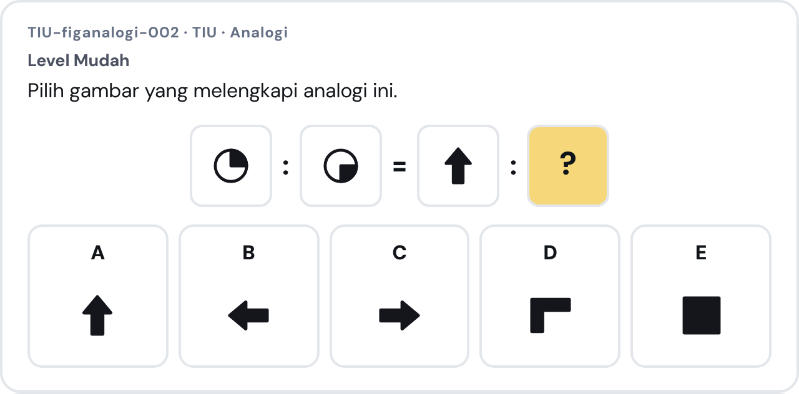

Level Mudah
Pilih gambar yang melengkapi analogi ini. [gambar]: [gambar] = [gambar]:?

* **A.** Pilihan A
* **B.** Pilihan B
* **C.** Pilihan C
* **D.** Pilihan D
* **E.** Pilihan E

#### Pembahasan Nomor 670

* **Jawaban:** **C**
* **Penjelasan:**
  A ke B: diputar 90° searah jarum jam. Lakukan hal yang sama pada C, hasilnya gambar C. Opsi A salah: gambar C belum diubah sama sekali. Opsi B salah: berupa bayangan cermin, bukan hasil putaran. Opsi D salah: bentuknya berubah, padahal seharusnya tetap. Opsi E salah: bentuknya berubah, padahal seharusnya tetap.

---

### Soal Nomor 671 (TIU - Figural Analogi)

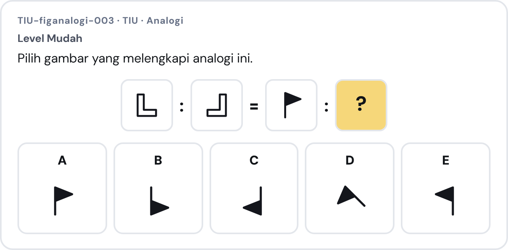

Level Mudah
Pilih gambar yang melengkapi analogi ini. [gambar]: [gambar] = [gambar]:?

* **A.** Pilihan A
* **B.** Pilihan B
* **C.** Pilihan C
* **D.** Pilihan D
* **E.** Pilihan E

#### Pembahasan Nomor 671

* **Jawaban:** **E**
* **Penjelasan:**
  A ke B: dicerminkan kiri-kanan. Lakukan hal yang sama pada C, hasilnya gambar E. Opsi A salah: gambar C belum diubah sama sekali. Opsi B salah: dicerminkan atas-bawah, bukan kiri-kanan. Opsi C salah: diputar 180°, bukan dicerminkan. Opsi D salah: sudut putarnya keliru.

---

### Soal Nomor 672 (TIU - Figural Analogi)

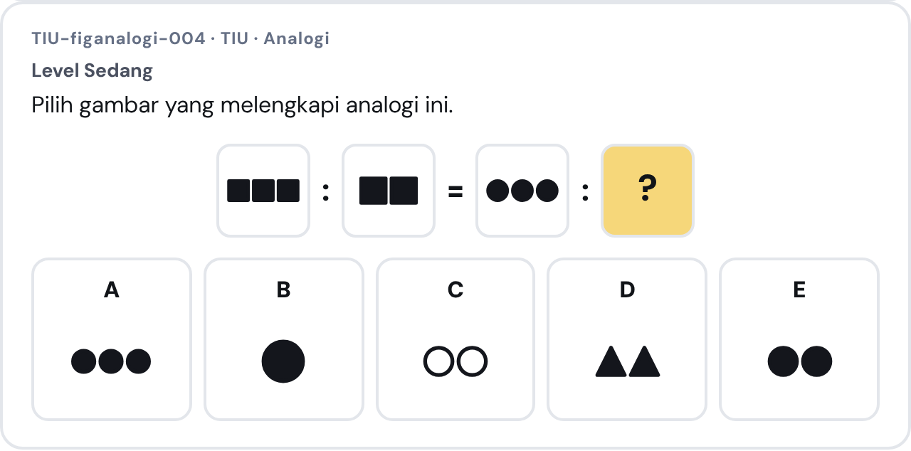

Level Sedang
Pilih gambar yang melengkapi analogi ini. [gambar]: [gambar] = [gambar]:?

* **A.** Pilihan A
* **B.** Pilihan B
* **C.** Pilihan C
* **D.** Pilihan D
* **E.** Pilihan E

#### Pembahasan Nomor 672

* **Jawaban:** **E**
* **Penjelasan:**
  A ke B: berkurang satu. Lakukan hal yang sama pada C, hasilnya gambar E. Opsi A salah: gambar C belum diubah sama sekali. Opsi B salah: jumlahnya keliru. Opsi C salah: warnanya tidak sesuai aturan. Opsi D salah: bentuknya berubah, padahal seharusnya tetap.

---

### Soal Nomor 673 (TIU - Figural Analogi)

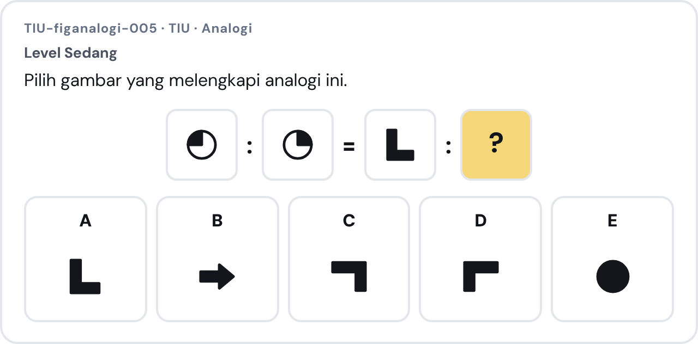

Level Sedang
Pilih gambar yang melengkapi analogi ini. [gambar]: [gambar] = [gambar]:?

* **A.** Pilihan A
* **B.** Pilihan B
* **C.** Pilihan C
* **D.** Pilihan D
* **E.** Pilihan E

#### Pembahasan Nomor 673

* **Jawaban:** **D**
* **Penjelasan:**
  A ke B: diputar 90° searah jarum jam. Lakukan hal yang sama pada C, hasilnya gambar D. Opsi A salah: gambar C belum diubah sama sekali. Opsi B salah: bentuknya berubah, padahal seharusnya tetap. Opsi C salah: berupa bayangan cermin, bukan hasil putaran. Opsi E salah: bentuknya berubah, padahal seharusnya tetap.

---

### Soal Nomor 674 (TIU - Figural Analogi)

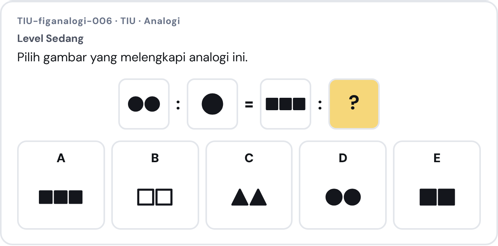

Level Sedang
Pilih gambar yang melengkapi analogi ini. [gambar]: [gambar] = [gambar]:?

* **A.** Pilihan A
* **B.** Pilihan B
* **C.** Pilihan C
* **D.** Pilihan D
* **E.** Pilihan E

#### Pembahasan Nomor 674

* **Jawaban:** **E**
* **Penjelasan:**
  A ke B: berkurang satu. Lakukan hal yang sama pada C, hasilnya gambar E. Opsi A salah: gambar C belum diubah sama sekali. Opsi B salah: warnanya tidak sesuai aturan. Opsi C salah: bentuknya berubah, padahal seharusnya tetap. Opsi D salah: bentuknya berubah, padahal seharusnya tetap.

---

### Soal Nomor 675 (TIU - Figural Analogi)

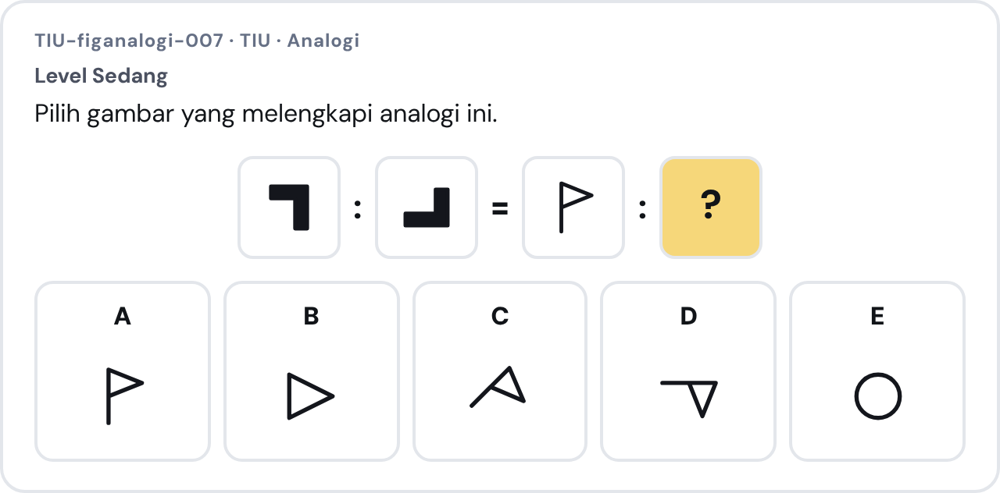

Level Sedang
Pilih gambar yang melengkapi analogi ini. [gambar]: [gambar] = [gambar]:?

* **A.** Pilihan A
* **B.** Pilihan B
* **C.** Pilihan C
* **D.** Pilihan D
* **E.** Pilihan E

#### Pembahasan Nomor 675

* **Jawaban:** **D**
* **Penjelasan:**
  A ke B: diputar 90° searah jarum jam. Lakukan hal yang sama pada C, hasilnya gambar D. Opsi A salah: gambar C belum diubah sama sekali. Opsi B salah: bentuknya berubah, padahal seharusnya tetap. Opsi C salah: sudut putarnya keliru. Opsi E salah: bentuknya berubah, padahal seharusnya tetap.

---

### Soal Nomor 676 (TIU - Figural Analogi)

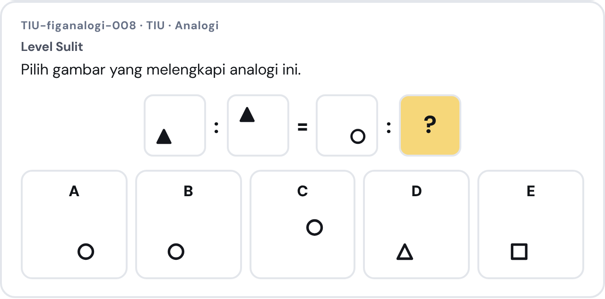

Level Sulit
Pilih gambar yang melengkapi analogi ini. [gambar]: [gambar] = [gambar]:?

* **A.** Pilihan A
* **B.** Pilihan B
* **C.** Pilihan C
* **D.** Pilihan D
* **E.** Pilihan E

#### Pembahasan Nomor 676

* **Jawaban:** **B**
* **Penjelasan:**
  A ke B: bergeser satu sudut searah jarum jam. Lakukan hal yang sama pada C, hasilnya gambar B. Opsi A salah: gambar C belum diubah sama sekali. Opsi C salah: letaknya keliru. Opsi D salah: bentuknya berubah, padahal seharusnya tetap. Opsi E salah: bentuknya berubah, padahal seharusnya tetap.

---

### Soal Nomor 677 (TIU - Figural Analogi)

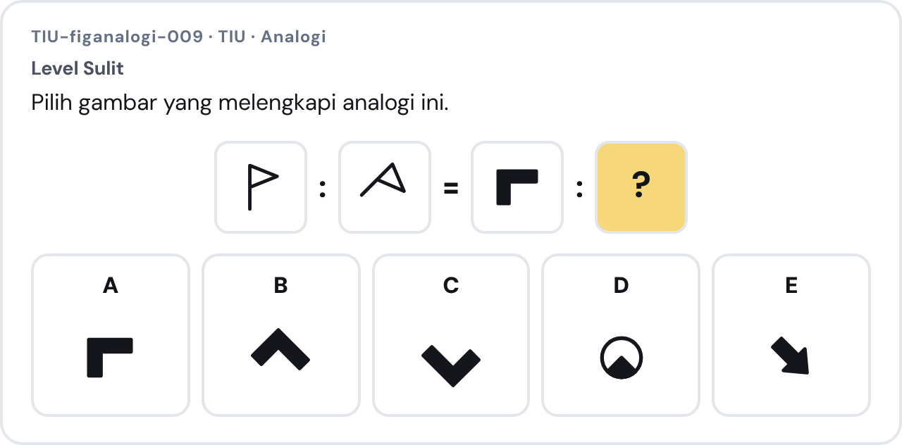

Level Sulit
Pilih gambar yang melengkapi analogi ini. [gambar]: [gambar] = [gambar]:?

* **A.** Pilihan A
* **B.** Pilihan B
* **C.** Pilihan C
* **D.** Pilihan D
* **E.** Pilihan E

#### Pembahasan Nomor 677

* **Jawaban:** **B**
* **Penjelasan:**
  A ke B: diputar 45° searah jarum jam. Lakukan hal yang sama pada C, hasilnya gambar B. Opsi A salah: gambar C belum diubah sama sekali. Opsi C salah: sudut putarnya keliru. Opsi D salah: bentuknya berubah, padahal seharusnya tetap. Opsi E salah: bentuknya berubah, padahal seharusnya tetap.

---

### Soal Nomor 678 (TIU - Figural Analogi)

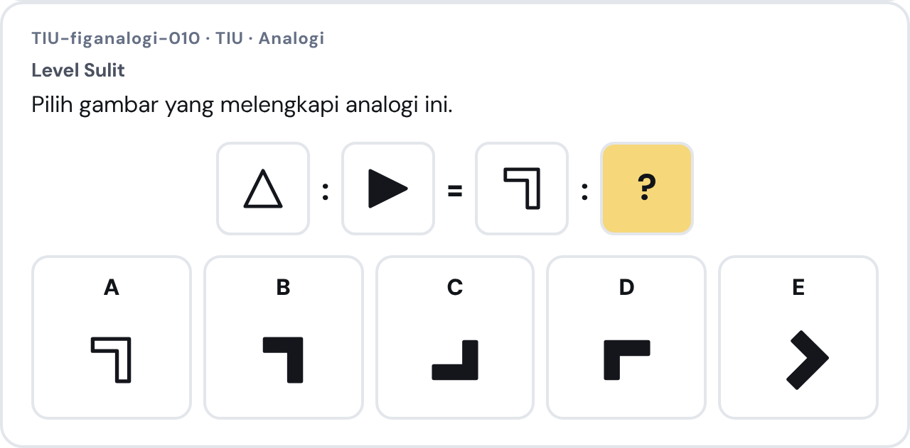

Level Sulit
Pilih gambar yang melengkapi analogi ini. [gambar]: [gambar] = [gambar]:?

* **A.** Pilihan A
* **B.** Pilihan B
* **C.** Pilihan C
* **D.** Pilihan D
* **E.** Pilihan E

#### Pembahasan Nomor 678

* **Jawaban:** **C**
* **Penjelasan:**
  A ke B: diputar 90° lalu warnanya dibalik. Lakukan hal yang sama pada C, hasilnya gambar C. Opsi A salah: gambar C belum diubah sama sekali. Opsi B salah: hanya warnanya yang diubah. Opsi D salah: sudut putarnya keliru. Opsi E salah: sudut putarnya keliru.

---

### Soal Nomor 679 (TIU - Figural Analogi)

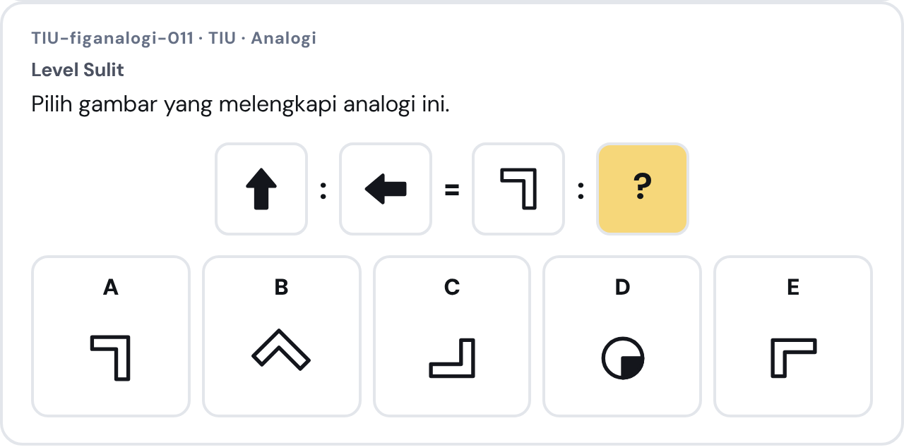

Level Sulit
Pilih gambar yang melengkapi analogi ini. [gambar]: [gambar] = [gambar]:?

* **A.** Pilihan A
* **B.** Pilihan B
* **C.** Pilihan C
* **D.** Pilihan D
* **E.** Pilihan E

#### Pembahasan Nomor 679

* **Jawaban:** **E**
* **Penjelasan:**
  A ke B: diputar 90° berlawanan jarum jam. Lakukan hal yang sama pada C, hasilnya gambar E. Opsi A salah: gambar C belum diubah sama sekali. Opsi B salah: sudut putarnya keliru. Opsi C salah: sudut putarnya keliru. Opsi D salah: bentuknya berubah, padahal seharusnya tetap.

---

### Soal Nomor 680 (TIU - Figural Analogi)

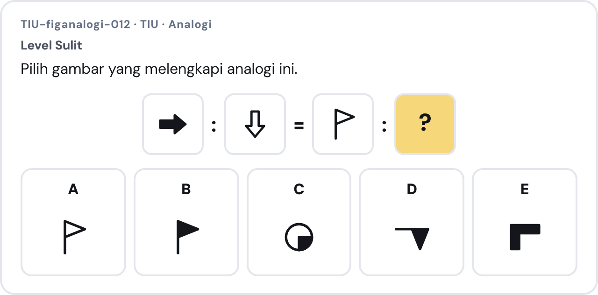

Level Sulit
Pilih gambar yang melengkapi analogi ini. [gambar]: [gambar] = [gambar]:?

* **A.** Pilihan A
* **B.** Pilihan B
* **C.** Pilihan C
* **D.** Pilihan D
* **E.** Pilihan E

#### Pembahasan Nomor 680

* **Jawaban:** **D**
* **Penjelasan:**
  A ke B: diputar 90° lalu warnanya dibalik. Lakukan hal yang sama pada C, hasilnya gambar D. Opsi A salah: gambar C belum diubah sama sekali. Opsi B salah: hanya warnanya yang diubah. Opsi C salah: bentuknya berubah, padahal seharusnya tetap. Opsi E salah: bentuknya berubah, padahal seharusnya tetap.

---

### Soal Nomor 681 (TIU - Figural Analogi)

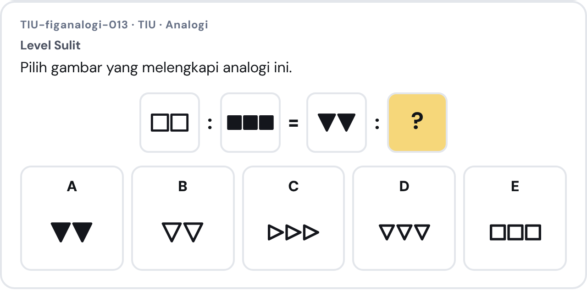

Level Sulit
Pilih gambar yang melengkapi analogi ini. [gambar]: [gambar] = [gambar]:?

* **A.** Pilihan A
* **B.** Pilihan B
* **C.** Pilihan C
* **D.** Pilihan D
* **E.** Pilihan E

#### Pembahasan Nomor 681

* **Jawaban:** **D**
* **Penjelasan:**
  A ke B: bertambah satu dan warnanya dibalik. Lakukan hal yang sama pada C, hasilnya gambar D. Opsi A salah: gambar C belum diubah sama sekali. Opsi B salah: hanya warnanya yang diubah. Opsi C salah: sudut putarnya keliru. Opsi E salah: bentuknya berubah, padahal seharusnya tetap.

---

### Soal Nomor 682 (TIU - Figural Analogi)

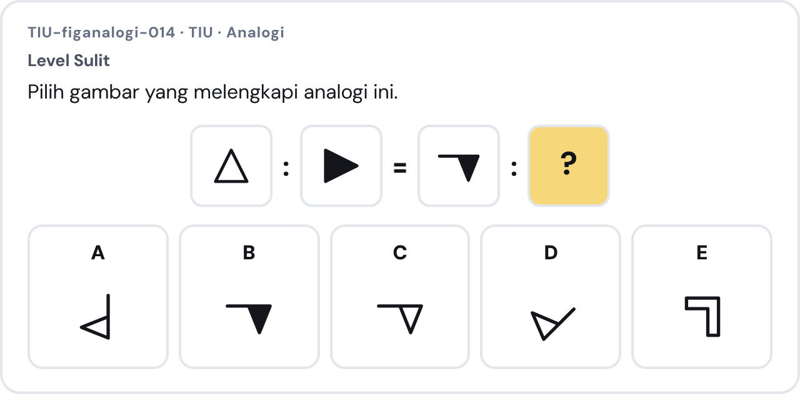

Level Sulit
Pilih gambar yang melengkapi analogi ini. [gambar]: [gambar] = [gambar]:?

* **A.** Pilihan A
* **B.** Pilihan B
* **C.** Pilihan C
* **D.** Pilihan D
* **E.** Pilihan E

#### Pembahasan Nomor 682

* **Jawaban:** **A**
* **Penjelasan:**
  A ke B: diputar 90° lalu warnanya dibalik. Lakukan hal yang sama pada C, hasilnya gambar A. Opsi B salah: gambar C belum diubah sama sekali. Opsi C salah: hanya warnanya yang diubah. Opsi D salah: sudut putarnya keliru. Opsi E salah: bentuknya berubah, padahal seharusnya tetap.

---

### Soal Nomor 683 (TIU - Figural Analogi)

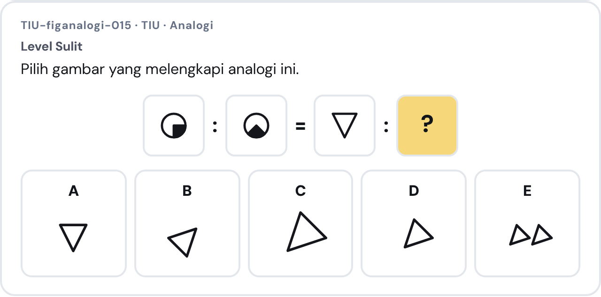

Level Sulit
Pilih gambar yang melengkapi analogi ini. [gambar]: [gambar] = [gambar]:?

* **A.** Pilihan A
* **B.** Pilihan B
* **C.** Pilihan C
* **D.** Pilihan D
* **E.** Pilihan E

#### Pembahasan Nomor 683

* **Jawaban:** **D**
* **Penjelasan:**
  A ke B: diputar 45° searah jarum jam. Lakukan hal yang sama pada C, hasilnya gambar D. Opsi A salah: gambar C belum diubah sama sekali. Opsi B salah: sudut putarnya keliru. Opsi C salah: ukurannya keliru. Opsi E salah: jumlahnya keliru.

---

### Soal Nomor 684 (TIU - Figural Analogi)

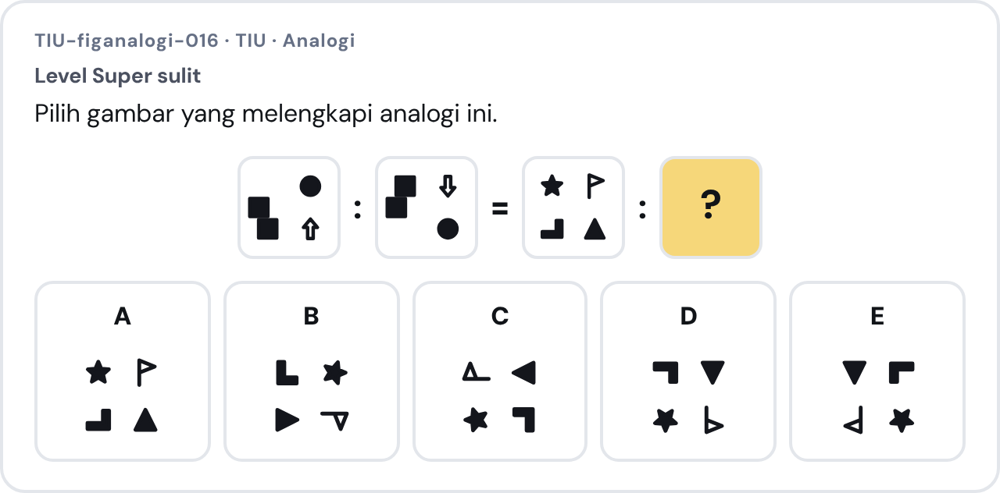

Level Super sulit
Pilih gambar yang melengkapi analogi ini. [gambar]: [gambar] = [gambar]:?

* **A.** Pilihan A
* **B.** Pilihan B
* **C.** Pilihan C
* **D.** Pilihan D
* **E.** Pilihan E

#### Pembahasan Nomor 684

* **Jawaban:** **D**
* **Penjelasan:**
  A ke B: dicerminkan atas-bawah. Lakukan hal yang sama pada C, hasilnya gambar D. Opsi A salah: gambar C belum diubah sama sekali. Opsi B salah: memakai aturan lain (putar 90° searah). Opsi C salah: memakai aturan lain (putar 90° berlawanan). Opsi E salah: memakai aturan lain (putar 180°).

---

### Soal Nomor 685 (TIU - Figural Analogi)

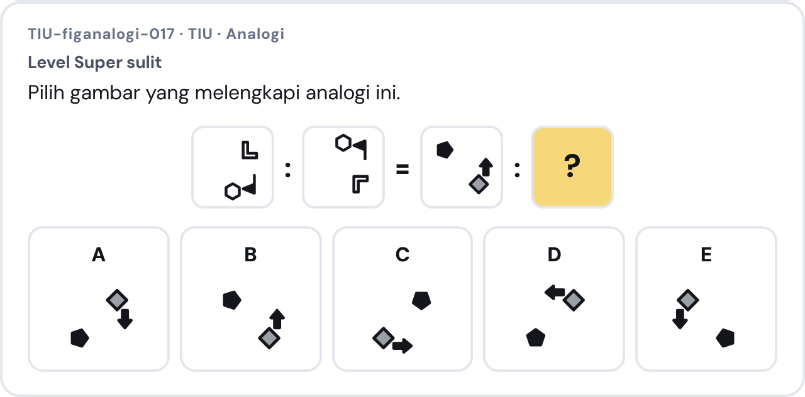

Level Super sulit
Pilih gambar yang melengkapi analogi ini. [gambar]: [gambar] = [gambar]:?

* **A.** Pilihan A
* **B.** Pilihan B
* **C.** Pilihan C
* **D.** Pilihan D
* **E.** Pilihan E

#### Pembahasan Nomor 685

* **Jawaban:** **A**
* **Penjelasan:**
  A ke B: dicerminkan atas-bawah. Lakukan hal yang sama pada C, hasilnya gambar A. Opsi B salah: gambar C belum diubah sama sekali. Opsi C salah: memakai aturan lain (putar 90° searah). Opsi D salah: memakai aturan lain (putar 90° berlawanan). Opsi E salah: memakai aturan lain (putar 180°).

---

### Soal Nomor 686 (TIU - Figural Analogi)

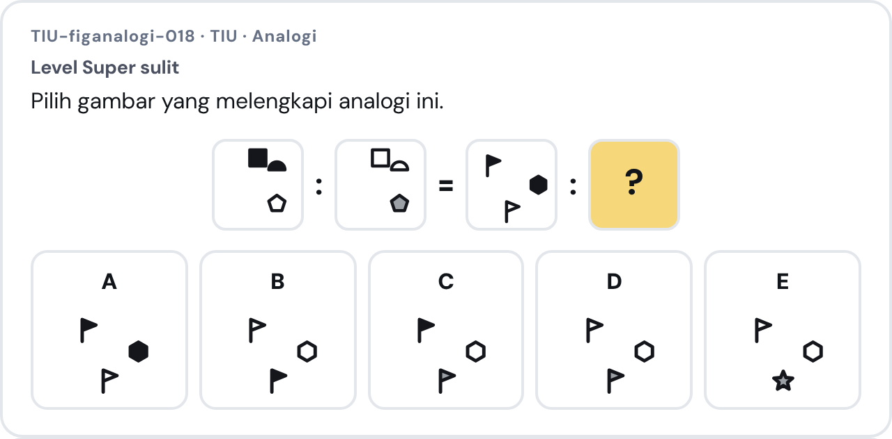

Level Super sulit
Pilih gambar yang melengkapi analogi ini. [gambar]: [gambar] = [gambar]:?

* **A.** Pilihan A
* **B.** Pilihan B
* **C.** Pilihan C
* **D.** Pilihan D
* **E.** Pilihan E

#### Pembahasan Nomor 686

* **Jawaban:** **D**
* **Penjelasan:**
  A ke B: warna naik satu tingkat: putih menjadi abu-abu, abu-abu menjadi hitam, hitam menjadi putih. Lakukan hal yang sama pada C, hasilnya gambar D. Opsi A salah: gambar C belum diubah sama sekali. Opsi B salah: memakai aturan lain (balik warna). Opsi C salah: warna salah satu unsur keliru. Opsi E salah: bentuk salah satu unsur keliru.

---

### Soal Nomor 687 (TIU - Figural Analogi)

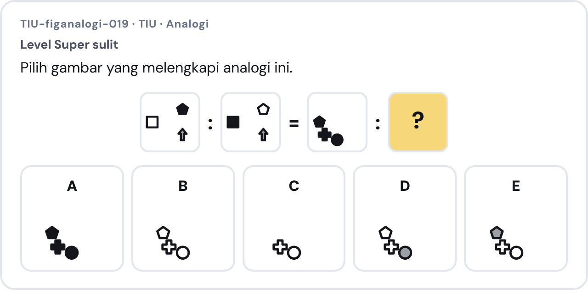

Level Super sulit
Pilih gambar yang melengkapi analogi ini. [gambar]: [gambar] = [gambar]:?

* **A.** Pilihan A
* **B.** Pilihan B
* **C.** Pilihan C
* **D.** Pilihan D
* **E.** Pilihan E

#### Pembahasan Nomor 687

* **Jawaban:** **B**
* **Penjelasan:**
  A ke B: warna hitam dan putih dibalik (abu-abu dan arsiran tetap). Lakukan hal yang sama pada C, hasilnya gambar B. Opsi A salah: gambar C belum diubah sama sekali. Opsi C salah: ada satu unsur yang hilang. Opsi D salah: warna salah satu unsur keliru. Opsi E salah: warna salah satu unsur keliru.

---

### Soal Nomor 688 (TIU - Figural Analogi)

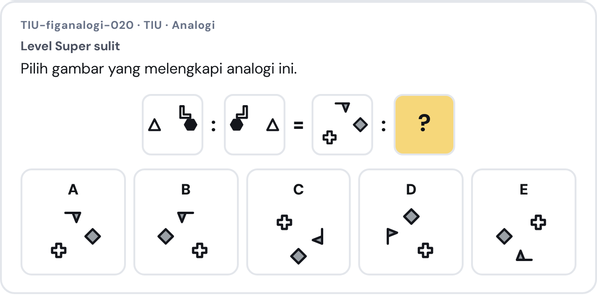

Level Super sulit
Pilih gambar yang melengkapi analogi ini. [gambar]: [gambar] = [gambar]:?

* **A.** Pilihan A
* **B.** Pilihan B
* **C.** Pilihan C
* **D.** Pilihan D
* **E.** Pilihan E

#### Pembahasan Nomor 688

* **Jawaban:** **B**
* **Penjelasan:**
  A ke B: dicerminkan kiri-kanan (posisi dan bentuk tiap unsur ikut dicerminkan). Lakukan hal yang sama pada C, hasilnya gambar B. Opsi A salah: gambar C belum diubah sama sekali. Opsi C salah: memakai aturan lain (putar 90° searah). Opsi D salah: memakai aturan lain (putar 90° berlawanan). Opsi E salah: memakai aturan lain (putar 180°).

---

### Soal Nomor 689 (TIU - Figural Analogi)

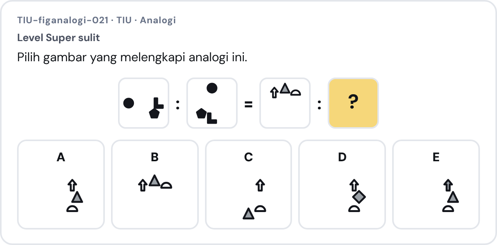

Level Super sulit
Pilih gambar yang melengkapi analogi ini. [gambar]: [gambar] = [gambar]:?

* **A.** Pilihan A
* **B.** Pilihan B
* **C.** Pilihan C
* **D.** Pilihan D
* **E.** Pilihan E

#### Pembahasan Nomor 689

* **Jawaban:** **A**
* **Penjelasan:**
  A ke B: semua unsur bergeser dua posisi searah jarum jam pada lingkaran, arah tiap unsur tetap. Lakukan hal yang sama pada C, hasilnya gambar A. Opsi B salah: gambar C belum diubah sama sekali. Opsi C salah: posisi salah satu unsur keliru. Opsi D salah: bentuk salah satu unsur keliru. Opsi E salah: warna salah satu unsur keliru.

---

### Soal Nomor 690 (TIU - Figural Analogi)

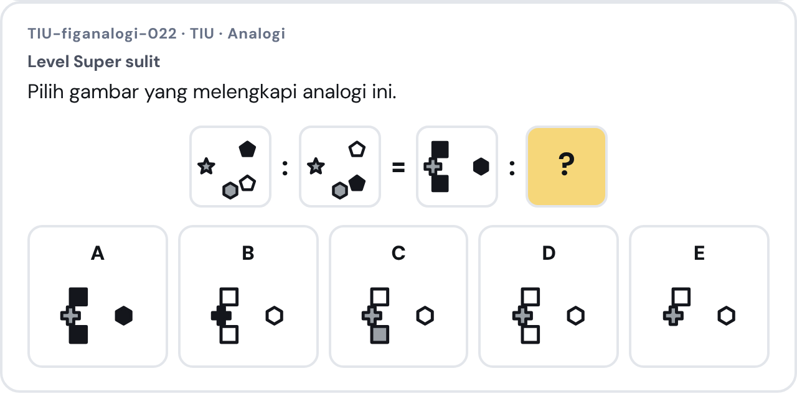

Level Super sulit
Pilih gambar yang melengkapi analogi ini. [gambar]: [gambar] = [gambar]:?

* **A.** Pilihan A
* **B.** Pilihan B
* **C.** Pilihan C
* **D.** Pilihan D
* **E.** Pilihan E

#### Pembahasan Nomor 690

* **Jawaban:** **D**
* **Penjelasan:**
  A ke B: warna hitam dan putih dibalik (abu-abu dan arsiran tetap). Lakukan hal yang sama pada C, hasilnya gambar D. Opsi A salah: gambar C belum diubah sama sekali. Opsi B salah: memakai aturan lain (warna naik satu tingkat). Opsi C salah: warna salah satu unsur keliru. Opsi E salah: ada satu unsur yang hilang.

---

### Soal Nomor 691 (TIU - Figural Analogi)

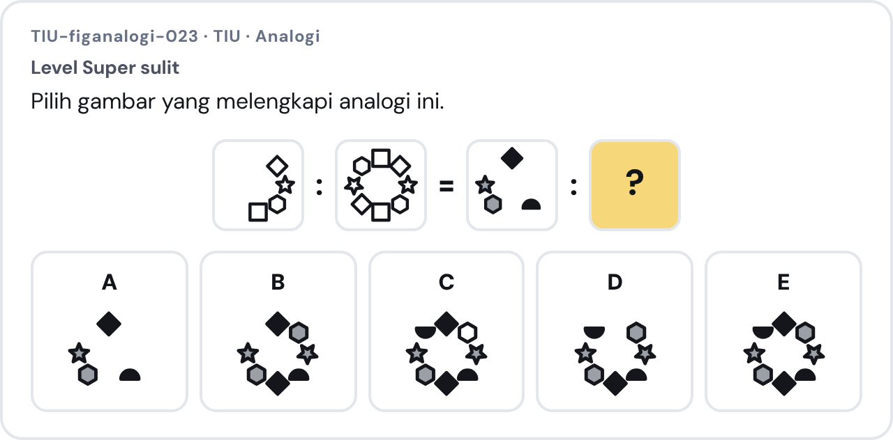

Level Super sulit
Pilih gambar yang melengkapi analogi ini. [gambar]: [gambar] = [gambar]:?

* **A.** Pilihan A
* **B.** Pilihan B
* **C.** Pilihan C
* **D.** Pilihan D
* **E.** Pilihan E

#### Pembahasan Nomor 691

* **Jawaban:** **E**
* **Penjelasan:**
  A ke B: tiap unsur mendapat kembaran di posisi seberangnya (kembaran ikut diputar 180°). Lakukan hal yang sama pada C, hasilnya gambar E. Opsi A salah: gambar C belum diubah sama sekali. Opsi B salah: ada satu unsur yang hilang. Opsi C salah: warna salah satu unsur keliru. Opsi D salah: ada satu unsur yang hilang.

---

### Soal Nomor 692 (TIU - Figural Analogi)

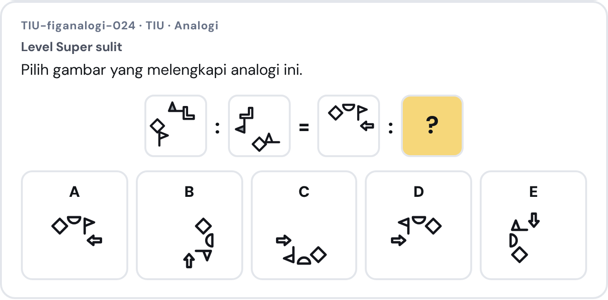

Level Super sulit
Pilih gambar yang melengkapi analogi ini. [gambar]: [gambar] = [gambar]:?

* **A.** Pilihan A
* **B.** Pilihan B
* **C.** Pilihan C
* **D.** Pilihan D
* **E.** Pilihan E

#### Pembahasan Nomor 692

* **Jawaban:** **E**
* **Penjelasan:**
  A ke B: diputar 90° berlawanan arah jarum jam. Lakukan hal yang sama pada C, hasilnya gambar E. Opsi A salah: gambar C belum diubah sama sekali. Opsi B salah: memakai aturan lain (putar 90° searah). Opsi C salah: memakai aturan lain (putar 180°). Opsi D salah: memakai aturan lain (cermin kiri-kanan).

---

### Soal Nomor 693 (TIU - Figural Analogi)

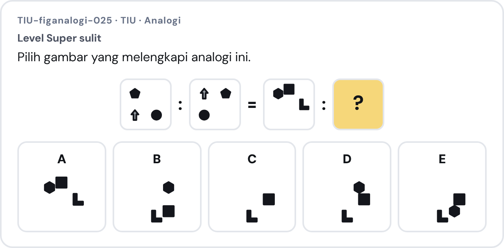

Level Super sulit
Pilih gambar yang melengkapi analogi ini. [gambar]: [gambar] = [gambar]:?

* **A.** Pilihan A
* **B.** Pilihan B
* **C.** Pilihan C
* **D.** Pilihan D
* **E.** Pilihan E

#### Pembahasan Nomor 693

* **Jawaban:** **D**
* **Penjelasan:**
  A ke B: semua unsur bergeser dua posisi searah jarum jam pada lingkaran, arah tiap unsur tetap. Lakukan hal yang sama pada C, hasilnya gambar D. Opsi A salah: gambar C belum diubah sama sekali. Opsi B salah: posisi salah satu unsur keliru. Opsi C salah: ada satu unsur yang hilang. Opsi E salah: posisi salah satu unsur keliru.

---

### Soal Nomor 694 (TIU - Figural Analogi)

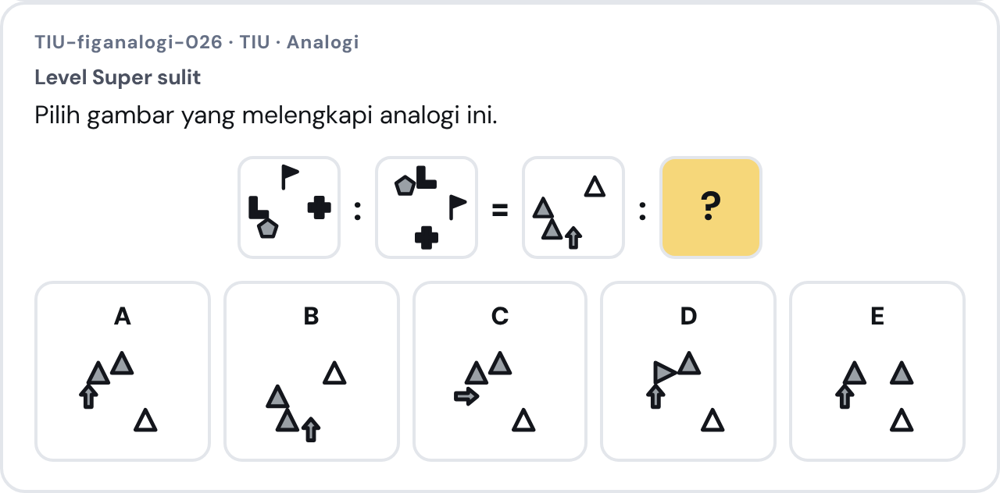

Level Super sulit
Pilih gambar yang melengkapi analogi ini. [gambar]: [gambar] = [gambar]:?

* **A.** Pilihan A
* **B.** Pilihan B
* **C.** Pilihan C
* **D.** Pilihan D
* **E.** Pilihan E

#### Pembahasan Nomor 694

* **Jawaban:** **A**
* **Penjelasan:**
  A ke B: semua unsur bergeser dua posisi searah jarum jam pada lingkaran, arah tiap unsur tetap. Lakukan hal yang sama pada C, hasilnya gambar A. Opsi B salah: gambar C belum diubah sama sekali. Opsi C salah: arah salah satu unsur keliru. Opsi D salah: arah salah satu unsur keliru. Opsi E salah: posisi salah satu unsur keliru.

---

### Soal Nomor 695 (TIU - Figural Analogi)

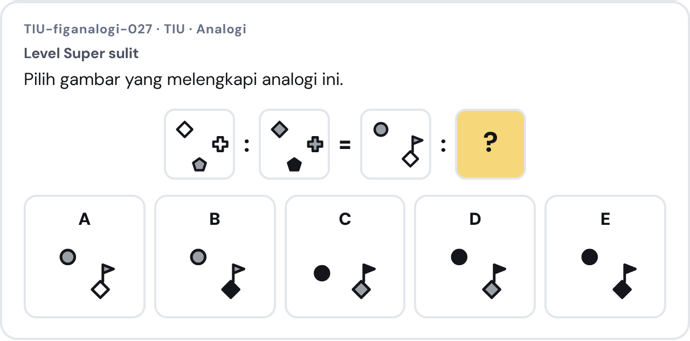

Level Super sulit
Pilih gambar yang melengkapi analogi ini. [gambar]: [gambar] = [gambar]:?

* **A.** Pilihan A
* **B.** Pilihan B
* **C.** Pilihan C
* **D.** Pilihan D
* **E.** Pilihan E

#### Pembahasan Nomor 695

* **Jawaban:** **D**
* **Penjelasan:**
  A ke B: warna naik satu tingkat: putih menjadi abu-abu, abu-abu menjadi hitam, hitam menjadi putih. Lakukan hal yang sama pada C, hasilnya gambar D. Opsi A salah: gambar C belum diubah sama sekali. Opsi B salah: memakai aturan lain (balik warna). Opsi C salah: posisi salah satu unsur keliru. Opsi E salah: warna salah satu unsur keliru.

---

### Soal Nomor 696 (TIU - Figural Analogi)

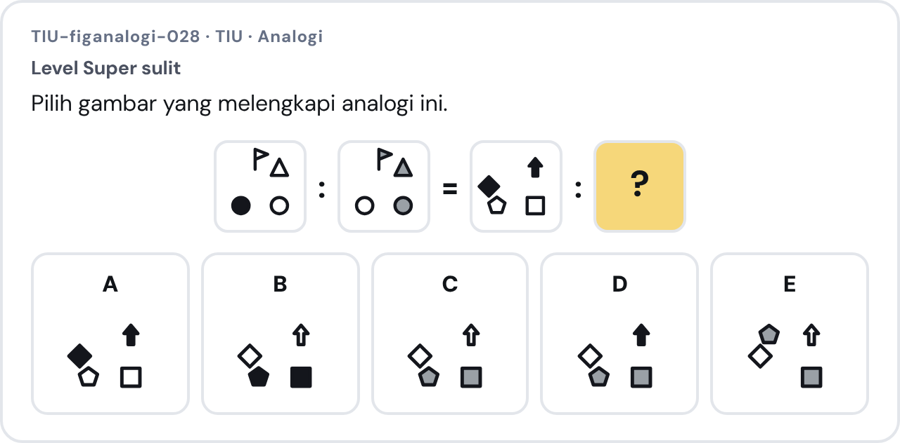

Level Super sulit
Pilih gambar yang melengkapi analogi ini. [gambar]: [gambar] = [gambar]:?

* **A.** Pilihan A
* **B.** Pilihan B
* **C.** Pilihan C
* **D.** Pilihan D
* **E.** Pilihan E

#### Pembahasan Nomor 696

* **Jawaban:** **C**
* **Penjelasan:**
  A ke B: warna naik satu tingkat: putih menjadi abu-abu, abu-abu menjadi hitam, hitam menjadi putih. Lakukan hal yang sama pada C, hasilnya gambar C. Opsi A salah: gambar C belum diubah sama sekali. Opsi B salah: memakai aturan lain (balik warna). Opsi D salah: warna salah satu unsur keliru. Opsi E salah: posisi salah satu unsur keliru.

---

### Soal Nomor 697 (TIU - Figural Analogi)

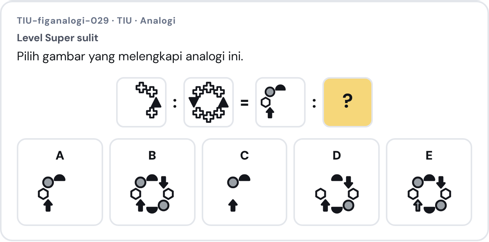

Level Super sulit
Pilih gambar yang melengkapi analogi ini. [gambar]: [gambar] = [gambar]:?

* **A.** Pilihan A
* **B.** Pilihan B
* **C.** Pilihan C
* **D.** Pilihan D
* **E.** Pilihan E

#### Pembahasan Nomor 697

* **Jawaban:** **B**
* **Penjelasan:**
  A ke B: tiap unsur mendapat kembaran di posisi seberangnya (kembaran ikut diputar 180°). Lakukan hal yang sama pada C, hasilnya gambar B. Opsi A salah: gambar C belum diubah sama sekali. Opsi C salah: memakai aturan lain (hapus unsur putih). Opsi D salah: ada satu unsur yang hilang. Opsi E salah: warna salah satu unsur keliru.

---

### Soal Nomor 698 (TIU - Figural Analogi)

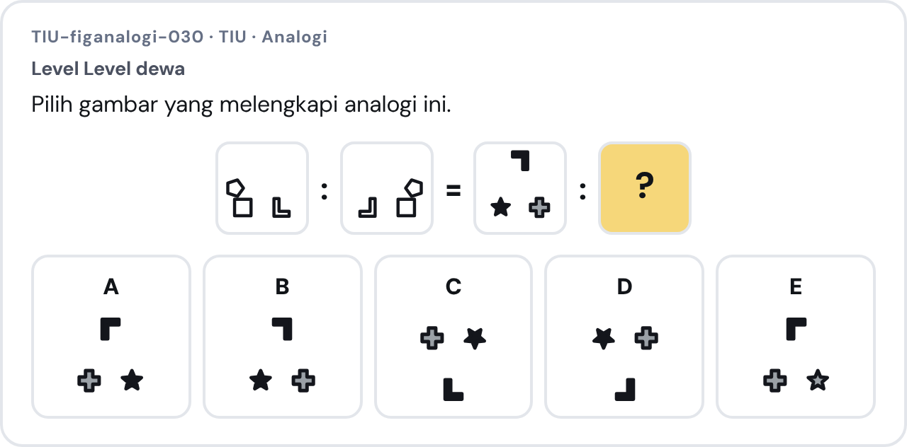

Level Level dewa
Pilih gambar yang melengkapi analogi ini. [gambar]: [gambar] = [gambar]:?

* **A.** Pilihan A
* **B.** Pilihan B
* **C.** Pilihan C
* **D.** Pilihan D
* **E.** Pilihan E

#### Pembahasan Nomor 698

* **Jawaban:** **A**
* **Penjelasan:**
  A ke B: diputar 180°, lalu dicerminkan atas-bawah. Lakukan hal yang sama pada C, hasilnya gambar A. Opsi B salah: gambar C belum diubah sama sekali. Opsi C salah: hanya aturan pertama yang dipakai. Opsi D salah: hanya aturan kedua yang dipakai. Opsi E salah: warna salah satu unsur keliru.

---

### Soal Nomor 699 (TIU - Figural Analogi)

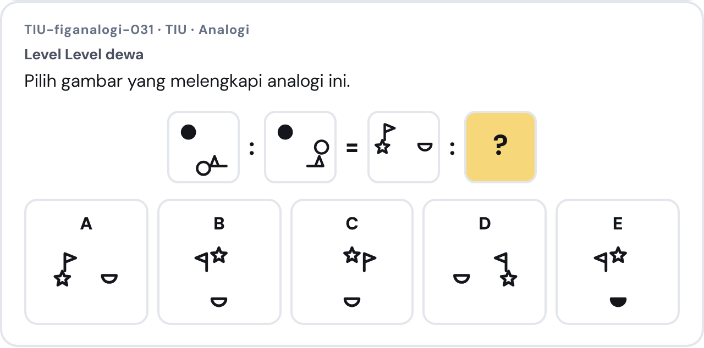

Level Level dewa
Pilih gambar yang melengkapi analogi ini. [gambar]: [gambar] = [gambar]:?

* **A.** Pilihan A
* **B.** Pilihan B
* **C.** Pilihan C
* **D.** Pilihan D
* **E.** Pilihan E

#### Pembahasan Nomor 699

* **Jawaban:** **B**
* **Penjelasan:**
  A ke B: semua unsur bergeser dua posisi searah jarum jam pada lingkaran, arah tiap unsur tetap, lalu dicerminkan kiri-kanan (posisi dan bentuk tiap unsur ikut dicerminkan). Lakukan hal yang sama pada C, hasilnya gambar B. Opsi A salah: gambar C belum diubah sama sekali. Opsi C salah: hanya aturan pertama yang dipakai. Opsi D salah: hanya aturan kedua yang dipakai. Opsi E salah: warna salah satu unsur keliru.

---

### Soal Nomor 700 (TIU - Figural Analogi)

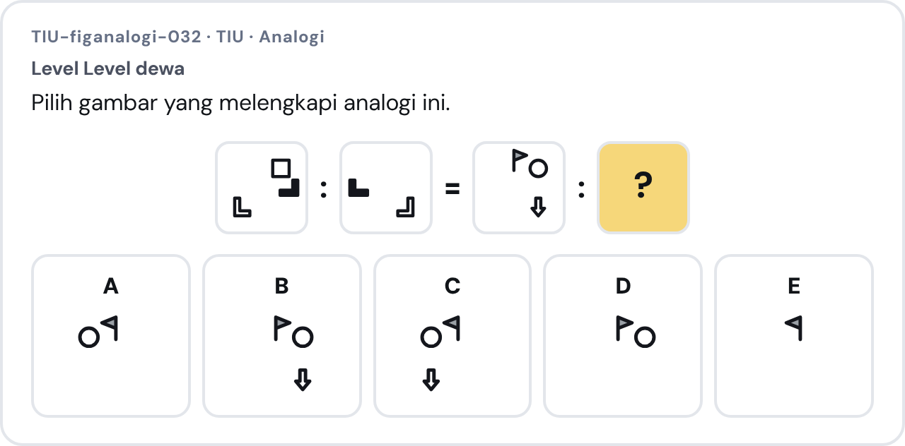

Level Level dewa
Pilih gambar yang melengkapi analogi ini. [gambar]: [gambar] = [gambar]:?

* **A.** Pilihan A
* **B.** Pilihan B
* **C.** Pilihan C
* **D.** Pilihan D
* **E.** Pilihan E

#### Pembahasan Nomor 700

* **Jawaban:** **A**
* **Penjelasan:**
  A ke B: dicerminkan kiri-kanan (posisi dan bentuk tiap unsur ikut dicerminkan), lalu semua unsur putih dihapus. Lakukan hal yang sama pada C, hasilnya gambar A. Opsi B salah: gambar C belum diubah sama sekali. Opsi C salah: hanya aturan pertama yang dipakai. Opsi D salah: hanya aturan kedua yang dipakai. Opsi E salah: ada satu unsur yang hilang.

---

### Soal Nomor 701 (TIU - Figural Analogi)

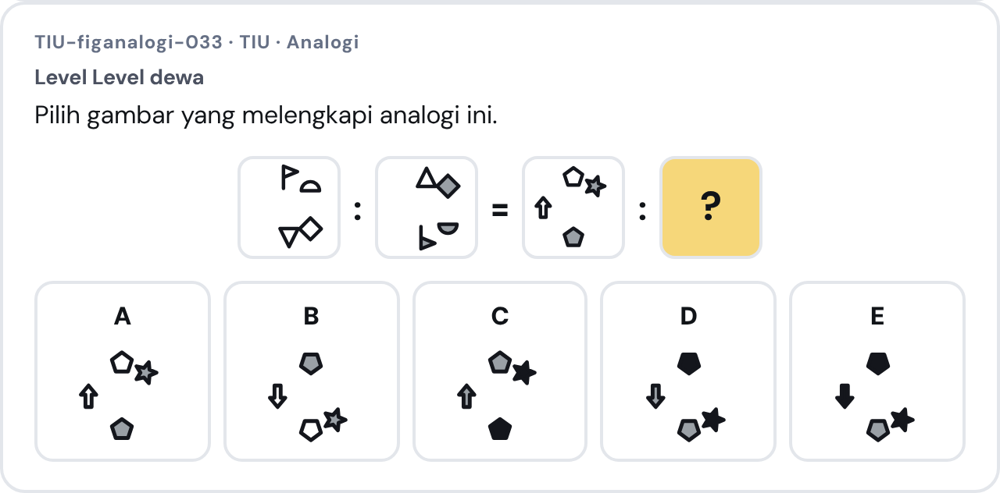

Level Level dewa
Pilih gambar yang melengkapi analogi ini. [gambar]: [gambar] = [gambar]:?

* **A.** Pilihan A
* **B.** Pilihan B
* **C.** Pilihan C
* **D.** Pilihan D
* **E.** Pilihan E

#### Pembahasan Nomor 701

* **Jawaban:** **D**
* **Penjelasan:**
  A ke B: dicerminkan atas-bawah, lalu warna naik satu tingkat: putih menjadi abu-abu, abu-abu menjadi hitam, hitam menjadi putih. Lakukan hal yang sama pada C, hasilnya gambar D. Opsi A salah: gambar C belum diubah sama sekali. Opsi B salah: hanya aturan pertama yang dipakai. Opsi C salah: hanya aturan kedua yang dipakai. Opsi E salah: warna salah satu unsur keliru.

---

### Soal Nomor 702 (TIU - Figural Analogi)

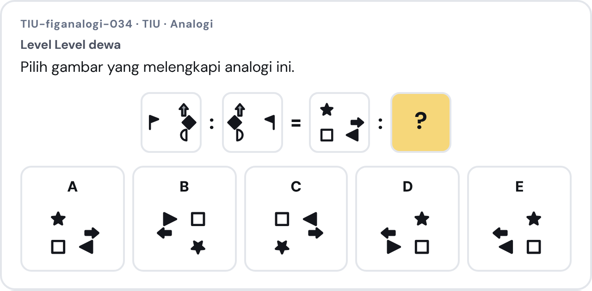

Level Level dewa
Pilih gambar yang melengkapi analogi ini. [gambar]: [gambar] = [gambar]:?

* **A.** Pilihan A
* **B.** Pilihan B
* **C.** Pilihan C
* **D.** Pilihan D
* **E.** Pilihan E

#### Pembahasan Nomor 702

* **Jawaban:** **D**
* **Penjelasan:**
  A ke B: diputar 180°, lalu dicerminkan atas-bawah. Lakukan hal yang sama pada C, hasilnya gambar D. Opsi A salah: gambar C belum diubah sama sekali. Opsi B salah: hanya aturan pertama yang dipakai. Opsi C salah: hanya aturan kedua yang dipakai. Opsi E salah: arah salah satu unsur keliru.

---

### Soal Nomor 703 (TIU - Figural Analogi)

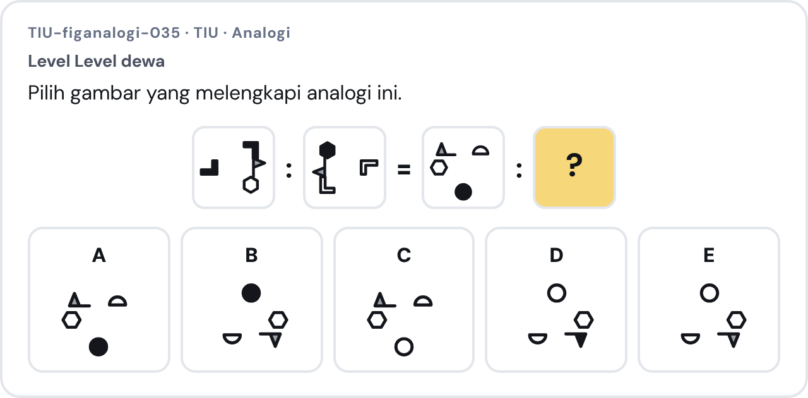

Level Level dewa
Pilih gambar yang melengkapi analogi ini. [gambar]: [gambar] = [gambar]:?

* **A.** Pilihan A
* **B.** Pilihan B
* **C.** Pilihan C
* **D.** Pilihan D
* **E.** Pilihan E

#### Pembahasan Nomor 703

* **Jawaban:** **E**
* **Penjelasan:**
  A ke B: diputar 180°, lalu warna hitam dan putih dibalik (abu-abu dan arsiran tetap). Lakukan hal yang sama pada C, hasilnya gambar E. Opsi A salah: gambar C belum diubah sama sekali. Opsi B salah: hanya aturan pertama yang dipakai. Opsi C salah: hanya aturan kedua yang dipakai. Opsi D salah: warna salah satu unsur keliru.

---

### Soal Nomor 704 (TIU - Figural Analogi)

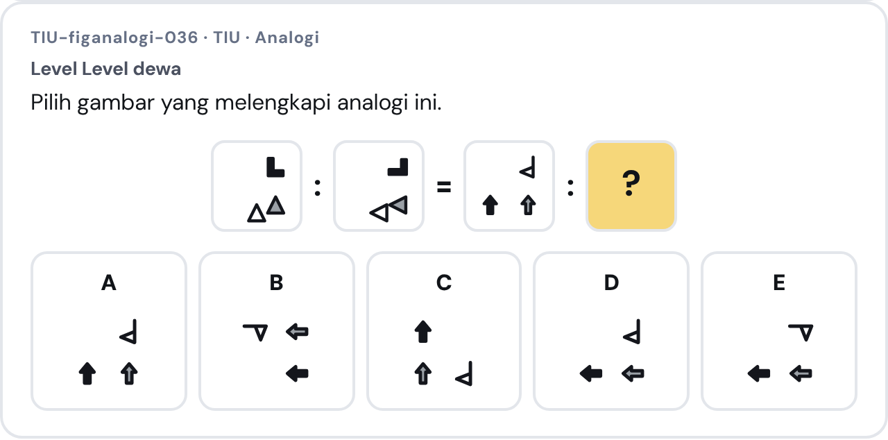

Level Level dewa
Pilih gambar yang melengkapi analogi ini. [gambar]: [gambar] = [gambar]:?

* **A.** Pilihan A
* **B.** Pilihan B
* **C.** Pilihan C
* **D.** Pilihan D
* **E.** Pilihan E

#### Pembahasan Nomor 704

* **Jawaban:** **E**
* **Penjelasan:**
  A ke B: diputar 90° berlawanan arah jarum jam, lalu semua unsur bergeser dua posisi searah jarum jam pada lingkaran, arah tiap unsur tetap. Lakukan hal yang sama pada C, hasilnya gambar E. Opsi A salah: gambar C belum diubah sama sekali. Opsi B salah: hanya aturan pertama yang dipakai. Opsi C salah: hanya aturan kedua yang dipakai. Opsi D salah: arah salah satu unsur keliru.

---

### Soal Nomor 705 (TIU - Figural Analogi)

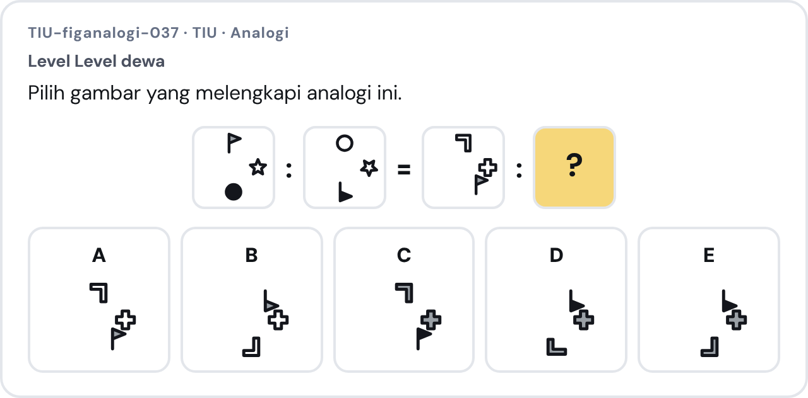

Level Level dewa
Pilih gambar yang melengkapi analogi ini. [gambar]: [gambar] = [gambar]:?

* **A.** Pilihan A
* **B.** Pilihan B
* **C.** Pilihan C
* **D.** Pilihan D
* **E.** Pilihan E

#### Pembahasan Nomor 705

* **Jawaban:** **E**
* **Penjelasan:**
  A ke B: dicerminkan atas-bawah, lalu warna naik satu tingkat: putih menjadi abu-abu, abu-abu menjadi hitam, hitam menjadi putih. Lakukan hal yang sama pada C, hasilnya gambar E. Opsi A salah: gambar C belum diubah sama sekali. Opsi B salah: hanya aturan pertama yang dipakai. Opsi C salah: hanya aturan kedua yang dipakai. Opsi D salah: arah salah satu unsur keliru.

---

### Soal Nomor 706 (TIU - Figural Analogi)

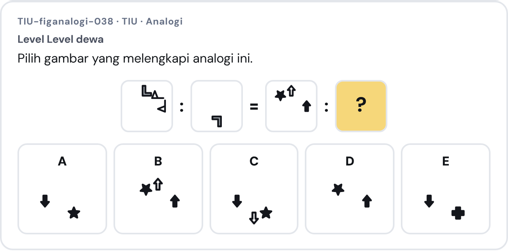

Level Level dewa
Pilih gambar yang melengkapi analogi ini. [gambar]: [gambar] = [gambar]:?

* **A.** Pilihan A
* **B.** Pilihan B
* **C.** Pilihan C
* **D.** Pilihan D
* **E.** Pilihan E

#### Pembahasan Nomor 706

* **Jawaban:** **A**
* **Penjelasan:**
  A ke B: diputar 180°, lalu semua unsur putih dihapus. Lakukan hal yang sama pada C, hasilnya gambar A. Opsi B salah: gambar C belum diubah sama sekali. Opsi C salah: hanya aturan pertama yang dipakai. Opsi D salah: hanya aturan kedua yang dipakai. Opsi E salah: bentuk salah satu unsur keliru.

---

### Soal Nomor 707 (TIU - Figural Analogi)

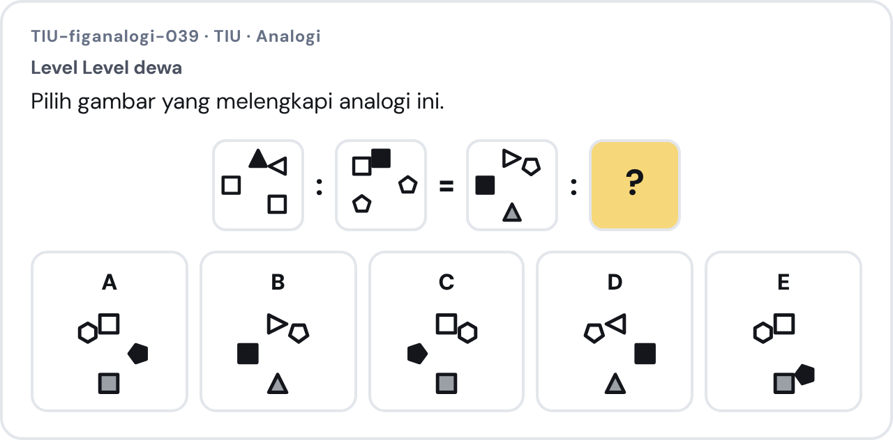

Level Level dewa
Pilih gambar yang melengkapi analogi ini. [gambar]: [gambar] = [gambar]:?

* **A.** Pilihan A
* **B.** Pilihan B
* **C.** Pilihan C
* **D.** Pilihan D
* **E.** Pilihan E

#### Pembahasan Nomor 707

* **Jawaban:** **A**
* **Penjelasan:**
  A ke B: bentuk menjadi segi-banyak berikutnya: segitiga menjadi persegi, persegi menjadi segilima, segilima menjadi segienam, lalu dicerminkan kiri-kanan (posisi dan bentuk tiap unsur ikut dicerminkan). Lakukan hal yang sama pada C, hasilnya gambar A. Opsi B salah: gambar C belum diubah sama sekali. Opsi C salah: hanya aturan pertama yang dipakai. Opsi D salah: hanya aturan kedua yang dipakai. Opsi E salah: posisi salah satu unsur keliru.

---

### Soal Nomor 708 (TIU - Figural Analogi)

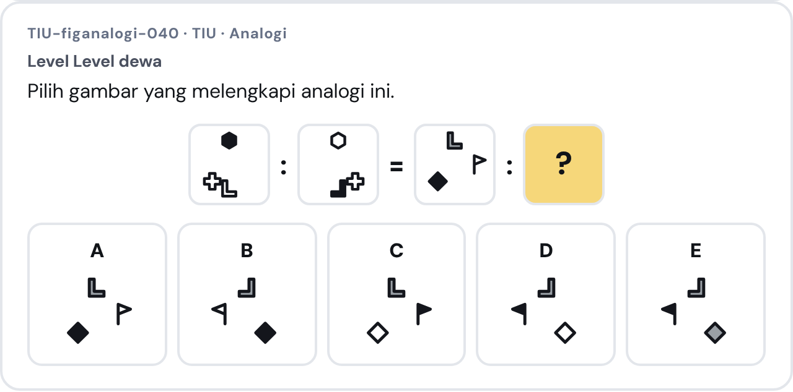

Level Level dewa
Pilih gambar yang melengkapi analogi ini. [gambar]: [gambar] = [gambar]:?

* **A.** Pilihan A
* **B.** Pilihan B
* **C.** Pilihan C
* **D.** Pilihan D
* **E.** Pilihan E

#### Pembahasan Nomor 708

* **Jawaban:** **D**
* **Penjelasan:**
  A ke B: dicerminkan kiri-kanan (posisi dan bentuk tiap unsur ikut dicerminkan), lalu warna hitam dan putih dibalik (abu-abu dan arsiran tetap). Lakukan hal yang sama pada C, hasilnya gambar D. Opsi A salah: gambar C belum diubah sama sekali. Opsi B salah: hanya aturan pertama yang dipakai. Opsi C salah: hanya aturan kedua yang dipakai. Opsi E salah: warna salah satu unsur keliru.

---

### Soal Nomor 709 (TIU - Figural Analogi)

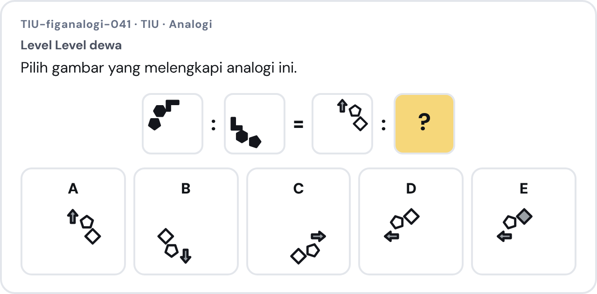

Level Level dewa
Pilih gambar yang melengkapi analogi ini. [gambar]: [gambar] = [gambar]:?

* **A.** Pilihan A
* **B.** Pilihan B
* **C.** Pilihan C
* **D.** Pilihan D
* **E.** Pilihan E

#### Pembahasan Nomor 709

* **Jawaban:** **D**
* **Penjelasan:**
  A ke B: diputar 180°, lalu diputar 90° searah jarum jam (posisi dan arah tiap unsur ikut berputar). Lakukan hal yang sama pada C, hasilnya gambar D. Opsi A salah: gambar C belum diubah sama sekali. Opsi B salah: hanya aturan pertama yang dipakai. Opsi C salah: hanya aturan kedua yang dipakai. Opsi E salah: warna salah satu unsur keliru.

---

### Soal Nomor 710 (TIU - Figural Analogi)

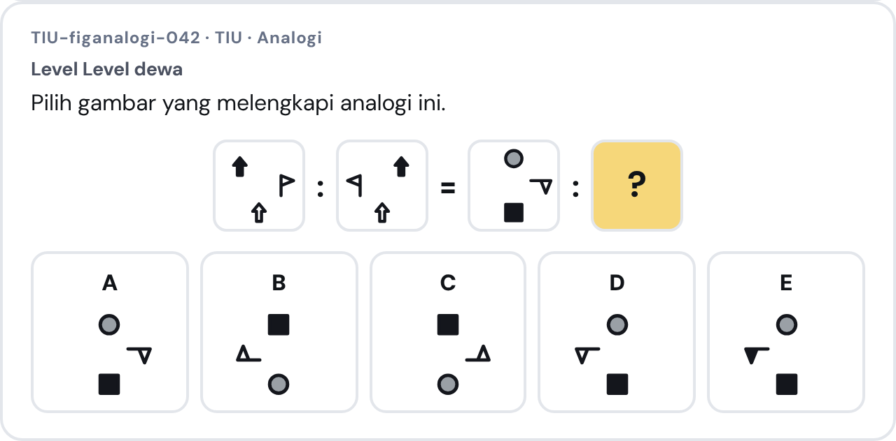

Level Level dewa
Pilih gambar yang melengkapi analogi ini. [gambar]: [gambar] = [gambar]:?

* **A.** Pilihan A
* **B.** Pilihan B
* **C.** Pilihan C
* **D.** Pilihan D
* **E.** Pilihan E

#### Pembahasan Nomor 710

* **Jawaban:** **D**
* **Penjelasan:**
  A ke B: diputar 180°, lalu dicerminkan atas-bawah. Lakukan hal yang sama pada C, hasilnya gambar D. Opsi A salah: gambar C belum diubah sama sekali. Opsi B salah: hanya aturan pertama yang dipakai. Opsi C salah: hanya aturan kedua yang dipakai. Opsi E salah: warna salah satu unsur keliru.

---

### Soal Nomor 711 (TIU - Figural Analogi)

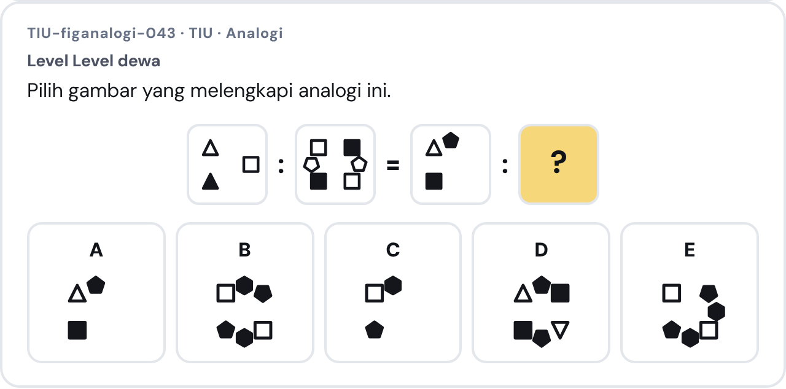

Level Level dewa
Pilih gambar yang melengkapi analogi ini. [gambar]: [gambar] = [gambar]:?

* **A.** Pilihan A
* **B.** Pilihan B
* **C.** Pilihan C
* **D.** Pilihan D
* **E.** Pilihan E

#### Pembahasan Nomor 711

* **Jawaban:** **B**
* **Penjelasan:**
  A ke B: bentuk menjadi segi-banyak berikutnya: segitiga menjadi persegi, persegi menjadi segilima, segilima menjadi segienam, lalu tiap unsur mendapat kembaran di posisi seberangnya (kembaran ikut diputar 180°). Lakukan hal yang sama pada C, hasilnya gambar B. Opsi A salah: gambar C belum diubah sama sekali. Opsi C salah: hanya aturan pertama yang dipakai. Opsi D salah: hanya aturan kedua yang dipakai. Opsi E salah: posisi salah satu unsur keliru.

---

### Soal Nomor 712 (TIU - Figural Analogi)

Kotak berisi titik di pojok kiri bawah menjadi kotak dengan titik di pojok kiri atas (diputar 90 derajat searah jarum jam). Titik di pojok kanan bawah akan menjadi...

* **A.** Pojok kanan atas
* **B.** Pojok kiri atas
* **C.** Pojok kiri bawah
* **D.** Pojok kanan bawah
* **E.** Di tengah

#### Pembahasan Nomor 712

* **Jawaban:** **C**
* **Penjelasan:**
  Putar searah jarum jam: kanan bawah pindah ke kiri bawah.

---

### Soal Nomor 713 (TIU - Figural Ketaksamaan)

Perhatikan lima panah berikut: ↑ ↑ → ↑ ↑. Panah yang berbeda adalah panah ke...

* **A.** 1
* **B.** 2
* **C.** 3
* **D.** 4
* **E.** 5

#### Pembahasan Nomor 713

* **Jawaban:** **C**
* **Penjelasan:**
  Empat panah mengarah ke atas, cuma panah ketiga yang mengarah ke kanan.

---

### Soal Nomor 714 (TIU - Figural Ketaksamaan)

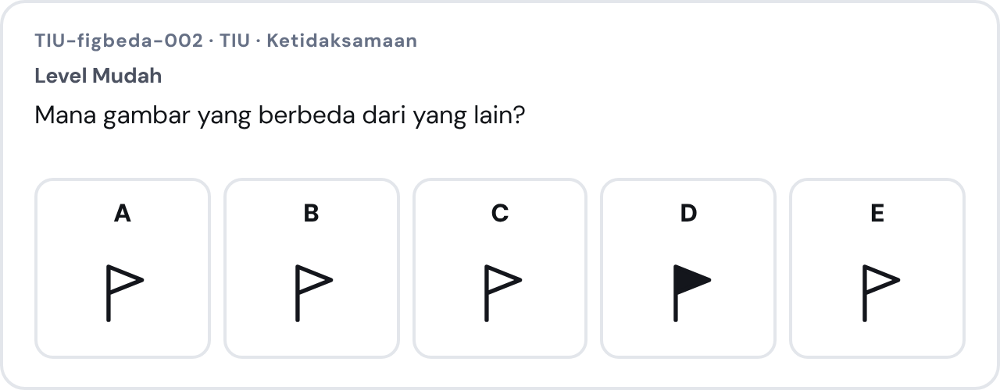

Level Mudah
Mana gambar yang berbeda dari yang lain?

* **A.** Pilihan A
* **B.** Pilihan B
* **C.** Pilihan C
* **D.** Pilihan D
* **E.** Pilihan E

#### Pembahasan Nomor 714

* **Jawaban:** **D**
* **Penjelasan:**
  Warna: empat gambar putih, satu gambar hitam. Opsi A salah: ciri ini sama dengan kelompok. Opsi B salah: ciri ini sama dengan kelompok. Opsi C salah: ciri ini sama dengan kelompok. Opsi E salah: ciri ini sama dengan kelompok.

---

### Soal Nomor 715 (TIU - Figural Ketaksamaan)

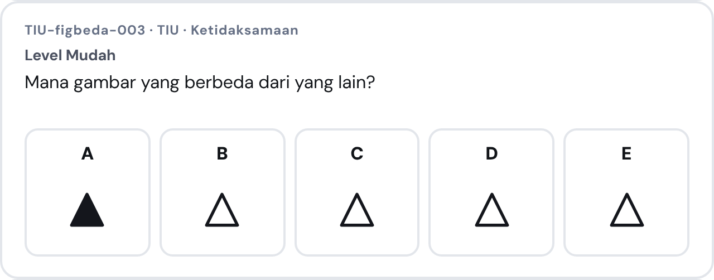

Level Mudah
Mana gambar yang berbeda dari yang lain?

* **A.** Pilihan A
* **B.** Pilihan B
* **C.** Pilihan C
* **D.** Pilihan D
* **E.** Pilihan E

#### Pembahasan Nomor 715

* **Jawaban:** **A**
* **Penjelasan:**
  Warna: empat gambar putih, satu gambar hitam. Opsi B salah: ciri ini sama dengan kelompok. Opsi C salah: ciri ini sama dengan kelompok. Opsi D salah: ciri ini sama dengan kelompok. Opsi E salah: ciri ini sama dengan kelompok.

---

### Soal Nomor 716 (TIU - Figural Ketaksamaan)

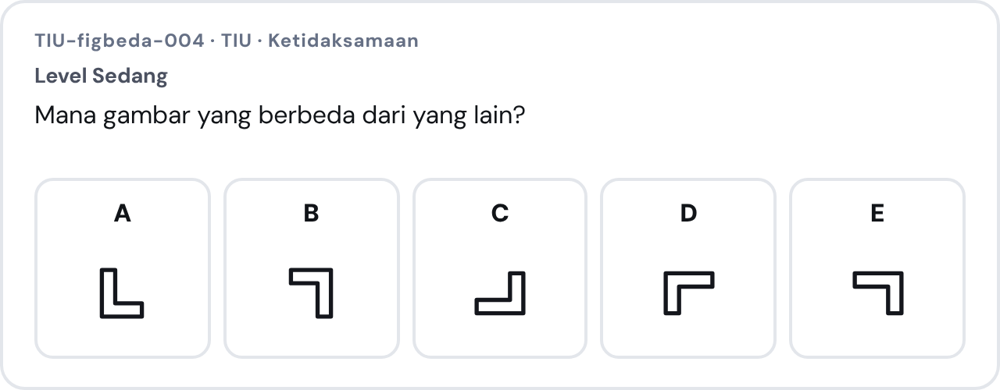

Level Sedang
Mana gambar yang berbeda dari yang lain?

* **A.** Pilihan A
* **B.** Pilihan B
* **C.** Pilihan C
* **D.** Pilihan D
* **E.** Pilihan E

#### Pembahasan Nomor 716

* **Jawaban:** **E**
* **Penjelasan:**
  Gambar E adalah bayangan cermin, yang lain hanya diputar. Diputar tetap sama, dicerminkan berbeda. Opsi A salah: ciri ini sama dengan kelompok. Opsi B salah: ciri ini sama dengan kelompok. Opsi C salah: ciri ini sama dengan kelompok. Opsi D salah: ciri ini sama dengan kelompok.

---

### Soal Nomor 717 (TIU - Figural Ketaksamaan)

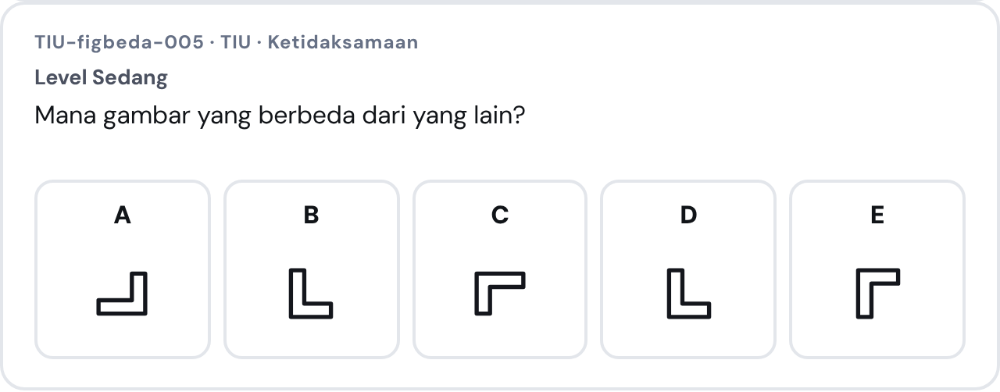

Level Sedang
Mana gambar yang berbeda dari yang lain?

* **A.** Pilihan A
* **B.** Pilihan B
* **C.** Pilihan C
* **D.** Pilihan D
* **E.** Pilihan E

#### Pembahasan Nomor 717

* **Jawaban:** **E**
* **Penjelasan:**
  Gambar E adalah bayangan cermin, yang lain hanya diputar. Diputar tetap sama, dicerminkan berbeda. Opsi A salah: ciri ini sama dengan kelompok. Opsi B salah: ciri ini sama dengan kelompok. Opsi C salah: ciri ini sama dengan kelompok. Opsi D salah: ciri ini sama dengan kelompok.

---

### Soal Nomor 718 (TIU - Figural Ketaksamaan)

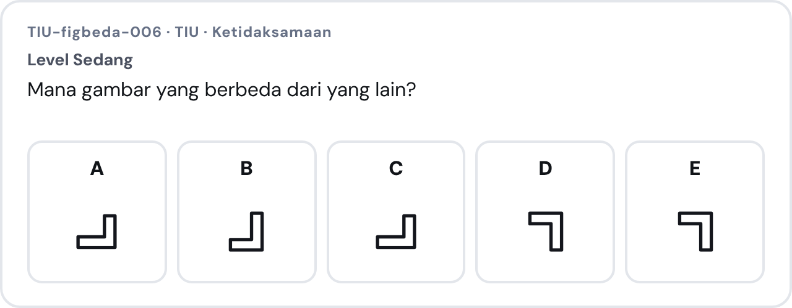

Level Sedang
Mana gambar yang berbeda dari yang lain?

* **A.** Pilihan A
* **B.** Pilihan B
* **C.** Pilihan C
* **D.** Pilihan D
* **E.** Pilihan E

#### Pembahasan Nomor 718

* **Jawaban:** **B**
* **Penjelasan:**
  Gambar B adalah bayangan cermin, yang lain hanya diputar. Diputar tetap sama, dicerminkan berbeda. Opsi A salah: ciri ini sama dengan kelompok. Opsi C salah: ciri ini sama dengan kelompok. Opsi D salah: ciri ini sama dengan kelompok. Opsi E salah: ciri ini sama dengan kelompok.

---

### Soal Nomor 719 (TIU - Figural Ketaksamaan)

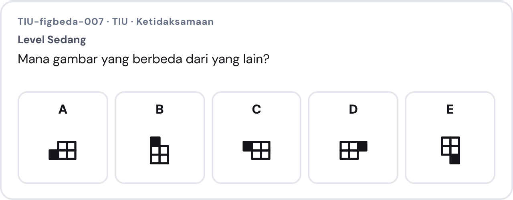

Level Sedang
Mana gambar yang berbeda dari yang lain?

* **A.** Pilihan A
* **B.** Pilihan B
* **C.** Pilihan C
* **D.** Pilihan D
* **E.** Pilihan E

#### Pembahasan Nomor 719

* **Jawaban:** **C**
* **Penjelasan:**
  Empat gambar adalah bentuk yang sama dan hanya diputar. Gambar C berbeda: berupa bayangan cermin, tidak bisa dicapai hanya dengan memutar. Opsi A salah: ini hanya putaran dari bentuk yang sama. Opsi B salah: ini hanya putaran dari bentuk yang sama. Opsi D salah: ini hanya putaran dari bentuk yang sama. Opsi E salah: ini hanya putaran dari bentuk yang sama.

---

### Soal Nomor 720 (TIU - Figural Ketaksamaan)

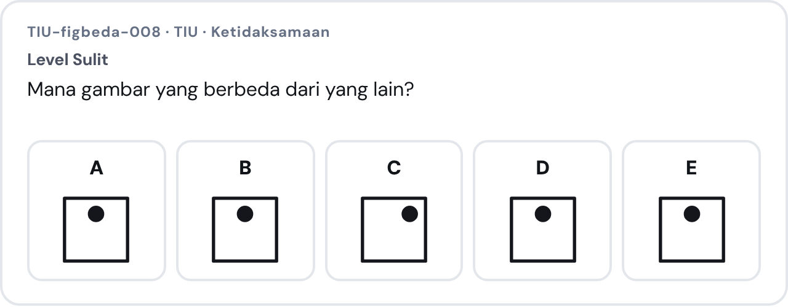

Level Sulit
Mana gambar yang berbeda dari yang lain?

* **A.** Pilihan A
* **B.** Pilihan B
* **C.** Pilihan C
* **D.** Pilihan D
* **E.** Pilihan E

#### Pembahasan Nomor 720

* **Jawaban:** **C**
* **Penjelasan:**
  Posisi titik: empat kotak punya titik di tempat yang sama, satu kotak titiknya pindah. Opsi A salah: ciri ini sama dengan kelompok. Opsi B salah: ciri ini sama dengan kelompok. Opsi D salah: ciri ini sama dengan kelompok. Opsi E salah: ciri ini sama dengan kelompok.

---

### Soal Nomor 721 (TIU - Figural Ketaksamaan)

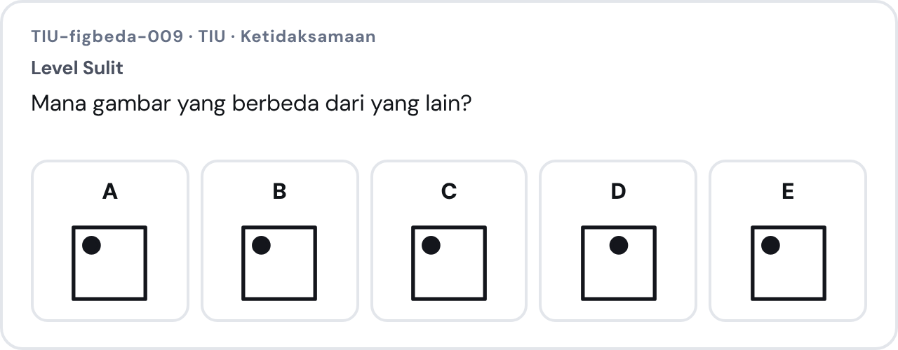

Level Sulit
Mana gambar yang berbeda dari yang lain?

* **A.** Pilihan A
* **B.** Pilihan B
* **C.** Pilihan C
* **D.** Pilihan D
* **E.** Pilihan E

#### Pembahasan Nomor 721

* **Jawaban:** **D**
* **Penjelasan:**
  Posisi titik: empat kotak punya titik di tempat yang sama, satu kotak titiknya pindah. Opsi A salah: ciri ini sama dengan kelompok. Opsi B salah: ciri ini sama dengan kelompok. Opsi C salah: ciri ini sama dengan kelompok. Opsi E salah: ciri ini sama dengan kelompok.

---

### Soal Nomor 722 (TIU - Figural Ketaksamaan)

Level Sulit
Mana gambar yang berbeda dari yang lain?

* **A.** Pilihan A
* **B.** Pilihan B
* **C.** Pilihan C
* **D.** Pilihan D
* **E.** Pilihan E

#### Pembahasan Nomor 722

* **Jawaban:** **A**
* **Penjelasan:**
  Posisi titik: empat kotak punya titik di tempat yang sama, satu kotak titiknya pindah. Opsi B salah: ciri ini sama dengan kelompok. Opsi C salah: ciri ini sama dengan kelompok. Opsi D salah: ciri ini sama dengan kelompok. Opsi E salah: ciri ini sama dengan kelompok.

---

### Soal Nomor 723 (TIU - Figural Ketaksamaan)

Level Sulit
Mana gambar yang berbeda dari yang lain?

* **A.** Pilihan A
* **B.** Pilihan B
* **C.** Pilihan C
* **D.** Pilihan D
* **E.** Pilihan E

#### Pembahasan Nomor 723

* **Jawaban:** **A**
* **Penjelasan:**
  Empat gambar adalah bentuk yang sama dan hanya diputar. Gambar A berbeda: berupa bayangan cermin, tidak bisa dicapai hanya dengan memutar. Opsi B salah: ini hanya putaran dari bentuk yang sama. Opsi C salah: ini hanya putaran dari bentuk yang sama. Opsi D salah: ini hanya putaran dari bentuk yang sama. Opsi E salah: ini hanya putaran dari bentuk yang sama.

---

### Soal Nomor 724 (TIU - Figural Ketaksamaan)

Level Sulit
Mana gambar yang berbeda dari yang lain?

* **A.** Pilihan A
* **B.** Pilihan B
* **C.** Pilihan C
* **D.** Pilihan D
* **E.** Pilihan E

#### Pembahasan Nomor 724

* **Jawaban:** **E**
* **Penjelasan:**
  Posisi titik: empat kotak punya titik di tempat yang sama, satu kotak titiknya pindah. Opsi A salah: ciri ini sama dengan kelompok. Opsi B salah: ciri ini sama dengan kelompok. Opsi C salah: ciri ini sama dengan kelompok. Opsi D salah: ciri ini sama dengan kelompok.

---

### Soal Nomor 725 (TIU - Figural Ketaksamaan)

Level Sulit
Mana gambar yang berbeda dari yang lain?

* **A.** Pilihan A
* **B.** Pilihan B
* **C.** Pilihan C
* **D.** Pilihan D
* **E.** Pilihan E

#### Pembahasan Nomor 725

* **Jawaban:** **C**
* **Penjelasan:**
  Gambar C adalah bayangan cermin, yang lain hanya diputar. Diputar tetap sama, dicerminkan berbeda. Opsi A salah: ciri ini sama dengan kelompok. Opsi B salah: ciri ini sama dengan kelompok. Opsi D salah: ciri ini sama dengan kelompok. Opsi E salah: ciri ini sama dengan kelompok.

---

### Soal Nomor 726 (TIU - Figural Ketaksamaan)

Level Sulit
Mana gambar yang berbeda dari yang lain?

* **A.** Pilihan A
* **B.** Pilihan B
* **C.** Pilihan C
* **D.** Pilihan D
* **E.** Pilihan E

#### Pembahasan Nomor 726

* **Jawaban:** **C**
* **Penjelasan:**
  Gambar C adalah bayangan cermin, yang lain hanya diputar. Diputar tetap sama, dicerminkan berbeda. Opsi A salah: ciri ini sama dengan kelompok. Opsi B salah: ciri ini sama dengan kelompok. Opsi D salah: ciri ini sama dengan kelompok. Opsi E salah: ciri ini sama dengan kelompok.

---

### Soal Nomor 727 (TIU - Figural Ketaksamaan)

Level Sulit
Mana gambar yang berbeda dari yang lain?

* **A.** Pilihan A
* **B.** Pilihan B
* **C.** Pilihan C
* **D.** Pilihan D
* **E.** Pilihan E

#### Pembahasan Nomor 727

* **Jawaban:** **B**
* **Penjelasan:**
  Empat gambar adalah bentuk yang sama dan hanya diputar. Gambar B berbeda: berupa bayangan cermin, tidak bisa dicapai hanya dengan memutar. Opsi A salah: ini hanya putaran dari bentuk yang sama. Opsi C salah: ini hanya putaran dari bentuk yang sama. Opsi D salah: ini hanya putaran dari bentuk yang sama. Opsi E salah: ini hanya putaran dari bentuk yang sama.

---

### Soal Nomor 728 (TIU - Figural Ketaksamaan)

Level Super sulit
Mana gambar yang berbeda dari yang lain?

* **A.** Pilihan A
* **B.** Pilihan B
* **C.** Pilihan C
* **D.** Pilihan D
* **E.** Pilihan E

#### Pembahasan Nomor 728

* **Jawaban:** **E**
* **Penjelasan:**
  Empat gambar adalah susunan yang sama dan hanya diputar. Gambar E adalah bayangan cerminnya: urutan bentuk searah jarum jam terbalik. Diputar tetap sama, dicerminkan berbeda. Opsi A salah: ciri ini sama dengan kelompok. Opsi B salah: ciri ini sama dengan kelompok. Opsi C salah: ciri ini sama dengan kelompok. Opsi D salah: ciri ini sama dengan kelompok.

---

### Soal Nomor 729 (TIU - Figural Ketaksamaan)

Level Super sulit
Mana gambar yang berbeda dari yang lain?

* **A.** Pilihan A
* **B.** Pilihan B
* **C.** Pilihan C
* **D.** Pilihan D
* **E.** Pilihan E

#### Pembahasan Nomor 729

* **Jawaban:** **E**
* **Penjelasan:**
  Empat gambar adalah bentuk yang sama dan hanya diputar. Gambar E berbeda: berupa bayangan cermin, tidak bisa dicapai hanya dengan memutar. Opsi A salah: ini hanya putaran dari bentuk yang sama. Opsi B salah: ini hanya putaran dari bentuk yang sama. Opsi C salah: ini hanya putaran dari bentuk yang sama. Opsi D salah: ini hanya putaran dari bentuk yang sama.

---

### Soal Nomor 730 (TIU - Figural Ketaksamaan)

Level Super sulit
Mana gambar yang berbeda dari yang lain?

* **A.** Pilihan A
* **B.** Pilihan B
* **C.** Pilihan C
* **D.** Pilihan D
* **E.** Pilihan E

#### Pembahasan Nomor 730

* **Jawaban:** **C**
* **Penjelasan:**
  Aturan tersembunyi: setiap gambar punya jumlah unsur hitam yang sama. Bentuk, posisi, dan jumlah total unsur berbeda-beda sebagai pengecoh. Gambar C punya jumlah hitam yang berbeda. Opsi A salah: ciri ini sama dengan kelompok. Opsi B salah: ciri ini sama dengan kelompok. Opsi D salah: ciri ini sama dengan kelompok. Opsi E salah: ciri ini sama dengan kelompok.

---

### Soal Nomor 731 (TIU - Figural Ketaksamaan)

Level Super sulit
Mana gambar yang berbeda dari yang lain?

* **A.** Pilihan A
* **B.** Pilihan B
* **C.** Pilihan C
* **D.** Pilihan D
* **E.** Pilihan E

#### Pembahasan Nomor 731

* **Jawaban:** **D**
* **Penjelasan:**
  Empat gambar adalah bentuk yang sama dan hanya diputar. Gambar D berbeda: berupa bayangan cermin, tidak bisa dicapai hanya dengan memutar. Opsi A salah: ini hanya putaran dari bentuk yang sama. Opsi B salah: ini hanya putaran dari bentuk yang sama. Opsi C salah: ini hanya putaran dari bentuk yang sama. Opsi E salah: ini hanya putaran dari bentuk yang sama.

---

### Soal Nomor 732 (TIU - Figural Ketaksamaan)

Level Super sulit
Mana gambar yang berbeda dari yang lain?

* **A.** Pilihan A
* **B.** Pilihan B
* **C.** Pilihan C
* **D.** Pilihan D
* **E.** Pilihan E

#### Pembahasan Nomor 732

* **Jawaban:** **B**
* **Penjelasan:**
  Empat gambar adalah susunan yang sama dan hanya diputar. Gambar B adalah bayangan cerminnya: urutan bentuk searah jarum jam terbalik. Diputar tetap sama, dicerminkan berbeda. Opsi A salah: ciri ini sama dengan kelompok. Opsi C salah: ciri ini sama dengan kelompok. Opsi D salah: ciri ini sama dengan kelompok. Opsi E salah: ciri ini sama dengan kelompok.

---

### Soal Nomor 733 (TIU - Figural Ketaksamaan)

Level Super sulit
Mana gambar yang berbeda dari yang lain?

* **A.** Pilihan A
* **B.** Pilihan B
* **C.** Pilihan C
* **D.** Pilihan D
* **E.** Pilihan E

#### Pembahasan Nomor 733

* **Jawaban:** **A**
* **Penjelasan:**
  Empat gambar adalah susunan yang sama dan hanya diputar. Gambar A adalah bayangan cerminnya: urutan bentuk searah jarum jam terbalik. Diputar tetap sama, dicerminkan berbeda. Opsi B salah: ciri ini sama dengan kelompok. Opsi C salah: ciri ini sama dengan kelompok. Opsi D salah: ciri ini sama dengan kelompok. Opsi E salah: ciri ini sama dengan kelompok.

---

### Soal Nomor 734 (TIU - Figural Ketaksamaan)

Level Super sulit
Mana gambar yang berbeda dari yang lain?

* **A.** Pilihan A
* **B.** Pilihan B
* **C.** Pilihan C
* **D.** Pilihan D
* **E.** Pilihan E

#### Pembahasan Nomor 734

* **Jawaban:** **B**
* **Penjelasan:**
  Aturan tersembunyi: setiap gambar punya jumlah unsur hitam yang sama. Bentuk, posisi, dan jumlah total unsur berbeda-beda sebagai pengecoh. Gambar B punya jumlah hitam yang berbeda. Opsi A salah: ciri ini sama dengan kelompok. Opsi C salah: ciri ini sama dengan kelompok. Opsi D salah: ciri ini sama dengan kelompok. Opsi E salah: ciri ini sama dengan kelompok.

---

### Soal Nomor 735 (TIU - Figural Ketaksamaan)

Level Super sulit
Mana gambar yang berbeda dari yang lain?

* **A.** Pilihan A
* **B.** Pilihan B
* **C.** Pilihan C
* **D.** Pilihan D
* **E.** Pilihan E

#### Pembahasan Nomor 735

* **Jawaban:** **E**
* **Penjelasan:**
  Empat gambar adalah bentuk yang sama dan hanya diputar. Gambar E berbeda: berupa bayangan cermin, tidak bisa dicapai hanya dengan memutar. Opsi A salah: ini hanya putaran dari bentuk yang sama. Opsi B salah: ini hanya putaran dari bentuk yang sama. Opsi C salah: ini hanya putaran dari bentuk yang sama. Opsi D salah: ini hanya putaran dari bentuk yang sama.

---

### Soal Nomor 736 (TIU - Figural Ketaksamaan)

Level Super sulit
Mana gambar yang berbeda dari yang lain?

* **A.** Pilihan A
* **B.** Pilihan B
* **C.** Pilihan C
* **D.** Pilihan D
* **E.** Pilihan E

#### Pembahasan Nomor 736

* **Jawaban:** **A**
* **Penjelasan:**
  Aturan tersembunyi: bentuk di dalam selalu sama dengan bentuk di luar, dan warnanya selalu berlawanan. Gambar A melanggar salah satunya. Opsi B salah: ciri ini sama dengan kelompok. Opsi C salah: ciri ini sama dengan kelompok. Opsi D salah: ciri ini sama dengan kelompok. Opsi E salah: ciri ini sama dengan kelompok.

---

### Soal Nomor 737 (TIU - Figural Ketaksamaan)

Level Super sulit
Mana gambar yang berbeda dari yang lain?

* **A.** Pilihan A
* **B.** Pilihan B
* **C.** Pilihan C
* **D.** Pilihan D
* **E.** Pilihan E

#### Pembahasan Nomor 737

* **Jawaban:** **A**
* **Penjelasan:**
  Aturan tersembunyi: bentuk di dalam selalu sama dengan bentuk di luar, dan warnanya selalu berlawanan. Gambar A melanggar salah satunya. Opsi B salah: ciri ini sama dengan kelompok. Opsi C salah: ciri ini sama dengan kelompok. Opsi D salah: ciri ini sama dengan kelompok. Opsi E salah: ciri ini sama dengan kelompok.

---

### Soal Nomor 738 (TIU - Figural Ketaksamaan)

Level Super sulit
Mana gambar yang berbeda dari yang lain?

* **A.** Pilihan A
* **B.** Pilihan B
* **C.** Pilihan C
* **D.** Pilihan D
* **E.** Pilihan E

#### Pembahasan Nomor 738

* **Jawaban:** **B**
* **Penjelasan:**
  Empat gambar adalah susunan yang sama dan hanya diputar. Gambar B adalah bayangan cerminnya: urutan bentuk searah jarum jam terbalik. Diputar tetap sama, dicerminkan berbeda. Opsi A salah: ciri ini sama dengan kelompok. Opsi C salah: ciri ini sama dengan kelompok. Opsi D salah: ciri ini sama dengan kelompok. Opsi E salah: ciri ini sama dengan kelompok.

---

### Soal Nomor 739 (TIU - Figural Ketaksamaan)

Level Super sulit
Mana gambar yang berbeda dari yang lain?

* **A.** Pilihan A
* **B.** Pilihan B
* **C.** Pilihan C
* **D.** Pilihan D
* **E.** Pilihan E

#### Pembahasan Nomor 739

* **Jawaban:** **D**
* **Penjelasan:**
  Empat gambar adalah bentuk yang sama dan hanya diputar. Gambar D berbeda: kotak hitamnya berpindah tempat. Opsi A salah: ini hanya putaran dari bentuk yang sama. Opsi B salah: ini hanya putaran dari bentuk yang sama. Opsi C salah: ini hanya putaran dari bentuk yang sama. Opsi E salah: ini hanya putaran dari bentuk yang sama.

---

### Soal Nomor 740 (TIU - Figural Ketaksamaan)

Level Super sulit
Mana gambar yang berbeda dari yang lain?

* **A.** Pilihan A
* **B.** Pilihan B
* **C.** Pilihan C
* **D.** Pilihan D
* **E.** Pilihan E

#### Pembahasan Nomor 740

* **Jawaban:** **C**
* **Penjelasan:**
  Aturan tersembunyi: bentuk di dalam selalu sama dengan bentuk di luar, dan warnanya selalu berlawanan. Gambar C melanggar salah satunya. Opsi A salah: ciri ini sama dengan kelompok. Opsi B salah: ciri ini sama dengan kelompok. Opsi D salah: ciri ini sama dengan kelompok. Opsi E salah: ciri ini sama dengan kelompok.

---

### Soal Nomor 741 (TIU - Figural Ketaksamaan)

Level Super sulit
Mana gambar yang berbeda dari yang lain?

* **A.** Pilihan A
* **B.** Pilihan B
* **C.** Pilihan C
* **D.** Pilihan D
* **E.** Pilihan E

#### Pembahasan Nomor 741

* **Jawaban:** **B**
* **Penjelasan:**
  Aturan tersembunyi: setiap gambar punya jumlah unsur hitam yang sama. Bentuk, posisi, dan jumlah total unsur berbeda-beda sebagai pengecoh. Gambar B punya jumlah hitam yang berbeda. Opsi A salah: ciri ini sama dengan kelompok. Opsi C salah: ciri ini sama dengan kelompok. Opsi D salah: ciri ini sama dengan kelompok. Opsi E salah: ciri ini sama dengan kelompok.

---

### Soal Nomor 742 (TIU - Figural Ketaksamaan)

Level Level dewa
Mana gambar yang berbeda dari yang lain?

* **A.** Pilihan A
* **B.** Pilihan B
* **C.** Pilihan C
* **D.** Pilihan D
* **E.** Pilihan E

#### Pembahasan Nomor 742

* **Jawaban:** **D**
* **Penjelasan:**
  Aturan tersembunyi: jumlah unsur hitam sama dengan jumlah unsur putih (abu-abu tidak dihitung). Empat gambar memenuhinya, gambar D tidak. Opsi A salah: ciri ini sama dengan kelompok. Opsi B salah: ciri ini sama dengan kelompok. Opsi C salah: ciri ini sama dengan kelompok. Opsi E salah: ciri ini sama dengan kelompok.

---

### Soal Nomor 743 (TIU - Figural Ketaksamaan)

Level Level dewa
Mana gambar yang berbeda dari yang lain?

* **A.** Pilihan A
* **B.** Pilihan B
* **C.** Pilihan C
* **D.** Pilihan D
* **E.** Pilihan E

#### Pembahasan Nomor 743

* **Jawaban:** **B**
* **Penjelasan:**
  Aturan tersembunyi: jumlah unsur hitam sama dengan jumlah unsur putih (abu-abu tidak dihitung). Empat gambar memenuhinya, gambar B tidak. Opsi A salah: ciri ini sama dengan kelompok. Opsi C salah: ciri ini sama dengan kelompok. Opsi D salah: ciri ini sama dengan kelompok. Opsi E salah: ciri ini sama dengan kelompok.

---

### Soal Nomor 744 (TIU - Figural Ketaksamaan)

Level Level dewa
Mana gambar yang berbeda dari yang lain?

* **A.** Pilihan A
* **B.** Pilihan B
* **C.** Pilihan C
* **D.** Pilihan D
* **E.** Pilihan E

#### Pembahasan Nomor 744

* **Jawaban:** **A**
* **Penjelasan:**
  Aturan tersembunyi: bentuk dalam sama dengan bentuk luar DAN warnanya berlawanan. Gambar A melanggar salah satu dari dua syarat itu. Opsi B salah: ciri ini sama dengan kelompok. Opsi C salah: ciri ini sama dengan kelompok. Opsi D salah: ciri ini sama dengan kelompok. Opsi E salah: ciri ini sama dengan kelompok.

---

### Soal Nomor 745 (TIU - Figural Ketaksamaan)

Level Level dewa
Mana gambar yang berbeda dari yang lain?

* **A.** Pilihan A
* **B.** Pilihan B
* **C.** Pilihan C
* **D.** Pilihan D
* **E.** Pilihan E

#### Pembahasan Nomor 745

* **Jawaban:** **C**
* **Penjelasan:**
  Empat gambar adalah bentuk yang sama dan hanya diputar. Gambar C berbeda: kotak hitamnya berpindah tempat. Opsi A salah: ini hanya putaran dari bentuk yang sama. Opsi B salah: ini hanya putaran dari bentuk yang sama. Opsi D salah: ini hanya putaran dari bentuk yang sama. Opsi E salah: ini hanya putaran dari bentuk yang sama.

---

### Soal Nomor 746 (TIU - Figural Ketaksamaan)

Level Level dewa
Mana gambar yang berbeda dari yang lain?

* **A.** Pilihan A
* **B.** Pilihan B
* **C.** Pilihan C
* **D.** Pilihan D
* **E.** Pilihan E

#### Pembahasan Nomor 746

* **Jawaban:** **E**
* **Penjelasan:**
  Aturan tersembunyi: bentuk dalam sama dengan bentuk luar DAN warnanya berlawanan. Gambar E melanggar salah satu dari dua syarat itu. Opsi A salah: ciri ini sama dengan kelompok. Opsi B salah: ciri ini sama dengan kelompok. Opsi C salah: ciri ini sama dengan kelompok. Opsi D salah: ciri ini sama dengan kelompok.

---

### Soal Nomor 747 (TIU - Figural Ketaksamaan)

Level Level dewa
Mana gambar yang berbeda dari yang lain?

* **A.** Pilihan A
* **B.** Pilihan B
* **C.** Pilihan C
* **D.** Pilihan D
* **E.** Pilihan E

#### Pembahasan Nomor 747

* **Jawaban:** **A**
* **Penjelasan:**
  Aturan tersembunyi: bentuk dalam sama dengan bentuk luar DAN warnanya berlawanan. Gambar A melanggar salah satu dari dua syarat itu. Opsi B salah: ciri ini sama dengan kelompok. Opsi C salah: ciri ini sama dengan kelompok. Opsi D salah: ciri ini sama dengan kelompok. Opsi E salah: ciri ini sama dengan kelompok.

---

### Soal Nomor 748 (TIU - Figural Ketaksamaan)

Level Level dewa
Mana gambar yang berbeda dari yang lain?

* **A.** Pilihan A
* **B.** Pilihan B
* **C.** Pilihan C
* **D.** Pilihan D
* **E.** Pilihan E

#### Pembahasan Nomor 748

* **Jawaban:** **C**
* **Penjelasan:**
  Empat gambar adalah susunan yang sama dan hanya diputar. Gambar C adalah bayangan cerminnya: urutan bentuk searah jarum jam terbalik. Diputar tetap sama, dicerminkan berbeda. Opsi A salah: ciri ini sama dengan kelompok. Opsi B salah: ciri ini sama dengan kelompok. Opsi D salah: ciri ini sama dengan kelompok. Opsi E salah: ciri ini sama dengan kelompok.

---

### Soal Nomor 749 (TIU - Figural Ketaksamaan)

Level Level dewa
Mana gambar yang berbeda dari yang lain?

* **A.** Pilihan A
* **B.** Pilihan B
* **C.** Pilihan C
* **D.** Pilihan D
* **E.** Pilihan E

#### Pembahasan Nomor 749

* **Jawaban:** **C**
* **Penjelasan:**
  Empat gambar adalah bentuk yang sama dan hanya diputar. Gambar C berbeda: berupa bayangan cermin, tidak bisa dicapai hanya dengan memutar. Opsi A salah: ini hanya putaran dari bentuk yang sama. Opsi B salah: ini hanya putaran dari bentuk yang sama. Opsi D salah: ini hanya putaran dari bentuk yang sama. Opsi E salah: ini hanya putaran dari bentuk yang sama.

---

### Soal Nomor 750 (TIU - Figural Ketaksamaan)

Level Level dewa
Mana gambar yang berbeda dari yang lain?

* **A.** Pilihan A
* **B.** Pilihan B
* **C.** Pilihan C
* **D.** Pilihan D
* **E.** Pilihan E

#### Pembahasan Nomor 750

* **Jawaban:** **E**
* **Penjelasan:**
  Aturan tersembunyi: bentuk dalam sama dengan bentuk luar DAN warnanya berlawanan. Gambar E melanggar salah satu dari dua syarat itu. Opsi A salah: ciri ini sama dengan kelompok. Opsi B salah: ciri ini sama dengan kelompok. Opsi C salah: ciri ini sama dengan kelompok. Opsi D salah: ciri ini sama dengan kelompok.

---

### Soal Nomor 751 (TIU - Figural Ketaksamaan)

Level Level dewa
Mana gambar yang berbeda dari yang lain?

* **A.** Pilihan A
* **B.** Pilihan B
* **C.** Pilihan C
* **D.** Pilihan D
* **E.** Pilihan E

#### Pembahasan Nomor 751

* **Jawaban:** **B**
* **Penjelasan:**
  Empat gambar adalah susunan yang sama dan hanya diputar. Gambar B adalah bayangan cerminnya: urutan bentuk searah jarum jam terbalik. Diputar tetap sama, dicerminkan berbeda. Opsi A salah: ciri ini sama dengan kelompok. Opsi C salah: ciri ini sama dengan kelompok. Opsi D salah: ciri ini sama dengan kelompok. Opsi E salah: ciri ini sama dengan kelompok.

---

### Soal Nomor 752 (TIU - Figural Ketaksamaan)

Level Level dewa
Mana gambar yang berbeda dari yang lain?

* **A.** Pilihan A
* **B.** Pilihan B
* **C.** Pilihan C
* **D.** Pilihan D
* **E.** Pilihan E

#### Pembahasan Nomor 752

* **Jawaban:** **C**
* **Penjelasan:**
  Aturan tersembunyi: bentuk dalam sama dengan bentuk luar DAN warnanya berlawanan. Gambar C melanggar salah satu dari dua syarat itu. Opsi A salah: ciri ini sama dengan kelompok. Opsi B salah: ciri ini sama dengan kelompok. Opsi D salah: ciri ini sama dengan kelompok. Opsi E salah: ciri ini sama dengan kelompok.

---

### Soal Nomor 753 (TIU - Figural Ketaksamaan)

Level Level dewa
Mana gambar yang berbeda dari yang lain?

* **A.** Pilihan A
* **B.** Pilihan B
* **C.** Pilihan C
* **D.** Pilihan D
* **E.** Pilihan E

#### Pembahasan Nomor 753

* **Jawaban:** **D**
* **Penjelasan:**
  Empat gambar adalah bentuk yang sama dan hanya diputar. Gambar D berbeda: berupa bayangan cermin, tidak bisa dicapai hanya dengan memutar. Opsi A salah: ini hanya putaran dari bentuk yang sama. Opsi B salah: ini hanya putaran dari bentuk yang sama. Opsi C salah: ini hanya putaran dari bentuk yang sama. Opsi E salah: ini hanya putaran dari bentuk yang sama.

---

### Soal Nomor 754 (TIU - Figural Ketaksamaan)

Level Level dewa
Mana gambar yang berbeda dari yang lain?

* **A.** Pilihan A
* **B.** Pilihan B
* **C.** Pilihan C
* **D.** Pilihan D
* **E.** Pilihan E

#### Pembahasan Nomor 754

* **Jawaban:** **A**
* **Penjelasan:**
  Aturan tersembunyi: bentuk dalam sama dengan bentuk luar DAN warnanya berlawanan. Gambar A melanggar salah satu dari dua syarat itu. Opsi B salah: ciri ini sama dengan kelompok. Opsi C salah: ciri ini sama dengan kelompok. Opsi D salah: ciri ini sama dengan kelompok. Opsi E salah: ciri ini sama dengan kelompok.

---

### Soal Nomor 755 (TIU - Figural Ketaksamaan)

Level Level dewa
Mana gambar yang berbeda dari yang lain?

* **A.** Pilihan A
* **B.** Pilihan B
* **C.** Pilihan C
* **D.** Pilihan D
* **E.** Pilihan E

#### Pembahasan Nomor 755

* **Jawaban:** **D**
* **Penjelasan:**
  Empat gambar adalah susunan yang sama dan hanya diputar. Gambar D adalah bayangan cerminnya: urutan bentuk searah jarum jam terbalik. Diputar tetap sama, dicerminkan berbeda. Opsi A salah: ciri ini sama dengan kelompok. Opsi B salah: ciri ini sama dengan kelompok. Opsi C salah: ciri ini sama dengan kelompok. Opsi E salah: ciri ini sama dengan kelompok.

---

### Soal Nomor 756 (TIU - Figural Ketaksamaan)

Manakah yang BUKAN memiliki dua pasang sisi sejajar?

* **A.** Persegi
* **B.** Belah ketupat
* **C.** Layang-layang
* **D.** Persegi panjang
* **E.** Jajar genjang

#### Pembahasan Nomor 756

* **Jawaban:** **C**
* **Penjelasan:**
  Layang-layang tidak memiliki sisi sejajar.

---

### Soal Nomor 757 (TIU - Figural Serial)

Serial: ↑ → ↓ ← ↑ →... Gambar berikutnya adalah...

* **A.** ↑
* **B.** ↗
* **C.** ←
* **D.** →
* **E.** ↓

#### Pembahasan Nomor 757

* **Jawaban:** **E**
* **Penjelasan:**
  Tiap langkah panah berputar 90 derajat searah jarum jam: ↑ → ↓ ← ↑ →, berikutnya ↓.

---

### Soal Nomor 758 (TIU - Figural Serial)

Level Mudah
Tentukan gambar berikutnya dalam serial ini. [gambar] › [gambar] › [gambar] ›?

* **A.** Pilihan A
* **B.** Pilihan B
* **C.** Pilihan C
* **D.** Pilihan D
* **E.** Pilihan E

#### Pembahasan Nomor 758

* **Jawaban:** **C**
* **Penjelasan:**
  Titik berpindah satu sudut berlawanan arah jarum jam tiap langkah. Langkah berikutnya adalah gambar C. Opsi A salah: jumlahnya keliru. Opsi B salah: letaknya keliru. Opsi D salah: sudut putarnya keliru. Opsi E salah: sudut putarnya keliru.

---

### Soal Nomor 759 (TIU - Figural Serial)

Level Mudah
Tentukan gambar berikutnya dalam serial ini. [gambar] › [gambar] › [gambar] ›?

* **A.** Pilihan A
* **B.** Pilihan B
* **C.** Pilihan C
* **D.** Pilihan D
* **E.** Pilihan E

#### Pembahasan Nomor 759

* **Jawaban:** **E**
* **Penjelasan:**
  Gambar berputar 90° berlawanan arah jarum jam tiap langkah. Langkah berikutnya adalah gambar E. Opsi A salah: melompat dua langkah. Opsi B salah: sama dengan gambar terakhir, belum bergerak. Opsi C salah: bentuknya berubah, padahal seharusnya tetap. Opsi D salah: bentuknya berubah, padahal seharusnya tetap.

---

### Soal Nomor 760 (TIU - Figural Serial)

Level Sedang
Tentukan gambar berikutnya dalam serial ini. [gambar] › [gambar] › [gambar] › [gambar] ›?

* **A.** Pilihan A
* **B.** Pilihan B
* **C.** Pilihan C
* **D.** Pilihan D
* **E.** Pilihan E

#### Pembahasan Nomor 760

* **Jawaban:** **B**
* **Penjelasan:**
  Dua pola berjalan bersamaan: berputar 90° tiap langkah, dan warna bergantian. Putaran penuh kembali ke arah awal. Langkah berikutnya adalah gambar B. Opsi A salah: arahnya benar, tetapi warnanya tidak bergantian. Opsi C salah: warnanya benar, tetapi arahnya salah. Opsi D salah: sudut putarnya keliru. Opsi E salah: bentuknya berubah, padahal seharusnya tetap.

---

### Soal Nomor 761 (TIU - Figural Serial)

Level Sedang
Tentukan gambar berikutnya dalam serial ini. [gambar] › [gambar] › [gambar] ›?

* **A.** Pilihan A
* **B.** Pilihan B
* **C.** Pilihan C
* **D.** Pilihan D
* **E.** Pilihan E

#### Pembahasan Nomor 761

* **Jawaban:** **A**
* **Penjelasan:**
  Titik berpindah satu sudut searah jarum jam tiap langkah. Langkah berikutnya adalah gambar A. Opsi B salah: letaknya keliru. Opsi C salah: jumlahnya keliru. Opsi D salah: bentuknya berubah, padahal seharusnya tetap. Opsi E salah: letaknya keliru.

---

### Soal Nomor 762 (TIU - Figural Serial)

Level Sedang
Tentukan sel kosong pada matriks ini. [gambar]
[gambar]
[gambar]
[gambar]
[gambar]
[gambar]
[gambar]
[gambar]
?

* **A.** Pilihan A
* **B.** Pilihan B
* **C.** Pilihan C
* **D.** Pilihan D
* **E.** Pilihan E

#### Pembahasan Nomor 762

* **Jawaban:** **C**
* **Penjelasan:**
  Tiap baris dan kolom berisi tiga bentuk berbeda, masing-masing sekali. Bentuk yang belum ada di baris dan kolom sel kosong adalah jawabannya. Jawabannya gambar C. Opsi A salah: bentuk ini sudah ada di baris yang sama. Opsi B salah: bentuk ini sudah ada di kolom yang sama. Opsi D salah: warnanya tidak sesuai pola. Opsi E salah: bentuk dan warna tidak sesuai.

---

### Soal Nomor 763 (TIU - Figural Serial)

Level Sedang
Tentukan sel kosong pada matriks ini. [gambar]
[gambar]
[gambar]
[gambar]
[gambar]
[gambar]
[gambar]
[gambar]
?

* **A.** Pilihan A
* **B.** Pilihan B
* **C.** Pilihan C
* **D.** Pilihan D
* **E.** Pilihan E

#### Pembahasan Nomor 763

* **Jawaban:** **C**
* **Penjelasan:**
  Tiap baris dan kolom berisi tiga bentuk berbeda, masing-masing sekali. Bentuk yang belum ada di baris dan kolom sel kosong adalah jawabannya. Jawabannya gambar C. Opsi A salah: bentuk ini sudah ada di baris yang sama. Opsi B salah: bentuk ini sudah ada di kolom yang sama. Opsi D salah: warnanya tidak sesuai pola. Opsi E salah: bentuk dan warna tidak sesuai.

---

### Soal Nomor 764 (TIU - Figural Serial)

Level Sulit
Tentukan gambar berikutnya dalam serial ini. [gambar] › [gambar] › [gambar] ›?

* **A.** Pilihan A
* **B.** Pilihan B
* **C.** Pilihan C
* **D.** Pilihan D
* **E.** Pilihan E

#### Pembahasan Nomor 764

* **Jawaban:** **D**
* **Penjelasan:**
  Titik berpindah satu sudut berlawanan arah jarum jam tiap langkah, dan warnanya bergantian. Langkah berikutnya adalah gambar D. Opsi A salah: letaknya benar, tetapi warnanya tidak bergantian. Opsi B salah: letaknya keliru. Opsi C salah: sudut putarnya keliru. Opsi E salah: letaknya keliru.

---

### Soal Nomor 765 (TIU - Figural Serial)

Level Sulit
Tentukan gambar berikutnya dalam serial ini. [gambar] › [gambar] › [gambar] ›?

* **A.** Pilihan A
* **B.** Pilihan B
* **C.** Pilihan C
* **D.** Pilihan D
* **E.** Pilihan E

#### Pembahasan Nomor 765

* **Jawaban:** **E**
* **Penjelasan:**
  Titik berpindah satu sudut berlawanan arah jarum jam tiap langkah, dan warnanya bergantian. Langkah berikutnya adalah gambar E. Opsi A salah: letaknya benar, tetapi warnanya tidak bergantian. Opsi B salah: jumlahnya keliru. Opsi C salah: bentuknya berubah, padahal seharusnya tetap. Opsi D salah: letaknya keliru.

---

### Soal Nomor 766 (TIU - Figural Serial)

Level Sulit
Tentukan sel kosong pada matriks ini. [gambar]
[gambar]
[gambar]
[gambar]
[gambar]
[gambar]
[gambar]
[gambar]
?

* **A.** Pilihan A
* **B.** Pilihan B
* **C.** Pilihan C
* **D.** Pilihan D
* **E.** Pilihan E

#### Pembahasan Nomor 766

* **Jawaban:** **E**
* **Penjelasan:**
  Kolom ketiga adalah jumlah kolom pertama dan kedua. Baris ketiga: 3 + 3 = 6. Jawabannya gambar E. Opsi A salah: bukan jumlah dari dua sel di sebelah kirinya. Opsi B salah: bukan jumlah dari dua sel di sebelah kirinya. Opsi C salah: bukan jumlah dari dua sel di sebelah kirinya. Opsi D salah: bukan jumlah dari dua sel di sebelah kirinya.

---

### Soal Nomor 767 (TIU - Figural Serial)

Level Sulit
Tentukan gambar berikutnya dalam serial ini. [gambar] › [gambar] › [gambar] ›?

* **A.** Pilihan A
* **B.** Pilihan B
* **C.** Pilihan C
* **D.** Pilihan D
* **E.** Pilihan E

#### Pembahasan Nomor 767

* **Jawaban:** **B**
* **Penjelasan:**
  Titik berpindah satu sudut berlawanan arah jarum jam tiap langkah, dan warnanya bergantian. Langkah berikutnya adalah gambar B. Opsi A salah: letaknya benar, tetapi warnanya tidak bergantian. Opsi C salah: bentuknya berubah, padahal seharusnya tetap. Opsi D salah: bentuknya berubah, padahal seharusnya tetap. Opsi E salah: letaknya keliru.

---

### Soal Nomor 768 (TIU - Figural Serial)

Level Sulit
Tentukan gambar berikutnya dalam serial ini. [gambar] › [gambar] › [gambar] ›?

* **A.** Pilihan A
* **B.** Pilihan B
* **C.** Pilihan C
* **D.** Pilihan D
* **E.** Pilihan E

#### Pembahasan Nomor 768

* **Jawaban:** **C**
* **Penjelasan:**
  Dua pola bersamaan: jumlah bertambah satu, dan warna bergantian. Langkah berikutnya adalah gambar C. Opsi A salah: jumlahnya benar, tetapi warnanya tidak bergantian. Opsi B salah: bentuknya berubah, padahal seharusnya tetap. Opsi D salah: bentuknya berubah, padahal seharusnya tetap. Opsi E salah: jumlahnya keliru.

---

### Soal Nomor 769 (TIU - Figural Serial)

Level Sulit
Tentukan gambar berikutnya dalam serial ini. [gambar] › [gambar] › [gambar] ›?

* **A.** Pilihan A
* **B.** Pilihan B
* **C.** Pilihan C
* **D.** Pilihan D
* **E.** Pilihan E

#### Pembahasan Nomor 769

* **Jawaban:** **A**
* **Penjelasan:**
  Titik berpindah satu sudut berlawanan arah jarum jam tiap langkah, dan warnanya bergantian. Langkah berikutnya adalah gambar A. Opsi B salah: letaknya benar, tetapi warnanya tidak bergantian. Opsi C salah: bentuknya berubah, padahal seharusnya tetap. Opsi D salah: letaknya keliru. Opsi E salah: bentuknya berubah, padahal seharusnya tetap.

---

### Soal Nomor 770 (TIU - Figural Serial)

Level Sulit
Tentukan gambar berikutnya dalam serial ini. [gambar] › [gambar] › [gambar] ›?

* **A.** Pilihan A
* **B.** Pilihan B
* **C.** Pilihan C
* **D.** Pilihan D
* **E.** Pilihan E

#### Pembahasan Nomor 770

* **Jawaban:** **D**
* **Penjelasan:**
  Titik berpindah satu sudut berlawanan arah jarum jam tiap langkah, dan warnanya bergantian. Langkah berikutnya adalah gambar D. Opsi A salah: letaknya benar, tetapi warnanya tidak bergantian. Opsi B salah: bentuknya berubah, padahal seharusnya tetap. Opsi C salah: letaknya keliru. Opsi E salah: letaknya keliru.

---

### Soal Nomor 771 (TIU - Figural Serial)

Level Sulit
Tentukan sel kosong pada matriks ini. [gambar]
[gambar]
[gambar]
[gambar]
[gambar]
[gambar]
[gambar]
[gambar]
?

* **A.** Pilihan A
* **B.** Pilihan B
* **C.** Pilihan C
* **D.** Pilihan D
* **E.** Pilihan E

#### Pembahasan Nomor 771

* **Jawaban:** **E**
* **Penjelasan:**
  Tiap kolom ke kanan berputar 90°, tiap baris ke bawah menambah 45°. Sel kosong: 90 x 2 + 45 x 2 = 270°. Jawabannya gambar E. Opsi A salah: berupa bayangan cermin. Opsi B salah: warnanya tidak sesuai aturan. Opsi C salah: bentuknya berubah, padahal seharusnya tetap. Opsi D salah: bentuknya berubah, padahal seharusnya tetap.

---

### Soal Nomor 772 (TIU - Figural Serial)

Level Super sulit
Tentukan sel kosong pada matriks ini. [gambar]
[gambar]
[gambar]
[gambar]
[gambar]
[gambar]
[gambar]
[gambar]
?

* **A.** Pilihan A
* **B.** Pilihan B
* **C.** Pilihan C
* **D.** Pilihan D
* **E.** Pilihan E

#### Pembahasan Nomor 772

* **Jawaban:** **D**
* **Penjelasan:**
  Gambar ketiga di tiap baris adalah gabungan (semua titik dari kedua gambar). Jawabannya gambar D. Opsi A salah: ada titik yang kurang. Opsi B salah: hasil aturan lain: titik yang ada di kedua gambar sekaligus. Opsi C salah: urutan gambar terbalik pada aturan selisih. Opsi E salah: hasil aturan lain: titik yang hanya ada di salah satu gambar.

---

### Soal Nomor 773 (TIU - Figural Serial)

Level Super sulit
Tentukan sel kosong pada matriks ini. [gambar]
[gambar]
[gambar]
[gambar]
[gambar]
[gambar]
[gambar]
[gambar]
?

* **A.** Pilihan A
* **B.** Pilihan B
* **C.** Pilihan C
* **D.** Pilihan D
* **E.** Pilihan E

#### Pembahasan Nomor 773

* **Jawaban:** **C**
* **Penjelasan:**
  Ada 3 aturan yang berjalan bersamaan: bentuk luar mengikuti pola kotak latin (tiap baris dan kolom memuat tiga bentuk, masing-masing sekali); warna luar mengikuti pola baris atau kotak latin; arah bentuk dalam berputar 90° tiap langkah ke kanan atau ke bawah. Baca tiap ciri secara terpisah, lalu gabungkan untuk sel kosong. Jawabannya gambar C. Opsi A salah: sama dengan gambar di kirinya. Opsi B salah: sama dengan gambar di atasnya. Opsi D salah: warna luar keliru. Opsi E salah: arah putaran keliru.

---

### Soal Nomor 774 (TIU - Figural Serial)

Level Super sulit
Tentukan sel kosong pada matriks ini. [gambar]
[gambar]
[gambar]
[gambar]
[gambar]
[gambar]
[gambar]
[gambar]
?

* **A.** Pilihan A
* **B.** Pilihan B
* **C.** Pilihan C
* **D.** Pilihan D
* **E.** Pilihan E

#### Pembahasan Nomor 774

* **Jawaban:** **A**
* **Penjelasan:**
  Gambar ketiga di tiap baris adalah titik gambar pertama yang tidak ada di gambar kedua. Jawabannya gambar A. Opsi B salah: ada titik yang kurang. Opsi C salah: urutan gambar terbalik pada aturan selisih. Opsi D salah: hasil aturan lain: gabungan. Opsi E salah: ada titik yang berlebih.

---

### Soal Nomor 775 (TIU - Figural Serial)

Level Super sulit
Tentukan sel kosong pada matriks ini. [gambar]
[gambar]
[gambar]
[gambar]
[gambar]
[gambar]
[gambar]
[gambar]
?

* **A.** Pilihan A
* **B.** Pilihan B
* **C.** Pilihan C
* **D.** Pilihan D
* **E.** Pilihan E

#### Pembahasan Nomor 775

* **Jawaban:** **A**
* **Penjelasan:**
  Ada 3 aturan yang berjalan bersamaan: bentuk luar mengikuti pola kotak latin (tiap baris dan kolom memuat tiga bentuk, masing-masing sekali); warna dalam mengikuti pola kolom atau kotak latin; jumlah bentuk dalam naik satu mengikuti baris atau kolom. Baca tiap ciri secara terpisah, lalu gabungkan untuk sel kosong. Jawabannya gambar A. Opsi B salah: sama dengan gambar di kirinya. Opsi C salah: sama dengan gambar di atasnya. Opsi D salah: jumlah bentuk dalam keliru. Opsi E salah: bentuk luar keliru.

---

### Soal Nomor 776 (TIU - Figural Serial)

Level Super sulit
Tentukan sel kosong pada matriks ini. [gambar]
[gambar]
[gambar]
[gambar]
[gambar]
[gambar]
[gambar]
[gambar]
?

* **A.** Pilihan A
* **B.** Pilihan B
* **C.** Pilihan C
* **D.** Pilihan D
* **E.** Pilihan E

#### Pembahasan Nomor 776

* **Jawaban:** **A**
* **Penjelasan:**
  Ada 3 aturan yang berjalan bersamaan: bentuk luar mengikuti pola kotak latin (tiap baris dan kolom memuat tiga bentuk, masing-masing sekali); warna luar mengikuti pola baris atau kotak latin; arah bentuk dalam berputar 90° tiap langkah ke kanan atau ke bawah. Baca tiap ciri secara terpisah, lalu gabungkan untuk sel kosong. Jawabannya gambar A. Opsi B salah: sama dengan gambar di kirinya. Opsi C salah: sama dengan gambar di atasnya. Opsi D salah: warna luar keliru. Opsi E salah: bentuk luar keliru.

---

### Soal Nomor 777 (TIU - Figural Serial)

Level Super sulit
Tentukan gambar berikutnya dalam serial ini. [gambar] › [gambar] › [gambar] › [gambar] ›?

* **A.** Pilihan A
* **B.** Pilihan B
* **C.** Pilihan C
* **D.** Pilihan D
* **E.** Pilihan E

#### Pembahasan Nomor 777

* **Jawaban:** **D**
* **Penjelasan:**
  Tiap unsur punya aturan sendiri: bentuk tengah naik satu sisi tiap langkah: segitiga, persegi, segilima, segienam, lalu ulang; titik tepi berpindah 2 posisi berlawanan arah jarum jam tiap langkah. Terapkan semuanya pada langkah ke-5: gambar D. Opsi A salah: dua pola sama-sama keliru. Opsi B salah: bentuk unsur tengah keliru (mengulang langkah sebelumnya). Opsi C salah: posisi titik tepi keliru (mengulang langkah sebelumnya). Opsi E salah: bentuk unsur tengah keliru (melompat satu langkah).

---

### Soal Nomor 778 (TIU - Figural Serial)

Level Super sulit
Tentukan gambar berikutnya dalam serial ini. [gambar] › [gambar] › [gambar] › [gambar] ›?

* **A.** Pilihan A
* **B.** Pilihan B
* **C.** Pilihan C
* **D.** Pilihan D
* **E.** Pilihan E

#### Pembahasan Nomor 778

* **Jawaban:** **B**
* **Penjelasan:**
  Tiap unsur punya aturan sendiri: unsur tengah berputar 45° searah jarum jam tiap langkah; titik tepi berpindah 3 posisi searah jarum jam tiap langkah, warnanya bergantian hitam dan putih. Terapkan semuanya pada langkah ke-5: gambar B. Opsi A salah: dua pola sama-sama keliru. Opsi C salah: arah putar unsur tengah keliru (melompat satu langkah). Opsi D salah: arah putar unsur tengah keliru (mengulang langkah sebelumnya). Opsi E salah: posisi titik tepi keliru (melompat satu langkah).

---

### Soal Nomor 779 (TIU - Figural Serial)

Level Super sulit
Tentukan sel kosong pada matriks ini. [gambar]
[gambar]
[gambar]
[gambar]
[gambar]
[gambar]
[gambar]
[gambar]
?

* **A.** Pilihan A
* **B.** Pilihan B
* **C.** Pilihan C
* **D.** Pilihan D
* **E.** Pilihan E

#### Pembahasan Nomor 779

* **Jawaban:** **D**
* **Penjelasan:**
  Ada 3 aturan yang berjalan bersamaan: bentuk luar mengikuti pola kotak latin (tiap baris dan kolom memuat tiga bentuk, masing-masing sekali); warna dalam mengikuti pola kolom atau kotak latin; jumlah bentuk dalam naik satu mengikuti baris atau kolom. Baca tiap ciri secara terpisah, lalu gabungkan untuk sel kosong. Jawabannya gambar D. Opsi A salah: sama dengan gambar di kirinya. Opsi B salah: sama dengan gambar di atasnya. Opsi C salah: bentuk luar keliru. Opsi E salah: bentuk luar keliru.

---

### Soal Nomor 780 (TIU - Figural Serial)

Level Super sulit
Tentukan gambar berikutnya dalam serial ini. [gambar] › [gambar] › [gambar] › [gambar] ›?

* **A.** Pilihan A
* **B.** Pilihan B
* **C.** Pilihan C
* **D.** Pilihan D
* **E.** Pilihan E

#### Pembahasan Nomor 780

* **Jawaban:** **D**
* **Penjelasan:**
  Tiap unsur punya aturan sendiri: bentuk tengah naik satu sisi tiap langkah: segitiga, persegi, segilima, segienam, lalu ulang; titik tepi berpindah 2 posisi berlawanan arah jarum jam tiap langkah. Terapkan semuanya pada langkah ke-5: gambar D. Opsi A salah: dua pola sama-sama keliru. Opsi B salah: posisi titik tepi keliru (mengulang langkah sebelumnya). Opsi C salah: bentuk unsur tengah keliru (mengulang langkah sebelumnya). Opsi E salah: bentuk unsur tengah keliru (melompat satu langkah).

---

### Soal Nomor 781 (TIU - Figural Serial)

Level Super sulit
Tentukan sel kosong pada matriks ini. [gambar]
[gambar]
[gambar]
[gambar]
[gambar]
[gambar]
[gambar]
[gambar]
?

* **A.** Pilihan A
* **B.** Pilihan B
* **C.** Pilihan C
* **D.** Pilihan D
* **E.** Pilihan E

#### Pembahasan Nomor 781

* **Jawaban:** **D**
* **Penjelasan:**
  Ada 3 aturan yang berjalan bersamaan: bentuk luar mengikuti pola kotak latin (tiap baris dan kolom memuat tiga bentuk, masing-masing sekali); warna dalam mengikuti pola kolom atau kotak latin; jumlah bentuk dalam naik satu mengikuti baris atau kolom. Baca tiap ciri secara terpisah, lalu gabungkan untuk sel kosong. Jawabannya gambar D. Opsi A salah: sama dengan gambar di kirinya. Opsi B salah: sama dengan gambar di atasnya. Opsi C salah: jumlah bentuk dalam keliru. Opsi E salah: bentuk luar keliru.

---

### Soal Nomor 782 (TIU - Figural Serial)

Level Super sulit
Tentukan sel kosong pada matriks ini. [gambar]
[gambar]
[gambar]
[gambar]
[gambar]
[gambar]
[gambar]
[gambar]
?

* **A.** Pilihan A
* **B.** Pilihan B
* **C.** Pilihan C
* **D.** Pilihan D
* **E.** Pilihan E

#### Pembahasan Nomor 782

* **Jawaban:** **A**
* **Penjelasan:**
  Ada 3 aturan yang berjalan bersamaan: bentuk luar mengikuti pola kotak latin (tiap baris dan kolom memuat tiga bentuk, masing-masing sekali); warna luar mengikuti pola baris atau kotak latin; arah bentuk dalam berputar 90° tiap langkah ke kanan atau ke bawah. Baca tiap ciri secara terpisah, lalu gabungkan untuk sel kosong. Jawabannya gambar A. Opsi B salah: sama dengan gambar di kirinya. Opsi C salah: sama dengan gambar di atasnya. Opsi D salah: arah putaran keliru. Opsi E salah: bentuk luar keliru.

---

### Soal Nomor 783 (TIU - Figural Serial)

Level Super sulit
Tentukan gambar berikutnya dalam serial ini. [gambar] › [gambar] › [gambar] › [gambar] ›?

* **A.** Pilihan A
* **B.** Pilihan B
* **C.** Pilihan C
* **D.** Pilihan D
* **E.** Pilihan E

#### Pembahasan Nomor 783

* **Jawaban:** **C**
* **Penjelasan:**
  Tiap unsur punya aturan sendiri: unsur tengah berputar 90° searah jarum jam tiap langkah; warna unsur tengah bergilir putih, abu-abu, hitam, lalu ulang. Terapkan semuanya pada langkah ke-5: gambar C. Opsi A salah: dua pola sama-sama keliru. Opsi B salah: warna unsur tengah keliru (melompat satu langkah). Opsi D salah: arah putar unsur tengah keliru (mengulang langkah sebelumnya). Opsi E salah: warna unsur tengah keliru (mengulang langkah sebelumnya).

---

### Soal Nomor 784 (TIU - Figural Serial)

Level Super sulit
Tentukan gambar berikutnya dalam serial ini. [gambar] › [gambar] › [gambar] › [gambar] ›?

* **A.** Pilihan A
* **B.** Pilihan B
* **C.** Pilihan C
* **D.** Pilihan D
* **E.** Pilihan E

#### Pembahasan Nomor 784

* **Jawaban:** **E**
* **Penjelasan:**
  Tiap unsur punya aturan sendiri: unsur tengah berputar 90° berlawanan arah jarum jam tiap langkah; titik tepi berpindah 3 posisi searah jarum jam tiap langkah, warnanya bergantian hitam dan putih. Terapkan semuanya pada langkah ke-5: gambar E. Opsi A salah: dua pola sama-sama keliru. Opsi B salah: arah putar unsur tengah keliru (melompat satu langkah). Opsi C salah: posisi titik tepi keliru (mengulang langkah sebelumnya). Opsi D salah: posisi titik tepi keliru (melompat satu langkah).

---

### Soal Nomor 785 (TIU - Figural Serial)

Level Super sulit
Tentukan sel kosong pada matriks ini. [gambar]
[gambar]
[gambar]
[gambar]
[gambar]
[gambar]
[gambar]
[gambar]
?

* **A.** Pilihan A
* **B.** Pilihan B
* **C.** Pilihan C
* **D.** Pilihan D
* **E.** Pilihan E

#### Pembahasan Nomor 785

* **Jawaban:** **E**
* **Penjelasan:**
  Ada 3 aturan yang berjalan bersamaan: bentuk luar mengikuti pola kotak latin (tiap baris dan kolom memuat tiga bentuk, masing-masing sekali); warna dalam mengikuti pola kolom atau kotak latin; jumlah bentuk dalam naik satu mengikuti baris atau kolom. Baca tiap ciri secara terpisah, lalu gabungkan untuk sel kosong. Jawabannya gambar E. Opsi A salah: sama dengan gambar di kirinya. Opsi B salah: sama dengan gambar di atasnya. Opsi C salah: warna dalam keliru. Opsi D salah: warna dalam keliru.

---

### Soal Nomor 786 (TIU - Figural Serial)

Level Level dewa
Tentukan sel kosong pada matriks ini. [gambar]
[gambar]
[gambar]
[gambar]
[gambar]
[gambar]
[gambar]
[gambar]
?

* **A.** Pilihan A
* **B.** Pilihan B
* **C.** Pilihan C
* **D.** Pilihan D
* **E.** Pilihan E

#### Pembahasan Nomor 786

* **Jawaban:** **D**
* **Penjelasan:**
  Gambar ketiga di tiap baris adalah titik yang ada di kedua gambar sekaligus. Jawabannya gambar D. Opsi A salah: ada titik yang berlebih. Opsi B salah: hasil aturan lain: titik gambar pertama yang tidak ada di gambar kedua. Opsi C salah: hasil aturan lain: titik yang hanya ada di salah satu gambar. Opsi E salah: hasil aturan lain: gabungan.

---

### Soal Nomor 787 (TIU - Figural Serial)

Level Level dewa
Tentukan gambar berikutnya dalam serial ini. [gambar] › [gambar] › [gambar] › [gambar] › [gambar] ›?

* **A.** Pilihan A
* **B.** Pilihan B
* **C.** Pilihan C
* **D.** Pilihan D
* **E.** Pilihan E

#### Pembahasan Nomor 787

* **Jawaban:** **B**
* **Penjelasan:**
  Tiap unsur punya aturan sendiri: warna unsur tengah bergilir putih, abu-abu, hitam, lalu ulang; unsur tengah berputar 90° searah jarum jam tiap langkah; titik tepi berpindah 2 posisi searah jarum jam tiap langkah, warnanya bergantian hitam dan putih. Terapkan semuanya pada langkah ke-6: gambar B. Opsi A salah: dua pola sama-sama keliru. Opsi C salah: arah putar unsur tengah keliru (mengulang langkah sebelumnya). Opsi D salah: posisi titik tepi keliru (mengulang langkah sebelumnya). Opsi E salah: arah putar unsur tengah keliru (melompat satu langkah).

---

### Soal Nomor 788 (TIU - Figural Serial)

Level Level dewa
Tentukan sel kosong pada matriks ini. [gambar]
[gambar]
[gambar]
[gambar]
[gambar]
[gambar]
[gambar]
[gambar]
?

* **A.** Pilihan A
* **B.** Pilihan B
* **C.** Pilihan C
* **D.** Pilihan D
* **E.** Pilihan E

#### Pembahasan Nomor 788

* **Jawaban:** **E**
* **Penjelasan:**
  Ada 4 aturan yang berjalan bersamaan: bentuk luar mengikuti pola kotak latin (tiap baris dan kolom memuat tiga bentuk, masing-masing sekali); bentuk dalam mengikuti pola kotak latin; warna dalam mengikuti pola kolom atau kotak latin; jumlah bentuk dalam naik satu mengikuti baris atau kolom. Baca tiap ciri secara terpisah, lalu gabungkan untuk sel kosong. Jawabannya gambar E. Opsi A salah: sama dengan gambar di kirinya. Opsi B salah: sama dengan gambar di atasnya. Opsi C salah: jumlah bentuk dalam keliru. Opsi D salah: bentuk dalam keliru.

---

### Soal Nomor 789 (TIU - Figural Serial)

Level Level dewa
Tentukan sel kosong pada matriks ini. [gambar]
[gambar]
[gambar]
[gambar]
[gambar]
[gambar]
[gambar]
[gambar]
?

* **A.** Pilihan A
* **B.** Pilihan B
* **C.** Pilihan C
* **D.** Pilihan D
* **E.** Pilihan E

#### Pembahasan Nomor 789

* **Jawaban:** **C**
* **Penjelasan:**
  Ada 4 aturan yang berjalan bersamaan: bentuk luar mengikuti pola kotak latin (tiap baris dan kolom memuat tiga bentuk, masing-masing sekali); bentuk dalam mengikuti pola kotak latin; warna dalam mengikuti pola kolom atau kotak latin; jumlah bentuk dalam naik satu mengikuti baris atau kolom. Baca tiap ciri secara terpisah, lalu gabungkan untuk sel kosong. Jawabannya gambar C. Opsi A salah: sama dengan gambar di kirinya. Opsi B salah: sama dengan gambar di atasnya. Opsi D salah: bentuk luar keliru. Opsi E salah: warna dalam keliru.

---

### Soal Nomor 790 (TIU - Figural Serial)

Level Level dewa
Tentukan gambar berikutnya dalam serial ini. [gambar] › [gambar] › [gambar] › [gambar] › [gambar] ›?

* **A.** Pilihan A
* **B.** Pilihan B
* **C.** Pilihan C
* **D.** Pilihan D
* **E.** Pilihan E

#### Pembahasan Nomor 790

* **Jawaban:** **D**
* **Penjelasan:**
  Tiap unsur punya aturan sendiri: warna unsur tengah bergilir putih, abu-abu, hitam, lalu ulang; unsur tengah berputar 45° berlawanan arah jarum jam tiap langkah; titik tepi berpindah 1 posisi berlawanan arah jarum jam tiap langkah. Terapkan semuanya pada langkah ke-6: gambar D. Opsi A salah: dua pola sama-sama keliru. Opsi B salah: posisi titik tepi keliru (mengulang langkah sebelumnya). Opsi C salah: arah putar unsur tengah keliru (mengulang langkah sebelumnya). Opsi E salah: arah putar unsur tengah keliru (melompat satu langkah).

---

### Soal Nomor 791 (TIU - Figural Serial)

Level Level dewa
Tentukan gambar berikutnya dalam serial ini. [gambar] › [gambar] › [gambar] › [gambar] › [gambar] ›?

* **A.** Pilihan A
* **B.** Pilihan B
* **C.** Pilihan C
* **D.** Pilihan D
* **E.** Pilihan E

#### Pembahasan Nomor 791

* **Jawaban:** **A**
* **Penjelasan:**
  Tiap unsur punya aturan sendiri: titik tepi melompat makin jauh: 1, 2, 3, 4... posisi searah jarum jam; warna unsur tengah bergilir putih, abu-abu, hitam, lalu ulang; unsur tengah berputar 45° searah jarum jam tiap langkah. Terapkan semuanya pada langkah ke-6: gambar A. Opsi B salah: dua pola sama-sama keliru. Opsi C salah: warna unsur tengah keliru (mengulang langkah sebelumnya). Opsi D salah: posisi titik tepi keliru (mengulang langkah sebelumnya). Opsi E salah: arah putar unsur tengah keliru (melompat satu langkah).

---

### Soal Nomor 792 (TIU - Figural Serial)

Level Level dewa
Tentukan sel kosong pada matriks ini. [gambar]
[gambar]
[gambar]
[gambar]
[gambar]
[gambar]
[gambar]
[gambar]
?

* **A.** Pilihan A
* **B.** Pilihan B
* **C.** Pilihan C
* **D.** Pilihan D
* **E.** Pilihan E

#### Pembahasan Nomor 792

* **Jawaban:** **D**
* **Penjelasan:**
  Gambar ketiga di tiap baris adalah titik yang hanya ada di salah satu gambar (yang sama-sama ada dihapus). Jawabannya gambar D. Opsi A salah: hasil aturan lain: gabungan. Opsi B salah: ada titik yang kurang. Opsi C salah: hasil aturan lain: titik gambar pertama yang tidak ada di gambar kedua. Opsi E salah: ada titik yang berlebih.

---

### Soal Nomor 793 (TIU - Figural Serial)

Level Level dewa
Tentukan sel kosong pada matriks ini. [gambar]
[gambar]
[gambar]
[gambar]
[gambar]
[gambar]
[gambar]
[gambar]
?

* **A.** Pilihan A
* **B.** Pilihan B
* **C.** Pilihan C
* **D.** Pilihan D
* **E.** Pilihan E

#### Pembahasan Nomor 793

* **Jawaban:** **B**
* **Penjelasan:**
  Ada 4 aturan yang berjalan bersamaan: bentuk luar mengikuti pola kotak latin (tiap baris dan kolom memuat tiga bentuk, masing-masing sekali); bentuk dalam mengikuti pola kotak latin; warna dalam mengikuti pola kolom atau kotak latin; jumlah bentuk dalam naik satu mengikuti baris atau kolom. Baca tiap ciri secara terpisah, lalu gabungkan untuk sel kosong. Jawabannya gambar B. Opsi A salah: sama dengan gambar di kirinya. Opsi C salah: sama dengan gambar di atasnya. Opsi D salah: bentuk dalam keliru. Opsi E salah: warna dalam keliru.

---

### Soal Nomor 794 (TIU - Figural Serial)

Level Level dewa
Tentukan sel kosong pada matriks ini. [gambar]
[gambar]
[gambar]
[gambar]
[gambar]
[gambar]
[gambar]
[gambar]
?

* **A.** Pilihan A
* **B.** Pilihan B
* **C.** Pilihan C
* **D.** Pilihan D
* **E.** Pilihan E

#### Pembahasan Nomor 794

* **Jawaban:** **A**
* **Penjelasan:**
  Ada 4 aturan yang berjalan bersamaan: bentuk luar mengikuti pola kotak latin (tiap baris dan kolom memuat tiga bentuk, masing-masing sekali); warna luar mengikuti pola baris atau kotak latin; jumlah bentuk dalam naik satu mengikuti baris atau kolom; arah bentuk dalam berputar 90° tiap langkah ke kanan atau ke bawah. Baca tiap ciri secara terpisah, lalu gabungkan untuk sel kosong. Jawabannya gambar A. Opsi B salah: sama dengan gambar di kirinya. Opsi C salah: sama dengan gambar di atasnya. Opsi D salah: arah putaran keliru. Opsi E salah: bentuk luar keliru.

---

### Soal Nomor 795 (TIU - Figural Serial)

Level Level dewa
Tentukan gambar berikutnya dalam serial ini. [gambar] › [gambar] › [gambar] › [gambar] › [gambar] ›?

* **A.** Pilihan A
* **B.** Pilihan B
* **C.** Pilihan C
* **D.** Pilihan D
* **E.** Pilihan E

#### Pembahasan Nomor 795

* **Jawaban:** **A**
* **Penjelasan:**
  Tiap unsur punya aturan sendiri: unsur tengah berputar 45° searah jarum jam tiap langkah; warna unsur tengah bergilir putih, abu-abu, hitam, lalu ulang; titik tepi melompat makin jauh: 1, 2, 3, 4... posisi searah jarum jam. Terapkan semuanya pada langkah ke-6: gambar A. Opsi B salah: dua pola sama-sama keliru. Opsi C salah: posisi titik tepi keliru (melompat satu langkah). Opsi D salah: posisi titik tepi keliru (mengulang langkah sebelumnya). Opsi E salah: arah putar unsur tengah keliru (mengulang langkah sebelumnya).

---

### Soal Nomor 796 (TIU - Figural Serial)

Level Level dewa
Tentukan gambar berikutnya dalam serial ini. [gambar] › [gambar] › [gambar] › [gambar] › [gambar] ›?

* **A.** Pilihan A
* **B.** Pilihan B
* **C.** Pilihan C
* **D.** Pilihan D
* **E.** Pilihan E

#### Pembahasan Nomor 796

* **Jawaban:** **D**
* **Penjelasan:**
  Tiap unsur punya aturan sendiri: warna unsur tengah bergilir putih, abu-abu, hitam, lalu ulang; unsur tengah berputar 45° berlawanan arah jarum jam tiap langkah; titik tepi melompat makin jauh: 1, 2, 3, 4... posisi searah jarum jam. Terapkan semuanya pada langkah ke-6: gambar D. Opsi A salah: dua pola sama-sama keliru. Opsi B salah: posisi titik tepi keliru (melompat satu langkah). Opsi C salah: arah putar unsur tengah keliru (melompat satu langkah). Opsi E salah: arah putar unsur tengah keliru (mengulang langkah sebelumnya).

---

### Soal Nomor 797 (TIU - Figural Serial)

Level Level dewa
Tentukan gambar berikutnya dalam serial ini. [gambar] › [gambar] › [gambar] › [gambar] › [gambar] ›?

* **A.** Pilihan A
* **B.** Pilihan B
* **C.** Pilihan C
* **D.** Pilihan D
* **E.** Pilihan E

#### Pembahasan Nomor 797

* **Jawaban:** **A**
* **Penjelasan:**
  Tiap unsur punya aturan sendiri: warna unsur tengah bergilir putih, abu-abu, hitam, lalu ulang; unsur tengah berputar 90° searah jarum jam tiap langkah; titik tepi berpindah 3 posisi searah jarum jam tiap langkah, warnanya bergantian hitam dan putih. Terapkan semuanya pada langkah ke-6: gambar A. Opsi B salah: dua pola sama-sama keliru. Opsi C salah: warna unsur tengah keliru (melompat satu langkah). Opsi D salah: posisi titik tepi keliru (melompat satu langkah). Opsi E salah: posisi titik tepi keliru (mengulang langkah sebelumnya).

---

### Soal Nomor 798 (TIU - Figural Serial)

Level Level dewa
Tentukan gambar berikutnya dalam serial ini. [gambar] › [gambar] › [gambar] › [gambar] › [gambar] ›?

* **A.** Pilihan A
* **B.** Pilihan B
* **C.** Pilihan C
* **D.** Pilihan D
* **E.** Pilihan E

#### Pembahasan Nomor 798

* **Jawaban:** **A**
* **Penjelasan:**
  Tiap unsur punya aturan sendiri: titik tepi berpindah 2 posisi berlawanan arah jarum jam tiap langkah; unsur tengah berputar 90° berlawanan arah jarum jam tiap langkah; warna unsur tengah bergilir putih, abu-abu, hitam, lalu ulang. Terapkan semuanya pada langkah ke-6: gambar A. Opsi B salah: dua pola sama-sama keliru. Opsi C salah: posisi titik tepi keliru (melompat satu langkah). Opsi D salah: arah putar unsur tengah keliru (mengulang langkah sebelumnya). Opsi E salah: warna unsur tengah keliru (mengulang langkah sebelumnya).

---

### Soal Nomor 799 (TIU - Figural Serial)

Level Level dewa
Tentukan gambar berikutnya dalam serial ini. [gambar] › [gambar] › [gambar] › [gambar] › [gambar] ›?

* **A.** Pilihan A
* **B.** Pilihan B
* **C.** Pilihan C
* **D.** Pilihan D
* **E.** Pilihan E

#### Pembahasan Nomor 799

* **Jawaban:** **D**
* **Penjelasan:**
  Tiap unsur punya aturan sendiri: titik tepi berpindah 1 posisi searah jarum jam tiap langkah, warnanya bergantian hitam dan putih; unsur tengah berputar 45° berlawanan arah jarum jam tiap langkah; warna unsur tengah bergilir putih, abu-abu, hitam, lalu ulang. Terapkan semuanya pada langkah ke-6: gambar D. Opsi A salah: dua pola sama-sama keliru. Opsi B salah: posisi titik tepi keliru (mengulang langkah sebelumnya). Opsi C salah: warna unsur tengah keliru (mengulang langkah sebelumnya). Opsi E salah: posisi titik tepi keliru (melompat satu langkah).

---

### Soal Nomor 800 (TIU - Figural Serial)

Sebuah panah mula-mula menunjuk ke atas. Tiap langkah panah diputar 90 derajat searah jarum jam; pada langkah genap panah juga dicerminkan kiri-kanan. Setelah langkah ke-4, panah menunjuk...

* **A.** Ke atas
* **B.** Ke bawah
* **C.** Ke kiri
* **D.** Ke kanan
* **E.** Tidak dapat ditentukan

#### Pembahasan Nomor 800

* **Jawaban:** **A**
* **Penjelasan:**
  Langkah 1: kanan. 2: bawah (cermin kiri-kanan tidak mengubahnya). 3: kiri. 4: atas.

---

### Soal Nomor 801 (TIU - Figural Serial)

Persegi dibagi 4 kotak bernomor 1 (kiri atas), 2 (kanan atas), 3 (kanan bawah), 4 (kiri bawah). Langkah 1 mengarsir kotak 1. Tiap langkah arsir berpindah searah jarum jam melompati satu kotak (maju 2 posisi). Kotak yang diarsir pada langkah ke-6...

* **A.** Kotak 1
* **B.** Kotak 2
* **C.** Kotak 3
* **D.** Kotak 4
* **E.** Tidak dapat ditentukan

#### Pembahasan Nomor 801

* **Jawaban:** **C**
* **Penjelasan:**
  Pola 1, 3, 1, 3, 1, 3: langkah ke-6 kotak 3.

---

## Bagian: TKP (295 Soal)

---

### Soal Nomor 802 (TKP - Pelayanan Publik)

Anda bertugas di loket pendaftaran Puskesmas. Seorang pasien lansia kesulitan mengisi formulir pendaftaran digital, sementara antrean di belakangnya mulai menumpuk. Sikap Anda...

* **A.** Membantu mengisi formulir sampai selesai dan meminta rekan mengatur antrean yang menumpuk *(Skor: 5)*
* **B.** Membantu mengisi formulir sampai selesai lalu meminta maaf kepada warga yang mengantre *(Skor: 4)*
* **C.** Menjelaskan caranya langkah demi langkah lalu mempersilakan pasien mencoba sendiri *(Skor: 3)*
* **D.** Menyarankan pasien kembali bersama keluarga yang dapat mendampingi pengisian formulir *(Skor: 2)*
* **E.** Meminta pasien menyelesaikan sendiri karena aturan mengharuskan pengisian mandiri *(Skor: 1)*

#### Pembahasan Nomor 802

* **Opsi Terbaik (Skor 5):** **A**
* **Bobot Skor:** A=5, B=4, C=3, D=2, E=1
* **Penjelasan:**
  Nilai 5: empati pada pasien rentan sekaligus menjaga kelancaran layanan.

---

### Soal Nomor 803 (TKP - Pelayanan Publik)

Seorang wajib pajak daerah mengeluh tarif naik tanpa pemberitahuan. Sebagai petugas loket, Anda mengetahui kenaikan itu telah diatur dalam peraturan daerah. Sikap Anda...

* **A.** Menjelaskan dasar peraturan daerahnya, memberi rujukan sumber resmi, dan menginformasikan jalur keberatan *(Skor: 5)*
* **B.** Menjelaskan dasar peraturan daerahnya dan menyarankan wajib pajak mengajukan keberatan secara tertulis *(Skor: 4)*
* **C.** Menjelaskan bahwa tarif ditetapkan pemerintah daerah lalu meneruskan keluhan ke atasan untuk ditindaklanjuti *(Skor: 3)*
* **D.** Meminta wajib pajak membaca sendiri peraturan daerahnya di situs resmi sebelum dilayani lagi *(Skor: 2)*
* **E.** Menyatakan bahwa tarif sudah ketentuan dan keluhan seperti itu tidak akan mengubah apa pun *(Skor: 1)*

#### Pembahasan Nomor 803

* **Opsi Terbaik (Skor 5):** **A**
* **Bobot Skor:** A=5, B=4, C=3, D=2, E=1
* **Penjelasan:**
  Nilai 5: informatif, transparan, dan membuka akses penyelesaian.

---

### Soal Nomor 804 (TKP - Pelayanan Publik)

Sistem layanan online kantor Anda mengalami gangguan saat banyak warga menunggu. Tindakan Anda...

* **A.** Menginformasikan kendala dan estimasi pemulihan, mencatat data warga secara manual, dan melapor ke tim TI *(Skor: 5)*
* **B.** Menginformasikan kendala dan estimasi pemulihan, lalu melapor ke tim TI sambil melayani warga yang mendesak *(Skor: 4)*
* **C.** Melapor ke tim TI dan meminta warga menunggu di ruang tunggu tanpa kepastian waktu pemulihan *(Skor: 3)*
* **D.** Menyarankan warga kembali besok agar tidak menunggu lama sementara tim TI memperbaiki sistem *(Skor: 2)*
* **E.** Menunggu sampai sistem pulih sendiri karena perbaikan merupakan tugas tim TI sepenuhnya *(Skor: 1)*

#### Pembahasan Nomor 804

* **Opsi Terbaik (Skor 5):** **A**
* **Bobot Skor:** A=5, B=4, C=3, D=2, E=1
* **Penjelasan:**
  Nilai 5: komunikatif, ada solusi sementara, dan eskalasi.

---

### Soal Nomor 805 (TKP - Pelayanan Publik)

Seorang warga lupa membawa KTP asli dan hanya membawa fotokopi, padahal layanan mensyaratkan verifikasi dokumen asli. Sikap Anda...

* **A.** Menjelaskan aturannya dengan ramah dan mencarikan alternatif verifikasi yang diperbolehkan oleh aturan *(Skor: 5)*
* **B.** Menjelaskan aturannya dengan ramah lalu menanyakan ke atasan apakah ada kebijakan pengecualian *(Skor: 4)*
* **C.** Menolak dengan sopan dan menyarankan warga kembali membawa dokumen asli di hari lain *(Skor: 3)*
* **D.** Melayani sementara dengan fotokopi dan meminta warga melengkapi dokumen aslinya nanti *(Skor: 2)*
* **E.** Menolak karena persyaratan tidak dapat ditawar dan tidak menjelaskan alasannya kepada warga *(Skor: 1)*

#### Pembahasan Nomor 805

* **Opsi Terbaik (Skor 5):** **A**
* **Bobot Skor:** A=5, B=4, C=3, D=2, E=1
* **Penjelasan:**
  Nilai 5: ramah, tegas pada aturan, dan solutif.

---

### Soal Nomor 806 (TKP - Pelayanan Publik)

Seorang warga membawa balita meminta didahulukan, padahal tidak ada aturan prioritas di loket Anda. Anda...

* **A.** Menjelaskan aturan, meminta bantuan rekan atau atasan mencari solusi prioritas yang sah, dan membantu selama menunggu *(Skor: 5)*
* **B.** Menjelaskan aturan dan meminta warga lain dengan sopan mengizinkan balita itu didahulukan *(Skor: 4)*
* **C.** Mendahulukan balita itu agar tidak terjadi keributan lalu menjelaskan alasannya kepada warga lain *(Skor: 3)*
* **D.** Menolak dengan sopan dan meminta warga tetap mengikuti antrean tanpa menawarkan bantuan *(Skor: 2)*
* **E.** Mengabaikan permintaan itu dan melanjutkan pelayanan sesuai nomor antrean semata *(Skor: 1)*

#### Pembahasan Nomor 806

* **Opsi Terbaik (Skor 5):** **A**
* **Bobot Skor:** A=5, B=4, C=3, D=2, E=1
* **Penjelasan:**
  Nilai 5: ramah, taat aturan, dan mencarikan solusi sah.

---

### Soal Nomor 807 (TKP - Pelayanan Publik)

Warga yang puas menawarkan makan siang gratis sebagai tanda terima kasih. Anda...

* **A.** Menolak halus, berterima kasih, dan menjelaskan aturan bagi pegawai *(Skor: 5)*
* **B.** Menolak halus dan berterima kasih tanpa menjelaskan alasan aturan bagi pegawai *(Skor: 4)*
* **C.** Menerima lalu melaporkannya kepada atasan sesuai ketentuan gratifikasi setelahnya *(Skor: 3)*
* **D.** Menerima karena sekadar makan siang dan tidak ada urusan yang sedang diproses warga itu *(Skor: 2)*
* **E.** Menerima asalkan dilakukan di luar kantor agar tidak diketahui rekan lain *(Skor: 1)*

#### Pembahasan Nomor 807

* **Opsi Terbaik (Skor 5):** **A**
* **Bobot Skor:** A=5, B=4, C=3, D=2, E=1
* **Penjelasan:**
  Nilai 5: sopan sekaligus menjaga integritas.

---

### Soal Nomor 808 (TKP - Pelayanan Publik)

Keluhan layanan lambat dari seorang warga viral di media sosial dengan nada marah. Sebagai petugas layanan, Anda...

* **A.** Menanggapi sopan di kanal yang sama, meminta data untuk ditindaklanjuti, memperbaiki, lalu mengabari hasilnya *(Skor: 5)*
* **B.** Menanggapi sopan di kanal yang sama dan meminta data, lalu menyerahkan tindak lanjutnya kepada atasan *(Skor: 4)*
* **C.** Menanggapi singkat dengan permintaan maaf lalu menyerahkan penanganannya kepada tim humas *(Skor: 3)*
* **D.** Menunggu atasan merespons karena keluhan di media sosial bukan bagian tugas petugas layanan *(Skor: 2)*
* **E.** Membantah keluhan itu satu per satu dengan data layanan agar tidak menimbulkan salah paham *(Skor: 1)*

#### Pembahasan Nomor 808

* **Opsi Terbaik (Skor 5):** **A**
* **Bobot Skor:** A=5, B=4, C=3, D=2, E=1
* **Penjelasan:**
  Nilai 5: sopan, solutif, dan menutup lingkaran informasi.

---

### Soal Nomor 809 (TKP - Pelayanan Publik)

Anda menemukan prosedur yang membuat warga mengulang pengisian data di tiga loket. Anda...

* **A.** Mendokumentasikan keluhan dan mengusulkan penyederhanaan beserta data kepada atasan sambil tetap melayani sesuai prosedur *(Skor: 5)*
* **B.** Mendokumentasikan keluhan dan mengusulkan penyederhanaan kepada atasan tanpa data pendukung sambil tetap melayani *(Skor: 4)*
* **C.** Mengusulkan penyederhanaan secara lisan kepada rekan sekantor lalu menunggu ada yang menindaklanjuti *(Skor: 3)*
* **D.** Tetap melayani sesuai prosedur tanpa usulan karena prosedur itu bukan kewenangan petugas loket *(Skor: 2)*
* **E.** Melewati satu loket tanpa izin agar pelayanan warga lebih cepat selesai *(Skor: 1)*

#### Pembahasan Nomor 809

* **Opsi Terbaik (Skor 5):** **A**
* **Bobot Skor:** A=5, B=4, C=3, D=2, E=1
* **Penjelasan:**
  Nilai 5: patuh prosedur sambil memperbaiki sistem lewat jalur resmi.

---

### Soal Nomor 810 (TKP - Pelayanan Publik)

Warga penyandang disabilitas kesulitan menaiki tangga menuju ruang layanan. Anda...

* **A.** Melayani di lantai dasar atau menjemput warga, lalu mengusulkan akses ramah disabilitas *(Skor: 5)*
* **B.** Melayani di lantai dasar atau menjemput warga tanpa mengusulkan perbaikan aksesnya *(Skor: 4)*
* **C.** Meminta warga datang kembali bersama pendamping yang dapat membantunya naik ke ruang layanan *(Skor: 3)*
* **D.** Menyarankan warga memakai perantara untuk mengurus layanan tanpa penjelasan lebih lanjut *(Skor: 2)*
* **E.** Menyampaikan bahwa fasilitas kantor memang terbatas dan warga diminta memahaminya *(Skor: 1)*

#### Pembahasan Nomor 810

* **Opsi Terbaik (Skor 5):** **A**
* **Bobot Skor:** A=5, B=4, C=3, D=2, E=1
* **Penjelasan:**
  Nilai 5: solusi langsung dan perbaikan jangka panjang.

---

### Soal Nomor 811 (TKP - Pelayanan Publik)

Warga meminta data pribadi warga lain yang Anda pegang. Anda...

* **A.** Menolak sopan, menjelaskan perlindungan data, dan menawarkan prosedur permintaan informasi resmi *(Skor: 5)*
* **B.** Menolak sopan dan menjelaskan perlindungan data tanpa menawarkan prosedur permintaan informasi *(Skor: 4)*
* **C.** Menyarankan warga meminta langsung kepada pemilik data karena Anda tidak berwenang memberikannya *(Skor: 3)*
* **D.** Memberikan sebagian data yang tidak terlalu sensitif agar kebutuhan warga tetap terbantu *(Skor: 2)*
* **E.** Memberikan data setelah warga menunjukkan identitas dan menyampaikan alasannya dengan meyakinkan *(Skor: 1)*

#### Pembahasan Nomor 811

* **Opsi Terbaik (Skor 5):** **A**
* **Bobot Skor:** A=5, B=4, C=3, D=2, E=1
* **Penjelasan:**
  Nilai 5: menjaga data pribadi dan tetap melayani.

---

### Soal Nomor 812 (TKP - Pelayanan Publik)

Atasan meminta loket tutup lebih awal karena acara, padahal masih ada warga mengantre. Anda...

* **A.** Menyampaikan kepada atasan, menyelesaikan antrean tercatat, lalu mengumumkan jadwal layanan pengganti *(Skor: 5)*
* **B.** Menyampaikan kepada atasan dan menyelesaikan antrean tercatat tanpa mengumumkan jadwal pengganti *(Skor: 4)*
* **C.** Menutup loket sesuai perintah setelah meminta rekan mencatat kontak warga yang masih mengantre *(Skor: 3)*
* **D.** Menutup loket sesuai perintah dan meminta warga kembali keesokan harinya *(Skor: 2)*
* **E.** Tetap membuka loket tanpa memberi tahu atasan sampai seluruh warga selesai dilayani *(Skor: 1)*

#### Pembahasan Nomor 812

* **Opsi Terbaik (Skor 5):** **A**
* **Bobot Skor:** A=5, B=4, C=3, D=2, E=1
* **Penjelasan:**
  Nilai 5: menjaga layanan sambil berkomunikasi.

---

### Soal Nomor 813 (TKP - Pelayanan Publik)

Warga menanyakan hal di luar wewenang Anda. Anda...

* **A.** Mengarahkan ke petugas yang tepat *(Skor: 5)*
* **B.** Menjawab seadanya agar cepat selesai dan tidak menunggu terlalu lama *(Skor: 2)*
* **C.** Menyuruh bertanya ke orang lain tanpa menunjukkan siapa orangnya *(Skor: 3)*
* **D.** Bilang tidak tahu lalu sibuk dengan pekerjaan lain di meja *(Skor: 1)*
* **E.** Menjelaskan panjang lebar hal yang sebenarnya tidak Anda kuasai *(Skor: 2)*

#### Pembahasan Nomor 813

* **Opsi Terbaik (Skor 5):** **A**
* **Bobot Skor:** A=5, B=2, C=3, D=1, E=2
* **Penjelasan:**
  Nilai 5: mengarahkan dengan benar.

---

### Soal Nomor 814 (TKP - Pelayanan Publik)

Warga marah di loket karena berkas persyaratannya kedaluwarsa. Anda...

* **A.** Menjelaskan aturan secara tegas lalu meminta warga mengurus ulang ke tempat lain *(Skor: 3)*
* **B.** Menenangkan warga, menjelaskan aturan, dan menunjukkan langkah perbaikan *(Skor: 5)*
* **C.** Menerima berkas sementara agar warga tidak marah, lalu memprosesnya setelah ada kelonggaran yang belum tentu diberikan atasan *(Skor: 2)*
* **D.** Membiarkan warga marah sampai reda sendiri *(Skor: 1)*
* **E.** Mengajak warga menemui atasan sambil menjelaskan persoalannya *(Skor: 4)*

#### Pembahasan Nomor 814

* **Opsi Terbaik (Skor 5):** **B**
* **Bobot Skor:** A=3, B=5, C=2, D=1, E=4
* **Penjelasan:**
  Nilai 5: empati, kejelasan aturan, dan solusi.

---

### Soal Nomor 815 (TKP - Pelayanan Publik)

Dua warga bersamaan meminta dilayani dan saling mengklaim lebih dulu datang. Anda...

* **A.** Memeriksa nomor antrean dan melayani sesuai urutan dengan sopan *(Skor: 5)*
* **B.** Memeriksa nomor antrean dan melayani sesuai urutan setelah meminta keduanya menunggu tenang *(Skor: 4)*
* **C.** Meminta keduanya bergantian sesuai kesepakatan mereka tanpa memeriksa nomor antrean *(Skor: 3)*
* **D.** Meminta atasan memutuskan siapa yang dilayani lebih dahulu karena keduanya mengklaim *(Skor: 2)*
* **E.** Melayani warga yang tampak lebih terburu-buru agar tidak menimbulkan keributan di loket *(Skor: 1)*

#### Pembahasan Nomor 815

* **Opsi Terbaik (Skor 5):** **A**
* **Bobot Skor:** A=5, B=4, C=3, D=2, E=1
* **Penjelasan:**
  Nilai 5: objektif dan adil.

---

### Soal Nomor 816 (TKP - Pelayanan Publik)

Warga lansia berulang kali menanyakan hal yang sama. Anda...

* **A.** Menjawab sabar dan menuliskan jawabannya agar mudah diingat *(Skor: 5)*
* **B.** Menjawab sabar dengan suara pelan tanpa mencatat apa pun untuknya *(Skor: 4)*
* **C.** Menjawab singkat lalu mengarahkan lansia itu ke petugas informasi di sebelah *(Skor: 3)*
* **D.** Meminta rekan lain menjawab karena pertanyaan itu sudah beberapa kali Anda jelaskan *(Skor: 2)*
* **E.** Menjawab singkat sambil menunjukkan rasa kesal karena antrean di belakangnya *(Skor: 1)*

#### Pembahasan Nomor 816

* **Opsi Terbaik (Skor 5):** **A**
* **Bobot Skor:** A=5, B=4, C=3, D=2, E=1
* **Penjelasan:**
  Nilai 5: sabar dan memberi solusi praktis.

---

### Soal Nomor 817 (TKP - Pelayanan Publik)

Printer rusak dan warga meminta Anda memotret dokumen pribadinya dengan ponsel pribadi Anda. Anda...

* **A.** Menolak karena data pribadi, menawarkan perangkat kantor atau jadwal ulang *(Skor: 5)*
* **B.** Menolak karena data pribadi, lalu meminta warga kembali besok tanpa menawarkan alternatif *(Skor: 4)*
* **C.** Memotret dengan ponsel pribadi lalu segera menghapus fotonya di hadapan warga *(Skor: 3)*
* **D.** Memotret dengan ponsel rekan agar data warga tidak tersimpan di ponsel Anda *(Skor: 2)*
* **E.** Memotret dan menyimpan salinannya untuk berjaga-jaga bila dokumen diperlukan kembali *(Skor: 1)*

#### Pembahasan Nomor 817

* **Opsi Terbaik (Skor 5):** **A**
* **Bobot Skor:** A=5, B=4, C=3, D=2, E=1
* **Penjelasan:**
  Nilai 5: menjaga data pribadi dan tetap solutif.

---

### Soal Nomor 818 (TKP - Pelayanan Publik)

Warga meminta berkasnya dipercepat karena kasihan, dan teman Anda mendukung. Anda...

* **A.** Menjelaskan antrean berlaku sama dan menawarkan jalur prioritas resmi bila memenuhi syarat *(Skor: 5)*
* **B.** Menjelaskan antrean berlaku sama tanpa menawarkan jalur prioritas resmi *(Skor: 4)*
* **C.** Meminta teman Anda yang memproses berkas itu agar tidak dianggap memberi keistimewaan *(Skor: 3)*
* **D.** Mempercepat sekali ini karena warga tampak mengalami kesulitan dan teman Anda mendukung *(Skor: 2)*
* **E.** Memproses berkas itu setelah jam kerja agar tidak diketahui warga lain yang mengantre *(Skor: 1)*

#### Pembahasan Nomor 818

* **Opsi Terbaik (Skor 5):** **A**
* **Bobot Skor:** A=5, B=4, C=3, D=2, E=1
* **Penjelasan:**
  Nilai 5: adil dan menawarkan solusi sah.

---

### Soal Nomor 819 (TKP - Pelayanan Publik)

Warga tidak puas dan ingin bertemu pimpinan yang sedang rapat. Anda...

* **A.** Menyampaikan pimpinan sedang rapat, mencatat keluhan, dan menjadwalkan pertemuan *(Skor: 5)*
* **B.** Menyampaikan pimpinan sedang rapat dan mencatat keluhan tanpa menjadwalkan pertemuan *(Skor: 4)*
* **C.** Meminta warga menunggu sampai rapat selesai tanpa kepastian waktu *(Skor: 3)*
* **D.** Menyampaikan keluhan itu kepada pimpinan lewat pesan singkat saat rapat berlangsung *(Skor: 2)*
* **E.** Meminta warga datang kembali besok karena pimpinan tidak dapat ditemui hari ini *(Skor: 1)*

#### Pembahasan Nomor 819

* **Opsi Terbaik (Skor 5):** **A**
* **Bobot Skor:** A=5, B=4, C=3, D=2, E=1
* **Penjelasan:**
  Nilai 5: menyalurkan keluhan dengan tertib.

---

### Soal Nomor 820 (TKP - Pelayanan Publik)

Warga datang menjelang loket tutup dengan berkas lengkap, dan Anda masih bisa melayani 10 menit lagi. Anda...

* **A.** Melayani sampai selesai dan memberi tahu bila perlu kelengkapan lanjutan *(Skor: 5)*
* **B.** Melayani sampai selesai tanpa menyampaikan kemungkinan kelengkapan lanjutan *(Skor: 4)*
* **C.** Melayani setelah meminta warga menunggu karena jam layanan hampir berakhir *(Skor: 3)*
* **D.** Meminta warga datang kembali besok agar berkasnya diperiksa lebih teliti *(Skor: 2)*
* **E.** Menolak karena jam layanan hampir berakhir dan antrean sudah ditutup *(Skor: 1)*

#### Pembahasan Nomor 820

* **Opsi Terbaik (Skor 5):** **A**
* **Bobot Skor:** A=5, B=4, C=3, D=2, E=1
* **Penjelasan:**
  Nilai 5: melayani tuntas dan komunikatif.

---

### Soal Nomor 821 (TKP - Pelayanan Publik)

Warga marah karena layanan gagal akibat sistem, bukan kesalahan Anda. Anda...

* **A.** Meminta maaf, menjelaskan, dan menawarkan solusi sementara *(Skor: 5)*
* **B.** Meminta maaf dan menjelaskan penyebabnya tanpa menawarkan solusi sementara *(Skor: 4)*
* **C.** Menjelaskan bahwa gangguan berasal dari sistem dan bukan kesalahan petugas loket *(Skor: 3)*
* **D.** Meminta warga menunggu perbaikan sistem tanpa menjelaskan perkiraan waktunya *(Skor: 2)*
* **E.** Mengarahkan warga menyampaikan keluhan kepada tim TI yang mengelola sistem *(Skor: 1)*

#### Pembahasan Nomor 821

* **Opsi Terbaik (Skor 5):** **A**
* **Bobot Skor:** A=5, B=4, C=3, D=2, E=1
* **Penjelasan:**
  Nilai 5: empati dan solusi.

---

### Soal Nomor 822 (TKP - Pelayanan Publik)

Warga difabel kesulitan mengakses loket di lantai atas. Anda...

* **A.** Melayani di lantai bawah dan mengusulkan perbaikan akses *(Skor: 5)*
* **B.** Melayani di lantai bawah tanpa mengusulkan perbaikan akses kepada atasan *(Skor: 4)*
* **C.** Meminta warga datang bersama pendamping yang dapat membantunya menuju loket *(Skor: 3)*
* **D.** Mengusulkan perbaikan akses kepada atasan lalu meminta warga menunggu hingga selesai *(Skor: 2)*
* **E.** Menyarankan warga mengurus layanan lewat perantara karena loket berada di lantai atas *(Skor: 1)*

#### Pembahasan Nomor 822

* **Opsi Terbaik (Skor 5):** **A**
* **Bobot Skor:** A=5, B=4, C=3, D=2, E=1
* **Penjelasan:**
  Nilai 5: layanan inklusif dan perbaikan sistem.

---

### Soal Nomor 823 (TKP - Pelayanan Publik)

Warga mendesak layanan selesai hari ini, tetapi berkasnya cacat dan aturan melarang memproses. Atasan berpesan usahakan jangan ada keluhan. Anda...

* **A.** Menjelaskan kekurangan berkas dengan ramah, membantu melengkapi secepatnya, dan melapor ke atasan alasan penundaan *(Skor: 5)*
* **B.** Menjelaskan kekurangan berkas dengan ramah dan membantu melengkapi tanpa melapor ke atasan alasan penundaan *(Skor: 4)*
* **C.** Memproses berkas itu dengan catatan kekurangan agar tidak ada keluhan sesuai pesan atasan *(Skor: 3)*
* **D.** Meminta warga melengkapi berkas dan kembali pada hari lain tanpa membantu melengkapi *(Skor: 2)*
* **E.** Memproses berkas itu secepatnya karena atasan berpesan agar tidak ada keluhan warga *(Skor: 1)*

#### Pembahasan Nomor 823

* **Opsi Terbaik (Skor 5):** **A**
* **Bobot Skor:** A=5, B=4, C=3, D=2, E=1
* **Penjelasan:**
  Nilai 5: taat aturan, ramah, dan transparan kepada atasan.

---

### Soal Nomor 824 (TKP - Pelayanan Publik)

Warga mengancam memviralkan layanan bila tidak didahulukan, padahal tidak memenuhi kriteria prioritas. Anda...

* **A.** Menjelaskan kriteria dengan tenang, menawarkan jalur pengaduan resmi, dan tetap melayani sesuai antrean *(Skor: 5)*
* **B.** Menjelaskan kriteria dengan tenang dan tetap melayani sesuai antrean tanpa menawarkan jalur pengaduan *(Skor: 4)*
* **C.** Meminta atasan menangani warga itu agar Anda tidak terlibat dalam perselisihan *(Skor: 3)*
* **D.** Mendahulukan warga itu sekali ini agar tidak terjadi keributan di media sosial *(Skor: 2)*
* **E.** Menyarankan warga mengurus layanan di hari lain saat loket tidak ramai *(Skor: 1)*

#### Pembahasan Nomor 824

* **Opsi Terbaik (Skor 5):** **A**
* **Bobot Skor:** A=5, B=4, C=3, D=2, E=1
* **Penjelasan:**
  Nilai 5: tegas pada aturan, tetap santun dan terbuka.

---

### Soal Nomor 825 (TKP - Pelayanan Publik)

Anda menemukan kesalahan input yang membuat sebagian warga berhak tidak terdaftar menjelang penyaluran bantuan. Anda...

* **A.** Melapor ke atasan dengan bukti, mengusulkan koreksi darurat sesuai prosedur, dan memantau penyaluran *(Skor: 5)*
* **B.** Melapor ke atasan dengan bukti dan mengusulkan koreksi darurat tanpa memantau penyaluran *(Skor: 4)*
* **C.** Melapor ke atasan lalu menunggu keputusan tanpa mengusulkan koreksi darurat *(Skor: 3)*
* **D.** Memperbaiki data sendiri agar warga tetap menerima bantuan lalu melapor setelahnya *(Skor: 2)*
* **E.** Menunggu penyaluran selesai agar koreksi dilakukan pada tahap berikutnya *(Skor: 1)*

#### Pembahasan Nomor 825

* **Opsi Terbaik (Skor 5):** **A**
* **Bobot Skor:** A=5, B=4, C=3, D=2, E=1
* **Penjelasan:**
  Nilai 5: bertanggung jawab lewat jalur resmi.

---

### Soal Nomor 826 (TKP - Pelayanan Publik)

Warga datang ke loket dengan berkas lengkap, tetapi kuota antrean daring hari ini sudah penuh. Aturan hanya melayani pendaftar daring. Warga itu datang dari jauh dengan membawa anak kecil. Sikap Anda....

* **A.** Menerima berkas warga di luar antrean daring karena merasa kasihan, tanpa memberi tahu koordinator layanan *(Skor: 1)*
* **B.** Menjelaskan aturan kuota dengan ramah, lalu menyarankan warga mendaftar daring dari rumah untuk jadwal berikutnya *(Skor: 3)*
* **C.** Menjelaskan aturan kuota dengan ramah, lalu menanyakan kepada koordinator apakah tersedia slot tambahan sesuai ketentuan loket, lalu menunggu arahan atasan *(Skor: 4)*
* **D.** Menjelaskan aturan kuota dengan ramah, mendaftarkan warga untuk jadwal terdekat, dan memberi tahu berkas yang perlu dibawa kembali *(Skor: 5)*
* **E.** Menjelaskan aturan kuota dengan singkat, lalu mempersilakan warga menunggu siapa tahu ada pendaftar yang membatalkan jadwalnya *(Skor: 2)*

#### Pembahasan Nomor 826

* **Opsi Terbaik (Skor 5):** **D**
* **Bobot Skor:** A=1, B=3, C=4, D=5, E=2
* **Penjelasan:**
  Nilai 5: patuh aturan, empatik, dan memberi solusi konkret saat itu juga. Menerima di luar antrean tanpa izin melanggar aturan.

---

### Soal Nomor 827 (TKP - Pelayanan Publik)

Seorang pemohon izin usaha marah karena berkasnya dikembalikan dua kali dengan catatan perbaikan yang berbeda dari dua petugas verifikasi. Anda petugas yang menerima keluhannya. Sikap Anda....

* **A.** Meminta maaf, mencatat keluhan pemohon, lalu menjanjikan kabar dari atasan dalam beberapa hari ke depan, lalu menyerahkan kelanjutannya kepada pihak lain *(Skor: 3)*
* **B.** Menjelaskan bahwa perbedaan catatan lazim terjadi dan meminta pemohon mengikuti catatan yang paling baru *(Skor: 2)*
* **C.** Mengatakan di hadapan pemohon bahwa salah satu petugas verifikasi kurang teliti dalam memeriksa berkas *(Skor: 1)*
* **D.** Meminta maaf, memeriksa kedua catatan bersama pemohon, lalu menyampaikan perbedaannya kepada atasan untuk dicarikan keputusan *(Skor: 4)*
* **E.** Meminta maaf, memeriksa kedua catatan bersama pemohon, lalu mengoordinasikan kedua petugas agar ada satu daftar perbaikan final *(Skor: 5)*

#### Pembahasan Nomor 827

* **Opsi Terbaik (Skor 5):** **E**
* **Bobot Skor:** A=3, B=2, C=1, D=4, E=5
* **Penjelasan:**
  Nilai 5: empati, solusi, dan koordinasi yang menyelesaikan akar masalah. Menyalahkan petugas lain di depan pemohon merusak kepercayaan.

---

### Soal Nomor 828 (TKP - Pelayanan Publik)

Anda petugas informasi. Seorang warga lansia bertanya tentang prosedur yang sudah dijelaskan dua kali dan belum paham, sementara beberapa warga lain menunggu. Sikap Anda....

* **A.** Menjelaskan lagi dengan bahasa sederhana dan menuliskan langkah-langkahnya agar dapat dibawa pulang oleh warga lansia tersebut *(Skor: 4)*
* **B.** Menjelaskan lagi dengan bahasa sederhana, lalu mempersilakan warga duduk sementara Anda melayani warga lain yang menunggu *(Skor: 3)*
* **C.** Menjelaskan lagi dengan bahasa lebih sederhana disertai catatan langkah, lalu meminta rekan melayani antrean lain hingga warga lansia paham *(Skor: 5)*
* **D.** Menyerahkan brosur prosedur dan menyarankan warga membacanya bersama keluarga di rumah pada kesempatan berikutnya, sambil berharap masalahnya mereda sendiri *(Skor: 2)*
* **E.** Mengulangi penjelasan yang sama dengan lebih cepat agar warga lain tidak menunggu terlalu lama di loket, agar tidak menambah beban kerja *(Skor: 1)*

#### Pembahasan Nomor 828

* **Opsi Terbaik (Skor 5):** **C**
* **Bobot Skor:** A=4, B=3, C=5, D=2, E=1
* **Penjelasan:**
  Nilai 5: menyesuaikan cara menjelaskan dan menjaga layanan warga lain lewat bantuan rekan.

---

### Soal Nomor 829 (TKP - Pelayanan Publik)

Seorang warga mengeluh lewat kanal pengaduan daring bahwa lampu jalan di depan rumahnya padam tiga minggu. Anda petugas penerima pengaduan, tetapi urusan lampu jalan berada di dinas lain. Sikap Anda....

* **A.** Meneruskan pengaduan ke dinas berwenang dengan data lengkap, memberi tahu warga tindak lanjutnya, dan memantau sampai ada tanggapan *(Skor: 5)*
* **B.** Meneruskan pengaduan ke dinas berwenang dengan data lengkap, lalu memberi tahu warga tentang tindak lanjutnya, lalu menunggu arahan atasan *(Skor: 4)*
* **C.** Menutup pengaduan karena berada di luar kewenangan unit Anda dan tidak termasuk tugas pokok Anda, agar tidak menambah beban kerja *(Skor: 1)*
* **D.** Membalas bahwa urusan lampu jalan bukan kewenangan unit Anda dan menyarankan warga menghubungi dinas terkait *(Skor: 2)*
* **E.** Meneruskan pengaduan ke dinas berwenang dengan data lengkap tanpa memberi kabar apa pun kepada warga *(Skor: 3)*

#### Pembahasan Nomor 829

* **Opsi Terbaik (Skor 5):** **A**
* **Bobot Skor:** A=5, B=4, C=1, D=2, E=3
* **Penjelasan:**
  Nilai 5: menuntaskan, bukan sekadar melempar.

---

### Soal Nomor 830 (TKP - Pelayanan Publik)

Pasien rujukan datang ke fasilitas Anda tanpa surat rujukan lengkap karena fasilitas asal belum mengirimkannya, dan kondisi pasien tampak lemah. Sikap Anda....

* **A.** Memastikan pasien mendapat pemeriksaan awal sesuai kondisinya, lalu meminta keluarga mengurus kelengkapan surat rujukan *(Skor: 4)*
* **B.** Meminta pasien menunggu sambil menghubungi fasilitas asal untuk melengkapi surat rujukan yang belum dikirim, lalu menyerahkan kelanjutannya kepada pihak lain *(Skor: 3)*
* **C.** Memastikan pasien mendapat pemeriksaan awal sesuai kondisinya, lalu menghubungi fasilitas asal untuk melengkapi surat rujukan *(Skor: 5)*
* **D.** Menolak pelayanan sampai surat rujukan lengkap diterima oleh fasilitas Anda, agar tidak menambah beban kerja *(Skor: 1)*
* **E.** Meminta pasien kembali ke fasilitas asal untuk mengambil surat rujukan yang sudah lengkap *(Skor: 2)*

#### Pembahasan Nomor 830

* **Opsi Terbaik (Skor 5):** **C**
* **Bobot Skor:** A=4, B=3, C=5, D=1, E=2
* **Penjelasan:**
  Nilai 5: mengutamakan keselamatan pasien, lalu mengurus administrasi sendiri.

---

### Soal Nomor 831 (TKP - Pelayanan Publik)

Sistem pembayaran retribusi daring gagal memproses transaksi warga: saldo warga terpotong tetapi status tagihan belum lunas. Sikap Anda....

* **A.** Meminta warga menyimpan bukti transaksi, mencatat data lengkapnya, dan melaporkannya kepada tim teknis *(Skor: 4)*
* **B.** Meminta warga menyimpan bukti transaksi, mencatat data lengkapnya, melapor ke tim teknis, dan menghubungi warga setelah selesai *(Skor: 5)*
* **C.** Meminta warga menghubungi bank penerbit karena saldo warga sudah terpotong dari rekeningnya *(Skor: 3)*
* **D.** Mencatat tagihan sebagai lunas secara manual tanpa menunggu verifikasi tim teknis, agar tidak menambah beban kerja *(Skor: 1)*
* **E.** Meminta warga menunggu satu sampai dua hari karena sistem biasanya memperbarui status sendiri, sambil berharap masalahnya mereda sendiri *(Skor: 2)*

#### Pembahasan Nomor 831

* **Opsi Terbaik (Skor 5):** **B**
* **Bobot Skor:** A=4, B=5, C=3, D=1, E=2
* **Penjelasan:**
  Nilai 5: tertib bukti, eskalasi, dan tindak lanjut ke warga.

---

### Soal Nomor 832 (TKP - Pelayanan Publik)

Seorang warga marah di loket karena berkas izin usahanya belum selesai padahal sudah lewat estimasi, dan ia merekam Anda sambil menuntut jawaban. Sikap Anda....

* **A.** Tetap tenang, mengecek status berkas, menjelaskan penyebab keterlambatan, dan memberi kepastian tindak lanjut tertulis *(Skor: 5)*
* **B.** Mengecek status berkas lalu meminta warga berhenti merekam karena mengganggu pelayanan *(Skor: 3)*
* **C.** Meminta atasan menemui warga karena itu bukan wewenang Anda *(Skor: 3)*
* **D.** Menjelaskan bahwa estimasi waktu hanya perkiraan dan bukan janji *(Skor: 2)*
* **E.** Menghentikan layanan sampai warga berhenti merekam dan bersikap sopan *(Skor: 1)*

#### Pembahasan Nomor 832

* **Opsi Terbaik (Skor 5):** **A**
* **Bobot Skor:** A=5, B=3, C=3, D=2, E=1
* **Penjelasan:**
  Nilai 5: tenang, transparan, dan memberi kepastian. Merekam pelayanan publik tidak dilarang.

---

### Soal Nomor 833 (TKP - Pelayanan Publik)

Aplikasi layanan online mengalami gangguan saat batas akhir pengajuan bantuan sosial tinggal dua hari. Banyak warga lanjut usia mengantre di kantor. Tindakan Anda....

* **A.** Mengusulkan perpanjangan batas waktu kepada atasan sambil mencatat data warga secara manual dan menyiapkan loket khusus lansia *(Skor: 5)*
* **B.** Mencatat data warga secara manual dan memasukkannya setelah aplikasi pulih *(Skor: 4)*
* **C.** Meminta warga menunggu sampai aplikasi diperbaiki tim teknis *(Skor: 2)*
* **D.** Mengarahkan warga memakai aplikasi lewat ponsel anaknya masing-masing *(Skor: 2)*
* **E.** Meminta warga kembali setelah gangguan dinyatakan selesai *(Skor: 1)*

#### Pembahasan Nomor 833

* **Opsi Terbaik (Skor 5):** **A**
* **Bobot Skor:** A=5, B=4, C=2, D=2, E=1
* **Penjelasan:**
  Nilai 5: solusi sementara, melindungi hak warga atas batas waktu, dan empati pada kelompok rentan.

---

### Soal Nomor 834 (TKP - Pelayanan Publik)

Seorang pemohon meminta Anda mempercepat penerbitan dokumen dengan imbalan "uang terima kasih" dan berjanji merahasiakannya. Tindakan Anda....

* **A.** Menolak, menjelaskan alur resmi dan estimasi waktunya, serta mencatat kejadian untuk dilaporkan ke atasan *(Skor: 5)*
* **B.** Menolak dengan halus tanpa menjelaskan alasan agar tidak menyinggung pemohon *(Skor: 3)*
* **C.** Menolak dan menegur pemohon di depan antrean agar menjadi pelajaran *(Skor: 2)*
* **D.** Menolak lalu memproses dokumen itu lebih dulu karena terlanjur diminta *(Skor: 1)*
* **E.** Menerima lalu menyerahkannya ke bendahara sebagai pendapatan kantor *(Skor: 1)*

#### Pembahasan Nomor 834

* **Opsi Terbaik (Skor 5):** **A**
* **Bobot Skor:** A=5, B=3, C=2, D=1, E=1
* **Penjelasan:**
  Nilai 5: tegas, informatif, dan akuntabel.

---

### Soal Nomor 835 (TKP - Pelayanan Publik)

Warga penyandang disabilitas netra datang tanpa pendamping untuk mengurus dokumen kependudukan, sementara formulir hanya tersedia cetak. Sikap Anda....

* **A.** Membantu membacakan dan mengisi formulir sesuai arahannya, memastikan isiannya dibacakan ulang, dan mengusulkan versi ramah disabilitas *(Skor: 5)*
* **B.** Membantu mengisi formulir sesuai arahannya lalu menyuruhnya menandatangani *(Skor: 4)*
* **C.** Meminta rekan membantu karena Anda sedang melayani antrean lain *(Skor: 3)*
* **D.** Menyarankan ia datang kembali dengan pendamping *(Skor: 2)*
* **E.** Menyuruhnya mengisi sendiri karena aturan mewajibkan pemohon mengisi formulir *(Skor: 1)*

#### Pembahasan Nomor 835

* **Opsi Terbaik (Skor 5):** **A**
* **Bobot Skor:** A=5, B=4, C=3, D=2, E=1
* **Penjelasan:**
  Nilai 5: inklusif, memastikan kebenaran isi, dan memperbaiki sistem.

---

### Soal Nomor 836 (TKP - Pelayanan Publik)

Atasan meminta laporan indeks kepuasan masyarakat segera dinaikkan agar mencapai target, padahal data survei asli di bawah target. Sikap Anda....

* **A.** Menyampaikan data asli, menjelaskan faktor penyebabnya, dan mengusulkan rencana perbaikan layanan *(Skor: 5)*
* **B.** Menyampaikan data asli tanpa penjelasan lain agar keputusan tetap di tangan atasan *(Skor: 4)*
* **C.** Membulatkan angka ke atas sedikit agar mendekati target *(Skor: 2)*
* **D.** Menaikkan angka sesuai permintaan karena atasan penanggung jawab laporan *(Skor: 1)*
* **E.** Menunda laporan sampai ada perbaikan nilai survei *(Skor: 3)*

#### Pembahasan Nomor 836

* **Opsi Terbaik (Skor 5):** **A**
* **Bobot Skor:** A=5, B=4, C=2, D=1, E=3
* **Penjelasan:**
  Nilai 5: jujur sekaligus solutif.

---

### Soal Nomor 837 (TKP - Pelayanan Publik)

Seorang warga bertanya tentang layanan yang menjadi kewenangan instansi lain, dan ia terlihat bingung serta sudah menempuh perjalanan jauh. Tindakan Anda....

* **A.** Menjelaskan instansi yang berwenang, menghubungi petugas di sana untuk memastikan syarat, dan menuliskan alamat serta persyaratannya *(Skor: 5)*
* **B.** Menjelaskan instansi yang berwenang beserta alamatnya *(Skor: 4)*
* **C.** Menyarankan warga bertanya ke petugas informasi *(Skor: 3)*
* **D.** Mengatakan layanan itu bukan wewenang kantor Anda *(Skor: 2)*
* **E.** Mencoba melayani sendiri agar warga tidak perlu pergi lagi *(Skor: 1)*

#### Pembahasan Nomor 837

* **Opsi Terbaik (Skor 5):** **A**
* **Bobot Skor:** A=5, B=4, C=3, D=2, E=1
* **Penjelasan:**
  Nilai 5: proaktif memastikan warga terlayani. Opsi 5 melampaui kewenangan.

---

### Soal Nomor 838 (TKP - Pelayanan Publik)

Survei menunjukkan keluhan terbanyak adalah waktu tunggu yang lama pada jam makan siang. Sebagai petugas, usulan Anda....

* **A.** Mengusulkan pembagian jam istirahat bergilir agar loket tetap buka dan mengujinya dulu pada satu pekan *(Skor: 5)*
* **B.** Mengusulkan menutup loket lebih awal agar antrean tidak menumpuk *(Skor: 2)*
* **C.** Mengusulkan penambahan pegawai tanpa menganalisis jam sibuk *(Skor: 3)*
* **D.** Menunggu instruksi atasan karena jam kerja bukan wewenang Anda *(Skor: 3)*
* **E.** Mengimbau warga datang di luar jam makan siang *(Skor: 2)*

#### Pembahasan Nomor 838

* **Opsi Terbaik (Skor 5):** **A**
* **Bobot Skor:** A=5, B=2, C=3, D=3, E=2
* **Penjelasan:**
  Nilai 5: inovatif, tetap melayani, dan berbasis data.

---

### Soal Nomor 839 (TKP - Pelayanan Publik)

Warga lansia menanyakan hal yang sama berulang kali karena sulit memahami penjelasan, sementara antrean memanjang. Sikap Anda....

* **A.** Menjelaskan perlahan dengan bahasa sederhana, menuliskan langkahnya, lalu meminta rekan mengatur antrean *(Skor: 5)*
* **B.** Menjelaskan perlahan dan meminta antrean bersabar *(Skor: 4)*
* **C.** Menjelaskan singkat lalu mempersilakan warga berikutnya maju *(Skor: 2)*
* **D.** Menyuruh warga membawa anggota keluarga yang lebih paham *(Skor: 2)*
* **E.** Meminta rekan melayani lansia itu agar antrean tidak terganggu *(Skor: 3)*

#### Pembahasan Nomor 839

* **Opsi Terbaik (Skor 5):** **A**
* **Bobot Skor:** A=5, B=4, C=2, D=2, E=3
* **Penjelasan:**
  Nilai 5: sabar, memberi bukti tertulis, dan menjaga antrean.

---

### Soal Nomor 840 (TKP - Pelayanan Publik)

Seorang warga marah di loket karena berkasnya belum selesai padahal sudah melewati jadwal. Sikap terbaik Anda sebagai petugas adalah...

* **A.** Menjelaskan aturan panjang tanpa memeriksa berkas *(Skor: 4)*
* **B.** Mendengarkan dengan tenang, meminta maaf atas keterlambatan, memeriksa status berkas, dan memberi kepastian waktu *(Skor: 5)*
* **C.** Mengabaikannya sampai ia tenang *(Skor: 3)*
* **D.** Menyuruhnya menunggu karena itu bukan urusan Anda *(Skor: 2)*
* **E.** Mengarahkannya ke loket lain tanpa penjelasan *(Skor: 1)*

#### Pembahasan Nomor 840

* **Opsi Terbaik (Skor 5):** **B**
* **Bobot Skor:** A=4, B=5, C=3, D=2, E=1
* **Penjelasan:**
  Nilai 5: ramah, mengakui masalah, mencari solusi, dan memberi kepastian. Menjelaskan aturan tanpa mengecek berkas bernilai lebih rendah, sedangkan mengabaikan paling rendah.

---

### Soal Nomor 841 (TKP - Pelayanan Publik)

Warga menanyakan layanan yang bukan wewenang unit Anda. Sikap Anda...

* **A.** Mengoper tanpa penjelasan *(Skor: 4)*
* **B.** Menjawab sebisanya dari dugaan *(Skor: 3)*
* **C.** Diam saja *(Skor: 2)*
* **D.** Menjelaskan bahwa itu bukan wewenang unit ini, lalu mengarahkan ke unit yang tepat beserta syarat dan lokasinya *(Skor: 5)*
* **E.** Menyuruhnya mencari sendiri *(Skor: 1)*

#### Pembahasan Nomor 841

* **Opsi Terbaik (Skor 5):** **D**
* **Bobot Skor:** A=4, B=3, C=2, D=5, E=1
* **Penjelasan:**
  Nilai 5: ramah, jelas, dan memberi arahan konkret. Menebak jawaban berisiko menyesatkan warga.

---

### Soal Nomor 842 (TKP - Pelayanan Publik)

Jam istirahat tiba, tetapi antrean warga masih panjang. Tindakan Anda...

* **A.** Tetap melayani antrean yang ada dan bergantian istirahat dengan rekan agar layanan tidak terhenti *(Skor: 5)*
* **B.** Melayani tanpa istirahat sama sekali *(Skor: 4)*
* **C.** Menyerahkan semuanya ke rekan *(Skor: 3)*
* **D.** Menutup loket tepat waktu *(Skor: 2)*
* **E.** Meminta warga datang lagi *(Skor: 1)*

#### Pembahasan Nomor 842

* **Opsi Terbaik (Skor 5):** **A**
* **Bobot Skor:** A=5, B=4, C=3, D=2, E=1
* **Penjelasan:**
  Nilai 5: layanan berkesinambungan, hak istirahat tetap terjaga lewat pembagian giliran.

---

### Soal Nomor 843 (TKP - Pelayanan Publik)

Seorang warga memasukkan kritik pedas ke kotak saran. Sikap Anda...

* **A.** Menyimpannya saja *(Skor: 4)*
* **B.** Membalas dengan menegur warga *(Skor: 3)*
* **C.** Mencatat, membahasnya dengan atasan, dan menindaklanjuti perbaikan layanan *(Skor: 5)*
* **D.** Mengabaikannya karena anonim *(Skor: 2)*
* **E.** Membuangnya *(Skor: 1)*

#### Pembahasan Nomor 843

* **Opsi Terbaik (Skor 5):** **C**
* **Bobot Skor:** A=4, B=3, C=5, D=2, E=1
* **Penjelasan:**
  Nilai 5: kritik dipakai untuk memperbaiki layanan. Mengabaikan atau membuang bernilai rendah.

---

### Soal Nomor 844 (TKP - Pelayanan Publik)

Seorang penyandang disabilitas datang, padahal loket berada di lantai dua tanpa lift. Tindakan Anda...

* **A.** Meminta datang lagi nanti *(Skor: 4)*
* **B.** Memindahkan layanan ke lantai satu atau menjemput berkasnya, lalu mengusulkan perbaikan akses *(Skor: 5)*
* **C.** Membantu menaiki tangga seadanya *(Skor: 3)*
* **D.** Melayani sambil mengeluh *(Skor: 2)*
* **E.** Menyuruh membawa pendamping *(Skor: 1)*

#### Pembahasan Nomor 844

* **Opsi Terbaik (Skor 5):** **B**
* **Bobot Skor:** A=4, B=5, C=3, D=2, E=1
* **Penjelasan:**
  Nilai 5: layanan setara dan inklusif, ditambah usulan perbaikan jangka panjang.

---

### Soal Nomor 845 (TKP - Pelayanan Publik)

Seorang warga menyodorkan uang terima kasih setelah urusannya selesai. Sikap Anda...

* **A.** Menolak dengan sopan dan menjelaskan layanan ini sesuai tarif resmi tanpa tambahan *(Skor: 5)*
* **B.** Menerima lalu membagikan ke rekan *(Skor: 4)*
* **C.** Menerima karena sudah diberikan *(Skor: 3)*
* **D.** Menolak dengan marah *(Skor: 2)*
* **E.** Menerima asal tidak ada yang melihat *(Skor: 1)*

#### Pembahasan Nomor 845

* **Opsi Terbaik (Skor 5):** **A**
* **Bobot Skor:** A=5, B=4, C=3, D=2, E=1
* **Penjelasan:**
  Nilai 5: menolak gratifikasi dengan santun. Menerima, walau dibagi, tetap salah.

---

### Soal Nomor 846 (TKP - Pelayanan Publik)

Seorang lansia datang ke loket tanpa fotokopi KTP yang menjadi syarat layanan, sementara antrean panjang. Tindakan terbaik Anda adalah...

* **A.** Menolak berkasnya dan menyuruhnya kembali besok *(Skor: 4)*
* **B.** Menerima berkas tanpa KTP agar cepat selesai *(Skor: 3)*
* **C.** Meminta orang di belakangnya maju lebih dulu tanpa penjelasan *(Skor: 2)*
* **D.** Membantu memfotokopi atau menunjukkan tempat fotokopi terdekat, lalu melayaninya *(Skor: 5)*
* **E.** Memarahinya karena tidak menyiapkan syarat *(Skor: 1)*

#### Pembahasan Nomor 846

* **Opsi Terbaik (Skor 5):** **D**
* **Bobot Skor:** A=4, B=3, C=2, D=5, E=1
* **Penjelasan:**
  Nilai 5: tetap melayani dengan empati dan mencari solusi tanpa melanggar persyaratan.

---

### Soal Nomor 847 (TKP - Pelayanan Publik)

Seorang warga mengeluh di media sosial bahwa layanan instansi Anda lambat. Sikap terbaik Anda adalah...

* **A.** Mengajak warga berdebat di kolom komentar *(Skor: 4)*
* **B.** Membiarkannya karena bukan tugas Anda *(Skor: 3)*
* **C.** Menghapus komentar warga itu *(Skor: 2)*
* **D.** Membalas dengan membela diri *(Skor: 1)*
* **E.** Menanggapi dengan sopan lalu meneruskan keluhan ke unit terkait agar ditindaklanjuti *(Skor: 5)*

#### Pembahasan Nomor 847

* **Opsi Terbaik (Skor 5):** **E**
* **Bobot Skor:** A=4, B=3, C=2, D=1, E=5
* **Penjelasan:**
  Nilai 5: menanggapi ramah dan memastikan keluhan sampai ke unit yang berwenang.

---

### Soal Nomor 848 (TKP - Pelayanan Publik)

Beberapa menit sebelum loket tutup, seorang warga dari luar kota datang membawa berkas lengkap. Tindakan terbaik Anda adalah...

* **A.** Menitipkan berkas ke rekan tanpa penjelasan *(Skor: 4)*
* **B.** Meminta warga mengirim berkas lewat kerabat *(Skor: 3)*
* **C.** Melayaninya hingga selesai sesuai standar pelayanan *(Skor: 5)*
* **D.** Menyuruhnya kembali besok karena sudah mau tutup *(Skor: 2)*
* **E.** Meminta warga datang pagi esok dengan antrean prioritas *(Skor: 1)*

#### Pembahasan Nomor 848

* **Opsi Terbaik (Skor 5):** **C**
* **Bobot Skor:** A=4, B=3, C=5, D=2, E=1
* **Penjelasan:**
  Nilai 5: melayani sampai tuntas karena persyaratan udah lengkap dan warga udah datang jauh.

---

### Soal Nomor 849 (TKP - Pelayanan Publik)

Warga bertanya soal layanan yang baru berubah dan Anda belum yakin jawabannya. Anda...

* **A.** Menyuruh warga bertanya ke tempat lain *(Skor: 4)*
* **B.** Mengatakan layanan itu tidak ada *(Skor: 3)*
* **C.** Menjawab menurut perkiraan agar cepat *(Skor: 2)*
* **D.** Meminta warga datang lagi tanpa kejelasan *(Skor: 1)*
* **E.** Mengecek ke aturan atau atasan lalu menyampaikan jawaban yang benar *(Skor: 5)*

#### Pembahasan Nomor 849

* **Opsi Terbaik (Skor 5):** **E**
* **Bobot Skor:** A=4, B=3, C=2, D=1, E=5
* **Penjelasan:**
  Nilai 5: memastikan informasi benar sebelum disampaikan.

---

### Soal Nomor 850 (TKP - Pelayanan Publik)

Seorang penyandang disabilitas kesulitan naik ke loket di lantai atas. Anda...

* **A.** Menyuruh menunggu di lantai atas *(Skor: 4)*
* **B.** Meminta keluarganya mengurus saja *(Skor: 3)*
* **C.** Menolak karena prosedur *(Skor: 2)*
* **D.** Memindahkan layanan ke tempat yang mudah dijangkau *(Skor: 5)*
* **E.** Meminta ia naik sendiri *(Skor: 1)*

#### Pembahasan Nomor 850

* **Opsi Terbaik (Skor 5):** **D**
* **Bobot Skor:** A=4, B=3, C=2, D=5, E=1
* **Penjelasan:**
  Nilai 5: pelayanan inklusif dan solutif.

---

### Soal Nomor 851 (TKP - Pelayanan Publik)

Warga menawarkan amplop sebagai ucapan terima kasih setelah Anda melayani. Anda...

* **A.** Menolak dengan sopan dan menjelaskan aturan gratifikasi *(Skor: 5)*
* **B.** Menerima lalu membaginya ke rekan *(Skor: 4)*
* **C.** Menyimpan dulu lalu melapor nanti *(Skor: 3)*
* **D.** Menerima karena tidak diminta *(Skor: 2)*
* **E.** Menolak sambil marah *(Skor: 1)*

#### Pembahasan Nomor 851

* **Opsi Terbaik (Skor 5):** **A**
* **Bobot Skor:** A=5, B=4, C=3, D=2, E=1
* **Penjelasan:**
  Nilai 5: menolak santun dan edukatif.

---

### Soal Nomor 852 (TKP - Pelayanan Publik)

Antrean panjang dan seorang warga memotong antrean dengan alasan terburu-buru. Anda...

* **A.** Melayani agar tidak ribut *(Skor: 4)*
* **B.** Mengabaikan kejadian itu *(Skor: 3)*
* **C.** Meminta tertib dan menawarkan jalur prioritas bila memenuhi syarat *(Skor: 5)*
* **D.** Memarahinya di depan umum *(Skor: 2)*
* **E.** Menyuruhnya pulang *(Skor: 1)*

#### Pembahasan Nomor 852

* **Opsi Terbaik (Skor 5):** **C**
* **Bobot Skor:** A=4, B=3, C=5, D=2, E=1
* **Penjelasan:**
  Nilai 5: adil dan tetap memberi solusi resmi.

---

### Soal Nomor 853 (TKP - Pelayanan Publik)

Layanan sering terhambat karena formulir yang rumit. Anda...

* **A.** Mengubah formulir sendiri tanpa izin *(Skor: 4)*
* **B.** Mengusulkan penyederhanaan formulir kepada atasan beserta data keluhan *(Skor: 5)*
* **C.** Meminta warga memahami saja *(Skor: 3)*
* **D.** Mengeluh ke rekan saja *(Skor: 2)*
* **E.** Membiarkan karena sudah lama begitu *(Skor: 1)*

#### Pembahasan Nomor 853

* **Opsi Terbaik (Skor 5):** **B**
* **Bobot Skor:** A=4, B=5, C=3, D=2, E=1
* **Penjelasan:**
  Nilai 5: inisiatif perbaikan melalui jalur yang benar.

---

### Soal Nomor 854 (TKP - Jejaring Kerja)

Dua rekan dari unit berbeda berselisih soal pembagian data sehingga proyek bersama Anda terhambat. Tindakan Anda...

* **A.** Mempertemukan keduanya, memfasilitasi diskusi, dan menyepakati alur data bersama *(Skor: 5)*
* **B.** Berbicara dengan masing-masing lalu mengusulkan alur data bersama kepada atasan *(Skor: 4)*
* **C.** Menyampaikan perselisihan itu kepada atasan dan meminta keputusan tentang pembagian data *(Skor: 3)*
* **D.** Membuat salinan data sendiri agar bagian proyek Anda tetap berjalan tepat waktu *(Skor: 2)*
* **E.** Menunggu perselisihan selesai sambil mengerjakan bagian yang tidak memerlukan data *(Skor: 1)*

#### Pembahasan Nomor 854

* **Opsi Terbaik (Skor 5):** **A**
* **Bobot Skor:** A=5, B=4, C=3, D=2, E=1
* **Penjelasan:**
  Nilai 5: inisiatif menjembatani dan menjaga kerja sama.

---

### Soal Nomor 855 (TKP - Jejaring Kerja)

Anda mewakili instansi pada forum koordinasi dengan instansi lain yang belum Anda kenal. Persiapan terbaik adalah...

* **A.** Mempelajari agenda, menghubungi perwakilan instansi lain lebih dulu untuk berkenalan dan menyamakan harapan *(Skor: 5)*
* **B.** Mempelajari agenda dan berkenalan dengan perwakilan instansi lain pada sesi istirahat forum *(Skor: 4)*
* **C.** Mempelajari agenda lalu menyampaikan usulan instansi Anda tanpa membahasnya dengan pihak lain *(Skor: 3)*
* **D.** Meminta atasan menunjuk pejabat lain yang sudah mengenal instansi tersebut untuk hadir *(Skor: 2)*
* **E.** Hadir tepat waktu dan menyimak jalannya forum sambil mencatat hal-hal penting saja *(Skor: 1)*

#### Pembahasan Nomor 855

* **Opsi Terbaik (Skor 5):** **A**
* **Bobot Skor:** A=5, B=4, C=3, D=2, E=1
* **Penjelasan:**
  Nilai 5: membangun jejaring secara proaktif.

---

### Soal Nomor 856 (TKP - Jejaring Kerja)

Rekan senior enggan membagikan templat laporan yang Anda perlukan. Sikap Anda...

* **A.** Menjelaskan kebutuhan, menawarkan bantuan balik, dan berterima kasih; bila tetap sulit, berkonsultasi dengan atasan *(Skor: 5)*
* **B.** Menjelaskan kebutuhan dan meminta ulang dengan sopan, lalu berkonsultasi dengan atasan bila tetap sulit *(Skor: 4)*
* **C.** Meminta ulang dengan sopan di lain waktu tanpa melibatkan atasan dalam urusan itu *(Skor: 3)*
* **D.** Membuat templat sendiri tanpa berkomunikasi lebih dulu dengan rekan senior itu *(Skor: 2)*
* **E.** Menyampaikan keberatan atas sikap rekan senior itu kepada rekan sekantor yang lain *(Skor: 1)*

#### Pembahasan Nomor 856

* **Opsi Terbaik (Skor 5):** **A**
* **Bobot Skor:** A=5, B=4, C=3, D=2, E=1
* **Penjelasan:**
  Nilai 5: komunikasi baik dan eskalasi hanya bila perlu.

---

### Soal Nomor 857 (TKP - Jejaring Kerja)

Mitra eksternal mengeluhkan kesalahan unit lain kepada Anda. Anda...

* **A.** Mencatat keluhan, mengoordinasikan ke unit terkait, dan mengabari mitra tindak lanjutnya *(Skor: 5)*
* **B.** Mencatat keluhan dan mengoordinasikan ke unit terkait tanpa mengabari mitra tindak lanjutnya *(Skor: 4)*
* **C.** Menyarankan mitra menghubungi unit terkait dan memberikan kontak yang bisa dihubungi *(Skor: 3)*
* **D.** Meminta mitra bersabar sambil menunggu unit terkait menyadari kesalahannya sendiri *(Skor: 2)*
* **E.** Mengabaikan keluhan karena kesalahan itu bukan bagian dari tugas unit Anda *(Skor: 1)*

#### Pembahasan Nomor 857

* **Opsi Terbaik (Skor 5):** **A**
* **Bobot Skor:** A=5, B=4, C=3, D=2, E=1
* **Penjelasan:**
  Nilai 5: kolaboratif dan menjaga kepercayaan mitra.

---

### Soal Nomor 858 (TKP - Jejaring Kerja)

Rekan lintas unit sering terlambat memberi data sehingga pekerjaan Anda terhambat. Anda...

* **A.** Berbicara langsung, menyepakati tenggat tertulis, dan melibatkan atasan bila berulang *(Skor: 5)*
* **B.** Berbicara langsung dan menyepakati tenggat tertulis tanpa melibatkan atasan bila terus berulang *(Skor: 4)*
* **C.** Melapor ke atasan tanpa berbicara lebih dulu dengan rekan tersebut *(Skor: 3)*
* **D.** Mengerjakan data itu sendiri tanpa memberi tahu rekan maupun atasan *(Skor: 2)*
* **E.** Mengeluh kepada rekan lain tentang kebiasaan terlambat rekan lintas unit tersebut *(Skor: 1)*

#### Pembahasan Nomor 858

* **Opsi Terbaik (Skor 5):** **A**
* **Bobot Skor:** A=5, B=4, C=3, D=2, E=1
* **Penjelasan:**
  Nilai 5: komunikasi langsung lalu eskalasi bila perlu.

---

### Soal Nomor 859 (TKP - Jejaring Kerja)

Mitra lintas instansi meminta mengubah jadwal yang sudah disepakati tanpa alasan jelas. Anda...

* **A.** Menanyakan alasannya, mencari alternatif jadwal bersama, dan menyepakatinya secara tertulis *(Skor: 5)*
* **B.** Menanyakan alasannya dan mencari alternatif jadwal bersama, lalu menyepakatinya secara lisan *(Skor: 4)*
* **C.** Menyetujui perubahan jadwal setelah berkonsultasi dengan atasan tanpa menanyakan alasan kepada mitra *(Skor: 3)*
* **D.** Meminta atasan menjawab permintaan itu karena jadwal tersebut disepakati atas nama instansi *(Skor: 2)*
* **E.** Menolak perubahan karena jadwal sudah disepakati dan tidak ada alasan yang jelas *(Skor: 1)*

#### Pembahasan Nomor 859

* **Opsi Terbaik (Skor 5):** **A**
* **Bobot Skor:** A=5, B=4, C=3, D=2, E=1
* **Penjelasan:**
  Nilai 5: komunikatif dan terdokumentasi.

---

### Soal Nomor 860 (TKP - Jejaring Kerja)

Anda mendengar tim lain akan mengajukan ide yang mirip dengan ide Anda. Anda...

* **A.** Mengajak berdiskusi menggabungkan ide dan membagi peran *(Skor: 5)*
* **B.** Mengajak berdiskusi untuk membandingkan ide, lalu mengusulkan kepada atasan ide yang lebih unggul *(Skor: 4)*
* **C.** Meminta atasan menilai ide mana yang lebih layak sebelum kedua tim mengajukannya *(Skor: 3)*
* **D.** Mengurungkan ide Anda agar tidak menimbulkan persaingan dengan tim lain *(Skor: 2)*
* **E.** Mengajukan ide lebih dulu agar dinilai sebagai pencetus sebelum tim lain mengajukannya *(Skor: 1)*

#### Pembahasan Nomor 860

* **Opsi Terbaik (Skor 5):** **A**
* **Bobot Skor:** A=5, B=4, C=3, D=2, E=1
* **Penjelasan:**
  Nilai 5: kolaboratif.

---

### Soal Nomor 861 (TKP - Jejaring Kerja)

Rekan baru bertanya terus-menerus sehingga mengganggu pekerjaan Anda. Anda...

* **A.** Menjadwalkan waktu bimbingan dan memberikan materi rujukan *(Skor: 5)*
* **B.** Menjadwalkan waktu bimbingan tetapi meminta rekan baru mencari rujukan sendiri lebih dulu *(Skor: 4)*
* **C.** Menjawab singkat setiap pertanyaan agar pekerjaan sendiri tetap dapat diselesaikan tepat waktu *(Skor: 3)*
* **D.** Menyarankan rekan baru bertanya kepada atasan karena membimbing bukan tugas Anda *(Skor: 2)*
* **E.** Melapor ke atasan agar rekan baru diberi arahan supaya tidak sering mengganggu pekerjaan *(Skor: 1)*

#### Pembahasan Nomor 861

* **Opsi Terbaik (Skor 5):** **A**
* **Bobot Skor:** A=5, B=4, C=3, D=2, E=1
* **Penjelasan:**
  Nilai 5: suportif dan terstruktur.

---

### Soal Nomor 862 (TKP - Jejaring Kerja)

Atasan memuji hasil kerja tim hanya atas nama satu rekan. Anda...

* **A.** Menyampaikan kontribusi tim kepada atasan secara santun dengan bukti kerja *(Skor: 5)*
* **B.** Menyampaikan kontribusi tim kepada rekan yang dipuji agar ia yang meluruskannya kepada atasan *(Skor: 4)*
* **C.** Menyampaikan kontribusi tim kepada atasan di rapat tanpa menyiapkan bukti kerja *(Skor: 3)*
* **D.** Diam karena atasan pasti mengetahui siapa saja yang bekerja dalam tim itu *(Skor: 2)*
* **E.** Mengurangi kerja sama dengan rekan yang dipuji agar kontribusi masing-masing terlihat jelas *(Skor: 1)*

#### Pembahasan Nomor 862

* **Opsi Terbaik (Skor 5):** **A**
* **Bobot Skor:** A=5, B=4, C=3, D=2, E=1
* **Penjelasan:**
  Nilai 5: adil dan konstruktif.

---

### Soal Nomor 863 (TKP - Jejaring Kerja)

Rekan lintas unit meminta bantuan saat Anda sedang sibuk. Anda...

* **A.** Menolak karena sibuk dan tidak peduli apa pun alasannya *(Skor: 2)*
* **B.** Menjadwalkan bantuan pada waktu yang jelas *(Skor: 5)*
* **C.** Membantu seadanya tanpa memikirkan hasil pekerjaan sendiri nanti *(Skor: 3)*
* **D.** Menyuruh orang lain tanpa memberi kabar kepada peminta bantuan *(Skor: 1)*
* **E.** Mengabaikan sampai ia bertanya kembali dua kali berturut-turut *(Skor: 1)*

#### Pembahasan Nomor 863

* **Opsi Terbaik (Skor 5):** **B**
* **Bobot Skor:** A=2, B=5, C=3, D=1, E=1
* **Penjelasan:**
  Nilai 5: realistis dan kooperatif.

---

### Soal Nomor 864 (TKP - Jejaring Kerja)

Anda butuh data dari unit lain yang tidak merespons surel. Anda...

* **A.** Menelepon atau menemui langsung dan menjelaskan kebutuhan *(Skor: 5)*
* **B.** Menunggu sampai mereka membalas surel setelah beberapa hari kerja berlalu *(Skor: 2)*
* **C.** Mengirim surel ulang berkali-kali dengan nada marah kepada seluruh tim mereka *(Skor: 1)*
* **D.** Mengerjakan dengan asumsi sendiri tanpa data resmi agar tidak terhambat *(Skor: 2)*
* **E.** Mengeluh ke atasan tanpa mencoba menghubungi lagi dengan cara lain *(Skor: 3)*

#### Pembahasan Nomor 864

* **Opsi Terbaik (Skor 5):** **A**
* **Bobot Skor:** A=5, B=2, C=1, D=2, E=3
* **Penjelasan:**
  Nilai 5: inisiatif komunikasi langsung.

---

### Soal Nomor 865 (TKP - Jejaring Kerja)

Anda memimpin tim kecil; dua anggota berselisih soal pembagian tugas. Anda...

* **A.** Mendengar keduanya lalu memfasilitasi pembagian menurut keahlian dan beban kerja *(Skor: 5)*
* **B.** Mendengar keduanya lalu menetapkan pembagian sendiri dan menjelaskan alasannya *(Skor: 4)*
* **C.** Menetapkan pembagian sendiri tanpa mendengar keduanya agar perselisihan segera selesai *(Skor: 3)*
* **D.** Meminta keduanya menyelesaikan sendiri dan melapor bila belum ada kesepakatan *(Skor: 2)*
* **E.** Mendukung pendapat anggota yang lebih senior agar pembagian tugas cepat disepakati *(Skor: 1)*

#### Pembahasan Nomor 865

* **Opsi Terbaik (Skor 5):** **A**
* **Bobot Skor:** A=5, B=4, C=3, D=2, E=1
* **Penjelasan:**
  Nilai 5: partisipatif dan adil.

---

### Soal Nomor 866 (TKP - Jejaring Kerja)

Instansi lain meminta data bersama, sebagian bersifat rahasia. Anda...

* **A.** Memilah data yang boleh dibagikan dan menyepakati mekanisme aman *(Skor: 5)*
* **B.** Memilah data yang boleh dibagikan dan mengirimkannya lewat surel biasa agar cepat *(Skor: 4)*
* **C.** Meminta persetujuan atasan lebih dulu tanpa memilah data yang akan dibagikan *(Skor: 3)*
* **D.** Membagikan lewat grup pesan agar proyek tidak terhambat oleh prosedur permintaan *(Skor: 2)*
* **E.** Menolak berbagi data apa pun karena sebagian datanya bersifat rahasia *(Skor: 1)*

#### Pembahasan Nomor 866

* **Opsi Terbaik (Skor 5):** **A**
* **Bobot Skor:** A=5, B=4, C=3, D=2, E=1
* **Penjelasan:**
  Nilai 5: kolaboratif dan menjaga kerahasiaan.

---

### Soal Nomor 867 (TKP - Jejaring Kerja)

Rekan menyelesaikan bagian Anda tanpa diminta karena Anda terlambat. Anda...

* **A.** Berterima kasih, menjelaskan kendala, dan menyusun jadwal agar tidak terulang *(Skor: 5)*
* **B.** Berterima kasih dan menjelaskan kendala tanpa menyusun jadwal agar tidak terulang *(Skor: 4)*
* **C.** Berterima kasih saja lalu melanjutkan tugas berikutnya seperti biasa *(Skor: 3)*
* **D.** Menyebut hasilnya sebagai kerja bersama tanpa menjelaskan keterlambatan Anda *(Skor: 2)*
* **E.** Merasa tersinggung karena rekan mengambil bagian tugas Anda tanpa bertanya *(Skor: 1)*

#### Pembahasan Nomor 867

* **Opsi Terbaik (Skor 5):** **A**
* **Bobot Skor:** A=5, B=4, C=3, D=2, E=1
* **Penjelasan:**
  Nilai 5: bertanggung jawab dan memperbaiki.

---

### Soal Nomor 868 (TKP - Jejaring Kerja)

Mitra swasta mengajak makan malam untuk membahas kerja sama. Anda...

* **A.** Menyarankan pertemuan resmi di kantor dan melaporkan agenda ke atasan *(Skor: 5)*
* **B.** Datang bersama rekan dan melaporkan pertemuan itu ke atasan sesudahnya *(Skor: 4)*
* **C.** Datang bersama rekan tanpa melapor karena pertemuan itu membahas kerja sama *(Skor: 3)*
* **D.** Datang dan hanya membahas hal umum tanpa menyinggung pekerjaan *(Skor: 2)*
* **E.** Datang sendiri dan membiarkan mitra membayar karena sekadar jamuan makan *(Skor: 1)*

#### Pembahasan Nomor 868

* **Opsi Terbaik (Skor 5):** **A**
* **Bobot Skor:** A=5, B=4, C=3, D=2, E=1
* **Penjelasan:**
  Nilai 5: menjaga jarak profesional dan transparan.

---

### Soal Nomor 869 (TKP - Jejaring Kerja)

Rekan lintas unit yang dulu pernah menghambat Anda kini meminta bantuan mendesak. Anda...

* **A.** Membantu sesuai kebutuhan kerja dan memisahkan urusan pribadi *(Skor: 5)*
* **B.** Membantu sesuai kebutuhan kerja sambil mengingatkan sikapnya dahulu agar tidak terulang *(Skor: 4)*
* **C.** Membantu sebagian saja dan meminta rekan itu melengkapi sisanya sendiri *(Skor: 3)*
* **D.** Menyarankan rekan itu meminta bantuan unit lain yang lebih siap membantunya *(Skor: 2)*
* **E.** Menolak karena pernah dihambat dan bantuan tidak termasuk tugas Anda *(Skor: 1)*

#### Pembahasan Nomor 869

* **Opsi Terbaik (Skor 5):** **A**
* **Bobot Skor:** A=5, B=4, C=3, D=2, E=1
* **Penjelasan:**
  Nilai 5: profesional.

---

### Soal Nomor 870 (TKP - Jejaring Kerja)

Rapat lintas unit berlarut karena dua unit bertahan pada pendapat masing-masing. Anda...

* **A.** Merangkum titik temu dan perbedaan lalu mengusulkan kompromi berbasis tujuan bersama *(Skor: 5)*
* **B.** Merangkum titik temu dan perbedaan lalu meminta atasan memutuskan pilihan terbaik *(Skor: 4)*
* **C.** Menyarankan rapat dihentikan dan dilanjutkan setelah masing-masing unit berkonsultasi *(Skor: 3)*
* **D.** Mendukung unit yang pendapatnya lebih sesuai dengan unit Anda agar cepat selesai *(Skor: 2)*
* **E.** Membiarkan perdebatan berlanjut sampai salah satu unit mengalah dengan sendirinya *(Skor: 1)*

#### Pembahasan Nomor 870

* **Opsi Terbaik (Skor 5):** **A**
* **Bobot Skor:** A=5, B=4, C=3, D=2, E=1
* **Penjelasan:**
  Nilai 5: memfasilitasi solusi bersama.

---

### Soal Nomor 871 (TKP - Jejaring Kerja)

Dua mitra proyek menuntut hal yang saling bertentangan. Anda...

* **A.** Mempertemukan keduanya dan mencari kesepakatan berbasis tujuan proyek *(Skor: 5)*
* **B.** Mempertemukan keduanya lalu meminta atasan memutuskan tuntutan yang akan dipenuhi *(Skor: 4)*
* **C.** Menemui kedua mitra secara terpisah dan menyampaikan hasil pembicaraan kepada masing-masing *(Skor: 3)*
* **D.** Memenuhi tuntutan mitra yang kontraknya lebih besar agar proyek tidak terganggu *(Skor: 2)*
* **E.** Menunda keputusan sampai kedua mitra menyadari tuntutan mereka bertentangan *(Skor: 1)*

#### Pembahasan Nomor 871

* **Opsi Terbaik (Skor 5):** **A**
* **Bobot Skor:** A=5, B=4, C=3, D=2, E=1
* **Penjelasan:**
  Nilai 5: memfasilitasi solusi bersama.

---

### Soal Nomor 872 (TKP - Jejaring Kerja)

Anggota tim baru tertinggal. Tenggat dekat. Anda...

* **A.** Membimbingnya sambil membagi tugas sesuai kemampuan *(Skor: 5)*
* **B.** Membimbingnya sambil mengambil alih bagian yang sulit tanpa membicarakannya dengan atasan *(Skor: 4)*
* **C.** Membagi tugas sesuai kemampuan tanpa membimbingnya agar tenggat tetap terkejar *(Skor: 3)*
* **D.** Meminta atasan menambah anggota tim agar beban kerja terbagi lebih merata *(Skor: 2)*
* **E.** Mengerjakan bagiannya sendiri tanpa memberi tahu siapa pun agar tenggat terpenuhi *(Skor: 1)*

#### Pembahasan Nomor 872

* **Opsi Terbaik (Skor 5):** **A**
* **Bobot Skor:** A=5, B=4, C=3, D=2, E=1
* **Penjelasan:**
  Nilai 5: membimbing dan menjaga target.

---

### Soal Nomor 873 (TKP - Jejaring Kerja)

Proyek lintas unit macet karena dua kepala unit berbeda prioritas dan Anda berada di tengah. Anda...

* **A.** Memfasilitasi pertemuan dengan data dampak, mengusulkan prioritas bersama, dan meminta keputusan atasan *(Skor: 5)*
* **B.** Memfasilitasi pertemuan dan mengusulkan prioritas bersama tanpa data dampak *(Skor: 4)*
* **C.** Meminta atasan memutuskan prioritas tanpa memfasilitasi pertemuan kedua kepala unit *(Skor: 3)*
* **D.** Mengerjakan bagian dari kepala unit yang atasannya lebih senior lebih dulu *(Skor: 2)*
* **E.** Menunggu kedua kepala unit menyepakati prioritas tanpa melakukan apa pun *(Skor: 1)*

#### Pembahasan Nomor 873

* **Opsi Terbaik (Skor 5):** **A**
* **Bobot Skor:** A=5, B=4, C=3, D=2, E=1
* **Penjelasan:**
  Nilai 5: memfasilitasi kolaborasi berbasis data.

---

### Soal Nomor 874 (TKP - Jejaring Kerja)

Rekan satu tim mengaku hasil tim sebagai karyanya di depan pimpinan. Anda...

* **A.** Menemuinya lebih dulu, lalu mendokumentasikan kontribusi tim dan menyampaikannya faktual kepada pimpinan *(Skor: 5)*
* **B.** Menemuinya lebih dulu dan memintanya meluruskan sendiri tanpa mendokumentasikan kontribusi tim *(Skor: 4)*
* **C.** Menyampaikan kontribusi tim kepada pimpinan tanpa menemui rekan itu terlebih dahulu *(Skor: 3)*
* **D.** Mengungkapkan kekecewaan kepada rekan satu tim lain agar rekan itu mendapat tekanan *(Skor: 2)*
* **E.** Membiarkan karena pimpinan tentu mengetahui siapa saja yang bekerja dalam tim itu *(Skor: 1)*

#### Pembahasan Nomor 874

* **Opsi Terbaik (Skor 5):** **A**
* **Bobot Skor:** A=5, B=4, C=3, D=2, E=1
* **Penjelasan:**
  Nilai 5: konfrontasi santun dan bukti faktual.

---

### Soal Nomor 875 (TKP - Jejaring Kerja)

Anda menyusun laporan bersama dengan unit lain, tetapi data dari unit itu terlambat dua hari dari kesepakatan dan tenggat laporan tinggal tiga hari. Sikap Anda....

* **A.** Memakai data tahun lalu sebagai pengganti sementara tanpa memberi tahu siapa pun agar laporan tetap tepat waktu, agar tidak menambah beban kerja Anda dan rekan satu unit *(Skor: 1)*
* **B.** Menghubungi pejabat penghubung unit itu untuk menanyakan kendala, lalu melaporkan kemungkinan keterlambatan laporan kepada atasan Anda *(Skor: 4)*
* **C.** Menghubungi pejabat penghubung unit itu untuk menanyakan kendala dan menyepakati tanggal baru, sambil menyusun bagian lain agar tenggat terkejar *(Skor: 5)*
* **D.** Mengirim pengingat tertulis kepada unit itu dan menunggu sampai data diterima sesuai tanggal yang dijanjikan ulang *(Skor: 3)*
* **E.** Melaporkan kepada atasan bahwa keterlambatan unit itu menjadi penyebab bila laporan akhir tidak selesai tepat waktu *(Skor: 2)*

#### Pembahasan Nomor 875

* **Opsi Terbaik (Skor 5):** **C**
* **Bobot Skor:** A=1, B=4, C=5, D=3, E=2
* **Penjelasan:**
  Nilai 5: komunikasi langsung, kesepakatan baru, dan antisipasi tenggat. Data lama tanpa pemberitahuan menyesatkan.

---

### Soal Nomor 876 (TKP - Jejaring Kerja)

Dalam rapat koordinasi lintas instansi, dua perwakilan berdebat keras tentang pembagian tugas dan rapat nyaris buntu. Anda peserta dari instansi ketiga. Sikap Anda....

* **A.** Mengusulkan jeda singkat, lalu meminta pimpinan rapat merangkum titik temu yang sudah disepakati kedua belah pihak, lalu menunggu arahan atasan *(Skor: 4)*
* **B.** Mendukung perwakilan yang usulannya paling menguntungkan instansi Anda dalam pembagian tugas tersebut *(Skor: 1)*
* **C.** Meminta pimpinan rapat mengambil keputusan sepihak agar rapat segera dapat dilanjutkan ke agenda berikutnya *(Skor: 3)*
* **D.** Mengusulkan jeda singkat, lalu merangkum titik temu kedua pihak dan mengusulkan pembagian tugas sesuai kewenangan tiap instansi *(Skor: 5)*
* **E.** Mencatat jalannya perdebatan untuk dilaporkan kepada pimpinan instansi Anda setelah rapat koordinasi selesai *(Skor: 2)*

#### Pembahasan Nomor 876

* **Opsi Terbaik (Skor 5):** **D**
* **Bobot Skor:** A=4, B=1, C=3, D=5, E=2
* **Penjelasan:**
  Nilai 5: menjembatani dengan dasar kewenangan, bukan memihak.

---

### Soal Nomor 877 (TKP - Jejaring Kerja)

Rekan dari instansi mitra meminta Anda membagikan data internal yang belum dipublikasikan untuk kajian bersama. Belum ada perjanjian kerja sama resmi. Sikap Anda....

* **A.** Menjelaskan bahwa data internal memerlukan izin atasan, mengajukan permintaan resmi, dan menawarkan data publik yang dapat dibagikan lebih dahulu *(Skor: 5)*
* **B.** Menjelaskan bahwa data internal memerlukan izin atasan, lalu mengajukan permintaan resmi tersebut kepada atasan Anda, lalu menunggu arahan atasan *(Skor: 4)*
* **C.** Menjelaskan bahwa data belum dapat dibagikan dan menyarankan instansi mitra mengirim surat resmi terlebih dahulu, lalu menyerahkan kelanjutannya kepada pihak lain *(Skor: 3)*
* **D.** Membagikan seluruh data secara pribadi agar hubungan kerja sama dengan instansi mitra tetap terjaga baik, agar tidak menambah beban kerja *(Skor: 1)*
* **E.** Membagikan sebagian data yang dianggap tidak sensitif tanpa menunggu izin dari atasan Anda, sambil berharap masalahnya mereda sendiri *(Skor: 2)*

#### Pembahasan Nomor 877

* **Opsi Terbaik (Skor 5):** **A**
* **Bobot Skor:** A=5, B=4, C=3, D=1, E=2
* **Penjelasan:**
  Nilai 5: menjaga data sesuai prosedur sambil tetap membantu kerja sama.

---

### Soal Nomor 878 (TKP - Jejaring Kerja)

Anda baru bergabung di tim lintas bidang. Anda tahu seorang anggota memiliki keahlian yang Anda perlukan, tetapi ia tampak sibuk dan jarang membalas pesan. Sikap Anda....

* **A.** Menghubungi anggota itu untuk meminta waktu singkat sesuai jadwalnya dengan pertanyaan yang sudah disiapkan *(Skor: 4)*
* **B.** Mencari jawaban sendiri dari internet tanpa menghubungi anggota tim yang memiliki keahlian itu *(Skor: 2)*
* **C.** Mendatangi anggota itu berulang kali sampai ia bersedia meluangkan waktu untuk membantu Anda, agar tidak menambah beban kerja Anda dan rekan satu unit *(Skor: 1)*
* **D.** Meminta atasan memperkenalkan Anda kepada anggota itu agar komunikasi menjadi lebih mudah *(Skor: 3)*
* **E.** Menghubungi anggota itu untuk meminta waktu singkat sesuai jadwalnya, menyiapkan pertanyaan ringkas, dan menawarkan bantuan balik *(Skor: 5)*

#### Pembahasan Nomor 878

* **Opsi Terbaik (Skor 5):** **E**
* **Bobot Skor:** A=4, B=2, C=1, D=3, E=5
* **Penjelasan:**
  Nilai 5: menghargai waktu rekan dan membangun hubungan timbal balik.

---

### Soal Nomor 879 (TKP - Jejaring Kerja)

Dua anggota tim Anda tidak saling berbicara setelah berselisih soal pembagian kredit atas sebuah proyek, sehingga koordinasi tersendat. Anda bukan atasan mereka. Sikap Anda....

* **A.** Menjadi perantara pesan di antara keduanya agar koordinasi tetap berjalan seperti biasa, sambil berharap masalahnya mereda sendiri *(Skor: 2)*
* **B.** Melaporkan kondisi itu kepada atasan dan menawarkan diri membantu bila diminta oleh beliau *(Skor: 3)*
* **C.** Berbicara dengan masing-masing secara terpisah dan mengusulkan pertemuan bersama untuk membahas perselisihan itu, lalu menunggu arahan atasan *(Skor: 4)*
* **D.** Menunggu sampai keduanya berdamai sendiri karena perselisihan itu urusan pribadi mereka berdua, agar tidak menambah beban kerja *(Skor: 1)*
* **E.** Berbicara dengan masing-masing secara terpisah, lalu memfasilitasi pertemuan bersama untuk menyepakati cara pencantuman peran tiap orang *(Skor: 5)*

#### Pembahasan Nomor 879

* **Opsi Terbaik (Skor 5):** **E**
* **Bobot Skor:** A=2, B=3, C=4, D=1, E=5
* **Penjelasan:**
  Nilai 5: memfasilitasi penyelesaian yang konkret.

---

### Soal Nomor 880 (TKP - Jejaring Kerja)

Instansi Anda hendak bermitra dengan lembaga swadaya masyarakat untuk program literasi. Anda diminta menyiapkan pertemuan awal. Sikap Anda....

* **A.** Meminta lembaga itu mengirim proposal terlebih dahulu tanpa menyiapkan agenda dari pihak Anda, sambil berharap masalahnya mereda sendiri *(Skor: 2)*
* **B.** Mempelajari profil dan rekam jejak lembaga itu, menyiapkan agenda dan tujuan bersama, lalu mengonfirmasi kewenangan kerja sama kepada atasan *(Skor: 5)*
* **C.** Mengirim undangan pertemuan dan menyiapkan ruang serta konsumsi untuk para peserta pertemuan awal, lalu menyerahkan kelanjutannya kepada pihak lain *(Skor: 3)*
* **D.** Mempelajari profil dan rekam jejak lembaga itu serta menyiapkan agenda dan tujuan bersama untuk pertemuan, lalu menunggu arahan atasan *(Skor: 4)*
* **E.** Menyepakati rencana kerja sama secara lisan dengan lembaga itu agar prosesnya lebih cepat, agar tidak menambah beban kerja *(Skor: 1)*

#### Pembahasan Nomor 880

* **Opsi Terbaik (Skor 5):** **B**
* **Bobot Skor:** A=2, B=5, C=3, D=4, E=1
* **Penjelasan:**
  Nilai 5: persiapan matang dan kejelasan kewenangan.

---

### Soal Nomor 881 (TKP - Jejaring Kerja)

Dua unit di kantor Anda berebut memakai satu sistem data bersama sehingga laporan tertunda. Anda tidak berwenang atas keduanya. Tindakan Anda....

* **A.** Mempertemukan perwakilan kedua unit, menyepakati jadwal penggunaan, dan melaporkan hasilnya kepada atasan *(Skor: 5)*
* **B.** Meminta atasan masing-masing unit menyelesaikan perselisihan *(Skor: 3)*
* **C.** Menyusun salinan data sendiri agar laporan Anda tetap selesai *(Skor: 2)*
* **D.** Menunggu sampai kedua unit berdamai *(Skor: 1)*
* **E.** Mendukung unit yang menurut Anda lebih membutuhkan sistem itu *(Skor: 2)*

#### Pembahasan Nomor 881

* **Opsi Terbaik (Skor 5):** **A**
* **Bobot Skor:** A=5, B=3, C=2, D=1, E=2
* **Penjelasan:**
  Nilai 5: menjembatani dan menjaga kepentingan bersama.

---

### Soal Nomor 882 (TKP - Jejaring Kerja)

Anda diminta mewakili instansi pada koordinasi lintas sektor dengan peserta yang belum Anda kenal. Persiapan terbaik....

* **A.** Mempelajari agenda, menghubungi beberapa peserta lebih dulu, dan menyiapkan bahan yang mudah dipakai bersama *(Skor: 5)*
* **B.** Mempelajari agenda lalu hadir tepat waktu *(Skor: 3)*
* **C.** Hadir dan berkenalan saat rapat dimulai *(Skor: 3)*
* **D.** Meminta atasan hadir karena peserta lebih kenal pimpinan *(Skor: 2)*
* **E.** Hadir sekadar mendengarkan lalu melapor *(Skor: 1)*

#### Pembahasan Nomor 882

* **Opsi Terbaik (Skor 5):** **A**
* **Bobot Skor:** A=5, B=3, C=3, D=2, E=1
* **Penjelasan:**
  Nilai 5: persiapan matang dan membangun jaringan lebih awal.

---

### Soal Nomor 883 (TKP - Jejaring Kerja)

Rekan di instansi mitra terlambat mengirim data yang Anda butuhkan untuk laporan tenggat besok. Sikap Anda....

* **A.** Menghubunginya, menanyakan kendala, menawarkan bantuan, dan menyiapkan alternatif bila data belum tiba *(Skor: 5)*
* **B.** Menghubunginya lagi dan meminta data dikirim secepatnya *(Skor: 3)*
* **C.** Melapor ke atasan agar atasan mitra menegurnya *(Skor: 2)*
* **D.** Menunggu data sambil mengerjakan bagian lain *(Skor: 3)*
* **E.** Memakai data lama agar laporan tetap selesai *(Skor: 1)*

#### Pembahasan Nomor 883

* **Opsi Terbaik (Skor 5):** **A**
* **Bobot Skor:** A=5, B=3, C=2, D=3, E=1
* **Penjelasan:**
  Nilai 5: komunikasi baik, empati, dan antisipasi.

---

### Soal Nomor 884 (TKP - Jejaring Kerja)

Anda ditegur karena pernah mengkritik kebijakan rekan antarunit di rapat. Ia tampak canggung sejak itu. Tindakan Anda....

* **A.** Menemui rekan secara pribadi, menjelaskan niat kritik Anda, dan menawarkan cara bekerja sama yang lebih baik *(Skor: 5)*
* **B.** Menunggu sampai suasana mencair dengan sendirinya *(Skor: 3)*
* **C.** Meminta rekan lain menyampaikan permohonan maaf Anda *(Skor: 2)*
* **D.** Menghindari rapat bersama sampai situasi tenang *(Skor: 2)*
* **E.** Membiarkan karena kritik Anda memang benar *(Skor: 1)*

#### Pembahasan Nomor 884

* **Opsi Terbaik (Skor 5):** **A**
* **Bobot Skor:** A=5, B=3, C=2, D=2, E=1
* **Penjelasan:**
  Nilai 5: menjaga hubungan kerja tanpa menarik kritik yang benar.

---

### Soal Nomor 885 (TKP - Jejaring Kerja)

Sebuah komunitas mitra menawarkan kerja sama pelatihan gratis untuk pegawai, tetapi belum ada dasar kerja sama resmi. Sikap Anda....

* **A.** Menyampaikan tawaran ke pimpinan dan mengusulkan penyusunan nota kesepahaman sebelum pelatihan berjalan *(Skor: 5)*
* **B.** Menerima tawaran dan memberi tahu pimpinan setelah jadwal ditetapkan *(Skor: 2)*
* **C.** Menolak tawaran karena belum ada dasar hukum *(Skor: 3)*
* **D.** Mengundang pegawai secara pribadi tanpa membawa nama instansi *(Skor: 2)*
* **E.** Menunda menjawab tanpa melaporkan kepada siapa pun *(Skor: 1)*

#### Pembahasan Nomor 885

* **Opsi Terbaik (Skor 5):** **A**
* **Bobot Skor:** A=5, B=2, C=3, D=2, E=1
* **Penjelasan:**
  Nilai 5: memanfaatkan peluang secara tertib.

---

### Soal Nomor 886 (TKP - Jejaring Kerja)

Rapat koordinasi lintas instansi buntu karena dua pihak bersikeras dengan pendapatnya. Tindakan Anda....

* **A.** Meringkas poin yang sudah disepakati dan perbedaannya, lalu mengusulkan opsi gabungan untuk dibahas bersama *(Skor: 5)*
* **B.** Mengusulkan voting agar rapat cepat selesai *(Skor: 3)*
* **C.** Mengusulkan rapat ditunda sampai atasan masing-masing hadir *(Skor: 3)*
* **D.** Mendukung pendapat pihak yang lebih berpengaruh *(Skor: 1)*
* **E.** Diam dan menunggu kesepakatan muncul *(Skor: 2)*

#### Pembahasan Nomor 886

* **Opsi Terbaik (Skor 5):** **A**
* **Bobot Skor:** A=5, B=3, C=3, D=1, E=2
* **Penjelasan:**
  Nilai 5: memfasilitasi konsensus.

---

### Soal Nomor 887 (TKP - Jejaring Kerja)

Anda baru pindah unit dan rekan lama kurang terbuka berbagi informasi penting. Sikap Anda....

* **A.** Meminta waktu berbincang, menyampaikan kebutuhan Anda, dan menawarkan membantu pekerjaannya *(Skor: 5)*
* **B.** Meminta atasan menegaskan kewajiban berbagi informasi *(Skor: 2)*
* **C.** Mencari informasi sendiri dari dokumen kantor *(Skor: 3)*
* **D.** Menunggu mereka terbuka seiring waktu *(Skor: 3)*
* **E.** Mengeluh kepada rekan dari unit lama *(Skor: 1)*

#### Pembahasan Nomor 887

* **Opsi Terbaik (Skor 5):** **A**
* **Bobot Skor:** A=5, B=2, C=3, D=3, E=1
* **Penjelasan:**
  Nilai 5: membangun kepercayaan dua arah.

---

### Soal Nomor 888 (TKP - Jejaring Kerja)

Anda dan rekan berbeda pendapat soal pembagian tugas hingga pekerjaan tertunda. Tindakan paling tepat adalah...

* **A.** Mengajak rekan berdiskusi langsung untuk mencari titik temu, dan melibatkan atasan bila belum selesai *(Skor: 5)*
* **B.** Melapor ke atasan agar rekan ditegur *(Skor: 4)*
* **C.** Mengerjakan semuanya sendiri *(Skor: 3)*
* **D.** Membicarakan rekan dengan teman lain *(Skor: 2)*
* **E.** Mengabaikan perbedaan itu *(Skor: 1)*

#### Pembahasan Nomor 888

* **Opsi Terbaik (Skor 5):** **A**
* **Bobot Skor:** A=5, B=4, C=3, D=2, E=1
* **Penjelasan:**
  Nilai 5: inisiatif berkomunikasi dan mencari solusi bersama dulu, eskalasi ke atasan hanya bila perlu.

---

### Soal Nomor 889 (TKP - Jejaring Kerja)

Unit lain memerlukan data unit Anda untuk laporan gabungan. Sikap Anda...

* **A.** Menolak karena bukan tugas unit Anda *(Skor: 4)*
* **B.** Menunda sampai ditagih berkali-kali *(Skor: 3)*
* **C.** Memberikan data tanpa memeriksa *(Skor: 2)*
* **D.** Memberikan sebagian saja *(Skor: 1)*
* **E.** Memberikan data sesuai prosedur, tepat waktu, dan mengonfirmasi bahwa data sudah diterima *(Skor: 5)*

#### Pembahasan Nomor 889

* **Opsi Terbaik (Skor 5):** **E**
* **Bobot Skor:** A=4, B=3, C=2, D=1, E=5
* **Penjelasan:**
  Nilai 5: kooperatif, tepat prosedur, dan memastikan komunikasi tuntas.

---

### Soal Nomor 890 (TKP - Jejaring Kerja)

Rekan unit lain lambat membalas permintaan Anda padahal tenggat dekat. Tindakan Anda...

* **A.** Mengeluh ke rekan lain *(Skor: 4)*
* **B.** Mengerjakan sendiri tanpa memberi tahu *(Skor: 3)*
* **C.** Menunggu saja *(Skor: 2)*
* **D.** Menghubungi ulang dengan permintaan jelas dan tenggatnya, lalu melibatkan atasan bila tetap buntu *(Skor: 5)*
* **E.** Melaporkan ke atasan tanpa menghubungi lebih dulu *(Skor: 1)*

#### Pembahasan Nomor 890

* **Opsi Terbaik (Skor 5):** **D**
* **Bobot Skor:** A=4, B=3, C=2, D=5, E=1
* **Penjelasan:**
  Nilai 5: komunikasi langsung dulu, eskalasi belakangan bila perlu.

---

### Soal Nomor 891 (TKP - Jejaring Kerja)

Anda mewakili unit di rapat lintas instansi tetapi belum menguasai bahannya. Tindakan Anda...

* **A.** Mempelajari bahan, berkonsultasi dengan atasan atau rekan yang paham, lalu hadir dengan catatan *(Skor: 5)*
* **B.** Hadir dan diam saja *(Skor: 4)*
* **C.** Menolak mewakili *(Skor: 3)*
* **D.** Mencari pengganti tanpa izin *(Skor: 2)*
* **E.** Menjawab sembarang agar terlihat paham *(Skor: 1)*

#### Pembahasan Nomor 891

* **Opsi Terbaik (Skor 5):** **A**
* **Bobot Skor:** A=5, B=4, C=3, D=2, E=1
* **Penjelasan:**
  Nilai 5: persiapan matang demi kepentingan unit.

---

### Soal Nomor 892 (TKP - Jejaring Kerja)

Mitra eksternal meminta informasi internal yang bersifat rahasia. Sikap Anda...

* **A.** Menolak dengan sopan, menjelaskan batasan, dan menawarkan informasi publik yang boleh dibagikan *(Skor: 5)*
* **B.** Memberikan karena mitra dekat *(Skor: 4)*
* **C.** Memberikan setengahnya *(Skor: 3)*
* **D.** Menolak tanpa penjelasan *(Skor: 2)*
* **E.** Memberikan lewat pesan pribadi *(Skor: 1)*

#### Pembahasan Nomor 892

* **Opsi Terbaik (Skor 5):** **A**
* **Bobot Skor:** A=5, B=4, C=3, D=2, E=1
* **Penjelasan:**
  Nilai 5: menjaga rahasia jabatan tanpa memutus hubungan baik.

---

### Soal Nomor 893 (TKP - Jejaring Kerja)

Anda berbeda pendapat dengan rekan soal pembagian tugas. Tindakan Anda...

* **A.** Berdiskusi mencari titik temu demi tujuan bersama, dan meminta arahan atasan bila buntu *(Skor: 5)*
* **B.** Menyerah tanpa bicara *(Skor: 4)*
* **C.** Mendiamkan rekan *(Skor: 3)*
* **D.** Melapor ke atasan sebelum bicara dengan rekan *(Skor: 2)*
* **E.** Mengikuti pendapat sendiri *(Skor: 1)*

#### Pembahasan Nomor 893

* **Opsi Terbaik (Skor 5):** **A**
* **Bobot Skor:** A=5, B=4, C=3, D=2, E=1
* **Penjelasan:**
  Nilai 5: dialog dulu, atasan sebagai penengah bila perlu.

---

### Soal Nomor 894 (TKP - Jejaring Kerja)

Anda butuh data dari unit lain untuk laporan, tetapi stafnya lambat merespons. Tindakan terbaik Anda adalah...

* **A.** Menghubungi stafnya lagi dengan sopan, menjelaskan tenggat, dan bila perlu melibatkan atasan *(Skor: 5)*
* **B.** Membuat data sendiri dari perkiraan *(Skor: 4)*
* **C.** Mengadu ke atasan unit itu tanpa menghubungi stafnya *(Skor: 3)*
* **D.** Melaporkan bahwa unit itu tidak kooperatif *(Skor: 2)*
* **E.** Menunggu tanpa berbuat apa pun *(Skor: 1)*

#### Pembahasan Nomor 894

* **Opsi Terbaik (Skor 5):** **A**
* **Bobot Skor:** A=5, B=4, C=3, D=2, E=1
* **Penjelasan:**
  Nilai 5: komunikasi langsung dan santun lebih dulu, eskalasi hanya bila perlu.

---

### Soal Nomor 895 (TKP - Jejaring Kerja)

Dalam rapat, usulan Anda ditolak mayoritas rekan. Sikap terbaik Anda adalah...

* **A.** Menerima keputusan, mendukung pelaksanaannya, dan membuka diskusi lagi bila ada data baru *(Skor: 5)*
* **B.** Menyalahkan rekan yang tidak setuju *(Skor: 4)*
* **C.** Meminta atasan membatalkan keputusan *(Skor: 3)*
* **D.** Tetap menjalankan usulan sendiri *(Skor: 2)*
* **E.** Diam dan tidak ikut melaksanakan keputusan *(Skor: 1)*

#### Pembahasan Nomor 895

* **Opsi Terbaik (Skor 5):** **A**
* **Bobot Skor:** A=5, B=4, C=3, D=2, E=1
* **Penjelasan:**
  Nilai 5: menghargai keputusan bersama dan tetap kolaboratif.

---

### Soal Nomor 896 (TKP - Jejaring Kerja)

Rekan dari instansi mitra meminta data internal yang bukan wewenang Anda. Tindakan terbaik Anda adalah...

* **A.** Memberikan sebagian data dengan syarat dirahasiakan *(Skor: 4)*
* **B.** Memberikannya karena sesama pegawai *(Skor: 3)*
* **C.** Menolak tanpa memberi alternatif *(Skor: 2)*
* **D.** Mengarahkan ke pejabat berwenang dan menjelaskan prosedur permintaan data resmi *(Skor: 5)*
* **E.** Mengabaikan permintaan itu *(Skor: 1)*

#### Pembahasan Nomor 896

* **Opsi Terbaik (Skor 5):** **D**
* **Bobot Skor:** A=4, B=3, C=2, D=5, E=1
* **Penjelasan:**
  Nilai 5: menjaga kerahasiaan data dan tetap membantu lewat jalur yang benar.

---

### Soal Nomor 897 (TKP - Jejaring Kerja)

Anda perlu bekerja sama dengan instansi lain untuk program bersama. Langkah awal terbaik...

* **A.** Menunggu mereka menghubungi lebih dulu *(Skor: 4)*
* **B.** Meminta atasan saja yang berhubungan *(Skor: 3)*
* **C.** Langsung membagi tugas lewat surat tanpa komunikasi *(Skor: 2)*
* **D.** Menghubungi perwakilan instansi itu, menyamakan tujuan, lalu menyepakati peran *(Skor: 5)*
* **E.** Mengerjakan sendiri agar tidak merepotkan *(Skor: 1)*

#### Pembahasan Nomor 897

* **Opsi Terbaik (Skor 5):** **D**
* **Bobot Skor:** A=4, B=3, C=2, D=5, E=1
* **Penjelasan:**
  Nilai 5: komunikasi aktif dan kesepakatan peran.

---

### Soal Nomor 898 (TKP - Jejaring Kerja)

Rekan unit lain meminta informasi yang tidak rahasia. Anda...

* **A.** Memberi jika dibalas imbalan *(Skor: 4)*
* **B.** Menunda sampai ia menagih berkali-kali *(Skor: 3)*
* **C.** Memberikannya dengan cepat dan mencatat permintaannya *(Skor: 5)*
* **D.** Menolak karena bukan tugas Anda *(Skor: 2)*
* **E.** Memberi sebagian data tanpa menjelaskan batasannya *(Skor: 1)*

#### Pembahasan Nomor 898

* **Opsi Terbaik (Skor 5):** **C**
* **Bobot Skor:** A=4, B=3, C=5, D=2, E=1
* **Penjelasan:**
  Nilai 5: kooperatif dan tertib administrasi.

---

### Soal Nomor 899 (TKP - Jejaring Kerja)

Anggota tim selalu terlambat menyerahkan bagiannya. Anda...

* **A.** Mengucilkannya dari tim *(Skor: 4)*
* **B.** Berbicara dengan dia untuk mencari kendala dan menyepakati tenggat baru *(Skor: 5)*
* **C.** Membiarkan agar ia belajar sendiri *(Skor: 3)*
* **D.** Melaporkan ke atasan tanpa bicara dulu *(Skor: 2)*
* **E.** Mengerjakan bagiannya diam-diam setiap kali *(Skor: 1)*

#### Pembahasan Nomor 899

* **Opsi Terbaik (Skor 5):** **B**
* **Bobot Skor:** A=4, B=5, C=3, D=2, E=1
* **Penjelasan:**
  Nilai 5: menyelesaikan akar masalah secara langsung.

---

### Soal Nomor 900 (TKP - Jejaring Kerja)

Anda baru pindah ke unit baru dan belum mengenal siapa pun. Anda...

* **A.** Memperkenalkan diri, bertanya, dan aktif membantu pekerjaan tim *(Skor: 5)*
* **B.** Hanya bergaul dengan rekan satu daerah *(Skor: 4)*
* **C.** Menunggu diajak bicara *(Skor: 3)*
* **D.** Bekerja sendiri agar tidak mengganggu *(Skor: 2)*
* **E.** Mengeluh ke atasan soal suasana *(Skor: 1)*

#### Pembahasan Nomor 900

* **Opsi Terbaik (Skor 5):** **A**
* **Bobot Skor:** A=5, B=4, C=3, D=2, E=1
* **Penjelasan:**
  Nilai 5: proaktif membangun relasi kerja.

---

### Soal Nomor 901 (TKP - Jejaring Kerja)

Dua rekan berebut kredit hasil kerja tim di depan atasan. Anda...

* **A.** Menyebarkan kejadian itu di grup *(Skor: 4)*
* **B.** Memihak rekan yang lebih dekat *(Skor: 3)*
* **C.** Mengklaim bagian terbesar untuk diri sendiri *(Skor: 2)*
* **D.** Diam karena bukan urusan Anda *(Skor: 1)*
* **E.** Menjelaskan kontribusi tiap anggota secara objektif *(Skor: 5)*

#### Pembahasan Nomor 901

* **Opsi Terbaik (Skor 5):** **E**
* **Bobot Skor:** A=4, B=3, C=2, D=1, E=5
* **Penjelasan:**
  Nilai 5: objektif dan menghargai tim.

---

### Soal Nomor 902 (TKP - Sosial Budaya)

Seorang rekan yang berasal dari daerah lain sering dikucilkan karena dialeknya. Sikap Anda...

* **A.** Mengajaknya bergabung makan siang dan kerja kelompok, serta mengingatkan rekan lain untuk menghargai perbedaan *(Skor: 5)*
* **B.** Mengajaknya bergabung dalam kerja kelompok dan mengingatkan rekan lain secara umum di rapat unit *(Skor: 4)*
* **C.** Menegur rekan yang mengucilkan dan melaporkannya kepada atasan tanpa mendekati rekan yang dikucilkan *(Skor: 3)*
* **D.** Menyarankan rekan itu menyesuaikan logat bicaranya agar lebih mudah diterima oleh kelompok *(Skor: 2)*
* **E.** Membiarkan karena hubungan antarrekan bukan bagian dari tugas pekerjaan Anda *(Skor: 1)*

#### Pembahasan Nomor 902

* **Opsi Terbaik (Skor 5):** **A**
* **Bobot Skor:** A=5, B=4, C=3, D=2, E=1
* **Penjelasan:**
  Nilai 5: inklusif dan aktif merangkul.

---

### Soal Nomor 903 (TKP - Sosial Budaya)

Saat sosialisasi di desa, tokoh adat melakukan prosesi pembukaan yang membuat jadwal molor. Sikap Anda...

* **A.** Menghormati prosesi dan menyusun ulang agenda bersama panitia agar tujuan acara tetap tercapai *(Skor: 5)*
* **B.** Menghormati prosesi dan meminta panitia memangkas materi agar acara selesai sesuai jadwal *(Skor: 4)*
* **C.** Mengikuti prosesi tanpa memberi masukan dan menyerahkan perubahan agenda kepada panitia *(Skor: 3)*
* **D.** Meminta tokoh adat mempersingkat prosesi karena jadwal sosialisasi sudah ditetapkan instansi *(Skor: 2)*
* **E.** Memulai materi di sela prosesi agar waktu sosialisasi tidak berkurang sama sekali *(Skor: 1)*

#### Pembahasan Nomor 903

* **Opsi Terbaik (Skor 5):** **A**
* **Bobot Skor:** A=5, B=4, C=3, D=2, E=1
* **Penjelasan:**
  Nilai 5: menghargai adat sambil menjaga tujuan acara.

---

### Soal Nomor 904 (TKP - Sosial Budaya)

Tetangga di grup warga mengunggah candaan yang menyinggung suku tertentu. Sikap Anda...

* **A.** Menegur secara pribadi dan mengingatkan pentingnya menjaga kerukunan antarwarga *(Skor: 5)*
* **B.** Menegur di grup dengan sopan dan mengingatkan pentingnya menjaga kerukunan antarwarga *(Skor: 4)*
* **C.** Meminta pengurus grup menghapus unggahan itu tanpa menegur tetangga yang mengunggahnya *(Skor: 3)*
* **D.** Mengabaikan unggahan itu karena hanya candaan dan tidak ada warga yang keberatan secara langsung *(Skor: 2)*
* **E.** Membalas dengan candaan serupa agar suasana grup tetap cair dan tidak canggung *(Skor: 1)*

#### Pembahasan Nomor 904

* **Opsi Terbaik (Skor 5):** **A**
* **Bobot Skor:** A=5, B=4, C=3, D=2, E=1
* **Penjelasan:**
  Nilai 5: menegur dengan cara yang menjaga hubungan baik.

---

### Soal Nomor 905 (TKP - Sosial Budaya)

Teman dekat Anda menyebarkan konten yang menyalahkan etnis tertentu atas krisis ekonomi. Anda...

* **A.** Mengajak berdiskusi dengan data, mengingatkan dampaknya, dan melapor jika konten bersifat hasutan *(Skor: 5)*
* **B.** Mengajak berdiskusi dengan data dan mengingatkan dampaknya tanpa melapor walaupun konten bersifat hasutan *(Skor: 4)*
* **C.** Menegur di kolom komentar secara terbuka agar pengikut temannya ikut mengetahui kekeliruannya *(Skor: 3)*
* **D.** Mendiamkan unggahan itu karena teman dekat dan berharap ia menghapusnya sendiri nanti *(Skor: 2)*
* **E.** Memutus pertemanan tanpa bicara dan menyebarkan tangkapan layar unggahan itu ke grup lain *(Skor: 1)*

#### Pembahasan Nomor 905

* **Opsi Terbaik (Skor 5):** **A**
* **Bobot Skor:** A=5, B=4, C=3, D=2, E=1
* **Penjelasan:**
  Nilai 5: menegur dengan data dan memakai jalur resmi bila perlu.

---

### Soal Nomor 906 (TKP - Sosial Budaya)

Di daerah tugas baru, warga enggan menerima program karena pernah dikecewakan. Anda...

* **A.** Mendengarkan keluhan, melibatkan tokoh setempat, dan menunjukkan manfaat nyata secara bertahap *(Skor: 5)*
* **B.** Mendengarkan keluhan dan menjelaskan manfaat program secara lengkap tanpa melibatkan tokoh setempat *(Skor: 4)*
* **C.** Menunggu warga berubah pikiran sambil tetap menyiapkan program sesuai rencana awal *(Skor: 3)*
* **D.** Melanjutkan program sesuai jadwal dan melaporkan penolakan warga kepada atasan *(Skor: 2)*
* **E.** Memindahkan lokasi program ke desa lain tanpa membicarakannya dengan warga setempat *(Skor: 1)*

#### Pembahasan Nomor 906

* **Opsi Terbaik (Skor 5):** **A**
* **Bobot Skor:** A=5, B=4, C=3, D=2, E=1
* **Penjelasan:**
  Nilai 5: membangun kepercayaan lewat dialog dan bukti.

---

### Soal Nomor 907 (TKP - Sosial Budaya)

Anda memimpin rapat, dan peserta dari daerah tertentu sering dipotong bicaranya karena logatnya. Anda...

* **A.** Mengatur giliran bicara dan mengingatkan semua peserta untuk saling menghargai secara netral *(Skor: 5)*
* **B.** Mengatur giliran bicara lalu menegur secara pribadi peserta yang memotong setelah rapat selesai *(Skor: 4)*
* **C.** Meminta peserta yang logatnya sulit dipahami menuliskan pendapatnya agar rapat berjalan lancar *(Skor: 3)*
* **D.** Membiarkan pemotongan agar rapat cepat selesai sesuai alokasi waktu yang sudah ditetapkan *(Skor: 2)*
* **E.** Menegur peserta yang logatnya dianggap menyulitkan agar berbicara lebih jelas *(Skor: 1)*

#### Pembahasan Nomor 907

* **Opsi Terbaik (Skor 5):** **A**
* **Bobot Skor:** A=5, B=4, C=3, D=2, E=1
* **Penjelasan:**
  Nilai 5: adil dan inklusif.

---

### Soal Nomor 908 (TKP - Sosial Budaya)

Warga adat menolak pembangunan fasilitas di lokasi yang mereka anggap sakral. Sebagai petugas lapangan, Anda...

* **A.** Mendengarkan, melibatkan tokoh adat, melaporkan, dan mencari lokasi alternatif bersama *(Skor: 5)*
* **B.** Mendengarkan, melibatkan tokoh adat, dan melaporkan penolakan itu kepada atasan untuk diputuskan *(Skor: 4)*
* **C.** Meminta warga menunjukkan dasar hukum penolakan mereka sebelum pembangunan ditunda *(Skor: 3)*
* **D.** Menunda pembangunan tanpa menjelaskan alasan kepada warga maupun kepada atasan Anda *(Skor: 2)*
* **E.** Mengajak warga lain yang mendukung untuk meyakinkan warga adat agar menerima lokasi itu *(Skor: 1)*

#### Pembahasan Nomor 908

* **Opsi Terbaik (Skor 5):** **A**
* **Bobot Skor:** A=5, B=4, C=3, D=2, E=1
* **Penjelasan:**
  Nilai 5: menghormati nilai lokal dan mencari solusi bersama.

---

### Soal Nomor 909 (TKP - Sosial Budaya)

Anda diminta memberi sambutan di acara komunitas yang memakai bahasa daerah yang tidak Anda kuasai. Anda...

* **A.** Mempelajari salam dasar, meminta bantuan penerjemah, dan menghormati adat acara *(Skor: 5)*
* **B.** Mempelajari salam dasar lalu menyampaikan sambutan dalam bahasa Indonesia tanpa penerjemah *(Skor: 4)*
* **C.** Menyampaikan sambutan dalam bahasa Indonesia dengan bantuan penerjemah tanpa mempelajari salam dasar *(Skor: 3)*
* **D.** Menyampaikan sambutan singkat dalam bahasa Indonesia tanpa persiapan khusus untuk acara itu *(Skor: 2)*
* **E.** Meminta rekan yang menguasai bahasa daerah itu menggantikan Anda tanpa menjelaskan alasannya *(Skor: 1)*

#### Pembahasan Nomor 909

* **Opsi Terbaik (Skor 5):** **A**
* **Bobot Skor:** A=5, B=4, C=3, D=2, E=1
* **Penjelasan:**
  Nilai 5: menghargai budaya setempat.

---

### Soal Nomor 910 (TKP - Sosial Budaya)

Dalam program bantuan, sebagian warga meminta bantuan hanya untuk kelompok mereka. Anda...

* **A.** Menjelaskan kriteria objektif, memfasilitasi musyawarah, dan memastikan penerima sesuai kriteria *(Skor: 5)*
* **B.** Menjelaskan kriteria objektif kepada warga lalu menetapkan penerima tanpa musyawarah *(Skor: 4)*
* **C.** Memfasilitasi musyawarah dan menyesuaikan kriteria agar sebagian besar warga merasa puas *(Skor: 3)*
* **D.** Menunda program sampai seluruh warga menyepakati penerima bantuan secara bulat *(Skor: 2)*
* **E.** Menuruti usulan kelompok tersebut agar program berjalan tanpa menimbulkan protes warga *(Skor: 1)*

#### Pembahasan Nomor 910

* **Opsi Terbaik (Skor 5):** **A**
* **Bobot Skor:** A=5, B=4, C=3, D=2, E=1
* **Penjelasan:**
  Nilai 5: adil dan transparan.

---

### Soal Nomor 911 (TKP - Sosial Budaya)

Rekan baru memakai pakaian adat yang dipertanyakan beberapa orang di kantor. Anda...

* **A.** Menghargai dan menegur komentar yang menyinggung *(Skor: 5)*
* **B.** Menyarankan rekan itu menggantinya agar tidak menimbulkan komentar di kantor *(Skor: 2)*
* **C.** Menertawakannya bersama teman-teman supaya suasana lebih santai *(Skor: 1)*
* **D.** Diam agar tidak ikut dalam perdebatan yang tidak penting *(Skor: 3)*
* **E.** Melaporkannya sebagai pelanggaran seragam padahal belum ada aturannya *(Skor: 1)*

#### Pembahasan Nomor 911

* **Opsi Terbaik (Skor 5):** **A**
* **Bobot Skor:** A=5, B=2, C=1, D=3, E=1
* **Penjelasan:**
  Nilai 5: menghargai keberagaman.

---

### Soal Nomor 912 (TKP - Sosial Budaya)

Rekan Anda sering tidak diajak makan siang karena dianggap berbeda keyakinan. Anda...

* **A.** Mengajaknya bergabung dan menegur dengan baik *(Skor: 5)*
* **B.** Mengajaknya makan bersama tanpa menegur siapa pun *(Skor: 4)*
* **C.** Menyarankan rekan itu lebih aktif bergaul dengan rekan lainnya *(Skor: 3)*
* **D.** Membiarkan karena pilihan teman makan siang adalah urusan pribadi masing-masing *(Skor: 2)*
* **E.** Ikut menjaga jarak agar tidak terlibat dalam perselisihan antarrekan *(Skor: 1)*

#### Pembahasan Nomor 912

* **Opsi Terbaik (Skor 5):** **A**
* **Bobot Skor:** A=5, B=4, C=3, D=2, E=1
* **Penjelasan:**
  Nilai 5: inklusif dan berani menegur.

---

### Soal Nomor 913 (TKP - Sosial Budaya)

Hajatan adat tetangga bersuara keras hingga larut. Anda...

* **A.** Mendatangi dengan sopan, menyampaikan keluhan, dan mencari kesepakatan batas waktu *(Skor: 5)*
* **B.** Menyampaikan keluhan kepada ketua RT agar disampaikan kepada keluarga penyelenggara *(Skor: 4)*
* **C.** Memahami tradisi dan tidak mengatakan apa pun karena hajatan hanya berlangsung sementara *(Skor: 3)*
* **D.** Melapor ke polisi agar kebisingan dihentikan sesuai aturan ketertiban umum *(Skor: 2)*
* **E.** Menyampaikan keluhan di media sosial agar penyelenggara menyadari gangguannya *(Skor: 1)*

#### Pembahasan Nomor 913

* **Opsi Terbaik (Skor 5):** **A**
* **Bobot Skor:** A=5, B=4, C=3, D=2, E=1
* **Penjelasan:**
  Nilai 5: komunikasi langsung dan saling menghargai.

---

### Soal Nomor 914 (TKP - Sosial Budaya)

Di daerah tugas, warga sulit memahami penjelasan Anda karena beda bahasa. Anda...

* **A.** Belajar ungkapan dasar setempat dan meminta bantuan tokoh atau penerjemah *(Skor: 5)*
* **B.** Memakai bahasa Indonesia sederhana dan gambar sambil memastikan warga paham *(Skor: 4)*
* **C.** Meminta aparat desa menyampaikan ulang penjelasan Anda tanpa mempelajari bahasa setempat *(Skor: 3)*
* **D.** Mengulang penjelasan dengan suara lebih keras dan lebih lambat sampai dipahami *(Skor: 2)*
* **E.** Meminta warga belajar bahasa Indonesia agar penjelasan berikutnya lebih mudah diikuti *(Skor: 1)*

#### Pembahasan Nomor 914

* **Opsi Terbaik (Skor 5):** **A**
* **Bobot Skor:** A=5, B=4, C=3, D=2, E=1
* **Penjelasan:**
  Nilai 5: adaptif dan menghargai budaya.

---

### Soal Nomor 915 (TKP - Sosial Budaya)

Menu acara kantor tidak sesuai dengan keyakinan sebagian pegawai. Anda...

* **A.** Mengusulkan panitia menyediakan pilihan yang sesuai untuk semua *(Skor: 5)*
* **B.** Menyediakan pilihan tambahan sendiri bagi pegawai yang menu acaranya tidak sesuai *(Skor: 4)*
* **C.** Membiarkan peserta menyesuaikan sendiri karena panitia sudah menyediakan menu *(Skor: 3)*
* **D.** Menyarankan pegawai tersebut membawa bekal sendiri agar tidak merepotkan panitia *(Skor: 2)*
* **E.** Menyampaikan bahwa menu mengikuti kebiasaan mayoritas pegawai di kantor *(Skor: 1)*

#### Pembahasan Nomor 915

* **Opsi Terbaik (Skor 5):** **A**
* **Bobot Skor:** A=5, B=4, C=3, D=2, E=1
* **Penjelasan:**
  Nilai 5: inklusif lewat jalur panitia.

---

### Soal Nomor 916 (TKP - Sosial Budaya)

Rekan baru berbicara lugas yang dianggap kasar oleh sebagian orang. Anda...

* **A.** Mengajaknya bicara, menjelaskan norma kantor, dan memberi masukan tanpa merendahkan *(Skor: 5)*
* **B.** Mengajaknya bicara dan menjelaskan norma kantor tanpa membahas dampak ucapannya *(Skor: 4)*
* **C.** Menyampaikan keberatan sebagian rekan kepada atasan agar ia diberi arahan *(Skor: 3)*
* **D.** Membiarkan karena gaya bicara adalah kepribadian dan nanti menyesuaikan sendiri *(Skor: 2)*
* **E.** Menegur rekan itu di depan rekan lain agar semua tahu batas yang berlaku *(Skor: 1)*

#### Pembahasan Nomor 916

* **Opsi Terbaik (Skor 5):** **A**
* **Bobot Skor:** A=5, B=4, C=3, D=2, E=1
* **Penjelasan:**
  Nilai 5: membimbing dengan menghargai.

---

### Soal Nomor 917 (TKP - Sosial Budaya)

Di daerah tugas, sebagian kebiasaan setempat Anda anggap kurang efisien. Anda...

* **A.** Memahami alasannya dulu lalu mengusulkan perbaikan secara menghormati *(Skor: 5)*
* **B.** Memahami alasannya lalu menunggu warga mengusulkan perubahan sendiri *(Skor: 4)*
* **C.** Mengikuti kebiasaan itu tanpa memberi masukan agar tidak menimbulkan penolakan *(Skor: 3)*
* **D.** Mengusulkan perbaikan langsung kepada tokoh setempat tanpa memahami alasannya dahulu *(Skor: 2)*
* **E.** Menyampaikan kepada atasan bahwa kebiasaan itu perlu diubah dengan segera *(Skor: 1)*

#### Pembahasan Nomor 917

* **Opsi Terbaik (Skor 5):** **A**
* **Bobot Skor:** A=5, B=4, C=3, D=2, E=1
* **Penjelasan:**
  Nilai 5: peka budaya sekaligus konstruktif.

---

### Soal Nomor 918 (TKP - Sosial Budaya)

Rapat didominasi satu orang, anggota lain enggan bicara. Anda...

* **A.** Mengatur giliran bicara agar semua ikut menyampaikan pendapat *(Skor: 5)*
* **B.** Meminta anggota lain menulis pendapat lalu membacakannya tanpa mengatur giliran *(Skor: 4)*
* **C.** Menegur orang yang mendominasi di depan peserta agar memberi kesempatan kepada yang lain *(Skor: 3)*
* **D.** Melanjutkan rapat sesuai agenda dan menerima masukan tambahan setelah rapat selesai *(Skor: 2)*
* **E.** Membiarkan rapat berjalan karena anggota yang diam dianggap setuju dengan pendapat itu *(Skor: 1)*

#### Pembahasan Nomor 918

* **Opsi Terbaik (Skor 5):** **A**
* **Bobot Skor:** A=5, B=4, C=3, D=2, E=1
* **Penjelasan:**
  Nilai 5: inklusif.

---

### Soal Nomor 919 (TKP - Sosial Budaya)

Warga setempat menolak program karena menyalahi adat. Anda...

* **A.** Berdialog dengan tokoh adat dan menyesuaikan pelaksanaan tanpa mengubah tujuan *(Skor: 5)*
* **B.** Berdialog dengan tokoh adat lalu mengubah tujuan program agar sesuai dengan adat *(Skor: 4)*
* **C.** Menyesuaikan pelaksanaan sendiri berdasarkan pengamatan tanpa berdialog dengan tokoh adat *(Skor: 3)*
* **D.** Melanjutkan program sesuai rencana sambil menjelaskan manfaatnya kepada warga *(Skor: 2)*
* **E.** Menunda program sampai warga sendiri yang meminta program itu dilaksanakan *(Skor: 1)*

#### Pembahasan Nomor 919

* **Opsi Terbaik (Skor 5):** **A**
* **Bobot Skor:** A=5, B=4, C=3, D=2, E=1
* **Penjelasan:**
  Nilai 5: menghargai budaya dan tetap mencapai tujuan.

---

### Soal Nomor 920 (TKP - Sosial Budaya)

Tokoh masyarakat meminta penerima bantuan diprioritaskan dari kelompoknya, padahal data menunjukkan kelompok lain lebih membutuhkan. Anda...

* **A.** Menjelaskan kriteria dengan data, mengajak tokoh berdialog, dan melibatkannya dalam verifikasi penerima *(Skor: 5)*
* **B.** Menjelaskan kriteria dengan data dan mengajak tokoh berdialog tanpa melibatkannya dalam verifikasi *(Skor: 4)*
* **C.** Menyisihkan sebagian kuota untuk kelompok tokoh itu agar tidak ada penolakan *(Skor: 3)*
* **D.** Menyerahkan keputusan penerima kepada atasan tanpa menjelaskan data kepada tokoh itu *(Skor: 2)*
* **E.** Memprioritaskan kelompok tokoh itu karena pengaruhnya besar di tengah warga *(Skor: 1)*

#### Pembahasan Nomor 920

* **Opsi Terbaik (Skor 5):** **A**
* **Bobot Skor:** A=5, B=4, C=3, D=2, E=1
* **Penjelasan:**
  Nilai 5: adil, transparan, dan melibatkan tokoh.

---

### Soal Nomor 921 (TKP - Sosial Budaya)

Rekan baru dari agama minoritas sering dijadikan bahan candaan di grup kantor dan tampak tidak keberatan. Anda...

* **A.** Mengajak grup menghentikan candaan itu dengan santun dan memastikan rekan itu merasa nyaman *(Skor: 5)*
* **B.** Mengajak grup menghentikan candaan itu dengan santun tanpa menanyakan kenyamanan rekan itu *(Skor: 4)*
* **C.** Menanyakan kenyamanan rekan itu secara pribadi tanpa menegur anggota grup yang bercanda *(Skor: 3)*
* **D.** Membiarkan karena rekan itu tampak tidak keberatan dan ikut tertawa bersama *(Skor: 2)*
* **E.** Meminta atasan menegur grup agar Anda tidak berselisih dengan rekan-rekan lain *(Skor: 1)*

#### Pembahasan Nomor 921

* **Opsi Terbaik (Skor 5):** **A**
* **Bobot Skor:** A=5, B=4, C=3, D=2, E=1
* **Penjelasan:**
  Nilai 5: inklusif dan menjaga hubungan baik.

---

### Soal Nomor 922 (TKP - Sosial Budaya)

Seorang pegawai baru di unit Anda berlogat daerah yang kental, dan sering ditirukan sambil bercanda oleh beberapa rekan. Pegawai baru itu tampak menarik diri. Sikap Anda....

* **A.** Ikut bercanda secara ringan agar suasana di antara rekan kerja tidak menjadi canggung, agar tidak menambah beban kerja *(Skor: 1)*
* **B.** Mengajak pegawai baru ikut kegiatan kerja dan makan siang bersama tanpa menegur siapa pun yang menirukan logatnya *(Skor: 4)*
* **C.** Menyarankan pegawai baru memakai logat yang lebih umum agar lebih mudah diterima oleh rekan-rekan kerja, sambil berharap masalahnya mereda sendiri *(Skor: 2)*
* **D.** Menegur dengan santun rekan yang menirukan logat tersebut dan mengajak pegawai baru ikut kegiatan kerja dan makan siang bersama *(Skor: 5)*
* **E.** Menegur dengan santun rekan yang menirukan logat tersebut tanpa mendekati pegawai baru yang tampak menarik diri *(Skor: 3)*

#### Pembahasan Nomor 922

* **Opsi Terbaik (Skor 5):** **D**
* **Bobot Skor:** A=1, B=4, C=2, D=5, E=3
* **Penjelasan:**
  Nilai 5: menghentikan perilaku yang merendahkan dan merangkul yang dirugikan.

---

### Soal Nomor 923 (TKP - Sosial Budaya)

Sebagian warga desa binaan menolak sosialisasi program kesehatan pada hari pasaran tertentu karena dianggap hari pantangan adat, dan jadwal sosialisasi bertepatan dengan hari itu. Sikap Anda....

* **A.** Menyampaikan keberatan warga kepada atasan dan menunggu keputusan apakah jadwal perlu diubah atau tidak *(Skor: 3)*
* **B.** Menyampaikan bahwa pantangan itu tidak berdasar ilmiah sehingga tidak perlu dipertimbangkan dalam penjadwalan, agar tidak menambah beban kerja *(Skor: 1)*
* **C.** Tetap melaksanakan sosialisasi sesuai jadwal sambil menjelaskan manfaat program kesehatan kepada warga *(Skor: 2)*
* **D.** Berdiskusi dengan tokoh adat, lalu menawarkan sosialisasi pada hari itu dengan pembatasan kegiatan tertentu sesuai kebiasaan setempat *(Skor: 4)*
* **E.** Berdiskusi dengan tokoh adat untuk memahami pantangan itu, lalu menggeser jadwal ke hari lain tanpa mengubah tujuan dan materi program *(Skor: 5)*

#### Pembahasan Nomor 923

* **Opsi Terbaik (Skor 5):** **E**
* **Bobot Skor:** A=3, B=1, C=2, D=4, E=5
* **Penjelasan:**
  Nilai 5: menghormati adat sambil menjaga tujuan program.

---

### Soal Nomor 924 (TKP - Sosial Budaya)

Dua kelompok pemuda di lingkungan Anda berselisih karena panitia perayaan hari besar daerah dianggap hanya melibatkan satu kelompok. Ketegangan mulai terlihat di media sosial. Sikap Anda....

* **A.** Meminta ketua RT menengahi dan menunggu sampai kedua kelompok menjadi lebih tenang dengan sendirinya *(Skor: 3)*
* **B.** Mengajak perwakilan kedua kelompok berdialog bersama tokoh lingkungan, lalu mengusulkan pelibatan kedua kelompok dalam kepanitiaan *(Skor: 5)*
* **C.** Mengajak perwakilan kedua kelompok berdialog bersama tokoh lingkungan tanpa mengusulkan perubahan susunan kepanitiaan, lalu menunggu arahan atasan *(Skor: 4)*
* **D.** Mengunggah imbauan umum di media sosial agar semua pihak menahan diri dalam menanggapi persoalan itu *(Skor: 2)*
* **E.** Membela kelompok yang sebagian anggotanya adalah kerabat dekat Anda dalam perselisihan tersebut, agar tidak menambah beban kerja *(Skor: 1)*

#### Pembahasan Nomor 924

* **Opsi Terbaik (Skor 5):** **B**
* **Bobot Skor:** A=3, B=5, C=4, D=2, E=1
* **Penjelasan:**
  Nilai 5: dialog dan solusi inklusif.

---

### Soal Nomor 925 (TKP - Sosial Budaya)

Rekan Anda yang beragama berbeda sedang berpuasa dan tampak lemas, sementara tim harus menyelesaikan pekerjaan fisik di lapangan siang ini. Sikap Anda....

* **A.** Menawarkan pembagian tugas fisik agar rekan itu mendapat bagian lebih ringan, serta mengatur jeda sesuai waktu ibadahnya *(Skor: 5)*
* **B.** Meminta rekan itu tetap bekerja seperti biasa karena ibadah adalah urusan pribadinya sendiri *(Skor: 1)*
* **C.** Menanyakan kondisi rekan itu dan membiarkannya menentukan sendiri bagian yang akan ia kerjakan *(Skor: 3)*
* **D.** Menyarankan rekan itu beristirahat di kantor sementara pekerjaan lapangan dikerjakan anggota lain, sambil berharap masalahnya mereda sendiri *(Skor: 2)*
* **E.** Menawarkan pembagian tugas fisik agar rekan itu mendapat bagian yang lebih ringan dari anggota tim lain *(Skor: 4)*

#### Pembahasan Nomor 925

* **Opsi Terbaik (Skor 5):** **A**
* **Bobot Skor:** A=5, B=1, C=3, D=2, E=4
* **Penjelasan:**
  Nilai 5: toleran dan menyesuaikan kerja tim secara adil.

---

### Soal Nomor 926 (TKP - Sosial Budaya)

Dalam kerja bakti, seorang warga penyandang disabilitas ingin ikut serta, tetapi sebagian panitia ragu karena khawatir mengganggu kelancaran kegiatan. Sikap Anda....

* **A.** Mempersilakan warga itu ikut tanpa tugas khusus agar ia tidak merasa terbebani selama kegiatan *(Skor: 3)*
* **B.** Menanyakan bantuan yang dibutuhkan warga itu, lalu menyesuaikan pembagian tugas agar ia dapat berkontribusi sesuai kemampuannya *(Skor: 5)*
* **C.** Menanyakan bantuan yang dibutuhkan warga itu, lalu menugaskannya pada pekerjaan yang sudah tersedia *(Skor: 4)*
* **D.** Menyampaikan kepada warga itu bahwa kegiatan kali ini lebih cocok bagi warga yang bugar, agar tidak menambah beban kerja Anda dan rekan satu unit *(Skor: 1)*
* **E.** Menyarankan warga itu menyumbang dana saja sebagai pengganti kehadirannya dalam kegiatan *(Skor: 2)*

#### Pembahasan Nomor 926

* **Opsi Terbaik (Skor 5):** **B**
* **Bobot Skor:** A=3, B=5, C=4, D=1, E=2
* **Penjelasan:**
  Nilai 5: inklusif, bertanya dulu, lalu menyesuaikan peran.

---

### Soal Nomor 927 (TKP - Sosial Budaya)

Anda ditugaskan di daerah baru dan diundang ke acara adat setempat yang memiliki aturan berpakaian dan tata cara tertentu yang belum Anda ketahui. Sikap Anda....

* **A.** Menghadiri acara dengan pakaian dan tata cara yang biasa Anda pakai di daerah asal, agar tidak menambah beban kerja *(Skor: 1)*
* **B.** Menghadiri acara dengan mengamati dan menyesuaikan diri dengan yang dilakukan orang lain di sana *(Skor: 3)*
* **C.** Menanyakan kepada rekan lokal tentang aturan berpakaian, lalu menghadiri acara tersebut dengan sopan, lalu menunggu arahan atasan *(Skor: 4)*
* **D.** Menolak undangan dengan sopan karena belum memahami tata cara adat di daerah tersebut *(Skor: 2)*
* **E.** Menanyakan kepada tokoh setempat atau rekan lokal tentang tata cara dan aturan berpakaian, lalu hadir dengan sikap menghormati *(Skor: 5)*

#### Pembahasan Nomor 927

* **Opsi Terbaik (Skor 5):** **E**
* **Bobot Skor:** A=1, B=3, C=4, D=2, E=5
* **Penjelasan:**
  Nilai 5: proaktif belajar budaya setempat.

---

### Soal Nomor 928 (TKP - Sosial Budaya)

Rekan baru Anda berasal dari daerah dengan logat kental, dan sebagian rekan menirunya sebagai candaan. Ia tampak tidak nyaman. Sikap Anda....

* **A.** Menegur candaan itu dengan santun dan mengajak rekan baru bergabung dalam kerja tim *(Skor: 5)*
* **B.** Mengajak rekan baru bergabung tanpa menyinggung candaan *(Skor: 4)*
* **C.** Menegur rekan yang bercanda di depan umum agar jera *(Skor: 2)*
* **D.** Membiarkan karena hanya canda *(Skor: 1)*
* **E.** Menyarankan rekan baru membiasakan diri *(Skor: 2)*

#### Pembahasan Nomor 928

* **Opsi Terbaik (Skor 5):** **A**
* **Bobot Skor:** A=5, B=4, C=2, D=1, E=2
* **Penjelasan:**
  Nilai 5: menghentikan perilaku merendahkan sekaligus merangkul.

---

### Soal Nomor 929 (TKP - Sosial Budaya)

Pada hari besar keagamaan yang tidak Anda rayakan, rekan yang merayakan meminta Anda menggantikan jaga kantor. Sikap Anda....

* **A.** Bersedia menggantikan dan menyepakati penggantian hari libur, sambil memastikan jadwal adil bagi semua *(Skor: 5)*
* **B.** Bersedia menggantikan tanpa membicarakan imbalan *(Skor: 4)*
* **C.** Menolak karena hari itu tetap libur nasional *(Skor: 2)*
* **D.** Bersedia asal rekan lain juga menggantikan hari raya Anda *(Skor: 3)*
* **E.** Meminta atasan menunjuk orang lain *(Skor: 3)*

#### Pembahasan Nomor 929

* **Opsi Terbaik (Skor 5):** **A**
* **Bobot Skor:** A=5, B=4, C=2, D=3, E=3
* **Penjelasan:**
  Nilai 5: toleran dan adil.

---

### Soal Nomor 930 (TKP - Sosial Budaya)

Anda ditugaskan sosialisasi program ke desa yang memiliki larangan adat memasuki hutan tertentu, padahal lokasi program berdekatan. Tindakan Anda....

* **A.** Berdiskusi dengan tokoh adat, menyesuaikan lokasi atau tata cara kegiatan, dan menjelaskan tujuan program *(Skor: 5)*
* **B.** Tetap melaksanakan program karena sudah direncanakan *(Skor: 2)*
* **C.** Membatalkan program di desa itu *(Skor: 2)*
* **D.** Meminta izin tokoh adat setelah kegiatan berjalan *(Skor: 3)*
* **E.** Menyerahkan keputusan kepada warga tanpa pendampingan *(Skor: 1)*

#### Pembahasan Nomor 930

* **Opsi Terbaik (Skor 5):** **A**
* **Bobot Skor:** A=5, B=2, C=2, D=3, E=1
* **Penjelasan:**
  Nilai 5: menghormati adat tanpa mengorbankan tujuan program.

---

### Soal Nomor 931 (TKP - Sosial Budaya)

Warga perumahan Anda menolak kehadiran pendatang dari suku tertentu menyewa rumah dengan alasan "menjaga keamanan". Sikap Anda....

* **A.** Mengingatkan bahwa penolakan karena suku tidak dibenarkan, lalu mengusulkan aturan lingkungan yang berlaku untuk semua warga *(Skor: 5)*
* **B.** Mengingatkan secara pribadi warga yang paling vokal *(Skor: 3)*
* **C.** Mengusulkan pendatang melapor ke ketua lingkungan *(Skor: 3)*
* **D.** Mengikuti keputusan warga mayoritas *(Skor: 1)*
* **E.** Tidak menanggapi karena bukan urusan Anda *(Skor: 2)*

#### Pembahasan Nomor 931

* **Opsi Terbaik (Skor 5):** **A**
* **Bobot Skor:** A=5, B=3, C=3, D=1, E=2
* **Penjelasan:**
  Nilai 5: menolak diskriminasi dan menawarkan solusi inklusif.

---

### Soal Nomor 932 (TKP - Sosial Budaya)

Anda menjadi panitia acara kantor dengan peserta beragam kebiasaan makan dan keyakinan. Cara terbaik menyusun konsumsi....

* **A.** Mendata kebutuhan peserta lebih dulu lalu menyediakan menu sesuai kebutuhan itu *(Skor: 5)*
* **B.** Menyediakan menu yang disukai mayoritas peserta *(Skor: 3)*
* **C.** Menyediakan menu seragam dan mengizinkan peserta membawa bekal *(Skor: 3)*
* **D.** Menyerahkan pilihan menu kepada vendor *(Skor: 2)*
* **E.** Menyediakan menu yang paling murah *(Skor: 1)*

#### Pembahasan Nomor 932

* **Opsi Terbaik (Skor 5):** **A**
* **Bobot Skor:** A=5, B=3, C=3, D=2, E=1
* **Penjelasan:**
  Nilai 5: inklusif sejak perencanaan.

---

### Soal Nomor 933 (TKP - Sosial Budaya)

Tetangga mengundang Anda ke tradisi syukuran yang menurut keyakinan Anda tidak sejalan, tetapi diyakini penting oleh warga. Sikap Anda....

* **A.** Hadir sebagai tanda menghormati, mengikuti bagian yang tidak bertentangan dengan keyakinan, dan menjelaskan batasannya dengan sopan *(Skor: 5)*
* **B.** Hadir seluruh acara demi menjaga hubungan baik *(Skor: 4)*
* **C.** Berterima kasih lalu tidak hadir tanpa penjelasan *(Skor: 2)*
* **D.** Menolak dan menyarankan tradisi itu ditiadakan *(Skor: 1)*
* **E.** Mengirim makanan sebagai pengganti kehadiran *(Skor: 3)*

#### Pembahasan Nomor 933

* **Opsi Terbaik (Skor 5):** **A**
* **Bobot Skor:** A=5, B=4, C=2, D=1, E=3
* **Penjelasan:**
  Nilai 5: menghormati tanpa mengorbankan keyakinan.

---

### Soal Nomor 934 (TKP - Sosial Budaya)

Di grup alumni, seseorang mengunggah candaan yang menyinggung agama tertentu dan sebagian anggota tertawa. Tindakan Anda....

* **A.** Menegur lewat pesan pribadi lalu meminta ia menghapus unggahan, dan mengingatkan grup tentang batas candaan *(Skor: 5)*
* **B.** Menegur terbuka di grup dengan kalimat tegas *(Skor: 4)*
* **C.** Diam agar suasana grup tidak rusak *(Skor: 2)*
* **D.** Keluar dari grup *(Skor: 2)*
* **E.** Membalas dengan candaan serupa tentang agama lain *(Skor: 1)*

#### Pembahasan Nomor 934

* **Opsi Terbaik (Skor 5):** **A**
* **Bobot Skor:** A=5, B=4, C=2, D=2, E=1
* **Penjelasan:**
  Nilai 5: menegur dengan cara yang menjaga hubungan.

---

### Soal Nomor 935 (TKP - Sosial Budaya)

Dalam rapat desa, usulan perempuan tentang program posyandu sering dipotong peserta laki-laki. Anda moderator. Tindakan Anda....

* **A.** Mengatur giliran bicara yang adil dan meminta usulan perempuan dibahas sampai tuntas *(Skor: 5)*
* **B.** Mengingatkan peserta agar tidak memotong pembicaraan *(Skor: 4)*
* **C.** Meminta usulan perempuan ditulis dan dibahas pada rapat berikutnya *(Skor: 3)*
* **D.** Membiarkan karena rapat berjalan sesuai tradisi desa *(Skor: 1)*
* **E.** Mengambil alih dan memutuskan usulan sendiri agar cepat *(Skor: 2)*

#### Pembahasan Nomor 935

* **Opsi Terbaik (Skor 5):** **A**
* **Bobot Skor:** A=5, B=4, C=3, D=1, E=2
* **Penjelasan:**
  Nilai 5: memastikan partisipasi setara.

---

### Soal Nomor 936 (TKP - Sosial Budaya)

Anda ditempatkan di daerah yang adat dan bahasanya berbeda dari kampung halaman. Sikap terbaik adalah...

* **A.** Tetap memakai kebiasaan lama dan meminta warga menyesuaikan *(Skor: 4)*
* **B.** Membatasi pergaulan agar tidak bermasalah *(Skor: 3)*
* **C.** Menertawakan kebiasaan setempat di media sosial *(Skor: 2)*
* **D.** Meminta dipindahkan secepatnya *(Skor: 1)*
* **E.** Mempelajari adat dan bahasa setempat, bergaul dengan warga, tetap menaati aturan *(Skor: 5)*

#### Pembahasan Nomor 936

* **Opsi Terbaik (Skor 5):** **E**
* **Bobot Skor:** A=4, B=3, C=2, D=1, E=5
* **Penjelasan:**
  Nilai 5: beradaptasi, menghormati budaya setempat, dan tetap bekerja efektif.

---

### Soal Nomor 937 (TKP - Sosial Budaya)

Rekan beragama lain mengundang Anda ke perayaan hari rayanya. Sikap Anda...

* **A.** Menolak karena beda keyakinan *(Skor: 4)*
* **B.** Menyuruh rekan lain mewakili *(Skor: 3)*
* **C.** Hadir dengan sopan sebagai bentuk penghormatan tanpa mengabaikan keyakinan sendiri *(Skor: 5)*
* **D.** Pura-pura sakit *(Skor: 2)*
* **E.** Hadir sambil memberi komentar buruk *(Skor: 1)*

#### Pembahasan Nomor 937

* **Opsi Terbaik (Skor 5):** **C**
* **Bobot Skor:** A=4, B=3, C=5, D=2, E=1
* **Penjelasan:**
  Nilai 5: menghargai perbedaan dan menjaga hubungan kerja.

---

### Soal Nomor 938 (TKP - Sosial Budaya)

Warga setempat memakai bahasa daerah yang tidak Anda pahami saat berkonsultasi. Tindakan Anda...

* **A.** Meminta mereka memakai bahasa Indonesia dengan nada tinggi *(Skor: 4)*
* **B.** Menjawab asal *(Skor: 3)*
* **C.** Menyuruh datang bersama penerjemah *(Skor: 2)*
* **D.** Meminta bantuan rekan setempat sebagai penerjemah sambil belajar bahasa daerah itu *(Skor: 5)*
* **E.** Mengabaikan *(Skor: 1)*

#### Pembahasan Nomor 938

* **Opsi Terbaik (Skor 5):** **D**
* **Bobot Skor:** A=4, B=3, C=2, D=5, E=1
* **Penjelasan:**
  Nilai 5: solutif dan mau belajar budaya setempat.

---

### Soal Nomor 939 (TKP - Sosial Budaya)

Rekan menyindir logat bicara rekan lain yang berasal dari daerah berbeda. Sikap Anda...

* **A.** Membiarkan *(Skor: 4)*
* **B.** Menegur dengan santun bahwa itu tidak pantas dan menghargai keberagaman *(Skor: 5)*
* **C.** Menjauhi mereka *(Skor: 3)*
* **D.** Ikut tertawa *(Skor: 2)*
* **E.** Melaporkan tanpa menegur *(Skor: 1)*

#### Pembahasan Nomor 939

* **Opsi Terbaik (Skor 5):** **B**
* **Bobot Skor:** A=4, B=5, C=3, D=2, E=1
* **Penjelasan:**
  Nilai 5: berani meluruskan dengan santun.

---

### Soal Nomor 940 (TKP - Sosial Budaya)

Jadwal pelayanan bentrok dengan upacara adat besar di daerah tugas Anda. Tindakan Anda...

* **A.** Mengikuti adat dan meninggalkan tugas *(Skor: 4)*
* **B.** Berkoordinasi dengan atasan untuk menyesuaikan jadwal agar layanan tetap berjalan dan adat dihormati *(Skor: 5)*
* **C.** Menyerahkan ke rekan *(Skor: 3)*
* **D.** Menutup layanan sepihak *(Skor: 2)*
* **E.** Tetap buka tanpa memedulikan warga *(Skor: 1)*

#### Pembahasan Nomor 940

* **Opsi Terbaik (Skor 5):** **B**
* **Bobot Skor:** A=4, B=5, C=3, D=2, E=1
* **Penjelasan:**
  Nilai 5: menghormati adat sekaligus menjaga kewajiban pelayanan.

---

### Soal Nomor 941 (TKP - Sosial Budaya)

Warga dari kelompok minoritas kesulitan mengakses layanan kantor. Tindakan Anda...

* **A.** Mengarahkan ke kantor lain *(Skor: 4)*
* **B.** Memberi layanan istimewa *(Skor: 3)*
* **C.** Memastikan layanan setara, mencari tahu hambatannya, dan melaporkan agar ada solusi *(Skor: 5)*
* **D.** Menunggu keluhan resmi *(Skor: 2)*
* **E.** Menganggapnya masalah mereka *(Skor: 1)*

#### Pembahasan Nomor 941

* **Opsi Terbaik (Skor 5):** **C**
* **Bobot Skor:** A=4, B=3, C=5, D=2, E=1
* **Penjelasan:**
  Nilai 5: setara dan proaktif tanpa diskriminasi.

---

### Soal Nomor 942 (TKP - Sosial Budaya)

Anda ditempatkan di daerah dengan adat berbeda dan diundang warga ke upacara adat yang belum Anda pahami. Sikap terbaik Anda adalah...

* **A.** Hadir tetapi mengkritik adat itu *(Skor: 4)*
* **B.** Menolak karena berbeda dengan kebiasaan Anda *(Skor: 3)*
* **C.** Hadir, menghormati tata caranya, dan bertanya dengan sopan bila belum paham *(Skor: 5)*
* **D.** Mengirim perwakilan tanpa alasan *(Skor: 2)*
* **E.** Meminta upacara disederhanakan sesuai selera Anda *(Skor: 1)*

#### Pembahasan Nomor 942

* **Opsi Terbaik (Skor 5):** **C**
* **Bobot Skor:** A=4, B=3, C=5, D=2, E=1
* **Penjelasan:**
  Nilai 5: menghormati budaya setempat dan mau belajar.

---

### Soal Nomor 943 (TKP - Sosial Budaya)

Dua kelompok warga berselisih karena perbedaan suku. Tindakan terbaik Anda adalah...

* **A.** Membiarkannya karena bukan urusan Anda *(Skor: 4)*
* **B.** Menyebarkan kabar perselisihan itu di media sosial *(Skor: 3)*
* **C.** Memihak kelompok yang sesuku dengan Anda *(Skor: 2)*
* **D.** Menyarankan salah satu kelompok pindah *(Skor: 1)*
* **E.** Menjadi penengah, mempertemukan kedua pihak berdialog, dan melibatkan tokoh setempat bila perlu *(Skor: 5)*

#### Pembahasan Nomor 943

* **Opsi Terbaik (Skor 5):** **E**
* **Bobot Skor:** A=4, B=3, C=2, D=1, E=5
* **Penjelasan:**
  Nilai 5: mediasi yang mengutamakan persatuan, bukan memihak.

---

### Soal Nomor 944 (TKP - Sosial Budaya)

Rekan baru dari daerah lain sering salah menangkap logat bicara Anda. Sikap terbaik Anda adalah...

* **A.** Meminta atasan memindahkannya *(Skor: 4)*
* **B.** Menjelaskan dengan kata yang lebih mudah dipahami dan sabar membantunya beradaptasi *(Skor: 5)*
* **C.** Menertawakan logatnya *(Skor: 3)*
* **D.** Menghindari berbicara dengannya *(Skor: 2)*
* **E.** Meniru logatnya untuk bercanda *(Skor: 1)*

#### Pembahasan Nomor 944

* **Opsi Terbaik (Skor 5):** **B**
* **Bobot Skor:** A=4, B=5, C=3, D=2, E=1
* **Penjelasan:**
  Nilai 5: sabar dan inklusif terhadap perbedaan.

---

### Soal Nomor 945 (TKP - Sosial Budaya)

Rekan mengundang Anda ke perayaan keagamaan yang berbeda dari keyakinan Anda. Anda...

* **A.** Hadir dengan hormat bila tidak bertentangan dengan keyakinan, atau menolak dengan sopan *(Skor: 5)*
* **B.** Menolak sambil menyindir keyakinan mereka *(Skor: 4)*
* **C.** Datang sambil mengomentari ritualnya *(Skor: 3)*
* **D.** Memutus hubungan dengan rekan itu *(Skor: 2)*
* **E.** Menyuruh rekan lain mewakili *(Skor: 1)*

#### Pembahasan Nomor 945

* **Opsi Terbaik (Skor 5):** **A**
* **Bobot Skor:** A=5, B=4, C=3, D=2, E=1
* **Penjelasan:**
  Nilai 5: toleran dan menjaga hubungan baik.

---

### Soal Nomor 946 (TKP - Sosial Budaya)

Warga di wilayah tugas punya kebiasaan musyawarah panjang sebelum memutuskan. Anda...

* **A.** Mengkritik kebiasaan itu di depan warga *(Skor: 4)*
* **B.** Menghargai prosesnya dan menyesuaikan jadwal kerja *(Skor: 5)*
* **C.** Meminta warga memutuskan cepat *(Skor: 3)*
* **D.** Memutuskan sendiri agar efisien *(Skor: 2)*
* **E.** Meninggalkan forum *(Skor: 1)*

#### Pembahasan Nomor 946

* **Opsi Terbaik (Skor 5):** **B**
* **Bobot Skor:** A=4, B=5, C=3, D=2, E=1
* **Penjelasan:**
  Nilai 5: menghormati budaya setempat.

---

### Soal Nomor 947 (TKP - Sosial Budaya)

Teman kantor mengejek logat bicara rekan baru. Anda...

* **A.** Mengingatkan dengan baik bahwa itu tidak pantas dan mengajak rekan baru bergabung *(Skor: 5)*
* **B.** Merekam lalu menyebarkannya *(Skor: 4)*
* **C.** Diam saja *(Skor: 3)*
* **D.** Ikut tertawa *(Skor: 2)*
* **E.** Menyuruh rekan baru mengubah logatnya *(Skor: 1)*

#### Pembahasan Nomor 947

* **Opsi Terbaik (Skor 5):** **A**
* **Bobot Skor:** A=5, B=4, C=3, D=2, E=1
* **Penjelasan:**
  Nilai 5: membela yang dirugikan tanpa memperkeruh.

---

### Soal Nomor 948 (TKP - Sosial Budaya)

Kantor mengadakan bakti sosial akhir pekan yang bersifat sukarela. Anda...

* **A.** Tidak ikut karena tidak wajib *(Skor: 4)*
* **B.** Mengkritik kegiatan itu *(Skor: 3)*
* **C.** Ikut sesuai kemampuan dan mengajak rekan lain *(Skor: 5)*
* **D.** Ikut hanya untuk difoto *(Skor: 2)*
* **E.** Menyuruh orang lain menggantikan *(Skor: 1)*

#### Pembahasan Nomor 948

* **Opsi Terbaik (Skor 5):** **C**
* **Bobot Skor:** A=4, B=3, C=5, D=2, E=1
* **Penjelasan:**
  Nilai 5: peduli sosial dan menggerakkan sesama.

---

### Soal Nomor 949 (TKP - Sosial Budaya)

Warga menolak sebuah program karena bertentangan dengan adat setempat. Anda...

* **A.** Mencari warga lain yang mau *(Skor: 4)*
* **B.** Memaksa program tetap berjalan *(Skor: 3)*
* **C.** Berdialog dengan tokoh adat untuk mencari penyesuaian tanpa melanggar aturan *(Skor: 5)*
* **D.** Menyalahkan warga *(Skor: 2)*
* **E.** Membatalkan program tanpa melapor *(Skor: 1)*

#### Pembahasan Nomor 949

* **Opsi Terbaik (Skor 5):** **C**
* **Bobot Skor:** A=4, B=3, C=5, D=2, E=1
* **Penjelasan:**
  Nilai 5: dialog dan kompromi yang tetap sesuai aturan.

---

### Soal Nomor 950 (TKP - Teknologi Informasi dan Komunikasi)

Instansi Anda mewajibkan tanda tangan elektronik, tetapi atasan senior ragu memakainya. Tindakan Anda...

* **A.** Menyusun panduan singkat dan mendampingi atasan mencoba langkah demi langkah *(Skor: 5)*
* **B.** Menyusun panduan singkat lalu menyerahkannya kepada atasan untuk dicoba sendiri *(Skor: 4)*
* **C.** Memberikan tautan tutorial resmi dan menawarkan bantuan bila atasan mengalami kesulitan *(Skor: 3)*
* **D.** Menyerahkan tugas penandatanganan kepada staf lain agar proses administrasi tetap berjalan *(Skor: 2)*
* **E.** Menyarankan atasan memakai cara manual sementara waktu sampai merasa lebih siap *(Skor: 1)*

#### Pembahasan Nomor 950

* **Opsi Terbaik (Skor 5):** **A**
* **Bobot Skor:** A=5, B=4, C=3, D=2, E=1
* **Penjelasan:**
  Nilai 5: adaptif dan membantu transisi teknologi.

---

### Soal Nomor 951 (TKP - Teknologi Informasi dan Komunikasi)

Anda menerima surel yang mengaku dari pimpinan dan meminta data kepegawaian dikirim lewat tautan tak dikenal. Sikap Anda...

* **A.** Tidak mengklik, memverifikasi ke pimpinan lewat kanal resmi, dan melapor ke tim TI *(Skor: 5)*
* **B.** Tidak mengklik dan memverifikasi ke pimpinan lewat kanal resmi tanpa melapor ke tim TI *(Skor: 4)*
* **C.** Tidak mengklik dan melaporkan surel itu ke tim TI tanpa memverifikasi kepada pimpinan *(Skor: 3)*
* **D.** Membalas surel itu untuk menanyakan keaslian permintaan sebelum mengirim data apa pun *(Skor: 2)*
* **E.** Mengirim sebagian data yang tidak terlalu sensitif sambil menunggu konfirmasi pimpinan *(Skor: 1)*

#### Pembahasan Nomor 951

* **Opsi Terbaik (Skor 5):** **A**
* **Bobot Skor:** A=5, B=4, C=3, D=2, E=1
* **Penjelasan:**
  Nilai 5: waspada phishing dan melapor.

---

### Soal Nomor 952 (TKP - Teknologi Informasi dan Komunikasi)

Aplikasi kerja memiliki fitur baru yang dapat memangkas separuh waktu penyusunan laporan, tetapi tim belum mengetahuinya. Tindakan Anda...

* **A.** Mempelajari dan mencobanya, lalu membagikan tutorial singkat kepada tim *(Skor: 5)*
* **B.** Mempelajari dan mencobanya, lalu mengusulkan pelatihan resmi kepada atasan *(Skor: 4)*
* **C.** Mengusulkan pelatihan kepada atasan tanpa mencoba fitur itu terlebih dahulu *(Skor: 3)*
* **D.** Memakainya sendiri untuk mempercepat pekerjaan tanpa memberi tahu anggota tim lain *(Skor: 2)*
* **E.** Menunggu instruksi atasan karena cara kerja lama masih menghasilkan laporan yang sah *(Skor: 1)*

#### Pembahasan Nomor 952

* **Opsi Terbaik (Skor 5):** **A**
* **Bobot Skor:** A=5, B=4, C=3, D=2, E=1
* **Penjelasan:**
  Nilai 5: inisiatif memanfaatkan TIK dan berbagi pengetahuan.

---

### Soal Nomor 953 (TKP - Teknologi Informasi dan Komunikasi)

Anda menyadari spreadsheet bersama berisi data sensitif warga dapat dilihat banyak pihak. Tindakan Anda...

* **A.** Segera membatasi akses, melapor ke atasan, dan mengusulkan aturan hak akses *(Skor: 5)*
* **B.** Segera membatasi akses dan melapor ke atasan tanpa mengusulkan perbaikan aturannya *(Skor: 4)*
* **C.** Membatasi akses setelah mengumpulkan daftar siapa saja yang sudah membukanya *(Skor: 3)*
* **D.** Menghapus kolom sensitif lalu memberi tahu atasan setelah pekerjaan hari itu selesai *(Skor: 2)*
* **E.** Menunggu rapat bulanan untuk membahas hak akses spreadsheet bersama tersebut *(Skor: 1)*

#### Pembahasan Nomor 953

* **Opsi Terbaik (Skor 5):** **A**
* **Bobot Skor:** A=5, B=4, C=3, D=2, E=1
* **Penjelasan:**
  Nilai 5: melindungi data dan memperbaiki tata kelola.

---

### Soal Nomor 954 (TKP - Teknologi Informasi dan Komunikasi)

Aplikasi kantor meminta pembaruan yang meminta akses kamera dan kontak yang tidak relevan dengan tugas. Anda...

* **A.** Memeriksa izin yang diminta dan berkonsultasi ke tim TI sebelum menyetujui *(Skor: 5)*
* **B.** Menolak pembaruan sementara dan menanyakan kepada tim TI apakah izin itu memang diperlukan *(Skor: 4)*
* **C.** Membatalkan pembaruan dan memakai aplikasi versi lama tanpa memberi tahu tim TI *(Skor: 3)*
* **D.** Meminta rekan mencoba pembaruan itu lebih dulu untuk melihat apakah ada masalah *(Skor: 2)*
* **E.** Menyetujui seluruh izin agar aplikasi tetap dapat dipakai untuk bekerja hari ini *(Skor: 1)*

#### Pembahasan Nomor 954

* **Opsi Terbaik (Skor 5):** **A**
* **Bobot Skor:** A=5, B=4, C=3, D=2, E=1
* **Penjelasan:**
  Nilai 5: waspada dan memakai jalur konsultasi.

---

### Soal Nomor 955 (TKP - Teknologi Informasi dan Komunikasi)

Anda tidak sengaja mengirim berkas rahasia ke grup yang salah. Anda...

* **A.** Menarik pesan, melapor ke atasan dan tim TI, dan meminta anggota grup menghapusnya *(Skor: 5)*
* **B.** Menarik pesan dan melapor ke atasan, lalu meminta anggota grup menghapusnya tanpa melibatkan tim TI *(Skor: 4)*
* **C.** Menarik pesan lalu menyampaikan permintaan maaf di grup agar anggota tidak membuka berkasnya *(Skor: 3)*
* **D.** Menghapus pesan itu dari grup tanpa melapor karena belum banyak anggota yang membacanya *(Skor: 2)*
* **E.** Mengirim berkas lain ke grup yang sama agar berkas rahasia itu tertimpa dan tidak terlihat *(Skor: 1)*

#### Pembahasan Nomor 955

* **Opsi Terbaik (Skor 5):** **A**
* **Bobot Skor:** A=5, B=4, C=3, D=2, E=1
* **Penjelasan:**
  Nilai 5: tanggap, jujur, dan memitigasi risiko.

---

### Soal Nomor 956 (TKP - Teknologi Informasi dan Komunikasi)

Sistem kantor lambat. Anda diminta mengolah data sensitif warga memakai spreadsheet di ponsel pribadi. Anda...

* **A.** Melaporkan kendala ke tim TI dan memakai perangkat resmi, tanpa memindahkan data ke perangkat pribadi *(Skor: 5)*
* **B.** Melaporkan kendala ke tim TI lalu menunda pekerjaan sampai sistem pulih tanpa menawarkan solusi sementara *(Skor: 4)*
* **C.** Memakai ponsel pribadi hanya untuk mengolah data lalu menghapusnya segera setelah pekerjaan selesai *(Skor: 3)*
* **D.** Mengirim data ke surel pribadi lebih dulu agar dapat diolah di perangkat yang lebih cepat *(Skor: 2)*
* **E.** Meminta rekan memproses data itu di ponsel pribadinya karena sistem kantor sedang lambat *(Skor: 1)*

#### Pembahasan Nomor 956

* **Opsi Terbaik (Skor 5):** **A**
* **Bobot Skor:** A=5, B=4, C=3, D=2, E=1
* **Penjelasan:**
  Nilai 5: menjaga keamanan data.

---

### Soal Nomor 957 (TKP - Teknologi Informasi dan Komunikasi)

Aplikasi kerja kini punya fitur AI yang dapat menulis laporan otomatis. Anda...

* **A.** Mencoba, memverifikasi hasilnya, tidak memasukkan data sensitif, dan memeriksa ketentuan kantor *(Skor: 5)*
* **B.** Mencoba dan memverifikasi hasilnya tanpa data sensitif, tetapi tanpa memeriksa ketentuan kantor *(Skor: 4)*
* **C.** Memeriksa ketentuan kantor lebih dulu dan menunggu rekan lain mencobanya sebelum ikut memakai *(Skor: 3)*
* **D.** Memakainya untuk menulis laporan dan hanya memeriksa hasilnya bila atasan menemukan kesalahan *(Skor: 2)*
* **E.** Menempelkan seluruh data laporan ke fitur itu agar hasil tulisannya lengkap dan akurat *(Skor: 1)*

#### Pembahasan Nomor 957

* **Opsi Terbaik (Skor 5):** **A**
* **Bobot Skor:** A=5, B=4, C=3, D=2, E=1
* **Penjelasan:**
  Nilai 5: memanfaatkan teknologi secara hati-hati.

---

### Soal Nomor 958 (TKP - Teknologi Informasi dan Komunikasi)

Akun media sosial instansi dipakai menyebarkan konten tidak pantas. Anda...

* **A.** Melapor ke admin dan TI, mengamankan akun, serta mendokumentasikan kejadian *(Skor: 5)*
* **B.** Melapor ke admin dan TI lalu menghapus konten tanpa mendokumentasikan kejadian *(Skor: 4)*
* **C.** Menghapus konten itu lebih dulu lalu melapor ke admin setelah akun kembali aman *(Skor: 3)*
* **D.** Membuat unggahan klarifikasi di akun pribadi sambil menunggu akun instansi dipulihkan *(Skor: 2)*
* **E.** Membagikan tangkapan layar konten itu ke publik agar pelakunya cepat diketahui *(Skor: 1)*

#### Pembahasan Nomor 958

* **Opsi Terbaik (Skor 5):** **A**
* **Bobot Skor:** A=5, B=4, C=3, D=2, E=1
* **Penjelasan:**
  Nilai 5: tanggap dan terdokumentasi.

---

### Soal Nomor 959 (TKP - Teknologi Informasi dan Komunikasi)

Rapat daring penting terganggu koneksi buruk. Anda...

* **A.** Memberi tahu peserta, menyiapkan alternatif (telepon atau ringkasan tertulis), dan memastikan keputusan terdokumentasi *(Skor: 5)*
* **B.** Memberi tahu peserta dan menyiapkan alternatif telepon, tetapi keputusan tidak didokumentasikan secara tertulis *(Skor: 4)*
* **C.** Memberi tahu peserta lalu menjadwalkan ulang rapat tanpa menyiapkan alternatif untuk keputusan mendesak *(Skor: 3)*
* **D.** Melanjutkan rapat dengan peserta yang koneksinya baik dan menyampaikan hasilnya kepada yang lain nanti *(Skor: 2)*
* **E.** Membubarkan rapat dan meminta penyedia internet menjelaskan penyebab gangguan itu *(Skor: 1)*

#### Pembahasan Nomor 959

* **Opsi Terbaik (Skor 5):** **A**
* **Bobot Skor:** A=5, B=4, C=3, D=2, E=1
* **Penjelasan:**
  Nilai 5: adaptif dan akuntabel.

---

### Soal Nomor 960 (TKP - Teknologi Informasi dan Komunikasi)

Anda ragu sebuah tautan aman. Anda...

* **A.** Tidak membuka dan konfirmasi ke pengirim lewat kanal lain *(Skor: 5)*
* **B.** Membuka di perangkat kantor karena sudah ada antivirus yang melindungi *(Skor: 2)*
* **C.** Membuka di ponsel pribadi karena data kantor tidak ada di sana *(Skor: 3)*
* **D.** Membagikannya kepada rekan agar mereka memeriksa lebih dahulu *(Skor: 1)*
* **E.** Membuka saja karena kemungkinan besar aman bagi mayoritas pengguna *(Skor: 2)*

#### Pembahasan Nomor 960

* **Opsi Terbaik (Skor 5):** **A**
* **Bobot Skor:** A=5, B=2, C=3, D=1, E=2
* **Penjelasan:**
  Nilai 5: verifikasi sebelum membuka.

---

### Soal Nomor 961 (TKP - Teknologi Informasi dan Komunikasi)

Anda diminta membuat presentasi memakai aplikasi desain yang belum dikuasai, tenggat dua hari. Anda...

* **A.** Mempelajari fitur dasar lewat panduan resmi dan meminta rekan yang paham menunjukkan jalan pintas *(Skor: 5)*
* **B.** Memakai aplikasi yang sudah dikuasai dan memberi tahu atasan alasan perubahannya *(Skor: 4)*
* **C.** Mempelajari fitur dasar lewat panduan resmi tanpa meminta bantuan rekan yang paham *(Skor: 3)*
* **D.** Mengerjakan seadanya dengan fitur yang sudah diketahui lalu menyerahkan tepat tenggat *(Skor: 2)*
* **E.** Meminta rekan mengerjakannya karena tenggat dua hari terlalu singkat bagi Anda *(Skor: 1)*

#### Pembahasan Nomor 961

* **Opsi Terbaik (Skor 5):** **A**
* **Bobot Skor:** A=5, B=4, C=3, D=2, E=1
* **Penjelasan:**
  Nilai 5: belajar cepat dan berkolaborasi.

---

### Soal Nomor 962 (TKP - Teknologi Informasi dan Komunikasi)

Listrik padam saat Anda mengolah data penting. Anda...

* **A.** Menyimpan versi terakhir, memeriksa integritas data setelah listrik hidup, dan melapor bila ada yang hilang *(Skor: 5)*
* **B.** Menyimpan versi terakhir dan memeriksa integritas data setelah listrik hidup tanpa melapor bila ada yang hilang *(Skor: 4)*
* **C.** Menyalakan ulang perangkat lalu melanjutkan pekerjaan tanpa memeriksa kelengkapan data *(Skor: 3)*
* **D.** Meminta rekan memeriksa data itu setelah listrik hidup karena Anda sedang mengerjakan tugas lain *(Skor: 2)*
* **E.** Menunggu besok baru memeriksa data karena pekerjaan sudah melewati jam kerja *(Skor: 1)*

#### Pembahasan Nomor 962

* **Opsi Terbaik (Skor 5):** **A**
* **Bobot Skor:** A=5, B=4, C=3, D=2, E=1
* **Penjelasan:**
  Nilai 5: mengamankan data dan transparan.

---

### Soal Nomor 963 (TKP - Teknologi Informasi dan Komunikasi)

Rekan meminta kata sandi akun kerja Anda karena akunnya terkunci. Anda...

* **A.** Menolak dan membantunya mengajukan pemulihan akun ke TI *(Skor: 5)*
* **B.** Menolak dan menyarankan rekan menghubungi TI sendiri tanpa membantu pengajuannya *(Skor: 4)*
* **C.** Memberi sandi sementara lalu meminta rekan segera menggantinya setelah akun terbuka *(Skor: 3)*
* **D.** Memberi sandi dan menggantinya setelah rekan selesai memakai akun itu *(Skor: 2)*
* **E.** Login atas nama rekan itu agar pekerjaannya tidak terhambat selama akun terkunci *(Skor: 1)*

#### Pembahasan Nomor 963

* **Opsi Terbaik (Skor 5):** **A**
* **Bobot Skor:** A=5, B=4, C=3, D=2, E=1
* **Penjelasan:**
  Nilai 5: menjaga kerahasiaan akun.

---

### Soal Nomor 964 (TKP - Teknologi Informasi dan Komunikasi)

Sistem layanan baru membuat banyak warga lansia kesulitan. Anda...

* **A.** Menyediakan pendampingan langsung dan panduan sederhana serta menampung masukan untuk perbaikan sistem *(Skor: 5)*
* **B.** Menyediakan pendampingan langsung dan panduan sederhana tanpa menampung masukan untuk perbaikan sistem *(Skor: 4)*
* **C.** Menyediakan pendampingan langsung saja saat warga lansia datang ke loket *(Skor: 3)*
* **D.** Meminta warga lansia belajar sendiri dari panduan yang tersedia di situs layanan *(Skor: 2)*
* **E.** Kembali ke cara lama untuk warga lansia tanpa izin dari atasan *(Skor: 1)*

#### Pembahasan Nomor 964

* **Opsi Terbaik (Skor 5):** **A**
* **Bobot Skor:** A=5, B=4, C=3, D=2, E=1
* **Penjelasan:**
  Nilai 5: inklusif dan memperbaiki sistem.

---

### Soal Nomor 965 (TKP - Teknologi Informasi dan Komunikasi)

Atasan meminta data kependudukan dikirim lewat aplikasi pesan pribadi karena "paling cepat". Anda...

* **A.** Menyampaikan risikonya, mengusulkan saluran resmi yang aman, dan menunggu persetujuan *(Skor: 5)*
* **B.** Menyampaikan risikonya lalu mengirim data dengan menghapus pesannya setelah diterima *(Skor: 4)*
* **C.** Mengirim sebagian kecil data saja yang tidak terlalu sensitif lewat aplikasi pesan itu *(Skor: 3)*
* **D.** Mengirim sesuai perintah karena atasan bertanggung jawab atas keputusan pengiriman tersebut *(Skor: 2)*
* **E.** Menolak mengirim tanpa menjelaskan risiko dan tanpa mengusulkan saluran lain *(Skor: 1)*

#### Pembahasan Nomor 965

* **Opsi Terbaik (Skor 5):** **A**
* **Bobot Skor:** A=5, B=4, C=3, D=2, E=1
* **Penjelasan:**
  Nilai 5: patuh sambil melindungi data.

---

### Soal Nomor 966 (TKP - Teknologi Informasi dan Komunikasi)

Anda tidak sengaja menekan balas semua dan mengirim dokumen internal ke daftar surel yang memuat pihak luar. Anda...

* **A.** Segera melapor ke atasan dan tim TI, meminta penerima menghapus, dan mencatat kronologi *(Skor: 5)*
* **B.** Segera melapor ke atasan dan tim TI serta meminta penerima menghapus tanpa mencatat kronologi *(Skor: 4)*
* **C.** Meminta penerima menghapus surel itu lalu melapor ke atasan setelah jam kerja selesai *(Skor: 3)*
* **D.** Mengirim surel susulan yang menyatakan dokumen tersebut tidak perlu dibuka siapa pun *(Skor: 2)*
* **E.** Menunggu penerima mengabari karena belum tentu ada yang membuka dokumen itu *(Skor: 1)*

#### Pembahasan Nomor 966

* **Opsi Terbaik (Skor 5):** **A**
* **Bobot Skor:** A=5, B=4, C=3, D=2, E=1
* **Penjelasan:**
  Nilai 5: mitigasi cepat dan transparan.

---

### Soal Nomor 967 (TKP - Teknologi Informasi dan Komunikasi)

Anda menemukan celah keamanan pada sistem kantor. Anda...

* **A.** Melaporkan ke tim TI dengan bukti dan tidak menyebarkannya *(Skor: 5)*
* **B.** Melaporkan ke tim TI tanpa bukti agar tim yang menelusuri temuan itu sendiri *(Skor: 4)*
* **C.** Mengujinya secukupnya untuk memastikan dampaknya lalu melapor ke tim TI *(Skor: 3)*
* **D.** Menyampaikan temuan kepada rekan sekantor agar ikut berhati-hati memakai sistemnya *(Skor: 2)*
* **E.** Menunggu jadwal audit keamanan berkala agar temuan dilaporkan bersama temuan lain *(Skor: 1)*

#### Pembahasan Nomor 967

* **Opsi Terbaik (Skor 5):** **A**
* **Bobot Skor:** A=5, B=4, C=3, D=2, E=1
* **Penjelasan:**
  Nilai 5: melapor dengan aman.

---

### Soal Nomor 968 (TKP - Teknologi Informasi dan Komunikasi)

Anda diminta mengelola data warga dengan aplikasi baru yang belum dilatih. Anda...

* **A.** Belajar lewat panduan resmi, uji coba data contoh, lalu minta pendampingan bila perlu *(Skor: 5)*
* **B.** Belajar lewat panduan resmi lalu langsung memakai data warga tanpa uji coba data contoh *(Skor: 4)*
* **C.** Meminta rekan yang sudah paham mengelola data warga sementara Anda hanya mengamati *(Skor: 3)*
* **D.** Memakai aplikasi lama untuk sementara sampai pelatihan resmi aplikasi baru dijadwalkan *(Skor: 2)*
* **E.** Mencoba aplikasi baru langsung pada data warga sambil memperbaiki kesalahan yang muncul *(Skor: 1)*

#### Pembahasan Nomor 968

* **Opsi Terbaik (Skor 5):** **A**
* **Bobot Skor:** A=5, B=4, C=3, D=2, E=1
* **Penjelasan:**
  Nilai 5: belajar aman.

---

### Soal Nomor 969 (TKP - Teknologi Informasi dan Komunikasi)

Aplikasi baru diluncurkan, tetapi data lama belum bermigrasi dan warga mengeluh. Anda...

* **A.** Mendokumentasikan keluhan, menyampaikan ke tim pengembang dengan contoh kasus, dan membantu warga lewat jalur manual sementara *(Skor: 5)*
* **B.** Mendokumentasikan keluhan dan menyampaikannya ke tim pengembang tanpa membantu warga lewat jalur manual *(Skor: 4)*
* **C.** Membantu warga lewat jalur manual tanpa menyampaikan keluhan ke tim pengembang *(Skor: 3)*
* **D.** Meminta warga menunggu sampai tim pengembang menyelesaikan migrasi data lama *(Skor: 2)*
* **E.** Menyarankan warga memakai aplikasi lama tanpa izin sampai migrasi selesai *(Skor: 1)*

#### Pembahasan Nomor 969

* **Opsi Terbaik (Skor 5):** **A**
* **Bobot Skor:** A=5, B=4, C=3, D=2, E=1
* **Penjelasan:**
  Nilai 5: solutif dan tetap melayani.

---

### Soal Nomor 970 (TKP - Teknologi Informasi dan Komunikasi)

Rekan meminta kata sandi akun bersama berisi data pegawai lewat tautan dengan alasan pemeliharaan. Anda...

* **A.** Memverifikasi lewat tim TI dan menolak memberi kata sandi lewat tautan *(Skor: 5)*
* **B.** Menolak memberi kata sandi lewat tautan tanpa memverifikasi kepada tim TI *(Skor: 4)*
* **C.** Memberi kata sandi setelah rekan menjelaskan alasan pemeliharaan lewat telepon *(Skor: 3)*
* **D.** Memberi kata sandi sementara lewat tautan lalu menggantinya setelah pemeliharaan selesai *(Skor: 2)*
* **E.** Mengabaikan permintaan itu tanpa memberi tahu tim TI maupun atasan *(Skor: 1)*

#### Pembahasan Nomor 970

* **Opsi Terbaik (Skor 5):** **A**
* **Bobot Skor:** A=5, B=4, C=3, D=2, E=1
* **Penjelasan:**
  Nilai 5: waspada phishing dan memakai kanal resmi.

---

### Soal Nomor 971 (TKP - Teknologi Informasi dan Komunikasi)

Anda menerima surel yang tampak dari bagian keuangan, meminta Anda mengklik tautan untuk memperbarui kata sandi sistem penggajian hari ini juga. Alamat pengirimnya sedikit berbeda dari biasanya. Sikap Anda....

* **A.** Tidak mengklik tautan, lalu menghapus surel tersebut dari kotak masuk dan folder surel yang tersimpan, lalu menyerahkan kelanjutannya kepada pihak lain *(Skor: 3)*
* **B.** Mengklik tautan hanya untuk melihat tampilannya, tetapi tidak memasukkan kata sandi apa pun *(Skor: 2)*
* **C.** Meneruskan surel itu kepada rekan satu tim agar mereka juga memperbarui kata sandi masing-masing *(Skor: 1)*
* **D.** Tidak mengklik tautan, memverifikasi lewat kanal resmi bagian keuangan, dan melaporkan surel itu kepada tim keamanan informasi *(Skor: 5)*
* **E.** Tidak mengklik tautan, lalu memverifikasi lewat kanal resmi bagian keuangan tanpa memberi tahu pihak lain *(Skor: 4)*

#### Pembahasan Nomor 971

* **Opsi Terbaik (Skor 5):** **D**
* **Bobot Skor:** A=3, B=2, C=1, D=5, E=4
* **Penjelasan:**
  Nilai 5: tidak mengklik, memverifikasi, dan melapor agar pihak lain terlindungi.

---

### Soal Nomor 972 (TKP - Teknologi Informasi dan Komunikasi)

Unit Anda mulai memakai aplikasi pengarsipan digital. Sebagian pegawai senior masih menyimpan dokumen di map fisik dan menolak memindahkannya karena takut hilang. Sikap Anda....

* **A.** Membiarkan pegawai senior tetap memakai map fisik sampai mereka siap beralih dengan sendirinya, sambil berharap masalahnya mereda sendiri *(Skor: 2)*
* **B.** Menunjukkan fitur pencadangan aplikasi, mendampingi pemindahan beberapa dokumen, dan menyepakati masa transisi bersama atasan *(Skor: 5)*
* **C.** Mengusulkan kepada atasan agar pelatihan aplikasi diadakan kembali bagi seluruh pegawai senior di unit *(Skor: 3)*
* **D.** Menunjukkan fitur pencadangan aplikasi kepada pegawai senior dan mendampingi pemindahan beberapa dokumen mereka *(Skor: 4)*
* **E.** Memindahkan dokumen pegawai senior ke aplikasi tanpa memberi tahu mereka agar proses cepat selesai *(Skor: 1)*

#### Pembahasan Nomor 972

* **Opsi Terbaik (Skor 5):** **B**
* **Bobot Skor:** A=2, B=5, C=3, D=4, E=1
* **Penjelasan:**
  Nilai 5: menjawab kekhawatiran, mendampingi, dan menyusun transisi.

---

### Soal Nomor 973 (TKP - Teknologi Informasi dan Komunikasi)

Anda mengelola data warga dalam berkas spreadsheet bersama. Seorang rekan meminta tautannya dibagikan ke pihak ketiga dengan akses sunting terbuka bagi siapa saja yang memegang tautan. Sikap Anda....

* **A.** Meminta rekan menanyakan kepada pihak ketiga apakah akses seluas itu memang benar-benar dibutuhkan *(Skor: 2)*
* **B.** Menolak akses terbuka dan menjelaskan kepada rekan tentang risiko kebocoran data pribadi warga, lalu menunggu arahan atasan *(Skor: 4)*
* **C.** Menolak akses terbuka, menjelaskan risiko data pribadi, dan menawarkan berbagi data yang sudah dianonimkan dengan izin akses terbatas *(Skor: 5)*
* **D.** Membuka akses seperti diminta dengan alasan data akan dipakai untuk kepentingan bersama, agar tidak menambah beban kerja Anda dan rekan satu unit *(Skor: 1)*
* **E.** Membuka akses tetapi hanya untuk melihat saja tanpa hak sunting bagi pihak ketiga, lalu menyerahkan kelanjutannya kepada pihak lain *(Skor: 3)*

#### Pembahasan Nomor 973

* **Opsi Terbaik (Skor 5):** **C**
* **Bobot Skor:** A=2, B=4, C=5, D=1, E=3
* **Penjelasan:**
  Nilai 5: melindungi data pribadi dan tetap menawarkan solusi aman.

---

### Soal Nomor 974 (TKP - Teknologi Informasi dan Komunikasi)

Saat menguji menu profil pada aplikasi layanan yang Anda kelola, tiba-tiba tampil data warga lain. Gejala ini belum dilaporkan siapa pun. Sikap Anda....

* **A.** Mengabaikan gejala itu karena pengujian dilakukan di lingkungan percobaan, bukan data sebenarnya *(Skor: 1)*
* **B.** Melanjutkan pengujian untuk memastikan gejala itu muncul berulang sebelum melaporkannya, lalu menyerahkan kelanjutannya kepada pihak lain *(Skor: 3)*
* **C.** Mencatat gejala itu untuk dilaporkan pada rapat evaluasi mingguan yang dijadwalkan unit Anda *(Skor: 2)*
* **D.** Menghentikan pengujian, mendokumentasikan langkah yang memunculkan gejala, dan segera melapor kepada tim pengembang dan pimpinan *(Skor: 5)*
* **E.** Menghentikan pengujian dan segera melaporkan gejala itu kepada tim pengembang aplikasi layanan, lalu menunggu arahan atasan *(Skor: 4)*

#### Pembahasan Nomor 974

* **Opsi Terbaik (Skor 5):** **D**
* **Bobot Skor:** A=1, B=3, C=2, D=5, E=4
* **Penjelasan:**
  Nilai 5: kebocoran data pribadi harus segera dilaporkan beserta bukti.

---

### Soal Nomor 975 (TKP - Teknologi Informasi dan Komunikasi)

Anda membuat presentasi dengan bantuan alat kecerdasan buatan generatif, dan hasilnya memuat beberapa angka statistik tanpa sumber. Sikap Anda....

* **A.** Mengubah beberapa angka agar tampak berbeda dari hasil yang diberikan alat bantu, agar tidak menambah beban kerja *(Skor: 1)*
* **B.** Menyisipkan catatan bahwa angka dihasilkan alat bantu dan perlu diverifikasi oleh pembaca *(Skor: 3)*
* **C.** Memeriksa angka-angka penting pada sumber resmi dan mencantumkan sumbernya pada slide terkait, lalu menunggu arahan atasan *(Skor: 4)*
* **D.** Memakai angka tersebut karena alat itu dilatih dari data yang sangat luas dan beragam, sambil berharap masalahnya mereda sendiri *(Skor: 2)*
* **E.** Memeriksa setiap angka pada sumber resmi, mengganti atau menghapus yang tidak dapat diverifikasi, dan mencantumkan sumbernya *(Skor: 5)*

#### Pembahasan Nomor 975

* **Opsi Terbaik (Skor 5):** **E**
* **Bobot Skor:** A=1, B=3, C=4, D=2, E=5
* **Penjelasan:**
  Nilai 5: verifikasi menyeluruh dan transparansi sumber.

---

### Soal Nomor 976 (TKP - Teknologi Informasi dan Komunikasi)

Layanan penyimpanan kantor sedang gangguan, sementara Anda harus mengirim dokumen besar berisi data internal yang dibutuhkan hari ini. Sikap Anda....

* **A.** Meminta persetujuan atasan terlebih dahulu sebelum memakai layanan penyimpanan pribadi untuk sementara *(Skor: 3)*
* **B.** Melaporkan gangguan kepada tim TI dan meminta jalur alternatif resmi untuk mengirim dokumen tersebut, lalu menunggu arahan atasan *(Skor: 4)*
* **C.** Mengunggah dokumen ke layanan pribadi dengan kata sandi, lalu menghapusnya setelah dipakai oleh penerima *(Skor: 2)*
* **D.** Mengunggah dokumen ke layanan pribadi dan membagikan tautannya kepada seluruh pihak terkait, agar tidak menambah beban kerja Anda dan rekan satu unit *(Skor: 1)*
* **E.** Melaporkan gangguan kepada tim TI, meminta jalur alternatif resmi, dan menyiapkan dokumen agar siap diunggah begitu layanan pulih *(Skor: 5)*

#### Pembahasan Nomor 976

* **Opsi Terbaik (Skor 5):** **E**
* **Bobot Skor:** A=3, B=4, C=2, D=1, E=5
* **Penjelasan:**
  Nilai 5: patuh pada jalur resmi dan tetap menjaga tenggat.

---

### Soal Nomor 977 (TKP - Teknologi Informasi dan Komunikasi)

Anda menemukan sebuah tautan di grup kantor yang mengatasnamakan pimpinan dan meminta pegawai mengisi data pribadi untuk "pembaruan kepegawaian". Tindakan Anda....

* **A.** Tidak membuka tautan, memverifikasi ke pimpinan lewat kanal resmi, dan melapor ke tim TI *(Skor: 5)*
* **B.** Tidak membuka tautan lalu menghapus pesannya *(Skor: 3)*
* **C.** Membuka tautan untuk memeriksa kebenarannya *(Skor: 1)*
* **D.** Mengisi data karena tampaknya dari pimpinan *(Skor: 1)*
* **E.** Meneruskan tautan ke rekan agar diperiksa bersama *(Skor: 2)*

#### Pembahasan Nomor 977

* **Opsi Terbaik (Skor 5):** **A**
* **Bobot Skor:** A=5, B=3, C=1, D=1, E=2
* **Penjelasan:**
  Nilai 5: waspada phishing dan melapor.

---

### Soal Nomor 978 (TKP - Teknologi Informasi dan Komunikasi)

Atasan mengirim dokumen rahasia lewat aplikasi pesan pribadi karena sistem kantor sedang gangguan, lalu meminta Anda menyimpannya di ponsel. Sikap Anda....

* **A.** Mengamankan dokumen, mengusulkan pengiriman lewat kanal resmi begitu pulih, dan menghapus salinan di ponsel setelah selesai *(Skor: 5)*
* **B.** Menyimpan dokumen di ponsel sampai tugas selesai *(Skor: 3)*
* **C.** Menolak menerima dokumen itu *(Skor: 2)*
* **D.** Meneruskan dokumen ke komputer kantor lalu menghapus pesannya *(Skor: 4)*
* **E.** Menyimpan dokumen dan membagikannya ke tim lewat grup *(Skor: 1)*

#### Pembahasan Nomor 978

* **Opsi Terbaik (Skor 5):** **A**
* **Bobot Skor:** A=5, B=3, C=2, D=4, E=1
* **Penjelasan:**
  Nilai 5: menjaga keamanan informasi dan mencari kanal sah.

---

### Soal Nomor 979 (TKP - Teknologi Informasi dan Komunikasi)

Anda melihat video rekayasa kecerdasan buatan yang memperlihatkan pimpinan instansi mengumumkan kebijakan palsu dan mulai dibagikan pegawai. Tindakan Anda....

* **A.** Memverifikasi ke kanal resmi, melaporkan ke bagian humas dan TI, serta mengimbau pegawai tidak membagikannya *(Skor: 5)*
* **B.** Memverifikasi ke kanal resmi lalu memberi tahu rekan terdekat *(Skor: 4)*
* **C.** Membagikan ulang dengan peringatan bahwa video belum tentu benar *(Skor: 2)*
* **D.** Mengabaikan karena banyak video palsu beredar *(Skor: 1)*
* **E.** Membuat video bantahan dengan teknologi serupa *(Skor: 2)*

#### Pembahasan Nomor 979

* **Opsi Terbaik (Skor 5):** **A**
* **Bobot Skor:** A=5, B=4, C=2, D=1, E=2
* **Penjelasan:**
  Nilai 5: verifikasi, lapor, dan cegah penyebaran.

---

### Soal Nomor 980 (TKP - Teknologi Informasi dan Komunikasi)

Kantor mewajibkan penyimpanan arsip digital, tetapi beberapa pegawai senior masih menyimpan berkas fisik saja. Sebagai staf, Anda....

* **A.** Membantu memindai berkas mereka, menjelaskan manfaatnya, dan menyusun panduan singkat *(Skor: 5)*
* **B.** Menjelaskan aturannya lalu menyerahkan keputusan pada mereka *(Skor: 3)*
* **C.** Melaporkan pegawai yang belum patuh kepada atasan *(Skor: 2)*
* **D.** Memindai sendiri berkas mereka tanpa memberi tahu *(Skor: 3)*
* **E.** Menunggu sampai ada sanksi resmi *(Skor: 1)*

#### Pembahasan Nomor 980

* **Opsi Terbaik (Skor 5):** **A**
* **Bobot Skor:** A=5, B=3, C=2, D=3, E=1
* **Penjelasan:**
  Nilai 5: mendampingi transisi secara persuasif.

---

### Soal Nomor 981 (TKP - Teknologi Informasi dan Komunikasi)

Anda menyadari aplikasi kantor menampilkan nomor induk kependudukan warga secara terbuka bagi semua pengguna. Tindakan Anda....

* **A.** Melaporkan segera kepada tim TI dan atasan, meminta pembatasan akses sementara, dan mengusulkan peninjauan hak akses *(Skor: 5)*
* **B.** Melaporkan kepada tim TI saja *(Skor: 4)*
* **C.** Menutup halaman itu dari tampilan Anda saja *(Skor: 2)*
* **D.** Mencatat temuan untuk dibahas di rapat bulanan *(Skor: 3)*
* **E.** Memberi tahu rekan agar berhati-hati menggunakan aplikasi *(Skor: 2)*

#### Pembahasan Nomor 981

* **Opsi Terbaik (Skor 5):** **A**
* **Bobot Skor:** A=5, B=4, C=2, D=3, E=2
* **Penjelasan:**
  Nilai 5: bertindak cepat dan sistemik terhadap kebocoran data.

---

### Soal Nomor 982 (TKP - Teknologi Informasi dan Komunikasi)

Untuk mempercepat penyusunan laporan, Anda ingin memakai alat kecerdasan buatan umum dengan memasukkan data internal instansi. Langkah yang paling tepat....

* **A.** Memeriksa kebijakan instansi tentang penggunaan alat itu dan memakai data yang telah dianonimkan atau disetujui *(Skor: 5)*
* **B.** Memakainya langsung karena hanya untuk membantu bahasa laporan *(Skor: 2)*
* **C.** Memakainya setelah menghapus nama pegawai dari data *(Skor: 3)*
* **D.** Menanyakan rekan yang pernah memakainya *(Skor: 3)*
* **E.** Tidak memakainya sama sekali dalam kondisi apa pun *(Skor: 2)*

#### Pembahasan Nomor 982

* **Opsi Terbaik (Skor 5):** **A**
* **Bobot Skor:** A=5, B=2, C=3, D=3, E=2
* **Penjelasan:**
  Nilai 5: memanfaatkan teknologi sambil menjaga kerahasiaan.

---

### Soal Nomor 983 (TKP - Teknologi Informasi dan Komunikasi)

Tim Anda menolak pindah ke platform kerja baru karena sudah nyaman dengan cara lama, padahal platform lama akan dihentikan. Tindakan Anda....

* **A.** Mengadakan sesi uji coba singkat, memetakan kekhawatiran tim, dan menyiapkan panduan penggunaan *(Skor: 5)*
* **B.** Meminta tim pindah karena instruksi kantor sudah jelas *(Skor: 3)*
* **C.** Menunda migrasi sampai tim siap *(Skor: 2)*
* **D.** Memindahkan data tim tanpa memberi tahu agar cepat selesai *(Skor: 1)*
* **E.** Memakai platform baru sendiri dan membiarkan tim *(Skor: 2)*

#### Pembahasan Nomor 983

* **Opsi Terbaik (Skor 5):** **A**
* **Bobot Skor:** A=5, B=3, C=2, D=1, E=2
* **Penjelasan:**
  Nilai 5: mengelola perubahan dengan melibatkan tim.

---

### Soal Nomor 984 (TKP - Teknologi Informasi dan Komunikasi)

Anda diminta memublikasikan data statistik layanan di situs kantor, tetapi sebagian data memuat identitas penerima bantuan. Tindakan Anda....

* **A.** Menyamarkan atau menghapus identitas, memastikan data yang tampil agregat, dan meminta persetujuan atasan sebelum terbit *(Skor: 5)*
* **B.** Menerbitkan seluruh data agar transparan *(Skor: 1)*
* **C.** Menerbitkan data tanpa kolom nama saja *(Skor: 3)*
* **D.** Menunda penerbitan tanpa memberi tahu atasan *(Skor: 2)*
* **E.** Menerbitkan data lalu menghapusnya bila ada keberatan *(Skor: 1)*

#### Pembahasan Nomor 984

* **Opsi Terbaik (Skor 5):** **A**
* **Bobot Skor:** A=5, B=1, C=3, D=2, E=1
* **Penjelasan:**
  Nilai 5: transparan sekaligus melindungi data pribadi.

---

### Soal Nomor 985 (TKP - Teknologi Informasi dan Komunikasi)

Atasan meminta Anda memakai aplikasi pelaporan baru yang belum Anda kuasai. Sikap yang tepat adalah...

* **A.** Tetap memakai cara lama *(Skor: 4)*
* **B.** Meminta rekan mengerjakannya *(Skor: 3)*
* **C.** Menunggu sampai ada paksaan *(Skor: 2)*
* **D.** Mempelajarinya lewat panduan atau pelatihan, bertanya ke rekan, lalu memakainya dan berbagi tips *(Skor: 5)*
* **E.** Mengeluh bahwa aplikasi merepotkan *(Skor: 1)*

#### Pembahasan Nomor 985

* **Opsi Terbaik (Skor 5):** **D**
* **Bobot Skor:** A=4, B=3, C=2, D=5, E=1
* **Penjelasan:**
  Nilai 5: mau belajar teknologi baru dan membantu rekan.

---

### Soal Nomor 986 (TKP - Teknologi Informasi dan Komunikasi)

Anda menerima email yang mengaku dari admin dan meminta kata sandi akun. Tindakan Anda...

* **A.** Menghapusnya tanpa memberi tahu *(Skor: 4)*
* **B.** Membalas dengan kata sandi *(Skor: 3)*
* **C.** Meneruskannya ke semua rekan *(Skor: 2)*
* **D.** Tidak menanggapi dan melaporkannya ke tim TI sebagai upaya phishing *(Skor: 5)*
* **E.** Mengklik tautannya untuk memastikan *(Skor: 1)*

#### Pembahasan Nomor 986

* **Opsi Terbaik (Skor 5):** **D**
* **Bobot Skor:** A=4, B=3, C=2, D=5, E=1
* **Penjelasan:**
  Nilai 5: menghindari risiko dan melaporkan agar rekan lain terlindungi.

---

### Soal Nomor 987 (TKP - Teknologi Informasi dan Komunikasi)

Kantor memakai aplikasi baru yang belum Anda kuasai. Sikap Anda...

* **A.** Mempelajari panduan, ikut pelatihan, lalu berbagi ilmu ke rekan *(Skor: 5)*
* **B.** Menunggu rekan lain mengerjakan *(Skor: 4)*
* **C.** Memakai cara lama diam-diam *(Skor: 3)*
* **D.** Mengeluh ke atasan *(Skor: 2)*
* **E.** Menolak memakainya *(Skor: 1)*

#### Pembahasan Nomor 987

* **Opsi Terbaik (Skor 5):** **A**
* **Bobot Skor:** A=5, B=4, C=3, D=2, E=1
* **Penjelasan:**
  Nilai 5: adaptif dan berbagi pengetahuan.

---

### Soal Nomor 988 (TKP - Teknologi Informasi dan Komunikasi)

Data penting kerja hanya tersimpan di komputer pribadi Anda. Tindakan Anda...

* **A.** Menyimpan di flashdisk pribadi *(Skor: 4)*
* **B.** Mencadangkannya secara berkala ke penyimpanan resmi kantor *(Skor: 5)*
* **C.** Menghapus yang lama *(Skor: 3)*
* **D.** Mengirim ke surel pribadi *(Skor: 2)*
* **E.** Membiarkan saja *(Skor: 1)*

#### Pembahasan Nomor 988

* **Opsi Terbaik (Skor 5):** **B**
* **Bobot Skor:** A=4, B=5, C=3, D=2, E=1
* **Penjelasan:**
  Nilai 5: aman, terkelola, dan sesuai kebijakan kantor.

---

### Soal Nomor 989 (TKP - Teknologi Informasi dan Komunikasi)

Rekan meminjam akun Anda untuk menyelesaikan pekerjaannya. Sikap Anda...

* **A.** Memberikan asal diawasi *(Skor: 4)*
* **B.** Memberikan karena sama-sama sekantor *(Skor: 3)*
* **C.** Memberikan lalu mengganti kata sandi *(Skor: 2)*
* **D.** Menolak tanpa penjelasan *(Skor: 1)*
* **E.** Menolak dengan sopan dan membantu rekan mengurus hak akses lewat prosedur resmi *(Skor: 5)*

#### Pembahasan Nomor 989

* **Opsi Terbaik (Skor 5):** **E**
* **Bobot Skor:** A=4, B=3, C=2, D=1, E=5
* **Penjelasan:**
  Nilai 5: menjaga keamanan akun dan tetap membantu lewat jalur benar.

---

### Soal Nomor 990 (TKP - Teknologi Informasi dan Komunikasi)

Anda menemukan cara mengotomatiskan laporan rutin yang menghemat waktu. Tindakan Anda...

* **A.** Menerapkannya tanpa izin *(Skor: 4)*
* **B.** Menyimpannya untuk diri sendiri *(Skor: 3)*
* **C.** Memakainya sendiri diam-diam *(Skor: 2)*
* **D.** Mengabaikannya *(Skor: 1)*
* **E.** Mengusulkan ke atasan lengkap dengan uji coba dan panduan agar bisa dipakai tim *(Skor: 5)*

#### Pembahasan Nomor 990

* **Opsi Terbaik (Skor 5):** **E**
* **Bobot Skor:** A=4, B=3, C=2, D=1, E=5
* **Penjelasan:**
  Nilai 5: inovatif, transparan, dan bermanfaat bagi tim.

---

### Soal Nomor 991 (TKP - Teknologi Informasi dan Komunikasi)

Kantor mengganti aplikasi absensi dengan sistem baru yang belum Anda kuasai. Sikap terbaik Anda adalah...

* **A.** Mempelajari panduannya, mencoba, dan bertanya ke tim TI bila ada kendala *(Skor: 5)*
* **B.** Tetap memakai cara lama tanpa izin *(Skor: 4)*
* **C.** Menolak memakai sistem baru *(Skor: 3)*
* **D.** Menunggu rekan mengisikan absen *(Skor: 2)*
* **E.** Mengeluh kepada seluruh rekan *(Skor: 1)*

#### Pembahasan Nomor 991

* **Opsi Terbaik (Skor 5):** **A**
* **Bobot Skor:** A=5, B=4, C=3, D=2, E=1
* **Penjelasan:**
  Nilai 5: proaktif belajar dan mencari bantuan yang tepat.

---

### Soal Nomor 992 (TKP - Teknologi Informasi dan Komunikasi)

Anda menerima email berisi tautan yang meminta kata sandi akun dinas dengan alasan verifikasi mendesak. Tindakan terbaik Anda adalah...

* **A.** Mengklik tautan dan mengisi kata sandi *(Skor: 4)*
* **B.** Meneruskan email ke seluruh rekan *(Skor: 3)*
* **C.** Tidak mengklik, melaporkan dugaan phishing ke tim TI, lalu menghapus email *(Skor: 5)*
* **D.** Membalas email menanyakan alasannya *(Skor: 2)*
* **E.** Mengganti kata sandi lewat tautan itu *(Skor: 1)*

#### Pembahasan Nomor 992

* **Opsi Terbaik (Skor 5):** **C**
* **Bobot Skor:** A=4, B=3, C=5, D=2, E=1
* **Penjelasan:**
  Nilai 5: tidak memberikan kredensial dan melaporkan ancaman ke pihak berwenang.

---

### Soal Nomor 993 (TKP - Teknologi Informasi dan Komunikasi)

Untuk menyusun laporan, Anda menemukan data kebijakan di media sosial yang sumbernya tidak jelas. Tindakan terbaik Anda adalah...

* **A.** Meminta rekan memastikan tanpa mengecek sendiri *(Skor: 4)*
* **B.** Langsung mengutipnya agar cepat selesai *(Skor: 3)*
* **C.** Mencocokkannya dengan sumber resmi seperti situs instansi atau peraturan sebelum dipakai *(Skor: 5)*
* **D.** Menggunakan data itu tetapi menyebutnya perkiraan *(Skor: 2)*
* **E.** Menyalinnya tanpa mencantumkan sumber *(Skor: 1)*

#### Pembahasan Nomor 993

* **Opsi Terbaik (Skor 5):** **C**
* **Bobot Skor:** A=4, B=3, C=5, D=2, E=1
* **Penjelasan:**
  Nilai 5: memverifikasi lewat sumber resmi sebelum memakai informasi.

---

### Soal Nomor 994 (TKP - Teknologi Informasi dan Komunikasi)

Anda menerima surel dari alamat tidak dikenal yang meminta data login. Anda...

* **A.** Meneruskan ke rekan untuk dicek *(Skor: 4)*
* **B.** Tidak membalas, melaporkan ke tim TI, dan menghapus surel itu *(Skor: 5)*
* **C.** Membuka tautannya untuk memastikan *(Skor: 3)*
* **D.** Mengabaikan tanpa melapor *(Skor: 2)*
* **E.** Membalas dengan data yang diminta *(Skor: 1)*

#### Pembahasan Nomor 994

* **Opsi Terbaik (Skor 5):** **B**
* **Bobot Skor:** A=4, B=5, C=3, D=2, E=1
* **Penjelasan:**
  Nilai 5: waspada phishing dan melapor.

---

### Soal Nomor 995 (TKP - Teknologi Informasi dan Komunikasi)

Anda perlu menyimpan dokumen kantor yang berisi data pegawai. Cara terbaik...

* **A.** Menyimpan di penyimpanan resmi kantor dengan akses terbatas *(Skor: 5)*
* **B.** Menyimpan di grup pesan *(Skor: 4)*
* **C.** Menyimpan di flash disk pribadi *(Skor: 3)*
* **D.** Mengirim ke surel pribadi *(Skor: 2)*
* **E.** Menyimpan di komputer umum *(Skor: 1)*

#### Pembahasan Nomor 995

* **Opsi Terbaik (Skor 5):** **A**
* **Bobot Skor:** A=5, B=4, C=3, D=2, E=1
* **Penjelasan:**
  Nilai 5: data dijaga di sistem resmi.

---

### Soal Nomor 996 (TKP - Teknologi Informasi dan Komunikasi)

Aplikasi kantor yang baru mengubah cara Anda bekerja. Anda...

* **A.** Meminta rekan mengerjakan semuanya *(Skor: 4)*
* **B.** Mengikuti pelatihan, mencoba fitur, dan bertanya bila kesulitan *(Skor: 5)*
* **C.** Menolak memakainya *(Skor: 3)*
* **D.** Menunggu sampai dipaksa *(Skor: 2)*
* **E.** Tetap memakai cara lama *(Skor: 1)*

#### Pembahasan Nomor 996

* **Opsi Terbaik (Skor 5):** **B**
* **Bobot Skor:** A=4, B=5, C=3, D=2, E=1
* **Penjelasan:**
  Nilai 5: adaptif terhadap teknologi baru.

---

### Soal Nomor 997 (TKP - Teknologi Informasi dan Komunikasi)

Anda menemukan rekan memasang aplikasi tidak resmi di komputer kantor. Anda...

* **A.** Ikut memasang *(Skor: 4)*
* **B.** Menghapusnya diam-diam tanpa memberi tahu *(Skor: 3)*
* **C.** Membiarkan *(Skor: 2)*
* **D.** Mengingatkan risiko keamanannya dan menyarankan melapor ke TI *(Skor: 5)*
* **E.** Memotretnya untuk bahan bercanda *(Skor: 1)*

#### Pembahasan Nomor 997

* **Opsi Terbaik (Skor 5):** **D**
* **Bobot Skor:** A=4, B=3, C=2, D=5, E=1
* **Penjelasan:**
  Nilai 5: menjaga keamanan sistem secara terbuka.

---

### Soal Nomor 998 (TKP - Teknologi Informasi dan Komunikasi)

Kata sandi akun kerja Anda sudah lama tidak diganti. Anda...

* **A.** Menggantinya berkala dengan kombinasi kuat dan tidak membagikannya *(Skor: 5)*
* **B.** Membiarkan karena merasa aman *(Skor: 4)*
* **C.** Memakai kata sandi yang sama untuk semua akun *(Skor: 3)*
* **D.** Menuliskannya di kertas di meja *(Skor: 2)*
* **E.** Memberitahu rekan agar mudah dibantu *(Skor: 1)*

#### Pembahasan Nomor 998

* **Opsi Terbaik (Skor 5):** **A**
* **Bobot Skor:** A=5, B=4, C=3, D=2, E=1
* **Penjelasan:**
  Nilai 5: kebersihan keamanan akun.

---

### Soal Nomor 999 (TKP - Profesionalisme)

Atasan meminta Anda menyelesaikan tugas sesuai SOP yang menurut Anda kurang efisien. Sikap Anda...

* **A.** Mengerjakan sesuai SOP lalu mengusulkan perbaikan kepada atasan beserta data pendukungnya *(Skor: 5)*
* **B.** Mengerjakan sesuai SOP lalu menyampaikan keberatan secara lisan kepada atasan tanpa data pendukung *(Skor: 4)*
* **C.** Mengerjakan sesuai SOP tanpa berkomentar agar tidak menimbulkan perdebatan dengan atasan *(Skor: 3)*
* **D.** Mengerjakan sesuai SOP sambil menyampaikan ketidakpuasan kepada rekan sekantor *(Skor: 2)*
* **E.** Mengerjakan dengan cara yang menurut Anda lebih efisien tanpa memberi tahu atasan *(Skor: 1)*

#### Pembahasan Nomor 999

* **Opsi Terbaik (Skor 5):** **A**
* **Bobot Skor:** A=5, B=4, C=3, D=2, E=1
* **Penjelasan:**
  Nilai 5: patuh prosedur sekaligus konstruktif.

---

### Soal Nomor 1000 (TKP - Profesionalisme)

Satu jam sebelum rapat, rekan Anda sakit dan Anda diminta menggantikannya padahal materinya belum Anda kuasai. Tindakan Anda...

* **A.** Mempelajari bahan, menanyakan inti materi kepada rekan atau atasan, hadir, dan menindaklanjuti hasil rapat *(Skor: 5)*
* **B.** Mempelajari bahan seperlunya, hadir, dan meminta salinan notulen rapat untuk ditindaklanjuti *(Skor: 4)*
* **C.** Hadir dengan membaca bahan seadanya dan hanya mencatat hal-hal yang dibahas *(Skor: 3)*
* **D.** Meminta atasan menunjuk pegawai lain yang lebih menguasai materi rapat *(Skor: 2)*
* **E.** Tidak hadir karena materinya belum dikuasai dan rapat dapat dijadwalkan ulang *(Skor: 1)*

#### Pembahasan Nomor 1000

* **Opsi Terbaik (Skor 5):** **A**
* **Bobot Skor:** A=5, B=4, C=3, D=2, E=1
* **Penjelasan:**
  Nilai 5: bertanggung jawab dan siap belajar cepat.

---

### Soal Nomor 1001 (TKP - Profesionalisme)

Anda mengetahui ada sisa anggaran kegiatan kecil yang bisa dipakai pribadi tanpa ketahuan. Tindakan Anda...

* **A.** Tidak memakainya dan melaporkan sisa anggaran kepada bendahara sesuai mekanisme yang berlaku *(Skor: 5)*
* **B.** Tidak memakainya dan menanyakan kepada bendahara ke mana sisa anggaran sebaiknya dikembalikan *(Skor: 4)*
* **C.** Tidak memakainya tetapi membiarkan sisa anggaran tanpa dilaporkan karena nilainya kecil *(Skor: 3)*
* **D.** Memakainya untuk keperluan kantor lain tanpa pencatatan karena sifatnya mendesak *(Skor: 2)*
* **E.** Meminjam sementara dan mengembalikannya sebelum akhir bulan agar tidak ada yang tahu *(Skor: 1)*

#### Pembahasan Nomor 1001

* **Opsi Terbaik (Skor 5):** **A**
* **Bobot Skor:** A=5, B=4, C=3, D=2, E=1
* **Penjelasan:**
  Nilai 5: akuntabel dan transparan.

---

### Soal Nomor 1002 (TKP - Profesionalisme)

Rekan Anda dimutasi sehingga beban kerja Anda bertambah dan belum ada pengganti. Tindakan Anda...

* **A.** Mendata tugas yang bertambah, lalu mengusulkan prioritas dan pembagian kerja kepada atasan *(Skor: 5)*
* **B.** Mengerjakan tugas tambahan sambil menyampaikan kepada atasan bahwa bebannya meningkat *(Skor: 4)*
* **C.** Mengerjakan seluruhnya dengan lembur sampai ada pegawai pengganti yang ditetapkan *(Skor: 3)*
* **D.** Mengerjakan tugas yang mudah dan mendesak lebih dulu, sisanya menunggu pengganti datang *(Skor: 2)*
* **E.** Menyampaikan keluhan kepada rekan karena atasan tidak memperhatikan beban kerja *(Skor: 1)*

#### Pembahasan Nomor 1002

* **Opsi Terbaik (Skor 5):** **A**
* **Bobot Skor:** A=5, B=4, C=3, D=2, E=1
* **Penjelasan:**
  Nilai 5: solutif dan berbasis data.

---

### Soal Nomor 1003 (TKP - Profesionalisme)

Atasan memerintahkan lembur menyelesaikan laporan, tetapi Anda menemukan data sumbernya keliru. Tindakan Anda...

* **A.** Menyampaikan temuan beserta bukti, mengusulkan verifikasi cepat, dan menyiapkan laporan dengan catatan *(Skor: 5)*
* **B.** Menyampaikan temuan secara lisan kepada atasan lalu menyelesaikan laporan sesuai data yang ada *(Skor: 4)*
* **C.** Menyelesaikan laporan sesuai data yang ada lalu menyampaikan kekeliruannya setelah laporan dikirim *(Skor: 3)*
* **D.** Memperbaiki sendiri data yang keliru lalu mencatatnya dalam arsip pribadi tanpa memberi tahu atasan *(Skor: 2)*
* **E.** Menunda laporan sampai unit pemberi data memperbaikinya tanpa memberi tahu atasan *(Skor: 1)*

#### Pembahasan Nomor 1003

* **Opsi Terbaik (Skor 5):** **A**
* **Bobot Skor:** A=5, B=4, C=3, D=2, E=1
* **Penjelasan:**
  Nilai 5: jujur, memberi bukti, dan tetap solutif.

---

### Soal Nomor 1004 (TKP - Profesionalisme)

Rekan meminta Anda menandatangani daftar hadir untuknya karena ia terlambat satu jam. Anda...

* **A.** Menolak, menjelaskan alasannya, dan menyarankan ia melapor sendiri kepada atasan *(Skor: 5)*
* **B.** Menolak, lalu melaporkannya langsung kepada atasan tanpa memberi kesempatan rekan melapor sendiri *(Skor: 4)*
* **C.** Menolak dengan sopan tanpa menjelaskan alasannya dan tidak menindaklanjuti apa pun *(Skor: 3)*
* **D.** Menandatangani tetapi menegur rekan agar tidak mengulanginya di kemudian hari *(Skor: 2)*
* **E.** Menandatangani karena rekan itu terburu-buru dan berjanji melapor sendiri kepada atasan *(Skor: 1)*

#### Pembahasan Nomor 1004

* **Opsi Terbaik (Skor 5):** **A**
* **Bobot Skor:** A=5, B=4, C=3, D=2, E=1
* **Penjelasan:**
  Nilai 5: menolak pemalsuan dan tetap membantu menyelesaikan masalah.

---

### Soal Nomor 1005 (TKP - Profesionalisme)

Anda diminta mengerjakan tugas di luar bidang Anda dengan tenggat besok. Anda...

* **A.** Menyampaikan keterbatasan, meminta panduan atau rekan ahli, dan mengerjakan bagian yang mampu *(Skor: 5)*
* **B.** Menyampaikan keterbatasan kepada atasan dan meminta tugas dialihkan kepada rekan yang lebih ahli *(Skor: 4)*
* **C.** Mengerjakan seadanya dengan mencari rujukan sendiri tanpa memberi tahu atasan soal keterbatasannya *(Skor: 3)*
* **D.** Menunda sampai ada instruksi tambahan karena tugas itu di luar bidang Anda *(Skor: 2)*
* **E.** Menyerahkan tugas kepada rekan tanpa izin agar tenggat tetap terpenuhi *(Skor: 1)*

#### Pembahasan Nomor 1005

* **Opsi Terbaik (Skor 5):** **A**
* **Bobot Skor:** A=5, B=4, C=3, D=2, E=1
* **Penjelasan:**
  Nilai 5: jujur akan kemampuan dan proaktif mencari solusi.

---

### Soal Nomor 1006 (TKP - Profesionalisme)

Atasan meminta Anda merevisi laporan yang menurut Anda sudah benar, tanpa alasan. Anda...

* **A.** Menanyakan bagian yang perlu diperbaiki, merevisi sesuai arahan selama tidak melanggar aturan, dan menyimpan versi awal *(Skor: 5)*
* **B.** Menanyakan bagian yang perlu diperbaiki lalu merevisi sesuai arahan tanpa menyimpan versi awal *(Skor: 4)*
* **C.** Merevisi sesuai permintaan tanpa bertanya agar tidak terjadi perdebatan dengan atasan *(Skor: 3)*
* **D.** Merevisi laporan itu sambil menyampaikan ketidaksetujuan kepada rekan sekantor *(Skor: 2)*
* **E.** Meminta rekan yang lebih berpengalaman merevisi laporan itu atas nama Anda *(Skor: 1)*

#### Pembahasan Nomor 1006

* **Opsi Terbaik (Skor 5):** **A**
* **Bobot Skor:** A=5, B=4, C=3, D=2, E=1
* **Penjelasan:**
  Nilai 5: terbuka pada arahan dan tetap akuntabel.

---

### Soal Nomor 1007 (TKP - Profesionalisme)

Dua atasan memberi perintah berbeda untuk tugas yang sama. Anda...

* **A.** Menyampaikan perbedaan itu kepada keduanya, meminta klarifikasi, lalu mengerjakan sesuai kesepakatan *(Skor: 5)*
* **B.** Menyampaikan perbedaan itu kepada atasan yang lebih senior dan mengerjakan sesuai arahannya *(Skor: 4)*
* **C.** Mengerjakan dua versi tugas sekaligus agar siap bila salah satu atasan meminta hasilnya *(Skor: 3)*
* **D.** Menunda tugas sampai kedua atasan menyadari sendiri adanya perbedaan perintah mereka *(Skor: 2)*
* **E.** Memilih perintah yang lebih sesuai dengan beban kerja Anda tanpa memberi tahu keduanya *(Skor: 1)*

#### Pembahasan Nomor 1007

* **Opsi Terbaik (Skor 5):** **A**
* **Bobot Skor:** A=5, B=4, C=3, D=2, E=1
* **Penjelasan:**
  Nilai 5: komunikasi transparan.

---

### Soal Nomor 1008 (TKP - Profesionalisme)

Anda melihat cara menyelesaikan tugas lebih cepat dengan melewati satu tahap verifikasi yang dianggap formalitas. Anda...

* **A.** Tetap menjalankan verifikasi dan mengusulkan penyederhanaan lewat jalur resmi *(Skor: 5)*
* **B.** Tetap menjalankan verifikasi dan menyampaikan usulan penyederhanaan secara lisan kepada rekan *(Skor: 4)*
* **C.** Menjalankan verifikasi sambil menyampaikan ketidakpuasan atas tahapan yang dianggap formalitas *(Skor: 3)*
* **D.** Meminta rekan melewati tahap itu dan memeriksa hasilnya sendiri sebelum dikirim *(Skor: 2)*
* **E.** Melewati tahap itu secara diam-diam karena hasilnya tetap sama dan lebih efisien *(Skor: 1)*

#### Pembahasan Nomor 1008

* **Opsi Terbaik (Skor 5):** **A**
* **Bobot Skor:** A=5, B=4, C=3, D=2, E=1
* **Penjelasan:**
  Nilai 5: patuh prosedur dan memperbaiki lewat jalur resmi.

---

### Soal Nomor 1009 (TKP - Profesionalisme)

Rekan senior meminta Anda mengerjakan tugasnya dengan alasan Anda lebih menguasai. Anda...

* **A.** Membantu sebagian, memastikan tanggung jawab tetap pada yang bersangkutan, dan memberi tahu atasan bila beban berlebih *(Skor: 5)*
* **B.** Membantu sebagian dan memastikan tanggung jawab tetap pada yang bersangkutan tanpa memberi tahu atasan *(Skor: 4)*
* **C.** Mengerjakan seluruhnya dengan syarat rekan senior itu membantu pekerjaan Anda di lain waktu *(Skor: 3)*
* **D.** Menolak dengan sopan dan menyarankan rekan senior meminta bantuan kepada rekan lain *(Skor: 2)*
* **E.** Mengerjakan seluruhnya karena menghormati rekan senior meskipun beban kerja Anda bertambah *(Skor: 1)*

#### Pembahasan Nomor 1009

* **Opsi Terbaik (Skor 5):** **A**
* **Bobot Skor:** A=5, B=4, C=3, D=2, E=1
* **Penjelasan:**
  Nilai 5: kolaboratif dan akuntabel.

---

### Soal Nomor 1010 (TKP - Profesionalisme)

Saat audit, sebagian dokumen yang diminta belum lengkap. Anda...

* **A.** Melengkapi yang bisa, jujur menyatakan yang belum ada, dan menyampaikan rencana perbaikan *(Skor: 5)*
* **B.** Melengkapi yang bisa dan jujur menyatakan yang belum ada tanpa menyampaikan rencana perbaikan *(Skor: 4)*
* **C.** Menjelaskan bahwa dokumen yang belum ada sedang disusun dan akan diserahkan setelah audit selesai *(Skor: 3)*
* **D.** Meminta rekan unit lain melengkapi dokumen itu agar audit tidak terhenti *(Skor: 2)*
* **E.** Membuat dokumen susulan dengan tanggal mundur agar tampak sesuai waktu pelaksanaan kegiatan *(Skor: 1)*

#### Pembahasan Nomor 1010

* **Opsi Terbaik (Skor 5):** **A**
* **Bobot Skor:** A=5, B=4, C=3, D=2, E=1
* **Penjelasan:**
  Nilai 5: jujur dan solutif.

---

### Soal Nomor 1011 (TKP - Profesionalisme)

Relasi menawarkan pekerjaan sampingan bagi hasil yang berhubungan dengan instansi Anda. Anda...

* **A.** Menolak karena berpotensi konflik kepentingan, dan berkonsultasi dengan atasan bila perlu *(Skor: 5)*
* **B.** Menolak karena berpotensi konflik kepentingan tanpa menyampaikan penawaran itu kepada atasan *(Skor: 4)*
* **C.** Menerima dengan syarat tidak memakai fasilitas kantor dan hanya bekerja di luar jam dinas *(Skor: 3)*
* **D.** Menerima setelah memberi tahu atasan bahwa pekerjaan itu dilakukan di luar jam kerja *(Skor: 2)*
* **E.** Menyerahkan pekerjaan itu kepada kerabat agar Anda sendiri tidak terlibat secara langsung *(Skor: 1)*

#### Pembahasan Nomor 1011

* **Opsi Terbaik (Skor 5):** **A**
* **Bobot Skor:** A=5, B=4, C=3, D=2, E=1
* **Penjelasan:**
  Nilai 5: menghindari konflik kepentingan.

---

### Soal Nomor 1012 (TKP - Profesionalisme)

Anda salah mengirim laporan kepada pihak luar yang tidak berhak. Anda...

* **A.** Segera melapor ke atasan dan meminta pihak itu menghapusnya *(Skor: 5)*
* **B.** Diam menunggu respons dari pihak tersebut sampai ada kabar *(Skor: 1)*
* **C.** Menarik kembali tanpa memberi tahu siapa pun karena takut ditegur *(Skor: 2)*
* **D.** Mengganti pesan dengan versi benar tanpa penjelasan agar tidak terlihat *(Skor: 2)*
* **E.** Menyalahkan sistem pengiriman surel yang tidak memberi peringatan *(Skor: 1)*

#### Pembahasan Nomor 1012

* **Opsi Terbaik (Skor 5):** **A**
* **Bobot Skor:** A=5, B=1, C=2, D=2, E=1
* **Penjelasan:**
  Nilai 5: jujur dan memitigasi risiko.

---

### Soal Nomor 1013 (TKP - Profesionalisme)

Tenggat mendekat dan Anda sakit ringan. Anda...

* **A.** Memberi tahu atasan dan menyerahkan progres *(Skor: 5)*
* **B.** Memaksakan bekerja tanpa memberi tahu karena tidak enak hati kepada atasan *(Skor: 3)*
* **C.** Tidak masuk tanpa kabar karena kondisi dirasa tidak memungkinkan bekerja *(Skor: 1)*
* **D.** Meminta rekan menyelesaikan seluruhnya tanpa menjelaskan kondisi Anda *(Skor: 2)*
* **E.** Menyerahkan hasil seadanya agar cepat selesai dan bisa segera beristirahat *(Skor: 2)*

#### Pembahasan Nomor 1013

* **Opsi Terbaik (Skor 5):** **A**
* **Bobot Skor:** A=5, B=3, C=1, D=2, E=2
* **Penjelasan:**
  Nilai 5: komunikatif dan bertanggung jawab.

---

### Soal Nomor 1014 (TKP - Profesionalisme)

Anda menemukan kesalahan kecil pada laporan rekan yang telah disetujui atasan. Anda...

* **A.** Memberi tahu rekan dan atasan secara santun sebelum laporan dipakai *(Skor: 5)*
* **B.** Memberi tahu rekan secara santun dan memintanya melapor sendiri kepada atasan *(Skor: 4)*
* **C.** Memberi tahu rekan saja karena kesalahannya kecil dan laporan sudah disetujui *(Skor: 3)*
* **D.** Memperbaiki sendiri tanpa memberi tahu agar tidak menimbulkan keributan *(Skor: 2)*
* **E.** Membiarkan karena laporan itu sudah disetujui atasan dan bukan tanggung jawab Anda *(Skor: 1)*

#### Pembahasan Nomor 1014

* **Opsi Terbaik (Skor 5):** **A**
* **Bobot Skor:** A=5, B=4, C=3, D=2, E=1
* **Penjelasan:**
  Nilai 5: jujur dan santun.

---

### Soal Nomor 1015 (TKP - Profesionalisme)

Anda diminta menyusun laporan dengan data yang bisa disesuaikan agar target tampak tercapai. Anda...

* **A.** Menyusun apa adanya dan menyertakan analisis kendala *(Skor: 5)*
* **B.** Menyusun apa adanya dan menyampaikan keberatan secara lisan tanpa analisis kendala *(Skor: 4)*
* **C.** Menyesuaikan sedikit angka yang selisihnya kecil lalu mencatat penyesuaian itu secara pribadi *(Skor: 3)*
* **D.** Menuruti perintah atasan karena penyusunan target menjadi kewenangannya *(Skor: 2)*
* **E.** Meminta rekan menyusun laporan itu agar Anda tidak bertanggung jawab atas datanya *(Skor: 1)*

#### Pembahasan Nomor 1015

* **Opsi Terbaik (Skor 5):** **A**
* **Bobot Skor:** A=5, B=4, C=3, D=2, E=1
* **Penjelasan:**
  Nilai 5: data apa adanya.

---

### Soal Nomor 1016 (TKP - Profesionalisme)

Pekerjaan Anda selesai lebih cepat dari jadwal. Anda...

* **A.** Memberi tahu atasan dan menawarkan bantuan pada tugas yang mendesak *(Skor: 5)*
* **B.** Memeriksa ulang dan memperbaiki hasil lalu melaporkannya kepada atasan *(Skor: 4)*
* **C.** Memeriksa ulang hasil lalu menunggu tugas berikutnya tanpa melapor kepada atasan *(Skor: 3)*
* **D.** Menunda penyerahan pekerjaan sampai mendekati jadwal agar tidak diberi tugas tambahan *(Skor: 2)*
* **E.** Meninggalkan kantor lebih awal karena pekerjaan yang menjadi tanggung jawab sudah selesai *(Skor: 1)*

#### Pembahasan Nomor 1016

* **Opsi Terbaik (Skor 5):** **A**
* **Bobot Skor:** A=5, B=4, C=3, D=2, E=1
* **Penjelasan:**
  Nilai 5: proaktif.

---

### Soal Nomor 1017 (TKP - Profesionalisme)

Atasan baru mengubah cara kerja yang sudah Anda kuasai. Anda...

* **A.** Mempelajari cara baru, menyampaikan kekhawatiran dengan data, lalu mengikuti keputusan *(Skor: 5)*
* **B.** Mempelajari cara baru dan mengikutinya tanpa menyampaikan kekhawatiran apa pun *(Skor: 4)*
* **C.** Mengikuti cara baru sambil menyampaikan keberatan kepada rekan sekantor *(Skor: 3)*
* **D.** Tetap memakai cara lama untuk tugas yang sudah dikuasai sampai ada penjelasan lebih lanjut *(Skor: 2)*
* **E.** Mengajak rekan menolak perubahan itu agar atasan meninjau ulang keputusannya *(Skor: 1)*

#### Pembahasan Nomor 1017

* **Opsi Terbaik (Skor 5):** **A**
* **Bobot Skor:** A=5, B=4, C=3, D=2, E=1
* **Penjelasan:**
  Nilai 5: adaptif dan konstruktif.

---

### Soal Nomor 1018 (TKP - Profesionalisme)

Atasan menegur Anda di depan rekan karena kesalahan kecil, padahal Anda yakin tidak salah. Anda...

* **A.** Diam lalu meminta waktu bicara empat mata dengan membawa bukti *(Skor: 5)*
* **B.** Diam lalu meminta waktu bicara empat mata tanpa membawa bukti *(Skor: 4)*
* **C.** Menerima teguran dan meminta maaf agar suasana kembali tenang dengan cepat *(Skor: 3)*
* **D.** Menunjukkan bukti saat itu juga agar rekan lain mengetahui bahwa Anda tidak salah *(Skor: 2)*
* **E.** Mengadukan teguran itu kepada pimpinan di atas atasan Anda secara tertulis *(Skor: 1)*

#### Pembahasan Nomor 1018

* **Opsi Terbaik (Skor 5):** **A**
* **Bobot Skor:** A=5, B=4, C=3, D=2, E=1
* **Penjelasan:**
  Nilai 5: menjaga suasana dan tetap meluruskan secara tepat.

---

### Soal Nomor 1019 (TKP - Profesionalisme)

Anda diminta mengerjakan tugas mendesak di akhir pekan tanpa lembur resmi. Anda...

* **A.** Menanyakan dasar penugasan dan skema kompensasi, lalu menyesuaikan sesuai aturan *(Skor: 5)*
* **B.** Menyanggupi tugas itu lalu menanyakan skema kompensasi setelah pekerjaan selesai *(Skor: 4)*
* **C.** Menyanggupi tugas itu tanpa menanyakan kompensasi karena sifatnya mendesak *(Skor: 3)*
* **D.** Menolak karena tidak ada lembur resmi dan meminta tugas dijadwalkan ulang *(Skor: 2)*
* **E.** Mengerjakan sebagian saja di akhir pekan dan sisanya pada hari kerja *(Skor: 1)*

#### Pembahasan Nomor 1019

* **Opsi Terbaik (Skor 5):** **A**
* **Bobot Skor:** A=5, B=4, C=3, D=2, E=1
* **Penjelasan:**
  Nilai 5: tertib aturan dan tetap bertanggung jawab.

---

### Soal Nomor 1020 (TKP - Profesionalisme)

Anda mendapat tugas baru di luar uraian pekerjaan yang belum pernah dikerjakan. Anda...

* **A.** Mempelajari, bertanya kepada yang berpengalaman, dan melaporkan progres berkala *(Skor: 5)*
* **B.** Mempelajari dan bertanya kepada yang berpengalaman tanpa melaporkan progres berkala *(Skor: 4)*
* **C.** Mempelajari sendiri dari referensi yang tersedia lalu menyerahkan hasil pada tenggat *(Skor: 3)*
* **D.** Meminta atasan mengalihkan tugas kepada rekan yang sudah pernah mengerjakannya *(Skor: 2)*
* **E.** Mengerjakan seadanya dengan cara yang sudah dikuasai tanpa memberi tahu atasan *(Skor: 1)*

#### Pembahasan Nomor 1020

* **Opsi Terbaik (Skor 5):** **A**
* **Bobot Skor:** A=5, B=4, C=3, D=2, E=1
* **Penjelasan:**
  Nilai 5: proaktif belajar dan transparan.

---

### Soal Nomor 1021 (TKP - Profesionalisme)

Atasan menugaskan Anda memimpin proyek padahal ada rekan lebih senior yang tampak kecewa. Anda...

* **A.** Menerima tugas, berkomunikasi terbuka, dan melibatkan rekan senior sesuai keahliannya *(Skor: 5)*
* **B.** Menerima tugas dan berkomunikasi terbuka tanpa melibatkan rekan senior secara khusus *(Skor: 4)*
* **C.** Menerima tugas lalu meminta rekan senior menjadi pemimpin agar tidak ada ketegangan *(Skor: 3)*
* **D.** Menerima tugas dan memimpin sesuai rencana sendiri tanpa memedulikan kekecewaan rekan *(Skor: 2)*
* **E.** Menolak penugasan itu dan menyarankan rekan senior yang memimpin proyeknya *(Skor: 1)*

#### Pembahasan Nomor 1021

* **Opsi Terbaik (Skor 5):** **A**
* **Bobot Skor:** A=5, B=4, C=3, D=2, E=1
* **Penjelasan:**
  Nilai 5: bertanggung jawab dan inklusif.

---

### Soal Nomor 1022 (TKP - Profesionalisme)

Atasan menugaskan target yang hanya tercapai bila prosedur dilanggar. Anda...

* **A.** Menyampaikan kendala dengan data dan mengusulkan solusi sesuai prosedur *(Skor: 5)*
* **B.** Menyampaikan kendala secara lisan tanpa data dan menunggu arahan atasan berikutnya *(Skor: 4)*
* **C.** Mengerjakan sesuai prosedur sampai batas yang mampu tanpa menyampaikan kendala *(Skor: 3)*
* **D.** Melonggarkan prosedur sedikit saja agar target tercapai dan mencatatnya secara pribadi *(Skor: 2)*
* **E.** Mengikuti perintah atasan karena tanggung jawab hasil berada pada atasan *(Skor: 1)*

#### Pembahasan Nomor 1022

* **Opsi Terbaik (Skor 5):** **A**
* **Bobot Skor:** A=5, B=4, C=3, D=2, E=1
* **Penjelasan:**
  Nilai 5: patuh aturan dan solutif.

---

### Soal Nomor 1023 (TKP - Profesionalisme)

Anda salah mencatat data yang sudah dilaporkan ke pimpinan. Anda...

* **A.** Segera melapor, memperbaiki, dan mencegah terulang *(Skor: 5)*
* **B.** Segera melapor dan memperbaiki tanpa menyusun langkah pencegahan agar tidak terulang *(Skor: 4)*
* **C.** Memperbaiki data lebih dulu lalu melapor setelah laporan perbaikan siap dikirim *(Skor: 3)*
* **D.** Memperbaiki data secara diam-diam karena kesalahannya kecil dan belum dipakai pimpinan *(Skor: 2)*
* **E.** Menunggu sampai ada yang menemukan kesalahan itu sebelum menyampaikannya kepada pimpinan *(Skor: 1)*

#### Pembahasan Nomor 1023

* **Opsi Terbaik (Skor 5):** **A**
* **Bobot Skor:** A=5, B=4, C=3, D=2, E=1
* **Penjelasan:**
  Nilai 5: jujur dan bertanggung jawab.

---

### Soal Nomor 1024 (TKP - Profesionalisme)

Satu laporan harus selesai hari ini, padahal ada dua tugas mendesak lain dari atasan berbeda. Anda...

* **A.** Memetakan tenggat dan dampak, menyampaikan konflik prioritas kepada kedua atasan, lalu menyepakati urutan *(Skor: 5)*
* **B.** Memetakan tenggat dan dampak lalu memilih urutan sendiri tanpa menyampaikan kepada kedua atasan *(Skor: 4)*
* **C.** Menyampaikan konflik prioritas kepada satu atasan saja dan mengikuti arahannya *(Skor: 3)*
* **D.** Mengerjakan tugas dari atasan yang lebih senior terlebih dahulu tanpa memberi tahu atasan lain *(Skor: 2)*
* **E.** Mengerjakan semuanya sekaligus sampai larut malam tanpa menyampaikan kendala kepada siapa pun *(Skor: 1)*

#### Pembahasan Nomor 1024

* **Opsi Terbaik (Skor 5):** **A**
* **Bobot Skor:** A=5, B=4, C=3, D=2, E=1
* **Penjelasan:**
  Nilai 5: komunikatif dalam menentukan prioritas.

---

### Soal Nomor 1025 (TKP - Profesionalisme)

Anda mengetahui kesalahan kecil di laporan yang sudah dikirim dan belum ada yang menyadarinya. Anda...

* **A.** Segera menyampaikan kesalahan, mengirim revisi, dan menjelaskan perbaikannya *(Skor: 5)*
* **B.** Segera mengirim revisi tanpa menyampaikan kesalahan sebelumnya dan perbaikannya *(Skor: 4)*
* **C.** Menyampaikan kesalahan itu pada laporan periode berikutnya agar tidak mengganggu pimpinan *(Skor: 3)*
* **D.** Menunggu sampai ada yang menyadari kesalahan itu sebelum menyampaikannya *(Skor: 2)*
* **E.** Membiarkan karena kesalahannya kecil dan tidak memengaruhi isi laporan secara keseluruhan *(Skor: 1)*

#### Pembahasan Nomor 1025

* **Opsi Terbaik (Skor 5):** **A**
* **Bobot Skor:** A=5, B=4, C=3, D=2, E=1
* **Penjelasan:**
  Nilai 5: jujur dan akuntabel.

---

### Soal Nomor 1026 (TKP - Profesionalisme)

Mitra menawarkan jamuan mewah saat Anda sedang menilai proposalnya. Anda...

* **A.** Menolak sopan, menyatakan sedang menilai, dan melapor ke atasan bila ada tekanan *(Skor: 5)*
* **B.** Menolak sopan dan menyatakan sedang menilai tanpa melapor walaupun ada tekanan *(Skor: 4)*
* **C.** Menerima jamuan dengan membayar bagian Anda sendiri agar tidak menjadi gratifikasi *(Skor: 3)*
* **D.** Menerima jamuan lalu melapor ke atasan setelah penilaian proposal selesai *(Skor: 2)*
* **E.** Meminta rekan penilai lain menghadiri jamuan itu agar Anda tidak terlibat *(Skor: 1)*

#### Pembahasan Nomor 1026

* **Opsi Terbaik (Skor 5):** **A**
* **Bobot Skor:** A=5, B=4, C=3, D=2, E=1
* **Penjelasan:**
  Nilai 5: menghindari konflik kepentingan.

---

### Soal Nomor 1027 (TKP - Profesionalisme)

Anda menemukan satu angka keliru pada laporan yang Anda serahkan minggu lalu. Angka itu belum dipakai untuk keputusan apa pun dan atasan belum menyadarinya. Sikap Anda....

* **A.** Mengganti berkas laporan lama dengan versi yang benar tanpa memberi tahu siapa pun, agar tidak menambah beban kerja *(Skor: 1)*
* **B.** Menunggu sampai ada pihak yang mempertanyakan angka tersebut baru kemudian memperbaikinya *(Skor: 2)*
* **C.** Segera menyampaikan kekeliruan kepada atasan, menyerahkan laporan perbaikan, dan menyusun langkah pengecekan agar tidak terulang *(Skor: 5)*
* **D.** Segera menyampaikan kekeliruan kepada atasan dan menyerahkan laporan perbaikan kepada beliau, lalu menunggu arahan atasan sebelum bertindak lebih jauh *(Skor: 4)*
* **E.** Memperbaiki angka itu pada laporan berikutnya karena belum berdampak pada keputusan apa pun *(Skor: 3)*

#### Pembahasan Nomor 1027

* **Opsi Terbaik (Skor 5):** **C**
* **Bobot Skor:** A=1, B=2, C=5, D=4, E=3
* **Penjelasan:**
  Nilai 5: jujur, bertanggung jawab, dan mencegah pengulangan.

---

### Soal Nomor 1028 (TKP - Profesionalisme)

Atasan memberi dua tugas mendesak dengan tenggat sama, sementara Anda menilai keduanya tidak mungkin selesai berkualitas bila dikerjakan bersamaan. Sikap Anda....

* **A.** Menyampaikan estimasi waktu tiap tugas kepada atasan dan memohon penentuan prioritas di antara keduanya, lalu menunggu arahan atasan *(Skor: 4)*
* **B.** Menyampaikan estimasi waktu tiap tugas, memohon penentuan prioritas, dan mengusulkan pembagian tugas atau perpanjangan tenggat salah satunya *(Skor: 5)*
* **C.** Menyerahkan salah satu tugas kepada rekan tanpa memberi tahu atasan yang memberi tugas, agar tidak menambah beban kerja *(Skor: 1)*
* **D.** Mengerjakan tugas yang lebih mudah lebih dahulu, lalu melapor bila tugas lainnya tidak sempat selesai, lalu menyerahkan kelanjutannya kepada pihak lain *(Skor: 3)*
* **E.** Mengerjakan keduanya sekaligus dengan menurunkan ketelitian agar semuanya selesai tepat waktu, sambil berharap masalahnya mereda sendiri *(Skor: 2)*

#### Pembahasan Nomor 1028

* **Opsi Terbaik (Skor 5):** **B**
* **Bobot Skor:** A=4, B=5, C=1, D=3, E=2
* **Penjelasan:**
  Nilai 5: komunikasi terbuka disertai usulan solusi.

---

### Soal Nomor 1029 (TKP - Profesionalisme)

Anda mendapati prosedur kerja lama di unit Anda tidak sesuai peraturan terbaru, tetapi atasan dan rekan senior sudah terbiasa memakainya. Sikap Anda....

* **A.** Mempelajari peraturan terbaru, menyampaikan temuan beserta rujukan aturannya kepada atasan, dan mengusulkan penyesuaian prosedur *(Skor: 5)*
* **B.** Menyampaikan temuan kepada atasan beserta rujukan aturan terbarunya agar dapat dipertimbangkan, lalu menunggu arahan atasan sebelum bertindak lebih jauh *(Skor: 4)*
* **C.** Tetap mengikuti prosedur lama tetapi menjalankannya dengan lebih hati-hati dan lebih teliti *(Skor: 3)*
* **D.** Menjalankan prosedur sesuai peraturan terbaru sendiri tanpa memberi tahu siapa pun, agar tidak menambah beban kerja *(Skor: 1)*
* **E.** Menanyakan kepada rekan senior apakah prosedur lama masih boleh dipakai di unit tersebut *(Skor: 2)*

#### Pembahasan Nomor 1029

* **Opsi Terbaik (Skor 5):** **A**
* **Bobot Skor:** A=5, B=4, C=3, D=1, E=2
* **Penjelasan:**
  Nilai 5: dasar aturan, komunikasi ke atasan, dan usulan perbaikan.

---

### Soal Nomor 1030 (TKP - Profesionalisme)

Atasan dari unit lain meminta Anda menyelesaikan tugasnya karena Anda dianggap lebih menguasai bidang itu, padahal tugas Anda sendiri belum selesai dan atasan langsung belum mengetahuinya. Sikap Anda....

* **A.** Menyampaikan permintaan itu kepada atasan langsung dan menunggu arahan beliau sebelum menjawab, lalu menunggu arahan atasan *(Skor: 4)*
* **B.** Menyampaikan kondisi pekerjaan kepada atasan langsung, meminta arahan prioritas, lalu memberi tahu atasan unit lain hasil keputusannya *(Skor: 5)*
* **C.** Menolak dengan alasan tugas Anda belum selesai tanpa menjelaskan lebih lanjut kepada atasan itu *(Skor: 2)*
* **D.** Menyanggupi bila ada waktu luang setelah tugas Anda sendiri selesai dikerjakan semuanya, lalu menyerahkan kelanjutannya kepada pihak lain *(Skor: 3)*
* **E.** Mengerjakan tugas itu diam-diam di luar tugas Anda agar tidak merepotkan siapa pun, agar tidak menambah beban kerja *(Skor: 1)*

#### Pembahasan Nomor 1030

* **Opsi Terbaik (Skor 5):** **B**
* **Bobot Skor:** A=4, B=5, C=2, D=3, E=1
* **Penjelasan:**
  Nilai 5: transparan, mengikuti rantai atasan, dan menutup komunikasi.

---

### Soal Nomor 1031 (TKP - Profesionalisme)

Satu jam sebelum tenggat, Anda menyadari ada kesalahan hitung pada laporan yang sudah Anda kirim kepada atasan. Tindakan Anda....

* **A.** Segera menghubungi atasan, mengakui kesalahan, mengirim laporan perbaikan, dan menjelaskan cara mencegah terulang *(Skor: 5)*
* **B.** Mengirim laporan perbaikan tanpa menyebut kesalahan sebelumnya *(Skor: 3)*
* **C.** Menunggu atasan menemukan kesalahan itu lebih dulu *(Skor: 2)*
* **D.** Menjelaskan bahwa kesalahan berasal dari data pihak lain *(Skor: 1)*
* **E.** Mengabaikan karena selisihnya kecil *(Skor: 1)*

#### Pembahasan Nomor 1031

* **Opsi Terbaik (Skor 5):** **A**
* **Bobot Skor:** A=5, B=3, C=2, D=1, E=1
* **Penjelasan:**
  Nilai 5: akuntabel dan korektif.

---

### Soal Nomor 1032 (TKP - Profesionalisme)

Atasan meminta Anda menyelesaikan dua tugas besar yang tenggatnya bersamaan, dan keduanya tidak mungkin selesai sendiri. Sikap Anda....

* **A.** Menyampaikan beban dan estimasi waktu, mengusulkan prioritas serta pembagian tugas, lalu mengerjakan yang paling mendesak dulu *(Skor: 5)*
* **B.** Mengerjakan keduanya dengan lembur setiap hari *(Skor: 3)*
* **C.** Mengerjakan satu tugas dan menunda tugas lain tanpa memberi tahu *(Skor: 1)*
* **D.** Meminta atasan memilih salah satu tugas *(Skor: 3)*
* **E.** Mengeluhkan beban kepada rekan dan menunggu bantuan *(Skor: 2)*

#### Pembahasan Nomor 1032

* **Opsi Terbaik (Skor 5):** **A**
* **Bobot Skor:** A=5, B=3, C=1, D=3, E=2
* **Penjelasan:**
  Nilai 5: komunikatif, realistis, dan solutif.

---

### Soal Nomor 1033 (TKP - Profesionalisme)

Anda diminta menyetujui pembayaran vendor padahal pekerjaan baru selesai 70% dan vendor beralasan sedang kesulitan kas. Sikap Anda....

* **A.** Menolak membayar penuh, menjelaskan ketentuan kontrak, dan mengusulkan pembayaran sesuai progres sah *(Skor: 5)*
* **B.** Membayar penuh asalkan vendor berjanji menyelesaikannya *(Skor: 1)*
* **C.** Menunda semua pembayaran sampai pekerjaan selesai *(Skor: 3)*
* **D.** Meminta atasan memutuskan tanpa memberi pendapat *(Skor: 3)*
* **E.** Membayar 70% tanpa membahasnya dengan atasan *(Skor: 3)*

#### Pembahasan Nomor 1033

* **Opsi Terbaik (Skor 5):** **A**
* **Bobot Skor:** A=5, B=1, C=3, D=3, E=3
* **Penjelasan:**
  Nilai 5: patuh kontrak dan tetap solutif.

---

### Soal Nomor 1034 (TKP - Profesionalisme)

Anda mendapat tugas di luar bidang keahlian dengan tenggat dua minggu, dan tidak ada rekan yang menguasainya. Tindakan Anda....

* **A.** Menyusun rencana belajar, berkonsultasi dengan ahli terkait, mengerjakan bertahap, dan melaporkan kemajuan berkala *(Skor: 5)*
* **B.** Menolak karena tidak sesuai keahlian *(Skor: 2)*
* **C.** Mengerjakan sebisanya tanpa bertanya *(Skor: 3)*
* **D.** Meminta tugas diberikan kepada pegawai lain *(Skor: 2)*
* **E.** Menunda sampai ada pelatihan resmi *(Skor: 2)*

#### Pembahasan Nomor 1034

* **Opsi Terbaik (Skor 5):** **A**
* **Bobot Skor:** A=5, B=2, C=3, D=2, E=2
* **Penjelasan:**
  Nilai 5: kompeten dan terbuka belajar.

---

### Soal Nomor 1035 (TKP - Profesionalisme)

Rekan Anda sering pulang lebih awal dan meminta Anda mengisi absensinya. Sikap Anda....

* **A.** Menolak dengan sopan, mengingatkan risikonya, dan menyarankan ia meminta izin resmi kepada atasan *(Skor: 5)*
* **B.** Menolak dan melaporkannya langsung kepada atasan tanpa berbicara dengannya *(Skor: 3)*
* **C.** Menolak dan menjauhi rekan itu *(Skor: 2)*
* **D.** Mengisi absensi sekali ini saja dengan syarat tidak diulang *(Skor: 1)*
* **E.** Mengisi absensi karena kasihan *(Skor: 1)*

#### Pembahasan Nomor 1035

* **Opsi Terbaik (Skor 5):** **A**
* **Bobot Skor:** A=5, B=3, C=2, D=1, E=1
* **Penjelasan:**
  Nilai 5: tegas pada aturan dan membuka jalan benar.

---

### Soal Nomor 1036 (TKP - Profesionalisme)

Setelah rapat, atasan memuji hasil kerja tim, padahal sebagian besar ide berasal dari rekan Anda yang tidak hadir. Tindakan Anda....

* **A.** Menyampaikan bahwa ide itu dari rekan yang tidak hadir dan meminta atasan memberi apresiasi langsung kepadanya *(Skor: 5)*
* **B.** Menerima pujian atas nama tim tanpa menyebut siapa pun *(Skor: 2)*
* **C.** Menerima pujian lalu menyampaikan kepada rekan itu secara pribadi *(Skor: 3)*
* **D.** Menyampaikan peran masing-masing anggota dalam laporan tertulis *(Skor: 4)*
* **E.** Mengambil pujian karena Anda yang mempresentasikan *(Skor: 1)*

#### Pembahasan Nomor 1036

* **Opsi Terbaik (Skor 5):** **A**
* **Bobot Skor:** A=5, B=2, C=3, D=4, E=1
* **Penjelasan:**
  Nilai 5: jujur, adil, dan menghargai kontribusi.

---

### Soal Nomor 1037 (TKP - Profesionalisme)

Prosedur layanan yang baru bertentangan dengan peraturan lama yang belum dicabut, dan Anda harus memilih salah satu. Tindakan Anda....

* **A.** Meminta penjelasan tertulis dari atasan dan unit hukum tentang aturan yang berlaku sebelum melaksanakan *(Skor: 5)*
* **B.** Melaksanakan prosedur baru karena lebih mutakhir *(Skor: 3)*
* **C.** Melaksanakan peraturan lama karena sudah terbukti *(Skor: 3)*
* **D.** Menunda semua layanan terkait sampai ada kepastian *(Skor: 2)*
* **E.** Mengikuti kebiasaan rekan sekantor *(Skor: 1)*

#### Pembahasan Nomor 1037

* **Opsi Terbaik (Skor 5):** **A**
* **Bobot Skor:** A=5, B=3, C=3, D=2, E=1
* **Penjelasan:**
  Nilai 5: memastikan dasar hukum sebelum bertindak.

---

### Soal Nomor 1038 (TKP - Profesionalisme)

Anda mendapat kesempatan promosi, tetapi rekan Anda yang lebih senior juga mengincarnya dan meminta Anda mundur. Sikap Anda....

* **A.** Tetap mengikuti seleksi secara terbuka dan menjaga hubungan baik dengan rekan itu *(Skor: 5)*
* **B.** Mundur demi menghormati senioritas *(Skor: 3)*
* **C.** Mengikuti seleksi tetapi tidak memberi tahu rekan itu *(Skor: 2)*
* **D.** Meminta atasan memihak Anda *(Skor: 2)*
* **E.** Membuka kekurangan rekan itu kepada panitia *(Skor: 1)*

#### Pembahasan Nomor 1038

* **Opsi Terbaik (Skor 5):** **A**
* **Bobot Skor:** A=5, B=3, C=2, D=2, E=1
* **Penjelasan:**
  Nilai 5: berkompetisi sehat berdasarkan merit.

---

### Soal Nomor 1039 (TKP - Profesionalisme)

Atasan menyuruh Anda mengubah angka laporan agar tampak baik, padahal tidak sesuai data. Sikap Anda...

* **A.** Menyebarkan masalah ini di grup kantor *(Skor: 4)*
* **B.** Diam dan membiarkan orang lain mengurus *(Skor: 3)*
* **C.** Menolak dengan sopan, menjelaskan data sebenarnya, dan menawarkan cara penyajian yang akurat *(Skor: 5)*
* **D.** Mengubah karena itu perintah atasan *(Skor: 2)*
* **E.** Mengubah lalu mengeluh ke rekan *(Skor: 1)*

#### Pembahasan Nomor 1039

* **Opsi Terbaik (Skor 5):** **C**
* **Bobot Skor:** A=4, B=3, C=5, D=2, E=1
* **Penjelasan:**
  Nilai 5: menolak perintah yang melanggar aturan dengan sopan sambil menawarkan solusi sesuai aturan.

---

### Soal Nomor 1040 (TKP - Profesionalisme)

Tenggat laporan besok, tetapi data dari unit lain belum lengkap. Tindakan Anda...

* **A.** Menunda sampai data lengkap tanpa memberi tahu *(Skor: 4)*
* **B.** Menyalahkan unit lain *(Skor: 3)*
* **C.** Mengarang data kosong *(Skor: 2)*
* **D.** Mengonfirmasi data ke unit terkait, menyelesaikan bagian yang bisa, dan melapor ke atasan soal kendalanya *(Skor: 5)*
* **E.** Menyerahkan laporan seadanya tanpa keterangan *(Skor: 1)*

#### Pembahasan Nomor 1040

* **Opsi Terbaik (Skor 5):** **D**
* **Bobot Skor:** A=4, B=3, C=2, D=5, E=1
* **Penjelasan:**
  Nilai 5: bertanggung jawab dan transparan.

---

### Soal Nomor 1041 (TKP - Profesionalisme)

Atasan memberi instruksi yang jelas melanggar aturan. Sikap Anda...

* **A.** Melaksanakan lalu melapor belakangan *(Skor: 4)*
* **B.** Menolak dengan sopan, menjelaskan aturannya, dan mengusulkan alternatif yang sesuai aturan *(Skor: 5)*
* **C.** Menurut agar aman *(Skor: 3)*
* **D.** Menolak dengan marah *(Skor: 2)*
* **E.** Diam dan menunda *(Skor: 1)*

#### Pembahasan Nomor 1041

* **Opsi Terbaik (Skor 5):** **B**
* **Bobot Skor:** A=4, B=5, C=3, D=2, E=1
* **Penjelasan:**
  Nilai 5: menjaga integritas tanpa merusak hubungan kerja.

---

### Soal Nomor 1042 (TKP - Profesionalisme)

Anda menyadari ada kesalahan pada laporan yang sudah terkirim. Tindakan Anda...

* **A.** Memperbaiki diam-diam *(Skor: 4)*
* **B.** Membiarkan karena kecil *(Skor: 3)*
* **C.** Menyalahkan sistem *(Skor: 2)*
* **D.** Segera melapor ke atasan, memperbaiki, dan mengirim revisi *(Skor: 5)*
* **E.** Berharap tidak ada yang tahu *(Skor: 1)*

#### Pembahasan Nomor 1042

* **Opsi Terbaik (Skor 5):** **D**
* **Bobot Skor:** A=4, B=3, C=2, D=5, E=1
* **Penjelasan:**
  Nilai 5: jujur, cepat, dan akuntabel.

---

### Soal Nomor 1043 (TKP - Profesionalisme)

Anda diberi tugas yang di luar keahlian Anda. Sikap Anda...

* **A.** Mempelajarinya, bertanya ke senior, dan tetap bertanggung jawab atas hasilnya *(Skor: 5)*
* **B.** Mengerjakan asal jadi *(Skor: 4)*
* **C.** Mengoper ke rekan *(Skor: 3)*
* **D.** Menolak mentah-mentah *(Skor: 2)*
* **E.** Menunda tanpa kabar *(Skor: 1)*

#### Pembahasan Nomor 1043

* **Opsi Terbaik (Skor 5):** **A**
* **Bobot Skor:** A=5, B=4, C=3, D=2, E=1
* **Penjelasan:**
  Nilai 5: mau belajar dan bertanggung jawab.

---

### Soal Nomor 1044 (TKP - Profesionalisme)

Rekan sering terlambat sehingga pekerjaan tim tertunda. Tindakan Anda...

* **A.** Menggantikan semuanya tanpa bicara *(Skor: 4)*
* **B.** Melaporkan tanpa bicara lebih dulu *(Skor: 3)*
* **C.** Menegur baik-baik dan, bila berulang, menyampaikannya ke atasan *(Skor: 5)*
* **D.** Membiarkan *(Skor: 2)*
* **E.** Menyindir di grup *(Skor: 1)*

#### Pembahasan Nomor 1044

* **Opsi Terbaik (Skor 5):** **C**
* **Bobot Skor:** A=4, B=3, C=5, D=2, E=1
* **Penjelasan:**
  Nilai 5: komunikasi langsung dulu, eskalasi bila tidak berubah.

---

### Soal Nomor 1045 (TKP - Profesionalisme)

Atasan memberi tugas dengan tenggat besok, padahal pekerjaan lain Anda juga mendesak. Sikap terbaik Anda adalah...

* **A.** Mengerjakan seadanya agar cepat *(Skor: 4)*
* **B.** Menolak tugas itu *(Skor: 3)*
* **C.** Menyuruh rekan mengerjakannya *(Skor: 2)*
* **D.** Menyusun prioritas, bekerja sungguh-sungguh, dan melapor lebih awal beserta usulan solusi bila tidak semua bisa selesai *(Skor: 5)*
* **E.** Mengerjakan tugas baru dan mengabaikan yang lama *(Skor: 1)*

#### Pembahasan Nomor 1045

* **Opsi Terbaik (Skor 5):** **D**
* **Bobot Skor:** A=4, B=3, C=2, D=5, E=1
* **Penjelasan:**
  Nilai 5: bertanggung jawab, transparan, dan menawarkan solusi.

---

### Soal Nomor 1046 (TKP - Profesionalisme)

Anda sadar ada kesalahan angka pada laporan yang sudah dikirim ke atasan. Tindakan terbaik Anda adalah...

* **A.** Menunggu sampai atasan menemukannya *(Skor: 4)*
* **B.** Meminta rekan memperbaikinya diam-diam *(Skor: 3)*
* **C.** Menyalahkan sistem *(Skor: 2)*
* **D.** Diam karena belum ada yang tahu *(Skor: 1)*
* **E.** Segera mengakui, memperbaiki, dan mengirim revisi disertai penjelasan singkat *(Skor: 5)*

#### Pembahasan Nomor 1046

* **Opsi Terbaik (Skor 5):** **E**
* **Bobot Skor:** A=4, B=3, C=2, D=1, E=5
* **Penjelasan:**
  Nilai 5: jujur mengakui kesalahan dan segera memperbaikinya.

---

### Soal Nomor 1047 (TKP - Profesionalisme)

Atasan meminta Anda mengubah data agar kinerja unit tampak lebih baik dari kenyataan. Tindakan terbaik Anda adalah...

* **A.** Menolak dengan sopan dan menawarkan penyajian data apa adanya disertai rencana perbaikan *(Skor: 5)*
* **B.** Mengundurkan diri seketika *(Skor: 4)*
* **C.** Menuruti karena itu perintah atasan *(Skor: 3)*
* **D.** Mengubah sebagian kecil saja *(Skor: 2)*
* **E.** Menceritakannya ke rekan sambil mengeluh *(Skor: 1)*

#### Pembahasan Nomor 1047

* **Opsi Terbaik (Skor 5):** **A**
* **Bobot Skor:** A=5, B=4, C=3, D=2, E=1
* **Penjelasan:**
  Nilai 5: menolak perintah yang melanggar integritas dengan sopan dan menawarkan alternatif.

---

### Soal Nomor 1048 (TKP - Profesionalisme)

Anda menyadari laporan yang sudah terkirim memuat kesalahan angka. Anda...

* **A.** Menghapus laporan itu diam-diam *(Skor: 4)*
* **B.** Berharap tidak ada yang sadar *(Skor: 3)*
* **C.** Menyalahkan data dari rekan *(Skor: 2)*
* **D.** Menunggu ditegur *(Skor: 1)*
* **E.** Segera memberi tahu atasan dan mengirim perbaikan *(Skor: 5)*

#### Pembahasan Nomor 1048

* **Opsi Terbaik (Skor 5):** **E**
* **Bobot Skor:** A=4, B=3, C=2, D=1, E=5
* **Penjelasan:**
  Nilai 5: jujur dan bertanggung jawab.

---

### Soal Nomor 1049 (TKP - Profesionalisme)

Atasan meminta Anda mengerjakan sesuatu yang melanggar prosedur. Anda...

* **A.** Menyuruh rekan mengerjakan *(Skor: 4)*
* **B.** Menuruti agar tidak dimarahi *(Skor: 3)*
* **C.** Mengerjakan lalu melapor setelah ada masalah *(Skor: 2)*
* **D.** Menyampaikan keberatan sopan dengan dasar aturan dan menawarkan alternatif sesuai prosedur *(Skor: 5)*
* **E.** Menolak dengan emosi *(Skor: 1)*

#### Pembahasan Nomor 1049

* **Opsi Terbaik (Skor 5):** **D**
* **Bobot Skor:** A=4, B=3, C=2, D=5, E=1
* **Penjelasan:**
  Nilai 5: taat aturan dan komunikatif.

---

### Soal Nomor 1050 (TKP - Profesionalisme)

Beberapa tugas datang bersamaan dengan tenggat berdekatan. Anda...

* **A.** Meninggalkan semuanya *(Skor: 4)*
* **B.** Menyalahkan atasan *(Skor: 3)*
* **C.** Mengerjakan semuanya seadanya *(Skor: 2)*
* **D.** Mengerjakan yang paling mudah saja *(Skor: 1)*
* **E.** Menyusun prioritas menurut urgensi dan melapor bila perlu bantuan *(Skor: 5)*

#### Pembahasan Nomor 1050

* **Opsi Terbaik (Skor 5):** **E**
* **Bobot Skor:** A=4, B=3, C=2, D=1, E=5
* **Penjelasan:**
  Nilai 5: manajemen waktu yang terukur.

---

### Soal Nomor 1051 (TKP - Profesionalisme)

Rekan senior mengkritik hasil kerja Anda dengan keras. Anda...

* **A.** Mendengarkan, mengambil masukan yang berguna, dan memperbaiki pekerjaan *(Skor: 5)*
* **B.** Mengabaikan semua masukan *(Skor: 4)*
* **C.** Membalas dengan kritik *(Skor: 3)*
* **D.** Merasa dendam dan menghindarinya *(Skor: 2)*
* **E.** Mengadu ke atasan *(Skor: 1)*

#### Pembahasan Nomor 1051

* **Opsi Terbaik (Skor 5):** **A**
* **Bobot Skor:** A=5, B=4, C=3, D=2, E=1
* **Penjelasan:**
  Nilai 5: terbuka terhadap umpan balik.

---

### Soal Nomor 1052 (TKP - Profesionalisme)

Jam kerja hampir habis tetapi pekerjaan penting belum selesai. Anda...

* **A.** Mengerjakan seadanya *(Skor: 4)*
* **B.** Memalsukan tanda selesai *(Skor: 3)*
* **C.** Meninggalkannya kepada rekan tanpa pamit *(Skor: 2)*
* **D.** Menyelesaikannya dan berkoordinasi dengan atasan bila perlu waktu tambahan *(Skor: 5)*
* **E.** Pulang tepat waktu dan menundanya tanpa kabar *(Skor: 1)*

#### Pembahasan Nomor 1052

* **Opsi Terbaik (Skor 5):** **D**
* **Bobot Skor:** A=4, B=3, C=2, D=5, E=1
* **Penjelasan:**
  Nilai 5: bertanggung jawab dan transparan.

---

### Soal Nomor 1053 (TKP - Anti Radikalisme)

Anda melihat rekan memasang atribut kelompok yang menolak Pancasila di meja kerjanya. Tindakan Anda...

* **A.** Mengingatkan secara pribadi tentang kewajiban ASN dan melapor ke atasan bila tidak berubah *(Skor: 5)*
* **B.** Mengingatkan secara pribadi tentang kewajiban ASN dan tidak melapor bila ia berjanji melepasnya *(Skor: 4)*
* **C.** Langsung melapor ke atasan tanpa berbicara terlebih dahulu dengan rekan tersebut *(Skor: 3)*
* **D.** Memotret atribut itu lalu meminta pendapat beberapa rekan sebelum menentukan sikap *(Skor: 2)*
* **E.** Membicarakannya dengan rekan lain agar ada tekanan sosial supaya ia melepasnya *(Skor: 1)*

#### Pembahasan Nomor 1053

* **Opsi Terbaik (Skor 5):** **A**
* **Bobot Skor:** A=5, B=4, C=3, D=2, E=1
* **Penjelasan:**
  Nilai 5: mengingatkan lalu memakai jalur resmi.

---

### Soal Nomor 1054 (TKP - Anti Radikalisme)

Anda diundang kajian di luar kantor yang ternyata berisi ajakan membenci pemerintah dan menolak dasar negara. Sikap Anda...

* **A.** Meninggalkan acara dan melapor ke pihak berwenang bila ada ajakan kekerasan *(Skor: 5)*
* **B.** Meninggalkan acara dan menyampaikan keberatan kepada penyelenggara tanpa melapor *(Skor: 4)*
* **C.** Tetap mendengarkan sampai selesai untuk memahami isi ajakannya sebelum menentukan sikap *(Skor: 3)*
* **D.** Meninggalkan acara dan tidak ikut kajian berikutnya tanpa menyampaikan alasan *(Skor: 2)*
* **E.** Tetap hadir dan diam agar tidak dianggap memusuhi penyelenggara maupun peserta lain *(Skor: 1)*

#### Pembahasan Nomor 1054

* **Opsi Terbaik (Skor 5):** **A**
* **Bobot Skor:** A=5, B=4, C=3, D=2, E=1
* **Penjelasan:**
  Nilai 5: menolak tegas dan memakai jalur resmi.

---

### Soal Nomor 1055 (TKP - Anti Radikalisme)

Seorang tetangga menyebarkan video hasutan terhadap pemeluk agama lain. Tindakan Anda...

* **A.** Tidak menyebarkannya, melaporkan ke kanal pengaduan resmi, dan mengingatkan tetangga *(Skor: 5)*
* **B.** Tidak menyebarkannya, melaporkan ke platform, dan mengingatkan tetangga secara pribadi *(Skor: 4)*
* **C.** Tidak menyebarkannya dan melaporkan ke platform tanpa mengingatkan tetangga itu *(Skor: 3)*
* **D.** Mengingatkan tetangga secara pribadi agar menghapus video tanpa melaporkannya *(Skor: 2)*
* **E.** Meneruskan video itu ke grup keluarga untuk memperingatkan bahaya isi hasutannya *(Skor: 1)*

#### Pembahasan Nomor 1055

* **Opsi Terbaik (Skor 5):** **A**
* **Bobot Skor:** A=5, B=4, C=3, D=2, E=1
* **Penjelasan:**
  Nilai 5: tidak ikut menyebarkan dan memakai jalur resmi.

---

### Soal Nomor 1056 (TKP - Anti Radikalisme)

Atasan mengajak pegawai ikut kampanye politik pada jam kerja memakai fasilitas kantor. Anda...

* **A.** Menolak sopan dengan menjelaskan kewajiban netralitas ASN dan melapor bila ada tekanan *(Skor: 5)*
* **B.** Menolak sopan dengan menjelaskan kewajiban netralitas ASN tanpa melapor walaupun ada tekanan *(Skor: 4)*
* **C.** Ikut hadir di luar jam kerja tanpa memakai fasilitas kantor agar hubungan kerja tetap baik *(Skor: 3)*
* **D.** Berpura-pura sakit pada hari kampanye agar tidak perlu memberi jawaban kepada atasan *(Skor: 2)*
* **E.** Ikut hadir karena khawatir dianggap membangkang dan penilaian kinerja terpengaruh *(Skor: 1)*

#### Pembahasan Nomor 1056

* **Opsi Terbaik (Skor 5):** **A**
* **Bobot Skor:** A=5, B=4, C=3, D=2, E=1
* **Penjelasan:**
  Nilai 5: menjaga netralitas ASN dan memakai jalur resmi.

---

### Soal Nomor 1057 (TKP - Anti Radikalisme)

Rekan membagikan ceramah daring berisi ajakan mengkafirkan kelompok lain di grup kantor. Anda...

* **A.** Mengingatkan secara santun di luar grup, mengajak menjaga toleransi, dan melapor bila berulang *(Skor: 5)*
* **B.** Mengingatkan secara santun di luar grup dan mengajak menjaga toleransi tanpa melapor bila berulang *(Skor: 4)*
* **C.** Mengingatkan di grup dengan bahasa santun agar anggota lain ikut menjaga toleransi *(Skor: 3)*
* **D.** Diam dan keluar dari grup agar tidak terlibat dalam perdebatan yang tidak perlu *(Skor: 2)*
* **E.** Membalas di grup dengan dalil tandingan agar anggota lain tidak terpengaruh isinya *(Skor: 1)*

#### Pembahasan Nomor 1057

* **Opsi Terbaik (Skor 5):** **A**
* **Bobot Skor:** A=5, B=4, C=3, D=2, E=1
* **Penjelasan:**
  Nilai 5: persuasif lalu memakai jalur resmi.

---

### Soal Nomor 1058 (TKP - Anti Radikalisme)

Anda diundang diskusi daring tertutup yang membahas "mengganti sistem negara" dan peserta diminta merahasiakannya. Anda...

* **A.** Tidak ikut dan melaporkan kepada pihak berwenang *(Skor: 5)*
* **B.** Tidak ikut dan menyampaikan kepada atasan tanpa melapor ke pihak berwenang *(Skor: 4)*
* **C.** Menolak undangan itu tanpa melapor karena belum ada ajakan kekerasan yang jelas *(Skor: 3)*
* **D.** Ikut sebagai pengamat untuk mengetahui isi diskusi lalu melaporkannya setelah selesai *(Skor: 2)*
* **E.** Ikut dan menyimak tanpa berbicara karena diskusi hanya bersifat wacana *(Skor: 1)*

#### Pembahasan Nomor 1058

* **Opsi Terbaik (Skor 5):** **A**
* **Bobot Skor:** A=5, B=4, C=3, D=2, E=1
* **Penjelasan:**
  Nilai 5: menolak dan melapor.

---

### Soal Nomor 1059 (TKP - Anti Radikalisme)

Anda melihat poster ajakan intoleran di fasilitas umum dekat kantor. Anda...

* **A.** Tidak menyebarkan dan melaporkan ke pengelola atau aparat berwenang *(Skor: 5)*
* **B.** Tidak menyebarkan dan melaporkan ke pengelola fasilitas tanpa melibatkan aparat berwenang *(Skor: 4)*
* **C.** Mencopot poster itu sendiri tanpa melapor agar tidak dibaca warga lain *(Skor: 3)*
* **D.** Memotret poster itu lalu membagikannya ke grup agar warga ikut waspada *(Skor: 2)*
* **E.** Menempelkan poster tandingan yang berisi ajakan toleransi di tempat yang sama *(Skor: 1)*

#### Pembahasan Nomor 1059

* **Opsi Terbaik (Skor 5):** **A**
* **Bobot Skor:** A=5, B=4, C=3, D=2, E=1
* **Penjelasan:**
  Nilai 5: jalur resmi.

---

### Soal Nomor 1060 (TKP - Anti Radikalisme)

Rekan Anda mulai menjauh dari keluarga karena terpengaruh kelompok eksklusif. Anda...

* **A.** Mendengarkan, menyarankan konsultasi dengan tokoh atau ahli, dan melibatkan pihak berwenang bila ada indikasi bahaya *(Skor: 5)*
* **B.** Mendengarkan dan menyarankan konsultasi dengan tokoh atau ahli tanpa melibatkan pihak berwenang bila ada indikasi bahaya *(Skor: 4)*
* **C.** Mendengarkan lalu menyampaikan kekhawatiran Anda kepada keluarga rekan itu tanpa sepengetahuannya *(Skor: 3)*
* **D.** Menasihati rekan itu dengan tegas agar segera meninggalkan kelompoknya dan kembali kepada keluarga *(Skor: 2)*
* **E.** Memberi jarak sementara agar rekan itu menyadari sendiri akibat dari pilihannya *(Skor: 1)*

#### Pembahasan Nomor 1060

* **Opsi Terbaik (Skor 5):** **A**
* **Bobot Skor:** A=5, B=4, C=3, D=2, E=1
* **Penjelasan:**
  Nilai 5: peduli dan memakai jalur tepat.

---

### Soal Nomor 1061 (TKP - Anti Radikalisme)

Debat tentang isu agama di kantor mulai memanas. Anda...

* **A.** Menenangkan dengan mengingatkan saling menghormati dan mengalihkan ke fakta atau topik kerja *(Skor: 5)*
* **B.** Menenangkan dengan mengingatkan saling menghormati lalu meminta kedua pihak melanjutkan di luar kantor *(Skor: 4)*
* **C.** Meninggalkan ruangan agar tidak terlibat dan membiarkan debat selesai dengan sendirinya *(Skor: 3)*
* **D.** Meminta pihak yang paling keras bersuara untuk berhenti berbicara demi menjaga suasana *(Skor: 2)*
* **E.** Mencatat isi debat dan melaporkannya kepada atasan tanpa mencoba menenangkan suasana *(Skor: 1)*

#### Pembahasan Nomor 1061

* **Opsi Terbaik (Skor 5):** **A**
* **Bobot Skor:** A=5, B=4, C=3, D=2, E=1
* **Penjelasan:**
  Nilai 5: menengahi dengan netral.

---

### Soal Nomor 1062 (TKP - Anti Radikalisme)

Anda diajak menyebarkan pamflet yang menjelekkan pemerintah dengan data belum diverifikasi. Anda...

* **A.** Menolak dan mengecek faktanya terlebih dahulu *(Skor: 5)*
* **B.** Ikut membagikan karena terlihat meyakinkan dan banyak yang mendukung *(Skor: 1)*
* **C.** Membagikan dengan catatan bahwa belum tentu benar kepada pembaca *(Skor: 2)*
* **D.** Membantu mencetak tanpa membaca isinya karena hanya diminta teman *(Skor: 2)*
* **E.** Melaporkan teman Anda tanpa berbicara dengannya terlebih dahulu *(Skor: 3)*

#### Pembahasan Nomor 1062

* **Opsi Terbaik (Skor 5):** **A**
* **Bobot Skor:** A=5, B=1, C=2, D=2, E=3
* **Penjelasan:**
  Nilai 5: verifikasi dan tidak ikut menyebarkan.

---

### Soal Nomor 1063 (TKP - Anti Radikalisme)

Anda menerima tulisan yang menyebut dasar negara tidak cocok untuk Indonesia. Anda...

* **A.** Tidak menyebarkan, memeriksa sumbernya, dan melapor bila terindikasi propaganda *(Skor: 5)*
* **B.** Tidak menyebarkan dan menghapus tulisan itu tanpa memeriksa sumbernya *(Skor: 4)*
* **C.** Menyimpan tulisan itu sebagai arsip pribadi tanpa menyebarkan atau melaporkannya *(Skor: 3)*
* **D.** Membalas pengirimnya dengan argumen panjang agar ia menyadari kekeliruannya *(Skor: 2)*
* **E.** Menyebarkan tulisan itu ke rekan tepercaya agar dapat didiskusikan secara terbuka *(Skor: 1)*

#### Pembahasan Nomor 1063

* **Opsi Terbaik (Skor 5):** **A**
* **Bobot Skor:** A=5, B=4, C=3, D=2, E=1
* **Penjelasan:**
  Nilai 5: verifikasi dan jalur resmi.

---

### Soal Nomor 1064 (TKP - Anti Radikalisme)

Teman mengajak Anda ke pelatihan tertutup yang mewajibkan baiat kepada seorang tokoh. Anda...

* **A.** Menolak dan melaporkan indikasinya *(Skor: 5)*
* **B.** Menolak dan mengingatkan teman tentang risikonya tanpa melaporkan indikasinya *(Skor: 4)*
* **C.** Menolak dengan alasan sibuk tanpa menjelaskan keberatan Anda kepada teman *(Skor: 3)*
* **D.** Ikut sekali sebagai pengamat untuk memahami isi pelatihan sebelum menentukan sikap *(Skor: 2)*
* **E.** Ikut karena tidak enak menolak ajakan teman dekat yang sudah lama dikenal *(Skor: 1)*

#### Pembahasan Nomor 1064

* **Opsi Terbaik (Skor 5):** **A**
* **Bobot Skor:** A=5, B=4, C=3, D=2, E=1
* **Penjelasan:**
  Nilai 5: menolak dan melapor.

---

### Soal Nomor 1065 (TKP - Anti Radikalisme)

Unggahan kelompok warga mengajak memboikot usaha milik etnis tertentu. Anda...

* **A.** Tidak ikut, mengingatkan bahaya diskriminasi, dan melaporkannya ke platform atau aparat *(Skor: 5)*
* **B.** Tidak ikut dan mengingatkan bahaya diskriminasi tanpa melaporkannya ke platform atau aparat *(Skor: 4)*
* **C.** Tidak ikut dan tidak berkomentar agar tidak terlibat dalam perdebatan di kolom komentar *(Skor: 3)*
* **D.** Membiarkan unggahan itu karena hanya ajakan warga dan belum ada tindakan nyata *(Skor: 2)*
* **E.** Membalas dengan unggahan serupa terhadap usaha milik kelompok lain agar adil *(Skor: 1)*

#### Pembahasan Nomor 1065

* **Opsi Terbaik (Skor 5):** **A**
* **Bobot Skor:** A=5, B=4, C=3, D=2, E=1
* **Penjelasan:**
  Nilai 5: menolak diskriminasi lewat jalur resmi.

---

### Soal Nomor 1066 (TKP - Anti Radikalisme)

Anda diminta menjadi pembicara di acara kelompok yang dikenal menolak Pancasila. Anda...

* **A.** Menolak dan melaporkan permintaan itu *(Skor: 5)*
* **B.** Menolak dan menyampaikan alasan penolakan kepada atasan tanpa melapor ke pihak berwenang *(Skor: 4)*
* **C.** Menolak tanpa menyampaikan alasan karena tidak ingin menimbulkan konflik *(Skor: 3)*
* **D.** Datang hanya membahas materi nonpolitik agar tidak melanggar ketentuan ASN *(Skor: 2)*
* **E.** Datang agar dapat meluruskan pandangan peserta tentang dasar negara secara langsung *(Skor: 1)*

#### Pembahasan Nomor 1066

* **Opsi Terbaik (Skor 5):** **A**
* **Bobot Skor:** A=5, B=4, C=3, D=2, E=1
* **Penjelasan:**
  Nilai 5: menolak tegas dan melapor.

---

### Soal Nomor 1067 (TKP - Anti Radikalisme)

Atasan menyebarkan konten yang menyudutkan satu kelompok agama di grup kantor. Anda...

* **A.** Menegur secara pribadi lalu melapor lewat jalur resmi bila tidak berhenti *(Skor: 5)*
* **B.** Menegur secara pribadi tetapi tidak melapor walaupun atasan terus menyebarkannya *(Skor: 4)*
* **C.** Meninggalkan grup dan tidak menanggapi agar tidak berselisih dengan atasan *(Skor: 3)*
* **D.** Meminta rekan lain menegur atasan karena posisi mereka dianggap lebih dekat *(Skor: 2)*
* **E.** Menanggapi konten itu di grup dengan argumen tandingan agar tidak dianggap setuju *(Skor: 1)*

#### Pembahasan Nomor 1067

* **Opsi Terbaik (Skor 5):** **A**
* **Bobot Skor:** A=5, B=4, C=3, D=2, E=1
* **Penjelasan:**
  Nilai 5: berani menegur dan memakai jalur resmi.

---

### Soal Nomor 1068 (TKP - Anti Radikalisme)

Dalam obrolan kantor, rekan menyebut perlunya mengganti ideologi negara. Anda...

* **A.** Menanggapi dengan argumen bahwa Pancasila menyatukan keberagaman dan melapor bila berlanjut ke ajakan terorganisasi *(Skor: 5)*
* **B.** Menanggapi dengan argumen bahwa Pancasila menyatukan keberagaman tanpa melapor bila berlanjut ke ajakan terorganisasi *(Skor: 4)*
* **C.** Mengalihkan pembicaraan ke topik pekerjaan agar suasana obrolan tidak memanas *(Skor: 3)*
* **D.** Meninggalkan obrolan dan menyampaikan keberatan kepada atasan tanpa menanggapi rekan itu *(Skor: 2)*
* **E.** Mengikuti obrolan sampai selesai agar mengetahui sejauh mana pandangan rekan tersebut *(Skor: 1)*

#### Pembahasan Nomor 1068

* **Opsi Terbaik (Skor 5):** **A**
* **Bobot Skor:** A=5, B=4, C=3, D=2, E=1
* **Penjelasan:**
  Nilai 5: tegas, santun, dan melalui jalur yang tepat.

---

### Soal Nomor 1069 (TKP - Anti Radikalisme)

Anda diminta menandatangani petisi anti-Pancasila oleh teman dekat. Anda...

* **A.** Menolak dengan santun dan melaporkan bila ada ajakan terorganisasi *(Skor: 5)*
* **B.** Menolak dengan santun tanpa melaporkan walaupun ada ajakan terorganisasi *(Skor: 4)*
* **C.** Menolak dengan alasan pribadi tanpa menjelaskan keberatan Anda kepada teman dekat *(Skor: 3)*
* **D.** Membaca isi petisi lebih dulu lalu memutuskan sikap setelah berdiskusi dengan teman *(Skor: 2)*
* **E.** Menandatangani karena tidak enak menolak teman dekat yang sudah lama dikenal *(Skor: 1)*

#### Pembahasan Nomor 1069

* **Opsi Terbaik (Skor 5):** **A**
* **Bobot Skor:** A=5, B=4, C=3, D=2, E=1
* **Penjelasan:**
  Nilai 5: tegas dan melalui jalur resmi.

---

### Soal Nomor 1070 (TKP - Anti Radikalisme)

Rekan membagikan hoaks bernuansa SARA di grup. Anda...

* **A.** Meluruskan dengan sumber resmi dan mengingatkan; lapor bila berulang *(Skor: 5)*
* **B.** Meluruskan dengan sumber resmi dan mengingatkan tanpa melapor walaupun berulang *(Skor: 4)*
* **C.** Mengingatkan rekan secara pribadi agar menghapus unggahan tanpa menyertakan sumber resmi *(Skor: 3)*
* **D.** Meluruskan di grup dengan tegas agar anggota lain tidak terpengaruh isi hoaks itu *(Skor: 2)*
* **E.** Mengabaikan unggahan itu dan keluar dari grup agar tidak terlibat perdebatan *(Skor: 1)*

#### Pembahasan Nomor 1070

* **Opsi Terbaik (Skor 5):** **A**
* **Bobot Skor:** A=5, B=4, C=3, D=2, E=1
* **Penjelasan:**
  Nilai 5: meluruskan dan memakai jalur resmi.

---

### Soal Nomor 1071 (TKP - Anti Radikalisme)

Atasan mengajak pegawai ke pengajian kelompok yang mengkritik dasar negara dan mengaitkannya dengan penilaian kinerja. Anda...

* **A.** Menolak sopan, mengingatkan kewajiban setia pada Pancasila, dan melapor lewat jalur resmi bila ada tekanan *(Skor: 5)*
* **B.** Menolak sopan dan mengingatkan kewajiban setia pada Pancasila tanpa melapor walaupun ada tekanan *(Skor: 4)*
* **C.** Hadir sekali sebagai pengamat agar tidak dianggap menentang atasan lalu menilai isinya *(Skor: 3)*
* **D.** Menolak dengan alasan ada kegiatan lain tanpa menyinggung isi pengajian itu *(Skor: 2)*
* **E.** Hadir karena khawatir penilaian kinerja terpengaruh bila menolak ajakan atasan *(Skor: 1)*

#### Pembahasan Nomor 1071

* **Opsi Terbaik (Skor 5):** **A**
* **Bobot Skor:** A=5, B=4, C=3, D=2, E=1
* **Penjelasan:**
  Nilai 5: menolak tegas dan memakai jalur resmi.

---

### Soal Nomor 1072 (TKP - Anti Radikalisme)

Video sensasional yang menyudutkan satu kelompok beredar di grup keluarga dan banyak yang meneruskan. Anda...

* **A.** Memeriksa sumber, tidak meneruskan, dan mengingatkan keluarga dengan tautan klarifikasi *(Skor: 5)*
* **B.** Memeriksa sumber dan tidak meneruskan tanpa mengingatkan anggota keluarga lain *(Skor: 4)*
* **C.** Tidak meneruskan dan menyampaikan keberatan secara pribadi kepada anggota yang meneruskan *(Skor: 3)*
* **D.** Meneruskan dengan keterangan agar waspada karena belum tentu benar isinya *(Skor: 2)*
* **E.** Meninggalkan grup keluarga agar tidak terlibat dalam penyebaran video itu *(Skor: 1)*

#### Pembahasan Nomor 1072

* **Opsi Terbaik (Skor 5):** **A**
* **Bobot Skor:** A=5, B=4, C=3, D=2, E=1
* **Penjelasan:**
  Nilai 5: verifikasi dan tidak ikut menyebarkan.

---

### Soal Nomor 1073 (TKP - Anti Radikalisme)

Di grup pesan kantor, seorang rekan membagikan video ceramah berisi ajakan menolak dasar negara dan menyebut pegawai yang berbeda pandangan sebagai musuh. Beberapa anggota mulai menanggapi. Sikap Anda....

* **A.** Menyampaikan keberatan di grup dengan bahasa tegas agar anggota lain tidak ikut terpengaruh, lalu menyerahkan kelanjutannya kepada pihak lain *(Skor: 3)*
* **B.** Mengingatkan rekan secara pribadi tentang kewajiban ASN dan memantau apakah ia masih mengulangi perbuatannya, lalu menunggu arahan atasan *(Skor: 4)*
* **C.** Keluar dari grup pesan agar tidak terpapar konten semacam itu di kemudian hari, sambil berharap masalahnya mereda dengan sendirinya dalam waktu dekat *(Skor: 2)*
* **D.** Tidak menanggapi isi ceramah, mengingatkan rekan secara pribadi tentang kewajiban ASN, dan melapor ke atasan atau unit terkait bila berlanjut *(Skor: 5)*
* **E.** Membalas dengan video ceramah lain yang berpandangan sebaliknya agar terjadi keseimbangan, agar tidak menambah beban kerja *(Skor: 1)*

#### Pembahasan Nomor 1073

* **Opsi Terbaik (Skor 5):** **D**
* **Bobot Skor:** A=3, B=4, C=2, D=5, E=1
* **Penjelasan:**
  Nilai 5: tidak memperpanjang polemik, mengingatkan, dan melapor lewat jalur resmi bila berlanjut.

---

### Soal Nomor 1074 (TKP - Anti Radikalisme)

Seorang pegawai magang yang Anda bimbing mulai sering membahas gagasan bahwa hanya kelompoknya yang layak memimpin, dan sikapnya kepada teman beda keyakinan menjadi dingin. Sikap Anda....

* **A.** Menegur keras di depan rekan lain agar menjadi pelajaran bagi pegawai magang yang lain, agar tidak menambah beban kerja Anda dan rekan satu unit *(Skor: 1)*
* **B.** Memberi tugas yang tidak melibatkan teman beda keyakinan agar tidak muncul gesekan di tempat kerja, sambil berharap masalahnya mereda sendiri *(Skor: 2)*
* **C.** Mengajak berdialog terbuka tentang nilai Pancasila dan kerja sama di tempat kerja bersama pegawai magang itu, lalu menunggu arahan atasan *(Skor: 4)*
* **D.** Menyampaikan pengamatan Anda kepada atasan dan menyerahkan sepenuhnya penanganannya kepada beliau *(Skor: 3)*
* **E.** Mengajak berdialog terbuka tentang nilai Pancasila dan kerja sama di tempat kerja, serta berkonsultasi dengan atasan tentang pembinaan lanjutan *(Skor: 5)*

#### Pembahasan Nomor 1074

* **Opsi Terbaik (Skor 5):** **E**
* **Bobot Skor:** A=1, B=2, C=4, D=3, E=5
* **Penjelasan:**
  Nilai 5: pembinaan persuasif dengan dukungan atasan.

---

### Soal Nomor 1075 (TKP - Anti Radikalisme)

Poster berisi ujaran kebencian terhadap kelompok tertentu ditempel di lingkungan kantor Anda pagi ini, tanpa diketahui pelakunya. Sikap Anda....

* **A.** Mengamankan dan mendokumentasikan poster, lalu melaporkannya kepada pimpinan atau petugas keamanan kantor *(Skor: 4)*
* **B.** Memotret poster itu dan menyebarkannya di media sosial agar pelakunya cepat terungkap, agar tidak menambah beban kerja *(Skor: 1)*
* **C.** Melepas poster itu lalu membuangnya agar tidak terlihat oleh orang lain di lingkungan kantor *(Skor: 3)*
* **D.** Membiarkan poster itu karena pelakunya tidak diketahui dan tidak ada yang memintanya dilepas, sambil berharap masalahnya mereda sendiri *(Skor: 2)*
* **E.** Mengamankan dan mendokumentasikan poster, melaporkannya kepada pimpinan atau petugas keamanan, serta menenangkan rekan yang terdampak *(Skor: 5)*

#### Pembahasan Nomor 1075

* **Opsi Terbaik (Skor 5):** **E**
* **Bobot Skor:** A=4, B=1, C=3, D=2, E=5
* **Penjelasan:**
  Nilai 5: bukti, pelaporan, dan pemulihan suasana. Menyebarkan poster justru memperluas ujaran kebencian.

---

### Soal Nomor 1076 (TKP - Anti Radikalisme)

Seorang tetangga mengajak Anda ke kelompok kajian yang menolak hormat bendera dan menyebut pemerintah sebagai penguasa yang tidak sah. Sikap Anda....

* **A.** Menolak dengan santun lalu menghindar setiap kali bertemu dengan tetangga tersebut di lingkungan *(Skor: 3)*
* **B.** Menolak dengan santun dan menjelaskan alasan Anda menjaga persatuan bangsa kepada tetangga tersebut, lalu menunggu arahan atasan *(Skor: 4)*
* **C.** Menghadiri satu pertemuan untuk mengetahui isi kajiannya sebelum memutuskan sikap Anda, sambil berharap masalahnya mereda sendiri *(Skor: 2)*
* **D.** Menolak dengan santun, menjelaskan alasan Anda menjaga persatuan bangsa, dan melapor ke ketua RT atau pihak berwenang bila ajakan berlanjut *(Skor: 5)*
* **E.** Menerima ajakan itu agar hubungan bertetangga tetap terjaga baik, dengan alasan situasinya sedang sibuk dan tidak ingin menambah beban kerja Anda maupun rekan *(Skor: 1)*

#### Pembahasan Nomor 1076

* **Opsi Terbaik (Skor 5):** **D**
* **Bobot Skor:** A=3, B=4, C=2, D=5, E=1
* **Penjelasan:**
  Nilai 5: menolak tegas, edukatif, dan melapor bila berlanjut.

---

### Soal Nomor 1077 (TKP - Anti Radikalisme)

Seorang rekan sering membagikan konten yang menyebut pemerintah dan dasar negara sebagai thaghut serta mengajak menolak Pancasila. Tindakan Anda....

* **A.** Mengingatkannya secara pribadi tentang kewajiban ASN, dan melapor ke atasan atau kanal resmi bila ia tidak berhenti *(Skor: 5)*
* **B.** Langsung melapor tanpa berbicara dengannya *(Skor: 3)*
* **C.** Mengabaikan karena itu pilihan pribadi *(Skor: 1)*
* **D.** Berdebat di grup agar ia malu *(Skor: 2)*
* **E.** Tidak menanggapi tetapi menjauhinya *(Skor: 2)*

#### Pembahasan Nomor 1077

* **Opsi Terbaik (Skor 5):** **A**
* **Bobot Skor:** A=5, B=3, C=1, D=2, E=2
* **Penjelasan:**
  Nilai 5: mengingatkan lalu memakai jalur resmi.

---

### Soal Nomor 1078 (TKP - Anti Radikalisme)

Seorang kenalan mengajak Anda masuk kelompok tertutup yang menjanjikan "negara ideal" dan meminta Anda merahasiakannya dari keluarga. Sikap Anda....

* **A.** Menolak, mencari tahu kelompok itu dari sumber resmi, dan melapor bila ditemukan paham yang menolak dasar negara *(Skor: 5)*
* **B.** Menolak tanpa mencari tahu lebih lanjut *(Skor: 3)*
* **C.** Menghadiri satu pertemuan untuk menilai sendiri *(Skor: 1)*
* **D.** Menerima dengan syarat tidak memberi iuran *(Skor: 1)*
* **E.** Menyampaikan ajakan itu kepada rekan sekantor *(Skor: 2)*

#### Pembahasan Nomor 1078

* **Opsi Terbaik (Skor 5):** **A**
* **Bobot Skor:** A=5, B=3, C=1, D=1, E=2
* **Penjelasan:**
  Nilai 5: menolak tegas dan memakai jalur resmi.

---

### Soal Nomor 1079 (TKP - Anti Radikalisme)

Dalam rapat RT, seorang warga mengusulkan larangan kegiatan ibadah agama tertentu di lingkungan dengan alasan kenyamanan. Sikap Anda....

* **A.** Menyampaikan bahwa kebebasan beribadah dijamin konstitusi dan mengajak mencari solusi lewat aturan kegiatan yang berlaku bagi semua *(Skor: 5)*
* **B.** Menolak usulan tanpa menjelaskan alasannya *(Skor: 3)*
* **C.** Menyerahkan keputusan kepada suara terbanyak *(Skor: 1)*
* **D.** Menunda pembahasan ke rapat berikutnya *(Skor: 2)*
* **E.** Mendukung usulan agar tidak terjadi gesekan *(Skor: 1)*

#### Pembahasan Nomor 1079

* **Opsi Terbaik (Skor 5):** **A**
* **Bobot Skor:** A=5, B=3, C=1, D=2, E=1
* **Penjelasan:**
  Nilai 5: berdasar konstitusi dan inklusif.

---

### Soal Nomor 1080 (TKP - Anti Radikalisme)

Anda mendapati bawahan Anda menyimpan buku yang berisi ajakan kekerasan terhadap kelompok lain di mejanya. Tindakan Anda....

* **A.** Meminta penjelasannya secara tertutup, mengingatkan kewajiban ASN, dan melapor ke unit pembinaan bila terbukti menyebarkannya *(Skor: 5)*
* **B.** Menyita buku itu tanpa berbicara dengannya *(Skor: 3)*
* **C.** Melaporkan ke polisi tanpa memeriksa lebih dulu *(Skor: 2)*
* **D.** Menegurnya di depan seluruh tim *(Skor: 2)*
* **E.** Mengabaikan karena hanya buku *(Skor: 1)*

#### Pembahasan Nomor 1080

* **Opsi Terbaik (Skor 5):** **A**
* **Bobot Skor:** A=5, B=3, C=2, D=2, E=1
* **Penjelasan:**
  Nilai 5: proporsional dan sesuai prosedur.

---

### Soal Nomor 1081 (TKP - Anti Radikalisme)

Warganet menyebarkan narasi bahwa bencana alam di suatu daerah adalah azab bagi kelompok tertentu dan memicu kebencian. Tindakan Anda....

* **A.** Tidak menyebarkan, menyampaikan penjelasan ilmiah dan fakta bantuan dari sumber resmi, serta melaporkan akun penyebar kebencian *(Skor: 5)*
* **B.** Tidak menyebarkan dan melaporkan akun penyebar kebencian *(Skor: 4)*
* **C.** Membalas dengan kemarahan agar penyebar jera *(Skor: 1)*
* **D.** Menegur penyebar secara kasar di kolom komentar *(Skor: 1)*
* **E.** Mengabaikan karena hanya opini warganet *(Skor: 2)*

#### Pembahasan Nomor 1081

* **Opsi Terbaik (Skor 5):** **A**
* **Bobot Skor:** A=5, B=4, C=1, D=1, E=2
* **Penjelasan:**
  Nilai 5: meluruskan dengan fakta dan memakai jalur resmi.

---

### Soal Nomor 1082 (TKP - Anti Radikalisme)

Kantor mengadakan upacara bendera, tetapi seorang rekan menolak hormat bendera dengan alasan keyakinan dan mengajak yang lain ikut menolak. Sikap Anda....

* **A.** Menjelaskan bahwa hormat bendera adalah bentuk penghormatan kenegaraan, tetap mengikuti upacara, dan melaporkan ajakan menolak kepada atasan *(Skor: 5)*
* **B.** Mengikuti upacara tanpa menanggapi rekan itu *(Skor: 3)*
* **C.** Menyarankan rekan menyampaikan keberatan kepada atasan *(Skor: 3)*
* **D.** Ikut menolak demi kebersamaan *(Skor: 1)*
* **E.** Mengusulkan upacara ditiadakan *(Skor: 1)*

#### Pembahasan Nomor 1082

* **Opsi Terbaik (Skor 5):** **A**
* **Bobot Skor:** A=5, B=3, C=3, D=1, E=1
* **Penjelasan:**
  Nilai 5: memegang teguh kewajiban ASN dan memakai jalur resmi.

---

### Soal Nomor 1083 (TKP - Anti Radikalisme)

Rekan Anda membagikan pesan ujaran kebencian yang mengajak menolak Pancasila di grup kantor. Sikap tepat Anda adalah...

* **A.** Membiarkannya karena itu urusan pribadi *(Skor: 4)*
* **B.** Menasihati dengan santun memakai nilai Pancasila, dan melapor lewat jalur resmi bila diulangi *(Skor: 5)*
* **C.** Mengejek rekan di grup tersebut *(Skor: 3)*
* **D.** Memblokir rekan tanpa berbuat apa pun *(Skor: 2)*
* **E.** Ikut membagikan agar rekan lain tahu *(Skor: 1)*

#### Pembahasan Nomor 1083

* **Opsi Terbaik (Skor 5):** **B**
* **Bobot Skor:** A=4, B=5, C=3, D=2, E=1
* **Penjelasan:**
  Nilai 5: dialog santun dan penguatan nilai Pancasila, disertai pelaporan resmi kalau berulang.

---

### Soal Nomor 1084 (TKP - Anti Radikalisme)

Grup WhatsApp kantor memuat ajakan menolak Pancasila. Tindakan Anda...

* **A.** Membiarkan *(Skor: 4)*
* **B.** Mengingatkan dengan santun, lalu melapor ke atasan atau pihak berwenang bila berlanjut *(Skor: 5)*
* **C.** Ikut berkomentar setuju *(Skor: 3)*
* **D.** Keluar dari grup *(Skor: 2)*
* **E.** Membalas dengan kata kasar *(Skor: 1)*

#### Pembahasan Nomor 1084

* **Opsi Terbaik (Skor 5):** **B**
* **Bobot Skor:** A=4, B=5, C=3, D=2, E=1
* **Penjelasan:**
  Nilai 5: menegur santun dan menggunakan jalur resmi.

---

### Soal Nomor 1085 (TKP - Anti Radikalisme)

Rekan menyebarkan hoaks bernuansa SARA. Sikap Anda...

* **A.** Ikut menyebarkan *(Skor: 4)*
* **B.** Mengklarifikasi dengan sumber resmi dan meminta pesan itu dihapus *(Skor: 5)*
* **C.** Menghindari rekan *(Skor: 3)*
* **D.** Membalas dengan hoaks lain *(Skor: 2)*
* **E.** Menertawakan *(Skor: 1)*

#### Pembahasan Nomor 1085

* **Opsi Terbaik (Skor 5):** **B**
* **Bobot Skor:** A=4, B=5, C=3, D=2, E=1
* **Penjelasan:**
  Nilai 5: meluruskan dengan fakta dan mencegah penyebaran.

---

### Soal Nomor 1086 (TKP - Anti Radikalisme)

Anda diundang diskusi yang penuh ujaran kebencian pada pemerintah. Tindakan Anda...

* **A.** Hadir tanpa bicara *(Skor: 4)*
* **B.** Hadir dan ikut menghujat *(Skor: 3)*
* **C.** Merekam lalu menyebarkan *(Skor: 2)*
* **D.** Menolak ikut ujaran kebencian dan menyalurkan kritik lewat jalur konstitusional *(Skor: 5)*
* **E.** Mengundang lebih banyak orang *(Skor: 1)*

#### Pembahasan Nomor 1086

* **Opsi Terbaik (Skor 5):** **D**
* **Bobot Skor:** A=4, B=3, C=2, D=5, E=1
* **Penjelasan:**
  Nilai 5: kritik boleh, kebencian tidak.

---

### Soal Nomor 1087 (TKP - Anti Radikalisme)

Anda menemukan brosur kelompok yang ingin mengganti dasar negara dengan cara kekerasan. Tindakan Anda...

* **A.** Menyebarkannya sebagai peringatan *(Skor: 4)*
* **B.** Membuangnya saja *(Skor: 3)*
* **C.** Melaporkannya ke atasan atau aparat berwenang tanpa menyebarkannya *(Skor: 5)*
* **D.** Mengabaikannya *(Skor: 2)*
* **E.** Mengunggahnya ke media sosial *(Skor: 1)*

#### Pembahasan Nomor 1087

* **Opsi Terbaik (Skor 5):** **C**
* **Bobot Skor:** A=4, B=3, C=5, D=2, E=1
* **Penjelasan:**
  Nilai 5: melapor lewat jalur resmi. Menyebarkan justru ikut memperluas paham itu.

---

### Soal Nomor 1088 (TKP - Anti Radikalisme)

Seorang remaja di lingkungan Anda mulai terpengaruh paham radikal. Sikap Anda...

* **A.** Mengabaikannya *(Skor: 4)*
* **B.** Menjauhinya *(Skor: 3)*
* **C.** Melaporkan tanpa pendekatan apa pun *(Skor: 2)*
* **D.** Mengajaknya berdialog, menguatkan nilai Pancasila, dan melibatkan tokoh atau keluarga *(Skor: 5)*
* **E.** Menghakiminya di depan umum *(Skor: 1)*

#### Pembahasan Nomor 1088

* **Opsi Terbaik (Skor 5):** **D**
* **Bobot Skor:** A=4, B=3, C=2, D=5, E=1
* **Penjelasan:**
  Nilai 5: pendekatan persuasif, bukan menghukum.

---

### Soal Nomor 1089 (TKP - Anti Radikalisme)

Rekan Anda menolak bekerja dalam satu tim dengan orang yang berbeda agama. Sikap terbaik Anda adalah...

* **A.** Memaksanya dengan nada keras *(Skor: 4)*
* **B.** Memaklumi dan membiarkan tim terpisah *(Skor: 3)*
* **C.** Mengejeknya di depan umum *(Skor: 2)*
* **D.** Mengajaknya berdialog tentang toleransi dan kerja sama dengan menekankan nilai kebangsaan *(Skor: 5)*
* **E.** Melaporkannya tanpa bicara dulu *(Skor: 1)*

#### Pembahasan Nomor 1089

* **Opsi Terbaik (Skor 5):** **D**
* **Bobot Skor:** A=4, B=3, C=2, D=5, E=1
* **Penjelasan:**
  Nilai 5: dialog santun dan penguatan toleransi.

---

### Soal Nomor 1090 (TKP - Anti Radikalisme)

Anda menerima pesan berantai yang menghasut kebencian pada kelompok tertentu dan menyebutnya kebenaran. Tindakan terbaik Anda adalah...

* **A.** Membalas dengan hinaan *(Skor: 4)*
* **B.** Membagikannya ke grup keluarga agar waspada *(Skor: 3)*
* **C.** Tidak menyebarkannya, memeriksa kebenarannya, dan melaporkannya ke platform atau pihak berwenang *(Skor: 5)*
* **D.** Mengabaikannya sambil menyimpan pesan *(Skor: 2)*
* **E.** Membagikannya dengan tambahan komentar *(Skor: 1)*

#### Pembahasan Nomor 1090

* **Opsi Terbaik (Skor 5):** **C**
* **Bobot Skor:** A=4, B=3, C=5, D=2, E=1
* **Penjelasan:**
  Nilai 5: menghentikan penyebaran dan melapor lewat jalur resmi.

---

### Soal Nomor 1091 (TKP - Anti Radikalisme)

Seorang rekan berpendapat kekerasan boleh dilakukan atas nama keyakinan untuk mengubah negara. Tindakan terbaik Anda adalah...

* **A.** Mendebatnya dengan emosi *(Skor: 4)*
* **B.** Membiarkannya karena hanya pendapat *(Skor: 3)*
* **C.** Mengeluarkannya dari grup *(Skor: 2)*
* **D.** Mengikuti pendapatnya agar akrab *(Skor: 1)*
* **E.** Menjelaskan bahwa kekerasan melanggar hukum dan nilai Pancasila, mengajaknya berdialog, dan melapor bila muncul tindakan nyata *(Skor: 5)*

#### Pembahasan Nomor 1091

* **Opsi Terbaik (Skor 5):** **E**
* **Bobot Skor:** A=4, B=3, C=2, D=1, E=5
* **Penjelasan:**
  Nilai 5: meluruskan dengan dialog dan melapor kalau ada tindakan nyata.

---

### Soal Nomor 1092 (TKP - Anti Radikalisme)

Anda menerima pesan berantai berisi ajakan membenci kelompok tertentu. Anda...

* **A.** Tidak menyebarkannya, memeriksa kebenarannya, dan melapor bila provokatif *(Skor: 5)*
* **B.** Menyebarkannya dengan komentar sendiri *(Skor: 4)*
* **C.** Meneruskan ke keluarga *(Skor: 3)*
* **D.** Menyimpan lalu diam *(Skor: 2)*
* **E.** Membalas dengan kata kasar *(Skor: 1)*

#### Pembahasan Nomor 1092

* **Opsi Terbaik (Skor 5):** **A**
* **Bobot Skor:** A=5, B=4, C=3, D=2, E=1
* **Penjelasan:**
  Nilai 5: tidak ikut menyebar dan melapor.

---

### Soal Nomor 1093 (TKP - Anti Radikalisme)

Teman dekat sering mengajak Anda ke kelompok yang menolak dasar negara. Anda...

* **A.** Menolak tegas, mengingatkan temannya, dan melapor bila meresahkan *(Skor: 5)*
* **B.** Ikut agar tidak kehilangan teman *(Skor: 4)*
* **C.** Ikut sekali untuk mencoba *(Skor: 3)*
* **D.** Menjauh tanpa bicara *(Skor: 2)*
* **E.** Mengabaikan *(Skor: 1)*

#### Pembahasan Nomor 1093

* **Opsi Terbaik (Skor 5):** **A**
* **Bobot Skor:** A=5, B=4, C=3, D=2, E=1
* **Penjelasan:**
  Nilai 5: tegas dan peduli pada teman.

---

### Soal Nomor 1094 (TKP - Anti Radikalisme)

Dalam diskusi kantor, seseorang membela kekerasan atas nama keyakinan. Anda...

* **A.** Menyebarkan ucapannya *(Skor: 4)*
* **B.** Mendukung agar dianggap sepaham *(Skor: 3)*
* **C.** Diam agar tidak berdebat *(Skor: 2)*
* **D.** Menyatakan kekerasan tidak dibenarkan dan mengarahkan pada cara damai sesuai hukum *(Skor: 5)*
* **E.** Mengejeknya di depan umum *(Skor: 1)*

#### Pembahasan Nomor 1094

* **Opsi Terbaik (Skor 5):** **D**
* **Bobot Skor:** A=4, B=3, C=2, D=5, E=1
* **Penjelasan:**
  Nilai 5: menolak kekerasan dengan argumentasi santun.

---

### Soal Nomor 1095 (TKP - Anti Radikalisme)

Anda melihat poster ajakan makar di dekat kantor. Anda...

* **A.** Membiarkannya *(Skor: 4)*
* **B.** Memotret lalu membagikan di media sosial *(Skor: 3)*
* **C.** Mendiskusikannya dengan banyak orang *(Skor: 2)*
* **D.** Melapor ke pihak berwenang dan tidak ikut menyebarkan fotonya *(Skor: 5)*
* **E.** Merobek dan membuangnya tanpa melapor *(Skor: 1)*

#### Pembahasan Nomor 1095

* **Opsi Terbaik (Skor 5):** **D**
* **Bobot Skor:** A=4, B=3, C=2, D=5, E=1
* **Penjelasan:**
  Nilai 5: melapor lewat jalur resmi.

---

### Soal Nomor 1096 (TKP - Anti Radikalisme)

Ada grup daring yang menyebarkan hoaks berbau SARA di lingkungan Anda. Anda...

* **A.** Membalas dengan hinaan *(Skor: 4)*
* **B.** Tetap bergabung tanpa bersuara *(Skor: 3)*
* **C.** Mengabaikan *(Skor: 2)*
* **D.** Keluar, melaporkan grup itu ke platform atau aparat, dan memberi klarifikasi yang benar *(Skor: 5)*
* **E.** Ikut menyebarkan hoaks *(Skor: 1)*

#### Pembahasan Nomor 1096

* **Opsi Terbaik (Skor 5):** **D**
* **Bobot Skor:** A=4, B=3, C=2, D=5, E=1
* **Penjelasan:**
  Nilai 5: menghentikan hoaks dan meluruskan informasi.

---
